# Exact counting from random-phase checksums
## Subset Sum, interval constraints, and product-weighted partition functions

**Attribution:** icekylinx and GPT-6 Astra Pro. Apache-2.0 under the repository [license](../../LICENSE). External mathematical sources retain their attribution.

[Statement](README.md) · [Certified refinement](parameter-certificate.md) · [Sources](sources.md) · [Finite verification](verify/README.md)

The selected bound is the refined exponent `0.48986`, proved by the
[parameter certificate](parameter-certificate.md). The baseline constants below
first establish the counting extension, then the certificate substitutes its
strongest justified parameters. They are not separate catalogue results.

**Research manuscript. 2 November 2026.**

### Abstract

We derive an exact-counting extension of the specified filtering and
alias-extraction machinery in OpenAI's 4 October 2026 Subset Sum preprint.
The extension replaces full-modulus phases by roots of unity of
polynomial prime order, bounds every affected moment uniformly on a
shifted grid, and uses cyclotomic traces followed by Chinese remaindering
to recover the integer solution count. The resulting uniform randomized
algorithm returns the exact count with probability at least two thirds
and has bit complexity

<!-- math-display: 6c257ebada63446bf243a1e1
\mathrm{poly}(n,L)\,2^{0.49n}
-->
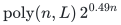

on every execution for arbitrary binary integer inputs of length <code class="math">L</code>.
For each fixed polynomial input-bit convention, the strict source
exponent margin absorbs the extra polynomial work and gives ordinary
<code class="math">O(2^{0.49n})</code> word operations in the source model. The proof does not
assume an isolated solution or a bound on the number of true solutions.

We also give a deterministic disjoint interval reduction with
<code class="math">O(n^2\log(N+1)+n+1)</code> exact queries on the same <code class="math">n</code> variables. Its
per-subset indicator identity preserves counts and arbitrary product
weights. A separate finite-field activity reduction handles binary
integer and rational weights without enlarging the variable set.
Together these give the same exponential bound for exact #Knapsack,
product-weighted partition functions, rational probabilities of linear
threshold events, and systems with a fixed number of integer linear
constraints.

### Status and dependencies

The counting algorithm uses named source lemmas pinned to
`openai/math` commit `4eaee87548250b2682affda7d05d947c05554bae`; Part I
states each dependency and checks the changes needed by the new phase
law. Those source results are mathematical inputs to the theorem. The
trace reconstruction, shifted-grid adaptation, disjoint interval
construction, and activity reduction are proved here. The interval and
activity reductions do not depend on the OpenAI source.

This manuscript does not claim a deterministic algorithm, a one-sided
counting error, a smaller simultaneous space exponent, a stretched
exponential algorithm, or a complexity-class separation. The enormous
effective fixed cutoffs in the asymptotic proof are not practical
parameter recommendations. Historical novelty and external acceptance
have not been established. The accompanying programs test finite
algebra and reductions; they do not implement the asymptotic checksum
estimator.

### Main conclusions

| Problem | Guarantee | Variable count and dependencies |
|---|---|---|
| Exact #Subset Sum with signed binary item weights | Exact integer with success probability at least <code class="math">2/3</code> in <code class="math">\mathrm{poly}(n,L)2^{0.49n}</code> bit time | <code class="math">n</code> indexed items; named OpenAI filtering, checksum, deficiency and alias results |
| Exact #Knapsack or interval counting | Same exponent and bounded-error exactness | Deterministic disjoint reduction; no added Boolean variables |
| Fixed number of integer linear constraints | Same exponent with a polynomial depending on that fixed number | Disjoint reductions and exact equation packing |
| Integer or rational product-weighted versions | Exact weighted integer or rational answer with the same exponent | Polynomial-sized prime fields, discrete-log tables, packing, and CRT; no large-amplitude moment assumption |

### Reading guide

Part I gives the complete random-phase counting proof and its uniform
finite-circle derivative bounds. Part II proves the disjoint interval
reduction and its fixed-dimensional extension. Part III proves signed,
finite-color, arbitrary integer, and rational product-weighted counting.
The numerical identities and reconstruction logic are reproducible with
`../verification/counting/run_checks.py`. The verification README records
what is checked and what is not checked.

The separate supplement `exact_counting_refinement.md` keeps the same
counting proof and supplies an exact rational parameter certificate for
the modest improvement `poly(n,L) 2^(0.48986 n)`. The exponent `0.49` is
retained below to keep the original counting extension and its source
contracts separate from that optional refinement.

---

## Part I. Exact counts through cyclotomic traces

**Research manuscript, 2 November 2026.**

This note proves an exact counting extension of the specified filtering,
checksum and alias-extraction lemmas in OpenAI's *Subset Sum in Time
O(2^(0.49n))* (4 October 2026). The source lemmas are used as mathematical
inputs; they are not re-proved here. The new argument changes the phase
distribution and recovers the count through cyclotomic traces. The result
is a bounded-error exponential-time counting theorem. Historical novelty
and external acceptance have not been established by this manuscript.

Source snapshot: `openai/math`, commit
`4eaee87548250b2682affda7d05d947c05554bae`.

### 1. A counting interface

Let F be an arbitrary family of subsets of [n], and write Z=|F|. For a
prime q and phi in (Z/qZ)^n, define

    S_q(phi) = sum_{I in F} zeta_q^(sum_{i in I} phi_i),
    zeta_q = exp(2 pi i/q).

For 1<=j<q, put S_j=S_q(j phi). If N_0 denotes the number of I in F
with sum_{i in I} phi_i=0 modulo q, then

    sum_{j=1}^{q-1} S_j = q N_0 - Z.                       (1)

Indeed, a zero exponent contributes q-1, while a nonzero exponent
contributes -1. In particular the left side is an integer, and

    Z = -sum_{j=1}^{q-1} S_j modulo q.                    (2)

The unknown N_0 is not estimated. Equation (2) eliminates it modulo q.
This works even if all members have zero phase, if F is empty, or if
the empty subset belongs to F.

**Trace recovery lemma.** Suppose estimates s_j satisfy
|s_j-S_j|<=1/(8q) for every 1<=j<q. Then rounding the real part of
sum_j s_j to its nearest integer gives the exact integer qN_0-Z.
Negating it modulo q gives Z modulo q.

The total complex error is less than 1/8, so there is no tie in the
rounding. The exact integer has absolute value at most q2^n and hence
O(n+log q) bits.

Now suppose an algorithm, for a uniform independent phase vector phi,
estimates S_q(phi) to this accuracy with failure probability delta.
Choose phi once and invoke it at j phi for all 1<=j<q, retaining
independent auxiliary randomness in each invocation. For prime q,
multiplication by j permutes Z/qZ, so each j phi has exactly the required
product-uniform marginal distribution. No independence between the
conjugate invocations is needed: their total failure probability is at
most (q-1)delta by the union bound.

Choose n distinct primes q in [n^2,32n^2]. The elementary prime-density
bound used in the cited literature supplies this many for all
sufficiently large n, and a deterministic sieve supplies the list in
polynomial time. Their product exceeds 2^n. The residues from (2) therefore
determine the unique integer Z in [0,2^n], by ordinary CRT. The combined
modulus has O(n log n) bits; schoolbook CRT arithmetic is polynomial.
There are O(n^3) conjugate invocations in total.

On a failed/capped invocation the counting algorithm may return zero.
After CRT, if the least nonnegative representative exceeds 2^n, return
zero as well. This preserves the n+1-bit output bound on unsuccessful
histories, without changing the success event or its analysis.

Small n can be handled exhaustively. Thus a random-phase oracle with
inverse-polynomial accuracy and exponentially small failure probability
can be converted to exact bounded-error counting with only polynomial
overhead, provided it works for q-th-root phases at polynomial q.

### 2. Why a change in the published phase law is necessary

The published checksum estimator uses a large modulus P, with
log_2 P = eta n + O(1), eta=0.51772, and independent phases uniform
modulo P. Taking all phases equal to zero does not preserve its moment
proof. Taking a trace over all P-1 conjugates would cost exponentially
many oracle calls, and therefore would not preserve its exponent.

The intended extension uses a polynomial prime q, q>=n^2, for the phases,
while retaining the original large modulus P for subset-sum filtering.
These are separate roles. The phases are not required to be uniform on
the full Pq-point circle: their q-point coset averages must instead be
bounded explicitly.

Fix arbitrary residues b_i modulo P and a target rho. Define

    V_rho(phi) = sum_{I: sum b_i = rho mod P}
                    zeta_q^(sum_{i in I} phi_i).

Fourier orthogonality over the P frequencies gives

    V_rho(phi) = (1/P) sum_{k=0}^{P-1} J_rho(k),
    J_rho(k) = exp(-2 pi i k rho/P)
              product_i (1+exp(2 pi i(phi_i/q + k b_i/P))).       (3)

This identity is exact. Put M=Pq and represent all angles on the M-point
circle. A frequency coordinate is the residue

    x_i(k) = P phi_i + q k b_i mod M.

The frequency range still has P elements. It must not be enlarged to M
in the algorithm or its cost ledger.

### 3. Shifted-grid averaging lemma

If H is a continuously differentiable 2pi-periodic function with
supremum derivative norm D, then for every real shift theta and integer q,

    |(1/q) sum_{a=0}^{q-1} H(theta+2pi a/q) - integral_T H|
        <= 2pi D/q.                                           (4)

Partition the circle into q intervals beginning at the sample points;
the mean-value bound within each interval proves (4). For a family of
functions with a uniform derivative bound, the estimate is uniform.

The source filtering functions start with fixed strictly positive
trigonometric-exponential densities. Normalize them on the M-point
circle, and define the source scores D_M,A_M,E_M,u_M,v_M by its finite
averages. These have continuously differentiable periodic extensions:
the denominators stay bounded away from zero and all first derivatives
are bounded by absolute constants, independently of M. This follows
directly by differentiating the finite sums and using the fixed upper,
lower and derivative bounds for the initial densities.

Consequently, for an absolute constant C and every q-point shifted
subgrid of the M-point circle,

    average_subgrid f_{*,M} <= 1+C/q,                           (5)

since the full M-point average of f_{*,M} is exactly one. The same
statement holds for the low-side density. More importantly, put

    H_{r,M}(x) = |1+exp(ix)|^2 2^(R_{r,M}(x)),
    R_1=8.5(Delta-u_M),  R_2=8.3(a v_M-u_M),

with the source constants Delta=0.02776, Gamma=0.46220,
a=Delta/Gamma. The source finite filtering theorem gives full-circle
averages below 2^0.5169 for all sufficiently large M. By (4), for all
sufficiently large q, uniformly in every shift,

    average_subgrid H_{r,M} < 2^0.5170,  r=1,2.                (6)

Using q>=n^2 ensures these statements for every sufficiently large n.
The change from 0.5169 to 0.5170 is strictly smaller than the source
variance margin. Every constant here is effective from the explicit
filtering functions and their derivative bounds.

### 4. The estimator on two different moduli

Use the source block-pattern construction with exactly its frequency
digit ranges and exponents. In the source notation, the number of
frequencies is P, eta=0.51772, tau=0.48996, epsilon=10^(-8), and a
pattern selects H_pi, alpha_pi and base B_pi. The high and low vectors
are now

    y_i(h) = P phi_i + q h B_pi b_i mod M,
    z_i(l) = -q l b_i mod M.

Hence y_i(h)-z_i(l)=x_i(k), where k=h B_pi+l. Discard k>=P exactly
as before. All non-star block labels are uniform modulo M, not q or P.
Use the finite filtering scores normalized on M.

Here are all places in the source checksum proof that use the phase
distribution, and their replacements.

1. **Coverage.** The change-of-law coverage proof is conditional on
   arbitrary phases. It applies on the M-point circle unchanged. The
   union bound ranges over P frequencies, so its scale is unchanged.

2. **One-side entry counts.** For every fixed digit vector, a uniform
   M-point table shift makes the shifted vector uniform on that circle.
   Its expected density factor is exactly one. The source one-side
   entry estimates therefore hold unchanged, conditional on the phases.

3. **Joint match count.** Conditional on a table label, the high-side
   phase is uniform on a shifted q-point subgrid. Equation (5) bounds
   its density average by 1+C/q, including the star mixture. Averaging
   the remaining low-side density over the M-point label gives exactly
   one. Independence across coordinates gives a factor at most
   (1+C/q)^n <= exp(C/n), rather than exactly one. For q>=n^2 this is
   at most two for all sufficiently large n. The exponential cap slack
   in the source absorbs this constant. All digit pairs are still
   counted before pattern restrictions, just as in the source proof.

4. **Product moment.** At each fixed k, the x_i(k) are independent
   uniform points of shifted q-point subgrids. Equation (6) therefore
   bounds the product moment by 2^(0.5170n). This is the only numerical
   change in the variance calculation.

All list construction, multiplicity computation, direct summation and
importance sampling are unchanged. In particular, no whole-table or
frequency-space enumeration is introduced. The conditional sampling
variance proof is algebraic and does not require independence between
different frequencies.

The source domination calculation now gives for each sampled pattern

    E[1_G |error_pi|^2]
      <= 2^((-tau-Delta+0.5170+48epsilon)n+O(1))
       = 2^(-0.00071952 n+O(1)).                              (7)

The subexponential pattern count and polynomially many invocations are
absorbed by this negative linear exponent. Markov's inequality gives
simultaneous error at most 1/(32q), with probability 1-o(1), for all
O(n^3) conjugate invocations and the O(n^2) target bins used below. The
required inverse-polynomial accuracy
does not increase the number of samples: the source variance was
already exponentially small.

The source good-event failures also remain small under this union bound.
For clarity, the list/match cap bound has the form
2^(-6epsilon n+O(sqrt(n))) per pattern, and the coverage loss is even
smaller. Multiplication by any fixed polynomial leaves o(1). These are
unconditional estimates, not estimates under a conditioned good-prime
law.

Each physical-circle residue has log_2 M=O(n+log q) bits. Uniform label
sampling, exact rational acceptance tests and circle-function
approximations thus retain polynomial bit cost. The source arithmetic
already evaluates phases to 2^(-2n^2) and sums on an n^2-bit dyadic grid.
The total rounding error across 2^(O(n)) contributions is
2^(-n^2+O(n)), which is smaller than 1/(32q) for every sufficiently
large n and polynomial q. No cyclotomic number field is represented
explicitly; its trace identity is used only in the proof of the final
integer rounding.

The resulting per-invocation all-history time is still

    2^((tau+20epsilon)n+O(sqrt(n))) poly(n+b+q),             (8)

with the source entry and sample caps enforced on every execution.

### 5. Subtracting aliases without isolation

For positive integer weights a_i and target t, keep the literal
transformed-input format of the source alias theorem. Choose its power
of two N_0 with 12n<=N_0<24n, put C=1+nN_0, and use the **deterministic**
tags u_i=1. Thus

    c_i=C a_i+1,    t_s=Ct+s,    0<=s<=nN_0.                (9)

The source theorem is uniform for every fixed choice of the tags in
{1,...,N_0}; it does not assume that they isolate any witness. Since
0<=|I|<=n<=nN_0<C, equality c(I)=t_s is equivalent to the simultaneous
equalities a(I)=t and |I|=s. Consequently the exact transformed bins
partition the original indexed solution family, and

    Z = sum_{s=0}^{nN_0} Z_s,
    Z_s = #{I: c(I)=t_s}.                                  (10)

No claim of uniqueness in a bin is used. The zero bins s>n may be
discarded at the final reconstruction, but retaining them keeps every
source invocation within its stated all-target contract.

In the cost formulas, b denotes an integer at least two bounding the
binary lengths of the normalized original weights and target. It is at
most polynomial in the original total input length; the transformed
integers have O(b+log n) bits. Out-of-range original targets are handled
directly before invoking the estimator.

First run the source capped preliminary search, but store the exact
number of representations with every distinct sum. When merging a
dictionary with its translate, add the multiplicities at equal keys.
On completion, compute

    Z_s = sum_v count_V(v) count_complement(t_s-v)

for each target bin, then sum the Z_s. The number of bins is O(n^2).

All counts have at most n+1 bits, so this changes only polynomial
factors and returns an exact count whenever the capped search completes.
When expected half-deficiency exceeds 0.01004n it completes with
probability 1-O(1/n), exactly as in the source.

After every preliminary outcome Continue, run the source alias procedure
once. The algorithm never evaluates the expected deficiency; the two
deficiency regimes are used only in the proof. In the low-deficiency
regime the source procedure chooses P and, with probability 1-o(1),
returns, simultaneously for every s, every indexed subset I with
c(I)=t_s modulo P but c(I)!=t_s over the integers. Its output is
deduplicated by original indices separately within each target bin.
The combined all-history output bound is 2^(tau n) times a polynomial.
It does not depend on any phase vector and can be reused for all q
and all conjugates. No alias is replaced by only its numerical sum.

For each q and phi, obtain the modular estimates for all target
residues, reusing an estimate for repeated residues. Subtract from the
estimate of V_{t_s mod P}(phi) the directly evaluated sum of
zeta_q^(phi dot 1_I) over that bin's alias list. When extraction is
complete, the residual is exactly

    S_{q,s}(phi) = sum_{I: c(I)=t_s} zeta_q^(phi dot 1_I).

The same high-precision phase arithmetic makes the additional error
less than 1/(32q). Combined with the estimator bounds, each residual
error is less than 1/(8q), as required by the trace recovery lemma.
Scanning the combined alias lists O(n^3) times adds only a polynomial
factor. Apply the trace recovery lemma **separately to each bin** and
round each bin's trace before summing the recovered residues Z_s mod q.
Summing the unrounded bin estimates would require a correspondingly
smaller error tolerance and is unnecessary. Equation (10) gives Z mod q.
There are O(n^3) conjugate invocations, each handling O(n^2) targets;
the resulting O(n^5) scalar error union bound is still polynomial.

Reuse the preliminary search and the alias extraction across the
entire CRT computation. Their error probabilities are paid once.
Condition on any fixed P and input for the checksum estimates, using
the uniform bounds proved above. Dependence between conjugate phases
is harmless. There is no conditioning of the cap bounds on successful
alias coverage. The overall error tends to zero, and an effective
fixed small-input cutoff makes it at most 1/3 on every input.

### 6. The counting theorem and its precise dependencies

The proof uses these named source results, at the pinned snapshot:

- **Filtering moments**, `prop:filtering-moments`, and **Finite filtering
  data**, `lemma:finite-filtering`, in `filtering.tex`.
- **Properties of deficiency**, `lem:deficiency`, **Random restrictions**,
  `lem:half-variance`, **Preliminary search**, `prop:preliminary`, and
  **Random-prime collisions**, `lem:prime-collision`, in `setup.tex`.
- **Alias extraction**, `thm:aliases`, in `aliases.tex`.
- The construction and proof of **Modular checksum estimator**,
  `thm:checksum`, including **Coverage and sizes**,
  `lemma:checksum-tables`, in `checksum.tex`. Sections 3--4 above give
  the modifications to its phase-distribution-dependent steps.
- The finite arithmetic and all-history cost accounting in
  `implementation.tex`, specifically `eq:finite-evaluation-error`,
  `eq:residual-accuracy`, and `eq:all-history-time`.

The probabilistic isolation assertion is not an assumption of the
counting extension. Equation (9) uses only the elementary source-format
transformation, with fixed tags, and (10) is a direct disjoint identity.

**Theorem.** Assuming the validity of the named source results, there is
a uniform randomized classical algorithm
that returns the exact number of indexed Subset Sum solutions with
probability at least 2/3. For each fixed polynomial input-bit convention,
its time is ordinary O(2^(0.49n)) word operations on every random
execution, with the source word convention. Its output has n+1 bits.
For arbitrary binary integer inputs of total length L, the same conclusion
holds in bit time poly(n,L)2^(0.49n), with a fixed polynomial independent
of the input.

Its success event is an exact count, not a multiplicative approximation.
No one-sided counting-error claim and no deterministic counting claim
is made. No improved simultaneous space exponent is asserted.

Zero and negative weights can be normalized without increasing n:
remove z zeros and multiply the answer by 2^z; replace a negative
weight -u and choice x by positive weight u and choice 1-x, shifting
the target by u. Repeated values retain their distinct original indices.

The source all-history guarded bound has exponent 0.489995 plus fixed
polynomial factors. The O(n^3) calls above preserve the strict gap to
0.49. For full binary input length L, one can also state a bit-complexity
bound poly(n,L)2^(0.49n) without a polynomial-bit restriction: if the
source guard b^(100000)<=2^n fails, exact counting meet-in-the-middle
uses 2^(n/2)poly(n,L) <= 2^(0.49n)b^1000 poly(n,L). The exponent of the
polynomial in L is fixed, though very large. Above the guard the source
bit accounting and the extension above supply the stated bound.

The complete argument is constructive: the effective fixed cutoffs use
the numerical constants in the source and the uniform derivative bounds
in Appendix A. The theorem does not assume a new unproved estimator,
independent conjugate phases, an isolation promise, or bounded solution
multiplicity. The finite tests accompanying this manuscript verify only
the algebraic reconstruction and reductions, not the source's full
exponential-time implementation.

### 7. Audit checklist

- Check the phase law in the full checksum proof, not only the stated
  estimator theorem: the new procedure supplies phases externally.
- Check uniform first-derivative bounds for all finite-circle scores.
- Check the joint match moment's extra (1+C/q)^n factor.
- Keep the P-frequency range separate from the Pq-point physical circle.
- Reuse aliases; do not count modular aliases as true solutions.
- Recover a residue from the trace, not the total count directly.
- Use every nonzero conjugate of a prime q, and enough distinct q's.
- Keep the preliminary branch's multiplicities and original IDs.
- Count finite-precision summation, uniform sampling and every cap.
- The finite check of (1) does not validate the source asymptotic
  estimator or replace the mathematical proof of its extension.

### Primary source paths

All paths below are relative to the pinned `openai/math` commit above:

- `preprints/Subset-Sum-in-Time-2-power-0-49n-October-4-2026/build/sections/filtering.tex`
- `preprints/Subset-Sum-in-Time-2-power-0-49n-October-4-2026/build/sections/checksum.tex`
- `preprints/Subset-Sum-in-Time-2-power-0-49n-October-4-2026/build/sections/aliases.tex`
- `preprints/Subset-Sum-in-Time-2-power-0-49n-October-4-2026/build/sections/setup.tex`
- `preprints/Subset-Sum-in-Time-2-power-0-49n-October-4-2026/build/sections/implementation.tex`

Canonical source URL:
https://github.com/openai/math/tree/4eaee87548250b2682affda7d05d947c05554bae/preprints/Subset-Sum-in-Time-2-power-0-49n-October-4-2026

### Appendix A. Explicit uniform derivative bounds

This closes the uniformity step in Section 3 without depending on the
physical circle size. The source trigonometric polynomials satisfy

    |r|<=2.433, |s|<=4.010, |r'|<=6.774, |s'|<=10.201.

Here the derivatives are with respect to the angular coordinate in
radians; the first derivative bounds are the sums of the absolute
Fourier coefficients multiplied by their harmonic indices. Write
R=2.433, S=4.010, R_1=6.774 and kappa=1.0315.

At any physical circle size M, extend the finite-grid kernel to arbitrary
real x by

    K_x(w) = 2^(r(x+w)+s(w)) /
             [(1/M) sum_{v in the M-grid} 2^(r(x+v)+s(v))].

Its M-grid average in w equals one. The cancellation of the initial
density normalizers gives exactly this expression. It obeys

    |log_2 K_x(w)| <= 2(R+S) = 12.886,
    partial_x log_2 K_x(w) = r'(x+w)-E_{K_x}r'(x+w),
    |partial_x log_2 K_x(w)| <= 2R_1 = 13.548.             (A1)

Consequently |partial_x K_x(w)|<=ln(2) 2R_1 K_x(w).
For the powered normalized densities,

    log_2 f_*(x)=kappa r(x)-log_2 average_M 2^(kappa r),
    log_2 g_*(x)=kappa s(x)-log_2 average_M 2^(kappa s),

so their logarithm magnitudes are at most 2kappa R<6 and
2kappa S<9, respectively. Differentiating the finite weighted sums
defining D,A,E, and using (A1), yields the conservative bounds

    |D|<13, |A|<6, |E|<9,
    |D'| < 2R_1*13 + 2R_1 < 190,
    |A'| < 2R_1*6 + kappa R_1 < 89,
    |E'| < 2R_1*9 < 122.                                (A2)

We used ln(2)<1 and retained a harmless redundant derivative term in
D'. Thus |u|<28, |v|<41, |u'|<401 and |v'|<591.
Since a=Delta/Gamma<0.061, the two moment exponents satisfy

    |R_1(x)|<239, |R_2(x)|<254,
    |R_1'(x)|<3409, |R_2'(x)|<3629.                      (A3)

The squared amplitude 2+2cos(x) is at most four and its derivative
magnitude is at most two. Applying the product and chain rules to
H_r=(2+2cos(x))2^(R_r(x)) now gives

    |H_r'(x)| < 2^300,  r=1,2,                          (A4)

uniformly in M. These intentionally generous bounds avoid numerical
optimization. They also bound the derivative of f_* by a much smaller
absolute constant.

Comparing a q-grid average with the full M-grid average using (4)
costs at most 4pi 2^300/q, since M>=q. For q>=2^320 this is at most
2^(-16). Moreover 2^0.5170-2^0.5169 > 2^(-15), by
2^x-1>=x ln(2) and ln(2)>1/2. Thus (6) follows at the explicit
q cutoff 2^320, once the source M cutoff is met. Using q>=n^2
absorbs this into an effective absolute n cutoff. There is no
input-dependent advice or circle-size-dependent smoothness constant.

---

## Part II. A disjoint interval-to-equality reduction

**Research manuscript, 2 November 2026.**

The scaling idea is due to Jesper Nederlof, Erik Jan van Leeuwen and
Ruben van der Zwaan, *Reducing a Target Interval to a Few Exact Queries*,
MFCS 2012, pp. 718--727, DOI
https://doi.org/10.1007/978-3-642-32589-2_62,
https://arxiv.org/abs/1208.4225.

Their Theorem 1 produces O(n log(u-l)) exact queries whose union covers
the target interval. Their final open question asks for a
counting-preserving version in which each subset satisfies at most one
query. The construction below obtains such a disjoint family with
O(n^2 log(N+1)) queries, allowing an O(n) factor increase in the weight
bound. It is therefore not literally their theorem with its same query
count and unchanged weight bound. Historical priority of this variant
has not been established.

### 1. The disjoint family theorem

Let a=(a_1,...,a_n), 0<=a_i<=N, be integer weights. Let l<=u be integers.
There is a deterministic polynomial-time construction of a list Q of
integer-weight exact queries (w,t), each on the same n original indices,
such that, for every x in {0,1}^n,

    sum_{(w,t) in Q} [w dot x=t] = [l<=a dot x<=u].        (1)

The list length is O(n^2 log(N+1)+n+1). Every output weight is at most
(n+1)N, and output targets have O(log(n+1)+log(N+1)) bits. Consequently
the construction preserves both arbitrary restricted set families and
exact counts. It introduces no new binary variables.

When N=0, either the empty list or the one query (0,...,0;0) suffices.
The case n=0 is equally immediate. Below assume n>=1 and N>=1.

### 2. Algorithm

First intersect [l,u] with [0,sum_i a_i]. If the intersection is empty,
return the empty list. If it is the whole attainable numerical range
[0,sum_i a_i], return the one all-zero query with target zero. If u-l<=2n,
return (a,t) for all integer t in [l,u]. These exact-target queries
are disjoint.

In every remaining case, put

    v_i=floor(a_i/2), r_i=a_i-2v_i in {0,1}, B=n+1,
    L=ceil(l/2), U=floor((u-n)/2).                         (2)

The interval [L,U] is nonempty because u-l>2n. Recursively construct
the query family for weights v and interval [L,U]. Add boundary
queries as follows. Let

    s_min=ceil((l-n)/2), s_max=floor(u/2).

For every integer s in [s_min,L-1] or [U+1,s_max], and every integer

    max(0,l-2s) <= k <= min(n,u-2s),                      (3)

include the exact query

    w_i=B v_i+r_i,  t=B s+k.                             (4)

Values s outside [0,sum_i v_i] can be omitted. Equations (2)--(4) use
only exact integer arithmetic. Negative targets or empty k intervals
can be omitted as well.

### 3. Proof of the indicator identity

Fix any x, and put s=v dot x, k=r dot x. Then 0<=k<=n and

    a dot x=2s+k.                                        (5)

If s is in the core [L,U], then 2s>=l and 2s+n<=u. Thus every subset
with such an s lies in the original interval, regardless of its k.
By induction, exactly one recursive query accepts each such subset,
and no recursive query accepts a subset outside this core.

If l<=a dot x<=u but s is outside the core, then (5) implies
s_min<=s<=s_max, so s lies in one of the two boundary ranges. Its k
satisfies exactly (3). The query (4) accepts it.

Conversely, suppose a query (4) accepts x. Reducing modulo B gives
r dot x=k modulo B. Both integers lie in [0,n], which is strictly
shorter than B, so r dot x=k exactly. Dividing the remaining equality
by B gives v dot x=s exactly. Equation (3) now implies the original
interval condition by (5).

Finally, a subset has just one pair (s,k). Thus it satisfies at most
one boundary query, and the boundary ranges exclude the recursive
core. These facts prove both directions of (1) and its multiplicity-one
claim by induction. No assumption on the family of allowed subsets
was made.

### 4. Size and bit complexity

The total number of boundary s values is at most n+2. Each admits at
most n+1 k values, so a level adds at most (n+1)(n+2) queries. Every
recursive step halves the largest weight, and there is only one
recursive child. There are at most ceil(log_2(N+1)) nontrivial levels;
the terminal exact list contains at most 2n+1 queries. This proves the
list-size bound.

At every level v_i<=N/2. Hence B v_i+r_i<=(n+1)N for N>=1, and
recursive levels only decrease this bound. A feasible boundary target
is at most B sum_i v_i+n, bounded by n(n+1)N+n; it has
O(log(n+1)+log(N+1)) bits. Listing every weight vector therefore takes
polynomial time in the input length, and no table of size N is built.

### 5. Counting and fixed-dimensional inequalities

For any family F subseteq {0,1}^n,

    #{x in F: l<=a dot x<=u}
      = sum_{(w,t) in Q} #{x in F: w dot x=t}.             (6)

Equation (6) is a sum of disjoint pieces, not inclusion-exclusion or
an approximate count. In particular an exact #Subset Sum algorithm
gives an exact #Knapsack threshold/interval counter with a polynomial
factor overhead and the same n.

For d integer linear inequalities, apply the construction successively
to each inequality. On each branch the remaining family is restricted
by the exact equations already selected. The number of terminal
branches is at most [poly(n,L)]^d, and each branch has at most d exact
linear equations. These can be packed into one signed #Subset Sum
instance on the same n variables.

Specifically, for equations a_j dot x=t_j, j=0,...,d-1, choose an
integer B greater than max_j(|t_j|+sum_i|a_{ji}|). Set

    A_i=sum_j B^j a_{ji}, T=sum_j B^j t_j.

Then A dot x=T if and only if every original equation holds: each
discrepancy d_j=a_j dot x-t_j has |d_j|<B, and reducing the packed
identity modulo B forces d_0=0, after which induction applies. The
packed bit length is polynomial in d and the input bit length.

Signed coefficients in an inequality are handled by globally
complementing the variables having a negative coefficient in that
row, adjusting every other row and every already retained equation.
This is an explicit bijection on {0,1}^n. After making the current row
nonnegative, use the construction above. Bounds outside its attainable
range are removed or rejected directly.

Thus, for each fixed d, exact counting for d integer linear
inequalities has the same exponential dependence on n as #Subset Sum,
up to a fixed polynomial in the full input length. If the counting
oracle is randomized, amplify each of the polynomially many calls
by a logarithmic number of repetitions and take the median integer
answer. A union bound ensures that every count used in (6) is correct
simultaneously, with any prescribed constant success probability.

The cyclotomic-counting theorem in the accompanying note therefore
gives bounded-error exact counting for these problems in
poly(n,L)2^(0.49n) bit operations, on every random execution, under
the explicitly named source dependencies of that theorem. The interval
reduction itself is deterministic and unconditional.

### 6. Boundary of the contribution

The halving/scaling idea and decision reductions between range and
exact-weight problems belong to the 2012 paper and related work.
The derivation here explicitly retains the carry k=r dot x so that
the pieces are disjoint. Its extra factor n in query count and weight
bound is charged. We make no claim that the original O(n log N)
disjoint-query problem at unchanged weight bound has been solved.

---

## Part III. Product-weighted counts and coefficient vectors

This note extends the random-phase counting interface in
Part I. It has the same named source dependencies and
the same bounded-error status. The extensions preserve the exponential
running-time bound; no stronger exponent is claimed.

The phase identities below are written for the original solution family
for readability. Their implementation uses the fixed-tag transformed
bins from Part I: apply the trace or coefficient recovery separately
within each bin, round there, and then sum the recovered residues.
Thus no accumulation of unrounded bin errors or generalized alias
contract is assumed.

### 1. Product sign weights

Let <code class="math">a_1,\ldots,a_n,t</code> be binary integers and let
<code class="math">\sigma_i\in\{-1,1\}</code>. Define the signed count

<!-- math-display: dc186ac90aef6eeb0d4e2951
Z_\sigma=\sum_{I\subseteq[n]:\ \sum_{i\in I}a_i=t}
                 \prod_{i\in I}\sigma_i.
-->
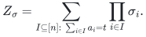

It is an integer in <code class="math">[-2^n,2^n]</code>.

**Theorem 1.** Under the source results named in
Part I, the exact integer <code class="math">Z_\sigma</code> can be returned
with probability at least <code class="math">2/3</code> in
<code class="math">\mathrm{poly}(n,L)2^{0.49n}</code> bit operations. Under each fixed
polynomial input-bit convention, the source word model gives ordinary
<code class="math">O(2^{0.49n})</code> time on every execution.

**Proof.** Insert the fixed factor <code class="math">\sigma_i</code> into the Fourier product:

<!-- math-display: 4b385eab3507b86225c081dc
J(k)=e_P(-kt)\prod_{i=1}^n
          (1+\sigma_i\zeta_q^{\phi_i}e_P(ka_i)).
                                                       \tag{1}
-->
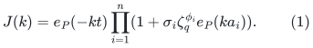

A negative sign is a fixed angular shift by <code class="math">\pi</code>. Represent all
angles on the circle of size <code class="math">2Pq</code>. Conditional on a frequency, each
coordinate is still uniform on a shifted <code class="math">q</code>-point grid. Every estimate
in the shifted-grid proof is uniform over the shift, so coverage,
table moments and the product moment retain their bounds.

For <code class="math">j=1,\ldots,q-1</code>, define

<!-- math-display: 4c9bbb871bea48f8f651a0a0
S_j=\sum_{I:\,a(I)=t}\sigma(I)\zeta_q^{j\phi(I)}.
-->
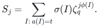

Only the random root-of-unity factor is conjugated; the rational signs
remain fixed for every <code class="math">j</code>. The exact trace identity is

<!-- math-display: 5f724fa82658f12950204a6c
\sum_{j=1}^{q-1}S_j=qN_{0,\sigma}-Z_\sigma,\qquad
N_{0,\sigma}=\sum_{I:\,a(I)=t,\,\phi(I)=0}\sigma(I)\in\mathbb Z.
                                                       \tag{2}
-->
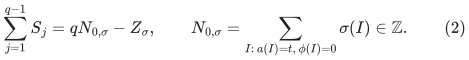

Approximating each <code class="math">S_j</code> to absolute error at most <code class="math">1/(8q)</code> and rounding
the real part of the trace recovers the integer in (2), hence
<code class="math">Z_\sigma\bmod q</code>.

In the preliminary distinct-sum procedure, each dictionary stores the
signed multiplicity at a key. A key whose signed coefficient is zero is
retained: the key set then remains exactly the support used in the
source deficiency and cap arguments. Dictionary merging adds the signed
multiplicities, and the final meet-in-the-middle join multiplies them.
Every coefficient has at most <code class="math">n+1</code> magnitude bits. Alias extraction uses
the same fixed-tag transformed weights while retaining original subset
indices; each returned alias is subtracted with its product sign.

Choose polynomially many primes whose product exceeds <code class="math">2^{n+1}</code>.
Balanced CRT then determines the unique integer in <code class="math">[-2^n,2^n]</code>.
The prime list used in the unweighted proof already has this product
bound for all sufficiently large <code class="math">n</code>. On unsuccessful histories, clamp
an out-of-range CRT representative to zero. The proof of the counting
theorem now applies with the same polynomial overhead. <code class="math">\square</code>

Zero and negative input weights require slight bookkeeping. A zero
weight contributes a factor <code class="math">1+\sigma_i</code>, so a negative sign on any
zero-weight item makes the total signed count zero. For a negative
weight, complementing its inclusion bit changes its weight to positive
and contributes the known global prefactor <code class="math">\sigma_i</code>. The underlying
variable bijection and all original indices are retained.

### 2. Fixed-order root weights and coefficient vectors

Let <code class="math">m\geq1</code> and assign each item a color <code class="math">r_i\in\mathbb Z/m\mathbb Z</code>.
Write

<!-- math-display: 4c7cc5c6d2cb9bf6f3dba2be
C_b=\#\{I\subseteq[n]:a(I)=t,\ \sum_{i\in I}r_i=b\pmod m\},
\qquad 0\leq b<m.
-->
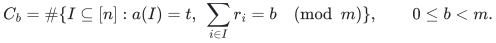

The vector <code class="math">(C_0,\ldots,C_{m-1})</code> is the coefficient vector of the
group-algebra element

<!-- math-display: fa29e7e88831fa430ea48dd5
\sum_{I:a(I)=t}Y^{\sum_{i\in I}r_i}
     \quad\text{in }\mathbb Z[Y]/(Y^m-1).
-->
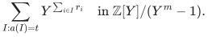

**Theorem 2.** For fixed <code class="math">m</code>, or more generally for <code class="math">m</code> bounded by a
fixed polynomial in the input length and <code class="math">n</code>, the entire vector can be
recovered exactly with probability at least <code class="math">2/3</code> in
<code class="math">\mathrm{poly}(n,L,m)2^{0.49n}</code> bit operations. The same word-time
exponent holds under the fixed polynomial input-bit convention.

**Proof.** First suppose <code class="math">m</code> is bounded by a fixed polynomial in <code class="math">n</code>.
For each <code class="math">\ell=0,\ldots,m-1</code>, use deterministic unit weights
<code class="math">\zeta_m^{\ell r_i}</code>. For each prime <code class="math">q</code>, choose one uniform phase
vector <code class="math">\phi\in(\mathbb Z/q\mathbb Z)^n</code>, and evaluate

<!-- math-display: 6ac99b301039e7d320ecc639
S_{\ell,j}=\sum_{I:a(I)=t}
      \zeta_m^{\ell r(I)}\zeta_q^{j\phi(I)},
      \qquad 1\leq j<q.
-->
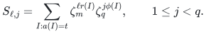

All corresponding angle grids fit on the physical circle of size
<code class="math">mPq</code>. The shifted-grid estimates remain uniform. The frequency range
has <code class="math">P</code> elements, as before.

Define <code class="math">N_{0,b}</code> as the number of solutions with color <code class="math">b</code> and phase
zero. Summing the nonzero <code class="math">q</code>-conjugates gives

<!-- math-display: cd67d598b870d3cbf218b849
T_\ell:=\sum_{j=1}^{q-1}S_{\ell,j}
      =\sum_{b=0}^{m-1}(qN_{0,b}-C_b)\zeta_m^{\ell b}.
-->
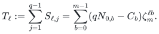

The inverse finite Fourier transform therefore yields the ordinary
integer

<!-- math-display: 9a731e6cedbdb2cbb6f02575
T_b:=\frac1m\sum_{\ell=0}^{m-1}\zeta_m^{-\ell b}T_\ell
      =qN_{0,b}-C_b.                                  \tag{3}
-->
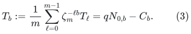

If every individual checksum has error at most <code class="math">1/(16q)</code>, each trace
has error below <code class="math">1/16</code>, and the normalized inverse transform does not
increase this absolute error. Evaluate the roots and arithmetic with
an additional error budget below <code class="math">1/16</code>; round the real part of (3).
This recovers <code class="math">C_b\bmod q</code> for every <code class="math">b</code>. CRT recovers each count in
<code class="math">[0,2^n]</code>.

There are <code class="math">m</code> times as many checksum calls. The source's exponentially
small moment error absorbs this fixed polynomial factor and the
associated union bound. Root evaluations need only polynomially many
bits, and all recovered trace integers have <code class="math">O(n+\log q)</code> bits.
Thus the extra cost is polynomial.

If <code class="math">m</code> is only polynomial in the full input length and may be
superpolynomial in <code class="math">n</code>, use exact-query packing instead of the direct
union bound over <code class="math">m</code> phase families. Take representatives
<code class="math">0\leq r_i&lt;m</code>, put <code class="math">R=\sum_i r_i</code>, and set <code class="math">B=R+1</code>. For each
<code class="math">s=0,\ldots,R</code>, query weights <code class="math">Ba_i+r_i</code> and target <code class="math">Bt+s</code>.
The same range argument used in Theorem 3 below makes this equality
equivalent to <code class="math">a(I)=t</code> and <code class="math">r(I)=s</code>. Sum the returned counts for
<code class="math">s\equiv b\pmod m</code> to recover <code class="math">C_b</code>. There are at most <code class="math">n(m-1)+1</code>
queries. Amplifying the bounded-error exact-counting oracle to failure
probability at most <code class="math">1/(6(nm+1))</code> per query gives the stated success probability
by a union bound and the claimed polynomial overhead. This argument
establishes the full-input-length statement without comparing a
possibly superpolynomial <code class="math">m</code> to an error tail in <code class="math">n</code>. <code class="math">\square</code>

The proof does not require that <code class="math">q</code> and <code class="math">m</code> be coprime: the <code class="math">q</code>-phase
is varied independently while the deterministic color root is kept
fixed. It also does not infer an integer from one complex embedding of
a higher-degree algebraic integer. The complete finite Fourier transform
provides all ordinary integer coefficients directly.

This coefficient-vector corollary can also be obtained by packing a
color-sum equation into a standard exact Subset Sum instance and
summing polynomially many possible color totals. Its value here is to
make the unit-weighted checksum interface explicit. Directly inserting
unbounded integer activities into the Fourier product would change its
moment bounds. The next section handles those activities by a separate
finite-field reduction, so no such amplitude assumption is needed.

### 3. Arbitrary binary integer activities without more variables

The following deterministic oracle reduction is independent of the
checksum implementation. It explains why the unweighted exact-counting
algorithm also computes product-weighted partition functions with
arbitrary binary integer activities.

**Theorem 3 (finite-field activity lifting).** Given integers
<code class="math">a_1,\ldots,a_n,t,w_1,\ldots,w_n</code>, the integer

<!-- math-display: 934c6fb785c9a2f6714b5262
Z_w=\sum_{I:\,a(I)=t}\prod_{i\in I}w_i
-->
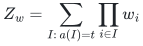

can be computed by polynomially many calls to ordinary exact
\#Subset Sum, each on at most <code class="math">n</code> items and with polynomial input bit
length, together with polynomial-time deterministic processing. Hence
the counting theorem gives an algorithm for <code class="math">Z_w</code> with success
probability at least <code class="math">2/3</code> and bit time
<code class="math">\mathrm{poly}(n,L)2^{0.49n}</code>. The underlying strict exponent
margin also preserves ordinary <code class="math">O(2^{0.49n})</code> word time under each fixed
polynomial input-bit convention.

**Proof.** The magnitude is bounded by the explicitly computable integer

<!-- math-display: 6c346682372eea3f4251b0a4
U=\prod_{i=1}^n(1+|w_i|),\qquad |Z_w|\leq U.
-->
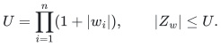

Its bit length is polynomial in the input length <code class="math">L</code>. Choose
polynomially many polynomial-sized distinct primes <code class="math">p</code> whose product
exceeds <code class="math">2U</code>. For example, for a sufficiently large polynomial parameter
<code class="math">H\geq L+n+3</code>, a deterministic sieve supplies <code class="math">H</code> primes in
<code class="math">[H^2,32H^2]</code>, and their product is more than sufficient. Fixed small
cases can use an enlarged constant range.

Work modulo one chosen prime <code class="math">p</code>. If <code class="math">w_i=0\bmod p</code>, every term
containing item <code class="math">i</code> vanishes, so remove that item. Each remaining
activity is nonzero. Find a primitive root <code class="math">g</code> of <code class="math">\mathbb F_p^*</code> and
build the complete table of its powers. Trial division of <code class="math">p-1</code> and
enumeration of its <code class="math">p-1</code> nonzero residues are polynomial-time operations
in the original input length because <code class="math">p</code> is polynomially bounded. Let
<code class="math">r_i\in\{0,\ldots,p-2\}</code> satisfy

<!-- math-display: 4c5daaa61736563f6cbc4474
g^{r_i}=w_i\pmod p.
-->
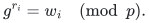

This discrete logarithm is a table lookup in a polynomial-sized group,
not a discrete-logarithm assumption. Put
<code class="math">R=\sum_i r_i</code> and <code class="math">B=R+1</code>. For each <code class="math">s=0,\ldots,R</code>, ask one
ordinary exact-counting query with weights and target

<!-- math-display: 2ed6e4cff7b88159952cadae
a'_i=Ba_i+r_i,\qquad t'_s=Bt+s.
-->
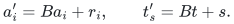

For any subset <code class="math">I</code>, the equality <code class="math">a'(I)=t'_s</code> implies
<code class="math">B(a(I)-t)=s-r(I)</code>. Since <code class="math">0\leq s,r(I)\leq R&lt;B</code>, it is equivalent
to the pair of equalities <code class="math">a(I)=t</code> and <code class="math">r(I)=s</code>. If the returned count
is <code class="math">C_s</code>, then

<!-- math-display: 2021a5d0f118d0f3e84a268d
Z_w=\sum_{s=0}^R g^s C_s\pmod p.                     \tag{4}
-->
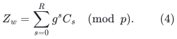

There are at most <code class="math">n(p-2)+1</code> queries. Packing increases each item bit
length by only <code class="math">O(\log n+\log p)</code>. It introduces no extra Boolean
variable. Repeating over the chosen primes and applying balanced CRT
recovers the unique integer <code class="math">Z_w\in[-U,U]</code>.

For a bounded-error counting oracle, amplify each query by independent
repetition and the median of its integer outputs, reducing its failure
probability below the reciprocal of a suitable polynomial in the total
number of queries. With probability at least <code class="math">2/3</code> all answers are
correct. This uses a logarithmic repetition factor. No uniformity of
the activities modulo primes is required.

For the ordinary word-time claim, some primes can leave only <code class="math">m&lt;n</code>
items, so the oracle's polynomial-bit convention is not applied blindly
with <code class="math">m</code> in place of <code class="math">n</code>. Under a fixed polynomial bound on the original
input bits, every query has bit length polynomial in the original <code class="math">n</code>.
If its guard holds, the stronger source bound is
<code class="math">2^{0.489995m}\mathrm{poly}(n)</code> and is at most
<code class="math">2^{0.489995n}\mathrm{poly}(n)</code>. If its guard fails, then
<code class="math">m=O(\log n)</code> and exact counting meet-in-the-middle costs only a
polynomial in <code class="math">n</code>. Thus polynomially many queries and their
amplification preserve ordinary <code class="math">O(2^{0.49n})</code> time. <code class="math">\square</code>

### 4. Two-sided and rational weights

The same reduction handles

<!-- math-display: 6a66951575e6096381ec714c
Z_{u,v}=\sum_{I:\,a(I)=t}
                 \prod_{i\notin I}u_i\prod_{i\in I}v_i
-->
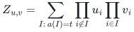

for arbitrary binary integers <code class="math">u_i,v_i</code>. Modulo a prime <code class="math">p</code>, if both
local weights vanish, the entire answer is zero. If only <code class="math">u_i</code> vanishes,
force <code class="math">i</code> into the subset, replace <code class="math">t</code> by <code class="math">t-a_i</code>, and multiply the
accumulated prefactor by <code class="math">v_i</code>. If only <code class="math">v_i</code> vanishes, force <code class="math">i</code> out
and multiply by <code class="math">u_i</code>. Otherwise multiply the prefactor by <code class="math">u_i</code> and
apply Theorem 3 to activity <code class="math">v_i/u_i</code> in <code class="math">\mathbb F_p</code>. The output
magnitude is bounded by <code class="math">\prod_i(&#124;u_i&#124;+&#124;v_i&#124;)</code>, so the same CRT argument
applies. The forced choices may depend on <code class="math">p</code>; this is valid because
only the residue modulo that prime is being computed.

For rational local weights, clear one common denominator per item,
perform the integer computation, and divide by their product. Both
the numerator and denominator have polynomial bit length. In
particular, for independent Bernoulli inclusion probabilities
<code class="math">p_i=r_i/s_i</code>, use <code class="math">u_i=s_i-r_i</code>, <code class="math">v_i=r_i</code>, and denominator
<code class="math">\prod_i s_i</code>. This computes the exact rational probability of a
specified subset sum.

Finally the disjoint interval reduction in
Part II is valid separately for each subset.
Multiplying that identity by an arbitrary product weight preserves it.
It therefore gives exact product-weighted \#Knapsack, and exact
probabilities of linear threshold events, at the same exponent. For a
fixed number of integer linear constraints, the corresponding disjoint
reductions and equation packing give the same conclusion with polynomial
overhead depending on the fixed number of constraints.

When a signed linear row is normalized by complementing an inclusion
bit, swap its two local weights <code class="math">u_i,v_i</code> at the same time. This retains
the product-weight identity even when either local weight is zero and
avoids introducing a reciprocal activity.

These are consequences of the unweighted counting theorem and the
explicit reduction above. The manuscript makes no historical-priority
claim for finite-field activity lifting itself.
