# Deterministic Subset Sum through signed circuits and trace bounds

**Yilin Liu · GPT-6 Astra Pro**

## Abstract

We give an exact deterministic algorithm for Subset Sum on arbitrary signed binary integers, with indexed witness recovery. The refined running time is <code class="math">C+\mathrm{poly}(n,L)2^{En}</code>, where <code class="math">E=158153814247997/318964058919134&lt;0.495836</code> and <code class="math">C</code> is finite and independent of the input. Part I develops the signed-circuit compiler and reduction. Part II proves the trace and type refinement, and its continuous-domain checker certifies all 62 contact branches with exact rational arithmetic. A separate scalar checker reconstructs the reflected profile and the complete outer cost ledger. The refined theorem uses this new certificate directly; the older numerical menu is retained only as background with its explicit premise. No simultaneous space exponent is asserted for this algorithm.

## Theorem and proof structure

**Theorem F (refined deterministic algorithm).** On <code class="math">n</code> indexed signed integers of full binary encoding length <code class="math">L</code>, the circuit and reduction constructions proved in Part I, with the parameter changes proved in Part II, decide feasibility and return an indexed witness in

<!-- math-display: 8e6756ac25f24efe1ec07fea
C+\mathrm{poly}(n,L)2^{En},\qquad
E=\frac{158153814247997}{318964058919134}.
-->
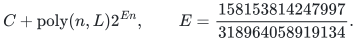

Here <code class="math">C</code> is the finite input-independent cost of constructing fixed circuit data, with no practical numerical bound claimed. All polynomial degrees are fixed and the complexity counts deterministic bit operations. The composition proof is Part II, Sections 2–7. The continuous-domain contact certificate in Part II, Section 4, and the scalar certificate in Section 9 discharge their separate numerical requirements. The circuit compiler and witness reduction are established by the mathematical arguments in the manuscript; the numerical programs are not a machine-checked formalization of those arguments.

**Theorem 1 (background conditional composition).** Assume the continuous-domain contact inequalities in Part I, Section I.4.2. The older baseline construction decides every signed binary Subset Sum instance and returns an indexed witness in

<!-- math-display: f372af3e5220e8f7a6e06800
C+\mathrm{poly}(n,L)2^{E_0n},
\qquad E_0=\frac{149809813343531}{301754962128739}<0.4964618056.
-->
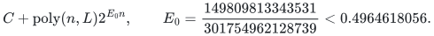

Here <code class="math">C</code> is the finite input-independent cost of constructing fixed circuit data. The input-dependent term includes residue-cover construction. The imported baseline profile wrapper did not include the modules and receipt needed to replay its full-domain calculation; its reported leaf counts alone do not establish those contacts. This background theorem retains its explicit premise. Theorem F instead uses the reconstructed new menu and does not depend on the older numerical receipt. Both compositions use fixed polynomial degrees and the uniform deterministic bit model.

**Notation.** A witness is a binary vector `x` with `sum_i w_i x_i=t`. The input includes zero, negative and repeated weights. `L` includes every input bit. Logarithms are base two unless `ln` is written. Set `h(z)=-z log_2 z-(1-z) log_2(1-z)` with continuous endpoint values and `H(c,z)=c h(z/c)`.

The finite startup search builds fixed circuit data once; it is part of the running time, with no practical bound claimed here. Original indices remain attached to all representations and are recovered by the signed-circuit witness procedure.

## 2. Arithmetic primitives

Both algorithms use polynomial-time arithmetic on binary integers, the following prime bound, and exact array operations.

### 2.1. Prime density and enumeration

For real <code class="math">x\geq1</code>, define

<!-- math-display: 5a9411c07f42fe03a2128647
\vartheta(x)=\sum_{p\leq x}\ln p,\qquad
\psi(x)=\sum_{p^j\leq x}\ln p,
-->
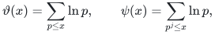

where <code class="math">p</code> ranges over primes and <code class="math">j</code> over positive integers. A prime power in <code class="math">(\lceil n/2\rceil,n]</code> contributes a factor of its underlying prime to <code class="math">\binom n{\lfloor n/2\rfloor}</code>. This follows by subtracting the three factorial valuations; its contribution at this power is one and all other contributions are nonnegative. Consequently

<!-- math-display: f8424bdf2fe1a5ae48ea1148
\psi(n)-\psi(\lceil n/2\rceil)
\leq\ln\binom n{\lfloor n/2\rfloor}\leq n\ln2.
-->
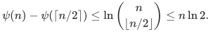

Induction gives <code class="math">\psi(n)\leq4n</code>: for <code class="math">n\geq2</code>, the induction bound is at most <code class="math">2n+2+n\ln2\leq4n</code>, and the base case is immediate. Thus <code class="math">\psi(x)\leq4x</code> for real <code class="math">x\geq1</code>.

Conversely, every prime valuation of <code class="math">\binom{2m}m</code> is at most the number of powers of that prime not exceeding <code class="math">2m</code>. Since the central coefficient is the largest of the <code class="math">2m+1</code> coefficients whose sum is <code class="math">2^{2m}</code>,

<!-- math-display: df903995d25c3caf5ea9b748
\psi(2m)\geq\ln\binom{2m}m
\geq2m\ln2-\ln(2m+1).
-->
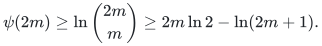

Put <code class="math">m=\lfloor x/2\rfloor</code>. Integrating the tangent-line bound <code class="math">1/u\geq4/3-4u/9</code> on <code class="math">[1,2]</code> gives <code class="math">\ln2\geq2/3</code>. Thus <code class="math">\psi(x)\geq x/2</code> for <code class="math">x\geq64</code>: it suffices that <code class="math">\ln(x+1)+4/3\leq x/6</code>, which holds at <code class="math">64</code> by <code class="math">65&lt;128</code> and <code class="math">\ln2&lt;1</code>, and whose right side grows faster thereafter. The prime-power contribution beyond the first power is at most

<!-- math-display: 5c1224d791063705f34c59eb
\psi(x)-\vartheta(x)
=\sum_{j=2}^{\lfloor\log_2x\rfloor}\vartheta(x^{1/j})
\leq4\sqrt{x}\log_2x.
-->
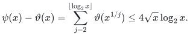

For <code class="math">x\geq2^{20}</code> the last bound is at most <code class="math">x/4</code> (the ratio <code class="math">\log_2x/\sqrt x</code> decreases in this range). We have proved

<!-- math-display: 411470ab36a7cf03f974392e
x/4\leq\vartheta(x)\leq4x\qquad(x\geq2^{20}).
-->
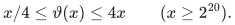

It follows that, for <code class="math">P\geq2^{20}</code>,

<!-- math-display: cdf10cc57f01c8abc776397d
\#\{p:P<p\leq32P\}
\geq\frac{\vartheta(32P)-\vartheta(P)}{\ln(32P)}
\geq\frac{4P}{\ln(32P)}.
-->
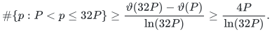

If a nonzero integer has absolute value less than <code class="math">2^b</code>, at most <code class="math">b\ln2/\ln P</code> primes greater than <code class="math">P</code> divide it. The fraction of primes in this interval dividing that integer is therefore at most <code class="math">2b/P</code>. This bound holds for all <code class="math">P\geq2^{20}</code>. The interval ratio <code class="math">32</code> contributes a fixed factor.

All these primes can be generated deterministically in <code class="math">P\mathrm{poly}(\log P)</code> bit operations. Start with the integers through <code class="math">\lfloor32P\rfloor</code>, and, for each unmarked integer starting at two, mark its proper multiples. A number remaining unmarked is prime: a composite has a smaller prime divisor, already processed. The number of marking iterations is at most <code class="math">32P\sum_{d\leq32P}1/d=O(P\log P)</code> even if all integers, rather than just primes, are charged. Index arithmetic has <code class="math">O(\log P)</code> bits.

### 2.2. Exact array and polynomial operations

For two length-<code class="math">q</code> arrays of integers of at most <code class="math">b</code> bits, compute cyclic convolution directly by

<!-- math-display: 1790a6ba9fd3fc5cea4a6a15
c_r=\sum_{j=0}^{q-1}a_j b_{r-j\bmod q}.
-->
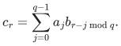

This uses <code class="math">q^2</code> multiplications and additions on integers of <code class="math">O(b+\log(q+1))</code> bits. The same bound applies to cyclic correlation. Both reductions charge this quadratic cost for their moduli.

In fixed dimension <code class="math">d</code>, a polynomial of coordinatewise degree at most <code class="math">M</code> has at most <code class="math">(M+1)^d</code> coefficients. Store them in an array. Addition, monomial shifts, and multiplication by a fixed polynomial take polynomial time in the degree and coefficient bit length. Integer arithmetic computes binomial coefficients and factorials through order <code class="math">M</code>. These operations support conditional-expectation arguments.

# Part I. A faster deterministic algorithm

This part proves the baseline compiler and reduction theorem used by Theorem F.

The reduction splits the coordinates into a prefix and two balanced outside
parts. A deterministic cover supplies binary–ternary representations of
each prefix; exact matching circuits join compatible records at equal
integer keys.

## I.1. Affine-majorant rebalancing

We develop the colored-circuit framework of Alman and Li [3] and Ye and Li [4], beginning with affine-majorant rebalancing.

### I.1.1. A finite rebalancing lemma

Let <code class="math">\mathcal I</code> and each <code class="math">\mathcal J_i</code> be nonempty finite sets, with positive real pairs

<!-- math-display: 40db53aac1f7dbc20265c0ac
(a_{ij},b_{ij}),\qquad i\in\mathcal I,\quad j\in\mathcal J_i.
-->
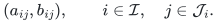

Fix real numbers <code class="math">p,q</code>. Suppose that, for every parameter in the closed unit interval,

<!-- math-display: 6176aa6c64b62c1ec8347a91
\min_{i\in\mathcal I}\sum_{j\in\mathcal J_i}
       a_{ij}^{\tau}b_{ij}^{1-\tau}
\leq \exp\bigl(\tau p+(1-\tau)q\bigr),
\qquad 0\leq\tau\leq1.
\tag{1}
-->
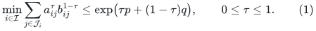

For <code class="math">\lambda&gt;0</code>, define

<!-- math-display: 585f8102c0127439042367b6
F_0(\lambda)=1+\lambda,
-->
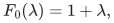

<!-- math-display: 4fbad78c48a3a87f704ce04c
F_d(\lambda)=
\min_{i\in\mathcal I}\sum_{j\in\mathcal J_i}
a_{ij}F_{d-1}\!\left(\lambda\frac{b_{ij}}{a_{ij}}\right)
\qquad(d\geq1).
\tag{2}
-->
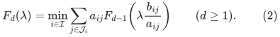

The finite minima are attained. Put

<!-- math-display: e0781dace04a42ca953799ef
A_{ij}=a_{ij}e^{-p},\qquad B_{ij}=b_{ij}e^{-q},\qquad
\delta_{ij}=\ln\frac{B_{ij}}{A_{ij}},\qquad
D=\max_{i,j}|\delta_{ij}|.
\tag{3}
-->
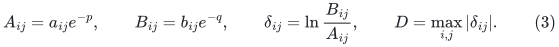

The constant <code class="math">D</code> is finite.

**Lemma I.1.1.** Under (1), every integer depth <code class="math">d\geq1</code> satisfies

<!-- math-display: 34ab7c6662b626c7da07685d
F_d\!\left(e^{(p-q)d}\right)
\leq
\exp\left(pd+K\ln2+\frac{D^2d}{8K}\right),
\qquad K=\lceil\sqrt d\rceil.
\tag{4}
-->
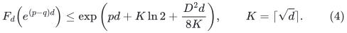

In particular,

<!-- math-display: 782a35b34db2121044eb70a6
K\ln2+\frac{D^2d}{8K}
\leq
\left(\ln2+\frac{D^2}{8}\right)\sqrt d+\ln2
=o(d).
\tag{5}
-->
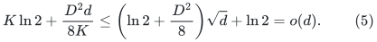

**Proof.** On nonnegative real functions define

<!-- math-display: 883e978797131abfaa30034a
(Tf)(t)=
\min_{i\in\mathcal I}\sum_{j\in\mathcal J_i}
A_{ij}f(t+\delta_{ij}),\qquad t\in\mathbb R.
\tag{6}
-->
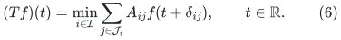

The operator is monotone and positively homogeneous:

<!-- math-display: 34edd6db1d3eaa716dea02a0
f\leq g\ \Longrightarrow\ Tf\leq Tg,
\qquad T(cf)=cTf\quad(c\geq0).
\tag{7}
-->
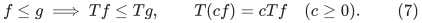

The normalized functions

<!-- math-display: eb940a1b57362e15fbba7da4
G_d(t)=e^{-pd}F_d\!\left(e^{(p-q)d+t}\right)
\tag{8}
-->
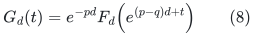

satisfy

<!-- math-display: 0c64714fe07fabe320d64fed
G_0(t)=1+e^t,\qquad G_d=TG_{d-1}.
\tag{9}
-->
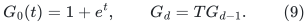

Indeed, substituting (2) into (8) gives (6), because

<!-- math-display: abb3878e11fb0b32db5723d4
\delta_{ij}=\ln(b_{ij}/a_{ij})+p-q.
-->
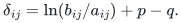

For an integer <code class="math">K\geq1</code>, put

<!-- math-display: 9b5173ef81bac748293b65ed
f_K(t)=\left(1+e^{t/K}\right)^K,
\qquad \phi_K(t)=\ln f_K(t).
\tag{10}
-->
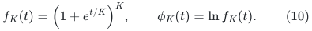

The binomial theorem gives

<!-- math-display: 72619bcd52b73cb4c5dc649b
f_K(t)\geq1+e^t.
\tag{11}
-->
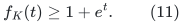

Direct differentiation yields

<!-- math-display: aa658fae4a2d83703b7f178d
\theta(t):=\phi_K'(t)
=\frac{e^{t/K}}{1+e^{t/K}}\in(0,1),
-->
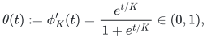

<!-- math-display: 4f9ec15f0a1e0e90f4a97477
0\leq\phi_K''(t)
=\frac{e^{t/K}}{K(1+e^{t/K})^2}
\leq\frac1{4K}.
\tag{12}
-->
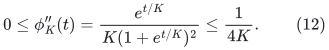

Taylor's theorem gives, for every real <code class="math">\delta</code>,

<!-- math-display: d4dbc239347e90d0f2edf444
\phi_K(t+\delta)-\phi_K(t)
\leq\theta(t)\delta+\frac{\delta^2}{8K}.
\tag{13}
-->
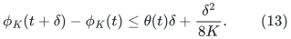

Normalizing (1) gives

<!-- math-display: c5592604d71d6e631827d9ea
\min_i\sum_j A_{ij}^{\tau}B_{ij}^{1-\tau}\leq1.
\tag{14}
-->
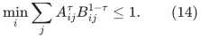

At each <code class="math">t</code>, choose a minimizing list for <code class="math">\tau=1-\theta(t)</code>. Equations (3), (13), and (14) give

<!-- math-display: 53714ad7d8aecc97dab96cf0
\begin{aligned}
(Tf_K)(t)
&\leq f_K(t)e^{D^2/(8K)}
       \min_i\sum_j A_{ij}e^{\theta(t)\delta_{ij}}\\
&= f_K(t)e^{D^2/(8K)}
       \min_i\sum_j A_{ij}^{1-\theta(t)}B_{ij}^{\theta(t)}\\
&\leq e^{D^2/(8K)}f_K(t).
\end{aligned}
\tag{15}
-->
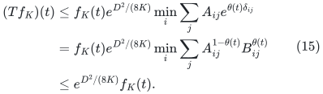

The first inequality holds for each list before minimization, allowing the chosen list to depend on <code class="math">t</code> as in (2).

Keeping <code class="math">K</code> fixed, (7), (9), (11), and (15) imply by induction

<!-- math-display: eb5051b35018b3da280e944d
G_d(t)\leq (T^df_K)(t)
\leq e^{D^2d/(8K)}f_K(t).
\tag{16}
-->
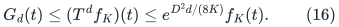

Since <code class="math">f_K(0)=2^K</code>, substituting <code class="math">t=0</code> into (8) and (16) proves (4). The inequalities <code class="math">\sqrt d\leq K&lt;\sqrt d+1</code> and <code class="math">d/K\leq\sqrt d</code> give (5). <code class="math">\square</code>

### I.1.2. Tensor circuits

An exact integer depth-two circuit for a finite integer matrix <code class="math">M</code> is a factorization into integer matrices. Its left and right degrees are the maximum nonzero counts in a row of the left factor and a column of the right factor, respectively. Exactness means integer matrix equality, with signed coefficients.

Suppose that every index in a nonempty finite menu supplies a colored circuit for this same matrix. Write its color decomposition as

<!-- math-display: 29af9e2343ce7eb488949578
M=\sum_{j\in\mathcal J_i}M_{ij},
\qquad M_{ij}=U_{ij}V_{ij}.
\tag{17}
-->
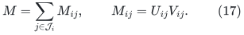

Remove gates having a zero factor on either side and discard empty colors. Let the color degrees be the positive integers

<!-- math-display: 3e8c99d412d565b08d5003a9
a_{ij}=\deg_L(U_{ij},V_{ij}),\qquad
b_{ij}=\deg_R(U_{ij},V_{ij}).
\tag{18}
-->
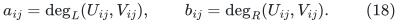

**Proposition I.1.2.** For every <code class="math">d\geq0</code> and <code class="math">\lambda&gt;0</code>, there is an exact integer circuit for <code class="math">M^{\otimes d}</code> satisfying

<!-- math-display: eab4fd119a78dbd2b7567d6b
\deg_L+\lambda\deg_R\leq F_d(\lambda),
\qquad M^{\otimes0}=(1).
\tag{19}
-->
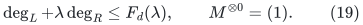

**Proof.** The one-gate circuit for <code class="math">(1)</code> proves (19) at <code class="math">d=0</code>.

For a positive depth, choose a menu index attaining (2). For each of its colors, apply the induction hypothesis at the smaller depth and the scaled weight

<!-- math-display: 8c90d3ac7c15c2427a5a2a9c
\lambda_j=\lambda\frac{b_{ij}}{a_{ij}}.
-->
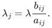

Let the resulting child degrees be <code class="math">L_j,R_j</code>. Tensor that child circuit with the color circuit for <code class="math">M_{ij}</code>, and concatenate the resulting circuits over all colors, using disjoint gate tags. The computed matrix is exactly

<!-- math-display: 08887b168375d95941bb0c37
\sum_j M_{ij}\otimes M^{\otimes(d-1)}
=M^{\otimes d}.
\tag{20}
-->
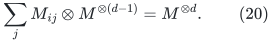

Tensor products bound endpoint degrees by products, and concatenation by sums; coefficients remain integral. Hence

<!-- math-display: b1bbc227fca62d3e57516447
\begin{aligned}
\deg_L+\lambda\deg_R
&\leq\sum_j\bigl(a_{ij}L_j+\lambda b_{ij}R_j\bigr)\\
&=\sum_j a_{ij}\bigl(L_j+\lambda_jR_j\bigr)\\
&\leq\sum_j a_{ij}F_{d-1}(\lambda_j)
=F_d(\lambda).
\end{aligned}
\tag{21}
-->
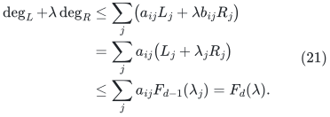

This proves (19). <code class="math">\square</code>

Apply the numerical lemma with weight <code class="math">\lambda=e^{(p-q)d}</code>. Since the two degrees are nonnegative, (19) bounds them separately:

<!-- math-display: a4d60ce283244e02b333d1fb
\deg_L\leq\exp\bigl(pd+O(\sqrt d)\bigr),\qquad
\deg_R\leq\exp\bigl(qd+O(\sqrt d)\bigr).
\tag{22}
-->
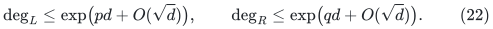

The implicit constants depend only on the fixed menu and affine majorant.

## I.2. Biased partial-matching circuits and uniform enumeration

### I.2.1. Typed matrices and colored profiles

Fix

<!-- math-display: 9a7ee49250c4494fae29c052
s=\frac{11}{100},\qquad t=\frac9{20},\qquad
a=\frac{13}{250},\qquad b=\frac{29}{500},\qquad a+b=s.
-->
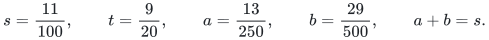

A length is admissible if it is a nonnegative multiple of 500. For an
admissible length <code class="math">N</code>, let <code class="math">T_N</code> have binary rows of weight <code class="math">tN</code>
and ternary columns with <code class="math">aN</code> specified ones, <code class="math">bN</code> specified zeros,
and <code class="math">(1-s)N</code> stars. Its entry is one precisely when the row agrees
with every specified column position. Set <code class="math">T_0=(1)</code>. Every row and
column has a matching partner, since <code class="math">a&lt;t</code> and <code class="math">b&lt;1-t</code>.

For <code class="math">0\le x\le c</code>, write

<!-- math-display: 7c3767e146309f504edf9671
H(c,x)=c\log_2c-x\log_2x-(c-x)\log_2(c-x),
-->
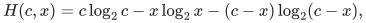

with <code class="math">0\log_20=0</code>. In particular <code class="math">H(c,x)=c h(x/c)</code> when <code class="math">c&gt;0</code>.
For a colored exact integer factorization, delete gates with a zero
factor and let <code class="math">A_j,B_j</code> be its positive left and right color degrees.
Its colored volume is

<!-- math-display: aea4a3e38ee91e1d4f568218
\Upsilon(\tau)=\sum_j A_j^\tau B_j^{1-\tau},\qquad 0\le\tau\le1.
-->
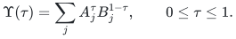

Section I.1 applies to these exact integer color degrees.

Use the finite lookup menu

<!-- math-display: 76d1971374ec21a3052ad5a8
\rho\in\{13/10,17/10,2,11/5,12/5,13/5,14/5,31/10,33/10\}.
-->
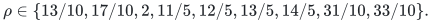

For each such <code class="math">\rho</code>, put

<!-- math-display: 26605b8580b287f268ba1f6a
a\le m\le s,\qquad \beta=a+\rho(m-a),\qquad m\le z\le\beta.
\tag{23}
-->
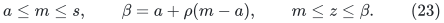

Throughout this menu, <code class="math">\beta\le .2434&lt;t&lt;1-t</code>. The two envelopes are

<!-- math-display: e82cc4313cece6a4538839ef
L_\rho(m,z)=\max\{0,H(t,z)+H(1-t,\beta-z)-H(1-m,\beta-m)\},
-->
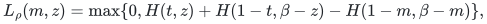

<!-- math-display: a36f8fc8bad9b48719992a71
R_{\rm old}(m,z)=H(b,m-a)+H(\beta-m,z-m).
\tag{24}
-->
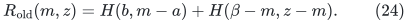

We form the continuous envelope <code class="math">R_{\rm new}</code> from the two bounds and a
simpler certified envelope <code class="math">\widehat R_\rho</code>.

### I.2.2. Exact lookup circuits with simultaneous concentration

The elementary binomial bounds

<!-- math-display: 48dcacf90726684f8f6ce7cc
\frac{2^{n h(j/n)}}{n+1}\le\binom nj\le2^{n h(j/n)}
\tag{25}
-->
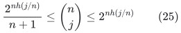

follow from the largest term in the binomial distribution of parameter
<code class="math">j/n</code>, with the endpoint values interpreted directly.

Fix an integer monomial size <code class="math">m_0\in[aN,sN]</code>, and set

<!-- math-display: 9d52bc3b1925b823f03510e3
B_0=\lfloor aN+\rho(m_0-aN)\rfloor,\qquad
T_{m_0}=\left\lceil N^2\binom N{m_0}/\binom{B_0}{m_0}\right\rceil.
-->
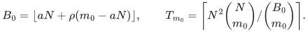

Choose <code class="math">T_{m_0}</code> independent uniform <code class="math">B_0</code>-subsets, retaining an
occurrence label when the same subset is chosen more than once. A fixed
<code class="math">m_0</code>-set is missed with probability at most <code class="math">e^{-N^2}</code>.

Require two further bounds on the same lists. For every binary row <code class="math">x</code>
and integer <code class="math">z_0</code>, the number of occurrences intersecting
<code class="math">\mathrm{supp}(x)</code> in exactly <code class="math">z_0</code> positions is at most
<code class="math">6\nu+3N</code>, where

<!-- math-display: db5fc7334cc7931fc7b15d2f
\nu=T_{m_0}\frac{\binom{|x|}{z_0}\binom{N-|x|}{B_0-z_0}}
 {\binom N{B_0}}.
\tag{26}
-->
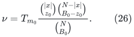

For every typed query <code class="math">y</code>, with specified sets <code class="math">Y_1,Y_0</code>, and every
integer <code class="math">j_0</code>, the number of occurrences satisfying
<code class="math">Y_1\subseteq B</code> and <code class="math">&#124;B\cap Y_0&#124;=j_0</code> is at most
<code class="math">6\nu'+4N</code>, where

<!-- math-display: b09358d19758dd1b512cfade
\nu'=T_{m_0}
 \frac{\binom{bN}{j_0}\binom{(1-s)N}{B_0-aN-j_0}}
 {\binom N{B_0}}.
\tag{27}
-->
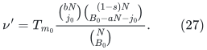

An out-of-domain binomial coefficient is zero. If <code class="math">X</code> is a sum of
independent indicators with mean <code class="math">v</code>, then
<code class="math">\mathbb E e^X\le e^{(e-1)v}</code>, and consequently
<code class="math">\Pr(X&gt;6v+dN)\le e^{-dN}\le2^{-dN}</code>.
There are at most <code class="math">2^N\mathrm{poly}(N)</code> row events,
<code class="math">3^N\mathrm{poly}(N)</code> query events, and
<code class="math">2^N\mathrm{poly}(N)</code> coverage events. A union bound proves
that all three requirements hold simultaneously at every sufficiently
large admissible <code class="math">N</code>. The deterministic compiler below finds such fixed
finite circuits by exact search.

Assign every <code class="math">m_0</code>-set <code class="math">U</code> to the first occurrence <code class="math">B(U)</code> containing
it. Gates have labels <code class="math">g=(m_0,B,\sigma)</code>, where <code class="math">B</code> includes its
occurrence label and <code class="math">\sigma\in\{0,1\}^{B}</code>. Define

<!-- math-display: 17d3e158bf0a6eb44f83f2ab
P[x,g]=[x|_B=\sigma],
-->
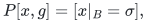

<!-- math-display: d53681d32596817553d80d7b
Q[g,y]=(-1)^{m_0-aN}
 \#\{U:Y_1\subseteq U\subseteq Y_1\cup Y_0,\ |U|=m_0,
                \ B(U)=B,\ \sigma|_U=1\}.
\tag{28}
-->
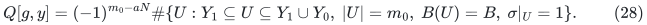

Then <code class="math">PQ=T_N</code> exactly: expanding
<code class="math">\prod_{i\in Y_1}x_i\prod_{i\in Y_0}(1-x_i)</code> by inclusion-exclusion
gives precisely (28), with each monomial assigned once. Monomials
merged at a fixed gate have the same sign. Their combined coefficient
has magnitude at most <code class="math">2^{bN}</code>.

Color a gate by <code class="math">(m_0,z_0)=(m_0,&#124;\sigma&#124;)</code>. Gates with <code class="math">z_0&lt;m_0</code>
have no query neighbor and are removed. There are <code class="math">O(N^2)</code> colors.
Each row has at most the count (26) gates of a given color. Counting
each contributing monomial separately gives the right-degree bound

<!-- math-display: f419f00aa4b25944631d6e3a
\binom{bN}{m_0-aN}\binom{B_0-m_0}{z_0-m_0}.
\tag{29}
-->
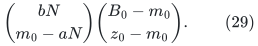

Let <code class="math">m=m_0/N,z=z_0/N,\beta'=B_0/N</code>. The identity

<!-- math-display: 265d41f2065578f6b25f6b2a
\binom N{B_0}\binom{B_0}{m_0}
 =\binom N{m_0}\binom{N-m_0}{B_0-m_0}
-->

and (25) show that the left and right degrees are polynomial times
<code class="math">2^{NL}</code> and <code class="math">2^{NR_{\rm old}}</code>, respectively, with <code class="math">\beta'</code>
substituted for <code class="math">\beta</code> in (24). The ceiling in <code class="math">T_{m_0}</code> adds at
most one to each expected occurrence count and is absorbed in that
polynomial.

### I.2.3. Counting distinct query gates

Fix a query and a lookup occurrence counted in (27), and put
<code class="math">j=j_0/N</code>. If its assignment has weight <code class="math">zN</code> and its gate is
nonzero at this query, it is one on <code class="math">Y_1</code> and has at least
<code class="math">(m-a)N</code> ones in <code class="math">B\cap Y_0</code>. If the latter count is <code class="math">uN</code>,
the number of assignments is

<!-- math-display: d243d2ebeffa0228ec71bde4
\binom{jN}{uN}\binom{(\beta-a-j)N}{(z-a-u)N}.
-->

Here and in the following calculation <code class="math">\beta</code> may also denote the
actual rounded lookup density <code class="math">\beta'</code>. Define

<!-- math-display: 6437fe26c376e2ef904c2d9d
C(j)=H(b,j)+H(1-s,\beta-a-j)-H(1-m,\beta-m),
-->

<!-- math-display: 067bac3dd39c1eba70d77949
S(j,u)=H(j,u)+H(\beta-a-j,z-a-u).
\tag{30}
-->

Property (27) and (25) bound the number of occurrences by polynomial
times <code class="math">2^{N\max(C(j),0)}</code>. Therefore

<!-- math-display: 2b259bee0c952aefa0bd137c
R_{\rm agg}(m,z)=\max_{j,u}\{\max(C(j),0)+S(j,u)\},\qquad
R_{\rm new}=\min(R_{\rm old},R_{\rm agg})
\tag{31}
-->

is a right-degree exponent. The maximum ranges over the binomial domain
and <code class="math">u\ge m-a</code>. Each gate assignment is counted once, with harmless overcounting of
assignments lacking an assigned monomial. The integer <code class="math">(j,u)</code> pairs add
a polynomial factor to the degree bound of the same signed factorization.

For continuity and explicit evaluation, put

<!-- math-display: 90f0e54d486ce329ea7eefba
v=m-a,\quad w=z-a,\quad B=\beta-a,\quad c=1-s.
-->

We have <code class="math">0\le v\le b</code>, <code class="math">v\le w\le B&lt;c</code>. Let

<!-- math-display: c533f9d365129a81043112b8
u_1=\max\{v,bw/(1-a)\},
-->

<!-- math-display: 8b7a1578e4ca649529ba0090
F_1=H(b,u_1)+H(c,w-u_1)+H(1-z,\beta-z)
                         -H(1-m,\beta-m),
-->

<!-- math-display: da741c0d3e4c120ad438e99c
F_2=\begin{cases}
 H(B,w),&B\le b\ \text{or}\ v\le bw/B,\\
 H(b,v)+H(B-b,w-v),&B>b\ \text{and}\ v>bw/B.
\end{cases}
\tag{32}
-->

At <code class="math">B=0</code>, take <code class="math">F_2=0</code>. Then

<!-- math-display: 52ff168b8560ff1811782d9d
R_{\rm agg}=\max(F_1,F_2).
\tag{33}
-->

Indeed, <code class="math">\max(\max(C,0)+S)=\max(\max(C+S),\max S)</code>.
The entropy chain identity and maximization over <code class="math">j</code> give

<!-- math-display: c071777c0a13b5b2184547fd
\max_j(C+S)=H(b,u)+H(c,w-u)+H(1-z,\beta-z)
                            -H(1-m,\beta-m).
-->

For example, after selecting the <code class="math">u</code> ones from the first region and
<code class="math">w-u</code> ones from the second, the remaining <code class="math">B-w</code> lookup positions
are split optimally between regions of sizes <code class="math">b-u</code> and <code class="math">c-w+u</code>;
their entropy is <code class="math">H(b+c-w,B-w)=H(1-z,\beta-z)</code>.
The unconstrained optimum in <code class="math">u</code> is <code class="math">bw/(1-a)</code>, so imposing
<code class="math">u\ge v</code> gives <code class="math">F_1</code>. Its other feasibility constraints hold since
<code class="math">B&lt;c</code> and <code class="math">v\le\min(b,w)</code>.
For <code class="math">S</code> alone, the unconstrained split in a region of size <code class="math">j</code>
has <code class="math">u=jw/B</code>. It attains <code class="math">H(B,w)</code> in the first case of (32).
In the second case the optimum has <code class="math">u=v</code>; the function
<code class="math">H(j,v)+H(B-j,w-v)</code> increases up to <code class="math">j=vB/w&gt;b</code>, and hence is
maximal at <code class="math">j=b</code>. The same condition implies <code class="math">w-v\le B-b</code>,
so the entropy arguments are valid. All formulas agree at branch
boundaries and extend continuously to their compact domain, including
<code class="math">B=0</code>.

### I.2.4. A rational improvement used in the profile certificate

If <code class="math">m&gt;a</code> and

<!-- math-display: 123b2646c7dc0769ae8d8299
\rho(m-a)^2\ge b(z-a),
\tag{34}
-->

then <code class="math">vB\ge bw</code> for the unrounded density <code class="math">B=\rho v</code>. Since
<code class="math">w\ge v&gt;0</code>, this implies <code class="math">B\ge b</code>. Both maxima in (33)
occur at <code class="math">u=v</code>. The entropy chain identity now gives

<!-- math-display: e9d454cade06c6a4b7014443
F_1=R_{\rm old}-[H(1-m,z-m)-H(1-s,z-m)],
-->

<!-- math-display: 32bb383752223cfe2126890a
F_2=R_{\rm old}-[H(\beta-m,z-m)-H(\beta-s,z-m)].
-->

For <code class="math">0\le d&lt;x\le1</code>,

<!-- math-display: e862cf7a0af4a26415dbb48f
\frac{\partial H(x,d)}{\partial x}
 =-\log_2(1-d/x)\ge \frac{d}{x\ln2}\ge\frac75d.
-->

The last inequality follows, for example, from <code class="math">\ln2&lt;5/7</code>.
Integration and continuity at the endpoints prove

<!-- math-display: 2ab08634ce992497263f9d5a
R_{\rm new}(m,z)\le
 R_{\rm old}(m,z)-\frac75(s-m)(z-m).
\tag{35}
-->

At <code class="math">m=a</code>, condition (34) forces <code class="math">z=a</code>, so the zero saving recovers
the old bound. On the feasible region, define the saving as follows:

<!-- math-display: abf42537b5f53695a6145e90
\Delta_\rho(m,z)=
\begin{cases}
\frac75(s-m)(z-m),&m>a\text{ and (34) holds},\\
0,&\text{otherwise},
\end{cases}
\qquad
\widehat R_\rho=R_{\rm old}-\Delta_\rho.
\tag{36}
-->

Thus <code class="math">R_{\rm new}\le\widehat R_\rho</code>. On a rectangular box
<code class="math">[m_0,m_1]\times[z_0,z_1]</code> with <code class="math">m_0&gt;a</code> and
<code class="math">\rho(m_0-a)^2\ge b(z_1-a)</code>, the certified saving is at least

<!-- math-display: 5fc979310661c4f9fc70dfe2
\frac75(s-m_1)\max\{0,z_0-m_1\}.
\tag{37}
-->

This rational quantity is the only occurrence improvement needed in
the finite certificate of Section I.4.

### I.2.5. Recursive positive containment and two orientation swaps

Use the direct occurrence circuit on the last profile interval and
recursive circuits on the others. We first establish their exact integer
matrix identities.

For an outer occurrence <code class="math">B</code>, its local matrix is
<code class="math">I[\sigma,U]=[U\subseteq\sigma]</code>, where <code class="math">&#124;\sigma&#124;=zN</code> and <code class="math">&#124;U&#124;=mN</code>.
Complementing both labels and transposing gives positive containment on
<code class="math">\beta N</code> coordinates, with row size <code class="math">(\beta-m)N</code> and query size
<code class="math">(\beta-z)N</code>. Choose a fixed first inner lookup density <code class="math">\gamma</code> and put
<code class="math">C=\gamma\beta</code>. All widths in the profile table below satisfy
<code class="math">\beta-z\le C\le\beta</code> throughout the outer color domain. Indeed it is
sufficient to check <code class="math">z=m</code>, and <code class="math">(\beta-m)/\beta</code> increases with <code class="math">m</code>.

Cover every positive query by labelled <code class="math">CN</code>-subsets and assign it uniquely
to the first covering occurrence. For a row-intersection color <code class="math">wN</code>,

<!-- math-display: e2633ec68683aa73fa027405
\max\{\beta-z,C-m\}\le w\le\min\{\beta-m,C\}.
\tag{38}
-->

The same sampling and binomial identities as in Section I.2.2 give the
uniform positive-containment degree exponents

<!-- math-display: 47b3d4cb398aeaff9e1365f1
F=\max\{0,H(\beta-m,w)+H(m,C-w)-H(z,C-\beta+z)\},
\quad G=H(C-\beta+z,w-\beta+z).
\tag{39}
-->

Sample a polynomial times
<code class="math">\binom{\beta N}{(\beta-z)N}/\binom{CN}{(\beta-z)N}</code> labelled inner
lookups. The expected number with row intersection <code class="math">wN</code> is that sample
count times
<code class="math">\binom{(\beta-m)N}{wN}\binom{mN}{(C-w)N}/\binom{\beta N}{CN}</code>.
Its entropy exponent is the expression inside <code class="math">F</code>. A simultaneous
Chernoff bound adds a nonnegative floor and a polynomial factor. A
positive query assigned to one lookup has exactly
<code class="math">\binom{(C-\beta+z)N}{(w-\beta+z)N}</code> matching assignment gates, giving
<code class="math">G</code>. Unique query assignment makes the factorization exact.

If <code class="math">P^{\rm in}Q^{\rm in}</code> denotes that positive factorization, then

<!-- math-display: e2fbc2a4dbfe63cb2b102dd0
I[\sigma,U]=\sum_h Q^{\rm in}[h,B\setminus\sigma]
                         P^{\rm in}[B\setminus U,h].
\tag{40}
-->

For an original signed query <code class="math">(Y_1,Y_0)</code> the coefficient at the new
labelled gate <code class="math">(m,B,z,h)</code> is

<!-- math-display: 3655bfed7ea71f47452c48b4
\sum_{\substack{U=Y_1\cup V,\ V\subseteq Y_0,\ |U|=mN\\B(U)=B}}
(-1)^{|V|}P^{\rm in}[B\setminus U,h].
\tag{41}
-->

Substitution in the inclusion–exclusion identity (28) proves exact
matrix equality. The two endpoint exponents are therefore

<!-- math-display: 094b6dd37fd432c71def07f5
L^{(1)}=L_\rho+G,\qquad R^{(1)}=H(b,m-a)+F.
\tag{42}
-->

The transpose places <code class="math">G</code> on the outer row side; (42) uses the
uncorrected outer occurrence bound.

Positive containment admits the same operation again. In general, on a
universe of size <code class="math">n</code>, rows of size <code class="math">Tn</code> and positive queries of size <code class="math">An</code>
are covered by lookups of size <code class="math">\gamma n</code>. At row intersection <code class="math">wn</code> the
occurrence exponent is

<!-- math-display: 8493612510c19a6ccb33099a
L_0=\max\{0,H(T,w)+H(1-T,\gamma-w)-H(1-A,\gamma-A)\}.
-->

The residual matrix, after complement and transpose, has types
<code class="math">T'=(\gamma-A)/\gamma</code>, <code class="math">A'=(\gamma-w)/\gamma</code>.
If its degrees per residual coordinate are <code class="math">(L',R')</code>, substitution gives
<code class="math">(L_0+\gamma R',\gamma L')</code>. This proves the orientation rule used next.

In units of the original <code class="math">N</code>, put

<!-- math-display: 13333c6b3e9f041ef9d933a1
C_1=\gamma_1\beta,\quad Q_1=\beta-z,\quad D_1=C_1-Q_1,
\qquad
\max\{Q_1,C_1-m\}\le w_1\le\min\{\beta-m,C_1\},
-->

<!-- math-display: a90fda97b1adeca72da84db9
F_{1,\mathrm{raw}}=H(\beta-m,w_1)+H(m,C_1-w_1)-H(z,D_1),
\qquad F_1=\max\{0,F_{1,\mathrm{raw}}\}.
\tag{43}
-->

For the second inner level choose the fixed rule

<!-- math-display: 0166b48630fdd038bfdd7316
Q_2=C_1-w_1,\quad C_2=\max\{C_1/2,Q_2\},\quad D_2=C_2-Q_2.
\tag{44}
-->

When <code class="math">w_1&lt;C_1/2</code>, the choice <code class="math">C_2=Q_2</code> is exactly the first-level
push implementation. Otherwise use the half lookup <code class="math">C_2=C_1/2</code>.
This fixed routing has last color and degree contributions

<!-- math-display: 370dd9eb24871efaed44684c
\max\{Q_2,C_2-Q_1\}\le w_2\le\min\{D_1,C_2\},
-->

<!-- math-display: 6b15defc94276d741b9b41f3
F_2=\max\{0,H(D_1,w_2)+H(Q_1,C_2-w_2)-H(w_1,D_2)\},
\qquad G_2=H(D_2,w_2-Q_2).
\tag{45}
-->

Two orientation swaps give

<!-- math-display: 8f73da86f5b9e3c6cb9a0e45
L^{(2)}=L_\rho+F_2,\qquad
R^{(2)}=H(b,m-a)+F_1+G_2.
\tag{46}
-->

At <code class="math">w_1=C_1/2</code>, one has <code class="math">D_2=G_2=0</code> and
<code class="math">F_2=H(D_1,Q_2)</code>, so the unmerged formulas agree at the routing boundary.
All displayed entropies include their continuous boundary values.

### I.2.6. Exact trace aggregation and pooled occurrence counts

Fix an outer color <code class="math">(m,z)</code> and labelled occurrences <code class="math">B</code> and <code class="math">C\subseteq B</code>
with <code class="math">&#124;B&#124;=\beta N</code>, <code class="math">&#124;C&#124;=cN</code>, <code class="math">c=\gamma_1\beta</code>. The first inner row
is <code class="math">B\setminus U</code>, whose intersection with <code class="math">C</code> is <code class="math">W=C\setminus U</code>.
After the next complement and transpose, the residual query is
<code class="math">K=C\setminus W=U\cap C</code>. Hence every descendant incidence and its
coefficient depends on <code class="math">U</code> only through <code class="math">K</code> for these fixed labels.
The coefficient may be summed first:

<!-- math-display: dc393e33104bad883f2bb767
(-1)^{(m-a)N}\#\{U:Y_1\subseteq U\subseteq Y_1\cup Y_0,
 |U|=mN,\ B(U)=B,\ U\cap C=K\}.
\tag{47}
-->

The aggregated coefficient preserves (41), has <code class="math">O(N)</code> bits, and retains
both occurrence labels in its gate.

Write <code class="math">j=&#124;B\cap Y_0&#124;/N</code>, <code class="math">e=&#124;C\cap Y_1&#124;/N</code>,
<code class="math">f=&#124;C\cap Y_0&#124;/N</code>, and <code class="math">q=&#124;K&#124;/N=c-w_1</code> in this subsection only.
For a fixed pair of occurrences there are at most
<code class="math">\binom{fN}{(q-e)N}</code> possible traces. Their full feasibility domain is

<!-- math-display: 72a182eaf99a00e90c85fb29
\begin{gathered}
0\le j\le b,\quad0\le\beta-a-j\le1-s,\quad
0\le e\le a,\quad0\le f\le j,\\
0\le c-e-f\le\beta-a-j,\quad0\le q-e\le f,\quad
0\le m-a-q+e\le j-f.
\end{gathered}
\tag{48}
-->

The last constraint ensures an outside completion; each feasible trace
is counted once regardless of its number of completions.

Choose independent outer samples in polynomial multiplicity times
<code class="math">\binom N{mN}/\binom{\beta N}{mN}</code>, and independently for each labelled
outer occurrence choose inner samples in polynomial multiplicity times
<code class="math">\binom{\beta N}{(\beta-z)N}/\binom{cN}{(\beta-z)N}</code>. Put

<!-- math-display: 3311c1426273f522182fe832
C_0(j)=H(b,j)+H(1-s,\beta-a-j)-H(1-m,\beta-m),
-->

<!-- math-display: a56a3d668e1f5016da0c240a
C_1(j,e,f)=H(a,e)+H(j,f)+H(\beta-a-j,c-e-f)-H(z,c-\beta+z).
\tag{49}
-->

Here <code class="math">C_1(j,e,f)</code> denotes an exponent, distinct from the lookup width
<code class="math">C_1</code> in (43). The outer histogram has at most a polynomial times
<code class="math">2^{N\max(0,C_0(j))}</code> occurrences. Fix any outer family satisfying
these bounds, before conditioning on an inner event. Across all eligible
labelled outer occurrences, the inner histogram indicators are independent
Bernoulli variables with common probability

<!-- math-display: 96d17f4abee7a470ccd7c5a1
\frac{\binom{aN}{eN}\binom{jN}{fN}
\binom{(\beta-a-j)N}{(c-e-f)N}}{\binom{\beta N}{cN}}.
-->

A single Chernoff bound on their pooled sum gives at most a polynomial
times

<!-- math-display: d9765881752f4c8bd720f687
2^{N\max\{0,C_1(j,e,f),C_0(j)+C_1(j,e,f)\}}
\tag{50}
-->

pairs. Polynomial oversampling makes every cover, row-degree, and
pooled-histogram failure probability <code class="math">\exp(-\Omega(N^2))</code>. A union bound
over <code class="math">\exp(O(N))</code> queries and labelled families and polynomially many
colors proves their simultaneous existence. Independence is used in the
unconditioned pooled-histogram estimate.

Consequently the aggregated circuit has unchanged left degree and right
exponent at most both the old bound in (46) and

<!-- math-display: e7ff85598c5c801b3f9fe0c8
G_2+\max_{j,e,f\text{ in }(48)}
\bigl[\max\{0,C_1(j,e,f),C_0(j)+C_1(j,e,f)\}+H(f,q-e)\bigr].
\tag{51}
-->

Both bounds apply to the same integer circuit.

### I.2.7. A closed trace correction

Put <code class="math">d=m-a</code>, <code class="math">r=s-m</code>, <code class="math">w=w_1</code>, <code class="math">q=c-w</code> and
<code class="math">D=\beta-m-w</code>. Suppose

<!-- math-display: 57aec207610ccd4282127762
\beta\ge s,\quad D\ge0,\quad0\le q\le d,\quad w\ge r,
-->

<!-- math-display: a98c71e504f542e5e0472d7d
(b-q)w\ge r(\beta-a-q),\qquad
rmD\le d(m-q)(1-s-D).
\tag{52}
-->

Then, with <code class="math">\Delta=H(1-m,D)-H(1-s,D)\ge0</code>, the right degree obeys

<!-- math-display: a026ac671c3ad6ca492e8e30
R^{\rm trace}\le H(b,m-a)+\max\{0,F_{1,\mathrm{raw}}-\Delta\}+G_2.
\tag{53}
-->

We prove each branch of (51). Let <code class="math">k=q-e</code>. Completion gives
<code class="math">f\le j-d+k\le r+k</code>, so
<code class="math">H(f,k)\le H(q+r,q)\le H(b,d)</code>, proving the zero branch.

For the <code class="math">C_1</code> branch, increasing <code class="math">j</code> to <code class="math">b</code> only enlarges the finite
set of pairs <code class="math">(C,K)</code>: relabel neutral positions as prescribed zeros
without removing old traces. Put <code class="math">g=f-k</code>, so <code class="math">0\le g\le r</code>. The
expression to maximize becomes

<!-- math-display: ca1b349a4b5f728c70a2430a
H(a,q-k)+H(b,k)+H(b-k,g)+H(\beta-s,w-g)-H(z,c-\beta+z).
-->

The unconstrained maximizer in <code class="math">g</code> is
<code class="math">(b-k)w/(\beta-a-k)</code>. It is nonincreasing in <code class="math">k</code> because
<code class="math">\beta\ge s</code>; the first inequality on the second line of (52)
puts it at least <code class="math">r</code> for <code class="math">k\le q</code>. The constrained maximum is thus
at <code class="math">g=r</code>. Vandermonde summation over <code class="math">k</code> bounds this branch by

<!-- math-display: 855345d80b547ec13591bc38
B_1=H(b,d)+H(m,q)+H(\beta-s,D)-H(z,c-\beta+z).
\tag{54}
-->

For the <code class="math">C_0+C_1</code> branch, set <code class="math">u=j-f-(d-k)</code>. Then
<code class="math">0\le u\le\min(r,D)</code>. Relax <code class="math">k\le d</code> to <code class="math">k\le d+u</code>;
two Vandermonde summations over <code class="math">k</code> and <code class="math">g</code> give

<!-- math-display: 65cc0bde85f0083a0cc5cbf8
\begin{aligned}
J(u)={}&H(b,d+u)+H(m+u,q)+H(1-s,D-u)\\
&+H(1-m-D,w)-H(1-m,w+D)-H(z,c-\beta+z).
\end{aligned}
\tag{55}
-->

The three terms depending on <code class="math">u</code> are concave, and their derivative
at zero is <code class="math">\log_2[rmD/(d(m-q)(1-s-D))]</code>. The last inequality
of (52) makes it nonpositive. If <code class="math">r=0</code> or <code class="math">D=0</code>, the feasible
interval is already <code class="math">\{0\}</code>; otherwise that inequality forces
<code class="math">d&gt;0</code> and <code class="math">1-s-D&gt;0</code>, while <code class="math">m-q\ge a&gt;0</code>. This justifies the
derivative or covers its boundary exceptions. Thus the maximum is
at zero. The entropy chain identity gives

<!-- math-display: 6e104e09bee896c1e6e879fc
B_2=J(0)=H(b,d)+F_{1,\mathrm{raw}}-\Delta.
-->

Finally,

<!-- math-display: 4515558d7e3dfee5ddc90d8b
B_2-B_1=
[H(\beta-m,D)-H(\beta-s,D)]
-[H(1-m,D)-H(1-s,D)]\ge0.
-->

Both brackets integrate <code class="math">\partial_xH(x,D)=\log_2[x/(x-D)]</code>
over intervals of length <code class="math">s-m</code>, and the first interval lies to the
left, where this derivative is larger. The three branch bounds prove
(53).

For the rational certificate we use only

<!-- math-display: b66224215e46d6973adc3029
\Delta\ge\frac75\frac{(s-m)D}{1-m}.
\tag{56}
-->

Indeed <code class="math">\log_2[x/(x-D)]\ge D/(x\ln2)\ge(7/5)D/(1-m)</code>
throughout the integral. On a rectangle <code class="math">m\in[m_0,m_1]</code>,
<code class="math">v=w_1-C_1/2\in[v_0,v_1]</code>, whose feasible colors satisfy (52),
the safe constant subtraction is

<!-- math-display: ee79082086e0cc5e20b8b53d
\delta=\frac75\frac{(s-m_1)D_{\min}}{1-m_0}.
\tag{57}
-->

The certificate verifies the region conditions throughout each rectangle.
Elsewhere set <code class="math">\delta=0</code> and use (46).

### I.2.8. Finite matrices, rounding and the compiler interface

All recursive families have fixed depth and polynomially many colors.
At a fixed finite base, exhaustive search finds outer and inner families
satisfying the simultaneous finite cover and histogram requirements.
Form the coefficients (47), merge equal traces, and store the resulting
nonzero finite adjacency lists. Exact multiplication verifies the matrix
identity. Each coefficient sums at most <code class="math">2^{O(N)}</code> bounded integer
contributions, and consequently has <code class="math">O(N)</code> bits.

Apply the rebalancing and three-count compiler of Sections I.2.10–I.2.16
to these aggregated finite matrices. At the input length, enumerate tensor
products of their stored adjacency lists. Inner colors preserve the
original row/query counts and each compatible pair's unique joint
count description.

For each fixed family the supremum of
<code class="math">\tau L+(1-\tau)R</code> over its colors is convex in <code class="math">\tau</code>.
Take <code class="math">R</code> to be the minimum of the two valid bounds for that aggregated
circuit, with its fixed routing. Convexity gives the contact chords in
Section I.4.

Rounding lookup sizes changes normalized parameters by <code class="math">O(1/N)</code>.
Use the full trace expression (51) and the old bound for this step.
Their entropy terms are continuous on compact feasible polyhedra, and
limits of rounded feasible colors remain feasible. The
maximum over colors therefore has upper error <code class="math">o(1)</code>, uniformly in
<code class="math">\tau</code>. The same conclusion holds at the fixed push/half boundary:
the unmerged degree formulas agree there and (51) is a valid bound
on either finite construction. Alternatively one can use the old bound
in a shrinking neighborhood of that boundary before passing to a
sufficiently large base. The color and histogram polynomial factors
also contribute <code class="math">o(1)</code> per coordinate.

Section I.2.16 absorbs these fixed polynomial losses into the total
compiler allowance <code class="math">\zeta=10^{-6}</code> by choosing a sufficiently large
fixed base. Preprocessing is independent of the Subset Sum instance;
variable-length coefficients and gate labels have <code class="math">O(M)</code> bits, with
polynomial work per emitted incidence.

### I.2.9. Direct profiles, endpoint circuits, and rounding

Define the direct upper lookup profile

<!-- math-display: 660f73bdf5ed8c0aabac8300
V_\rho(\tau)=\sup_{(m,z)\text{ in (23)}}
 \{\tau L_\rho(m,z)+(1-\tau)\widehat R_\rho(m,z)\}.
\tag{58}
-->

It is convex in <code class="math">\tau</code>, being a supremum of affine functions.
For every fixed <code class="math">\varepsilon&gt;0</code>, the exact colored circuit above,
at every sufficiently large admissible <code class="math">N</code>, satisfies uniformly
for <code class="math">0\le\tau\le1</code>

<!-- math-display: 8359d23ec6b55d27cc0d8452
\Upsilon_{N,\rho}(\tau)\le2^{N(V_\rho(\tau)+\varepsilon)}.
\tag{59}
-->

For rounding, use the continuous actual profile <code class="math">(L,R_{\rm new})</code>.
The change in <code class="math">\beta</code> is below <code class="math">1/N</code>, so uniform continuity on the
compact domains in (24), (32), and (33) gives a uniform <code class="math">o(1)</code> exponent
error. Its unrounded value is bounded by (58); polynomial factors and
<code class="math">O(N^2)</code> colors add <code class="math">O(\log N)/N</code>.

Two additional exact circuits use one gate for each query or one gate
for each row. Their profiles are, respectively,

<!-- math-display: 4cee66c48fb2ed970c42499b
\tau d_{\rm push},\qquad (1-\tau)d_{\rm pull},\qquad
d_{\rm push}=H(t,a)+H(1-t,b),\quad
d_{\rm pull}=H(1-s,t-a).
\tag{60}
-->

For the first circuit a row meets
<code class="math">\binom{tN}{aN}\binom{(1-t)N}{bN}</code> query gates and each query
meets one; for the second, a query meets
<code class="math">\binom{(1-s)N}{(t-a)N}</code> row gates and each row meets one.
At a fixed base length, the direct and recursive circuits of Sections I.2.2–I.2.8 form an exact menu for <code class="math">T_N</code>. Tensor products and transposes give the mixed menus below.

### I.2.10. Constructive simultaneous grouping of three counts

**Lemma I.2.1.** Given <code class="math">kd</code> integer vectors in <code class="math">[0,k]^3</code>, one can
deterministically partition them into <code class="math">d</code> groups of exactly <code class="math">k</code>
vectors such that every group sum differs in each coordinate by at
most <code class="math">12k</code> from <code class="math">k</code> times the global coordinate average. The
algorithm takes polynomial time and uses polynomial-bit rational
arithmetic in the explicit input size.

**Proof.** At a node containing <code class="math">qk</code> vectors, split the target number
of groups into <code class="math">q_1=\lfloor q/2\rfloor</code> and <code class="math">q_2=q-q_1</code>, unless
<code class="math">q=1</code>. Start with <code class="math">x_i=q_1/q</code>; this solves

<!-- math-display: bd6d7aaea63a1a7044622efe
\sum_i x_i=q_1k,\qquad
\sum_i x_i v_i=(q_1/q)\sum_i v_i,\qquad0\le x_i\le1.
-->

While more than four coordinates are fractional, choose five and a
nonzero integer null vector for their four constraint columns. Such
a vector has <code class="math">O(\log(k+1))</code>-bit entries by fixed-dimensional minors
(or elimination at the actual rank). Move maximally in one direction
until a coordinate reaches zero or one. At most <code class="math">qk</code> moves suffice.
Maintaining a common denominator, each move multiplies it by at most
one of the bounded null-vector entries, so the total bit length is
polynomial. At the end at most four coordinates are fractional, and
their sum is an integer. Round exactly this many to one, the others
to zero. The cardinality stays exact and each vector sum changes by
at most <code class="math">4k</code>. Recurse on the selected set and its complement, with
deterministic tie breaking throughout.

A node's error relative to its target number of final groups times
the global group average becomes <code class="math">(q_i/q)\Delta+e</code> in a child,
where <code class="math">\&#124;e\&#124;_\infty\le4k</code>. For every nontrivial split
<code class="math">q_i/q\le2/3</code>. Thus a leaf's error is at most
<code class="math">4k\sum_{j\ge0}(2/3)^j=12k</code>. The recursion and all its rational
operations have polynomial total size. <code class="math">\square</code>

### I.2.11. Matching dummy positions and exact joint descriptions

Take <code class="math">k</code> to be a multiple of 500, and put

<!-- math-display: 20cd074981b6c8bc379c3c33
c_{\rm pad}=500k,\qquad N_0=k^2+c_{\rm pad}.
\tag{61}
-->

For a typed row-query pair of length <code class="math">k^2d</code>, divide its coordinates
into <code class="math">kd</code> fixed consecutive blocks of length <code class="math">k</code>. Its joint
description records in each block the triple (row ones, query ones,
query zeros). Apply Lemma I.2.1 to this sequence, with deterministic
tie breaking. Each resulting group contains <code class="math">k^2</code> real coordinates;
write its three counts as <code class="math">(U,V,W)</code>. They differ from
<code class="math">(tk^2,ak^2,bk^2)</code> by at most <code class="math">12k</code> each.

Append <code class="math">c_{\rm pad}</code> dummy positions, with prescribed counts

<!-- math-display: 8b82d1e1c7fe824483bbefbb
u'=tN_0-U,\qquad v'=aN_0-V,\qquad w'=bN_0-W.
\tag{62}
-->

These integers satisfy
<code class="math">v',w'\ge0</code>, <code class="math">v'\le u'</code>, and <code class="math">w'\le c_{\rm pad}-u'</code>.
Indeed, the four sufficient inequalities are

<!-- math-display: 2937e018a34305833b47ca01
ac_{\rm pad}\ge12k,\quad bc_{\rm pad}\ge12k,\quad
(t-a)c_{\rm pad}\ge24k,\quad
(1-t-b)c_{\rm pad}\ge24k,
-->

and all hold for our constants. Put dummy row ones in the first
<code class="math">u'</code> positions, query ones in the first <code class="math">v'</code>, and query zeros
in the last <code class="math">w'</code>. Every dummy position matches. Each padded group
therefore belongs to <code class="math">T_{N_0}</code>, and its matching value is exactly
the matching value of its real coordinates. The same construction
applies to a transposed core by interchanging the endpoint roles.

Joint descriptions preserve exact factorization as follows.
Take disjoint circuit copies indexed by all formal descriptions with
the required global totals. A row uses only copies with its actual
row-count sequence, while a query uses only copies with its actual
two query-count sequences. Exactly one description is consistent
with both members of any pair. Every other copy has an absent endpoint, so their sum computes the
original matrix at every pair.

Among at most <code class="math">(k+1)^{3kd}</code> descriptions, a row enumerates at most
<code class="math">(k+1)^{2kd}</code> and a query at most <code class="math">(k+1)^{kd}</code>. Their per-coordinate
degree overheads are at most <code class="math">2\log_2(k+1)/k</code> and <code class="math">\log_2(k+1)/k</code>;
use the larger for either mixed endpoint. Padding inflates length by
<code class="math">1+500/k</code>. Both losses vanish as the fixed <code class="math">k</code> increases.

Any remaining admissible length can be padded to the next multiple
of <code class="math">k^2</code> using fewer than <code class="math">k^2</code> fixed positions of matching type
<code class="math">(t,a,b)</code>. This is a bounded additive cost once <code class="math">k</code> is fixed;
the zero-length matrix is handled separately. These are the restrictions used in mixed-core compilation.

### I.2.12. A joint endpoint objective

Let <code class="math">T_N</code> be the typed matrix of Sections I.2.1--I.2.11, and write

<!-- math-display: cab462fc5a43736b423b6842
R=h(t),\quad Q=h(s)+H(s,a),\quad D=R-Q,
\quad c=1-2s,\quad S_* =\frac{903}{2500},\quad C_* =\frac{20}{7}c^2.
-->

Section I.4 certifies a piecewise affine function <code class="math">f</code> with the following property: for every fixed <code class="math">\epsilon&gt;0</code>, all sufficiently large admissible <code class="math">N</code> admit a finite menu of exact colored integer circuits for the same matrix <code class="math">T_N</code>, such that the minimum volume at parameter <code class="math">\tau</code> is at most <code class="math">2^{N(f(\tau)+\epsilon)}</code>. The menu includes the two exact endpoint circuits. Define

<!-- math-display: 2139c90f99209b2430e50266
\begin{aligned}
R_U(q)&=qR+(1-q)Q,& R_V(q)&=qQ+(1-q)R,\\
v(q)&=\frac{R+Q+S_*}{2}+C_*(q-1/2)^2,\\
\delta_U(q)&=v(q)-R_U(q),&
\delta_V(q)&=v(q)-R_V(q).
\end{aligned}
\tag{63}
-->

For the baseline parameters, the contact premise of Section I.4.2 and the
entropy-compensation argument of Section I.4 give the profile inequality

<!-- math-display: a0f669f4af6fff21727fbb9b
qf(\tau)+(1-q)f(1-\tau)
\le\tau\delta_U(q)+(1-\tau)\delta_V(q)
\qquad(0\le q,\tau\le1).
\tag{64}
-->

**Theorem I.2.2 (compiler under the profile hypothesis).** Suppose (64) holds. Fix a positive rational allowance <code class="math">\eta</code>. One terminating deterministic preprocessing program supplies common exact integer adjacency enumerators for

<!-- math-display: 5ceb895966764bcddfbb0cc9
T_{m_1}\otimes T_{m_2}^{\top}
-->

at every pair of lengths divisible by <code class="math">500</code>. Put <code class="math">M=m_1+m_2</code> and <code class="math">q=m_1/M</code> when <code class="math">M&gt;0</code>. Their endpoint degrees are bounded by

<!-- math-display: ba75de0a0515d206ff08adcb
C_0\,2^{(\delta_U(q)+\eta)M},\qquad
C_0\,2^{(\delta_V(q)+\eta)M},
\tag{65}
-->

where <code class="math">C_0</code> is input-independent. Adjacency lists are generated within these bounds times a polynomial in <code class="math">M</code>. Gate identifiers and integer coefficients have <code class="math">O(M)</code> bits, up to fixed constants. The zero-length matrix is handled separately. The preprocessing depends only on the fixed circuit data and <code class="math">\eta</code>.

### I.2.13. Fixed exact mixed templates

Choose a fixed integer <code class="math">B</code> and a sufficiently large multiple <code class="math">k</code> of <code class="math">500</code>. Put <code class="math">N_0=k^2+500k</code> and <code class="math">q_j=j/B</code>. For every <code class="math">0\le j\le B</code>, consider the fixed matrix

<!-- math-display: 9b1db709e93793e4305c5995
\mathcal Q_j=T_{N_0}^{\otimes j}
\otimes(T_{N_0}^{\top})^{\otimes(B-j)}.
-->

Tensor independently chosen members of the typed menus. Every resulting menu member computes this same matrix. Transposition exchanges the two degree bounds, so the minimum volume is at most

<!-- math-display: f41dec02af11237da8423c13
2^{BN_0[q_jf(\tau)+(1-q_j)f(1-\tau)+\epsilon]}.
-->

By (64) this has the affine majorant with endpoint exponents <code class="math">\delta_U(q_j)+\epsilon</code> and <code class="math">\delta_V(q_j)+\epsilon</code>. Apply Lemma I.1.1 and Proposition I.1.2 to these finite color-degree lists. For every sufficiently large depth <code class="math">d</code>, an exact circuit for <code class="math">\mathcal Q_j^{\otimes d}</code> has endpoint exponents arbitrarily close to the targets, measured per <code class="math">BN_0d</code> coordinates. All menu members factor the same exact matrix, with the stated maximum degrees.

There are finitely many grid points. Fix one sufficiently large common depth <code class="math">d_0</code> and store an exact circuit for each <code class="math">\mathcal Q_j^{\otimes d_0}</code>. Use these stored circuits thereafter.

### I.2.14. Joint descriptions and three-count grouping

Pad each original core to length <code class="math">k^2d_i</code>, with the bounded divisibility conditions specified below. The added lengths are multiples of <code class="math">500</code>, so fixed matching row/query strings of types <code class="math">t,a,b</code> embed the original matrix as a restriction of the padded matrix.

Apply the grouping construction of Section I.2.11 separately to each core's row-one, query-one, and query-zero counts. It gives <code class="math">d_i</code> groups of <code class="math">k^2</code> real coordinates, each with discrepancies at most <code class="math">12k</code>. Append <code class="math">500k</code> matching dummy positions to each group, yielding <code class="math">T_{N_0}</code> or its transpose.

The padding targets lie within <code class="math">12k</code> of <code class="math">225k,26k,29k</code>. The integral query-one and query-zero counts therefore fit among the dummy row ones and zeros, respectively.

Tag each restricted grouped circuit by its joint description. The uniqueness argument of Section I.2.11 proves that their sum equals the original matrix.

In the first core, an endpoint on the row side knows its row-count vector and guesses two query-count vectors; an endpoint on the query side does the reverse. The roles are exchanged in the second core. Each endpoint guesses at most <code class="math">2k(d_1+d_2)</code> counts from <code class="math">\{0,\ldots,k\}</code>. Hence its logarithmic description overhead is at most

<!-- math-display: a7308c3bdb26ef50d66e0f94
\frac{2\log_2(k+1)}k\,k^2(d_1+d_2).
\tag{66}
-->

The micro-padding multiplies the grouped length by <code class="math">N_0/k^2=1+500/k</code>. These two overheads tend to zero as the single fixed <code class="math">k</code> increases.

### I.2.15. Exact adjacent-template mixing

Choose the initial bounded padding so that

<!-- math-display: 25643bceefaf227124fd000e
d_1\equiv d_2\equiv0\pmod{d_0},\qquad
d_1+d_2\equiv0\pmod{Bd_0}.
-->

Round each positive core upward to a multiple of <code class="math">k^2d_0</code>, then increase one core by fewer than <code class="math">Bd_0</code> microgroup units to meet the final condition. Only <code class="math">O(Bd_0k^2)</code> coordinates are added. A zero core can remain zero by rounding in the other core. The case of two zero cores is scalar.

Put <code class="math">T=(d_1+d_2)/(Bd_0)</code> and <code class="math">q'=d_1/(d_1+d_2)</code>. For <code class="math">0&lt;q'&lt;1</code>, set <code class="math">j=\lfloor Bq'\rfloor</code> and

<!-- math-display: 8b3b453859e625beab48548d
x=(j+1)T-d_1/d_0,\qquad y=d_1/d_0-jT.
-->

These are nonnegative integers, <code class="math">x+y=T</code>, and

<!-- math-display: 9c94e990c95a350a7ba474c0
\begin{aligned}
d_1&=d_0[jx+(j+1)y],\\
d_2&=d_0[(B-j)x+(B-j-1)y].
\end{aligned}
-->

After a permutation, the grouped matrix is exactly

<!-- math-display: 93de8dbf35ead25a3c81e0a1
(\mathcal Q_j^{\otimes d_0})^{\otimes x}
\otimes(\mathcal Q_{j+1}^{\otimes d_0})^{\otimes y}.
-->

At <code class="math">q'=0,1</code> use the corresponding endpoint template. Tensoring the stored circuits gives the interpolation of their endpoint exponents. The linear terms of <code class="math">\delta_U,\delta_V</code> interpolate exactly; their common quadratic term gives, for <code class="math">\lambda=Bq'-j</code>,

<!-- math-display: acc2c67c34abc9f7d1a24308
(1-\lambda)\delta_\bullet(q_j)+\lambda\delta_\bullet(q_{j+1})
\le\delta_\bullet(q')+\frac{C_*}{4B^2}.
\tag{67}
-->

The bounded initial padding changes the logarithmic target by only <code class="math">O(1)</code>: the two functions in (63) have bounded derivatives, and both the total length and the first-core length changed by a bounded amount.

### I.2.16. Allowances, uniform search, and enumeration

For the stated parameters <code class="math">C_*=1521/875</code>. Take <code class="math">B=1000</code>. Then <code class="math">C_*/(4B^2)&lt;4.35\cdot10^{-7}</code>. For <code class="math">\eta=10^{-6}</code>, allocate less than <code class="math">2.5\cdot10^{-7}</code> to stored-template errors, less than <code class="math">2.5\cdot10^{-7}</code> to (66) and the micro-padding inflation, and less than <code class="math">5\cdot10^{-7}</code> to (67), including its micro-padding factor. Choose <code class="math">k</code> sufficiently large, then the common depth <code class="math">d_0</code>. All choices are fixed independently of the input. The same construction works for any prescribed positive rational allowance by first enlarging <code class="math">B</code>.

The grid targets can be tested with rational bounds: writing <code class="math">x=q-1/2</code> gives <code class="math">\delta_U=S_*/2-xD+C_*x^2</code> and <code class="math">\delta_V=S_*/2+xD+C_*x^2</code>. Refine a rational interval for <code class="math">D</code> to any fixed tolerance. Dovetail over <code class="math">k,d_0</code> and tuples of finite integer factorizations, checking exact matrix equality and rational-exponent degree caps by integer-power comparisons. The preceding existence argument proves that this finite preprocessing search terminates.

At the input length, enumerate an endpoint's missing count descriptions, discard invalid ones, and enumerate the corresponding products of stored adjacency lists. The number of descriptions is bounded by (66); valid padded endpoints have positive degree, so enumeration fits (65) up to a polynomial. Tag gates by the description, template choices, and local gate indices. Coefficients are products of fixed stored entries, with <code class="math">O(M)</code>-bit lengths.

Compute integer histogram caps by multiplying stored maximum degrees by an integer upper bound on description counts. Their exponents satisfy (65), completing Theorem I.2.2.

## I.3. A uniform deterministic reduction

Let <code class="math">z_1,\ldots,z_n,\tau</code> be integers of total binary encoding length <code class="math">L</code>. Fix

<!-- math-display: 633c15232398022ca3f38f28
\begin{gathered}
s=\frac{11}{100},\quad t=\frac9{20},\quad
a=\frac{13}{250},\quad b=\frac{29}{500}=s-a,\\
\mu=\frac{100000000000000}{301754962128739},\quad
H_0=500,\quad\zeta=10^{-6}.
\end{gathered}
\tag{68}
-->

Write <code class="math">H(x,y)=xh(y/x)</code> and put

<!-- math-display: 5b67837b7b270ddc3cd5f924
\begin{gathered}
R=h(t),\quad Q_{\rm ent}=h(s)+H(s,a),\quad
J=1-H(s,a)-H(1-s,t-a),\\
S_*=\frac{903}{2500},\qquad
v_0=\frac{R+Q_{\rm ent}+S_*}{2},\qquad
g_*=\frac12+h(s)-J-v_0-\zeta.
\end{gathered}
\tag{69}
-->

The mixed-core circuit theorem of Section I.2 supplies exact integer factorizations and output-sensitive adjacency enumeration with the following per-input degree bounds. If a fraction <code class="math">q</code> of the main coordinates has the row orientation on side <code class="math">U</code>, define

<!-- math-display: 81bb73d79f51aa10c9fac7a6
\begin{aligned}
R_U(q)&=qR+(1-q)Q_{\rm ent},&
R_V(q)&=qQ_{\rm ent}+(1-q)R,\\
v(q)&=v_0+\frac{1521}{875}(q-1/2)^2,&
\delta_U(q)&=v(q)-R_U(q),\quad
\delta_V(q)=v(q)-R_V(q).
\end{aligned}
\tag{70}
-->

On <code class="math">M_0</code> main coordinates the two degree caps are at most a fixed constant times <code class="math">2^{[\delta_U(q)+\zeta]M_0}</code> and <code class="math">2^{[\delta_V(q)+\zeta]M_0}</code>, respectively. Enlarge these integer caps to at least one. All circuit constants are input-independent.

Put <code class="math">M=H_0\lfloor\mu n/H_0\rfloor</code>. Handle the fixed finite range of smaller <code class="math">n</code> by exhaustive search, at cost a fixed multiple of <code class="math">\mathrm{poly}(L)</code>. Assume henceforth that <code class="math">M</code> meets the stated core ranges.

### I.3.1. Three dictionaries and canonical layers

Choose three disjoint <code class="math">M</code>-coordinate blocks. Construct each sorted distinct-sum dictionary by repeated merging of

<!-- math-display: 890d17afa35fd9dc84eba310
\Sigma(X\cup\{i\})=\Sigma(X)\cup(\Sigma(X)+z_i),
-->

retaining one binary mask per sum. This costs <code class="math">2^M\mathrm{poly}(n,L)</code>. Let <code class="math">P</code> be a block with largest dictionary, let <code class="math">N=&#124;\Sigma(P)&#124;</code>, and denote the other two blocks by <code class="math">P_U,P_V</code>. For analysis write <code class="math">N=2^{(1-d)M}</code>.

If the exact integer test <code class="math">N^{50}\le2^{49M}</code> holds, then <code class="math">d\ge d_0=1/50</code>. Place two complete <code class="math">M</code>-block dictionaries in opposite halves and divide the remaining coordinates equally. Each half has at most <code class="math">N2^{(n-2M)/2+O(1)}</code> entries. Exact complement matching, retaining the stored equal-sum witnesses, decides the instance in

<!-- math-display: 72a04bac3654ab80daafed1c
\mathrm{poly}(n,L)2^{n/2-dM+O(1)}
\le\mathrm{poly}(n,L)2^{(1/2-d_0\mu)n+O(1)}.
\tag{71}
-->

The unused third block may be split in this branch. Henceforth <code class="math">d&lt;d_0=.02</code>. Let <code class="math">\mathcal A\subseteq\{0,1\}^P</code> be the <code class="math">N</code> retained masks of the prefix dictionary; the sum map is injective on <code class="math">\mathcal A</code>. For a binary prefix <code class="math">c</code>, write <code class="math">\bar c=1-c</code> and define

<!-- math-display: 30ae21550f689a8a2b366114
q_c(K)=\sum_{i\in K}(2c_i-1)z_i
=\sum_{i\in K\triangle\mathrm{supp}(\bar c)}z_i
-\sum_{i\in\mathrm{supp}(\bar c)}z_i.
\tag{72}
-->

Let <code class="math">d_c(k)=&#124;\{b\in\mathcal A:&#124;b\oplus\bar c&#124;=k\}&#124;</code>. Assign <code class="math">c</code> to the least layer <code class="math">k</code> with <code class="math">(M+1)d_c(k)\ge N</code>, and call its class <code class="math">\mathcal C_k</code>. The classes partition the binary prefixes. For a nonempty class, put <code class="math">B=\binom Mk</code> and <code class="math">\kappa=k/M</code>. Then

<!-- math-display: 39905fe14c6d6e410f5cdd17
B\ge\frac N{M+1},\qquad
h(\kappa)\ge1-d-\frac{\log_2(M+1)}M.
\tag{73}
-->

Since <code class="math">h(1/5)&lt;.74</code>, it follows that <code class="math">1/5&lt;\kappa&lt;4/5</code> for sufficiently large <code class="math">M</code>.

All classes can be computed in <code class="math">2^M\mathrm{poly}(M)</code> integer operations. For functions on the binary cube define

<!-- math-display: 06446dee8cab549bbbcd56eb
\widehat f(S)=\sum_xf(x)(-1)^{S\cdot x},\qquad
(f*_{\oplus}g)(x)=\sum_yf(y)g(x\oplus y).
-->

The identity <code class="math">\sum_S(-1)^{S\cdot(x\oplus y)}=2^M1_{x=y}</code> follows by multiplying <code class="math">1+(-1)^{x_i+y_i}</code> over the coordinates. It proves exact inverse Walsh division by <code class="math">2^M</code> and <code class="math">\widehat{f*_{\oplus}g}=\widehat f\widehat g</code>. Splitting on one coordinate computes a transform with <code class="math">M2^M</code> additions. For <code class="math">A=1_{\mathcal A}</code> and <code class="math">h_k(x)=1_{&#124;x&#124;=k}</code>,

<!-- math-display: 39ce8130679dc72f87146443
d_c(k)=(A*_{\oplus}h_k)(\bar c),\qquad
\widehat h_k(S)=\sum_j(-1)^j\binom{|S|}j\binom{M-|S|}{k-j}.
\tag{74}
-->

A polynomial-size binomial table, one transform of <code class="math">A</code>, and one inverse transform per layer suffice. All intermediate integers have <code class="math">O(M)</code> bits.

### I.3.2. Integral cores, label flips, and original integer keys

Fix a nonempty class <code class="math">\mathcal C_k</code>. Put <code class="math">M_0=M-H_0</code> and choose

<!-- math-display: 2fc4db880db15d3fb1015b81
m_1=H_0\left\lceil
\frac{(1-s)M_0-k}{(1-2s)H_0}\right\rceil,
\qquad m_2=M_0-m_1,
\qquad u_0=k-sm_1-(1-s)m_2.
\tag{75}
-->

Then <code class="math">u_0</code> is an integer with <code class="math">0\le u_0&lt;(1-2s)H_0=390</code>. Both cores are positive for sufficiently large <code class="math">M</code>, and their lengths are multiples of <code class="math">500</code>, making all support, row, and query counts integral.

A round consists of a labeled partition <code class="math">P=H_1\sqcup H_2\sqcup R_0</code> of sizes <code class="math">m_1,m_2,H_0</code>, together with a flip vector <code class="math">f\in\{0,1\}^P</code>. The untyped support family is

<!-- math-display: 13b9ccffad1cf810ed3bc847
\mathcal D=\{K\subseteq P:
|K\cap H_1|=sm_1,\quad
|K\cap H_2|=(1-s)m_2,\quad
|K\cap R_0|=u_0\}.
-->

Its size is

<!-- math-display: 0de4c77a850bc9e9adbe5a4a
K_0=\binom{m_1}{sm_1}\binom{m_2}{sm_2}\binom{H_0}{u_0}
=2^{h(s)M}\mathrm{poly}(M)^{\pm1},
\tag{76}
-->

uniformly in the layer. This uses
<code class="math">2^{mh(s)}/(m+1)\le\binom m{sm}\le2^{mh(s)}</code> and the fixed boundary size. A uniform partition contains each weight-<code class="math">k</code> mask with probability <code class="math">K_0/B</code>: all coordinates, including the boundary, are permuted, and coordinate permutations are transitive on that layer.

For a solution prefix <code class="math">c</code> put <code class="math">e_i=2c_i-1</code>. On <code class="math">H_1\cup R_0</code>, the <code class="math">U</code> contribution is <code class="math">e_i1_{i\in K}</code> and the <code class="math">V</code> contribution is <code class="math">c_i-e_i1_{i\in K}</code>. On <code class="math">H_2</code>, the <code class="math">V</code> contribution is <code class="math">e_i1_{i\notin K}</code> and the <code class="math">U</code> contribution is <code class="math">c_i-e_i1_{i\notin K}</code>. The ternary and binary contributions sum to <code class="math">c_i</code>. Relabel a ternary value <code class="math">1,-1,0</code> as the query symbol <code class="math">0,1,*</code>, respectively. A ternary value and binary row value sum to a binary value exactly when the row matches its query.

Both core queries have support density <code class="math">s</code>. The original <code class="math">U</code> prefix key is

<!-- math-display: d1ad6e4cc8c0cb1166785e6b
\mathrm{blockkey}_U=\gamma(c,\mathcal D)+q_c(K),
\qquad
\gamma(c,\mathcal D)=\sum_{i\in H_2}(1-c_i)z_i.
\tag{77}
-->

Indeed on <code class="math">H_2</code> its contribution is <code class="math">(1-c_i)+(2c_i-1)1_{i\in K}</code>, and elsewhere the first orientation has no translation. For a fixed <code class="math">c</code> and partition, distinct canonical masks <code class="math">b=K\oplus\bar c\in\mathcal A</code> give distinct keys in (77), by (72).

A coordinate flip complements its binary row and every specified query bit, preserving the wildcard and compatibility. Retain only flipped rows of weight <code class="math">tm_j</code> and flipped queries with <code class="math">am_j</code> ones and <code class="math">bm_j</code> zeros in core <code class="math">j</code>. The boundary has no type restriction. Undo flips before forming numerical records, so their contributions use the original weights, target, dictionaries, and key identity (77).

For any compatible row/query pair on a core of length <code class="math">m</code>, a uniform flip makes its row uniformly binary. The probability of meeting both type constraints is exactly

<!-- math-display: c1d92b5f63255a6c1b22a5da
\theta_m=
\frac{\binom{sm}{am}\binom{(1-s)m}{(t-a)m}}{2^m}.
\qquad
\theta=\theta_{m_1}\theta_{m_2}
=2^{-JM}\mathrm{poly}(M)^{\pm1}.
\tag{78}
-->

This probability is independent of the original compatible labels.

The row-oriented proportion on side <code class="math">U</code> is

<!-- math-display: 0353a927f9ecfc8fc1b4b1d8
q=\frac{m_2}{M_0},\qquad
\kappa_0=s+(1-2s)q,\qquad
\kappa=\kappa_0+O(1/M).
\tag{79}
-->

After reordering coordinates, the two-core matrix is <code class="math">T_{m_2}\otimes T_{m_1}^{\top}</code>. Use (70) for this orientation, tensoring with an explicit fixed boundary compatibility matrix. This gives common gate names, exact integer coefficients, and degree caps <code class="math">D_U,D_V\ge1</code> with

<!-- math-display: e2ea87deb393266779f5a977
\log_2 D_U\le[\delta_U(q)+\zeta]M_0+O(\log M)+O_{H_0}(1),
\quad
\log_2 D_V\le[\delta_V(q)+\zeta]M_0+O(\log M)+O_{H_0}(1).
\tag{80}
-->

### I.3.3. An exact polynomial-tensor round selector

Let <code class="math">\mathcal U\subseteq\mathcal C_k</code> be the unserved prefixes. For a partition and flip, let <code class="math">W_c</code> count the canonical masks <code class="math">b\in\mathcal A</code> such that <code class="math">K=b\oplus\bar c</code> belongs to <code class="math">\mathcal D</code> and meets both flipped type constraints. Uniform partition and flip averaging gives

<!-- math-display: a1a6d0f363cd582a4256f6c0
\mathbb E\sum_{c\in\mathcal U}W_c
\ge |\mathcal U|T,
\qquad
T=\frac{NK_0\theta}{(M+1)B}.
\tag{81}
-->

A round attaining this mean and all its actual counts can be computed in <code class="math">2^M\mathrm{poly}(n,L)</code> bit operations. To see this, introduce ten formal variables: <code class="math">X_j,Z_j</code> for <code class="math">j=0,1,2</code>, recording regional sizes and regional <code class="math">K</code> counts; and <code class="math">Y_j,V_j</code> for <code class="math">j=1,2</code>, recording core row-one and specified-query-one counts.

For local bits <code class="math">(c_i,b_i)</code> put <code class="math">k_i=1\oplus c_i\oplus b_i</code>. The binary row before flipping is <code class="math">1-b_i</code> on core 1 and <code class="math">b_i</code> on core 2. For a local region and flip <code class="math">(j,f_i)</code> use the following monomial as the corresponding entry of a <code class="math">2</code> by <code class="math">2</code> matrix indexed by <code class="math">(c_i,b_i)</code>:

<!-- math-display: 9c85626f176eac4b80e6054d
\begin{array}{c|c}
j&\text{entry}\\ \hline
1&X_1Z_1^{k_i}Y_1^{e_i'}V_1^{k_i e_i'},
\quad e_i'=(1-b_i)\oplus f_i\\
2&X_2Z_2^{k_i}Y_2^{e_i'}V_2^{(1-k_i)e_i'},
\quad e_i'=b_i\oplus f_i\\
0&X_0Z_0^{k_i}.
\end{array}
\tag{82}
-->

At an assigned coordinate retain its chosen matrix; at an unassigned coordinate sum over the six possible region/flip labels. Call the resulting local matrix <code class="math">T_i</code>. The polynomial

<!-- math-display: eac9b82af6fab27ec89975d9
F=\sum_{c\in\mathcal U}\sum_{b\in\mathcal A}
\prod_{i=1}^M T_i(c_i,b_i)
\tag{83}
-->

counts completions and their canonical witnesses. Extract the coefficient with regional sizes <code class="math">(H_0,m_1,m_2)</code>, regional <code class="math">K</code> counts <code class="math">(u_0,sm_1,(1-s)m_2)</code>, row-one counts <code class="math">(tm_1,tm_2)</code>, and query-one counts <code class="math">(am_1,am_2)</code>. The regional <code class="math">K</code> counts already force the global layer.

Compute (83) by applying the tensor product of the local matrices to the length-<code class="math">2^M</code> indicator vector of <code class="math">\mathcal A</code>, and sum the indicated output entries. Each tensor stage combines pairs of vector entries. Since all exponents are nonnegative, they may be truncated at their target values. There are at most <code class="math">(M+1)^{10}</code> coefficients per polynomial and at most six monomials per local matrix entry. The full tensor computation costs <code class="math">2^M\mathrm{poly}(M)</code> operations. Its coefficients count at most <code class="math">4^M6^M</code> objects and have <code class="math">O(M)</code> bits.

Expose a coordinate's region and flip simultaneously. If <code class="math">R'</code> coordinates and regional capacities <code class="math">R_0',R_1',R_2'</code> remain, then the number of uniform completions is

<!-- math-display: 7df759985d67f91db43f5755
\frac{R'!}{R_0'!R_1'!R_2'!}\,2^{R'}.
\tag{84}
-->

The extracted coefficient divided by (84) is the exact conditional expected witness mass. A feasible child <code class="math">(j,f_i)</code> has probability <code class="math">R_j'/(2R')</code>. The parent mean is the weighted average of the child means. Compute them by (83), compare by integer cross multiplication, and choose a maximizing child. Factorials and comparisons have polynomial bit length. Repeat over all coordinates and extract the terminal target coefficients to obtain all <code class="math">W_c</code> within the claimed cost, proving (81).

There is a uniform upper bound sharper than <code class="math">K_0</code>. In a fixed round, let <code class="math">c'=c\oplus f</code> on one core. On the specified support, the transformed row is <code class="math">1-c'</code>; elsewhere it is <code class="math">c'</code>. A transformed query with <code class="math">am</code> ones and <code class="math">bm</code> zeros therefore chooses <code class="math">am</code> support coordinates among the zeros of <code class="math">c'</code> and <code class="math">bm</code> among its ones. The row-weight condition forces <code class="math">&#124;c'&#124;=(t-a+b)m</code>. Put

<!-- math-display: f7455cc09530b457d12fdcc2
u=t-a+b=\frac{57}{125}=.456,
\qquad k_{\rm typed}=H(1-u,a)+H(u,b).
-->

On either core there are at most <code class="math">\binom{(1-u)m}{am}\binom{um}{bm}</code> such supports; on core 2 the support is the complement of <code class="math">K</code>. Including the fixed boundary,

<!-- math-display: 015febb43a29447dacd5593e
W_c\le K_{\rm typed}\le\mathrm{poly}(M)2^{k_{\rm typed}M},
\qquad k_{\rm typed}<.4981.
\tag{85}
-->

Use the sharper bound for upper costs, retaining denominator <code class="math">NK_0\theta</code> in (81).

### I.3.4. Actual-width buckets, canonical extraction, and implicit energy

Bucket the positive terminal counts into intervals <code class="math">[w,2w)</code> with <code class="math">w</code> a power of two. Choose a bucket <code class="math">G</code> maximizing <code class="math">&#124;G&#124;w</code>. Since there are at most <code class="math">M+1</code> buckets,

<!-- math-display: 2149f85d14a760716dd12aa8
|G|w\ge\frac{|\mathcal U|T}{2(M+1)},\qquad
w\ge\frac{T}{2(M+1)}.
\tag{86}
-->

Let <code class="math">K</code> be the exact size of the full typed support family of this round, including the boundary. It is independent of the pattern whenever its transformed regional weights are feasible; patterns with another weight have count zero. By (85), <code class="math">K\le\mathrm{poly}(M)2^{DM}</code>, where

<!-- math-display: 79e5ac5a835b44e02e3856f1
D=H(1-u,a)+H(u,b),\qquad
\eta=1-h(u),\qquad \alpha=1+h(s)-s.
\tag{87}
-->

Expanding the entropy terms of the same four-cell joint distribution in the two orders gives

<!-- math-display: d92670ae3f42819197848a18
h(u)+D=1+h(s)-J,\qquad
\frac KT\le\mathrm{poly}(M)
2^{[d+h(\kappa)-h(u)]M}
\le\mathrm{poly}(M)2^{(d+\eta)M}.
\tag{88}
-->

**Shared canonical extraction.** After the round is fixed, the relation between a pattern <code class="math">c</code> and an accepted canonical witness <code class="math">b\in\mathcal A</code> is a fixed number of nonnegative coordinate counts,

<!-- math-display: f93cdcf513a283c095522ff3
\sum_{i=1}^M e_i(c_i,b_i)=\vec t,
\qquad T_i[c_i,b_i]=X^{e_i(c_i,b_i)}.
-->

The ten variables of (82) suffice. For every witness prefix <code class="math">p</code> of length <code class="math">j</code>, apply
<code class="math">T_{j+1}\otimes\cdots\otimes T_M</code> to <code class="math">1_{\mathcal A}(p,\cdot)</code> and store
its polynomial vector <code class="math">F_p</code>. The <code class="math">2^j</code> vectors each have length <code class="math">2^{M-j}</code>;
all depths cost <code class="math">2^M\mathrm{poly}(M)</code> in time and storage. Degrees
are <code class="math">O(M)</code> in a fixed number of variables, and coefficients have <code class="math">O(M)</code>
bits. Nonnegative exponents permit truncation above each target.

For fixed <code class="math">c</code> the number of extensions of <code class="math">p</code> is exactly

<!-- math-display: 7563a9b1be92090b5e9dfde1
\left[X^{\vec t-\sum_{i\le j}e_i(c_i,p_i)}\right]
F_p[c_{j+1},\ldots,c_M],
\tag{89}
-->

with a negative residual count interpreted as zero. Querying the zero child and comparing its count with a requested lexicographic rank unpacks one witness in polynomial time. Shared <code class="math">2^M\mathrm{poly}(n,L)</code> preprocessing thus reports <code class="math">w</code> witnesses for each of <code class="math">G</code> patterns in <code class="math">&#124;G&#124;w\mathrm{poly}(n,L)</code> additional time. Their integer keys are distinct by canonical injectivity.

**One-canonical collision energy.** We choose a modulus before reporting witnesses. In a fixed number of regions prescribe the pattern weight <code class="math">U_j</code> and the support counts <code class="math">A_j,B_j</code> on its zero and one positions. Write <code class="math">\mathcal R_c</code> for this full typed support family. After fixed complements and orientations, the witness has the form <code class="math">b(R,c)=R\oplus(1-c)</code> and its key is a known translation plus <code class="math">\sum_i z_i b_i</code>. Sign changes in <code class="math">z_i</code> and the corresponding permutation of <code class="math">\mathcal A</code> handle both orientations. For a positive modulus <code class="math">q</code> define the ordered energy

<!-- math-display: af9a13a81bcd78d78064f917
\begin{gathered}
E_q(c)=\sum_{R,R'\in\mathcal R_c}
1_{\mathcal A}(b(R,c))
[d(R,R',c)\ne0]\,[q\mid d(R,R',c)],\\
d(R,R',c)=\sum_i z_i\bigl(b(R,c)_i-b(R',c)_i\bigr).
\end{gathered}
\tag{90}
-->

The orientation change is explicit: on the cores set <code class="math">c^*=c\oplus f</code>, <code class="math">b^*=b\oplus f</code> on <code class="math">H_1</code>, and <code class="math">b^*=b\oplus f\oplus1</code> on <code class="math">H_2</code>. Take <code class="math">R=K</code> on <code class="math">H_1</code> and <code class="math">R=\overline K</code> on <code class="math">H_2</code>. Then <code class="math">b^*=R\oplus(1-c^*)</code>. Replace <code class="math">z_i</code> by <code class="math">z_i^*=(-1)^{f_i+1_{i\in H_2}}z_i</code> in differences. The affine translation preserves equalities and canonical injectivity. Use this transformed notation below.

Only the first endpoint is canonical. For a bucket with <code class="math">w\le W_c&lt;2w</code>, the aggregate energy at modulus one is less than <code class="math">2&#124;G&#124;wK</code>. The oracle below computes every <code class="math">E_q(c)</code> in <code class="math">2^{\alpha M}\mathrm{poly}(n,L,\log q)</code> bit operations, independently of the modulus magnitude apart from <code class="math">\log q</code>.

Put <code class="math">\delta_i=b_i-b_i'\in\{-1,0,1\}</code>. In each region both endpoints have weight <code class="math">&#124;H_j&#124;-U_j-A_j+B_j</code>, so their positive and negative difference counts agree. Their support difference has size at most twice <code class="math">k=\sum_j(A_j+B_j)</code>, giving at most <code class="math">k</code> negative differences. Fill the ternary array

<!-- math-display: 07618fc59c3617c1685c9eef
f_q(\delta)=\left[\sum_i z_i\delta_i\ne0\right]
\left[q\mid\sum_i z_i\delta_i\right]
-->

on vectors satisfying these budgets, and set it to zero elsewhere. Its input support has at most <code class="math">\sum_{j\le2k}\binom Mj2^j</code> entries. Use four count variables <code class="math">x,y,x',y'</code> per region. Direct enumeration of the local bits gives the matrices, with rows <code class="math">c_i</code> and columns <code class="math">b_i</code>,

<!-- math-display: 0ad1f54a2a193024245b1596
T_0=\begin{pmatrix}xx'&1\\1&yy'\end{pmatrix},\quad
T_+=\begin{pmatrix}0&x'\\0&y\end{pmatrix},\quad
T_-=\begin{pmatrix}x&0\\y'&0\end{pmatrix}.
\tag{91}
-->

The coefficient of <code class="math">\prod_jx_j^{A_j}y_j^{B_j}(x'_j)^{A_j}(y'_j)^{B_j}</code> in
<code class="math">F_c=\sum_{b,\delta}1_{\mathcal A}(b)f_q(\delta)\prod_iT_{\delta_i}[c_i,b_i]</code>
is (90) for patterns having the prescribed regional weights <code class="math">U_j</code>; discard the other output entries. Each admissible local pair is counted once.

For a general <code class="math">T_0=\left(\begin{smallmatrix}a_0&amp;b_0\\c_0&amp;d_0\end{smallmatrix}\right)</code>, <code class="math">T_+=(p_0,q_0)^\top e_1^\top</code>, and <code class="math">T_-=(r_0,s_0)^\top e_0^\top</code>, set

<!-- math-display: ce2770496342bc89b50d42e4
\mathcal D=a_0q_0-c_0p_0,\quad
\mathcal H=a_0d_0-b_0c_0,\quad
\mathcal V=b_0q_0-d_0p_0.
-->

The identities <code class="math">\mathcal Hp_0+a_0\mathcal V=b_0\mathcal D</code> and <code class="math">\mathcal Hq_0+c_0\mathcal V=d_0\mathcal D</code> prove a polynomial rank-three decomposition

<!-- math-display: 618b2de2d59a9ad2d7ceb107
\begin{gathered}
\mathcal D T_\delta[c,b]
=\sum_{j=1}^3 P[j,\delta]U[c,j]V[j,b],\\
P=\begin{pmatrix}\mathcal H&\mathcal D&0\\1&0&0\\0&0&\mathcal D\end{pmatrix},\quad
U=\begin{pmatrix}p_0&a_0&r_0\\q_0&c_0&s_0\end{pmatrix},\quad
V=\begin{pmatrix}0&1\\\mathcal D&\mathcal V\\1&0\end{pmatrix}.
\end{gathered}
\tag{92}
-->

Order the columns of <code class="math">P</code> by <code class="math">0,+,-</code>, so channel three receives the
negative differences. Transform <code class="math">f_q</code> by <code class="math">\bigotimes_iP_i</code> and the
canonical indicator by <code class="math">\bigotimes_iV_i</code>, multiply coordinatewise, then
contract by <code class="math">\bigotimes_iU_i</code> to obtain <code class="math">(\prod_i\mathcal D_i)F</code>.
Keep strings with at most <code class="math">k</code> channel-three symbols. In the first
transform, processed channel-three symbols plus unprocessed negative
differences stay within <code class="math">k</code>; in the other transforms, a prefix or suffix
exceeding <code class="math">k</code> contributes only to discarded final channels. Every stage
therefore has at most

<!-- math-display: 722873a35599913866d576aa
R_k=\sum_{j\le k}\binom Mj2^{M-j}.
\tag{93}
-->

For example, after <code class="math">t</code> coordinates of the canonical-input transform it is <code class="math">2^{M-t}\sum_{j\le k}\binom tj2^{t-j}\le R_k</code>; the analogous output bound is <code class="math">2^t\sum_{j\le k}\binom{M-t}j2^{M-t-j}\le R_k</code>. These are ordinary coordinatewise contractions with polynomial arrays. Here <code class="math">k=sM+O(1)</code> and <code class="math">s&lt;1/3</code>, so <code class="math">R_k\le\mathrm{poly}(M)2^{[1+h(s)-s]M}</code>. The initial difference table is smaller because <code class="math">h(2s)+2s&lt;1&lt;\alpha</code>.

For (91), <code class="math">\mathcal D=x'(xy-1)</code> is a nonzero formal polynomial. The common multiplier is <code class="math">\prod_j(x'_j)^{m_j}(x_jy_j-1)^{m_j}</code>. Remove the monomial factors and multiply by the truncated series

<!-- math-display: 9f43263ff6b3fad788f06f9d
(1-x_jy_j)^{-m_j}
=\sum_{\ell\ge0}\binom{m_j+\ell-1}{\ell}(x_jy_j)^\ell
\tag{94}
-->

with the appropriate sign. Known divisibility gives the exact <code class="math">F_c</code>. The computation uses formal polynomials of degree <code class="math">O(M)</code> in a fixed number of variables, with polynomial coefficient lengths.

Enumerate the pattern and two support masks on the fixed <code class="math">H_0</code>-boundary.
Restrict the canonical indicator to the first boundary witness, add the exact boundary difference to the test for <code class="math">f_q</code>, and sum the two-core transforms. These
constantly many computations preserve the core budgets, state exponent,
and complete zero-difference exclusion. The witness family uses the
original cores and boundary, proving the signed-key oracle.

**Fixed-factor modulus.** Choose a polynomial bit bound <code class="math">B_0\ge1</code> for all nonzero complete key differences. If <code class="math">K=1</code>, take <code class="math">Q=1</code>. Otherwise fix <code class="math">r=64</code>, and set

<!-- math-display: 9ad60f56942a269a5f555fd7
t_0=\lceil(4K)^{1/r}\rceil,\qquad
P_0=2^{32}(B_0+r+2)^2t_0.
\tag{95}
-->

Sieve the primes in <code class="math">(P_0,32P_0]</code>. Section 2.1 gives at least <code class="math">P_0/\log_2P_0</code> candidates, more than <code class="math">2r</code>. A nonzero <code class="math">B_0</code>-bit difference has at most <code class="math">B_0/\log_2P_0</code> prime factors in the pool. At least half the pool remains unused at every stage; therefore at most a <code class="math">2B_0/P_0\le1/(2t_0)</code> fraction of the unused primes divide it. Starting at <code class="math">m=1</code>, compute <code class="math">\sum_{c\in G}E_{mp}(c)</code> for each unused candidate and choose a minimum. Conditional averaging reduces the surviving aggregate by a factor at least <code class="math">2t_0</code> at each stage. The product <code class="math">Q</code> of the <code class="math">r</code> chosen distinct primes satisfies

<!-- math-display: 414bc402acca6c4e6eae3ee8
K\le Q\le K\mathrm{poly}(n,L),\qquad
\sum_{c\in G}E_Q(c)
\le\frac{2|G|wK}{(2t_0)^r}\le |G|w/2.
\tag{96}
-->

Indeed <code class="math">Q&gt;P_0^r\ge t_0^r\ge4K</code> and <code class="math">t_0\le2(4K)^{1/r}</code>; <code class="math">r</code> is fixed, so all factors other than <code class="math">K</code> in <code class="math">(32P_0)^r</code> are polynomial. The number of candidate oracle calls is at most <code class="math">K^{1/64}\mathrm{poly}(n,L)</code>. Their total time per round is

<!-- math-display: 944aa8284699e455402dd60a
2^{(\alpha+D/64)M}\mathrm{poly}(n,L).
\tag{97}
-->

Prime sieving and the scan of each output energy vector are smaller. The conditional prime argument is an instance of the implicit-counting multi-prime method of Jin, Park, Saha, and Xu [9]; the oracle (90)–(94) and its costs are supplied here.

Serve the explicit patterns with <code class="math">E_Q(c)\le2w</code>; at least half of <code class="math">G</code> qualify. Extract <code class="math">w</code> canonical witnesses per served pattern by (89). Their ordered modular collisions are a subset of (90). If <code class="math">n_y</code> are their residue multiplicities, then

<!-- math-display: 06040cc82df3e764e0e477a0
\sum_y n_y=w,\qquad
\sum_y n_y^2\le w+E_Q(c)\le3w,\qquad
|S_c|\ge w/3\ge w/5,
\tag{98}
-->

where <code class="math">S_c</code> is the deduplicated residue support. Cauchy–Schwarz gives this bound; use <code class="math">w/5</code> in the cover below.

### I.3.5. Complete local covers and harmonic charging

For this fixed round initialize <code class="math">U_c=\mathbb Z_Q</code> for every served pattern. A residue <code class="math">\delta</code> newly covers

<!-- math-display: 8a45f22c1e9c881c78aa42ec
A_f(\delta)=\sum_c\sum_{s\in S_c}1_{U_c}(\delta-s),
\qquad
\frac1Q\sum_\delta A_f(\delta)
=\sum_c\frac{|U_c||S_c|}{Q}
\ge\frac{w}{5Q}\sum_c|U_c|.
\tag{99}
-->

Store uncovered indicators in binary range-sum trees. On a candidate
interval <code class="math">I</code>, sum the counts on <code class="math">I-s\pmod Q</code> over the stored <code class="math">S_c</code>;
each shifted interval splits into at most two ordinary intervals. Bisect
<code class="math">I</code>, compare child means by cross multiplication, and retain a child
with at least the parent mean. After <code class="math">O(\log(Q+1))</code> steps, including odd
interval lengths, a singleton attains the original mean. Delete its
covered points and repeat.

If <code class="math">H</code> patterns are served, at most

<!-- math-display: 937cceb2a9d73f01b1a2967e
D_i\le\left\lceil\frac{5Q_i}{w_i}
\left(1+\lceil\log_2(HQ_i)\rceil\right)\right\rceil
\tag{100}
-->

choices suffice. Indeed each step multiplies the uncovered count by at most <code class="math">1-w_i/(5Q_i)</code>; using <code class="math">1-x\le e^{-x}</code> makes the final integer count less than one. Initialization costs <code class="math">&#124;G_i&#124;Q_i</code>, and each search and deletion pass costs <code class="math">&#124;G_i&#124;w_i\mathrm{poly}(n,L)</code>. Thus all local covering work and state cost <code class="math">&#124;G_i&#124;Q_i\mathrm{poly}(n,L)</code>, including the residue deduplication. For <code class="math">w_i=Q_i=1</code>, use residue zero. In general,

<!-- math-display: 50ea09ca1760aaa7f7842cd8
D_i\le\mathrm{poly}(n,L)K/w_i,\qquad
\frac{D_i}{Q_i}\le\frac{\mathrm{poly}(n,L)}{w_i}.
\tag{101}
-->

Remove the served patterns and repeat the selector and bucket construction. Write <code class="math">C_i=&#124;\mathcal U_i&#124;</code>, let <code class="math">G_i</code> be the selected bucket, and let <code class="math">H_i</code> be its served subset, so <code class="math">&#124;H_i&#124;\ge&#124;G_i&#124;/2</code> and <code class="math">C_{i+1}=C_i-&#124;H_i&#124;</code>. Equation (86) implies

<!-- math-display: 296b38912ac3fd6a30448c47
\frac1{w_i}\le\frac{4(M+1)}T\frac{|H_i|}{C_i}.
-->

For every nonfinal iteration <code class="math">&#124;H_i&#124;/C_i\le\int_{C_{i+1}}^{C_i}dx/x</code>, and the final term is at most one. Since the served sets are disjoint,

<!-- math-display: 2ee2d3cc58761e6da897cf6c
\begin{aligned}
\sum_i|G_i|&\le2|\mathcal C_k|,\\
\sum_i\frac1{w_i}&\le\frac{4(M+1)(1+\ln|\mathcal C_k|)}T
\le\mathrm{poly}(M)\frac{B}{NK_0\theta},\\
I&\le K\sum_i\frac1{w_i}
\le\mathrm{poly}(M)K/T
\le\mathrm{poly}(M)2^{(d+\eta)M}.
\end{aligned}
\tag{102}
-->

Combining (101) and (102) gives the full filtering rate

<!-- math-display: 08de0dbea6cc1f4ae9413b8a
\boxed{\sum_i\frac{D_i}{Q_i}
\le\mathrm{poly}(n,L)\frac{B}{NK_0\theta}.}
\tag{103}
-->

Every local residue repetition is included. Equations (86), (96), and (88) also give

<!-- math-display: 896d0a471bb1b176c8c1adea
\max_iD_i\le\mathrm{poly}(n,L)K/T
\le\mathrm{poly}(n,L)2^{(d+\eta)M}.
-->

The total reported-witness and complete-cover costs are at most

<!-- math-display: cc59c151d573a2a7ca993205
\sum_i|G_i|w_i+\sum_i|G_i|Q_i
\le 2^M K\mathrm{poly}(n,L).
\tag{104}
-->

Shared witness-table preprocessing and selectors cost <code class="math">I2^M\mathrm{poly}(n,L)</code>. All candidate-prime oracle calls cost <code class="math">I2^{(\alpha+D/64)M}\mathrm{poly}(n,L)</code>. These charges include the full-family modulus scale and its residue states, in addition to harmonic filtering.

Each assigned round covers every residue for every served prefix. A common shift of its local residue sequence preserves coverage by translating the residue to be covered oppositely. Choose the modulus and shift separately in each round.

### I.3.6. Cached outer lists and balanced incidence bounds

Split the coordinates outside <code class="math">P</code> into <code class="math">O_U,O_V</code> of sizes differing by at most one, containing the whole blocks <code class="math">P_U,P_V</code>, respectively. This is feasible since <code class="math">3M\le n</code>. Cache the two exact lists using each designated dictionary and all binary masks on the other coordinates of that side. Retain the corresponding witnesses. Their sizes are at most

<!-- math-display: de9223c85b0e67a445b1d43c
|\mathcal O_U|,|\mathcal O_V|
\le2^{(n-M)/2-dM+O(1)}.
\tag{105}
-->

For a selected round, let <code class="math">\mathcal B_U,\mathcal B_V</code> be its allowed typed prefix records, after undoing its flips. Their exact full keys are

<!-- math-display: bb6f4da63b5c94e729b30154
\mathrm{key}(u)=\mathrm{blockkey}(u)+\mathrm{outersum}(u),
\qquad
\mathrm{key}'(v)=\tau-\mathrm{blockkey}(v)-\mathrm{outersum}(v).
\tag{106}
-->

The binary row universe has size <code class="math">\binom m{tm}\le2^{Rm}</code> and the query universe has size <code class="math">\binom m{sm}\binom{sm}{am}\le2^{Q_{\rm ent}m}</code>. Together with (80), each weighted prefix universe obeys

<!-- math-display: 60ff8cc6dd21e7604be34e38
D_U|\mathcal B_U|,\ D_V|\mathcal B_V|
\le\mathrm{poly}(M)2^{[v(q)+\zeta]M_0+O_{H_0}(1)}.
\tag{107}
-->

Since <code class="math">h''(x)=-1/[\ln(2)x(1-x)]</code> and <code class="math">h'(1/2)=0</code>,

<!-- math-display: c12a19d5b61eb48b6e48869b
1-h(1/2+x)\ge\frac2{\ln2}x^2\ge\frac{20}{7}x^2.
-->

The last inequality uses <code class="math">\ln2&lt;7/10</code>. Because <code class="math">(20/7)(1-2s)^2=1521/875</code>, (79) gives

<!-- math-display: 1d5ece4742a2aa2d655a3823
\frac{1521}{875}(q-1/2)^2\le1-h(\kappa_0).
-->

The relevant layers stay in <code class="math">(1/5,4/5)</code> and <code class="math">\kappa-\kappa_0=O(1/M)</code>, so <code class="math">M&#124;h(\kappa)-h(\kappa_0)&#124;=O(1)</code>. Thus

<!-- math-display: 02bf0fa17daf417d274a7135
D_U|\mathcal B_U|,\ D_V|\mathcal B_V|
\le\mathrm{poly}(M)2^{[v_0+1-h(\kappa)+\zeta]M}.
\tag{108}
-->

For modulus <code class="math">Q_i</code>, rebuild the cached outside residue buckets and histograms. Enumerate the raw prefix patterns to form prefix-key histograms, convolve them directly with the outside histograms, and reflect the <code class="math">V</code> sums around <code class="math">\tau</code>. The resulting nonnegative weighted-load array is

<!-- math-display: 85e4db181f1f774838b7f941
W_i(r)=D_U\#\{u:\mathrm{key}(u)\equiv r\}
+D_V\#\{v:\mathrm{key}'(v)\equiv r\}.
-->

For the local cover <code class="math">\delta_{i,1},\ldots,\delta_{i,D_i}</code>, scan all common shifts and choose <code class="math">\sigma_i</code> minimizing <code class="math">\sum_jW_i(\delta_{i,j}+\sigma_i)</code>. Its value is at most

<!-- math-display: b19c1ed7c036259a85ab1f18
\frac{D_i}{Q_i}
\left(D_U|\mathcal B_U||\mathcal O_U|
+D_V|\mathcal B_V||\mathcal O_V|\right).
\tag{109}
-->

Direct cyclic convolution and shift evaluation cost <code class="math">O(Q_i^2)</code> and <code class="math">O(Q_iD_i)\le Q_i^2\mathrm{poly}(n,L)</code> integer operations, respectively.

For each chosen residue and each <code class="math">U</code> prefix key <code class="math">x</code>, access only the outside bucket at <code class="math">\delta_{i,j}+\sigma_i-x</code>. On side <code class="math">V</code> access the bucket at <code class="math">\tau-x-\delta_{i,j}-\sigma_i</code>. Emit its entries and only then enumerate each retained record's circuit adjacency. Raw prefix enumeration and bucket lookups pay the overhead; (109) pays every emitted record because both degree caps are at least one.

Sum (109) and use (76), (78), (103), (105), (108), and <code class="math">B\le2^{Mh(\kappa)}</code>. The logarithm of the retained incidence volume, up to polynomial factors, is at most

<!-- math-display: 8cb0edf800bb510d1987cf3f
\begin{aligned}
&(n-M)/2-dM+[v_0+1-h(\kappa)+\zeta]M\\
&\qquad+[h(\kappa)-(1-d)-h(s)+J]M
=n/2-g_*M.
\end{aligned}
\tag{110}
-->

Both the deficiency and the layer entropy cancel. The outside lists remain balanced for every layer.

### I.3.7. Exact counting and binary witnesses

For each selected round and each local residue occurrence, use the common exact integer compatibility circuit on the retained records. Gate tags include both that round and that residue occurrence, or these instances are processed separately. Sort incidences by their full integer key and gate, aggregate the coefficients on each side, and sum the products of the two aggregates. Circuit exactness gives the nonnegative integer

<!-- math-display: cacce58ea87eb5cefe98b967
\sum_{u,v}
1_{\mathrm{key}(u)=\mathrm{key}'(v)}
1_{\text{coordinatewise compatible}(u,v)}.
\tag{111}
-->

Accept when the completed count is positive. A compatible equal-key pair reconstructs a binary prefix and two stored outside witnesses with total sum <code class="math">\tau</code>.

Conversely, fix a genuine solution with prefix <code class="math">c</code>. Its assigned good layer eventually serves it. The selected canonical keys are actual representations meeting the typed domains, and remain distinct by (72), (77). Its assigned complete local cover applies to every outside residue, also after the common shift. Consequently a compatible representation has its <code class="math">U</code> key in a selected residue. The target-adjusted <code class="math">V</code> key is exactly equal. Replacing either designated outside block by its stored equal-sum witness preserves both keys. Undoing the flips before forming the keys preserves the original input sums. Hence this local instance has positive count. If every completed count is zero, no solution exists.

Recover a pair from a positive count by bisecting the retained <code class="math">U</code> list and recounting, keeping a positive part, until one record remains; then bisect the <code class="math">V</code> list. Restricted counts retain the nonnegative interpretation and sum to the preceding count. The polynomially many restrictions each reduce incidence volume, so sorting, aggregation, and recovery add polynomial factors to (110).

### I.3.8. All remaining costs and uniformity

The remaining operations have the following bounds up to <code class="math">\mathrm{poly}(n,L)</code> factors. Here <code class="math">I\le2^{(d+\eta)M}\mathrm{poly}(n,L)</code>, <code class="math">Q_i\le2^{DM}\mathrm{poly}(n,L)</code>, and <code class="math">\max_iD_i\le2^{(d+\eta)M}\mathrm{poly}(n,L)</code>.

<!-- math-display: 305b210239a3f173060337a0
\begin{array}{c|c}
\text{operation}&\text{exponent per }n\\ \hline
\text{dictionary and canonical-layer preparation}&\mu\\
\text{canonical witness output and complete cover state}&\mu(1+D)\\
\text{all candidate-modulus energy evaluations}&\mu(\alpha+D/64+d+\eta)\\
\text{selector and shared witness preprocessing}&\mu(1+d+\eta)\\
\text{repeated raw prefix lookups}&\mu[1+2(d+\eta)]\\
\text{repeated outside lookups}&(1-\mu)/2+\mu(d+2\eta)\\
\text{direct convolutions and common shifts}&\mu(d+\eta+2D)\\
\text{high-deficiency dictionary matching}&1/2-d_0\mu\\
\text{retained incidences and witness recovery}&1/2-\mu g_*.
\end{array}
\tag{112}
-->

A raw prefix list has at most <code class="math">2^M</code> times a fixed boundary factor, since <code class="math">R\le1</code> and <code class="math">Q_{\rm ent}&lt;1</code>. Enumerating it for every round and residue therefore gives the prefix-lookup line. Even scanning both outside lists once per residue costs at most <code class="math">I\max_iD_i\,2^{(n-M)/2-dM+O(1)}</code>, giving the outside line. Histogram convolution and shift scans cost <code class="math">I\max_iQ_i^2\mathrm{poly}(n,L)</code>. The energy row includes every candidate prime at all 64 stages; the prime sieve is smaller. Section I.4 certifies all these rates at <code class="math">d&lt;d_0</code>.

There are <code class="math">M+1</code> layers and fixed numbers of boundary coordinates,
count variables and prime factors. The counts have polynomial bit length
in <code class="math">n,L</code>. Comparisons and covers are exact; zero-difference tests are
deterministic. Section I.2 supplies terminating input-independent
compilation. Since <code class="math">M=\mu n+O(1)</code>, lattice rounding adds <code class="math">O(1)</code> to
logarithmic costs and gives uniformity for arbitrary binary input lengths.

## I.4. Baseline analytic tools and numerical specification

This section records the baseline entropy tools, numerical menu, and cost
calculation. The analytic inequalities are proved below. The contact values
and subdivision counts in Section I.4.2 are historical reports for the older
menu, whose full-domain replay is absent from the imported material. They
remain the explicit premise of the background Theorem 1. The refined
Theorem F uses the independently reconstructed certificate in Part II,
Section 4. All terminating decimals denote exact rationals.

### I.4.1. Entropy inequalities and rational logarithms

For <code class="math">0&lt;q,p&lt;1</code>, the inequality <code class="math">\ln y\le y-1</code> gives

<!-- math-display: 94c4e4108fa720d4a73119e1
q\ln\frac pq+(1-q)\ln\frac{1-p}{1-q}\le0.
-->

It follows that

<!-- math-display: d92ed44d4934751002df265a
H(x,y)\le-y\log_2p-(x-y)\log_2(1-p).
-->

Endpoints follow by continuity. The function <code class="math">H(x,y)=xh(y/x)</code> is jointly concave: apply concavity of <code class="math">h</code> with weights proportional to the two first coordinates, then multiply by their sum. Its restriction to an affine segment is therefore above the chord joining its endpoint values. These facts justify the affine bounds used below.

For a rational <code class="math">1\le v\le2</code>, put <code class="math">z=(v-1)/(v+1)</code>. Integrating the geometric series for <code class="math">1/(1-z^2)</code> gives

<!-- math-display: 179eccc07183b6079d6232a5
\ln v=2\sum_{j=0}^{31}\frac{z^{2j+1}}{2j+1}+\mathcal R,
\qquad
0\le\mathcal R\le\frac{2z^{65}}{65(1-z^2)}.
-->

The tail bound follows by replacing its denominators by <code class="math">65</code>. Round each positive summand downward to a multiple of <code class="math">2^{-120}</code>; add <code class="math">32\cdot2^{-120}</code> and the displayed tail to obtain an upper bound. Apply the same calculation to <code class="math">v=2</code>. For any positive rational <code class="math">x</code>, write <code class="math">x=2^k v</code> with <code class="math">1\le v&lt;2</code> and use <code class="math">\log_2x=k+\ln v/\ln2</code>. The normalized numerator is nonnegative, so division by the opposite positive endpoint of the interval for <code class="math">\ln2</code> is valid. For the profile calculation, round the resulting base-two logarithms outward to multiples of <code class="math">10^{-14}</code>. The scalar calculations in Section I.4.4 can retain the finer rational endpoints before this final rounding.

Entropy enclosures follow by rational interval evaluation of

<!-- math-display: 9cdd78094edfb8470e6b5eb4
H(x,y)=x\log_2x-y\log_2y-(x-y)\log_2(x-y),
-->

with <code class="math">0\log_20=0</code> and <code class="math">H(x,0)=H(x,x)=0</code>. Also

<!-- math-display: eb8d7f001392dd2947121cff
h'(u)=\log_2\frac{1-u}{u},\qquad
h''(u)=-\frac1{(\ln2)u(1-u)}.
-->

Integrating the second derivative from <code class="math">1/2</code>, where <code class="math">h'=0</code>, yields <code class="math">1-h(1/2+x)\ge2x^2/\ln2</code> on <code class="math">&#124;x&#124;\le1/2</code>. The same logarithm enclosures give <code class="math">\ln2&lt;7/10</code>.

### I.4.2. Recursive and trace-aggregated lookup contacts

Every decimal in the following table denotes an exact rational number.
The first two rows use (42), the middle six use the trace-aggregated
construction (43)–(53), and the last uses the direct occurrence
circuit of Sections I.2.2–I.2.4. Within a row, both contacts concern one
fixed circuit and one fixed routing rule independent of <code class="math">\tau</code>.

| <code class="math">\rho</code> | <code class="math">\gamma_1</code> | Left <code class="math">\tau</code> | Upper bound | Right <code class="math">\tau</code> | Upper bound |
|---:|---:|---:|---:|---:|---:|
| <code class="math">1.3</code> | <code class="math">.47</code> | <code class="math">.24</code> | <code class="math">.12004</code> | <code class="math">.40</code> | <code class="math">.16082</code> |
| <code class="math">1.7</code> | <code class="math">.47</code> | <code class="math">.40</code> | <code class="math">.15966</code> | <code class="math">.45</code> | <code class="math">.17177</code> |
| <code class="math">2</code> | <code class="math">.47</code> | <code class="math">.45</code> | <code class="math">.17078</code> | <code class="math">.475</code> | <code class="math">.1764</code> |
| <code class="math">2.2</code> | <code class="math">.47</code> | <code class="math">.475</code> | <code class="math">.17585</code> | <code class="math">.49</code> | <code class="math">.17901</code> |
| <code class="math">2.4</code> | <code class="math">.47</code> | <code class="math">.49</code> | <code class="math">.1786</code> | <code class="math">.505</code> | <code class="math">.18154</code> |
| <code class="math">2.6</code> | <code class="math">.47</code> | <code class="math">.505</code> | <code class="math">.18122</code> | <code class="math">.52</code> | <code class="math">.18393</code> |
| <code class="math">2.8</code> | <code class="math">.50</code> | <code class="math">.52</code> | <code class="math">.18347</code> | <code class="math">.54</code> | <code class="math">.18689</code> |
| <code class="math">3.1</code> | <code class="math">.54</code> | <code class="math">.54</code> | <code class="math">.18616</code> | <code class="math">.57</code> | <code class="math">.19091</code> |
| <code class="math">3.3</code> | direct | <code class="math">.57</code> | <code class="math">.19179</code> | <code class="math">.76</code> | <code class="math">.21588</code> |

The tails use

<!-- math-display: d2400ff988b4825aa47ca64c
d_{\rm push}\le .49973033201029,\qquad
 d_{\rm pull}\le .88282502240658.
\tag{113}
-->

The claimed baseline contacts concern their full color domains. The following
describes their reported certificate construction; it specifies acceptance
rules but does not supply an independent replay of the historical run.
For rational <code class="math">0&lt;p&lt;1</code>, use the Gibbs supporting line

<!-- math-display: 052d3de334fd9c1df6ee7c61
H(x,y)\le -y\log_2p-(x-y)\log_2(1-p).
\tag{114}
-->

Both negative logarithms are enclosed outward on the <code class="math">10^{-14}</code> grid by
the rational logarithm procedure of Section I.4.1. Gibbs probabilities
are rational multiples of <code class="math">10^{-12}</code> clamped to
<code class="math">[10^{-9},1-10^{-9}]</code>. Every such probability gives a valid supporting line. Near-stationary
proposals reduce subdivision; acceptance uses the rational bounds.

An outward-rounded implementation normalizes to <code class="math">x\in[1,2]</code>, puts
<code class="math">q=(x-1)/(x+1)</code>, and uses

<!-- math-display: cbd643ece99610d4dc7a4cc7
\ln x=2\sum_{j=0}^{31}\frac{q^{2j+1}}{2j+1}+\mathcal R,
\qquad0\le\mathcal R\le\frac{2q^{65}}{65(1-q^2)}.
\tag{115}
-->

Keep each lower and upper operation outward on the <code class="math">2^{-120}</code> grid,
including interval bounds on <code class="math">q</code> and its powers. The same formula at
<code class="math">x=2</code> encloses <code class="math">\ln2</code>, and division gives rational bounds on <code class="math">\log_2x</code>.
Expanding <code class="math">H(x,y)=x\log_2x-y\log_2y-(x-y)\log_2(x-y)</code> gives outward
entropy bounds, with the zero terms defined continuously.

For the first-level contacts use boxes <code class="math">[m_0,m_1]\times[z_0,z_1]</code>,
starting from <code class="math">[a,s]\times[a,\beta(s)]</code> and tightening
<code class="math">z_0\ge m_0</code>, <code class="math">z_1\le\beta(m_1)</code>. Choose Gibbs lines at a feasible
center for the three positive inner entropies in
<code class="math">(1-\tau)F_{\rm raw}+\tau G</code>. Their weighted sum is affine in <code class="math">w</code>.
If its coefficient of <code class="math">w</code> is nonnegative, replace <code class="math">w</code> by either globally
valid affine upper bound <code class="math">\beta-m</code> or <code class="math">C</code>; if it is negative, replace
it by one of <code class="math">\beta-z,C-m,0</code>. Choose the tightest at the center, but
retain that same affine choice throughout the box. Each candidate
remains a valid one-sided inequality throughout the feasible region.

One rational proposal for the inner point uses 48 bisections on (38).
For <code class="math">\tau=A/B</code>, the derivative sign is determined by the following
rational comparison:

<!-- math-display: 30801bc731cc6c64521a5c0a
\left(\frac{(\beta-m-w)(C-w)}{w(m-C+w)}\right)^{B-A}
\left(\frac{C-w}{w-\beta+z}\right)^A.
\tag{116}
-->

Clear denominators before comparing integer powers; use the unique
endpoint when the interval is a singleton. This supplies the supporting-line parameters. In the branch <code class="math">F=0</code>,
apply a Gibbs line directly to <code class="math">G=H(C-\beta+z,w-\beta+z)</code> and eliminate
<code class="math">w</code> with the same valid affine endpoints. Thus the two branches of
<code class="math">\max(0,F_{\rm raw})</code> are both covered.

The negative entropy <code class="math">H(1-m,\beta-m)</code> has a lower linear chord in <code class="math">m</code>.
For <code class="math">H(z,C-\beta+z)</code>, refine until
<code class="math">z_0\ge(1-\gamma)\beta(m_1)</code>, so every box vertex lies in its entropy
domain. Its bilinear vertex interpolant is a lower bound by joint
concavity. After these replacements every branch is multiaffine in
<code class="math">(m,z)</code>; maxima and nonnegative sums preserve separate convexity.
Its maximum on a rectangle therefore occurs at a vertex. Accept only
if all four rational vertex bounds are below the table contact;
otherwise bisect the larger of <code class="math">3(m_1-m_0)</code> and <code class="math">z_1-z_0</code>, with the
first winning ties. This is the stated acceptance rule for the four first-level contacts.
The fixed push branch in the two-level families uses the same method
with <code class="math">w_1\le C_1/2</code>, projected lower bound
<code class="math">z\ge\max\{m,(1-\gamma_1/2)\beta\}</code>, and the additional globally
valid upper endpoint <code class="math">w_1\le C_1/2</code>.

For the recursive branch set <code class="math">v=w_1-C_1/2\ge0</code> and
<code class="math">C_2=\gamma_1\beta/2</code>. Its full domain is

<!-- math-display: 7bb632802ad6fb9515990fb6
\max\{0,\beta-z-C_2,C_2-m\}\le v
 \le\min\{C_2,\beta-m-C_2\}.
\tag{117}
-->

Put <code class="math">c=(1-\gamma_1/2)\rho-1&gt;0</code>. Start from

<!-- math-display: 6718bf834372b205f8d3af39
m\in\left[\max\left\{a,
\frac{(1-\gamma_1/2)a(\rho-1)}c\right\},s\right],\quad
z\in[a,\beta(s)],\quad
v\in[0,\min\{C_2(s),\beta(s)-s-C_2(s)\}].
-->

An empty range means that branch has no colors. On each box tighten

<!-- math-display: 18daececbc1580b9f9d10be2
\begin{aligned}
z_0&\leftarrow\max\{z_0,m_0,\beta(m_0)-C_2(m_0)-v_1\},\\
z_1&\leftarrow\min\{z_1,\beta(m_1)\},\\
v_0&\leftarrow\max\{v_0,0,\beta(m_0)-C_2(m_0)-z_1,C_2(m_1)-m_1\},\\
v_1&\leftarrow\min\{v_1,C_2(m_1),\beta(m_1)-m_1-C_2(m_1)\}.
\end{aligned}
\tag{118}
-->

All menu values have <code class="math">\gamma_1\rho\le2</code>, which justifies these
monotone endpoint relaxations. Discard only empty boxes.

Choose Gibbs lines at a feasible center for the positive terms in
<code class="math">\tau F_{2,\rm raw}+(1-\tau)G_2</code>. The weighted sum is affine in <code class="math">w_2</code>.
Eliminate its coefficient using a valid affine upper endpoint <code class="math">D_1</code> or
<code class="math">C_2</code> when nonnegative, and a lower endpoint <code class="math">Q_2,C_2-Q_1</code>, or <code class="math">0</code>
when negative. A rational stationary-point proposal on (45) compares

<!-- math-display: 72e28bc59654538d655b95f6
\left(\frac{(D_1-w_2)(C_2-w_2)}{w_2(Q_1-C_2+w_2)}\right)^A
\left(\frac{C_2-w_2}{w_2-Q_2}\right)^{B-A}
\gtreqless1
\tag{119}
-->

for <code class="math">\tau=A/B</code>. In the <code class="math">F_2=0</code> branch, put <code class="math">y=w_2-Q_2</code>;
then

<!-- math-display: ee8a491586feeee6f294f907
\max\{0,v-Q_1\}\le y\le\min\{v,w_1-Q_1\}.
-->

A Gibbs line for <code class="math">H(v,y)</code> and the appropriate signed affine endpoint
eliminate the last color.

Use a lower chord for <code class="math">H(1-m,\beta-m)</code>, lower bilinear interpolants
for <code class="math">H(z,D_1)</code> and <code class="math">H(C_2+v,v)</code>, and positive Gibbs lines for the
remaining entropies. Refine until
<code class="math">z_0\ge(1-\gamma_1)\beta(m_1)</code> to keep the first bilinear entropy
valid at every vertex. The second is always valid since <code class="math">v\ge0</code>.
For the trace correction put

<!-- math-display: a5141d8df1bd3153b3094c2f
\begin{aligned}
D_{\min}&=(1-\gamma_1/2)\beta(m_0)-m_0-v_1,\\
D_{\max}&=(1-\gamma_1/2)\beta(m_1)-m_1-v_0,\\
(d-q)_{\min}&=m_0-a-C_2(m_0)+v_0,\\
(m-q)_{\min}&=m_0-C_2(m_0)+v_0,\\
(w-r)_{\min}&=C_2(m_0)+v_0-s+m_0,\quad
r_{\max}=s-m_0,\quad d_{\min}=m_0-a.
\end{aligned}
\tag{120}
-->

Verify <code class="math">\beta(m_0)\ge s</code>, nonnegativity of the factors, and

<!-- math-display: 5fad422656d2c0be5d91da00
(d-q)_{\min}(w-r)_{\min}\ge r_{\max}D_{\max},
-->

<!-- math-display: adfa3e8345672de3dce173b0
r_{\max}m_1D_{\max}\le
 d_{\min}(m-q)_{\min}(1-s-D_{\max}).
\tag{121}
-->

These imply (52) for every feasible color in the box. Only on such
boxes replace <code class="math">F_1</code> by
<code class="math">\max\{0,F_{1,\rm raw}-\delta\}</code> with (57); otherwise set
<code class="math">\delta=0</code>. The subtraction stays inside the nonnegative maximum.

The resulting upper expression is separately convex in <code class="math">(m,z,v)</code>:
each branch is multiaffine, and all outer sums and maxima have
nonnegative weights. Evaluate every one of its eight vertices with
rational arithmetic. Accept precisely when all are at most the table
contact; otherwise bisect the coordinate with largest value among
<code class="math">3(m_1-m_0),z_1-z_0,2(v_1-v_0)</code>, with that tie order. Evaluate affine extensions on the relaxed-box vertices, with all
negative entropy evaluations in their valid domains.

The baseline manuscript reported the following accepted nonempty leaf counts.
These are historical report values; the refined checker does not reproduce
or certify this older parameter menu.

| <code class="math">\rho</code> | Left contact: push + recursive | Right contact: push + recursive |
|---:|---:|---:|
| <code class="math">2</code> | <code class="math">51+12447</code> | <code class="math">51+10699</code> |
| <code class="math">2.2</code> | <code class="math">50+15549</code> | <code class="math">50+14356</code> |
| <code class="math">2.4</code> | <code class="math">44+19271</code> | <code class="math">45+18263</code> |
| <code class="math">2.6</code> | <code class="math">46+21263</code> | <code class="math">45+21561</code> |
| <code class="math">2.8</code> | <code class="math">45+19175</code> | <code class="math">46+19509</code> |
| <code class="math">3.1</code> | <code class="math">55+15764</code> | <code class="math">55+16098</code> |

The reported counts total <code class="math">204538</code> accepted leaves in these twelve contacts,
with positive trace corrections on <code class="math">183117</code> recursive leaves. The reported
four first-level counts are <code class="math">176,139,143,137</code>. For the two direct contacts start with <code class="math">[a,s]\times[a,\beta(s)]</code>,
tighten <code class="math">z_0\ge m_0,z_1\le\beta(m_1)</code>, and use center-selected Gibbs
lines for all positive terms in (24) and a lower chord for
<code class="math">H(1-m,\beta-m)</code>. If <code class="math">m_0&gt;a</code> and
<code class="math">\rho(m_0-a)^2\ge b(z_1-a)</code>, subtract the constant
<code class="math">(7/5)(s-m_1)\max(0,z_0-m_1)</code> from the right degree; otherwise
subtract zero. Evaluate both branches of <code class="math">L_\rho</code> at all four
vertices, accepting only below the contact. Bisect by the same
<code class="math">3(m_1-m_0)</code> versus <code class="math">z_1-z_0</code> rule. The reported direct-contact counts are
<code class="math">175</code> and <code class="math">183</code> accepted leaves. Their full-domain inequalities remain the
explicit numerical premise of the background Theorem 1; these counts alone
do not independently establish that premise. Finite cover factors and
rounding are accounted for separately by <code class="math">\zeta</code>.

### I.4.3. Whole-prefix compensation

Join each row's two contacts by its chord. On <code class="math">[0,.24]</code> use
<code class="math">\tau d_{\rm push}</code> and on <code class="math">[.76,1]</code> use
<code class="math">(1-\tau)d_{\rm pull}</code>. Denote this piecewise upper profile by <code class="math">f</code>;
at a boundary retain both one-sided values. Convexity of each fixed
family's colored profile proves its chord throughout the interval.

Put

<!-- math-display: fa1cad1ae3da918c96c91aa5
R=h(t),\quad Q=h(s)+H(s,a),\quad D_c=R-Q,
\qquad .38309469039628\le D_c\le .38309469039633,
-->

<!-- math-display: f9d96a54c183bbdf46c009bd
K=\frac{875}{3042},\qquad C=\frac1{2K}=\frac{1521}{875},
\qquad S_*=\frac{903}{2500}=.3612.
\tag{122}
-->

For <code class="math">u=f(\tau)</code>, <code class="math">v=f(1-\tau)</code> and
<code class="math">\Delta=(2\tau-1)D_c+u-v</code>, the finite rational comparison gives

<!-- math-display: 797c8b3f65f87f22be9a5806
u+v+K\Delta^2\le S_*\qquad(0\le\tau\le1).
\tag{123}
-->

Here is the full reduction to the finite comparison. All chord values
are in <code class="math">[0,1/4]</code>, so <code class="math">&#124;\Delta&#124;\le .384+.25=.634</code>. The two
partial derivatives with respect to <code class="math">u,v</code> are positive because
<code class="math">2K\cdot .634&lt;1</code>. Thus both upper chords may be substituted
independently. The common refinement of their partitions has endpoints

<!-- math-display: 5aa6d0166a9ff31559b76ad2
0,.24,.40,.43,.45,.46,.475,.48,.49,.495,
.505,.51,.52,.525,.54,.55,.57,.60,.76,1.
\tag{124}
-->

On each of its nineteen intervals the expression is convex in <code class="math">\tau</code>;
it is also convex in <code class="math">D_c</code>. Check both interval endpoints at both
rational endpoints for <code class="math">D_c</code>. Thus there are thirty-eight one-sided
profile comparisons, or seventy-six scalar rational inequalities.
Their maximum is exactly

<!-- math-display: 3f5492d44428058a01fc53fd
\frac{1977604546193914547926593460805407}
{5475600000000000000000000000000000}<.361167,
-->

with margin below <code class="math">S_*</code> equal to

<!-- math-display: 628720a7c6beec523bfbd9e0
\frac{182173806085452073406539194593}
{5475600000000000000000000000000000}>.000033.
\tag{125}
-->

For the row-oriented core fraction <code class="math">q</code>, let

<!-- math-display: f853fa497a0f42687f299a33
\Phi(q,\tau)=q[\tau R+(1-\tau)Q+u]
 +(1-q)[(1-\tau)R+\tau Q+v].
-->

Writing <code class="math">x=q-1/2</code> gives
<code class="math">\Phi=(R+Q+u+v)/2+x\Delta</code>. Completing the square in (123)
therefore proves

<!-- math-display: 532c39d7eff0a6bc93e08d90
\Phi(q,\tau)\le v_*(q):=\frac{R+Q+S_*}{2}+C(q-1/2)^2.
\tag{126}
-->

Indeed the difference is at most
<code class="math">-\Delta^2/(4C)+x\Delta-Cx^2\le0</code>.
Since <code class="math">\ln2&lt;7/10</code>, entropy curvature gives
<code class="math">1-h(1/2+y)\ge(20/7)y^2</code>. Apply this with
<code class="math">y=(1-2s)(q-1/2)</code> and use <code class="math">C=(20/7)(1-2s)^2</code> to obtain

<!-- math-display: 026b447b6af037975a6d8abc
v_*(q)\le\frac{R+Q+S_*}{2}+1-h\bigl(s+(1-2s)q\bigr).
\tag{127}
-->

The reflected orientation has the same entropy. Bounded core rounding
changes the logarithmic cost only by a bounded quantity in the good-layer
range used by the reduction. The compiler of Section I.2 consequently
gives uniform endpoint degree caps with

<!-- math-display: ffdf1f7b92854457800ec997
\delta_U(q)=v_*(q)-[qR+(1-q)Q],\qquad
\delta_V(q)=v_*(q)-[qQ+(1-q)R],
-->

<!-- math-display: 9e5daaab44b8ab600303b049
\deg_U\le O(1)2^{[\delta_U(q)+\zeta]M},\qquad
\deg_V\le O(1)2^{[\delta_V(q)+\zeta]M},\qquad\zeta=10^{-6}.
\tag{128}
-->

These give the per-endpoint enumeration bounds for the exact circuits.

### I.4.4. Exact gain and complete reduction costs

Use the matching types of Section I.3, <code class="math">S_*=903/2500</code>, the full compilation allowance <code class="math">\zeta=10^{-6}</code>, and <code class="math">d_0=1/50</code>. With the definitions there,

<!-- math-display: 939315f3e11413dbebd21c71
g_*=-\frac12+\frac12h(s)+\frac12H(s,a)
+H(1-s,t-a)-\frac12h(t)-\frac12S_*-\zeta.
-->

The rational logarithm series in Section I.4.1 proves the safe bounds

<!-- math-display: a7b07310dc3f04d1914247d9
\begin{gathered}
g_*\ge g_L=\frac{2135335441677}{200000000000000},\qquad
D\le D_U=\frac{49809813343531}{10^{14}},\\
\alpha\le\alpha_U=\frac{138991595816454}{10^{14}},\qquad
\eta\le\eta_U=\frac{559334743723}{10^{14}}.
\end{gathered}
\tag{129}
-->

For example, outward intervals obtained from the same series are

<!-- math-display: e2c6a43f3d1ce3524219ef78
\begin{aligned}
.49991595816452&<h(s)<.49991595816453,\\
.00741117216645&<J<.00741117216646,\\
.49809813343529&<D<.49809813343530,\\
.00559334743721&<\eta<.00559334743722.
\end{aligned}
\tag{130}
-->

Choose the rational balance

<!-- math-display: c5283245d70f18b164d6113d
\mu=\frac1{2(1+D_U+g_L)}
=\frac{100000000000000}{301754962128739}.
-->

Then

<!-- math-display: eb66492755c27949672b30d0
\mu(1+D_U)=\frac12-\mu g_L
=E=\frac{149809813343531}{301754962128739}
<0.4964618056.
\tag{131}
-->

These rational upper bounds coincide. Their polynomially weighted sum has the same exponent. Also <code class="math">3\mu&lt;1</code> and <code class="math">g_L&lt;d_0</code>, so the dictionaries fit and the high-deficiency branch is strictly cheaper.

The following rates substitute the rational bounds (129) into (112). Decimal entries are rounded upward.

| Operation | Upper rate per input coordinate |
|---|---:|
| Retained incidences and witness recovery | <code class="math">E</code> |
| Canonical output and complete residue-cover state | <code class="math">E</code> |
| All candidate-modulus energy evaluations | <code class="math">.471671478</code> |
| Selector and shared witness preprocessing | <code class="math">.339876217</code> |
| Repeated prefix lookups | <code class="math">.348357717</code> |
| Repeated outside lookups | <code class="math">.344637748</code> |
| Direct cyclic convolution and common shifts | <code class="math">.338615680</code> |
| High-deficiency dictionary matching | <code class="math">.493372106</code> |
| Dictionary and canonical-layer preparation | <code class="math">.331394717</code> |

Each auxiliary rate is strictly smaller than <code class="math">E</code> by exact rational comparison. The bound <code class="math">h(1/5)&lt;.74&lt;1-d_0</code> places every nonempty good layer in <code class="math">(1/5,4/5)</code> for sufficiently large <code class="math">M</code>, as required by the core construction. The ledger includes local repetitions, modulus candidates, residue states, trie preprocessing, and witness recovery, with polynomial bit factors for all arithmetic.

## I.5. Proof of Theorem 1

Sections I.2 and I.4 give exact typed circuits and common adjacency
enumerators with total allowance <code class="math">\zeta=10^{-6}</code>. Their terminating
input-independent compilation contributes <code class="math">C</code>.

For an arbitrary integer instance, construct the dictionaries of Section
I.3. If <code class="math">N^{50}\le2^{49M}</code>, use two-dictionary matching. Otherwise the
canonical layers, typed selector, energy oracle, and harmonic covers
serve every prefix, preserving actual representations at every outside
residue. The balanced outside lists retain equal-sum witnesses.

Form original integer keys after undoing label flips, keeping round and
residue-occurrence tags distinct. The signed circuit gives the
nonnegative count of compatible equal-key pairs. A positive count yields
a binary witness by bisection; if all counts vanish, completeness gives
NO. This applies to signed weights, repetitions, zeros, and coincidences.

The ledger and (131) bound input-dependent work by
<code class="math">\mathrm{poly}(n,L)2^{En}</code>. Rounding and the boundary change only
constant factors; the finite small-input range is handled exhaustively
with a fixed polynomial coefficient. Adding <code class="math">C</code> proves the theorem. <code class="math">\square</code>

# Part II. Trace refinement and improved parameter setting

This part applies the exact circuit compiler and reduction proved in Part I
to a stronger pooled-trace bound and a new rational parameter setting.
Its numerical requirements are discharged by the reconstructed
continuous-domain and scalar certificates described in Sections 4 and 9.
Source revisions and attribution are recorded in the [source map](sources.md).

## 1. Theorem and dependencies

The background conditional composition in Theorem 1 has exponent

<!-- math-display: 10930d3b37a3f232430ec536
E_{\rm old}=\frac{149809813343531}{301754962128739}
 =.496461805587\ldots.
-->

The change below gives

<!-- math-display: 7c59a591e6a22df591bee65f
\boxed{E_{\rm new}=
 \frac{158153814247997}{318964058919134}
 =.4958358467845221\ldots < .495836.}
 \tag{XSS1}
-->

The exponent decreases by approximately `.00062595880` per input coordinate.
This result applies to arbitrary signed binary integers, with no promise
on density, multiplicities, target, or the existence of a solution.

**Theorem F, restated.** There is a uniform deterministic algorithm deciding Subset
Sum on `n` indexed signed binary integers of total encoding length `L`, and
returning an indexed witness on YES instances, using

<!-- math-display: 33c539bfa936f2ad9fa3ffa8
C_{\rm new}+\mathrm{poly}(n,L)2^{E_{\rm new}n}
 \tag{XSS2}
-->

bit operations. The startup cost `C_new` is finite and independent of the
input. All polynomial degrees are fixed. This is a time theorem; it makes
no simultaneous claim for the separate low-space algorithm.

The new argument changes the following concrete ingredients: the pooled-trace
upper bound, the rational matching types used inside the reduction, and
the finite menu of recursive lookup widths. The finite contact-cone lemma
extends every contact beyond its original chord interval. The argument then
recomputes the entire profile and every outer cost line. The exact signed identities, fixed-seed
compiler, canonical selection, energy evaluation, residue covers, exact
integer keys, and witness lifting are proved in Part I. The argument below
applies those constructions with the parameter changes justified in Section 6
and recomputes their cost in Section 7. It uses the new contact certificate
directly and does not assume the older numerical menu in Section I.4.2.

## 2. New types and the exact circuit families

Set

<!-- math-display: 2e9001c34312e1c71658709d
s=\frac7{50}=.14,\quad t=\frac9{20}=.45,\quad
 a=\frac{13}{200}=.065,\quad b=\frac3{40}=.075,
 \qquad a+b=s.
 \tag{XSS3}
-->

Write `H(c,x)=c log_2 c-x log_2 x-(c-x)log_2(c-x)`, with its continuous
endpoint values. The outer color domain is

<!-- math-display: 9064637da88d34519383d882
a\le m\le s,\qquad \beta=a+\rho(m-a),\qquad m\le z\le\beta,
-->

<!-- math-display: 2160ef753fc12c53cd84a86b
L_0=\max\{0,H(t,z)+H(1-t,\beta-z)-H(1-m,\beta-m)\}.
 \tag{XSS4}
-->

Use the following fixed recursive parameter triples. The third entry is
the second lookup fraction; all original half-lookup families are retained.

<!-- math-display: 9c558cff2561fc6714ef54de
\begin{aligned}
(\rho,\gamma_1,\gamma_2)\in\{&
(1.3,.47,.50),(1.7,.47,.50),(2.2,.50,.50),(2.6,.54,.50),\\
&(2.8,.58,.50),(3,.60,.50),(3.15,.664,.56),(3.29,.664,.56),\\
&(3.4,.62,.50),(3.43,.664,.56),(4,.65,.50)\}.
\end{aligned}
\tag{XSS5}
-->

All decimals in the mathematical specification are exact rationals.
For every family, `beta<=.365<t<1-t`. Its first inner lookup is
`c=gamma_1 beta`. The required containment condition `beta-z<=c`
holds on the full color domain. Its defect `beta-m-c` is affine in `m`;
at `m=a` it equals `-gamma_1 a<0`. At the other endpoint `m=s`,
the pairs `(beta-s,c)` for the eight original families are respectively

<!-- math-display: 1a41d2ae173bd8339886037c
(.0225,.076375),\ (.0525,.090475),\ (.09,.115),\ (.12,.1404),
-->

<!-- math-display: e5df18f6e8eb453036bf51d6
(.135,.1595),\ (.15,.174),\ (.18,.1984),\ (.225,.23725).
-->

The three added families have pairs

<!-- math-display: dce2aa5dd8c57daa0a3f5fd9
(.16125,.20003),\qquad (.17175,.207002),\qquad (.18225,.213974).
-->

Their positive containment slacks are `.03878`, `.035252` and `.031724`.
The scalar checker verifies all eleven families using exact rationals.

The first inner color and occurrence exponent are

<!-- math-display: a5e9af92ea14cc45f0e169b2
Q_1=\beta-z,\quad D_1=c-Q_1,\qquad
 \max\{Q_1,c-m\}\le w_1\le\min\{\beta-m,c\},
-->

<!-- math-display: 795c6417afd1acc0d2514d4a
F_{1,\rm raw}=H(\beta-m,w_1)+H(m,c-w_1)-H(z,D_1).
 \tag{XSS6}
-->

Use the exact second-level routing

<!-- math-display: a785e7de5f01b9342c9ed748
Q_2=c-w_1,\qquad C_2=\max\{\gamma_2c,Q_2\},\qquad D_2=C_2-Q_2.
 \tag{XSS7}
-->

On the push branch `w_1<=(1-gamma_2)c`, use the old valid profile upper bound

<!-- math-display: 994046d98eeaa0753b0aaae2
P_{\rm push}=\tau L_0+(1-\tau)H(b,m-a)
 +(1-\tau)\max\{0,F_{1,\rm raw}\}
 +\tau H(D_1,w_1-Q_1).
 \tag{XSS8}
-->

On the recursive branch, write `v=w_1-(1-gamma_2)c>=0`, so
`C_2=gamma_2 c` and `D_2=v`. The complete domain is

<!-- math-display: 381c25975771d7663625d5f0
\max\{0,\beta-z-(1-\gamma_2)c,\gamma_2c-m\}\le v
 \le\min\{\gamma_2c,\beta-m-(1-\gamma_2)c\},
-->

<!-- math-display: 9016e1973ff4279be2106ffd
\max\{Q_2,C_2-Q_1\}\le w_2\le\min\{D_1,C_2\}.
 \tag{XSS9}
-->

Put

<!-- math-display: 46bcef5b7d7b6d017a3e29d0
F_2=\max\{0,H(D_1,w_2)+H(Q_1,C_2-w_2)-H(w_1,D_2)\},
-->

<!-- math-display: 0d1d39cdc1ed01e557f4f09d
G_2=H(D_2,w_2-Q_2).
 \tag{XSS10}
-->

### Why the generalized second width is an exact circuit

The positive-containment identity in Section I.2.5 permits any lookup
containing its query. Here `0<=Q_2<=C_2<=c`. At finite integer sizes,
choose `max(ceil(gamma_2 |C|),|Q_2|)`; it remains at most `|C|`.
The same complement/transposition therefore gives (XSS10) for both
`gamma_2=1/2` and `gamma_2=14/25`.

Put `b_2=(1-gamma_2)c`. Eliminating the push color gives the interval

<!-- math-display: 6cb0edb53739dc6d16960e77
\max\{Q_1,c-m,0\}\le w_1\le\min\{\beta-m,b_2\},
-->

and the necessary projection inequalities `m>=gamma_2 c` and
`z>=beta-b_2`. The acceptance bound uses `b_2` as its upper endpoint;
it does not replace that endpoint by `gamma_2 c`. The recursive domain
in (XSS9) is exactly the complementary closed branch. At `v=0`,
`Q_2=C_2`, `G_2=0`, and

<!-- math-display: bb345de8fa2e98f5b0cd03cc
F_2=H(D_1,Q_2)=H(D_1,w_1-Q_1).
-->

Thus the unmerged degree contributions agree at the routing boundary.
The complete upper profiles need not agree there: the recursive profile
uses the sharper trace bound below, whereas (XSS8) retains the older
valid upper bound. Both closed domains are certified. The first-lookup
trace and its aggregated integer coefficient are unchanged by the new
second width.

The new profile replaces the old first-level right contribution by the
trace bound proved next. The finite signed matrix is still the same exact
aggregated circuit from baseline (47); no positive cover substitutes for
a signed identity.

Also retain the ordinary direct signed lookup family `rho=4`. Its profile
is bounded by

<!-- math-display: 6dedc6323e0547fd08598c4c
P_{\rm dir}=\tau L_0+(1-\tau)
 \{H(b,m-a)+H(\beta-m,z-m)-\delta_{\rm dir}\}.
 \tag{XSS11}
-->

On a rectangle where `m_0>a` and
`rho(m_0-a)^2>=b(z_1-a)`, use
`delta_dir=(7/5)(s-m_1) max(0,z_0-m_1)`; otherwise use zero.
This is the existing direct distinct-gate bound, applied at the new types.

## 3. The new pooled-trace lemma

Fix one outer and first-inner occurrence and write

<!-- math-display: 0dbf9393bdb211625e4df38b
d=m-a,\quad r=s-m,\quad q=c-w_1,\quad D=\beta-m-w_1,
 \qquad B=H(b,d).
-->

The first-inner domain gives `0<=q<=m` and `D>=0`. When `beta>=s`, define

<!-- math-display: 8dd48f077504fc9138908022
A(g)=H(b,g)+H(s-g,q)+H(\beta-s,w_1-g)-H(z,D_1),
-->

<!-- math-display: 00f3a083afbc9c5aa27a7fd1
J(u)=H(b,d+u)+H(m+u,q)+H(1-s,D-u)
       +H(1-m-D,w_1)-H(1-m,w_1+D)-H(z,D_1).
 \tag{XSS12}
-->

Both functions are concave in their scalar argument. Their intervals are

<!-- math-display: 1eded2e312fb7f1ba53c47d7
I_g=[\max\{0,w_1-(\beta-s)\},\min\{r,w_1\}],\qquad
 I_u=[0,\min\{r,D\}].
 \tag{XSS13}
-->

All entropy arguments are feasible. In particular, for this menu
`D<=beta<=.365<1-s=.86`. Put `A_*=max_{I_g}A` and `J_*=max_{I_u}J`.
Then the same exact aggregated circuit has a right-degree upper exponent

<!-- math-display: 563c0390514f905a0a6ec2d0
R^{\rm trace}\le G_2+B_{\rm tr},
-->

<!-- math-display: f727e254b3bca3f4bcc568df
\boxed{B_{\rm tr}=
 \min\left\{B+\max\{0,F_{1,\rm raw}\},
             \max\{B,A_*,J_*\}\right\}.}
 \tag{XSS14}
-->

When `beta<s`, define `B_tr=B+max(0,F_{1,raw})`. Thus on every recursive
color the complete profile is bounded by

<!-- math-display: ba2fbfa9761365c76e60757a
P_{\rm rec}=\tau L_0+(1-\tau)B_{\rm tr}
              +\tau F_2+(1-\tau)G_2.
 \tag{XSS15}
-->

### Proof of the trace lemma

Use the exact pooled-histogram expression (51) in the baseline. Its
histogram coordinates are `j,e,f`. Set `k=q-e` and `g=f-k`. The three
branches of the pooled count are `0,C_1,C_0+C_1`.

For the zero branch, every feasible trace `K` has at least one completion
`U=Y_1 union V`, where `V` has `dN` elements of `Y_0`. Select one
completion for each trace. Distinct traces have different `U cap C`, and
therefore different completions. Hence there are at most `binom(bN,dN)`
traces, giving exponent `B`. Equivalently, the feasibility constraints
give `0<=k<=d` and `0<=d-k<=j-f`; a fixed outside completion injects the
`binom(fN,kN)` trace choices into the `binom(bN,dN)` original choices.
This argument does not require `q<=d`.

For the <code class="math">C_1</code> branch, fix the outer universe <code class="math">B</code> of size <code class="math">\beta N</code> and
its prescribed-one set <code class="math">Y_1</code> of size <code class="math">aN</code>. Since <code class="math">\beta\ge s</code>, choose nested
prescribed-zero sets <code class="math">Z_j\subseteq Z_b\subseteq B\setminus Y_1</code> of sizes <code class="math">jN</code> and <code class="math">bN</code>.
A counted pair <code class="math">(C,K)</code> has <code class="math">C\cap Y_1\subseteq K\subseteq C\cap(Y_1\cup Z_j)</code>,
<code class="math">&#124;K&#124;=qN</code>, and a completion <code class="math">U=Y_1\cup V</code> with <code class="math">V\subseteq Z_j</code>, <code class="math">&#124;V&#124;=dN</code>,
and <code class="math">U\cap C=K</code>. Enlarging <code class="math">Z_j</code> to <code class="math">Z_b</code> leaves <code class="math">C,K,U</code> unchanged, so
this is an injection into the union of the feasible histograms at <code class="math">j=b</code>.
The restriction that <code class="math">B</code> owns <code class="math">U</code> was already relaxed in the histogram
upper bound; the injection need not preserve an ownership assignment.
The target union has only polynomially many values of the new zero
intersection count. Its largest entropy exponent therefore bounds the
original one, while the denominator <code class="math">H(z,D_1)</code> remains unchanged.
With <code class="math">k=q-e</code> and <code class="math">g=f-k</code>, the exponent at <code class="math">j=b</code> is

<!-- math-display: 40d8623b6216c5b2ee1330d4
H(a,q-k)+H(b,k)+H(b-k,g)+H(\beta-s,w_1-g)-H(z,D_1).
-->

The entropy chain identity and Vandermonde give

<!-- math-display: e3c02f21118a000e8993cd93
H(b,k)+H(b-k,g)=H(b,g)+H(b-g,k),
-->

<!-- math-display: daaca27aaffc01e402abdb9f
H(a,q-k)+H(b-g,k)\le H(s-g,q).
-->

Completion implies `0<=g<=r`, and the remaining entropy domains give
`I_g`. Thus this branch is at most `A_*`. The change from the earlier
argument is to sum over `k` before maximizing over `g`.

For the `C_0+C_1` branch set

<!-- math-display: f17d3ae3d07cc6f75787b481
u=j-f-(d-k),\qquad j=d+u+g.
-->

Feasibility gives `0<=u<=min(r,D)`. The numerator exponent rewrites as

<!-- math-display: 4a7ed8bcc8f42b3d077983ae
H(b,d+u)+H(d+u,k)+H(a,q-k)
 +H(r-u,g)+H(1-s,D-u)+H(1-s-D+u,w_1-g).
-->

The two negative terms are `H(1-m,w_1+D)` and `H(z,D_1)`.
Vandermonde in `k` gives `H(m+u,q)`; independently, Vandermonde in `g`
gives `H(1-m-D,w_1)`. The resulting expression is `J(u)`. Maximize over
`I_u`, and combine the three branches. Polynomially many histogram
choices do not change normalized exponents. Taking the minimum with the
old bound for the same circuit proves (XSS14).

### A useful closed corollary

If, in addition, `0<=q<=d`, `w_1>=r`, and

<!-- math-display: 4300185901832e74e43fecb3
d(m-q)(w_1-r)\ge rmD,
 \tag{XSS16}
-->

then the same closed correction as before is valid:

<!-- math-display: b27704807533dbf36ca4fd48
B_{\rm tr}\le B+\max\{0,F_{1,\rm raw}-\Delta\},\qquad
 \Delta=H(1-m,D)-H(1-s,D).
 \tag{XSS17}
-->

Indeed, for `rD>0`,

<!-- math-display: db5fcf6e0c6fc03db614095d
A'(r)=\log_2\frac{d(m-q)(w_1-r)}{rmD}\ge0,
-->

so concavity gives `A_*=A(r)`. Also

<!-- math-display: 2ef3a68ee5bd04d02ba7b684
J'(0)=\log_2\frac{rmD}{d(m-q)(1-s-D)}\le0,
-->

because `(1-s-D)-(w_1-r)=1-beta>=0`. Thus
`J_*=J(0)=B+F_{1,raw}-Delta`. The entropy-integral comparison in the
baseline gives `J(0)>=A(r)`. If `r=0` or `D=0`, the interval is a
singleton or `Delta=0`, and the old bound handles the boundary directly.

This guard is weaker than the old first guard:
`(b-q)w_1>=r(beta-a-q)` is equivalent to
`(d-q)(w_1-r)>=rD`; multiply by `m` and use
`d(m-q)-m(d-q)=aq>=0` to obtain (XSS16). The old second guard follows
automatically. The continuous bound (XSS14) remains available even when
the closed guard fails.

## 4. Full-domain contacts

The following bounds concern one fixed exact family in each row. Every
push branch, recursive branch, nonnegative maximum, and legal color is
included. A pair `(tau,U)` means that the full normalized colored profile
at `tau` is at most the exact rational `U`.

| Exact family `(rho,gamma_1,gamma_2)` | Certified contacts `(tau,U)` |
|---|---|
| Recursive `(1.3,.47,.5)` | `(.24,.14310)`, `(.40,.19000)` |
| Recursive `(1.7,.47,.5)` | `(.40,.18545)`, `(.44,.19560)` |
| Recursive `(2.2,.50,.5)` | `(.43,.19229)`, `(.46,.19877)` |
| Recursive `(2.6,.54,.5)` | `(.45,.19669)`, `(.48,.20234)` |
| Recursive `(2.8,.58,.5)` | `(.47,.20032)`, `(.49,.20396)` |
| Recursive `(3,.60,.5)` | `(.48,.20214)`, `(.49,.20384)`, `(.50,.20556)`, `(.51,.20730)` |
| Recursive `(3.15,.664,.56)` | `(.48,.20200)`, `(.49,.20371)`, `(.50,.20544)` |
| Recursive `(3.29,.664,.56)` | `(.49,.20377)`, `(.50,.20538)`, `(.51,.20700)` |
| Recursive `(3.4,.62,.5)` | `(.50,.20561)`, `(.51,.20706)`, `(.54,.21148)`, `(.58,.21758)` |
| Recursive `(3.43,.664,.56)` | `(.50,.20545)`, `(.51,.20695)`, `(.52,.20846)` |
| Recursive `(4,.65,.5)` | `(.55,.21218)`, `(.60,.21801)`, `(.65,.22429)` |
| Direct `rho=4` | `(.60,.21873)`, `(.76,.22760)` |

For one fixed family, the supremum of `tau L+(1-tau)R` over its colors
is convex in `tau`. The trace bound is independent of `tau`. Hence a
chord between consecutive contacts bounds the same family's whole
intervening interval. No chord joins unrelated circuit families.

### Rational proof method for the contacts

Use the baseline Gibbs inequality, for any rational `0<p<1`,

<!-- math-display: 74e1d55aa436f38d94ed4379
H(x,y)\le-y\log_2p-(x-y)\log_2(1-p).
 \tag{XSS18}
-->

Positive entropies are replaced by these affine majorants. Negative
entropies use lower linear or multilinear vertex interpolants, valid by
concavity. If a relaxed box has an invalid corner for `H(z,D_1)`, use
the safe lower bound zero for that entire negative term on that box.

For (XSS14), apply the positive-entropy Gibbs bounds separately to `A(g)`
and `J(u)`. Each resulting expression is affine in its extra scalar.
According to its coefficient's sign, substitute any one globally valid
upper or lower interval endpoint from (XSS13). This removes `g` and `u`
without adding a subdivision dimension. The negative terms remain the
same `H(z,D_1)` and `H(1-m,beta-m)` already handled by interpolation.

Similarly eliminate `w_2` using (XSS9), treating both branches of `F_2`.
The resulting functions are separately convex in `(m,z,v)`, so their
maxima are attained at the eight box vertices. The old trace guard or
the stronger guard (XSS16) may also be used on an entire box, with safe
constant subtraction

<!-- math-display: 8a6380577bd7798242338cbe
\delta=\frac75\frac{(s-m_1)D_{\min}}{1-m_0}
-->

inside the nonnegative maximum. Maximize each alternative bound over the
entire box's vertex set before taking the smaller resulting number. A
pointwise minimum of separately convex bounds need not be separately convex,
so taking a minimum independently at the vertices would not justify acceptance.
The push and direct branches use the analogous two-coordinate calculation.

Start from the whole domains in (XSS4), (XSS6), and (XSS9), tighten only
by necessary affine inequalities, and discard only empty boxes. For
recursive boxes, bisect the coordinate maximizing
`3(m_1-m_0), z_1-z_0, 2(v_1-v_0)`, in that tie order. For two-coordinate
boxes omit the third entry. The family `(1.3,.47)` has an empty recursive
branch; its complete domain is handled by the push calculation.

Several families have `gamma_1 rho>2`. No sign of the generalized affine
function `gamma_2 c-m` is copied from the old half-lookup certificate.
Every affine interval extremum is evaluated at both relevant endpoints.
For example, the lower bound for `m-q=m-gamma_2 c+v` is

<!-- math-display: 0ab669df1a64b85476abaf22
\min\{m_0-\gamma_2c(m_0),m_1-\gamma_2c(m_1)\}+v_0.
 \tag{XSS19}
-->

The old auxiliary shortcut `gamma_1 rho<=2` is unused. Neither it nor
a sign restriction on `gamma_1 gamma_2 rho` is required by the exact
circuit construction or this checker.

Rational Gibbs probabilities can be proposed by approximate stationary
points, rounded to multiples of `10^{-12}` and clamped to
`[10^{-9},1-10^{-9}]`. Acceptance uses only exact rational comparisons
with outward logarithm enclosures. Normalize a positive rational into
`[1,2]`, put `z=(x-1)/(x+1)`, and use

<!-- math-display: 924cfefc220197a9efdfd492
\ln x=2\sum_{j=0}^{31}\frac{z^{2j+1}}{2j+1}+\mathcal R,
 \qquad 0\le\mathcal R<2^{-100}.
 \tag{XSS20}
-->

The tail follows from `z<=1/3`. Products and divisions are rounded outward
on the `2^{-128}` grid. Divide by an independently enclosed `ln 2` and
round base-two logarithms outward to multiples of `10^{-14}`. Approximate
optimization chooses useful rational planes; it does not accept boxes.

The contact subdivisions are finite computations performed before the
input algorithm. Their scalar variables do not add an input-dependent
enumeration or optimization step.

The executable [continuous-domain checker](../../tools/verify_subset_sum_contacts.py)
completed all 60 push/recursive calculations and both direct calculations
with exact rational acceptance. Its [full-run receipt](verify/receipt.json)
records 248,189 accepted leaves, 496,320 subdivision nodes, two empty
recursive domains, and maximum depth 29. The accepted leaf counts are
given below in the same contact order as the preceding table. Each pair
is `(push leaves, recursive leaves)`; zero means an empty recursive domain.

| Family `(rho,gamma_1,gamma_2)` | Accepted leaf counts by contact |
|---|---|
| `(1.3,.47,.5)` | `(177,0)`, `(25,0)` |
| `(1.7,.47,.5)` | `(123,119)`, `(120,210)` |
| `(2.2,.50,.5)` | `(80,17319)`, `(80,14139)` |
| `(2.6,.54,.5)` | `(56,15591)`, `(59,13576)` |
| `(2.8,.58,.5)` | `(52,11670)`, `(52,10663)` |
| `(3,.60,.5)` | `(48,10249)`, `(48,9932)`, `(49,9562)`, `(49,9402)` |
| `(3.15,.664,.56)` | `(47,6760)`, `(47,6513)`, `(47,6382)` |
| `(3.29,.664,.56)` | `(46,6484)`, `(46,6405)`, `(47,6397)` |
| `(3.4,.62,.5)` | `(48,9331)`, `(49,9163)`, `(49,9386)`, `(49,9580)` |
| `(3.43,.664,.56)` | `(45,6782)`, `(46,6811)`, `(46,7011)` |
| `(4,.65,.5)` | `(47,8278)`, `(53,8872)`, `(60,9427)` |
| Direct `rho=4` | `161`, `224` |

The smallest exact acceptance margin over all nonempty leaves is

<!-- math-display: 7148c6062868d1e94040be84
\frac{136285389119}{128000000000000000000}>10^{-9}.
-->

The receipt binds the complete contact menu to the checker's exact source
bytes. It is a record of the completed calculation; rerunning `--all`
reconstructs the entire continuous-domain proof. Approximate optimization
only proposes rational planes and never accepts or discards a box. The
[verification note](verify/README.md) proves the coverage and acceptance rules.

## 5. The whole reflected profile

### Finite contact cones

For a finite exact colored circuit, Section I.2.1 deletes gates with a zero
factor and defines positive integer color degrees <code class="math">A_j,B_j\ge1</code>. Its
colored volume is <code class="math">\Upsilon(\tau)=\sum_j A_j^\tau B_j^{1-\tau}</code>.
For a contact weight <code class="math">\alpha\in(0,1)</code>, put

<!-- math-display: d7b969ffdb7bad53f2b4cf8f
\kappa=\max\left\{\frac{\tau}{\alpha},
                  \frac{1-\tau}{1-\alpha}\right\}\ge1.
-->

Both exponents on the left below are at most the corresponding exponents
on the right, and both degree bases are at least one. Therefore

<!-- math-display: f3a975584194d1123057d81d
A_j^\tau B_j^{1-\tau}
 \le\left(A_j^\alpha B_j^{1-\alpha}\right)^\kappa,
\qquad
\Upsilon(\tau)
 \le\sum_j\left(A_j^\alpha B_j^{1-\alpha}\right)^\kappa
 \le\Upsilon(\alpha)^\kappa.
-->

The last inequality follows from
<code class="math">\sum_jx_j^\kappa\le(\sum_jx_j)^\kappa</code> for nonnegative <code class="math">x_j</code> and
<code class="math">\kappa\ge1</code>. This is an exact finite-circuit inequality, including the
entire color sum.

Consequently, a contact <code class="math">(\alpha,U)</code> supplies the two linear upper bounds

<!-- math-display: 3c9fcc004316e1ff779ad3e2
\frac{U(1-\tau)}{1-\alpha}\quad(0\le\tau\le\alpha),
\qquad
\frac{U\tau}{\alpha}\quad(\alpha\le\tau\le1).
-->

If the finite seed contact has additive exponent error <code class="math">\epsilon</code>, these
bounds have error at most <code class="math">\kappa\epsilon</code>. All current contact weights
lie in <code class="math">[6/25,19/25]</code>, so <code class="math">\kappa\le25/6</code> uniformly. Section 6 charges this
constant amplification to the template allowance. No additional continuous
contact is assumed, and the contact checker and its menu are unchanged.

Add the two exact endpoint circuits, valid for every <code class="math">\tau</code>:

<!-- math-display: ac0c3032fbd3c2dcdbf91225
f_{\rm push}(\tau)=.58414212731239\,\tau,\qquad
 f_{\rm pull}(\tau)=.85319345691908\,(1-\tau).
 \tag{XSS21}
-->

The constants enclose <code class="math">H(t,a)+H(1-t,b)</code> and <code class="math">H(1-s,t-a)</code>, respectively.
Let <code class="math">f</code> be the minimum of these lines, all eligible consecutive same-family
contact chords from Section 4, and the contact-cone pieces above. A chord
is eligible only inside its certified interval.

This extended envelope is continuous. The global minimum of the finitely
many contact cones is continuous. At either endpoint of any added chord,
the cone of that endpoint's contact has the same value, so adding the
restricted chord cannot introduce a jump. The scalar checker verifies
every resulting junction equality exactly. It still checks both one-sided
evaluations for complete endpoint coverage.

Set

<!-- math-display: 30ff00cd0855d87746e9db83
D_c=h(t)-h(s)-H(s,a),\qquad
 .26905132960667\le D_c\le .26905132960673,
 \quad K=\frac{875}{2592},
-->

<!-- math-display: 98d7d79c388382b593e438e4
U=f(\tau),\quad V=f(1-\tau),\qquad
 \Theta=(2\tau-1)D_c+U-V.
-->

Then the complete scalar inequality is

<!-- math-display: b4e81c72bea0d5c2c72b5efc
\boxed{U+V+K\Theta^2\le S,\qquad S=.41077126.}
 \tag{XSS22}
-->

All selected values are below <code class="math">1/4</code>, so <code class="math">&#124;\Theta&#124;&lt;.52</code> and the left side
is increasing in each of <code class="math">U,V</code>. It is convex in <code class="math">\tau</code> on every common
affine refinement interval and is convex in <code class="math">D_c</code>. The breakpoints of <code class="math">f</code>
are exactly

<!-- math-display: eb90bfa4b860449a834cbc2b
\begin{aligned}
\mathcal B=\bigl\{&
0,\frac{2425000000000}{9700570910413},\frac{5672}{14453},
\frac25,\frac{288877}{673855},\\
&\frac{43}{100},\frac{3759}{8300},\frac{2114877}{4502050},
\frac{47}{100},\frac{177893}{370800},\\
&\frac{12}{25},\frac{49}{100},\frac{99}{200},\frac12,\frac{607}{1200},
\frac{51}{100},\frac{13}{25},\\
&\frac{257244}{494425},\frac{27}{50},\frac{308143}{561610},
\frac{11}{20},\frac35,\frac{5709}{9355},\\
&\frac{16693148922977}{22715773922977},1\bigr\}.
\end{aligned}
\tag{XSS23}
-->

Adjoin their reflections and check every interval endpoint from both
sides and both endpoints of the interval for <code class="math">D_c</code>. The executable scalar
certificate constructs this full common refinement and checks 160 exact
rational comparisons. Their maximum is

<!-- math-display: 9b5a44bb0a1c2666a8b6e1be
\frac{10515744200139750970543135213463}
 {25600000000000000000000000000000}
 =.41077125781795903\ldots < .41077126.
 \tag{XSS24}
-->

The maximum occurs at <code class="math">\tau=99/200</code> and its reflection <code class="math">101/200</code>.
The exact positive margin is

<!-- math-display: 8ad994fefeee3852dc9df829
\frac{55860249029456864786537}
 {25600000000000000000000000000000}>2\cdot10^{-9}.
-->

The numerical values of <code class="math">S</code> for different matching types are not directly
comparable. The running-time comparison uses the rebalanced reduction
below, with all type-dependent entropy terms recomputed.

## 6. Unequal cores, rational types, and the finite compiler

Put `R=h(t)`, `Q=h(s)+H(s,a)`. For a fraction `lambda` of row-oriented
core coordinates, the endpoint objective is

<!-- math-display: 203233b12d9395c38b6d17d0
\Phi(\lambda,\tau)=
 \lambda[\tau R+(1-\tau)Q+U]
 +(1-\lambda)[(1-\tau)R+\tau Q+V].
-->

Completing the square using (XSS22) gives

<!-- math-display: bb6ddb4f90778d4fdff7a168
\Phi(\lambda,\tau)\le\frac{R+Q+S}{2}
 +\frac{1296}{875}(\lambda-1/2)^2.
 \tag{XSS25}
-->

The entropy curvature bound is valid for these types:

<!-- math-display: f1f8c08dff6e295e131f529d
\frac{1296}{875}(\lambda-1/2)^2
 =\frac{20}{7}(1-2s)^2(\lambda-1/2)^2
 \le1-h\bigl(s+(1-2s)\lambda\bigr).
 \tag{XSS26}
-->

This follows from `1-h(1/2+x)>=2x^2/ln 2>20x^2/7` on the whole binary
entropy domain. Thus the complete mixed-core profile hypothesis holds.

The new rational types require a divisibility change. Use `H_0=1000`,
take a sufficiently large fixed `k` divisible by `1000`, and use
microblocks of length

<!-- math-display: 7e785acaa912bf5ad4a2fe3e
N_0=k^2+1000k.
-->

The grouping discrepancies are still at most `12k`. The added matching
dummy positions have target row-one, query-one, and query-zero counts
`450k,65k,75k`, respectively. These have ample slack for the discrepancies
and for fitting query ones and zeros into the corresponding row symbols.
Both the description overhead `2 log_2(k+1)/k` and the new padding factor
`1+1000/k` have the same limiting behavior required by the compiler.

Use core-fraction grid size <code class="math">10000</code>. Its quadratic interpolation loss
is at most <code class="math">(1296/875)/(4\cdot10000^2)&lt;3.71\cdot10^{-9}</code>.
Set the complete compilation allowance to <code class="math">\zeta=10^{-8}</code>: allocate less
than <code class="math">2.5\cdot10^{-9}</code> to the stored-template error, less than
<code class="math">2.5\cdot10^{-9}</code> to count descriptions and dummy-padding inflation,
and less than <code class="math">5\cdot10^{-9}</code> to interpolation including its padding factor.

The stored-template allowance includes both lookup ceilings, the seed's
color and histogram factors, contact-cone amplification, and finite-depth
rebalancing. Choose the pre-cone seed error below <code class="math">3\cdot10^{-10}</code>.
The exact bound <code class="math">\kappa\le25/6</code> makes its post-cone contribution less
than <code class="math">1.25\cdot10^{-9}</code>. Then choose the common amplification depth
large enough that its further loss is below <code class="math">1.25\cdot10^{-9}</code>.
Their sum is strictly below the allotted <code class="math">2.5\cdot10^{-9}</code>.

For the lookup-rounding step use the full pooled histogram expression
(51) and the unmerged degree identities, whose entropy terms are continuous
on compact feasible domains. Limits of rounded feasible colors remain in
the retained closed routing domains. The same uniform <code class="math">o(1)</code> argument as
Section I.2.8 applies to the added rational widths. The finite cone
inequality then transfers the already rounded seed bound to every weight;
it does not require continuity of a simplified upper profile at a routing
boundary.

Choose the fixed microblock length first, then the common amplification
depth, large enough for all these bounds. The interpolation has a strict
reserve, so Sections I.2.13–I.2.16 provide such fixed choices. Enlarging
these data increases the finite startup constant; no practical startup
bound is asserted. Every exact cover, aggregation identity, grouping
restriction and stored adjacency list remains valid. Dovetailing over
these finite data and checking exact integer matrix equality gives a
terminating uniform startup search.

At input length, use the same count descriptions, tensor products of
stored adjacency lists, actual gate names, and output-sensitive incidence
enumeration. The additional scalar entropy optimizations in the proof
are absent from this input-time implementation.

## 7. Retyping the reduction and the full outer ledger

The three-dictionary reduction is unchanged except for its rational types
and block scale. Its low-deficiency canonical layers satisfy
`1/5<k/M<4/5` exactly as before. Since the new `s=.14<1/5`, both integral
cores remain positive in the required range. Replacing `H_0=500` by
`1000` gives integral counts for all new types and only a fixed boundary
overhead.

The canonical transformed pattern density and type-dependent constants
are

<!-- math-display: 909507760b10eacdc53c0d68
u=t-a+b=.46,\qquad
 D_{\rm can}=H(1-u,a)+H(u,b),
-->

<!-- math-display: d6a4cb2b90bb022895e562f3
\eta=1-h(u),\quad \alpha=1+h(s)-s,\quad
 J=1-H(s,a)-H(1-s,t-a).
 \tag{XSS27}
-->

The canonical support bound, expectation identity, and `K/T` ratio are
the same binomial/entropy identities at these new rational arguments.
The initial difference table in the energy oracle also needs its own
retyping check. It has at most
<code class="math">\sum_{j\le 2sM+O(1)}\binom Mj2^j</code> entries. Since <code class="math">2s&lt;2/3</code>,
its exponent is at most <code class="math">h(2s)+2s</code>; exact entropy enclosures give

<!-- math-display: 6a0f8a79a9e35a19d606925e
h(2s)+2s<1.135451<1.444238<1+h(s)-s=\alpha.
-->

Thus it fits the same energy-transform budget. The stronger baseline
comparison <code class="math">h(2s)+2s&lt;1</code> is not required and does not hold at these
refined types. The channel-three contraction bound still applies because
<code class="math">s&lt;1/3</code>. The scalar certificate checks these two domains, every outer
lookup's containment condition, the dummy-padding inequalities, and the
new compiler grid allowance.

In particular,

<!-- math-display: 147e77afba20f1e9b025ff03
h(u)+D_{\rm can}=1+h(s)-J.
-->

The gain is recomputed from its full formula:

<!-- math-display: f0804eb29f74e56c5df3e83c
g_*=-\frac12+\frac12h(s)+\frac12H(s,a)+H(1-s,t-a)
       -\frac12h(t)-\frac12S-\zeta.
 \tag{XSS28}
-->

Outward rational entropy evaluation as in (XSS20) proves

<!-- math-display: abb76a28be7bda972d0fff79
\begin{aligned}
 D_{\rm can}&\le D_U=\frac{58153814247997}{10^{14}},\\
 \alpha&\le\alpha_U=\frac{144423881164287}{10^{14}},\\
 \eta&\le\eta_U=\frac{231078058989}{5\cdot10^{13}},\\
 g_*&\ge g_L=\frac{132821521157}{10^{13}}.
 \end{aligned}
 \tag{XSS29}
-->

Keep the dictionary-deficiency threshold `d_0=1/50`. Choose

<!-- math-display: 6502e24361b1674d637584ce
\mu=\frac1{2(1+D_U+g_L)}
 =\frac{50000000000000}{159482029459567},
-->

<!-- math-display: dbc75dafdd5888ccdd471ac5
M=1000\left\lfloor\frac{\mu n}{1000}\right\rfloor.
 \tag{XSS30}
-->

Then `3mu<1`, so the three dictionaries fit, and `g_L<d_0`. The two
binding input-dependent rates are exactly

<!-- math-display: 9fd7ec5d99ab6b689bf3fe9a
\mu(1+D_U)=\frac12-\mu g_L
 =\frac{158153814247997}{318964058919134}=E_{\rm new}.
 \tag{XSS31}
-->

Here is the complete ledger, with all displayed decimal caps rounded
upward:

| Operation | Rate per original input coordinate |
|---|---:|
| Retained signed-circuit incidences and witness recovery | `E_new` |
| Canonical outputs and complete residue-cover state | `E_new` |
| All candidate-modulus energy evaluations | `<.463358446` |
| Selectors and shared witness preprocessing | `<.321234175` |
| Repeated prefix lookups | `<.328953402` |
| Repeated outside lookups | `<.352410683` |
| Direct cyclic convolution and common shifts | `<.372361028` |
| High-deficiency dictionary matching | `<.493729702` |
| Dictionary and canonical-layer preparation | `<.313514947` |

These are exact substitutions into, respectively, the full existing
input-cost expressions

<!-- math-display: 7a3c59edfd3f5390224edd4e
\begin{gathered}
 \mu(1+D_U),\quad
 \mu(d_0+\eta_U+\alpha_U+D_U/64),\quad
 \mu(1+d_0+\eta_U),\\
 \mu[1+2(d_0+\eta_U)],\quad
 (1-\mu)/2+\mu(d_0+2\eta_U),\quad
 \mu(d_0+\eta_U+2D_U),\\
 1/2-d_0\mu,\quad 1/2-\mu g_L,\quad \mu.
 \end{gathered}
 \tag{XSS32}
-->

The modulus candidates, full residue state, repetitions of the local
covers, outside scans, canonical witnesses, integer-key bit lengths, and
large-deficiency fallback are included. The change in `H_0` contributes
only fixed padding and rounding costs. Handle the fixed finite small-input
range exhaustively, with polynomial dependence on `L`. This yields (XSS2)
under the same uniformity and exact-witness contract as the baseline.

## 8. Scope

The main new lemma replaces a constrained three-histogram maximization by
two concave scalar upper bounds and weakens the old closed-correction
guard. The second lookup also admits the exact rational fraction `14/25`,
with complete color domains and the same trace aggregation. The finite
contact-cone inequality extends the certified weights to a continuous
whole-interval envelope, with its seed amplification explicitly charged.
Retyping and the enlarged circuit menu convert these local changes into
the stated general deterministic time exponent. The claim is not
restricted to a favorable class of instances or to a single active color.

The startup search remains a large input-independent constant, with no
practical numerical bound supplied here. The result does not combine this
time exponent with the repository's separate small-space exponent, and it
does not change the unrelated matching exponent `4/5`.

## 9. Reproducible numerical certificates

[`verify_subset_sum_contacts.py`](../../tools/verify_subset_sum_contacts.py)
reconstructs the complete contact proof of Section 4. Run it with `--all`
to repeat all 62 branch calculations; `--jobs` only controls parallelism.
Every domain tightening and accepted vertex bound uses exact rational
arithmetic. The [receipt](verify/receipt.json) records the complete menu,
the accepted bounds and margins, and the source-code and menu fingerprints.
Receipt binding can be checked separately, without confusing that inexpensive
provenance check with a full recomputation.

[`verify_subset_sum_scalars.py`](../../tools/verify_subset_sum_scalars.py)
reconstructs the continuous contact/chord/cone envelope, proves its entropy enclosures
with rational logarithm series, checks all 160 reflected-profile
comparisons, and checks every operation in the outer ledger. It reproduces
the exact maximum (XSS24) and exponent (XSS31) without floating-point
acceptance. These two programs discharge the numerical requirements of
Theorem F. The circuit compiler, reduction, and witness recovery remain
the mathematical proofs given in this manuscript. The
[verification note](verify/README.md) gives the complete commands and
the separate scope of the finite energy-tensor check.

## References

1. Ellis Horowitz and Sartaj Sahni. Computing Partitions with Applications to the Knapsack Problem. *Journal of the ACM* 21(2):277–292, 1974. [doi:10.1145/321812.321823](https://doi.org/10.1145/321812.321823).
2. Tim Randolph and Karol Węgrzycki. Beating Meet-in-the-Middle for Subset Balancing Problems. *Proceedings of the 58th Annual ACM Symposium on Theory of Computing*, pp. 1314–1325. ACM, 2026. [doi:10.1145/3798129.3800841](https://doi.org/10.1145/3798129.3800841).
3. Josh Alman and Baitian Li. Kronecker Powers, Orthogonal Vectors, and the Asymptotic Spectrum. *arXiv:2509.14489v1*, 17 September 2025. [doi:10.48550/arXiv.2509.14489](https://arxiv.org/abs/2509.14489v1).
4. Lixi Ye and Baitian Li. Subset Sum via Partial Match. *arXiv:2610.10446v1*, 7 October 2026. [doi:10.48550/arXiv.2610.10446](https://arxiv.org/abs/2610.10446v1).
5. Swapnil Jain. Deterministic Subset Sum below meet-in-the-middle. Public GitHub preprint, commit `1daaf519f567dd7a65a00692b08b4ff54b252d24`, 11 October 2026. Theorem 5b-F in `proofs/stage5b.md`. [Versioned source](https://github.com/Swapnil-jain/subsetsum-derand/tree/1daaf519f567dd7a65a00692b08b4ff54b252d24).
6. OpenAI. Subset Sum in Time <code class="math">O(2^{0.49n})</code>. *OpenAI Math Release preprint*, 4 October 2026. Repository commit `1581d4cbdd69a0faf34b2089614fe2a814316a6a`. [Versioned source](https://github.com/openai/math/tree/1581d4cbdd69a0faf34b2089614fe2a814316a6a/preprints/Subset-Sum-in-Time-2-power-0-49n-October-4-2026).

7. OpenAI. A Low-Space Algorithm for Worst-Case Subset Sum. *OpenAI Math Release preprint*, 26 September 2026; accessed 23 October 2026. [Source](https://github.com/openai/math/tree/main/preprints/A-Low-Space-Algorithm-for-Worst-Case-Subset-Sum-September-26-2026).
8. Richard Schroeppel and Adi Shamir. A <code class="math">T=O(2^{n/2})</code>, <code class="math">S=O(2^{n/4})</code> Algorithm for Certain NP-Complete Problems. *SIAM Journal on Computing* 10(3):456–464, 1981. [doi:10.1137/0210033](https://doi.org/10.1137/0210033).
9. Ce Jin, Jaewoo Park, Barna Saha, and Yinzhan Xu. Deterministic Monotone Min-Plus Product and Convolution. *ICALP 2026*, LIPIcs 374, 119:1–119:23, 2026. [doi:10.4230/LIPIcs.ICALP.2026.119](https://drops.dagstuhl.de/entities/document/10.4230/LIPIcs.ICALP.2026.119).
10. Mokshay Madiman, Adam W. Marcus, and Prasad Tetali. Entropy and Set Cardinality Inequalities for Partition-Determined Functions. *Random Structures & Algorithms* 40(4):399–424, 2012. [doi:10.1002/rsa.20385](https://doi.org/10.1002/rsa.20385).
