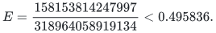

# Proof dependencies and source map

## Current theorem

[Theorem F](proof.md#theorem-and-proof-structure) is a deterministic exact
algorithm for arbitrary signed binary input, including indexed witnesses.
Its current exponent is

<!-- math-display: 2e4692a5690de048c3ca74ff
E=\frac{158153814247997}{318964058919134}<0.495836.
-->

Its running time includes a finite input-independent circuit search. The
argument does not assume that this search is practical, or that fixed
circuits are supplied as free advice. No unimplemented external algorithmic
oracle is a hypothesis of Theorem F.

## Proof chain

1. **Exact signed circuits.** Part I, Sections I.1–I.2.9 prove the affine
   rebalancing lemma, inclusion–exclusion factorizations, recursive
   containment and trace aggregation. Matrix equality is over the integers;
   support covers alone are not used as substitutes for signed identities.
2. **Uniform fixed-data compiler.** Sections I.2.10–I.2.16 prove three-count
   grouping, matching padding, mixed-core compilation and terminating
   exact search. Part II, Section 6 supplies the refined divisibility,
   grid and error allowances. This is the source of the startup constant.
3. **Refined trace contacts.** Part II, Sections 2–4 prove the new trace
   bound and extend the second positive-query lookup from `1/2` to `14/25`
   for three additional families, with every continuous domain explicit. The
   [contact checker](../../tools/verify_subset_sum_contacts.py) certifies
   those numerical inequalities by exact rational subdivision. Its
   [receipt](verify/receipt.json) covers all 62 branches.
4. **Whole-profile and cost bounds.** Part II, Sections 5–7 reconstruct
   the continuous reflected envelope, prove the finite contact-cone extension,
   justify retyping and balance the outer costs.
   The [scalar checker](../../tools/verify_subset_sum_scalars.py) verifies
   all 160 endpoint profile comparisons, the refined input difference
   table, compiler grid and complete outer ledger.
5. **Arbitrary integers and witnesses.** Part I, Section I.3 proves
   canonical layers, deterministic round selection, signed-key energy,
   fixed-factor modulus selection, complete residue covers, cached outer
   lists and nonnegative exact counting. Section I.3.7 recovers an indexed
   witness by restricted recounting; I.3.8 charges the full bit model.

The prime density estimate, sieve, Walsh transform, fixed-dimensional
polynomial operations and arithmetic used here are proved or explicitly
implemented in the manuscript. The multi-prime method in reference [9]
motivates the construction; equations (90)–(97) provide the actual oracle
and cost proof used by this theorem.

The older contact table in Part I, Section I.4.2 remains a premise only
of the separately labelled background Theorem 1. Its missing historical
replay is not a dependency of Theorem F.

## Randomness and verification scope

Sampling and concentration establish the existence of suitable finite
lookup families. The compiler enumerates and checks integer candidates
deterministically. The input algorithm neither samples these families nor
permits a probability of error. An average in a conditional-expectation
proof is computed exactly.

The executable certificates discharge numerical and finite algebraic
obligations. They do not formalize the arbitrary-input circuit compiler,
the integer-key reduction or witness recovery. The
[verification note](verify/README.md) records these boundaries separately.

## Source lineage and primary references

The bibliography in [proof.md](proof.md#references) preserves the source
lineage. In particular:

- Alman and Li, *Kronecker Powers, Orthogonal Vectors, and the Asymptotic
  Spectrum*, [arXiv:2509.14489v1](https://arxiv.org/abs/2509.14489v1),
  and Ye and Li, *Subset Sum via Partial Match*,
  [arXiv:2610.10446v1](https://arxiv.org/abs/2610.10446v1): circuit
  framework; the factorization and rebalancing statements needed here
  are proved in Part I.
- Jain, *Deterministic Subset Sum below meet-in-the-middle*,
  [revision 1daaf519](https://github.com/Swapnil-jain/subsetsum-derand/tree/1daaf519f567dd7a65a00692b08b4ff54b252d24),
  and the [versioned time-focused preprint](https://github.com/openai/math/tree/1581d4cbdd69a0faf34b2089614fe2a814316a6a/preprints/Subset-Sum-in-Time-2-power-0-49n-October-4-2026):
  provenance and comparison, rather than omitted algorithmic subroutines.
- Jin, Park, Saha and Xu, *Deterministic Monotone Min-Plus Product and
  Convolution*, [ICALP 2026, Article 119](https://drops.dagstuhl.de/entities/document/10.4230/LIPIcs.ICALP.2026.119):
  the multi-prime selection approach, instantiated and proved locally.
- Horowitz–Sahni [1974](https://doi.org/10.1145/321812.321823) and
  Schroeppel–Shamir [1981](https://doi.org/10.1137/0210033): classical
  comparison points. The separate
  [low-space result](../subset-sum-low-space-deterministic/) has its own
  algorithm and dependency map.

The [import record](../../provenance/README.md) and
[notice](NOTICE.md) retain source revisions, attribution and applicable
licenses.

**Attribution:** Yilin Liu · GPT-6 Astra Pro.
