# Verification of the deterministic Subset Sum refinement

Two continuous-domain checkers establish the numerical contact inequalities
used by the signed circuit construction: 62 preserved base branches for F2
and 16 third-lookup branches added for F3. The scalar checker derives the
reflected profile and complete running-time ledger from their combined menu.
The energy-tensor check compares finite algebraic identities with independent
enumeration.

| Program | Mathematical scope | Complete command |
|---|---|---|
| [Base continuous contacts](../../../tools/verify_subset_sum_contacts.py) | Every legal color, both nonnegative-maximum branches, and every routing branch of all refined contacts | `python tools/verify_subset_sum_contacts.py --all --jobs 4` |
| [F3 scalar composition](../../../tools/verify_subset_sum_scalars.py) | Exact entropy enclosures, continuous contact/chord/cone envelope, reflected quadratic compensation, and every outer cost inequality | `python tools/verify_subset_sum_scalars.py` |
| [Third-lookup contacts](../../../tools/verify_subset_sum_third_contacts.py) | Complete four-coordinate domain, third routing choices and occurrence floors for all 16 extension branches | `python tools/verify_subset_sum_third_contacts.py --all --jobs 4` |
| [Preserved F2 scalar ledger](../../../tools/verify_subset_sum_scalars.py) | The independent 160-comparison base calculation, without loading the extension menu | `python tools/verify_subset_sum_scalars.py --base-two-level` |
| [Headline consistency](check_headline_ledger.py) | Top theorem, abstract, card and source-map exponents agree with the current exact ledger; explicitly named historical values remain distinct | `python problems/subset-sum-fast-deterministic/verify/check_headline_ledger.py` |
| [Energy tensor](check_energy.py) | Exact rank-three identities and pruned contractions compared with independent binary endpoint enumeration on dimensions one through four | `python problems/subset-sum-fast-deterministic/verify/check_energy.py` |
| [Replay recovery](check_replay_recovery.py) | Interrupted exact branches resume identically to clean runs; mismatched kernel, menu or driver fingerprints are rejected | `python problems/subset-sum-fast-deterministic/verify/check_replay_recovery.py` |
| [Third replay recovery](check_third_recovery.py) | Exact interruption/resume agreement, source-change rejection and explicit initialization in a spawned worker | `python problems/subset-sum-fast-deterministic/verify/check_third_recovery.py` |

All commands are run from the repository root with Python assertions enabled.
They use only the Python standard library. Parallelism changes execution time, not the accepted
inequalities. These programs do not implement the full asymptotic input
algorithm or mechanically verify its combinatorial compiler and reduction;
those arguments are given in the [proof](../proof.md).

## 1. Exact logarithm bounds

Let `Q=2^128` and `D=10^14`. For a positive rational `x`, the checker finds
integers `k` and a rational `v` with `x=2^k v` and `1<=v<2`. With

<!-- math-display: cfa93ec237e51b56da5ff42d
q=\frac{v-1}{v+1}\in[0,1/3],
\qquad
\ln v=2\sum_{j=0}^{31}\frac{q^{2j+1}}{2j+1}+R,
-->
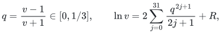

the tail satisfies

<!-- math-display: 531d2bb224b609243c6ca26b
0\le R\le\frac{2q^{65}}{65(1-q^2)}.
-->
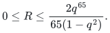

Every power, product and division in this calculation uses integer floors
and ceilings on the `1/Q` grid. The same calculation encloses `ln 2`.
Since `ln v>=0` and `ln 2>0`, division by the opposite positive endpoint
gives a valid enclosure for `log_2 v`. Adding `k` exactly and rounding
outward yields integers `l,u` such that

<!-- math-display: cc67e438c46030786347af9f
l/D\le\log_2x\le u/D.
-->
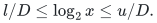

For `0<=y<=c`, entropy lower bounds use

<!-- math-display: 5a990d0ddc28cf19e99c3415
H(c,y)=-y\log_2(y/c)-(c-y)\log_2((c-y)/c),
-->
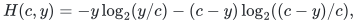

with continuous endpoint value zero. Taking the upper logarithm endpoints
therefore gives a rational lower entropy bound. No floating-point logarithm
can accept a comparison.

## 2. Coverage of the entire color domain

The fixed types are `a=.065`, `b=.075`, `s=.14`, `t=.45`. Write
`beta=a+rho(m-a)`, `c=gamma_1 beta`, and `b_2=(1-gamma_2)c`.
The original eight recursive families use `gamma_2=1/2`; the three added
families use `gamma_2=14/25`. The direct branch begins with

<!-- math-display: 6b3c4c4cf53cd44a2713c3ce
m\in[a,s],\qquad z\in[a,\beta(s)],
-->
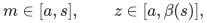

and enforces the necessary inequalities `z>=m`, `z<=beta`.

For the push branch, eliminating the first color from

<!-- math-display: 91f8e055107030abd0b1e444
\max\{\beta-z,c-m,0\}\le w_1
\le\min\{\beta-m,b_2\}
-->
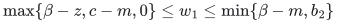

adds the necessary inequalities `m>=gamma_2 c` and `z>=beta-b_2`.
The eliminated color is bounded in the acceptance calculation, rather than
sampled.

For the recursive branch, let `v=w_1-b_2`. The initial interval
`v in [0,gamma_2 c(s)]` contains the full feasible range. The checker enforces

<!-- math-display: 0983a81ce3e9dd16fa4c7917
v\ge0,\qquad
v\ge\beta-z-b_2,\qquad
v\ge\gamma_2c-m,\qquad
v\le\gamma_2c,\qquad
v\le\beta-m-b_2.
-->
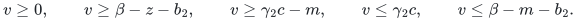

All these restrictions are affine in `(m,z,v)`. For a constraint
`a_0+sum_i a_i x_i>=0`, compute its maximum on the current rational box
by taking the appropriate endpoint of each coordinate. A negative maximum
proves emptiness. For `a_i>0`, the maximum contribution of the other
coordinates supplies a necessary lower bound on `x_i`; for `a_i<0`, it
supplies a necessary upper bound. Every tightened box therefore contains
every feasible point of its parent. This argument uses the actual coefficient
signs; it does not assume a sign for `1-gamma_1 gamma_2 rho`.
The two closed routing domains cover their common boundary. At integer
sizes the second lookup uses `max(ceil(gamma_2 |C|),|Q_2|)`; the proof
charges its rounding error to the fixed compiler allowance.

A rejected nonempty box is bisected at the exact rational midpoint of the
coordinate maximizing `3 width(m)`, `width(z)`, `2 width(v)`, in that tie
order. Both children are processed. Empty boxes are discarded only by the
necessary affine constraints. Acceptance of every remaining leaf therefore
covers the original continuous domain, including all boundary points.

## 3. The acceptance inequality

For every rational `p in (0,1)`, the Gibbs inequality gives

<!-- math-display: b97aa3438ea8a2fa58f7e2c5
H(c,y)\le-y\log_2p-(c-y)\log_2(1-p).
-->
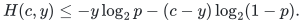

The checker proposes `p` as a multiple of `10^-12`, clamped to
`[10^-9,1-10^-9]`, and uses the exact outward logarithm bounds above.
Any such proposal gives a valid affine majorant. Approximate stationary
points make the majorants tighter; correctness does not require the
proposals to be exact optimizers.

If a positive-entropy majorant is affine in an auxiliary color `w`, then
its coefficient determines which side of the feasible interval can be
substituted. A nonnegative coefficient uses a globally valid affine upper
endpoint, and a negative coefficient uses a globally valid affine lower
endpoint. One endpoint expression is fixed throughout the box. This removes
`w_1` in the push branch, `w_2` in both recursive maximum branches, and
the trace variables `g,u` without adding subdivision dimensions.

Negative entropies use lower vertex interpolants. Joint concavity implies
that the multiaffine interpolation of their exact vertex values is a lower
bound throughout a rectangle; replacing the vertex values by certified
lower bounds preserves that conclusion. If a relaxed rectangular corner is
outside an entropy's domain, the entire negative term uses the safe lower
bound zero on that box.

After these replacements, each relevant branch is multiaffine in
`(m,z,v)`. Maxima and nonnegative sums preserve separate convexity.
Its maximum on the box is consequently attained at a vertex. The checker
evaluates every vertex with exact rational arithmetic and accepts only if
all values are at most the specified contact.

The recursive right degree has two alternative upper bounds: the old
occurrence bound, optionally strengthened by the closed trace correction,
and the continuous pooled-trace bound. The checker first maximizes each
alternative over **the whole box** and then takes the minimum of these
two maxima. A pointwise minimum of different separately convex bounds at
the vertices would not justify this acceptance rule and is never used.

**Certificate proposition.** If a run completes with `status: PASS`, every
selected contact holds throughout its specified feasible color domain,
assuming the analytic circuit and pooled-trace inequalities in the proof.
If it also reports `complete_X02_contact_menu: true`, it has covered all
60 push/recursive calculations and both direct calculations of the refined
menu. Node or depth limits raise an error and do not produce a complete
receipt. The limits cannot cause an unresolved box to be accepted.

## 4. Preserved F2 scalar composition and analytic proof interfaces

For one fixed circuit family, the supremum of
<code class="math">\tau L+(1-\tau)R</code> over its colors is convex in <code class="math">\tau</code>.
Consecutive certified contacts therefore bound that same family's profile
by their chord. Each contact also supplies a global cone. At the finite
circuit level, positive integer color degrees give

<!-- math-display: 923cfe9ab837fa635e6f90a4
\Upsilon(\tau)\le\Upsilon(\alpha)^\kappa,\qquad
\kappa=\max\{\tau/\alpha,(1-\tau)/(1-\alpha)\}.
-->
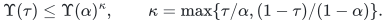

The proof derives this inequality for the entire color sum. A contact
<code class="math">(\alpha,U)</code> supplies <code class="math">U(1-\tau)/(1-\alpha)</code> on the left and <code class="math">U\tau/\alpha</code>
on the right. The scalar checker combines those pieces with the eligible
same-family chords and exact endpoint circuits. With `--base-two-level`, it
verifies continuity at every junction and all 160 exact reflected-profile
endpoint comparisons of F2.
It also checks the refined type constraints, the initial difference-table
size, the fixed compiler grid and all nine outer operation costs at

<!-- math-display: 3054506b2825457cc2040494
E_2=\frac{158153814247997}{318964058919134}<.495836.
-->
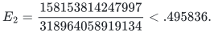

The preserved F2 contact budget is <code class="math">S_2=.41077126</code>. The compiler allowance is
<code class="math">10^{-8}</code> on a fixed core-fraction grid of size <code class="math">10000</code>. All contact
weights lie in <code class="math">[6/25,19/25]</code>, so the cone amplification is at most <code class="math">25/6</code>.
A pre-cone seed error below <code class="math">3\cdot10^{-10}</code> contributes less than
<code class="math">1.25\cdot10^{-9}</code> after amplification; a sufficiently large fixed
rebalancing depth contributes less than another <code class="math">1.25\cdot10^{-9}</code>.
These fit the existing strict <code class="math">2.5\cdot10^{-9}</code> template allowance,
including lookup ceilings and seed color factors. The separately allocated
description, padding and interpolation losses remain within <code class="math">10^{-8}</code>.
The scalar checker checks these rational caps and every displayed
nonbinding rate cap. Improving the binding exponent does not require every
nonbinding rate to decrease.

The proof supplies the exact signed identities, finite circuit
existence, fixed-data compiler, integer-key reduction, bit-cost accounting
and indexed witness recovery. The startup constant is finite and independent
of the input; the verifiers do not supply a practical bound on it.

The imported baseline profile wrapper required modules absent from the
provided source and did not supply a self-contained replay of the older
contacts. Historical leaf counts are not used by either reconstructed
verifier. The refined menu is checked directly, without an assumed receipt
for the older parameter setting.

## 5. Completed base run and receipt binding

The committed [complete receipt](receipt.json) records successful coverage
of all 62 branches: 248,189 accepted nonempty leaves, 496,320 subdivision
nodes, two empty recursive domains, and maximum subdivision depth 29.
The smallest exact acceptance margin is

<!-- math-display: 7148c6062868d1e94040be84
\frac{136285389119}{128000000000000000000}>10^{-9}.
-->
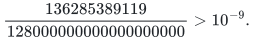

The proof's contact table gives the individual leaf counts. They are the
counts from this reconstructed run; no historical receipt or reported count
is used to accept a box. Floating-point proposals can affect the subdivision
chosen on a different platform, while every successful run still has to
pass the same exact rational inequalities over the full domain.

To reconstruct the complete certificate and check the new result's binding:

```sh
python tools/verify_subset_sum_contacts.py --all --jobs 4 --output /tmp/subset-sum-contacts.json
python tools/verify_subset_sum_contacts.py --check-receipt /tmp/subset-sum-contacts.json
```

The checker captures the SHA256 digest of its source bytes at startup and
refuses to write a receipt if those bytes change during the run. The receipt
also records a digest of the exact contact menu and all 62 expected
`(rho,gamma,gamma2,tau,target,branch)` choices. Receipt schema 2 binds
the second lookup fraction explicitly; a saved receipt for the earlier
44-branch menu cannot certify the extension.

The inexpensive check of the committed reference result is:

```sh
python tools/verify_subset_sum_contacts.py --check-receipt problems/subset-sum-fast-deterministic/verify/receipt.json
```

This checks the current code and menu fingerprints, complete unique branch
coverage, subdivision-count consistency, and exact recorded acceptance
margins. It is a provenance check; it does not re-evaluate every leaf.
Changing the checker or menu requires a new full run to obtain a matching
receipt. The scalar checker and the energy-tensor check retain their own
separate scopes described above.

## 6. Compatibility with the preceding contact menu

All 44 preceding branches remain in the current menu with second lookup
fraction `1/2` (or the unchanged direct branch). Specializing the generalized
identities and domain constraints to that value gives the preceding formulas.
The [compatibility record](gamma2_compatibility.json) documents two checks:
exact proposal/bound comparison on 1,302 nonempty prefix boxes and two empty
domains, and comparison of every completed original branch against its
preceding full-run record. All stable subdivision counts, accepted bounds,
margins and method counts agree; wall-clock times are excluded.

These finite comparisons detect unintended implementation changes. They
are not used to justify the new width or to replace its analytic derivation.
The current full run independently covers all original and added branches.

## 7. Resuming a long exact replay

The [recovery driver](replay_contacts.py) preserves completed branch results
and unfinished rational subdivision frontiers in an explicitly selected
local directory:

```sh
python problems/subset-sum-fast-deterministic/verify/replay_contacts.py \
  --cache /tmp/subset-sum-contact-cache --jobs 4 \
  --output /tmp/subset-sum-contacts.json
```

Repeating this command resumes unfinished branches and reuses completed
ones. Each JSON record binds the branch to the current kernel and menu;
frontiers also bind the recovery driver. The frontier stores rational box
endpoints, pending depths, exact accepted maxima and margins, and complete
binary-tree counters. Atomic replacement preserves the preceding valid
checkpoint if a write is interrupted. Checkpoints occur every 1,000 nodes
or 20 seconds. Source mismatches and inconsistent states are errors; they
do not trigger acceptance or silently reuse obsolete work.

These are **trusted local work products**. Their hashes detect accidental
changes and bind provenance; they do not supply independent proofs of the
already processed leaves. Use a fresh cache, or the kernel's ordinary
`--all` command in Section 5, for an independent replay. The complete
receipt records whether its branch results came from interrupted clean
kernel runs or from the recovery driver. Only complete branch results are
combined; an unfinished frontier never substitutes for a completed branch.

The recovery regression compares resumed and clean computations for a
nonempty push domain, a nonempty recursive domain, and an empty recursive
domain. It checks every stable result field across 165 accepted leaves,
forces two actual interruptions, rejects six fingerprint mismatches with
otherwise valid record checksums, and exercises a truncated temporary
write. This validates the recovery mechanism's concrete failure cases;
it does not extend the mathematical scope of the contact certificate.


## 8. Completed third-lookup extension

The third-lookup extension keeps the original 62 branches and their receipt. It adds a separate fixed menu with eight contacts, each covering both the first-level push branch and the remaining recursive domain. The recursive check includes both third-level routing choices and every nonnegative occurrence floor.

The new kernel is `tools/verify_subset_sum_third_contacts.py`; its exact menu is [third_contacts.json](third_contacts.json). The complete receipt is [third_receipt.json](third_receipt.json). The analytic proof of orientation, coverage, multiaffine acceptance, trace preservation, and compiler losses is in [Part III of the proof](../proof.md#part-iii-a-third-positive-containment-lookup). The strengthened scalar ledger uses both the old and new contact sets. It verifies 112 reflected-profile comparisons and all nine costs. Its independent `--base-two-level` mode retains the 160-comparison F2 ledger without loading the extension menu.

After the completed segmented replay, exactly one final newline was removed from the distributed kernel; the recovery check reconstructs both original source and receipt bytes and verifies their recorded SHA-256 digests, so every mathematical branch record is unchanged and no fresh or clean replay is claimed.

Run a clean independent replay from the repository root:

```sh
python3 tools/verify_subset_sum_third_contacts.py --all --jobs 4 --output /tmp/third-clean-receipt.json
```

For a long computation that must survive interruption, use the separate recovery driver:

```sh
python3 problems/subset-sum-fast-deterministic/verify/replay_third_contacts.py --all --cache /tmp/subset-sum-third-cache --jobs 4 --output /tmp/third-resumed-receipt.json
```

Every completed branch is retained. Between nodes, unfinished branches save exact rational subdivision frontiers once 1,000 further nodes or 20 seconds have elapsed, using atomic file replacement. A resume rechecks kernel, menu, and driver digests. The cache is a trusted local work product, not a proof-carrying format; the clean command ignores all caches. A changed source or menu requires a separate cache and a new complete receipt.

A cheap stored-receipt check verifies source binding, branch coverage, exact acceptance margins, and binary-tree accounting:

```sh
python3 tools/verify_subset_sum_third_contacts.py --receipt problems/subset-sum-fast-deterministic/verify/third_receipt.json
```

This check does not rerun the box inequalities. To exercise the concrete recovery and portability risks, run:

```sh
python3 problems/subset-sum-fast-deterministic/verify/check_third_recovery.py
```

That regression compares clean and interrupted/resumed runs, rejects changed source digests, ignores a truncated temporary write, verifies initialization in a newly spawned worker, rejects an invalid first-containment family, and refuses to turn an incomplete result list into a complete menu receipt. Its deliberately loose recursive target is only a bookkeeping test; it is not one of the claimed contacts.

All these scripts use the Python standard library and refuse `python -O`. Floating arithmetic only proposes rational Gibbs planes and subdivision choices. Every accepted contact bound uses exact rational arithmetic and outward integer logarithm enclosures. The theoretical Subset Sum compiler and its exact uniform seed search do not depend on the floating proposal routine.

The completed resumable replay under the final source covers 317,138 accepted leaves, 634,268 nodes, four empty leaves and maximum depth 29. Its minimum exact margin exceeds `1.14e-8`. Together with the proved analytic acceptance lemmas, this establishes the listed continuous contact inequalities. It does not independently verify the full signed circuit, its compiler, the input reduction, or the claimed algorithmic exponent. Those obligations are proved in the manuscript and the complete nine-rate ledger.
