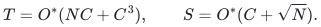

# Deterministic Subset Sum: writable-space bound

**Objective and output**

Exact YES/NO decision and the selected input indices for arbitrary signed binary integers, including zeros and repeated weights.

**Randomness**

Deterministic exact algorithm in the uniform bit model, including indexed-witness recovery; the writable-space and restricted-range variants have no probability of error.

**Time**

<code class="math">\mathrm{poly}(n,L)2^{n/2}</code> bit operations.

**Space**

<code class="math">\mathrm{poly}(n,L)2^{E_Sn}</code> writable bits, where <code class="math">E_S=18261635770550353/10^{17}=0.18261635770550353</code>. Read-only input storage is excluded.

**Parameters**

<code class="math">n</code> is the number of weights. <code class="math">L</code> includes every input bit, including the target, signs and delimiters. Polynomial degrees are fixed.

**Model and representation**

Uniform deterministic bit model, bounded-storage generation and indexed witness recovery.

**Lower-bound scope**

No lower bound is claimed.

**Review status**

**Ready for review.** The complete general low-space theorem with writable-space exponent 0.18261635770550353, including the storage schedule, indexed witnesses and the one-bit deficiency-proxy charge. The separate two-short-range theorem includes signed normalization, nested residue streams and self-contained exact Boolean convolution.

**Dependencies and scope.** The stronger n/6-space result requires the supplied three-block partition and two short normalized ranges. The general theorem has no such input restriction. Executable finite checks cover their named identities and resource ledgers; they are not a full implementation or formalization of either asymptotic construction.

The [verification note](verify/README.md) identifies executable coverage. This status does not claim external peer review or proof-assistant verification.

**Source**

[Theorem and complete proof](proof.md), [source and verification index](sources.md), [import notice](NOTICE.md).

The resource certificate is [check_resources.py](verify/check_resources.py). Its exact rational and integer comparisons accompany the proof's analytic reductions. The [structural check](verify/check_structural.py) covers the finite ownership and layout identities stated in its documentation.

This algorithm has its own construction. Its writable-space guarantee is not attached to the separate [faster-time theorem](../subset-sum-fast-deterministic/).

The [dependency map](sources.md) identifies where the required extraction,
cover, projection, stream and bit-cost statements are proved internally.

## Two short normalized ranges

For a supplied partition into three blocks of size at most <code class="math">m</code>, put <code class="math">N=2^m</code>. Suppose two blocks have normalized sum ranges <code class="math">W_A,W_B</code>, at arbitrary positive lattice scales. For <code class="math">C^2\ge\max\{N,W_A+1,W_B+1\}</code>, the [range theorem](range-branch.md) gives

<!-- math-display: 98b527c5b42ba4b5ae4ee7fd
T=O^*(NC+C^3),\qquad S=O^*(C+\sqrt N).
-->

Thus <code class="math">W_A,W_B\le O^*(2^m)</code> and <code class="math">n=3m+O(1)</code> give <code class="math">O^*(2^{n/2})</code> time and <code class="math">O^*(2^{n/6})</code> writable space. The third block and the ratio of lattice scales are unrestricted. The <code class="math">O^*</code> notation hides fixed polynomial factors in the full binary input; this is a detectable restricted-input result, separate from the general theorem.

The range theorem's [convolution lemma](convolution.md) proves its required
bit-time and space bounds using elementary deterministic arithmetic.
A [complete finite reference check](verify/check_range_solver.py)
compares both scale regimes and original indexed witnesses with exhaustive
search.

**Attribution:** Yilin Liu and GPT-6 Astra Pro.
