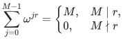
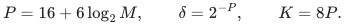
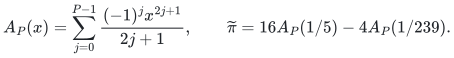
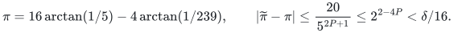
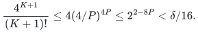
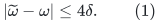
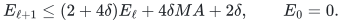
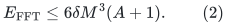
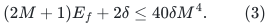
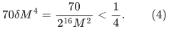

# Exact Boolean convolution with elementary bit arithmetic

**Lemma.** Two Boolean arrays of length at most <code class="math">C\ge1</code> have their
integer linear convolution computable deterministically in
<code class="math">C\,\mathrm{poly}(\log(C+2))</code> bit operations and writable bits.
Only integer addition, multiplication and division on polynomially many
bits in <code class="math">\log(C+2)</code> are required. No prime search, floating-point oracle
or fast multiplication theorem is an assumption.

This supplies the convolution primitive used by the
[short-range Subset Sum theorem](range-branch.md). The inputs to this
primitive are occupancy bits; their original subset witnesses remain
in the corresponding slot arrays.

## 1. Exact transform identity

Choose a power of two <code class="math">M</code> with <code class="math">2C\le M&lt;4C</code> and pad the two arrays
with zeros. Write <code class="math">\omega=\exp(2\pi\mathrm i/M)</code>. The geometric sum

<!-- math-display: 7b69ebb7aea8ec38a72a14f4
\sum_{j=0}^{M-1}\omega^{jr}=
\begin{cases}M,&M\mid r,\\0,&M\nmid r\end{cases}
-->

proves that the product of the two transforms, followed by the transform
with conjugate roots and division by <code class="math">M</code>, is their cyclic convolution.
The zero padding makes its first <code class="math">2C-1</code> entries the linear convolution.
The result is an integer in <code class="math">[0,C]</code> at each coordinate.

Splitting a transform sum into even and odd indices gives the two
butterflies <code class="math">a+\omega^j b</code> and <code class="math">a-\omega^j b</code>. Recursing for
<code class="math">\log_2M</code> levels uses <code class="math">O(M\log M)</code> additions and multiplications.
The subsequent construction approximates these operations with a proved
error smaller than the distance from an integer to its rounding boundary.

## 2. Deterministic roots with no transcendental input

Put

<!-- math-display: f000a3db3a81187a0b50888c
P=16+6\log_2M,\qquad \delta=2^{-P},\qquad K=8P.
-->

All are explicit integers or dyadic rationals. For rational <code class="math">x\in(0,1)</code>,
let

<!-- math-display: 3ad39b26d26acdac999ea7b6
A_P(x)=\sum_{j=0}^{P-1}\frac{(-1)^j x^{2j+1}}{2j+1},\qquad
\widetilde\pi=16A_P(1/5)-4A_P(1/239).
-->

The alternating series and the tangent addition formula give

<!-- math-display: a41447057a14cbe6243047d1
\pi=16\arctan(1/5)-4\arctan(1/239),\qquad
|\widetilde\pi-\pi|
\le\frac{20}{5^{2P+1}}\le2^{2-4P}<\delta/16.
-->

For clarity, the identity uses
<code class="math">\tan(4\arctan(1/5))=120/119</code>; subtracting
<code class="math">\arctan(1/239)</code> gives tangent one. The angle is positive and less
than <code class="math">4/5</code>, while <code class="math">\pi/2=2\arctan(1)\ge1</code> by integrating
<code class="math">1/(1+x^2)\ge1/2</code> on <code class="math">[0,1]</code>. Thus it lies in the principal
interval and equals <code class="math">\pi/4</code>.
The same alternating-series bounds give <code class="math">0&lt;\widetilde\pi&lt;16/5&lt;4</code>.
All terms and the resulting rational are computed exactly.

For each needed twiddle angle <code class="math">2\pi j/m</code>, with <code class="math">m\mid M</code> and
<code class="math">0\le j&lt;m/2</code>, put <code class="math">\theta=2\widetilde\pi j/m</code>. Its error is
less than <code class="math">\delta/16</code>, and <code class="math">&#124;\theta&#124;&lt;4</code>. Approximate
<code class="math">\exp(\mathrm i\theta)</code> by the degree-<code class="math">K</code> Taylor polynomial.
Taylor's integral remainder has norm at most

<!-- math-display: 8d27ad9db3a673014f105d8d
\frac{4^{K+1}}{(K+1)!}
\le4(4/P)^{4P}\le2^{2-8P}<\delta/16.
-->

The factorial bound keeps its last <code class="math">K/2</code> factors. The displayed
comparison uses <code class="math">P\ge16</code>.

The polynomial can be evaluated with bounded-size arithmetic. Use a
work grid of spacing <code class="math">\delta'=2^{-(P+16)}</code>, start at <code class="math">z=1</code>, and
for <code class="math">k=K,K-1,\ldots,1</code> replace <code class="math">z</code> by
<code class="math">1+(\mathrm i\theta/k)z</code>, rounding each real component to this grid.
Without rounding this is exactly the truncated Taylor polynomial.
Each local complex rounding error is at most <code class="math">2\delta'</code>. Its
amplification toward the output is bounded by a prefix of
<code class="math">1,&#124;\theta&#124;,&#124;\theta&#124;^2/2!,\ldots</code>, whose sum is at most
<code class="math">e^4&lt;64</code>. The total evaluation error is therefore less than
<code class="math">128\delta'=\delta/512</code>.

Round the resulting real and imaginary components to the coarser
<code class="math">\delta</code> grid. The final rounding has complex error at most <code class="math">\delta</code>.
The angle perturbation, Taylor remainder, work-grid errors and final
rounding together are less than <code class="math">2\delta</code>. We use the conservative
bound

<!-- math-display: 82281fb05725ad2a1abb3730
|\widetilde\omega-\omega|\le4\delta.
\tag{1}
-->

Conjugation supplies inverse roots with the same error. Rational
arctangent partial sums have <code class="math">\mathrm{poly}(P)</code>-bit numerator and
denominator. The Horner recurrence uses them with <code class="math">O(P)</code>-bit fixed-grid
values; each rounded division is exact integer arithmetic. The intermediate
Horner polynomials have magnitude at most <code class="math">e^4</code>, since each denominator
product is at least the corresponding factorial; their accumulated
rounding errors obey the same bound as above. Thus one
root costs <code class="math">\mathrm{poly}(P)</code> bit operations and temporary bits.
Compute the <code class="math">M/2</code> roots for the full transform one at a time. Every
smaller-stage root is one of these roots, so their stored array has
<code class="math">O(MP)</code> bits.

## 3. Forward, product and inverse error

All transform values are stored on the <code class="math">\delta</code> grid. Additions and
subtractions are exact. A complex product is rounded componentwise to
that grid; its rounding error has norm at most <code class="math">2\delta</code>.

Consider one transform whose exact input values are already on the grid
and have magnitude at most <code class="math">A</code>. An exact partial transform has magnitude
at most <code class="math">MA</code>. If <code class="math">E_\ell</code> bounds the current butterfly errors, (1)
gives

<!-- math-display: 2d89d1cc763524989b07b811
E_{\ell+1}\le(2+4\delta)E_\ell+4\delta MA+2\delta,
\qquad E_0=0.
-->

Since <code class="math">2+4\delta\le3</code> and
<code class="math">3^{\log_2M}\le M^2</code>, summing the recurrence gives the safe bound

<!-- math-display: 5416c1c12e4807ac8a930ea5
E_{\rm FFT}\le6\delta M^3(A+1).
\tag{2}
-->

For a Boolean input, <code class="math">A=1</code>, so each forward error is at most
<code class="math">E_f=12\delta M^3&lt;1</code>. Each exact transform value has magnitude at
most <code class="math">M</code>, and its approximation has magnitude at most <code class="math">M+1</code>.
After a rounded pointwise product, the error from the exact product
is at most

<!-- math-display: f3dc9c1fa23749a6a2b7e42f
(2M+1)E_f+2\delta\le40\delta M^4.
\tag{3}
-->

The approximate products have magnitude at most <code class="math">4M^2</code>. Applying (2)
to their inverse transform costs at most <code class="math">30\delta M^5</code> error.
Applying the *exact* inverse transform to the input errors (3) costs
at most another <code class="math">40\delta M^5</code>, by the triangle inequality for its
<code class="math">M</code> unit-modulus coefficients. Division by <code class="math">M</code> therefore leaves error
at most

<!-- math-display: d626fe9d5480811c70792815
70\delta M^4=
\frac{70}{2^{16}M^2}<\frac14.
\tag{4}
-->

The division is by a power of two and can be retained exactly for the
final integer comparison. Rounding the real part to the nearest integer
recovers every convolution coefficient uniquely. The imaginary part is
irrelevant to the output and obeys the same error bound.

## 4. Bit cost and writable space

Forward intermediates have magnitude <code class="math">O(M)</code>, pointwise products have
magnitude <code class="math">O(M^2)</code>, and inverse intermediates have magnitude <code class="math">O(M^3)</code>.
Equations (1)–(4) preserve these bounds with fixed constants. Their
scaled integer coordinates have <code class="math">O(P+\log M)=O(\log M)</code> bits.
Schoolbook multiplication and long division therefore cost
<code class="math">\mathrm{poly}(\log M)</code> per butterfly. There are <code class="math">O(M\log M)</code>
butterflies, and the root construction costs
<code class="math">M\,\mathrm{poly}(\log M)</code> as well.

The roots and a constant number of transform arrays occupy
<code class="math">O(M\log M)</code> bits. One root's rational work is reused before computing
the next; it uses only <code class="math">\mathrm{poly}(\log M)</code> temporary bits. Thus
both time and writable space are <code class="math">M\,\mathrm{poly}(\log M)</code>,
proving the lemma. Every tolerance and rounding operation is specified
by integers; the procedure is uniform and has no random choices.

The [exact reference check](verify/check_exact_convolution.py) implements
these integer rounding rules and compares finite outputs with direct
coefficient summation. Its finite comparisons support the implementation;
the error and resource bounds for every <code class="math">C</code> are proved above.
