# Exact deterministic Subset Sum with low writable space

**icekylinx · GPT-6 Astra Pro**

## Abstract and theorem

**Theorem 2.** For arbitrary indexed binary integers `w_1,...,w_n,t` of total encoding length `L`, a uniform deterministic algorithm returns an indexed witness or correctly returns NO using

<!-- math-display: dea20d00b9bc7644cda6c948
T=\mathrm{poly}(n,L)2^{n/2},\qquad
S=\mathrm{poly}(n,L)2^{E_S n},\qquad
E_S=\frac{18261635770550353}{10^{17}}.
-->
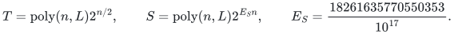

Time counts bit operations and space counts all simultaneously retained writable bits. The polynomial degrees are absolute constants. The proof includes signed and repeated weights, zero values, mixed density regimes, exact original-key recovery, and the high-deficiency fallback. This is a separate algorithm from the faster-time construction.

**Notation.** Logarithms are base two unless `ln` is written. The binary entropy is `h(z)=-z log_2 z-(1-z) log_2(1-z)` with continuous endpoint values. Masks always refer to indexed original coordinates.

## 2. Arithmetic primitives

Both algorithms use polynomial-time arithmetic on binary integers, the following prime bound, and exact array operations.

### 2.1. Prime density and enumeration

For real <code class="math">x\geq1</code>, define

<!-- math-display: 5a9411c07f42fe03a2128647
\vartheta(x)=\sum_{p\leq x}\ln p,\qquad
\psi(x)=\sum_{p^j\leq x}\ln p,
-->

where <code class="math">p</code> ranges over primes and <code class="math">j</code> over positive integers. A prime power in <code class="math">(\lceil n/2\rceil,n]</code> contributes a factor of its underlying prime to <code class="math">\binom n{\lfloor n/2\rfloor}</code>. This follows by subtracting the three factorial valuations; its contribution at this power is one and all other contributions are nonnegative. Consequently

<!-- math-display: f8424bdf2fe1a5ae48ea1148
\psi(n)-\psi(\lceil n/2\rceil)
\leq\ln\binom n{\lfloor n/2\rfloor}\leq n\ln2.
-->

Induction gives <code class="math">\psi(n)\leq4n</code>: for <code class="math">n\geq2</code>, the induction bound is at most <code class="math">2n+2+n\ln2\leq4n</code>, and the base case is immediate. Thus <code class="math">\psi(x)\leq4x</code> for real <code class="math">x\geq1</code>.

Conversely, every prime valuation of <code class="math">\binom{2m}m</code> is at most the number of powers of that prime not exceeding <code class="math">2m</code>. Since the central coefficient is the largest of the <code class="math">2m+1</code> coefficients whose sum is <code class="math">2^{2m}</code>,

<!-- math-display: df903995d25c3caf5ea9b748
\psi(2m)\geq\ln\binom{2m}m
\geq2m\ln2-\ln(2m+1).
-->

Put <code class="math">m=\lfloor x/2\rfloor</code>. Integrating the tangent-line bound <code class="math">1/u\geq4/3-4u/9</code> on <code class="math">[1,2]</code> gives <code class="math">\ln2\geq2/3</code>. Thus <code class="math">\psi(x)\geq x/2</code> for <code class="math">x\geq64</code>: it suffices that <code class="math">\ln(x+1)+4/3\leq x/6</code>, which holds at <code class="math">64</code> by <code class="math">65&lt;128</code> and <code class="math">\ln2&lt;1</code>, and whose right side grows faster thereafter. The prime-power contribution beyond the first power is at most

<!-- math-display: 5c1224d791063705f34c59eb
\psi(x)-\vartheta(x)
=\sum_{j=2}^{\lfloor\log_2x\rfloor}\vartheta(x^{1/j})
\leq4\sqrt{x}\log_2x.
-->

For <code class="math">x\geq2^{20}</code> the last bound is at most <code class="math">x/4</code> (the ratio <code class="math">\log_2x/\sqrt x</code> decreases in this range). We have proved

<!-- math-display: 411470ab36a7cf03f974392e
x/4\leq\vartheta(x)\leq4x\qquad(x\geq2^{20}).
-->

It follows that, for <code class="math">P\geq2^{20}</code>,

<!-- math-display: cdf10cc57f01c8abc776397d
\#\{p:P<p\leq32P\}
\geq\frac{\vartheta(32P)-\vartheta(P)}{\ln(32P)}
\geq\frac{4P}{\ln(32P)}.
-->

If a nonzero integer has absolute value less than <code class="math">2^b</code>, at most <code class="math">b\ln2/\ln P</code> primes greater than <code class="math">P</code> divide it. The fraction of primes in this interval dividing that integer is therefore at most <code class="math">2b/P</code>. This bound holds for all <code class="math">P\geq2^{20}</code>. The interval ratio <code class="math">32</code> contributes a fixed factor.

All these primes can be generated deterministically in <code class="math">P\mathrm{poly}(\log P)</code> bit operations. Start with the integers through <code class="math">\lfloor32P\rfloor</code>, and, for each unmarked integer starting at two, mark its proper multiples. A number remaining unmarked is prime: a composite has a smaller prime divisor, already processed. The number of marking iterations is at most <code class="math">32P\sum_{d\leq32P}1/d=O(P\log P)</code> even if all integers, rather than just primes, are charged. Index arithmetic has <code class="math">O(\log P)</code> bits.

### 2.2. Exact array and polynomial operations

For two length-<code class="math">q</code> arrays of integers of at most <code class="math">b</code> bits, compute cyclic convolution directly by

<!-- math-display: 1790a6ba9fd3fc5cea4a6a15
c_r=\sum_{j=0}^{q-1}a_j b_{r-j\bmod q}.
-->

This uses <code class="math">q^2</code> multiplications and additions on integers of <code class="math">O(b+\log(q+1))</code> bits. The same bound applies to cyclic correlation. Both reductions charge this quadratic cost for their moduli.

In fixed dimension <code class="math">d</code>, a polynomial of coordinatewise degree at most <code class="math">M</code> has at most <code class="math">(M+1)^d</code> coefficients. Store them in an array. Addition, monomial shifts, and multiplication by a fixed polynomial take polynomial time in the degree and coefficient bit length. Integer arithmetic computes binomial coefficients and factorials through order <code class="math">M</code>. These operations support conditional-expectation arguments.

# Part II. A deterministic low-space algorithm

This part proves Theorem 2. Write <code class="math">O^*(f(n))</code> for
<code class="math">\mathrm{poly}(n,L)f(n)</code>, where <code class="math">L</code> is the full encoding length.
Masks refer to indexed coordinates. The weights are <code class="math">w_1,\ldots,w_n</code>
and the target is <code class="math">t</code>; parameters used below are local to this part.
The time and space bounds are

<!-- math-display: ea314a4652c85d9d8f792b40
\begin{gathered}
T=O^*(2^{n/2}),\qquad S=O^*(2^{E_Sn}),\\
E_S=\frac{18261635770550353}{10^{17}}<0.1826163578.
\end{gathered}
\tag{132}
-->
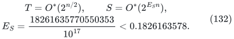

The construction starts from the representation layout, modular
streams and separators of [7]. Weighted canonical-distance ownership,
linear translate covers, biased top layers and bounded original-key
streams are combined below. We use <code class="math">n=3m+O(1)</code> with <code class="math">8\mid m</code>;
bounded leftover coordinates are enumerated explicitly.

## II.1. Support counting and nonlinear core extraction

For a coordinate set <code class="math">A</code>, let

<!-- math-display: 407b696928731a23ed35b066
\Sigma(A)=\left\{\sum_{i\in D}w_i:D\subseteq A\right\},
\qquad N(A)=|\Sigma(A)|,\qquad d(A)=|A|-\log_2N(A).
\tag{133}
-->
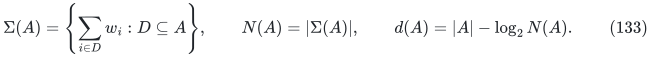

All masks are indexed. Split <code class="math">A</code> into two nearly equal parts, sort their
raw subset-sum arrays, and heap-merge the rows of their pair sums in
increasing actual order. Counting each new value once computes <code class="math">N(A)</code>
in <code class="math">O^*(2^{&#124;A&#124;})</code> time and <code class="math">O^*(2^{&#124;A&#124;/2})</code> space. The same stream fills
a distinct-value residue histogram with one additional modulus-length
array. Sums, comparisons, and counters have polynomial bit length in
<code class="math">n,L</code>.

Choose the lexicographically least witness for every distinct sum of a
<code class="math">q</code>-coordinate set, giving a family <code class="math">\mathcal F</code> of size <code class="math">N</code>. Its
projection onto any coordinate set is sum-injective. If two projected
masks had the same sum, replacing the lexicographically larger one in
its full canonical witness would preserve the sum and decrease that
witness.

A cube family of size <code class="math">N</code> has at most <code class="math">N\log_2N/2</code> internal edges.
Induct on dimension: slices of sizes <code class="math">a,b</code> have at most
<code class="math">(a\log_2a+b\log_2b)/2</code> internal edges and at most <code class="math">\min(a,b)</code> crossing
edges. Concavity gives <code class="math">h(p)\ge2\min(p,1-p)</code>, so the bound follows with
<code class="math">p=a/(a+b)</code>. If <code class="math">E_i</code> counts edges in direction <code class="math">i</code>, forgetting that
coordinate leaves exactly <code class="math">N-E_i</code> projected masks. Some deletion
therefore retains support at least <code class="math">N(q+d_q)/(2q)</code>, and the maximum-support
deletion satisfies

<!-- math-display: 696ece94412aa15f3215742e
d_{q-1}\le d_q-\log_2(1+d_q/q).
\tag{134}
-->
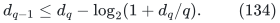

The algorithm counts all one-coordinate deletions sequentially and takes
a largest support, with fixed tie breaking. The entire nested chain
costs <code class="math">O^*(\sum_{q\le m}q2^{q-1})=O^*(2^m)</code> time and
<code class="math">O^*(2^{m/2})</code> space. It retains polynomially many coordinate sets and
counts.

Since <code class="math">\log_2(1+x)\ge x</code> on <code class="math">[0,1]</code>, deficiency density decreases along
the chain. If its initial density is at most <code class="math">\kappa</code>, then
<code class="math">\lambda=\log_2(1+\kappa)/\kappa</code> gives
<code class="math">d_{q-1}\le(1-\lambda/q)d_q</code>. For <code class="math">q\ge2</code> these factors are
nonnegative and at most <code class="math">(1-1/q)^\lambda</code>. Thus

<!-- math-display: 907a93418301fba433b3ec34
d(C)\le(c/m)^\lambda d(B),\qquad |C|=c,\quad |B|=m.
\tag{135}
-->
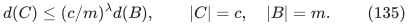

The zero-deficiency and empty-core cases follow directly. We will also
use <code class="math">\lambda=4/3</code> when <code class="math">\kappa\le1/6</code>, certified by <code class="math">7^9&gt;4\cdot6^9</code>.

The sharper certificate used in the resource policy is

<!-- math-display: c90f5da236ea2dc18c2711b8
P_*=\frac{23}{26},\qquad
\Phi(\delta)=\frac{\delta^{52}}{(P_*-\delta)^{75}},
\qquad
\Psi(q,d)=\frac{d^{52}}{(P_*q-d)^{75}}.
\tag{136}
-->
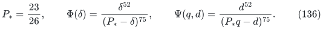

For <code class="math">\delta=d_q/q\le1/5</code>, put
<code class="math">F(\delta)=\log_2(1+\delta)-\delta</code> and
<code class="math">R(\delta)=\delta(P_*-\delta)/(2+\delta)</code>.
The derivative of
<code class="math">\ln(1+\delta)-2\delta/(2+\delta)</code> is
<code class="math">\delta^2/((1+\delta)(2+\delta)^2)\ge0</code>.
The positive atanh series gives
<code class="math">\ln2&lt;2/3+2/81+1/540=1123/1620&lt;52/75</code>.
Consequently <code class="math">F(\delta)\ge R(\delta)</code>, and
<code class="math">R'(\delta)=(2P_*-4\delta-\delta^2)/(2+\delta)^2&gt;0</code> on <code class="math">[0,1/5]</code>.
Writing <code class="math">\delta'=d_{q-1}/(q-1)</code>, (134) gives
<code class="math">\delta'\le\delta-R(\delta)/(q-1)</code>. Since
<code class="math">(\ln\Phi)'=23/R</code>, integration yields

<!-- math-display: 2b1eb9497eb04dc6bafd1d47
\ln\Phi(\delta)-\ln\Phi(\delta')
\ge\frac{23(\delta-\delta')}{R(\delta)}
\ge\frac{23}{q-1}
\ge23\ln\frac q{q-1}.
\tag{137}
-->
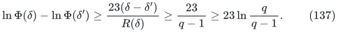

A zero endpoint is immediate. Since
<code class="math">\Phi(d/q)=q^{23}\Psi(q,d)</code>, multiplication along the chain proves
<code class="math">\Psi(c,d(C))\le\Psi(m,d(B))</code> exactly.

For an initial density upper bound <code class="math">0&lt;x\le1/5</code> and retained fraction
<code class="math">s\in(0,1]</code>, define <code class="math">\beta(x,s)</code> by

<!-- math-display: bb83e575706ccb8de4d4b03c
\beta^{52}(P_*-x)^{75}=x^{52}(P_*s-\beta)^{75},
\quad 0<\beta\le sx.
\tag{138}
-->
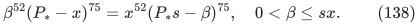

The left-to-right ratio increases strictly with <code class="math">\beta</code>, so the root is
unique. Equivalently,
<code class="math">P_*s=xt+(P_*-x)t^{52/75}</code> and <code class="math">\beta=xt</code>.
The potential proves <code class="math">d(C)\le m\beta(x,s)</code>.
At <code class="math">x=0</code> set <code class="math">\beta=0</code>. Increasing <code class="math">x</code> enlarges the initial potential,
so <code class="math">\beta</code> is increasing in <code class="math">x</code>; also <code class="math">\beta(x,s)\le sx</code>.
Rational bisection of (138), with denominators cleared, supplies safe
<code class="math">O(1/m)</code> enclosures by fixed-power integer comparisons.
All requested sizes and deficiency proxies are selected before useful
layers. Exact support counts continue to define the actual histograms.

## II.2. Trace mass, support-dependent signings, and balanced cells

### II.2.1. An exact fixed-layer trace inequality

For integers <code class="math">0\le k,r\le c</code> and every <code class="math">\mathcal F\subseteq\{0,1\}^c</code> with <code class="math">&#124;\mathcal F&#124;\ge2^k</code>,

<!-- math-display: fa1bcdd45988c685e1e4eabb
\sum_{|T|=r}|\pi_T\mathcal F|
\ge[z^r](1+2z)^k(1+z)^{c-k}
=\sum_j\binom kj\binom{c-k}{r-j}2^j.
\tag{139}
-->
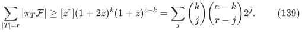

We prove the rank comparison needed for this coefficient inequality.
For an integer interval <code class="math">I</code>, let <code class="math">W(I)</code> be its multiset of binary
Hamming weights. Domination means that every upper-threshold count is
at least as large. We claim that, for <code class="math">a\ge b\ge0</code>,

<!-- math-display: a986b40108060e2b6290c216
W([a,a+b))\ \text{dominates}\ 1+W([0,b)).
\tag{140}
-->
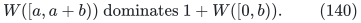

The case <code class="math">b=0</code> is immediate. Use strong induction on <code class="math">a+b</code>. A consequence available at smaller sums
is <code class="math">W([u,u+v))</code> dominating <code class="math">W([0,v))</code>: apply (140) to
<code class="math">\max(u,v),\min(u,v)</code>, weaken by removing the added one, then add and
cancel common prefix multisets in the threshold inequalities.
Let <code class="math">H</code> be the largest power of two at most <code class="math">a</code>.
If <code class="math">a+b\le2H</code>, remove the leading bit and apply this consequence to
<code class="math">[a-H,a-H+b)</code>. If <code class="math">a+b&gt;2H</code>, put <code class="math">D=2H=2^d</code>,
<code class="math">u=D-a</code>, and <code class="math">v=b-u&gt;0</code>. Since <code class="math">D-b\ge u</code>, the smaller instance
<code class="math">(D-b,u)</code> gives
<code class="math">W([D-b,D-b+u))</code> dominating <code class="math">1+W([0,u))</code>.
Complementing the <code class="math">d</code> bits reverses domination and gives
<code class="math">W([a,D))</code> dominating <code class="math">1+W([v,b))</code>.
The remaining interval has
<code class="math">W([D,D+v))=1+W([0,v))</code>, proving (140).

If <code class="math">B_j(N)</code> counts integers below <code class="math">N</code> with Hamming weight at least <code class="math">j</code>,
(140) says
<code class="math">B_j(a)+B_{j-1}(b)\le B_j(a+b)</code> for <code class="math">a\ge b</code>.
Induction on dimension now shows that a downset <code class="math">\mathcal D</code> of size
<code class="math">N</code> has at most <code class="math">B_j(N)</code> members of rank at least <code class="math">j</code>: its two slices
are downsets of sizes <code class="math">N_0\ge N_1</code>, and the displayed inequality combines
their inductive bounds. Thus, for every nonnegative decreasing rank
weight <code class="math">w</code>,

<!-- math-display: c2ce19d09b89f1d112313c6e
\sum_{A\in\mathcal D}w(|A|)
\ge\sum_{j=0}^{N-1}w(\mathrm{wt}(j)).
\tag{141}
-->
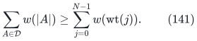

This follows by expressing <code class="math">w</code> as a constant plus nonnegative multiples
of lower-rank threshold indicators.

Downward compression in a coordinate replaces sections
<code class="math">\mathcal F_0,\mathcal F_1</code> by their union and intersection.
It preserves cardinality and decreases every projection size:
projections omitting the coordinate are unchanged, while the sum of
the two projected section sizes bounds the corresponding union and
projected intersection. Compression preserves earlier downward closure,
so one pass through the coordinates yields a downset <code class="math">\mathcal D</code>
with <code class="math">&#124;\pi_T\mathcal F&#124;\ge&#124;\pi_T\mathcal D&#124;</code> for every <code class="math">T</code>.
For a downset,

<!-- math-display: e44f6639ed1ab4006cc68940
\sum_{|T|=r}|\pi_T\mathcal D|
=\sum_{A\in\mathcal D}\binom{c-|A|}{r-|A|}.
\tag{142}
-->
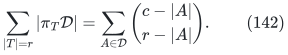

The rank weight on the right decreases, with consecutive ratio
<code class="math">(r-j)/(c-j)</code> until it becomes zero. When <code class="math">&#124;\mathcal D&#124;=2^k</code>,
(141) compares it with the full <code class="math">k</code>-cube and gives (139).
For a larger family, take any <code class="math">2^k</code> members first.

Apply (139) to the canonical full-support witnesses of a weighted
<code class="math">c</code>-coordinate core. Their projections are sum-injective by Section II.1.
With <code class="math">k=\lfloor\log_2N\rfloor</code>,

<!-- math-display: e2c2621a16070189efa71bce
S_r:=\sum_{|T|=r}N(T)
\ge[z^r](1+2z)^k(1+z)^{c-k}.
\tag{143}
-->
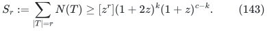

The right side is a polynomial-bit binomial sum. The canonical and
compressed families serve only in this proof.

### II.2.2. Finite trace-gain certificates

Let <code class="math">N\ge2^{c-d}</code>, <code class="math">\delta=d/c</code>, and
<code class="math">r=\theta c+O(Q_{\rm grid})</code>, where <code class="math">Q_{\rm grid}</code> is a fixed multiple of four chosen before the input.
Retaining a binomial term in (143) gives

<!-- math-display: 240655665c1776f08c0134c2
\log_2S_r\ge c\max_\eta
\left\{(1-\delta)h\!\left(\frac{\theta-\eta\delta}{1-\delta}\right)
       +\delta h(\eta)+\theta-\eta\delta\right\}
-O(Q_{\rm grid}\log(c+1)).
\tag{144}
-->
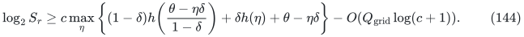

The feasible <code class="math">\eta</code> make both entropy arguments valid. The finite
rectangles used below satisfy

<!-- math-display: 3153d1d987a224f7bc35c18d
\log_2S_r\ge[h(\theta)+\theta]c-(\theta-g)d
              -O(Q_{\rm grid}\log(c+1)),
\tag{145}
-->
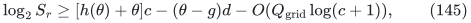

with <code class="math">(\theta,\delta,g)</code> in
<code class="math">[.38,.46]\times[0,.2]\times\{1/16\}</code>,
<code class="math">[.41,.46]\times[0,.05]\times\{3/40\}</code>, or
<code class="math">[.44,.46]\times[0,.03]\times\{79/1000\}</code>.
Greedy extraction decreases deficiency density, so a rectangle chosen
from a full-block density upper bound also applies to its strict core.

Here is a complete rational certificate. For fixed rational <code class="math">\eta</code>,
subtract <code class="math">h(\theta)+\theta(1-\delta)</code> from the expression in braces
in (144), calling the result <code class="math">\Delta(\theta,\delta)</code>.
It is concave in <code class="math">\delta</code>, with value zero at zero. For positive
<code class="math">\delta</code> it is also concave in <code class="math">\theta</code>: writing
<code class="math">z=(\theta-\eta\delta)/(1-\delta)</code>, its second derivative is
<code class="math">(\ln2)^{-1}(1/(\theta(1-\theta))-1/((1-\delta)z(1-z)))&lt;0</code>.
Indeed,
<code class="math">\theta(1-\theta)=(1-\delta)z(1-z)+\delta\eta(1-\eta) +\delta(1-\delta)(z-\eta)^2</code>.
It therefore suffices to bound <code class="math">\Delta/\delta</code> at the two theta
endpoints and the upper density endpoint of each rectangle.

Define rational entropy enclosures by

<!-- math-display: aa01c2e67a774b15051efe78
\begin{aligned}
\ell_-&=2\sum_{j=0}^{11}\frac1{(2j+1)3^{2j+1}},
&\ell_+&=\ell_-+\frac2{25\,3^{25}}\frac98,\\
S(z)&=\sum_{j=1}^{32}\frac{z^{2j}}{(2j)(2j-1)},
&R(z)&=\frac{z^{66}}{66\cdot65(1-z^2)},\\
h_-(p)&=1-\frac{S(|1-2p|)+R(|1-2p|)}{\ell_-},
&h_+(p)&=1-\frac{S(|1-2p|)}{\ell_+}.
\end{aligned}
\tag{146}
-->
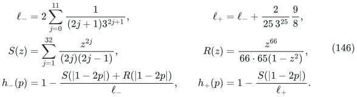

The positive atanh series bounds <code class="math">\ln2</code> between <code class="math">\ell_-,\ell_+</code>;
the positive entropy series and its geometric tail give
<code class="math">h_-(p)\le h(p)\le h_+(p)</code> at the interior arguments used here.
Substitution into

<!-- math-display: 883e4ba6f45a64b8149258df
G_-=
\frac{(1-\delta)h_-((\theta-\eta\delta)/(1-\delta))
             +\delta h_-(\eta)-h_+(\theta)}{\delta}
+\theta-\eta
\tag{147}
-->
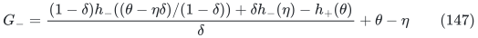

gives the following strict rational lower comparisons:

| Theta interval | <code class="math">\delta</code> | <code class="math">\eta</code> | Left bound | Right bound |
|---|---:|---:|---:|---:|
| <code class="math">[19/50,2/5]</code> | <code class="math">1/5</code> | <code class="math">13/50</code> | <code class="math">6253/10^5</code> | <code class="math">6309/10^5</code> |
| <code class="math">[2/5,43/100]</code> | <code class="math">1/5</code> | <code class="math">7/25</code> | <code class="math">6395/10^5</code> | <code class="math">6417/10^5</code> |
| <code class="math">[43/100,23/50]</code> | <code class="math">1/5</code> | <code class="math">3/10</code> | <code class="math">6597/10^5</code> | <code class="math">6439/10^5</code> |
| <code class="math">[41/100,43/100]</code> | <code class="math">1/20</code> | <code class="math">13/50</code> | <code class="math">7548/10^5</code> | <code class="math">7558/10^5</code> |
| <code class="math">[43/100,23/50]</code> | <code class="math">1/20</code> | <code class="math">7/25</code> | <code class="math">7714/10^5</code> | <code class="math">7676/10^5</code> |
| <code class="math">[11/25,23/50]</code> | <code class="math">3/100</code> | <code class="math">143/500</code> | <code class="math">3967/50000</code> | <code class="math">1593/20000</code> |

Each entry is verified by (146)–(147) after clearing positive
denominators. The first three exceed <code class="math">1/16</code>, the next two exceed <code class="math">3/40</code>,
and the last exceeds <code class="math">79/1000</code>. The two concavity reductions prove
(145) over all three rectangles, including zero density by continuity.

### II.2.3. Linear translate covers

Let <code class="math">V=\mathbb F_2^c</code>, let <code class="math">\varnothing\ne G\subseteq V</code>, and suppose membership in <code class="math">G</code> takes deterministic time <code class="math">Q</code> and workspace <code class="math">W</code>. Write <code class="math">N=2^c</code> and <code class="math">\alpha=&#124;G&#124;/N</code>. There is a deterministic algorithm returning a basis for a subspace <code class="math">H\le V</code> such that

<!-- math-display: dc3e4068948508fc877b48f6
G+H=V,\qquad
K:=|H|\le\min\left\{2^c,\frac{2(1+c\ln2)}{\alpha}\right\}.
\tag{148}
-->
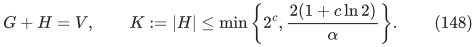

Its time is <code class="math">O^*(2^cKQ)</code> and its space is <code class="math">O^*(W+\mathrm{poly}(c))</code>. A basis permits enumeration of all centers with polynomial delay and state. All arithmetic in the construction has polynomial bitlength.

Start with <code class="math">H=\{0\}</code> and let <code class="math">U=V\setminus(G+H)</code>. Adding a vector <code class="math">v</code> to the basis replaces the uncovered set by <code class="math">U\cap(U+v)</code>. The average translation intersection is

<!-- math-display: 4166eaa3b32d164b3ed38256
\frac1N\sum_{v\in V}|U\cap(U+v)|=\frac{|U|^2}{N}.
\tag{149}
-->
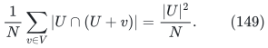

Choose <code class="math">v</code> whose intersection size is no larger than this average. If <code class="math">U\ne\varnothing</code>, then <code class="math">0&lt;&#124;U&#124;&lt;N</code>. Such a choice strictly decreases <code class="math">&#124;U&#124;</code>, and cannot lie in <code class="math">H</code>, since <code class="math">U</code> is <code class="math">H</code>-invariant. Consequently the subspace doubles at every successful step. After <code class="math">d</code> steps,

<!-- math-display: acbe9d3359818730c2e8b125
|U_d|/N\le(1-\alpha)^{2^d}\le e^{-\alpha2^d}.
\tag{150}
-->
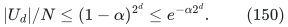

The first power of two at least <code class="math">(1+c\ln2)/\alpha</code> makes the integer <code class="math">&#124;U_d&#124;</code> smaller than one. Alternatively rank <code class="math">c</code> gives <code class="math">H=V</code>. This proves (148). The algorithm stops by exact counting, without evaluating a real logarithm.

To choose <code class="math">v</code>, fix its bits by conditional expectation. For a prefix length <code class="math">j</code>, let <code class="math">U_a</code> be the number of uncovered vectors with prefix <code class="math">a\in\mathbb F_2^j</code>. If <code class="math">v</code>'s prefix is <code class="math">P</code>, then

<!-- math-display: 2b310b2738a0ef9651034a49
\mathbb E[|U\cap(U+v)|\mid v|_{[j]}=P]
 =2^{-(c-j)}\sum_a U_aU_{a+P}.
\tag{151}
-->
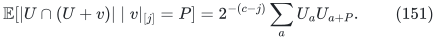

For each uncovered <code class="math">x</code> with prefix <code class="math">a</code>, its translated suffix is uniform in the suffix class with prefix <code class="math">a+P</code>; this proves the formula. The two next-bit means average to the current mean. Choose the smaller, using their common-denominator integer numerators. The uncovered predicate remains unchanged until all bits of the new vector have been chosen.

Membership in <code class="math">U</code> is decided by enumerating the present <code class="math">H</code> and testing <code class="math">x+h\notin G</code> for every <code class="math">h</code>. For one candidate prefix, enumerate each <code class="math">a</code>, count <code class="math">U_a</code> and <code class="math">U_{a+P}</code> by scanning their suffix classes, multiply the two counts, then discard them. The suffix classes partition <code class="math">V</code>, so this is at most two full passes, with time <code class="math">O^*(N&#124;H&#124;Q)</code> and space <code class="math">W+\mathrm{poly}(c)</code>. The score has at most <code class="math">2c+1</code> bits. The <code class="math">c</code> bit choices add a polynomial factor. Across stages the current subspace sizes are <code class="math">1,2,\ldots,K/2</code>, whose sum is less than <code class="math">K</code>. Exact stopping tests, including a final full pass, obey the same bound. This proves the claimed time and space.

If <code class="math">G</code> lies in the cardinality layer <code class="math">\binom{[c]}r</code>, test cardinality before the expensive predicate, whose time and state on this layer are <code class="math">Q_r,W_r</code>. For each fixed <code class="math">h</code>, exactly <code class="math">\binom cr</code> of the <code class="math">N</code> translated vectors in a full pass have cardinality <code class="math">r</code>. The preceding proof therefore gives the sharper bound

<!-- math-display: 4b2f5d2f5bfda32e607568b2
T=O^*\!\left(K\left[2^c+\binom cr Q_r\right]\right),
\qquad S=O^*(W_r+\mathrm{poly}(c)).
\tag{152}
-->
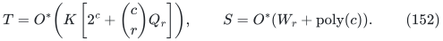

For a dyadic class defined by distinct subset-sum support, sorted half-sum streaming gives <code class="math">Q_r=O^*(2^r)</code>, <code class="math">W_r=O^*(2^{r/2})</code>. The cardinality test charges all failed masks; early successful membership tests only reduce the count.

### II.2.4. Support classes and signing costs

Partition the <code class="math">r</code>-subsets into exact support classes
<code class="math">\mathcal G_\ell=\{T:2^\ell\le N(T)&lt;2^{\ell+1}\}</code>.
Count them by the support stream of Section II.1, and choose a nonempty
class maximizing <code class="math">2^\ell g</code>, where <code class="math">g=&#124;\mathcal G_\ell&#124;</code>.
There are at most <code class="math">r+1</code> classes, so <code class="math">2^\ell g\ge S_r/(2(r+1))</code>.
Apply the linear translate cover to this class, and let <code class="math">K</code> be its
actual number of centers. Coverage gives <code class="math">2^c\le Kg</code>, while the size
bound gives <code class="math">Kg\le\mathrm{poly}(c)2^c</code>. Put
<code class="math">\tau=1-h(\theta)</code> and <code class="math">\phi=\theta-\gamma</code> for the applicable trace
gain <code class="math">\gamma</code>. The resulting bounds are:

<!-- math-display: dc57ac5fae6a382f29c20b9f
\begin{aligned}
\ell-\log_2K&\ge(\theta-\tau)c-\phi d
                    -O(Q_{\rm grid}\log(c+1)),\\
\ell&\ge\theta c-\phi d-O(Q_{\rm grid}\log(c+1)),\\
\log_2K&\le\tau c+\phi d+O(Q_{\rm grid}\log(c+1)).
\end{aligned}
\tag{153}
-->
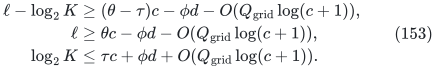

For the first line, use
<code class="math">\ell+\log_2g\ge\log_2S_r-O(\log(c+1))</code> and the upper bound on
<code class="math">Kg</code>. The second also uses <code class="math">g\le\binom cr</code>; the third follows from
the first and <code class="math">\ell\le r</code>. All class choices and membership tests
use exact integers. Substituting the third line into the layer-aware
construction bound gives

<!-- math-display: 530ddf0474174cbf3082140a
T=O^*\!\left(2^{(1+\theta)c+\phi d}\right),\qquad
S=O^*\!\left(2^{r/2}+\mathrm{poly}(c)\right).
\tag{154}
-->
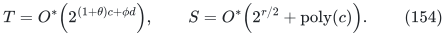

Indeed, the expensive term is
<code class="math">K\binom cr2^r\le O^*(2^{(1+\theta)c+\phi d})</code>;
the <code class="math">K2^c</code> term is smaller because <code class="math">h(\theta)+\theta&gt;1</code> on the
active intervals. A center basis is stored once per unsigned core and
scalar configuration, before outer owners or top signings. Subsequent
per-center work retains the actual <code class="math">K</code> multiplicity.

For a center <code class="math">D</code>, negate its weights and map a mask <code class="math">S</code> to
<code class="math">S\mathbin\triangle D</code>. Its signed weight is the original weight
minus <code class="math">\Delta_D=\sum_{i\in D}w_i</code>. On every fixed coordinate subset
<code class="math">T</code>, the signed support is a translate of <code class="math">\Sigma(T)</code>, so support-class
membership is independent of the center. Permitted fixed-cardinality
images are generated with their actual signed weights. Restoring
<code class="math">\Delta_D</code> recovers original local keys.

### II.2.5. Constructive balanced-cell families

We use a fixed number <code class="math">Q_{\rm grid}</code> of fine cells. For a core of size <code class="math">b</code>
divisible by <code class="math">Q_{\rm grid}</code>, fix a selected cardinality <code class="math">r</code> and smaller
cardinality <code class="math">k</code>, with <code class="math">Q_{\rm grid}\mid r,k</code>. A three-coloring
<code class="math">(D,A\setminus D,B\setminus A)</code> has totals <code class="math">(k,r-k,b-r)</code>.
A uniform equipartition into <code class="math">Q_{\rm grid}</code> equal cells gives exactly
<code class="math">1/Q_{\rm grid}</code> of each color to each cell with probability at least

<!-- math-display: 90c15e6872796357f6709d44
p_b=(b+1)^{-3Q_{\rm grid}}.
\tag{155}
-->
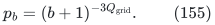

For each color, its equally split multinomial coefficient is maximal
and at least <code class="math">Q_{\rm grid}^{\,\text{color size}}/(b+1)^{Q_{\rm grid}}</code>.
Multiplying these three lower bounds and dividing by at most <code class="math">Q_{\rm grid}^b</code>
equipartition labelings proves (155).

Construct a family covering every such coloring by greedy conditional
expectation. After some partitions are chosen, fix the labels of one
new partition coordinate by coordinate. For a coloring with remaining
color counts <code class="math">r_a</code>, residual cell capacities <code class="math">R_j</code>, and residual
target counts <code class="math">t_{aj}</code>, its conditional coverage probability is

<!-- math-display: 43135b373fd53113a4e2fd3c
\frac{\prod_a r_a!/\prod_{a,j}t_{aj}!}
     {(\sum_jR_j)!/\prod_jR_j!},
\tag{156}
-->
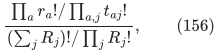

interpreted as zero for a negative target. Enumerate the uncovered
colorings, testing their status against the prior polynomial list,
and choose a next cell label at least as good as its capacity-weighted
mean. Each completed partition covers at least <code class="math">p_b</code> of the remaining
colorings. At most <code class="math">p_b^{-1}(b\ln3+1)+1</code> partitions suffice.
The factorials and score sums have polynomial bit length; the universe
is regenerated, and only the selected partition list is stored.

For an active strict local shell, <code class="math">\theta=.45</code>, and the coloring count is
<code class="math">\binom br\binom rk\le2^{[h(\theta)+\theta]b+O(Q_{\rm grid})}\le 2^{1.45m+O(Q_{\rm grid})}</code>.
For a top base of size at most <code class="math">.9m</code> it is at most
<code class="math">3^{.9m+O(Q_{\rm grid})}&lt;2^{1.427m+O(Q_{\rm grid})}</code>, and an oriented half uses at
most <code class="math">3^{m/2}</code>. Multiplication by the fixed-degree polynomial factors
preserves these bounds. Thus this construction supplies all required
fine-cell families within the half-exponential budget using polynomial
state. The local families depend only on their fixed cores and cardinalities.
Construct them before the ownership and signing loops, then reuse them
throughout. Top-base families are likewise reused across their signings.

To align a useful smaller layer, remove fewer than <code class="math">Q_{\rm grid}</code> elements from
each of its distinct-sum witnesses. If the removed set is <code class="math">R</code>, its
original sum is the trimmed sum plus <code class="math">\sum_{i\in R}w_i</code>; one trimmed
sum accounts for at most <code class="math">\binom b{&#124;R&#124;}</code> original sums.
Thus trimming loses at most <code class="math">b^{Q_{\rm grid}-1}</code>.
For each retained sum choose one trimmed witness. Every three-coloring
is balanced by some partition in the constructed family, so one
partition retains a reciprocal-polynomial fraction of the distinct sums.
The selected pattern occupies <code class="math">r/Q_{\rm grid}</code> positions per cell and its
smaller mask <code class="math">k/Q_{\rm grid}</code> positions. The total trimming, layer, and layout
loss is <code class="math">O(Q_{\rm grid}\log(b+1))</code> in its support logarithm.
Choose shell sizes divisible by <code class="math">Q_{\rm grid}</code> within <code class="math">O(Q_{\rm grid})</code> of <code class="math">\theta b</code>;
this changes the finite trace estimates only by the same lower-order
term.

### II.2.6. Retained quarter layers

Consider a good selected shell of size
<code class="math">r=\theta c+O(Q_{\rm grid})</code> with <code class="math">N(T)\ge2^\ell</code> and
<code class="math">\theta c-\ell\le\phi d+O(Q_{\rm grid}\log(m+1))</code>.
If the full-block deficiency density is at most <code class="math">x</code> and
<code class="math">\phi x&lt;\theta/8</code> with a fixed positive gap, density monotonicity gives
<code class="math">\ell/r&gt;7/8</code> after a fixed coordinate cutoff.
Pigeonhole distinct-sum witnesses by cardinality, complement within
<code class="math">T</code> if necessary, and trim fewer than <code class="math">Q_{\rm grid}</code> positions.
The resulting smaller layer <code class="math">k\le r/2</code> retains at least
<code class="math">2^\ell/\mathrm{poly}(m)</code> distinct sums. Since its cardinality
is at most <code class="math">2^{r h(k/r)}</code>,

<!-- math-display: c1a7dfc61857b9646a22e393
h(k/r)\ge\ell/r-o(1)>7/8>h(1/4).
\tag{157}
-->
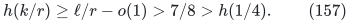

The last comparison follows from <code class="math">3^9&gt;2^{14}</code>, which gives
<code class="math">h(1/4)&lt;5/6</code>. Hence a useful layer has <code class="math">k/r&gt;1/4</code> with a fixed margin.
We retain only <code class="math">r/4\le k\le r/2</code> before expensive processing.
The polynomial family of retained layers and layouts preserves a
representation of every original solution.

For the biased top, <code class="math">\theta=21/50</code>, <code class="math">x\le27/200</code>, and
<code class="math">\phi\le143/400</code>. For a strict local core, <code class="math">\theta=9/20</code> and
<code class="math">\phi\le31/80</code>. The requisite gaps are

<!-- math-display: eb5a9e15606d7369bfb4c79b
\frac{\theta}{8}-\phi x\ge
\begin{cases}
339/80000,&\theta=21/50,\\
63/16000,&\theta=9/20.
\end{cases}
\tag{158}
-->
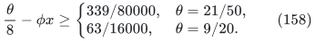

Every retained top layer satisfies
<code class="math">k/c\ge.105-o(1)&gt;.1</code> and <code class="math">(r-k)/c\ge.21-o(1)&gt;.2</code>.
The integer inequalities
<code class="math">10^{20}&gt;2^9 9^{18}</code> and <code class="math">5^{10}&gt;2^{23}</code> give
<code class="math">h(.1)&gt;9/20</code> and <code class="math">h(.2)&gt;7/10</code>. Its actual mean mask entropy
therefore exceeds <code class="math">23/40</code> after the fixed cutoff.
For every retained strict local layer,
<code class="math">k/c\ge9/80-o(1)&gt;1/9</code> and <code class="math">(r-k)/c\le27/80+o(1)&lt;7/20</code>.
The inequalities <code class="math">9^6&gt;2^{19}</code> and
<code class="math">20^{80}&lt;2^{75}7^{28}13^{52}</code> imply
<code class="math">h(1/9)&gt;1/2</code> and <code class="math">h(7/20)&lt;15/16</code>. Thus

<!-- math-display: 23e47d3f1fa8fa73ebd50354
h((r-k)/c)-h(k/c)<7/16.
\tag{159}
-->
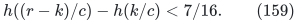

These bounds apply to every processed layer. The fine-cell product
counts incur <code class="math">O(Q_{\rm grid}\log(m+1))</code> error. Concavity also gives
<code class="math">h(k/c)+h((r-k)/c)\ge h(\theta)-o(1)</code>, which will bound the
unrestricted child domains.

### II.2.7. Shared local image scans

For fixed local layer, layout, and child roles, a center <code class="math">D</code> and good
selected set <code class="math">T</code> determine a permitted image <code class="math">X_D(T)</code>.
In a candidate-prime scan, enumerate <code class="math">T</code> first and count its support
once. For good <code class="math">T</code> only, enumerate the centers and generate
<code class="math">X_D(T)</code>. Since <code class="math">K&#124;\mathcal G_\ell&#124;\le\mathrm{poly}(c)2^c</code>,

<!-- math-display: 3dc86132550cc757423267a2
O^*\!\left(\binom cr2^r+K|\mathcal G_\ell|2^r\right)
=O^*(2^{c+r})
\tag{160}
-->
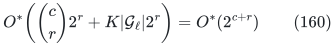

bounds one complete scan. The support-class test is independent of
<code class="math">D</code>, by the translation identity above. It is also independent of the
outer top label.

For one top seed, construct all local weighted residue covers in
lockstep. Keep each center's uncovered count, candidate interval,
polynomial seed list, and separate resource means. At every score
pass, put the good-set loop outside the center loop, generating one
image and its residue-prefix counts at a time. An image and its offsets
cost <code class="math">O^*(2^r)</code>, since its modulus is <code class="math">O^*(2^\ell)</code> and <code class="math">\ell\le r</code>.
Thus a simultaneous coverage-score pass costs <code class="math">O^*(2^{c+r})</code>.
Regenerate each center's resource vector in a shared workspace and
compare its own two exact means. The histogram cost is separately

<!-- math-display: affc4ccad2fb584fced5592e
O^*\!\left(K(P_{\max}^2+P_{\max}+2^{m-c})\right).
\tag{161}
-->
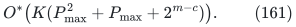

Only <code class="math">O^*(K)</code> scalar and seed state is cached. One image, histogram,
and complementary-support workspace is live at a time. Each cover
retains its own nonnegative cost normalizers; interleaving their score
passes preserves every conditional-expectation guarantee.

## II.3. Weighted ownership representations

Let a top core have size <code class="math">a</code>, <code class="math">N</code> distinct subset sums and deficiency <code class="math">d=a-\log N</code>. For the dense branch, use <code class="math">a=.9m+O(1)</code>, <code class="math">p=1/20</code>, and <code class="math">d/a\le17/2000+O(1/m)</code>. The representation and checker constructions below have the following bounds:

<!-- math-display: cee64d55c53810c21af9ba51
\begin{aligned}
T_{\rm owner}&=O^*(2^{3a/2+2d}),&
S_{\rm owner}&=O^*(2^{a/2}+2^d),\\
T_{\rm container}&=O^*(2^{.3825m}),&
S_{\rm construction}&=O^*(2^{.1275m}),\\
S_{\rm assignment/index}&=O^*(2^{.265185m}).
\end{aligned}
\tag{162}
-->
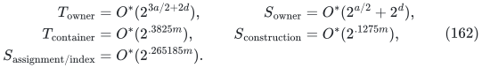

Every parent retains movable top/background logarithmic mass at least <code class="math">m/2-O(\log m)</code>. Its upper mass is the central equal-rate budget, up to polynomial factors. Exact incidence is bounded by <code class="math">2^{3m/2}</code> times a polynomial whenever the original local full-block deficiency is at least <code class="math">d</code>. The bounds hold for arbitrary indexed integer weights and every feasible fine profile.

### II.3.1. Direct coefficients and canonical distance

Let <code class="math">H</code> be the owner-right region of cardinality <code class="math">b</code>. For an original top subset <code class="math">S</code> and variation mask <code class="math">R</code>, use

<!-- math-display: 51219edf6699ddb495eb9612
(\alpha_i,\beta_i)=
\begin{cases}
(S_i\oplus R_i,\ R_i(2S_i-1)),&i\notin H,\\
(R_i(2S_i-1),\ S_i\oplus R_i),&i\in H.
\end{cases}
\tag{163}
-->
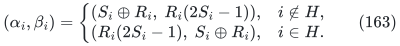

The coordinate sum is <code class="math">S_i</code>. The left top weight is
<code class="math">w(S\setminus H)+w^{S\oplus H}(R)</code>, where <code class="math">w_i^G=(-1)^{G_i}w_i</code>.
The parents store these original coefficient weights. A compatible pair is exactly one with binary coordinatewise sums.

Choose the smallest indexed full mask <code class="math">X</code> for each distinct original top sum, and denote this family by <code class="math">\mathcal F</code>. For a given <code class="math">S</code>, let <code class="math">N_j(S)</code> count its canonical witnesses at Hamming distance <code class="math">j</code>. Fix integers <code class="math">b,u,v</code> with
<code class="math">0\le u\le a-b</code>, <code class="math">0\le v\le b</code>, and <code class="math">j=b+u-v</code>. Set

<!-- math-display: 421b935db2e6ab0d36b96c9f
Q=\binom{a-b}u\binom bv,\qquad
c(S,H)=\#\{X\in\mathcal F:
 |(X\oplus S)\setminus H|=u,\quad |(X\oplus S)\cap H|=b-v\}.
\tag{164}
-->
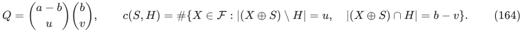

For <code class="math">R=X\oplus S\oplus H</code>, the required variation quotas are <code class="math">u,v</code>.
For fixed <code class="math">H</code>, its signed sum equals
<code class="math">w(X)-w(S\oplus H)</code>, so canonical contributions remain distinct.
Consequently <code class="math">c(S,H)</code> is a lower bound on the actual signed quota-image size and <code class="math">c(S,H)\le Q</code>.

Counting the same pairs <code class="math">(Y,H)</code>, with <code class="math">&#124;Y&#124;=j</code>, in two orders gives

<!-- math-display: d51625686e570355db3c9672
\binom aj\binom ju\binom{a-j}v=\binom ab Q,\qquad
\frac1{\binom ab}\sum_{|H|=b}c(S,H)
 =\frac{N_j(S)Q}{\binom aj}.
\tag{165}
-->
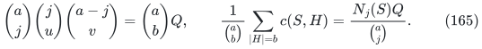

Choose a distance band <code class="math">I</code> by the integer condition
<code class="math">\sum_{j\notin I}\binom aj\le N/2</code>.
For every <code class="math">S</code>, some <code class="math">j\in I</code> then has
<code class="math">N_j(S)\ge N/[2(a+1)]</code>. All distances in the band are enumerated.

### II.3.2. Weighted owner covers

For a fixed distance and quota configuration, put <code class="math">C_0=2(a+1)</code>,

<!-- math-display: 9eb6860a6ca032cd01a2abb6
\mathcal E=\{S:C_0N_j(S)\ge N\},\qquad
M=\frac{NQ}{C_0\binom aj},\qquad
L_Q=1+\lfloor\log Q\rfloor.
\tag{166}
-->
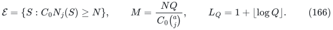

Configurations with <code class="math">M&gt;Q</code> have empty eligible universe. Otherwise maintain pairs <code class="math">(H_i,\ell_i)</code>, with <code class="math">0\le\ell_i&lt;L_Q</code>, and the implicit uncovered set
<code class="math">\mathcal U=\{S\in\mathcal E:c(S,H_i)&lt;2^{\ell_i}\text{ for all earlier }i\}</code>.
When <code class="math">\mathcal U\ne\varnothing</code>, choose <code class="math">H</code> satisfying
<code class="math">\sum_{S\in\mathcal U}c(S,H)\ge M&#124;\mathcal U&#124;</code>.
For <code class="math">r_\ell=\#\{S\in\mathcal U:c(S,H)\ge2^\ell\}</code>, the inequality
<code class="math">c\le\sum_{2^\ell\le c}2^\ell</code> gives some threshold with
<code class="math">2^\ell r_\ell\ge M&#124;\mathcal U&#124;/L_Q</code>. Choose a maximizing threshold and append that pair.

Charge <code class="math">2^{-\ell}</code> to the pair. If it removes <code class="math">r</code> of the <code class="math">U</code> current elements, its charge is at most <code class="math">Lr/(MU)</code>. Summing this through successive removals is bounded by a harmonic sum:

<!-- math-display: fe7253829e8a5b272de66484
\sum_i2^{-\ell_i}\le\frac{L_Q H_{|\mathcal E|}}M
 \le\frac{L_Q(1+a\ln2)}M,\qquad
K:=\#\{i\}\le\mathrm{poly}(a)2^d.
\tag{167}
-->
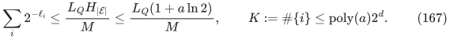

The last inequality uses <code class="math">2^{-\ell_i}\ge1/Q</code> and
<code class="math">\binom aj\le2^a</code>. Grouping pairs by threshold yields, for each group,

<!-- math-display: 2c7f039b8ca94192e1913b9e
\frac{K_\ell Q}{2^\ell}
 \le\mathrm{poly}(a)\frac{\binom aj}{N}.
\tag{168}
-->
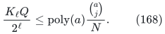

Every eligible pattern succeeds in at least one of the enumerated groups.

Here is a low-state implementation of the owner choice. A prefix fixes owner-one coordinates <code class="math">F_1</code>, owner-zero coordinates <code class="math">F_0</code>, and leaves <code class="math">W</code> unfixed. It has
<code class="math">B_P=\binom{&#124;W&#124;}{b-&#124;F_1&#124;}</code> completions. For a mask <code class="math">Y</code>, put
<code class="math">z_1=&#124;Y\cap F_1&#124;</code>, <code class="math">z_w=&#124;Y\cap W&#124;</code>. The number of these completions giving the prescribed quotas is zero unless <code class="math">&#124;Y&#124;=j</code>, and otherwise equals

<!-- math-display: 85e0ec7855eda8285930059b
k_P(Y)=
 \binom{z_w}{b-v-z_1}
 \binom{|W|-z_w}{b-|F_1|-(b-v-z_1)}.
\tag{169}
-->
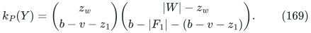

Infeasible binomial arguments mean zero. The mean total trace over the prefix's completions is:

<!-- math-display: 4724bdc68b755f57a87f4767
A_P/B_P,\qquad
A_P=\sum_{S\in\mathcal U}\sum_{X\in\mathcal F}k_P(S\oplus X).
\tag{170}
-->
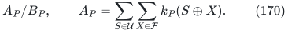

The current mean is the completion-count-weighted average of the feasible next-bit means. Exact cross multiplication therefore chooses a child with no smaller mean. Starting from (165), <code class="math">a</code> choices produce the required owner. The uncovered set is kept fixed throughout these prefix choices.

Partition coordinates computationally into halves of sizes <code class="math">\lfloor a/2\rfloor,\lceil a/2\rceil</code>, independently of ownership. Write <code class="math">S=(s,z)</code>, <code class="math">X=(x,y)</code>. For fixed <code class="math">s</code>, scan <code class="math">\mathcal F</code> and group its low masks <code class="math">y</code> by the three high-part counts of <code class="math">x\oplus s</code> in <code class="math">F_1,F_0,W</code>. There are polynomially many arrays of length <code class="math">2^{\lceil a/2\rceil}</code>. For each high-count triple, form the low kernel by inserting its counts and the low-mask counts into (169). Summing their XOR convolutions gives every value
<code class="math">\sum_X k_P((s,z)\oplus X)</code> for that <code class="math">s</code>.

A Walsh transform computes each convolution exactly: apply the butterflies <code class="math">(x,y)\mapsto(x+y,x-y)</code>, multiply the transforms pointwise, apply the transform again, and divide by its length. Character orthogonality proves exactness. The counts and intermediate values have polynomial bitlength. Grouping by high distance similarly computes <code class="math">N_j((s,z))</code>; grouping by the two high quota counts computes <code class="math">c((s,z),H_i)</code> for any previous pair. Retain the eligibility/uncovered Boolean array for this <code class="math">s</code>, and process previous pairs sequentially.

The canonical scan itself sorts the two half-subset occurrence lists and heap-merges their pair-sum rows. Process each equal-weight run completely, retaining only its smallest full mask. It costs <code class="math">O^*(2^a)</code> time and <code class="math">O^*(2^{a/2})</code> state per reset, including repeated and negative sums. For each <code class="math">s</code>, its scan dominates the polynomially many low transforms. Enumerating all <code class="math">s</code>, a prefix score, termination test or threshold count costs
<code class="math">O^*(2^{3a/2}(1+K_{\rm old}))</code> time and
<code class="math">O^*(2^{a/2}+K_{\rm old})</code> state.
Summing over the <code class="math">K</code> choices proves the first line of (162).

For each nonempty group and <code class="math">t=j/a-1/2</code>, binomial upper bounds turn (168) into

<!-- math-display: 947b93abf94d5a627750534c
\log Q-\ell+\log K_\ell
 \le d-aD(t)+O(\log a),\qquad
D(t)=1-h(1/2+t).
\tag{171}
-->
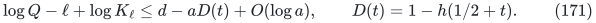

The owner lists are constructed before the common-prime selection of Section II.4, which uses their actual signed quota images.

### II.3.3. Equal rates on unequal owner regions

Fix <code class="math">p=1/20</code>. For an exact distance <code class="math">j</code>, set

<!-- math-display: b6903e5e3844c620db8312ac
t=j/a-1/2,\qquad z=\frac{t}{1-2p},\qquad
b=a(1/2+z),\qquad
u=p(a-b),\quad v=pb.
\tag{172}
-->
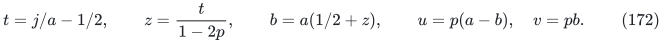

Then <code class="math">b+u-v=j</code>, the total variation radius is <code class="math">pa</code>, and the ideal natural quota entropy is <code class="math">a h(p)</code>, independent of <code class="math">t</code>.
Round <code class="math">b</code>, round <code class="math">u=p(a-b)</code>, and define <code class="math">v=b+u-j</code>. This preserves the distance exactly and changes all counts by <code class="math">O(1)</code>. On the active band <code class="math">&#124;t&#124;\le.06</code>, both owner regions and both quota fractions have fixed positive interior margins, so rounding changes logarithmic estimates by <code class="math">O(\log a)</code>. Thus

<!-- math-display: 83c188347bd60b9c1a2ae9ae
\log Q=a h(p)+O(\log a),\qquad u+v=pa+O(1).
\tag{173}
-->
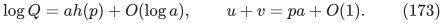

The band exists for every original pattern: strict extraction does not increase density, so <code class="math">d/a\le.0085+O(1/m)</code>, whereas the positive entropy series and <code class="math">\ln2&lt;52/75</code> give

<!-- math-display: b46db8b13ddbda11f54dda0c
D(.06)\ge\frac{2(.06)^2}{52/75}
 =\frac{27}{2600}>\frac{17}{2000}.
\tag{174}
-->
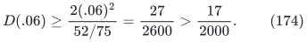

The binomial tail outside the band is at most
<code class="math">2(a+1)2^{a h(.56)+O(1)}</code>, hence is below <code class="math">N/2</code> after a fixed coordinate cutoff. The algorithm verifies the band by the exact integer tail comparison.

Write <code class="math">n_-=a-b</code> and <code class="math">n_+=b</code> for the exact owner-region sizes. Their ideal values are <code class="math">a(1/2-z)</code> and <code class="math">a(1/2+z)</code>, respectively, with bounded rounding error.

### II.3.4. Physical profiles and background allocation

Choose each local useful cardinality layer, balanced layout and child role from its physical integer image before common-prime selection. Full selected-support size at least its Good threshold gives a useful physical layer/layout after a polynomial loss in the coordinate count alone; this gives the physical local-layer contrast of Section II.2. Include all such enumerated local images in the common-prime universe, together with the global exact-quota top images. Keep the selected local images and child roles fixed throughout the following top refinement. Once the common prime path makes the global top image good, retain one variation witness per occupied top residue; each witness belongs to a residual cyclic-layout branch from Section II.6.1. A polynomial pigeonhole leaves one branch with a reciprocal-polynomial fraction of these residues. Partition the top regions into a fixed number <code class="math">Q_{\rm grid}</code> of fine chunks and enumerate their support counts; repeat the same pigeonhole step for these profiles. The algorithm enumerates every branch, and the eligibility allowance includes these polynomial losses. Local images remain fixed.

For an actual top profile, put <code class="math">P_-=\prod_{C\subseteq H^c}\binom{&#124;C&#124;}{u_C}</code> and <code class="math">P_+=\prod_{C\subseteq H}\binom{&#124;C&#124;}{v_C}</code>, where <code class="math">C</code> ranges over its fine chunks and fixed residual coordinates are singleton chunks. Write <code class="math">h_-=\log P_-</code>, <code class="math">h_+=\log P_+</code>, and <code class="math">r=u+v</code>. The exact raw top-domain logarithms are

<!-- math-display: 71516dd882a91bf3644d7acb
L_L=n_-+h_++v,\qquad
L_R=n_++h_-+u,
\qquad
M_{\rm total}=m+h_-+h_++r.
\tag{175}
-->
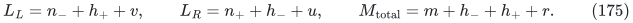

These use actual products, including sparse profiles. Since
<code class="math">P_-P_+\le Q</code>, take the exact upper cap

<!-- math-display: 556e89686b9b8fdc6b290083
M_{\rm cap}=\frac{m+\log Q+r}{2}.
\tag{176}
-->
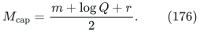

Choose <code class="math">M_j\in[\max(m/2,L_j),M_{\rm cap}]</code> with sum <code class="math">M_{\rm total}</code>. Then <code class="math">z_j=M_j-L_j\ge0</code> are background counts summing to <code class="math">m-a</code>. The interval conditions follow as follows. The upper-sum condition is <code class="math">M_{\rm total}\le2M_{\rm cap}</code>, from <code class="math">P_-P_+\le Q</code>. The sum of the two lower bounds is handled by four cases. The both-<code class="math">m/2</code> case uses <code class="math">M_{\rm total}\ge m</code>; the both-<code class="math">L_j</code> case uses <code class="math">m\ge a</code>. The two mixed cases follow from
<code class="math">m/2\ge(1-p)\max(n_-,n_+)</code> up to bounded rounding. Each individual upper bound exceeds its raw lower bound when the following two inequalities hold with fixed slack:

<!-- math-display: 120aba03e199185b84583b17
m-a\ge2|z|[1-h(p)-p]a,\qquad
m-a\ge[2|z|(1-p)-p]a.
\tag{177}
-->
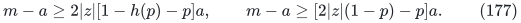

The first proves <code class="math">L_j\le M_{\rm cap}+O(\log a)</code>, using
<code class="math">h_\pm\le n_\pm h(p)+O(\log a)</code>; the second proves the mixed lower-sum cases. Also <code class="math">M_{\rm cap}\ge m/2</code>.
With <code class="math">p=.05</code>, <code class="math">&#124;z&#124;\le1/15</code>, <code class="math">a=.9m+O(1)</code>, their right sides are respectively less than <code class="math">.08m</code> and at most <code class="math">.069m</code>, whereas <code class="math">m-a=.1m+O(1)</code>. Thus every profile has a feasible interval pair after a fixed cutoff.

Use exact integer products to choose the background counts. Binary-search the least integer <code class="math">z_L\in[0,m-a]</code> satisfying <code class="math">z_L+L_L\ge m/2</code> and <code class="math">m-a-z_L+L_R\le M_{\rm cap}</code>, and put <code class="math">z_R=m-a-z_L</code>. Real interval feasibility shows that the other two bounds are missed by at most one. Both tests are monotone; squaring the domain products compares them with the integers <code class="math">2^m</code> and <code class="math">2^{m+r}Q</code>. Accordingly,

<!-- math-display: bd0415a4381749ffc45fe9f0
M_j\ge m/2-O(1),\qquad
M_j\le\frac{m+a[h(p)+p]}2+O(\log a).
\tag{178}
-->
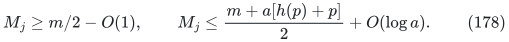

The fixed slack in (177) absorbs the binomial and quota-rounding corrections. Every one of the <code class="math">m-a</code> background coordinates is assigned.

Equation (178) supplies the actual movable mass required by the local atomic allocation in Section II.5; the local mask images and child roles remain fixed.

Substituting (173) and (178) into the child and restart resource formulas of Sections II.5 and II.7 gives the central top coefficients

<!-- math-display: 7ab153c29325c1e900902596
D_p=\frac{h(p)-p}{2},\qquad
A_p=\frac{h(p)-3p}{4},\qquad
f_p=\frac{h(p)+p}{8}.
\tag{179}
-->
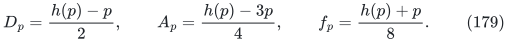

Equation (171) subtracts <code class="math">aD(t)</code> from both central raw and restart exponents and preserves the leaf coefficient. The checker enlargement affects incidence and tuple state only. Each fine-chunk factor has logarithmic size at most twice its coordinate count. With <code class="math">Q_{\rm grid}</code> fixed before the input, all layout, count-profile and residue-pigeonhole families have fixed polynomial size. Their logarithmic losses are polynomial factors. The fine-factor packing in Section II.5 incurs <code class="math">O(m/Q_{\rm grid}+Q_{\rm grid}\log(m+1))</code> error. The fixed grid and cutoff in Section II.8 place this error within the certified margins.

## II.4. Common modular filters and weighted covers

Let <code class="math">u=n+L+2</code>. Every integer difference below has fewer than <code class="math">2u</code>
binary digits. A pattern means a permitted selected mask together with
its signing or ownership label. Its image is a set of distinct integer
sums. For a distinct image <code class="math">X</code>, define

<!-- math-display: 95758c98d56f8fba2eb73456
C_q(X)=\sum_{z\bmod q}f_z(f_z-1),
\qquad f_z=|\{x\in X:x=z\bmod q\}|.
\tag{180}
-->
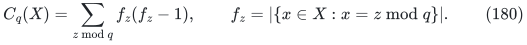

For <code class="math">h\ge4</code> there are at least <code class="math">2^h/(4h)</code> primes in
<code class="math">[2^h/(4h),2^h)</code>. Indeed, for <code class="math">x=2^h</code> the central binomial
coefficient is at least <code class="math">2^x/(x+1)</code>. Its valuation at each prime
<code class="math">p</code> is at most <code class="math">\lfloor\log_px\rfloor</code>, by the factorial valuation
formula. Hence it is at most <code class="math">x^{\pi(x)}</code>, so
<code class="math">\pi(x)\ge(x-\log_2(x+1))/h</code>. Subtracting at most <code class="math">x/(4h)</code>
smaller primes proves the claim; <code class="math">x</code> is composite.
A sieve constructs the pool. Conditioned on <code class="math">q\mid x-y</code>, the condition
<code class="math">qp\mid x-y</code> is exactly <code class="math">p\mid(x-y)/q</code>, including repeated prime
factors. The quotient has at most <code class="math">2u</code> distinct prime divisors. Thus a
uniform prime in this pool satisfies

<!-- math-display: 4ec82afa9aa98dd93e2cf013
\mathbb E_p C_{qp}(X)\le8u^2 2^{-h}C_q(X).
\tag{181}
-->

Call <code class="math">p</code> bad for <code class="math">X</code> if <code class="math">2^hC_{qp}(X)&gt;80u^2C_q(X)</code>.
At most one tenth of the pool is bad. If <code class="math">C_q(X)=0</code>, every prime is
good. Let <code class="math">2^B</code> bound the total number of individual patterns;
For example, encode mask labels and the indices of the fixed layout
families and take
<code class="math">B=4n+100Q_{\rm grid}^2\lceil\log_2(n+1)\rceil+100Q_{\rm grid}^2</code>.
The constructive families above have polynomial degree linear in
<code class="math">Q_{\rm grid}</code>, so this bounds every label length. At each fixed prefix <code class="math">q</code>, select
<code class="math">k=32(B+1)</code> prime positions with repetition. If <code class="math">b_A</code> earlier positions
were bad for pattern <code class="math">A</code>, choose the next prime minimizing

<!-- math-display: 681ff03eab9f07d3a481603a
\sum_A2^{b_A+1_{\{p\text{ bad for }A\}}}.
\tag{182}
-->

Its conditional mean is at most <code class="math">11/10</code> times the preceding sum.
After <code class="math">k</code> choices the sum is at most <code class="math">2^B(11/10)^k&lt;2^{k/4}</code>.
Each pattern is bad at fewer than <code class="math">k/4</code> positions. Every triple of
patterns therefore has a position good for all three.

Let <code class="math">\ell_0,\ell_L,\ell_R</code> be the natural image scales supplied by
the representations. Split the sorted scale increments into pieces
at most <code class="math">\lceil\ell_{\max}/16\rceil</code>, retaining all three endpoints.
There are at most nineteen pieces. A piece smaller than four uses
factor one; every other piece uses (182). Branch over the selected
prime positions, stopping an image at its scale. This fixed-depth tree
has polynomial size. Every eligible triple has a path good at all
active stages. Its recorded moduli satisfy

<!-- math-display: e7ba014a8afe390432134a09
\frac{2^{\ell_i}}{\mathrm{poly}(u)}\le p_i\le2^{\ell_i},
\qquad
C_{p_i}(X_i)\le(80u^2)^{19}|X_i|^2/p_i.
\tag{183}
-->

They form a divisibility chain, with
<code class="math">p_j/p_i\le2^{\ell_j-\ell_i}</code> when <code class="math">\ell_i\le\ell_j</code>.
Skipping short pieces loses a constant factor. Cauchy--Schwarz gives

<!-- math-display: 31ea09a8751d86e530c5b619
|X_i\bmod p_i|\ge
\frac{p_i}{p_i/|X_i|+(80u^2)^{19}}.
\tag{184}
-->

Eligibility means <code class="math">&#124;X_i&#124;\ge2^{\ell_i}/\mathrm{poly}(u)</code> with
a fixed polynomial. Fix an integer <code class="math">E_{\rm img}</code> larger than its degree and put
<code class="math">\delta=u^{-(2E_{\rm img}+400)}</code>. After a fixed small-input cutoff every
eligible image on a common-good path has density at least <code class="math">\delta</code>.

Process one image at a time, replaying the selected prime positions
to compute its bad count and accumulating (182). The physical
local-image scans in Section II.2.7 include all signing, layer and
layout labels, with Good-set membership tested outside the signing
loop. Their total cost per candidate is <code class="math">O^*(2^{c+r})</code>.
Prime enumeration contributes <code class="math">2^{\ell_{\max}/16+O(1)}</code>.
Ownership scans retain their actual owner count. Section II.8 bounds
all construction costs. The live arrays contain one image, its
residue frequencies and polynomially many prime positions; potential
values have polynomial bit length.

### II.4.1. A universal weighted translate cover

Suppose images <code class="math">I_A\subseteq\mathbb Z/p\mathbb Z</code> have density at
least <code class="math">\delta</code>. Let <code class="math">c(\rho)\ge0</code> be an exact rational cost with
uniform mean <code class="math">\mu</code>. If <code class="math">Q</code> pattern-offset pairs remain uncovered, let
<code class="math">\mathrm{cov}(\rho)</code> count those covered by <code class="math">\rho</code>. Its mean
is at least <code class="math">\delta Q</code>. When <code class="math">\mu&gt;0</code>, select a residue with score
at least the mean of

<!-- math-display: 201a121e821958b072a7316f
\mathrm{cov}(\rho)-\frac{\delta Q}{2\mu}c(\rho).
\tag{185}
-->

That mean is at least <code class="math">\delta Q/2</code>. The selected residue covers at
least <code class="math">\delta Q/2</code> pairs and costs at most <code class="math">2\mu/\delta</code>, since
<code class="math">\mathrm{cov}(\rho)\le Q</code>. If <code class="math">\mu=0</code>, all costs vanish and
use coverage alone. Repeating for
<code class="math">O(\delta^{-1}\log(Q+1))</code> rounds gives a polynomial-size list
<code class="math">\mathcal R</code> satisfying

<!-- math-display: a5cc62b84932f3de288609b0
\mathcal R\cap(I_A+v)\ne\varnothing\quad\text{for all }A,v,
\qquad
\sum_{\rho\in\mathcal R}c(\rho)
\le\mathrm{poly}(u)\mu.
\tag{186}
-->

For <code class="math">s</code> costs with positive means use the penalty
<code class="math">\delta Q\sum_i c_i(\rho)/(2s\mu_i)</code> in (185). This proves
(186) separately for each cost. Zero-mean terms are identically zero.

Find the residue by interval conditional expectation: bisect
<code class="math">[0,p-1]</code> and retain a child whose average score is at least its
parent's average. To sum coverage on an interval, generate one image
and its prefix-count array. Enumerate offsets, testing uncoveredness
by replaying the preceding residue list. A translated interval needs
at most two prefix queries. Cost prefix sums supply the other terms.
No pattern-offset table is retained.

For local covers, each signing retains its residue list, uncovered
count, current interval, and fixed normalizers. During one shared
selected-set scan visit every compatible signing and accumulate its
conditional scores. Generate its cost arrays in one reusable workspace.
Thus (160) pays support tests and image scans, while the remaining
cost and cache work is

<!-- math-display: a0887eeca76fbeb5d8e322d7
O^*\!\left(K(P_{\max}^2+2^{m-c}+P_{\max})\right)
\quad\text{time},\qquad
O^*(P_{\max}+K+2^{m-c})\quad\text{space}.
\tag{187}
-->

Construct the cover once for a fixed outer configuration and top
residue; reuse it in every interval query. It covers the solution's
translated local image at its actual parent lift.

## II.5. Top projection and atomic local generators

### II.5.1. Projecting a useful integer layer

Let a fixed signed top base have <code class="math">b</code> coordinates, selected set <code class="math">T</code> of
size <code class="math">sb</code>, and a cardinality layer with <code class="math">M</code> distinct sums. Orient the
layer by complementation inside <code class="math">T</code> so its size is at most <code class="math">sb/2</code>.
Trim to the fixed cell divisibility as in Section II.2, losing only
a polynomial factor, and recanonicalize each retained sum in the
complete trimmed layer of <code class="math">T</code>.

The balanced-cell family gives a layout into <code class="math">Q_{\rm grid}</code> equal
cells and a subfamily <code class="math">\mathcal F</code> of at least
<code class="math">M/\mathrm{poly}(b)</code> canonical masks with equal selected and
layer counts in each cell. The family of distinct projected masks from <code class="math">\mathcal F</code>
on any union of cells is sum-injective. Otherwise
replacing the larger equal-sum projection in its full witness would
preserve both its cardinality and sum while decreasing the canonical
witness.

For completeness, write <code class="math">\mathrm{Ent}</code> for binary Shannon
entropy. Factoring joint probabilities proves the chain rule;
concavity of <code class="math">-\sum p_i\log_2p_i</code> shows that additional conditioning
decreases conditional entropy. For uniform <code class="math">D\in\mathcal F</code>, expand
<code class="math">\mathrm{Ent}(D\cap U)</code> in coordinate order, where <code class="math">U</code> is a
uniform union of <code class="math">p</code> cells. Replace conditioning on earlier coordinates
of <code class="math">U</code> by conditioning on all earlier coordinates. Each coordinate
belongs to <code class="math">U</code> with probability <code class="math">p/Q_{\rm grid}</code>, so

<!-- math-display: 8cf6adb435560f539d543a94
\mathbb E_U\mathrm{Ent}(D\cap U)
\ge\frac{p}{Q_{\rm grid}}\log_2|\mathcal F|.
\tag{188}
-->

Some union therefore has at least <code class="math">&#124;\mathcal F&#124;^{p/Q_{\rm grid}}</code>
projected masks, all with distinct actual sums. Its size is
<code class="math">a=pb/Q_{\rm grid}</code>, and the selected fraction and relative layer
cardinalities are unchanged. Thus a support threshold <code class="math">2^\ell</code> on
the base yields a projected permitted image of size at least

<!-- math-display: be4a47461be1f50121cb23a6
2^{(a/b)\ell}/\mathrm{poly}(b).
\tag{189}
-->

Enumerate the layouts and all cell unions of the prescribed size.
The number is polynomial with fixed degree, since <code class="math">Q_{\rm grid}</code> is
fixed. Choose <code class="math">p</code> divisible by four; downward grid rounding changes
the ideal <code class="math">a/m</code> by at most <code class="math">4/Q_{\rm grid}</code>. All these are integer
images selected before common-prime construction. The signed
coordinates outside the projection remain ordinary top background.
The entire base-signing offset is restored once after the final join.

Let <code class="math">Q_L,Q_R</code> be the actual products of the permitted top-mask
binomial counts, and let <code class="math">F=m-a</code> background coordinates remain.
Choose <code class="math">z_L</code> nearest to
<code class="math">(F+\log_2Q_R-\log_2Q_L)/2</code>, and put <code class="math">z_R=F-z_L</code>.
This is an exact integer search comparing <code class="math">2^{2z_L}Q_L</code> with
<code class="math">2^FQ_R</code>. When the background-feasibility inequalities below have
their fixed reserve, both counts are nonnegative after the cutoff.
The ancestor products <code class="math">A_j=2^{z_j}Q_j</code> then satisfy

<!-- math-display: 2558287c0da3b4650018e217
\begin{gathered}
\log_2A_j\le\tfrac12(F+\log_2Q_L+\log_2Q_R)+1
\le\tfrac m2+(\overline H-\tfrac12)a+1,\\
\log_2A_j\ge\tfrac m2+(\overline H-\tfrac12)a
 -O(Q_{\rm grid}\log(m+1)),
\end{gathered}
\tag{190}
-->

where <code class="math">\overline H</code> is the actual mean of the two mask entropy rates.
The upper comparison uses exact product balancing and the binomial
upper bound. The lower comparison also uses the binomial lower bound
over the fixed number of cells. In particular
<code class="math">\overline H\ge1/2</code> supplies the movable-mass floor, while the upper
comparison gives incidence bounds with polynomial losses only.

### II.5.2. Biased top shells

Choose a strict top base of size <code class="math">b=\rho m</code> before its useful layer.
Its full support has deficiency <code class="math">d</code>. Let <code class="math">s=21/50</code>. Round the base
to the required fixed multiple so the shell size is exactly <code class="math">r=sb</code>. Partition its <code class="math">r</code>-subsets by dyadic
support size. If <code class="math">g</code> is the cardinality of a class with threshold
<code class="math">2^\ell</code>, maximize <code class="math">2^\ell g</code>. The fixed-layer trace theorem and
the gain certificates at <code class="math">s=.42</code> give

<!-- math-display: dcd1cd13613cbce5569f2c90
\ell+\log g\ge[h(s)+s]b-\phi_0d-O(\log(m+1)),
\qquad
\phi_0=\begin{cases}.345,&x_0\le.05,\\.3575,&x_0>.05.
\end{cases}
\tag{191}
-->

Here <code class="math">x_0</code> bounds the full top-block deficiency density, and strict
extraction preserves this density bound. Let the linear translate
cover of this class have <code class="math">K</code> centers. It satisfies
<code class="math">Kg\le\mathrm{poly}(m)2^b</code>. Put

<!-- math-display: bdd75f27df9ff4852e2027b1
\delta=sb-\ell,\qquad \kappa=\log K,\qquad \tau_0=1-h(s).
\tag{192}
-->

Since <code class="math">g\le\binom br\le\mathrm{poly}(m)2^{h(s)b}</code>,

<!-- math-display: c9b7cdf058820f811befd426
\delta+\kappa\le\tau_0b+\phi_0d+O(\log(m+1)),
\qquad \delta\le\phi_0d+O(\log(m+1)).
\tag{193}
-->

Each center is a separate outer signing. For any original witness,
one center makes its selected top set belong to the class. Negating
that center's coordinates translates the target once. Coordinates
later returned to the background retain their signed weights.

**Physical projection.**

Fix an outer center. Pigeonhole its selected-set support by
cardinality, orient the smaller layer and apply (189) before common
primes. Projection scales the physical deficit to <code class="math">(a/b)\delta</code>;
the outer code cost remains <code class="math">\kappa</code>.

Write <code class="math">k\in[0,s/2]</code> for the smaller-layer fraction on the base and set

<!-- math-display: a0f9f2127a366acbd44fce2c
\begin{gathered}
H_-=h(k),\quad H_+=h(s-k),\quad
\overline H=(H_-+H_+)/2,\quad H_0=h(s/2),\\
L_0=H_0-\overline H,\quad \Delta=H_+-H_-,\quad
D_0'=\tfrac12+s-H_0,\quad p=D_0'-\delta/b.
\end{gathered}
\tag{194}
-->

The active density range makes <code class="math">p&gt;0</code>. Choose the ideal projected size

<!-- math-display: 3a80ca9d58589a84de229cdc
a=\frac{pb}{p+L_0}.
\tag{195}
-->

It gives the exact raw-resource identity

<!-- math-display: a7997a028178f82bb3d6c6a4
-(\tfrac12+s-\overline H)a+(a/b)\delta+\kappa
=-D_0'b+\delta+\kappa.
\tag{196}
-->

Thus the top raw contribution is at most
<code class="math">-D_0b+\phi_0d+O(\log(m+1))</code>, with <code class="math">D_0=D_0'-\tau_0</code>.
The corresponding restart contribution is also bounded by its central
base value. Its difference from that value is

<!-- math-display: 79cc2593ba62aae9e324a9a7
\frac{L_0a}{2p}(\delta/b-s)\le0.
\tag{197}
-->

The leaf contribution satisfies
<code class="math">(\overline H/4-1/8)a\le(H_0/4-1/8)b</code> whenever
<code class="math">\overline H\ge1/2</code>, as proved below. Projection therefore preserves
the required central resource bounds without scaling the outer code.

**Background feasibility.**

Let <code class="math">B=b/m</code>. Balancing the actual top-mask products requires
<code class="math">a(1+\Delta)\le m</code>. A sufficient uniform condition is

<!-- math-display: 8a1adfaaca83ba02fb29db58
1-B\ge\frac{28}{25}pB^2.
\tag{198}
-->

For completeness, put <code class="math">c=s/2</code>, <code class="math">t=c-k</code>, and <code class="math">v=pB</code>. The function

<!-- math-display: 18e5771aaff5da66f4d5dbfb
F(t)=(\tfrac12+v)h(c+t)+(\tfrac12-v)h(c-t)
\tag{199}
-->

has <code class="math">F(0)=H_0</code> and <code class="math">F'(0)=2v h'(c)</code>. On
<code class="math">c\in[1/5,1/4]</code>, <code class="math">0\le t&lt;c</code>, <code class="math">v\le1/5</code>,

<!-- math-display: 670e5c8d6e1b2141b08a7bfa
-F''(t)=
\frac{c(1-c)-t^2-2v(1-2c)t}
{(\ln2)(c^2-t^2)((1-c)^2-t^2)}\ge\frac5{\ln2}.
\tag{200}
-->

After subtracting five times the denominator without <code class="math">\ln2</code>, the
numerator is at least
<code class="math">3/256+(29/16)t^2-(6/5)vt\ge3/256-(144/725)v^2&gt;0</code>.
Completing the square and using <code class="math">h'(c)\le2</code>, <code class="math">\ln2&lt;7/10</code>, gives
<code class="math">F(t)\le H_0+(28/25)v^2</code>. Therefore
<code class="math">L_0\ge p[B\Delta-(1-B)]</code>, proving the sufficient condition.
Endpoint layers follow by continuity. The active choice <code class="math">B\le.85</code>
satisfies it with a fixed margin, since <code class="math">p\le D_0'&lt;.179</code> and
<code class="math">(28/25)(.179)(.85)^2&lt;.15</code>.

Retain only smaller layers with <code class="math">r/4\le k b\le r/2</code>.
This retains a useful layer: the physical class bound gives
<code class="math">\delta/b\le(143/400)T=3861/80000&lt;s/8</code>, so its support entropy per
selected coordinate exceeds <code class="math">7/8-o(1)</code>. A layer with relative
cardinality at most <code class="math">1/4</code> has entropy at most <code class="math">h(1/4)&lt;5/6</code>,
certified by <code class="math">3^9&gt;2^{14}</code>. The fixed gap absorbs layer, trimming,
and layout losses. Thus every original solution has a retained layer.

Every retained layer, useful or otherwise, satisfies <code class="math">k\ge s/4&gt;.1</code>
and <code class="math">s-k\ge s/2&gt;.2</code>. The exact integer comparisons
<code class="math">10^{20}&gt;2^9 9^{18}</code> and <code class="math">5^{10}&gt;2^{23}</code> give
<code class="math">h(.1)&gt;9/20</code> and <code class="math">h(.2)&gt;7/10</code>. Hence

<!-- math-display: 306f0cf79673bb0815464da0
\overline H>\frac{23}{40}>\frac12.
\tag{201}
-->

Exact top-product balancing supplies at least
<code class="math">m/2+(\overline H-1/2)a+O(\log m)</code> movable logarithmic mass per
parent. The atomic-complement allocation therefore applies throughout
the enumerated layer range, rather than relying on eligibility for
each processed configuration.

**Incidence and resource bounds.**

For a full local block with deficiency <code class="math">d_j</code>, the parent ambient
exponent, including the outer top code, is

<!-- math-display: ed378724cfd0142a8c3d06dc
\frac{3m}{2}-d_j-(\tfrac12+s-\overline H)a
 +(a/b)\delta+\kappa.
\tag{202}
-->

Adding the separator degree <code class="math">d_sa</code>, its difference from the central
bound <code class="math">3m/2-d_j+\delta+\kappa-\tau_0b/2</code> is exactly

<!-- math-display: 99716ca2d40d92ce09a7af52
-\frac{L_0a d_s}{p}\le0.
\tag{203}
-->

The integer proxies satisfy <code class="math">d_j\ge x_0m-1</code> and
<code class="math">d\le m\beta(x_0,\rho)</code>. Thus the central incidence excess per
coordinate is at most <code class="math">I+1/m</code>, where

<!-- math-display: 8bf4a79c34b6a3284a61040c
I=\tfrac12\tau_0\rho+\phi_0\beta(x_0,\rho)-x_0.
\tag{204}
-->

The additional one bit in the unnormalized exponent is a factor of two,
included in the polynomial factor. Section II.8 proves <code class="math">I&lt;-1/1250</code> on the active
positive-deficiency interval. This margin pays fixed-grid projection
errors. The code rate is paid once in each outer solve, in its
preparation, and in every top-dependent residue cover; two outer
top signings are never combined by one compatibility checker.

For the local strict-core notation of the resource certificate, the
complete central upper bounds are

<!-- math-display: 5169f614407e3200aab4d26b
\begin{aligned}
R&=-D_0\rho+e\sigma+\phi_0\beta(x_0,\rho)
                  +\phi\beta(x,\sigma),\\
Q&=\tfrac34-A_0\rho-r\sigma-x+\phi_0\beta(x_0,\rho)
                  +\phi\beta(x,\sigma),\\
F&=\max\{1-\sigma,\tfrac38+(H_0/4-1/8)\rho
                                  +(H-1/2)\sigma/2\},\\
A_0&=\tfrac34+s-\tfrac32H_0-\tau_0.
\end{aligned}
\tag{205}
-->

The oriented-half local mode keeps its exact nonpositive compression
corrections. All definitions and inequalities here concern actual
integer images before modular reduction. Common primes are selected
only after those images are fixed. Universal local covers handle every
later background translation, and original-key signing unions retain
the full-block ambient bound without a local Cartesian code factor.

### II.5.3. The ordinary half-selected top

The high-tail mode uses a strict top base <code class="math">V</code> of size <code class="math">b=\rho m</code>,
<code class="math">\rho=18/25</code>. The prefix masks and their complements form a
polynomial signing family. Prefix flips take every original selected
cardinality from <code class="math">&#124;S&#124;</code> to <code class="math">b-&#124;S&#124;</code> in unit steps, so some signing gives
a half-selected set <code class="math">T</code>. Its complementary signing gives <code class="math">V\setminus T</code>.
Since <code class="math">N(V)\le N(T)N(V\setminus T)</code>, one has support at least
<code class="math">\sqrt{N(V)}</code>. Cardinality pigeonholing and (189) give a projected
permitted image at the exact inherited scale

<!-- math-display: cc21dbbc937904c7d98ec67c
\ell_0=\left\lfloor\frac{a}{2b}\log_2N(V)\right\rfloor.
\tag{206}
-->

Let <code class="math">N_0</code> be the original full top-block support. Deficiency density
decreases during extraction, so

<!-- math-display: 428dbf56b5ea0e8e70fcf35a
\ell_0\ge\left\lfloor\frac{a}{2m}\log_2N_0\right\rfloor,
\qquad f_0:=a/2-\ell_0\le\frac{a}{2m}d_0+1.
\tag{207}
-->

Here <code class="math">d_0=m-\log_2N_0</code>. These comparisons use the actual supports.

To choose the projected size uniformly over layers, set
<code class="math">h_0=h(1/4)</code> and <code class="math">p_0=1-h_0-\xi/2</code>, where <code class="math">\xi\le.203</code> is the
nominal base-density bound. For a smaller-layer fraction
<code class="math">k\in[0,1/4]</code>, put

<!-- math-display: 9fe818c82bd0d1a2f84c7aa7
\overline H=\tfrac12[h(k)+h(1/2-k)],\quad
\Delta=h(1/2-k)-h(k),\quad
a_* =\frac{p_0\rho m}{p_0+h_0-\overline H}.
\tag{208}
-->

The following sufficient conditions hold in this mode:
<code class="math">p_0&gt;0</code>, <code class="math">p_0\rho&lt;1/5</code>, and
<code class="math">1-\rho\ge(7/10)p_0\rho^2</code>. Indeed <code class="math">h_0&lt;.812</code>,
<code class="math">\xi/2\le.1015</code>, <code class="math">p_0&lt;.19</code>, and <code class="math">\rho=.72</code>.
They imply <code class="math">a_*(1+\Delta)\le m</code> as follows.
Write <code class="math">t=1/4-k</code>, <code class="math">r=p_0\rho</code>, and

<!-- math-display: f024f9fe3892683290db156e
F(t)=(\tfrac12+r)h(1/4+t)+(\tfrac12-r)h(1/4-t).
\tag{209}
-->

Then <code class="math">F(0)=h_0</code>, <code class="math">F'(0)=2r\log_23</code>, and

<!-- math-display: 7419aa4cebc80250bea67e1e
-(\ln2)F''(t)=
\frac{3/16-t^2-rt}{(1/16-t^2)(9/16-t^2)}\ge5.
\tag{210}
-->

Subtracting five times the denominator leaves at least
<code class="math">3/256+(29/16)t^2-rt\ge3/256-4r^2/29&gt;0</code>.
Completing the square gives
<code class="math">F(t)\le h_0+2(\ln2)(\log_23)^2r^2/5&lt;h_0+.7r^2</code>.
The last strict comparison follows from <code class="math">\ln2&lt;52/75</code> and
<code class="math">3^{200}&lt;2^{317}</code>. Since <code class="math">F=\overline H+r\Delta</code>, the reserve
condition proves

<!-- math-display: 2cd6ab9b3ae7251bfe45b3c8
h_0-\overline H\ge p_0[\rho\Delta-(1-\rho)].
\tag{211}
-->

This yields the asserted background feasibility and

<!-- math-display: c81c47911b2d4ef6610f5af7
\begin{aligned}
(1-\overline H-\xi/2)a_*&=(1-h_0-\xi/2)\rho m,\\
(\overline H/2-1/4)a_*&\le(h_0/2-1/4)\rho m.
\end{aligned}
\tag{212}
-->

Here <code class="math">1/2\le\overline H\le h_0</code>. Round down to an enumerated
four-cell multiple. The reserve is strict, so actual integer mask
products admit nonnegative background counts after the fixed cutoff.
Use the actual binomial products to balance those counts within one
bit, as in the biased-top construction.

The all-layer separator of Section II.6 at selected fraction <code class="math">1/2</code>
has common degree <code class="math">O^*(2^{(1-h_0)a})</code>. If <code class="math">\Lambda_j</code> is the original
parent ambient exponent, exact product balance and (207) give

<!-- math-display: af006da616e67728e5e214f2
\begin{aligned}
\Lambda_j+(1-h_0)a
&\le\tfrac32m-d_j+f_0-(h_0-\overline H)a+O(\log(n+L))\\
&\le\tfrac32m-d_j+\frac{a}{2m}d_0+O(\log(n+L))
\le\tfrac32m+O(\log(n+L)).
\end{aligned}
\tag{213}
-->

The last step uses the least-deficient full top block, so <code class="math">d_0\le d_j</code>.
Incidences retain this actual inherited scale separately from the
strict grid allowances used for raw and leaf resource bounds.

### II.5.4. Whole-complement supports and exact allocation

Fix a local core <code class="math">C\subseteq B_j</code> of size <code class="math">c\ge m/2-O(Q_{\rm grid})</code>, chosen before
its signing and useful layer. Put <code class="math">T=B_j\setminus C</code>. Store one indexed
witness per actual sum in <code class="math">\Sigma(T)</code>, and write

<!-- math-display: be5d64b930304b95d4f15a69
R_T=\log_2N(T)=m-c-d_T\le m/2+O(Q_{\rm grid}).
\tag{214}
-->

The sorted support stream constructs this array in <code class="math">O^*(2^{m-c})</code>
time and <code class="math">O^*(2^{m/2})</code> space, including generation state. Reuse it
across local signings. These coordinates are exclusive to this parent:
replacing a subset of <code class="math">T</code> by its stored equal-sum witness preserves
every compatibility condition.

A fixed local layer and balanced layout give mask families of exact
sizes

<!-- math-display: 7293eb6d2f9ee21cef36f086
W_1=\binom{c/Q_{\rm grid}}{k/Q_{\rm grid}}^{Q_{\rm grid}},\qquad
W_2=\binom{c/Q_{\rm grid}}{(r-k)/Q_{\rm grid}}^{Q_{\rm grid}}.
\tag{215}
-->

Their images and child roles are fixed before top fine-profile
selection. Orient <code class="math">W_1\le W_2</code> and put <code class="math">B_i=\log_2W_i</code>.
For every retained strict local layer, the quarter-layer lemma gives
<code class="math">B_2-B_1&lt;(7/16)c+O(Q_{\rm grid}\log(m+1))</code>.
The scalar policy gives <code class="math">c&gt;.53m</code>, so <code class="math">R_T&lt;.47m</code>.
The top allocation supplies movable ancestor factors of total
log-cardinality <code class="math">M_j\ge m/2-O(Q_{\rm grid}\log(m+1))</code> per parent.
These factors consist of allocated top-mask or coefficient choices and
ordinary background coordinates; the local image stays fixed.

Place the entire support array in child 1. Ideal balancing assigns the
movable masses <code class="math">E_1,E_2</code> as follows:

<!-- math-display: 82c6a9c182d9fff0322f7983
E_1+E_2=M_j,\qquad E_1-E_2=B_2-B_1-R_T.
\tag{216}
-->

Feasibility is equivalent to <code class="math">&#124;R_T-(B_2-B_1)&#124;\le M_j</code>.
For strict local cores both nonnegative terms on the left are at most
<code class="math">.47m+O(Q_{\rm grid}\log(m+1))</code>, leaving a fixed <code class="math">.03m</code> reserve.
For the oriented-half mode below each is at most <code class="math">m/2+O(Q_{\rm grid})</code>, so clamping
the ideal target to the available interval incurs only
<code class="math">O(Q_{\rm grid}\log(m+1))</code> error.

Every small ancestor factor has logarithmic size at most
<code class="math">2m/Q_{\rm grid}+O(\log(m+1))</code>; a free coordinate is one factor of
size two. Order the factors and take an initial segment whose product
first crosses the target. The overshoot is at most one factor.
The target comparison is exact: compare the squares of the two
integer partial domain sizes against their fixed total product.
Only ancestor factors and top background move between children;
each local mask family remains in its prescribed child.
The resulting raw child logarithms differ by
<code class="math">O(m/Q_{\rm grid}+Q_{\rm grid}\log(m+1))</code> from

<!-- math-display: 436890d75045193b9de1a90f
\beta_j=\frac{M_j+R_T+B_1+B_2}{2}.
\tag{217}
-->

The ambient histogram always uses distinct sums of the entire
original full local block <code class="math">B_j</code>. The support-array histogram counts
its distinct entries once; all mask factors retain their indexed raw
labels. In particular, compression does not add another independent
copy of the complement to the ambient domain.

### II.5.5. Raw factors and atomic leaves

A raw child domain is the Cartesian product of its assigned ancestor
factors, one prescribed local mask family, its assigned free coordinates,
and possibly the one atomic support array. Each mask factor specifies
an exact coordinate cell and cardinality. Each coefficient factor
specifies its allowed assignments on its cell. A raw record contains
its exact signed weight and all indexed mask or coefficient choices;
a support entry includes its stored original witness.
These factor records determine every later overlap and compatibility
test. Allowed top-label prefixes are imposed on their corresponding
factors before constructing the leaves.

Split a child's small factors between two stored raw leaves. If its
atomic factor has logarithmic size <code class="math">R_T</code> above half the child-domain
logarithm, put that factor alone in one leaf. Otherwise start with
that factor and add small factors until first crossing half. A child
without an atom starts with an empty first leaf. Thus the larger leaf
has logarithmic size at most

<!-- math-display: f4a0b9173c0b2620aa3560de
F_j\le\max\{R_T,\beta_j/2\}
       +O(m/Q_{\rm grid}+Q_{\rm grid}\log(m+1)).
\tag{218}
-->

Enumerate each leaf explicitly and sort it with its full witness.
Repeated weights retain distinct occurrence IDs. The support atom is
the only factor deduplicated by weight at this stage.

Let <code class="math">\overline\beta</code> be the uncompressed central analytic upper
budget for one child. Across <code class="math">K</code> local signings, the filtered-child
budget is <code class="math">\overline\beta-\ell+\log_2K</code>, and summed leaf starts have
budget <code class="math">\max\{R_T,\overline\beta/2\}+\log_2K</code>.
The active policies satisfy
<code class="math">\overline\beta-\ell&gt;.56919m</code> and
<code class="math">\overline\beta/2-r&gt;.05959m</code> before the declared finite losses.
For strict local cores these follow from
<code class="math">3/4-(.45+.5-h(.225))&gt;.56919</code> and
<code class="math">3/8-(.45+.25-h(.225)/2)&gt;.05959</code>;
the oriented-half bounds are larger.
Since <code class="math">\ell\le r</code>, <code class="math">R_T\le m/2+O(Q_{\rm grid})</code>, and the dictionary exponent is below
<code class="math">.548m</code>, the filtered analytic budget pays capacity and both terms
of the summed leaf initialization. This includes empty pruned calls.

For lift accounting we also need the actual unrestricted child domains.
Concavity gives
<code class="math">B_1+B_2\ge h(\theta)c-O(Q_{\rm grid}\log(m+1))</code>.
Moreover <code class="math">N(B_j)\le2^cN(T)</code>, so <code class="math">d_T\le d_j</code>.
Together with <code class="math">M_j\ge m/2-O(Q_{\rm grid}\log(m+1))</code> this yields

<!-- math-display: 94ef24d7b606a587284e109c
2\beta_j\ge\frac{3m}{2}-[1-h(\theta)]c-d_T
                 -O(Q_{\rm grid}\log(m+1)).
\tag{219}
-->

For strict locals <code class="math">\theta=.45</code>, and for the oriented-half mode
<code class="math">\theta=.5</code>. In either case <code class="math">1-h(\theta)&lt;.015</code> and
<code class="math">d_T\le d_j\le.203m+O(1)</code>. Each unrestricted child therefore has
more than <code class="math">2^{.64m}/\mathrm{poly}(n)</code> occurrences after the fixed
cutoff. Interval and prefix restrictions use the upper initialization
budget above.

### II.5.6. Oriented local halves

The main algorithm takes <code class="math">4\mid m</code>. Split a local full block into
two fixed equal halves and orient them as <code class="math">A,T</code> so that <code class="math">N(A)\ge N(T)</code>.
Move fewer than <code class="math">2Q_{\rm grid}</code> coordinates from <code class="math">A</code> to <code class="math">T</code> so that
<code class="math">c=&#124;A&#124;</code> is a multiple of <code class="math">2Q_{\rm grid}</code>.
Removing a coordinate decreases deficiency; adding one increases it.
Thus, writing <code class="math">d_A,d_T</code> for the resulting deficiencies and using
<code class="math">N(B_j)\le N(A)N(T)</code>, we retain

<!-- math-display: 34e41fa6c28dc0a2b1840765
d_A\le d_T,\qquad d_A+d_T\le d_j.
\tag{220}
-->

Use the support array of <code class="math">T</code> as the atom. On <code class="math">A</code>, enumerate each
prefix signing and its complement. For every original selected mask,
prefix flips change its cardinality by one at a time from its original
size to its complementary size; one attains <code class="math">&#124;A&#124;/2</code>.
The selected half <code class="math">S</code> and its complement, in the signed weights, satisfy
<code class="math">N(S)N(A\setminus S)\ge N(A)</code>. One of the two complementary signings
therefore gives a selected half with support at least <code class="math">\sqrt{N(A)}</code>.
Its natural scale is
<code class="math">\ell_A=\lfloor\log_2N(A)/2\rfloor</code>.
Pigeonholing, complementation inside this selected half, and the
balanced-cell construction give a useful smaller layer with only
polynomial support loss.

The two local mask families have total selected size <code class="math">&#124;A&#124;/2</code> and
mean entropy <code class="math">1/2\le\overline H_A\le h(1/4)</code>. Their contrast is at
most <code class="math">c=m/2-O(Q_{\rm grid})</code>, and <code class="math">R_T\le m/2+O(Q_{\rm grid})</code>,
so the allocation above applies. Replacing <code class="math">c</code> by <code class="math">m/2</code> incurs only
<code class="math">O(Q_{\rm grid})</code> in the following resource formulas.
Compared with the uncompressed half-core formula, compression reduces
each balanced child exponent by <code class="math">d_T/2</code> and raw-parent work by <code class="math">d_T</code>;
the local filter adds <code class="math">d_A/2</code>. The resulting corrections are

<!-- math-display: e7ad5535fd8adae526221abb
(d_A-d_T)/2\le0,\qquad d_A/2-d_T\le0.
\tag{221}
-->

For example, in an ordinary top representation let <code class="math">a</code> be the actual
top size, <code class="math">\overline H_0</code> its actual mean mask entropy, and
<code class="math">f_0=r_0-\ell_0</code> its physical image deficit, where <code class="math">r_0</code> is the
selected top size. Put <code class="math">h=h(1/4)</code> and <code class="math">u=1-h</code>.
Before applying the top central-domination inequalities, the filtered
child and raw-parent budgets satisfy

<!-- math-display: 7f373116242394adcd207d50
\begin{aligned}
\Gamma_{\rm half}
&\le\frac{3m}{4}+(\overline H_0/2-1/4)a-u\frac m2+O(Q_{\rm grid}),\\
J_{\rm half}
&\le\frac{3m}{2}-(1-\overline H_0)a
       +(2h-3/2)\frac m2+f_0,\\
\Lambda_j&\le\frac{3m}{2}-(1-\overline H_0)a-d_j+f_0.
\end{aligned}
\tag{222}
-->

For a biased selected top fraction <code class="math">s</code>, replace the top raw term
<code class="math">-(1-\overline H_0)a</code> by
<code class="math">-(1/2+s-\overline H_0)a</code>; the child coefficient stays unchanged.
An outer top-code logarithm is added once to each summed solve budget.
The actual top entropy is retained until its central-domination lemma
is applied. The ambient histogram still uses the original full local
block. The stored-leaf bound is
<code class="math">\max\{m/2,(1/4+h/4)m+(h/4-1/8)a\}</code> up to the declared finite
losses; it is below <code class="math">.523m</code> for <code class="math">a\le.9m</code>.

### II.5.7. Fixed granularity and arithmetic

Choose <code class="math">Q_{\rm grid}</code> as a fixed multiple of four, independently of
the input. Required integer divisibilities and layer trimming change
<code class="math">O(Q_{\rm grid})</code> coordinates. Binomial estimates, fixed-power root
enclosures, and the fixed number of count refinements add
<code class="math">O(Q_{\rm grid}\log(m+1))</code> to exponent bounds. Every stored sum,
count, factorial and exact comparison has polynomial bit length in
<code class="math">n,L</code>, with fixed constants depending on <code class="math">Q_{\rm grid}</code>.

A union of a multiple of four cells approximates an ideal projected
top size within <code class="math">4m/Q_{\rm grid}</code>. The small-factor packing above and
the subsequent leaf split each miss their targets by at most
<code class="math">2m/Q_{\rm grid}+O(\log(m+1))</code>.
The relevant raw, child, restart and leaf coefficients have absolute
value at most one. Their combined charge is bounded by
<code class="math">20m/Q_{\rm grid}+O(Q_{\rm grid}\log(m+1))</code>; the global certificate
uses the conservative allowance

<!-- math-display: 312429884d364acb29bdc459
100m/Q_{\rm grid}+O(Q_{\rm grid}\log(m+1)).
\tag{223}
-->

Fix <code class="math">Q_{\rm grid}=10^{12}</code> and then a fixed coordinate cutoff as
specified in the resource certificate. Smaller instances are solved
directly. All factors polynomial in the arbitrary input length <code class="math">L</code>
remain explicit polynomial factors. Incidence normalization uses
actual integer product counts.

## II.6. Compatibility and ordered generation

### II.6.1. Assignment containers

The following primitive is deterministic. A zero support uses one empty container. On <code class="math">n</code> coordinates, with ternary support size <code class="math">k</code> and container length <code class="math">2k\le l\le n</code>, let
<code class="math">N_k=\binom nk</code>, <code class="math">A_k=\binom lk</code>, <code class="math">p_k=A_k/N_k</code>. Choose

<!-- math-display: 972401c226e89f7f637d73f4
\nu=\left\lceil16(n+1)/p_k\right\rceil,\qquad
L_k=\lceil4\nu p_k+8(n+1)\rceil.
\tag{224}
-->

A multiset of <code class="math">\nu</code> containers can cover every support while giving each support fewer than <code class="math">L_k=O(n)</code> containing indices. For independent random containers, the potential
<code class="math">\#\{\text{uncovered supports}\}+\sum_B2^{\deg(B)-L_k}</code>
has expectation
<code class="math">N_k(1-p_k)^\nu+N_k2^{-L_k}(1+p_k)^\nu&lt;1</code>.
Indeed <code class="math">N_k\le2^n</code>, <code class="math">\nu p_k\ge16(n+1)</code>, <code class="math">1-p_k\le e^{-p_k}</code> and <code class="math">\log_2(1+p_k)\le2p_k</code> bound each term by less than <code class="math">1/2</code>.
Fix one container at a time by minimizing its exact conditional expectation. The mean over candidates is the previous value, so the final potential remains below one, forcing complete coverage and every degree below <code class="math">L_k</code>. After <code class="math">i</code> choices the conditional expectation is

<!-- math-display: e5c4428e28a9c64b0d187755
(1-p_k)^{\nu-i}U_i+
2^{-L_k}(1+p_k)^{\nu-i}\sum_B2^{d_i(B)}.
\tag{225}
-->

For a proposed next container and <code class="math">s=\nu-i-1</code>, comparisons use the common-denominator integer score
<code class="math">2^{L_k}(N_k-A_k)^sU_Y+(N_k+A_k)^s\sum_B2^{d_Y(B)}</code>.
Its bitlength is <code class="math">O(n\nu)</code>. The central binomial bound gives
<code class="math">N_k/A_k\le(2k+1)\binom nk4^{-k} \le(n+1)\sum_{j=0}^n\binom nj4^{-j}=(n+1)(5/4)^n</code>.
Schoolbook arithmetic, a scan of all supports for each candidate, and all rounds cost at most
<code class="math">O^*(2^{2n}\nu^3)=O^*((125/16)^n)&lt;O^*(2^{3n})</code>.
Support flags/degrees, selected containers and the large operands occupy <code class="math">O^*(2^n)</code> state.

For every selected container <code class="math">Y</code> and binary assignment <code class="math">s</code> on <code class="math">Y</code>, use the rectangle consisting of binary <code class="math">x</code> with <code class="math">x&#124;_Y=s</code>, and ternary <code class="math">y</code> supported on a <code class="math">k</code>-subset of <code class="math">Y</code> with <code class="math">y_i=(-1)^{s_i}</code> on that support. All pairs have binary sums, and every compatible pair is covered. Binary degree, ternary degree and tuple count are respectively

<!-- math-display: fb4c6c18d061f58816ecc325
O^*(N_k/A_k),\qquad O^*(2^{l-k}),\qquad O^*(N_k2^l/A_k).
\tag{226}
-->

Build a support-to-container index by enumerating each container's <code class="math">k</code>-subsets. Its length is <code class="math">\nu A_k=O^*(N_k)</code>, with polynomially many indices per support. A ternary query enumerates just these indices and the permitted assignment extensions. This realizes the degree bound as an actual query-time bound.

For the degree calculation take <code class="math">t\ge0</code>; for <code class="math">t&lt;0</code>, interchange the two region names and parent roles. Write
<code class="math">n_\pm=a(1/2\pm z)</code>, <code class="math">k_\pm=pn_\pm</code>.
Set <code class="math">h=h(p)</code>, <code class="math">g=h-3p&gt;0</code>. Initially use container length <code class="math">2k_\pm</code>. The full right degree exceeds the left by <code class="math">C=2zag</code>. Enlarge the plus-region container by <code class="math">w</code>, keeping the minus-region length unchanged. Define

<!-- math-display: 18717a2d171a27ae9e586167
E(l,k)=l[1-h(k/l)],\qquad
2w-E(2k_++w,k_+)=C.
\tag{227}
-->

The binary degree on the enlarged region decreases by <code class="math">w-E</code>, while its ternary degree increases by <code class="math">w</code>. Thus (227) equalizes the full parent degrees.

For <code class="math">p=1/20</code> and <code class="math">&#124;t&#124;\le.06</code>,
<code class="math">z\le1/15</code>. The rational entropy certificate in Section II.8 gives <code class="math">h(.05)&lt;.2864</code>, hence <code class="math">g&lt;7/50</code>, so

<!-- math-display: e2895ec3c6b196dd9e038267
\frac C{k_+}
 =\frac{2z}{1/2+z}\frac gp
 \le\frac4{17}\frac{14}5=\frac{56}{85}.
\tag{228}
-->

For <code class="math">l\ge2k</code>, differentiation gives
<code class="math">E(2k,k)=E_l(2k,k)=0</code>, <code class="math">0\le E_l&lt;1</code>, and
<code class="math">E_{ll}=k/[(\ln2)l(l-k)]</code>.
Hence <code class="math">E(2k+w,k)\le w^2/(4k\ln2)</code>.
The left side of (227) is strictly increasing with derivative greater than one. At <code class="math">w=3C/4</code>,
<code class="math">E\le63C/(680\ln2)&lt;C/2</code>, using <code class="math">\ln2&gt;1/2</code>;
thus its value exceeds <code class="math">C</code>. The unique root satisfies
<code class="math">0\le w\le3C/4</code>, and its container fits with fixed slack:

<!-- math-display: 9b86463d9f34650fe51bfc1c
2k_++w\le(2+42/85)k_+=\frac{53}{425}n_+<n_+.
\tag{229}
-->

Both complete checker degrees and the global assignment table therefore have logarithmic bounds

<!-- math-display: eaa481d9033e306549d91e0b
D_{\rm side}=\frac a2[h(p)-p]+\frac E2+O(\log a),
\qquad
\log N_{\rm tup}=a h(p)+E+O(\log a).
\tag{230}
-->

The positive binary-entropy series gives <code class="math">D(t)\ge2t^2/\ln2</code>. Combining this with the curvature bound proves, for <code class="math">t\ne0</code>,

<!-- math-display: 11c1bd04c5a0440eb747d2c0
\frac{E}{2aD(t)}
 \le\frac{9g^2}{32p(1-2p)^2}
 \le\frac{49}{360}<\frac38.
\tag{231}
-->

At <code class="math">t=0</code>, use the original containers and <code class="math">E=0</code>.
Integer container lengths bracket the monotone degree crossing. Expanding entropy at rational arguments converts each sign test to a comparison of integer powers with polynomial bitlength. Rounding an interior length changes exponents by <code class="math">O(\log a)</code>; actual polynomial load caps are retained.

### II.6.2. Support-balanced tensorization

Use four subregions for container construction. For a support <code class="math">R</code> on an <code class="math">n</code>-coordinate owner region, remove a residual set <code class="math">T</code> containing <code class="math">&#124;R&#124;\bmod4</code> supported and <code class="math">(n-&#124;R&#124;)\bmod4</code> unsupported coordinates. It has at most six coordinates. Enumerate every such <code class="math">T</code> and its support pattern. The remaining total and support cardinalities are divisible by four.

For any ordered even-size coordinate set with an even support, consider every cyclic interval containing half the coordinates. Its support count changes by at most one when the interval advances by one position. The opposite interval has the complementary support count. Discrete intermediate value therefore gives an interval with exactly half the support. Apply this twice: first divide the remaining region into two equal coordinate/support halves, then divide each half likewise. The four regions have equal coordinate counts and equal support counts.

Enumerating all cyclic choices at these three nodes gives a polynomial family. Every support is balanced by some branch. The residual coordinates remain explicit in all coefficient vectors and actual sums. Their checker enumerates binary assignments, with ternary signs forced on the fixed residual support; its cost is constant.

Suppose the original container ratio is <code class="math">\gamma=l/k</code>. In each regular subregion, set <code class="math">l_i=\lceil\gamma k_i\rceil</code>. On the active range <code class="math">k/n</code> is bounded away from zero and <code class="math">1/2</code>, <code class="math">l/n</code> is bounded below one, and <code class="math">l/k</code> is bounded. Thus all four lengths are feasible after a fixed cutoff. Removing finitely many coordinates and rounding four lengths gives

<!-- math-display: 73777782860bf0bddda50258
\begin{aligned}
\sum_i l_i&=l+O(1),&
\sum_i k_i&=k+O(1),\\
\sum_i n_i h(k_i/n_i)&=n h(k/n)+O(\log n),&
\sum_i l_i h(k_i/l_i)&=l h(k/l)+O(\log n).
\end{aligned}
\tag{232}
-->

The tensor rectangles preserve (226) and (230) up to polynomial factors. Their support indices realize the same sided degrees. Construction runs on regions of size <code class="math">n/4+O(1)</code>, so it takes
<code class="math">O^*(2^{3n/4})</code> time and <code class="math">O^*(2^{n/4})</code> construction state. The full assignment table, its initialization and clearing structure remain separately charged.

In the active band, <code class="math">&#124;z&#124;\le1/15</code>, so the larger owner region has at most <code class="math">.51m+O(1)</code> coordinates. Construction therefore has exponents <code class="math">.3825m</code> and <code class="math">.1275m</code>. The rational entropy enclosures from Section II.8,
<code class="math">h(.05)&lt;.28639696&lt;.2864</code> and <code class="math">D(.06)&lt;.011</code>, together with (231), give

<!-- math-display: 242964e246a0dc42f4e887fc
a h(p)+E
 < .9m[.2864+(3/4)(.011)]+O(\log m)
 =.265185m+O(\log m).
\tag{233}
-->

This includes the tuple table and support incidence indices.

### II.6.3. Exact sided incidence

Combining (176) with the actual-quota form of (230) gives
<code class="math">M_j+D_{\rm side}\le m/2+\log Q+E/2+O(\log a)</code>.
For original local full-support deficiency <code class="math">d_j</code>, the ambient count after the natural top modulus and summing the threshold group's owners therefore has exponent at most

<!-- math-display: e2b111ea9649c210fa2195ad
\frac32m-d_j+d-aD(t)+E/2+O(\log n)
 \le\frac32m-d_j+d-\frac58aD(t)+O(\log n).
\tag{234}
-->

Choosing a least-deficient original full block as top, and extracting without increasing absolute deficiency, gives <code class="math">d\le d_j</code>. The independent sorted parent streams charge the two sided incidence counts separately. At a complementary actual weight, one representative per tensor rectangle is sufficient: every pair in that rectangle has binary coefficient sum. Each distinct parent key pays its own incidence degree once.

### II.6.4. All-layer ordinary separators

Let <code class="math">0&lt;s\le1/2</code> be the selected top fraction. Group the retained
fine cells into four equal coarse regions. Their mask counts are
balanced independently of which raw child holds each factor.

For a cell of size <code class="math">g</code>, let left and right counts be <code class="math">kg</code> and
<code class="math">(s-k)g</code>. A separator must contain the left mask and avoid the right.
Set

<!-- math-display: 7bf0a4e5278a0cb75c0adafe
\alpha=1+\frac{\ln(2-s)}{\ln(1/(1-s))},\qquad
e(k)=\tfrac12+\alpha(k-s/2).
\tag{235}
-->

The separator has <code class="math">e(k)g+O(1)</code> coordinates. Concavity of <code class="math">\ln</code> gives
<code class="math">s\ln(2-s)&lt;-(1-s)\ln(1-s)</code>, hence <code class="math">1&lt;\alpha&lt;1/s</code>.
Consequently <code class="math">k&lt;e(k)&lt;1-s+k</code> throughout the layer interval.
Rational logarithm enclosures and integer rounding determine a
feasible size with only <code class="math">O(\log g)</code> exponent error.

The left degree exponent is

<!-- math-display: a222815d03fce3b1690c1ad0
E_s(k)=(1-k)h\!\left(\frac{e-k}{1-k}\right)
 -(1-s)h\!\left(\frac{e-k}{1-s}\right).
\tag{236}
-->

The right exponent is <code class="math">E_s(s-k)</code>. Put
<code class="math">X=1-k</code>, <code class="math">Y=e-k</code>, <code class="math">Z=1-e</code>, <code class="math">W=1-s-Y</code> and
<code class="math">G=(\ln2)E_s</code>. Direct differentiation gives

<!-- math-display: 271093f88570f2736d83286c
G''=1/X-\alpha^2/Z+(\alpha-1)^2/W.
\tag{237}
-->

Since <code class="math">Z/X\le1</code> and
<code class="math">Z/W\le(1+\alpha s)/(1-2s+\alpha s)</code>,

<!-- math-display: 1fc010030fc0590f23cd027a
ZG''\le
-\frac{2(1-s)(\alpha-1)}{1-2s+\alpha s}<0.
\tag{238}
-->

The chosen <code class="math">\alpha</code> makes <code class="math">G'(s/2)=0</code>. Both sided degrees are thus
at most <code class="math">O^*(2^{d_sa})</code> after taking products over cells, where

<!-- math-display: d8bdada0d9dfb5d3ad5c59f1
d_s=E_s(s/2)=s-h(s/2)+h(s)/2.
\tag{239}
-->

The family-size exponent is
<code class="math">T_s(k)=h(e)-(1-s)h((e-k)/(1-s))</code>.
It is symmetric about <code class="math">s/2</code>. Its second derivative has the sign of

<!-- math-display: 5fba335912d96492b59efa6a
(1-s)[(\alpha-1)^2-\alpha^2(1-s)]/4
 +s\alpha^2(\alpha-1)^2(k-s/2)^2.
\tag{240}
-->

At <code class="math">(k-s/2)^2=s^2/4</code>, four times this upper bound equals
<code class="math">(1-\alpha s)P(\alpha)</code>, where

<!-- math-display: 00899f7b27ae2a6348493f21
P(A)=(1-s)-(1-s)(2-s)A-s(1-2s)A^2-s^2A^3.
\tag{241}
-->

For <code class="math">0&lt;s\le1/2</code>, <code class="math">P(\alpha)\le P(1)=s-1&lt;0</code>.
Hence <code class="math">T_s</code> is concave and <code class="math">T_s(k)\le T_s(s/2)=s</code>.
The global tuple table has <code class="math">O^*(2^{sa})</code> entries.

For an integer region, write <code class="math">c,d</code> for its mask counts and <code class="math">e</code>
for its separator size, and put

<!-- math-display: 5dd56470db220dcf0c5ef47e
B_g=\binom ge,\quad R_g=\binom{g-c-d}{e-c},\quad
H_L=\binom{g-c}{e-c},\quad H_R=\binom{g-d}e.
\tag{242}
-->

Choose <code class="math">\nu=\lceil10(g+1)B_g/R_g\rceil</code> separators and load caps
<code class="math">K_j=\lceil2\nu H_j/B_g+4g+8\rceil</code>. The potential is the number
of uncovered disjoint pairs plus <code class="math">\sum2^{\deg-K_j}</code> over both mask
families. The uncovered-pair term is at most <code class="math">3^g e^{-10(g+1)}</code>. Each of the
two degree sums is at most <code class="math">2^{-3g-8}</code> by <code class="math">\log_2(1+p)\le2p</code>;
therefore the expected potential is below one.
After fixing some separators, with <code class="math">r</code> choices left, its exact
conditional expectation is

<!-- math-display: 797772234dd89ba44506e8f9
U_i(1-R_g/B_g)^r+
2^{-K_L}A_i(1+H_L/B_g)^r+
2^{-K_R}B_i(1+H_R/B_g)^r,
\tag{243}
-->

where <code class="math">A_i,B_i</code> sum the current degree powers. Enumerate all next
separators and retain one no larger than the mean. A common positive
denominator makes every comparison integral. The final potential
below one gives complete coverage and both load bounds.

There are at most <code class="math">2^g</code> candidates per choice, <code class="math">\mathrm{poly}(g)2^g</code>
choices, <code class="math">3^g</code> pair constraints and <code class="math">2^{g+1}</code> degree constraints.
Comparison integers have at most <code class="math">\mathrm{poly}(g)2^g</code> bits.
Schoolbook arithmetic gives <code class="math">O^*(2^{6g})</code> bit time and <code class="math">O^*(2^{2g})</code>
state, including the support-to-separator indices. Four coarse regions
therefore cost <code class="math">O^*(2^{3a/2})</code> time and <code class="math">O^*(2^{a/2})</code> construction
state, in addition to the global tuple table <code class="math">O^*(2^{sa})</code>.
The geometric families are reused under coordinate relabeling.

Store per-region compatible-index lists and enumerate their Cartesian
product for each parent label. A record pays its sided degree.
At a fixed complementary actual weight, retain one left witness per
tuple and query right witnesses through their compatible tuples.
Every pair in a tuple is disjoint. If a genuine pair shares a tuple,
any stored left representative has that weight and avoids the right
mask. Thus representative replacement preserves every match. Initialize
the table once per layout and clear touched entries by stamps; each
output key incurs one degree charge. At <code class="math">s=1/2</code>, the bound is
<code class="math">d_s=1-h(1/4)</code>, as used by the high-tail projection.

### II.6.5. Ordered child streams

Let <code class="math">p\mid P_{\max}</code>, and impose a child residue modulo <code class="math">p</code>. A pair of stored leaf arrays can be streamed in either order

<!-- math-display: f4dcc1266c187474d8aa2a2b
(w\bmod P_{\max},\ w\text{ increasing}),\qquad
((v-w)\bmod P_{\max},\ w\text{ decreasing}).
\tag{244}
-->

Sort the second leaf by its residue modulo <code class="math">p</code>, then modulo <code class="math">P_{\max}</code>, then actual weight and occurrence ID. For each first-leaf occurrence, find the complementary <code class="math">p</code>-slice and regard its pair sums as a row. In the direct order, traverse its residue groups cyclically forward from the first residue crossing the modular pivot, and traverse each residue in increasing actual weight. In the complementary order, traverse cyclically backward from the last residue at the complementary pivot, with decreasing actual weight inside a residue. A heap merges these sorted rows. Begin each cyclic traversal at a whole residue-group boundary, so repeated residues remain contiguous. Empty slices are skipped by their stored indices.

Initialization, arrays and mutable row-heap state are linear in the stored leaf lengths up to polynomial factors. Each advance costs polynomial time. A complete state copy costs its full size and shares only immutable arrays. Occurrence IDs distinguish all repeated values. Mask or coefficient-prefix restrictions are imposed on their fine factors before leaf generation, so they can only decrease the domains.

### II.6.6. The interval band join

Suppose the first child is ordered by <code class="math">(k,x\text{ increasing})</code> and the second by <code class="math">(k,y\text{ decreasing})</code>, with equal primary keys imposing the desired parent residue. For an actual-weight interval <code class="math">[L,U]</code>, maintain two forward cursors in the second stream. At a first occurrence <code class="math">(k,x)</code>, the start cursor is its first same-key occurrence of weight at most <code class="math">U-x</code>, or the first later key. The end cursor is its first same-key occurrence of weight strictly below <code class="math">L-x</code>, or the first later key. Skip earlier keys in both cursors. Their half-open occurrence-position interval is exactly the set of eligible partners, including tied weights and both interval endpoints. Both cursors move forward because <code class="math">x</code> increases and the thresholds decrease within a key.

Keep a circular buffer containing the last <code class="math">B</code> occurrences consumed by the end cursor. If the partner window has length at most <code class="math">B</code>, it is precisely the corresponding suffix of this buffer. Otherwise copy the start state and replay the entire window, then discard the copy. If the mutable state size is <code class="math">S_0</code>, there are at most <code class="math">J_I/B</code> such copies, where <code class="math">J_I</code> counts all potential reported pairs in the interval. Thus the join has time and space

<!-- math-display: 3e1d801ddf9f0200b3ace60e
O^*(N_1+N_2+B+(S_0/B)J_I+J_I),\qquad
O^*(S_0+B),
\tag{245}
-->

in addition to original leaf initialization. The same upper bound applies to early termination, charging a final copy to its potential window. The buffer persists across primary keys and uses absolute occurrence positions; its full capacity is initialized only once per join. Set <code class="math">B=C</code>, where <code class="math">C</code> is the dictionary capacity. The certified leaf bound gives <code class="math">S_0=O^*(C)</code>, so each interval call costs
<code class="math">O^*(F+G+C+J_I)</code>: <code class="math">F</code> pays leaves and initialization, <code class="math">G=N_1+N_2</code> counts filtered-child occurrences, and <code class="math">J_I</code> includes all raw parent pairs, including local overlaps rejected afterward.

### II.6.7. Original-weight unions over local signings

Fix one parent's outer layout, moduli, top residue and lift. For a local signing mask <code class="math">D</code>, set <code class="math">w_i^D=(-1)^{D_i}w_i</code> and <code class="math">\delta_D=w(D)</code>. Disjoint signed-core masks <code class="math">A,B</code> reconstruct the original subset <code class="math">(A\cup B)\oplus D</code>, with

<!-- math-display: 9cd64dc9bd7af066d8c060f4
w((A\cup B)\oplus D)=\delta_D+w^D(A)+w^D(B).
\tag{246}
-->

Use the parent-offset convention: a requested original interval <code class="math">I</code> and parent residue <code class="math">v</code> become <code class="math">I-\delta_D</code> and <code class="math">v-\delta_D\pmod {P_{\max}}</code> inside the signed child join. Restore <code class="math">\delta_D</code> exactly once before key insertion. The top label is unchanged: an indexed mask in ordinary mode or the complete coefficient vector in ownership mode. Any fixed outer top offset in ordinary mode is already included in the branch's target convention; ownership weights are direct original coefficient weights.

A capped query maintains one dictionary of original keys <code class="math">(w,\text{top label})</code>. Sequentially enumerate local signings and their cached polynomial lists of residue seeds, run the restricted band join, reject invalid local overlaps, restore the original witness, and insert the key. Stop the whole query at <code class="math">C+1</code> distinct keys. Free a signing's child states before processing the next signing. If generation completes, retain any original witness per key: differing local witnesses use only exclusive coordinates, so top compatibility is unaffected.

Let <code class="math">F_D</code> include all initialization under the cached seeds of signing <code class="math">D</code>, let <code class="math">G_D(v)</code> count its filtered-child scans, and let <code class="math">J_D(I,\pi,v)</code> count its raw labeled parent tuples in the requested interval and top-prefix cell. With the polynomial seed multiplicities included, the query costs

<!-- math-display: 665f74e7860d3c102d903251
O^*\!\left(C+\sum_D(F_D+G_D(v))
                 +\sum_DJ_D(I,\pi,v)\right),
\qquad
O^*\!\left(C+\max_DF_D\right)\text{ live generation space}.
\tag{247}
-->

The single dictionary is shared across all signings. Raw tuples keep their signing, seed and occurrence labels for charging; equal original output keys are deduplicated across those labels.

Every output uses an original subset of the entire exclusive full local block. Consequently its distinct-key histogram <code class="math">U(v)</code> is bounded by the ambient histogram <code class="math">V(v)</code> formed from original full-local distinct sums, allowed top labels and allocated ordinary top-background occurrences. This bound contains no signing multiplicity. Local image/cover preparation is completed before interval recursion; only polynomial seed lists and scalar states are cached per signing, while temporary image and histogram arrays are regenerated sequentially. Their separate preparation costs and cache space are included in the global resource accounting.

### II.6.8. Independent sorted streams

We prove a general conversion for a single parent. Let <code class="math">U</code> be the number of distinct valid original keys, <code class="math">J</code> the number of raw labeled occurrences, and suppose a restricted interval/prefix query has time
<code class="math">O^*(K+J_{I,\pi})</code> and state <code class="math">S</code>, including after early termination. For (247),

<!-- math-display: a9e9d1de7638702ab047d99a
K=C+\sum_D(F_D+G_D),\qquad J=\sum_DJ_D.
\tag{248}
-->

Choose an integer interval containing all possible original actual weights, with polynomial-bit endpoints; the sum of absolute input weights gives such a bound, enlarged by a constant factor for raw coefficient ranges if necessary. Traverse a binary tree of key cells depth first. A cell is an actual-weight interval and, only at a singleton weight, a top-label prefix. Run its capped query. If it finishes with at most <code class="math">C</code> keys, close the raw generator, sort the completed dictionary, and expose its records. If it reaches <code class="math">C+1</code> keys, discard the dictionary and generator, then split a nonsingleton weight interval at its midpoint. At a singleton weight, split by the next top-label bit. A full label prefix contains at most one key and cannot overflow. For increasing output, visit lower weight intervals first; for decreasing output, visit upper intervals first. Prefix order within a weight may be fixed lexicographically.

Every valid key lies in a unique terminal cell, so it is emitted once. The weight order of cells and sorting within completed dictionaries make the stream globally ordered, with complete equal-weight groups contiguous. A paused stream holds only its completed dictionary and scalar traversal frames. Ancestors retain no dictionaries or raw generator state.

The tree depth <code class="math">H</code> is polynomial in <code class="math">n+L</code>, from the endpoint bitlength and the <code class="math">O(a)</code>-bit top label. At a fixed depth, overflowing cells are disjoint and each contains more than <code class="math">C</code> valid keys; hence there are at most <code class="math">U/(C+1)</code> such cells. The entire binary tree has <code class="math">O(1+HU/C)</code> nodes, including empty children. Every raw occurrence, valid or invalid, has a well-defined original weight and top label and lies in at most one cell per depth. Thus
<code class="math">\sum_{\text{cells}}J_{I,\pi}\le O(HJ)</code>. Sorting completed dictionaries costs <code class="math">O^*(U)</code>, giving the total stream bound

<!-- math-display: fece9dac74fa400194bf4887
O^*(K(1+U/C)+J)\text{ time},\qquad O^*(C+S)\text{ space}.
\tag{249}
-->

This is a total-time bound; it includes empty streams and all starts. Original-weight offsets merely translate a signing's query interval and do not change the unique cell used in the occurrence charging.

Construct the left stream in increasing actual weight and the right stream in decreasing actual weight. Compare a left weight <code class="math">w_L</code> with the increasing transformed right key <code class="math">t'-w_R</code>. Advance the smaller key until they agree or a stream ends. At an agreement, consume the entire left weight group into the compatibility tuple table, then the entire complementary right group through that table. The fixed-weight representative argument proves soundness and completeness for ordinary separators or ownership rectangles. Both streams can be suspended during this process because each exposed dictionary was completed after closing its generator. A constant number of dictionaries and one active generation state suffice.

Let <code class="math">D_L,D_R</code> be the respective tuple degrees and <code class="math">N_{\rm tup}</code> the tuple-table size. Each distinct output key undergoes at most one incidence operation; raw duplicates have already been removed. With immutable incidence indices and once-only tuple initialization charged separately, the complete solve therefore satisfies

<!-- math-display: f32615c4bb73700567427748
\begin{aligned}
T=O^*\big(&K_L(1+U_L/C)+K_R(1+U_R/C)
          +J_L+J_R+U_LD_L+U_RD_R\big),\\
S&=O^*(C+S_L+S_R+N_{\rm tup}).
\end{aligned}
\tag{250}
-->

All restart products are sided. The two local signing unions are scanned independently, and the original full-block ambient bounds control their distinct output keys. Generation stamps or touched-entry clearing charge per-weight table reuse to the already counted left incidences. Exact original indexed witnesses are combined at a compatible match and verified in the input instance.

## II.7. Original keys and covers shared across residue lifts

Fix the top representation, a layout, useful local layers, and a
common-good modulus chain. Write <code class="math">q_0</code> for its top modulus, <code class="math">p_j</code> for
the local modulus on side <code class="math">j</code>, and <code class="math">P_{\max}</code> for the largest recorded
modulus. All divide <code class="math">P_{\max}</code>. Let <code class="math">C=\lceil2^{q_*m}\rceil</code> be the
dictionary capacity specified in Section II.8.

### II.7.1. Restoring keys before taking the union

The original-key identity (246) restores each local center before
deduplication. Ordinary top keys use an indexed mask in the fixed
outer signing; ownership keys use the complete original coefficient
vector. A fixed-key witness can be replaced because all differing
local coordinates are exclusive to that parent.

Let <code class="math">V_j(v)</code> count an ambient family by original parent residue modulo
<code class="math">P_{\max}</code>. It consists of every allowed top label, its assigned top
background choices, and every distinct sum of the original full local
block <code class="math">B_j</code>. This contains all restored parent keys. For their union,

<!-- math-display: fa3c843804e0a23935dcfddc
U_j(v)\le V_j(v),\qquad Z_j:=\sum_vV_j(v).
\tag{251}
-->

The same ambient bound serves every signing. Build its histogram from
the original support stream and the assigned top factors. Retained
keys and witnesses carry their exact indexed masks.

### II.7.2. Exact resource means

For one signing let raw child domains have sizes <code class="math">L_1,L_2</code>, which
depend on the layout and permitted masks, not their signed weights.
Let <code class="math">C_{D1},C_{D2}</code> be occurrence histograms modulo <code class="math">P_{\max}</code>;
raw occurrences include local overlaps and every generator label.
Fold them modulo <code class="math">p=p_j</code>, obtaining <code class="math">A_D,B_D</code>. Define

<!-- math-display: 52558f7a3202cff8cd9681a0
\begin{aligned}
G_D(v,r)&=A_D[r]+B_D[v-\delta_D-r\bmod p],\\
J_D(v,r)&=\sum_{x\bmod P_{\max}:x=r\bmod p}
 C_{D1}[x]C_{D2}[v-\delta_D-x],\\
\mu&=(L_1+L_2)/p.
\end{aligned}
\tag{252}
-->

The mean of <code class="math">G_D(v,r)</code> over <code class="math">r</code> is exactly <code class="math">\mu</code> for every <code class="math">v,D</code>.
The quantity <code class="math">J_D</code> counts raw pairs subject to both congruences;
local disjointness is checked after reporting them.

For a top residue <code class="math">\eta</code>, put <code class="math">H=P_{\max}/q_0</code>. The left lift set
is <code class="math">\Omega_L=\{v:v=\eta\bmod q_0\}</code>; the right set consists of
the complementary residues <code class="math">t'-v</code>. Here <code class="math">t'</code> includes the entire
fixed top-signing offset. In the ownership case it is the original
target. Put <code class="math">Z_j(\eta)=\sum_{v\in\Omega_j}V_j(v)</code>.
For each signing construct a local cover with three costs

<!-- math-display: cbd1241234826b7fc3af2fc8
\sum_{v\in\Omega_j}G_D(v,r),\qquad
\sum_{v\in\Omega_j}G_D(v,r)V_j(v),\qquad
\sum_{v\in\Omega_j}J_D(v,r).
\tag{253}
-->

Their means are <code class="math">H\mu</code>, <code class="math">\mu Z_j(\eta)</code>, and
<code class="math">A_D^{(0)}(\eta_j-\delta_D)/p</code>, respectively, where
<code class="math">A_D^{(0)}(s)</code> counts unfiltered child pairs of signed total
<code class="math">s\bmod q_0</code>, and <code class="math">\eta_j</code> is the prescribed side residue.
Apply (186) using separate normalizers. Summing over signings controls
the union query's scans, diagonal restart products, and raw pairs:

<!-- math-display: 00e3f4d817839ccb7d83dfda
\sum_{D,r\in\mathcal R_D,v\in\Omega_j}
G_D(v,r)U_j(v)
\le\mathrm{poly}(u)K\mu Z_j(\eta),
\tag{254}
-->

where <code class="math">K</code> is the actual local signing count. The cover meets every
translated eligible image, including its unknown solution lift.

For the top cover, first aggregate the integer counts

<!-- math-display: 25badfd56011227120777e50
A_j^{\rm agg}(\eta_j)=\sum_D A_D^{(0)}(\eta_j-\delta_D).
\tag{255}
-->

Use four costs <code class="math">A_j^{\rm agg}(\eta_j)/p_j</code> and <code class="math">Z_j(\eta)</code> for
<code class="math">j=L,R</code>. Their uniform means are

<!-- math-display: 961151907a2f650d788060e9
\overline J_j=\frac{K_jL_{j1}L_{j2}}{q_0p_j},
\qquad \overline Z_j=Z_j/q_0.
\tag{256}
-->

The top weighted cover bounds each cost by a polynomial times its
own mean and preserves every eligible top representation. Integer
aggregation precedes normalization, so intermediate numerators and
denominators have polynomial bit length. Each local cover uses only
three normalizers at a time.

### II.7.3. Summing the independently generated streams

Let <code class="math">F_{jD}</code> bound leaf initialization for signing <code class="math">D</code>, and <code class="math">d_j</code> be
the side's checker degree bound. Section II.6 supplies an independent
ordered stream of distinct parent keys at cost

<!-- math-display: 27242e62d764dd2aa2bf280e
O^*\!\left[
\left(C+\sum_D(F_{jD}+G_D(v))\right)
\left(1+\frac{U_j(v)}C\right)+\sum_DJ_D(v)
\right].
\tag{257}
-->

Merge the streams in opposite actual-weight order; their costs add.
Summing (257) over lifts and the local and top cover lists gives

<!-- math-display: 7bd890ae12700f7d0823c6e0
O^*\!\left[
\sum_{j=L,R}\left\{
H\left(C+\sum_DF_{jD}+K_j\mu_j\right)
+\left(C+\sum_DF_{jD}+K_j\mu_j\right)
\frac{\overline Z_j}{C}
+\overline J_j+\overline Z_jd_j
\right\}+N_{\rm tuple}\right].
\tag{258}
-->

Allocate the checker table of size <code class="math">N_{\rm tuple}</code> once for a fixed
layout; stamps clear only touched entries between weight groups.
Each distinct parent key incurs one checker-degree charge. The
ambient bound and independent stream construction give exactly the
diagonal restart products in (258).

To construct the costs, fold the ambient histogram on its lift coset
modulo <code class="math">p</code>. The resulting seed counts satisfy:

<!-- math-display: 30642cc2aa25eb283a5bb726
\sum_vG_D(v,r)V_j(v)
=A_D[r]\sum_sV_s+\sum_sV_sB_D[s-\delta_D-r].
\tag{259}
-->

A quadratic cyclic convolution gives the full seed vector. Folding
<code class="math">C_{D2}</code> modulo <code class="math">q_0</code> similarly gives

<!-- math-display: 1c4806d42126d0ec9848483d
\sum_{v\in\Omega_j}J_D(v,r)
=\sum_{x\bmod P_{\max}:x=r\bmod p}
C_{D1}[x]C_{D2}^{(q_0)}[\eta_j-\delta_D-x].
\tag{260}
-->

One <code class="math">P_{\max}</code>-entry scan fills all seeds. Release one signing's
histograms before preparing the next; cache only its residue list.
Every interval restart reuses that list. Simultaneous state is
<code class="math">O^*(C+\max_DF_{jD}+P_{\max}+K_L+K_R+N_{\rm tuple})</code>.

Every lift, including one with empty realized streams, incurs its
startup in (258). The identity

<!-- math-display: 299f29506452915a93b2f1ff
H\mu_j=P_{\max}
\left(\frac1{L_{j1}}+\frac1{L_{j2}}\right)
\frac{L_{j1}L_{j2}}{q_0p_j}
\tag{261}
-->

pays lifted child scans by the raw-pair mean when the unrestricted
balanced child domains exceed <code class="math">P_{\max}</code> by a fixed exponential
factor. Section II.5 proves this for every useful local layer.
The uncompressed analytic child budget in Section II.8 dominates
<code class="math">C+\sum_DF_{jD}</code> in the restart products. The baseline itself is bounded directly in Section II.8, retaining
the local cache and outer-label factors. That bound covers empty
calls separately from the output-dependent restart products.

## II.8. Parameters and complete resource bounds

Normalize the three full blocks to size <code class="math">m</code>. Let <code class="math">x_0</code> be the least
full-block deficiency proxy and let <code class="math">x\ge x_0</code> be either local proxy;
each side is analyzed at its own <code class="math">x</code>. More precisely, for actual
deficiency <code class="math">d_j=m-\log_2N_j</code>, use
<code class="math">x_j=(m-\lfloor\log_2N_j\rfloor)/m</code>, so
<code class="math">x_jm-1&lt;d_j\le x_jm</code>. A positive deficiency term may therefore
use the proxy as an upper bound; a saving <code class="math">-d_j</code> becomes at most
<code class="math">-x_jm+1</code>. Every displayed normalized ledger below suppresses this
bounded one-bit correction inside its polynomial factor. Extraction
uses monotonicity of <code class="math">\beta</code> for the upper proxy, while ambient support
and restart savings retain the one-bit allowance. The strict margins
and exact incidence estimates are consequently unchanged.

Use the potential <code class="math">\beta</code> of
Section II.1, with <code class="math">P_*=23/26</code> and <code class="math">\alpha_*=52/75</code>. Fix

<!-- math-display: 2a3d6295f040ba21f9eb4b44
q_{\rm circ}=\frac{137}{250},\qquad
X=\frac{17}{2000},\qquad T=\frac{27}{200},\qquad
B_{\max}=\frac{203}{1000}.
\tag{262}
-->

The core policies use the design anchor <code class="math">q_{\rm circ}</code>. Their actual
dictionary capacity <code class="math">2^{q_*m}</code> is specified below. The scalar functions
<code class="math">R,Q,F</code> bound, respectively, raw-parent time in excess of <code class="math">3m/2</code>,
the restart capacity threshold, and stored leaves. The independent-stream
bound of Section II.7 therefore has raw and restart exponents at most
<code class="math">3/2+R</code> and <code class="math">3/2+Q-q_*</code>. All terminating decimals in this section are
exact rationals.

### II.8.1. Exact scalar certificates

For the entropy comparisons use

<!-- math-display: 5fb4fec7aa54b68e185f3025
\begin{aligned}
L_-&=2\sum_{j=0}^{23}\frac1{(2j+1)3^{2j+1}},&
L_+&=L_-+\frac{2}{49\,3^{49}}\frac98,\\
S(z)&=\sum_{j=1}^{128}\frac{z^{2j}}{(2j)(2j-1)},&
E(z)&=\frac{z^{258}}{258\cdot257(1-z^2)}.
\end{aligned}
\tag{263}
-->

For <code class="math">u\in(0,1)</code>, put <code class="math">z=&#124;1-2u&#124;</code> in the logarithm and entropy bounds:

<!-- math-display: dc7cb2f001acf1e771b3a770
1-\frac{S(z)+E(z)}{L_-}\le h(u)
\le1-\frac{S(z)}{L_+}.
\tag{264}
-->

These inequalities certify the entropy bounds below. The only implicit
roots needed are

<!-- math-display: e67e53d2ba1763ddb3399b86
\begin{aligned}
\frac{859560838307}{10^{12}}
&<t(X,.9)<\frac{859560838308}{10^{12}},\\
\frac{515456646931}{10^{12}}
&<t(X,.6305)<\frac{515456646932}{10^{12}}.
\end{aligned}
\tag{265}
-->

At each listed interval endpoint <code class="math">P_*z-xt&gt;0</code>. Substitution gives
opposite signs in the increasing root equation
<code class="math">xt+(P_*-x)t^{52/75}=P_*z</code>, equivalently in
<code class="math">t^{52}(P_*-x)^{75}-(P_*z-xt)^{75}</code>. Thus (265), like
(264), is an integer comparison after clearing denominators.

### II.8.2. Ownership parameters

For <code class="math">0\le x_0\le X</code>, put

<!-- math-display: 9268b81b423958402080c4d3
\begin{gathered}
p=.05,\quad \rho=.9,\quad
h_L=.28639695711<h(p)<h_U=.28639695712,\\
H=.76919282902>h(.225),\qquad
\tau=.00722554602>1-h(.45),\\
D=(h_L-p)/2,\quad A=(h_L-3p)/4,\quad f=(h_U+p)/8,\\
v=H-.5,\quad e=2H-1-.45+\tau,\quad r=.95-H-\tau,\\
C=.75-q_{\rm circ}+(D-A)\rho,\qquad
\sigma=\min\{1,(C-x)/v\}.
\end{gathered}
\tag{266}
-->

For strict locals <code class="math">x&lt;T</code>, use <code class="math">\phi=.371,.375,.3875</code> on the
intervals cut at <code class="math">.03,.05</code>. The ownership and local-allocation bounds
of Sections II.3 and II.5 give

<!-- math-display: 06af985552ae263139fe0370
\begin{aligned}
R&=-D\rho+e\sigma+\beta(x_0,\rho)+\phi\beta(x,\sigma),\\
Q&=.75-A\rho-r\sigma-x+\beta(x_0,\rho)+\phi\beta(x,\sigma),\\
F&=\max\{1-\sigma,.375+f\rho+v\sigma/2\}.
\end{aligned}
\tag{267}
-->

Here <code class="math">Q=q_{\rm circ}+R</code> whenever <code class="math">\sigma&lt;1</code>. Set
<code class="math">b_t=X(859560838308/10^{12})</code>. Monotonicity of the potential and
(265) give <code class="math">\beta(x_0,.9)\le b_t</code>. Direct substitution gives

<!-- math-display: 3861ec92ac338bd66cfe7fdd
.99998<\sigma(X)<1,\qquad \sigma(T)>.53006,
\qquad C-v=.00849648632975<X.
\tag{268}
-->

For <code class="math">x\le X</code>, the bounds <code class="math">\beta(x,\sigma)\le x</code> and
<code class="math">\sigma\le1</code> give <code class="math">R&lt;-.00030765</code>. Also

<!-- math-display: 5cbb0473a830d759ff869e25
Q\le .75-A\rho-r\sigma(X)+\beta(x,\rho)-.629x
<.54769110.
\tag{269}
-->

Indeed <code class="math">t(x,.9)</code> increases with <code class="math">x</code>: at fixed <code class="math">t&lt;1</code>, the defining
right side <code class="math">xt+(P_*-x)t^{\alpha_*}</code> decreases with <code class="math">x</code>.
Thus <code class="math">\beta(x,.9)\le(859560838308/10^{12})x</code> on this interval,
and the affine upper bound in (269) is largest at <code class="math">X</code>.
For <code class="math">X\le x&lt;T</code>, proportional extraction gives

<!-- math-display: a64fd742af60d07d045ad8d5
R\le-D\rho+b_t+\frac{(e+\phi x)(C-x)}v.
\tag{270}
-->

This is a concave quadratic, with critical point
<code class="math">(\phi C-e)/(2\phi)</code> clamped to the relevant interval. Its three
maxima satisfy:

| Interval | Maximum location | Strict upper bound |
|---|---|---:|
| <code class="math">[X,.03]</code> | <code class="math">29646127739029/2968000000000000</code> | <code class="math">-.00030589</code> |
| <code class="math">[.03,.05]</code> | <code class="math">.03</code> | <code class="math">-.00074738</code> |
| <code class="math">[.05,T]</code> | <code class="math">.05</code> | <code class="math">-.00181446</code> |

For example the first exact value is

<!-- math-display: a2d2f05f35cb5d50fe9e1f26
-\frac{1955191732793963624585813319}{6391714532250880000000000000000}.
\tag{271}
-->

Consequently <code class="math">R&lt;-.0003</code>, <code class="math">Q&lt;q_{\rm circ}-.0003</code>, and
<code class="math">F\le.375+f\rho+v/2=.547441072186</code>; the complementary atom is
below <code class="math">.47</code>.

For <code class="math">T\le x\le B_{\max}</code> use oriented halves. With
<code class="math">h_0=374/461&gt;h(1/4)</code> and <code class="math">U=1-h_0</code>, their bounds are

<!-- math-display: 39a7d043aec9cca66d0d4f33
\begin{aligned}
R_h&\le-D\rho+(2h_0-1.5)/2+b_t
=-\frac{8711179803779801}{230500000000000000}<-.03779,\\
Q_h&\le .75-A\rho-U/2-T+b_t
=\frac{57308853692168787}{115250000000000000}<.49726,\\
F_h&\le.5.
\end{aligned}
\tag{272}
-->

The inequality for <code class="math">h_0</code> also follows directly from
<code class="math">3^{1383}&gt;2^{2192}</code>.

### II.8.3. Biased middle parameters

For <code class="math">X\le x_0\le T</code>, set

<!-- math-display: 1460d74f3d7b2a63da7b97da
\begin{gathered}
s=.42,\quad H_0=.741482739932>h(.21),\quad
\tau_0=.018546104967>1-h(.42),\\
H=.769192829014>h(.225),\quad
\tau=.007225546013>1-h(.45),\\
H_Q=.811278124460>h(.25),\\
D=.5+s-H_0-\tau_0=.159971155101,\\
A=.75+s-1.5H_0-\tau_0=.039229785135,\\
C=D-A=.120741369966,\quad f=H_0/4-.125=C/2,\\
v=H-.5,\quad e=2H-1-.45+\tau,\quad r=.95-H-\tau,\\
\rho=\min\{.605+3x_0,.85\},\quad Z=49/600,\quad
b=.75-q_{\rm circ}=.202.
\end{gathered}
\tag{273}
-->

Take <code class="math">\phi_0=.345</code> for <code class="math">x_0\le.05</code> and <code class="math">.3575</code> afterward.
Use the preceding three local values of <code class="math">\phi</code> and, for <code class="math">x&lt;T</code>,
<code class="math">\sigma=\min\{1,(b+C\rho-x)/v\}&gt;.53</code>. The biased projection
and local allocation give

<!-- math-display: 535c4bfc74ada01c056b82df
\begin{aligned}
R&=-D\rho+e\sigma+\phi_0\beta(x_0,\rho)+\phi\beta(x,\sigma),\\
Q&=.75-A\rho-r\sigma-x+\phi_0\beta(x_0,\rho)+\phi\beta(x,\sigma),\\
F&=\max\{1-\sigma,.375+f\rho+v\sigma/2\}.
\end{aligned}
\tag{274}
-->

The top term includes the actual outer code multiplicity. Two useful
bounds on the potential are

<!-- math-display: 1a2ca8d42f79a1d45708933d
\beta(x,z)\le xz^{4/3}\quad(92x\le17P_*),\qquad
\beta(x,z)\le xz^{7/5}\quad(161x\le11P_*).
\tag{275}
-->

To prove the first, substitute <code class="math">t=z^{4/3}</code> and divide the defining
equation by <code class="math">z</code>. For <code class="math">w=z^{1/225}</code> the resulting left side is
<code class="math">xw^{75}+(P_*-x)w^{-17}</code>, which decreases to <code class="math">P_*</code> on <code class="math">0&lt;w\le1</code>
under the displayed hypothesis. The second uses
<code class="math">xw^{150}+(P_*-x)w^{-11}</code> and <code class="math">w=z^{1/375}</code>.
Since <code class="math">T&lt;17P_*/92</code> and <code class="math">.85&lt;.95^3</code>, the top term satisfies
<code class="math">\beta(x_0,\rho)&lt;.95x_0\rho</code>. Locally use
<code class="math">\beta(x,\sigma)\le x\sigma</code>.

On the rising top define

<!-- math-display: 1133413dfc64c18bdd79c007
\begin{gathered}
B_0=b+.605C=.27504852882943,\quad k=3C=.362224109898,\\
a_c=B_0-v=.00585569981543,\quad
z_c=\frac{a_c}{1-k}=\frac{585569981543}{63777589010200}.
\end{gathered}
\tag{276}
-->

The uncapped domain is <code class="math">x\ge a_c+kx_0</code>. There

<!-- math-display: 10c11a66c913e31dd0bc18bd
R\le\overline R=-D\rho+(e+\phi x)\frac{B_0+kx_0-x}v
                      +.95\phi_0x_0\rho.
\tag{277}
-->

At fixed <code class="math">x</code>, its <code class="math">x_0^2</code> coefficient is <code class="math">3(.95)\phi_0&gt;0</code>.
On a diagonal edge it is
<code class="math">3(.95)\phi_0+\phi(k-1)/v \ge35091383426981/538385658028000&gt;0</code>; on the cap edge it is
<code class="math">3(.95)\phi_0&gt;0</code>. Hence maxima occur at boundary endpoints or
on a vertical boundary <code class="math">x_0=z</code>. On such a boundary the only additional
candidate is <code class="math">x_*=[b+C\rho(z)-e/\phi]/2</code>, clamped to that boundary.
Writing <code class="math">c_X=a_c+kX</code>, the complete rising-domain certificate is:

| Top interval | Local interval | Vertices | Strict upper <code class="math">\overline R</code> |
|---|---|---|---:|
| <code class="math">[X,.05]</code> | <code class="math">[X,.03]</code> | <code class="math">(X,c_X),(X,.03),(z_c,z_c),(.03,.03)</code> | <code class="math">-.0001771431</code> |
| <code class="math">[X,.05]</code> | <code class="math">[.03,.05]</code> | <code class="math">(X,.03),(X,.05),(.03,.03),(.05,.05)</code> | <code class="math">-.0006064236</code> |
| <code class="math">[X,.05]</code> | <code class="math">[.05,T]</code> | <code class="math">(X,.05),(X,T),(.05,.05),(.05,T)</code> | <code class="math">-.0016602729</code> |
| <code class="math">[.05,Z]</code> | <code class="math">[.03,.05]</code> | <code class="math">(.05,.05)</code> | <code class="math">-.0046558153</code> |
| <code class="math">[.05,Z]</code> | <code class="math">[.05,T]</code> | <code class="math">(.05,.05),(.05,T),(Z,Z),(Z,T)</code> | <code class="math">-.0040912578</code> |

All entries follow by rational substitution at these candidates.
The first maximum occurs at
<code class="math">x_0=X</code>, <code class="math">x=7574073885281873/742000000000000000</code>.
On the plateau, <code class="math">\overline R</code> increases with <code class="math">x_0</code> at fixed <code class="math">x</code>,
so maximize on <code class="math">x_0=x</code>. This concave quadratic has critical point
<code class="math">8011512564987923/62000000000000000</code> and value below <code class="math">-.0037421981</code>.
Thus the complete uncapped domain satisfies
<code class="math">R&lt;-1/6000</code> and <code class="math">Q=q_{\rm circ}+R&lt;.5478228569</code>.

The cap has <code class="math">X\le x_0\le z_c&lt;.01</code> and
<code class="math">x_0\le x\le a_c+kx_0&lt;.01</code>. Here <code class="math">\rho&lt;.64</code>,
<code class="math">.01&lt;11P_*/161</code>, and <code class="math">.64^2&lt;.84^5</code>, so (275) gives
<code class="math">\beta(x_0,\rho)&lt;.84x_0\rho</code>. Maximize raw work at
<code class="math">x=a_c+kx_0</code> and restart at <code class="math">x=x_0</code> to obtain

<!-- math-display: 17cbafebe64716df629fddcd
\begin{aligned}
R_c&\le-D\rho+e+.84(.345)x_0\rho+.371(a_c+kx_0),\\
Q_c&\le .75-A\rho-r-.629x_0+.345\beta(x_0,\rho).
\end{aligned}
\tag{278}
-->

The first is convex, and substitution at <code class="math">X,z_c</code> gives
<code class="math">R_c&lt;-.0003827602</code>. Along <code class="math">\rho=.605+3x_0</code>, implicit
differentiation gives

<!-- math-display: 0f9ea8fdd9dfc741b776a202
\beta'=t+x_0\frac{t^{\alpha_*}-t+3P_*}
 {x_0+\alpha_*(P_*-x_0)t^{\alpha_*-1}}
\le.635+.01\frac{1+3P_*}{\alpha_*(P_*-.01)}<.7.
\tag{279}
-->

Here <code class="math">t\le\rho\le.635</code>. Therefore <code class="math">Q_c'\le-3A-.629+.345(.7)&lt;0</code>.
Its maximum is at <code class="math">X</code>; the second root bracket in (265) yields

<!-- math-display: 880c21b5965b580a6d1a3c0b
Q_c\le q_{\rm crit}:=\frac{54784907211651059}{10^{17}}.
\tag{280}
-->

Outside the cap the raw-leaf term is <code class="math">.75-q_{\rm circ}/2+C\rho-x/2</code>.
It decreases along the rising diagonal; its capped value increases up
to <code class="math">z_c</code>. Hence <code class="math">F&lt;.5477835481</code>, including the complementary atom
below <code class="math">.47</code>.

The biased incidence excess is bounded by

<!-- math-display: f30c4abefc1c8b291ae7e3ed
I\le(\tau_0/2)\rho+.95\phi_0x_0\rho-x_0<-.0008968462<-1/1250.
\tag{281}
-->

The expression is convex on each rising piece and decreases on the
plateau. Its endpoint tests are <code class="math">X,.05,Z,T</code>, using both coefficients
at <code class="math">.05</code>. For <code class="math">x\ge T</code>, oriented halves instead give

<!-- math-display: 5562393af7f9c00998aefcba
\begin{aligned}
R_h&\le-D\rho+(2H_Q-1.5)/2+\phi_0\beta(x_0,\rho)<-.0357253886,\\
Q_h&\le .75-A\rho-(1-H_Q)/2-x+\phi_0\beta(x_0,\rho)<.5262657137,\\
F_h&\le\max\{.5,.375+f\rho+(H_Q-.5)/4\}<.5041346134.
\end{aligned}
\tag{282}
-->

Replace the top potential by <code class="math">.95x_0\rho</code> and <code class="math">x</code> by <code class="math">T</code> in <code class="math">Q_h</code>.
The rising pieces are convex and the plateau is affine, so the same
endpoint list proves all three bounds.

### II.8.4. Proportional high tail and actual capacity

For <code class="math">T\le x_0\le x\le B_{\max}</code>, take <code class="math">\rho_t=.72</code> and use
oriented local halves. Proportional extraction bounds the top deficit
by <code class="math">\rho_tx_0m</code>. With <code class="math">h_0=374/461</code>, <code class="math">U=1-h_0</code> and
<code class="math">A_0=1.25-1.5h_0</code>,

<!-- math-display: 94840493fb78554e8a7ef07b
\begin{aligned}
R_t&\le-U\rho_t+(2h_0-1.5)/2+\rho_tB_{\max}/2
=-\frac{17503}{11525000}<-.0015,\\
Q_t&\le .75-A_0\rho_t-U/2-T+\rho_tT/2
=\frac{628599}{1152500}<.54543,\\
F_t&\le\max\{.5,.375+(h_0-.5)(\rho_t+1)/4\}
=\frac{11729}{23050}<.50886.
\end{aligned}
\tag{283}
-->

The ordinary projection lemma applies throughout this closed domain:
<code class="math">p_0=1-h(1/4)-\xi/2&gt;0</code>, <code class="math">p_0\rho_t&lt;1/5</code>, and its sufficient
reserve <code class="math">.7p_0\rho_t^2&lt;1-\rho_t</code> hold for <code class="math">0\le\xi\le.203</code>.
For example <code class="math">p_0&lt;.19</code>, so the latter two inequalities follow already
from <code class="math">.19(.72)&lt;.2</code> and <code class="math">.7(.19)(.72)^2&lt;.28</code>.

The largest resource threshold is (280). Choose

<!-- math-display: a7dfb20ec811831f68b6fa4a
\begin{gathered}
q_*=q_{\rm crit}+10^{-9}
=\frac{54784907311651059}{10^{17}},\\
B_*:=.75-q_*=\frac{20215092688348941}{10^{17}}<.203.
\end{gathered}
\tag{284}
-->

For a full-block support of size <code class="math">N</code>, the integer test
<code class="math">m-\lfloor\log_2N\rfloor\ge B_*m</code> implies true deficiency
<code class="math">d\ge B_*m-1</code>. The high-deficiency interval algorithm then has

<!-- math-display: 5a8a1dc25a9946b73c82673d
T=O^*(2^{n/2}+2^{n/4}U/C),\qquad
S=O^*(2^{n/8}+C),\qquad
U\le O^*(2^{n/2-d}),\quad C=\lceil2^{q_*m}\rceil.
\tag{285}
-->

The identity <code class="math">q_*+B_*=3/4</code> bounds its restart term by <code class="math">O^*(2^{n/2})</code>.
Every remaining profile lies within the certified domain through
<code class="math">B_{\max}</code> after the fixed cutoff.

### II.8.5. Construction, startup, and state

The linear signing-code construction of Section II.2 has exponent
<code class="math">(1+\theta)c+\phi d</code> and is shared before outer top enumeration.
For strict locals, the uniform envelope

<!-- math-display: fb6b94765e2547e1c92ee2f4
\sigma\le\min\{1,(C_*-x)/v_*\},\qquad
C_*=.30463325,\qquad v_*=.26919
\tag{286}
-->

gives code cost at most <code class="math">\sigma(1.45+.3875x)</code>. It increases to
<code class="math">x_*=C_*-v_*=.03544325</code> and decreases thereafter, with maximum
<code class="math">1.45+.3875x_*&lt;1.464</code>. The actual local and outer label rates obey

<!-- math-display: e062eaf2a4ddac86e2ba1a54
\begin{gathered}
\kappa_j<.00723+.3875T=.0595425,\qquad
\kappa_0<.85(.01855+.3575T)=.056790625,\\
\kappa_{\rm owner}\le.9X=.00765.
\end{gathered}
\tag{287}
-->

Physical integer layers and layouts precede prime selection. For the
joint local universe <code class="math">(D,\mathrm{Good}T,\text{layer},\text{layout})</code>,
test Good membership with the selected set outside the signing loop.
The inequality <code class="math">K&#124;\mathrm{Good}&#124;\le\mathrm{poly}(n)2^c</code>
then bounds a candidate scan by <code class="math">O^*(2^{c+r})</code>. Prime depth <code class="math">16</code>
therefore gives exponent <code class="math">1+.45+.45/16=1.478125</code>.
Both physical local images are fixed before allocating a top fine profile;
the owner-dependent work pays its actual outer multiplicity.

The retained layers also have uniform physical cardinality bounds.
For the biased top, <code class="math">\delta/A\le.3575T+O(\log A/A)&lt;s/8</code>;
for a strict local, <code class="math">\delta/c\le.3875T+O(\log c/c)&lt;.45/8</code>.
Every useful layer has entropy at least <code class="math">7/8-o(1)</code>, whereas
<code class="math">3^9&gt;2^{14}</code> gives <code class="math">h(1/4)&lt;5/6</code>. Orient the layer so that
<code class="math">k\le r/2</code> and retain <code class="math">k\ge r/4</code>.
For top layers, <code class="math">k&gt;.1A</code> and <code class="math">r-k&gt;.2A</code>. The exact inequalities
<code class="math">10^{20}&gt;2^9 9^{18}</code> and <code class="math">5^{10}&gt;2^{23}</code> give mean top entropy
above <code class="math">23/40</code>. For strict locals, <code class="math">k\ge(.1125-o(1))c&gt;c/9</code> and
<code class="math">r-k\le(.3375+o(1))c&lt;.35c</code>; the inequalities <code class="math">9^6&gt;2^{19}</code> and
<code class="math">20^{80}&lt;2^{75}7^{28}13^{52}</code> give contrast below <code class="math">7/16</code>.
Together with <code class="math">c&gt;.53m</code>, this leaves at least <code class="math">.03m</code> reserve for
atomic allocation. These restrictions retain a representation of every
witness and depend on coordinate counts alone.

The remaining construction bounds, including their indicated label
multiplicities, are:

| Operation | Time exponent per <code class="math">m</code> |
|---|---:|
| Weighted ownership construction | <code class="math">1.3653</code> |
| Ownership top weighted covers | <code class="math">&lt;1.42317</code> |
| Biased top linear code and top primes | <code class="math">&lt;1.293</code> |
| Shared local linear codes | <code class="math">&lt;1.464</code> |
| Shared physical-image local primes | <code class="math">1.478125</code> |
| Top-dependent local weighted covers | <code class="math">&lt;1.465</code> |
| Signing histograms and full-support replay | <code class="math">&lt;1.057</code> |
| Four-region tensorized containers | <code class="math">.3825</code> |
| Cached local and top layout families | <code class="math">\le1.45</code> |
| Ordinary high-tail separators | <code class="math">1.08</code> |
| Full-block counting and extraction | <code class="math">1</code> |

Here the ownership rows use, respectively,
<code class="math">1.5(.9)+2(.9X)</code> and <code class="math">(1+2h(.05))(.9)+.9X</code>.
The biased top code costs at most <code class="math">1.42(.85)+.3575(.85)T</code>;
its weighted covers cost at most <code class="math">1.42(.85)+\kappa_0</code>, and adding
<code class="math">.45/16</code> bounds prime selection by <code class="math">1.293</code>.
The local weighted-cover maximum is below
<code class="math">1.45+.635(.01855+.3575(.01))=1.464049375</code>:
its diagonal core policy leaves the cap before <code class="math">.01</code>, after which
the core-size derivative is below <code class="math">-2.3</code> and the conservative outer-rate
derivative below <code class="math">.448</code>.
Histograms pay <code class="math">K_0K_j(P_{\max}^2+P_{\max}+2^{m-c})</code>;
they are regenerated one signing at a time.
The layout family costs are at most <code class="math">1.45</code>, <code class="math">.85(317/200)=1.34725</code>,
and <code class="math">.72(317/200)=1.1412</code>, using <code class="math">3^{200}&lt;2^{317}</code>.
The four-region ownership container has maximum region <code class="math">.51m</code>,
giving preparation exponents <code class="math">3(.51)/4=.3825</code> in time and <code class="math">.51/4=.1275</code>
in space.

For pure lift scans and starts, <code class="math">\log_2P_{\max}\le.45m+O(\log(n+L))</code>
and the single-sign uncompressed child budget is below <code class="math">1.122m</code>.
The local prime scales satisfy
<code class="math">\log_2p_j\ge(.45-.3875T)(.53)m-O(\log(n+L)) =.210774375m-O(\log(n+L))</code> for strict locals and
<code class="math">\log_2p_j\ge(.25-B_{\max}/4)m-O(\log(n+L)) =.19925m-O(\log(n+L))</code> for oriented halves.
The latter have local signing rate zero. Separating these modes gives

<!-- math-display: 8d2f3071fe353d01d052b9ce
\begin{aligned}
\text{strict:}\quad&.45+1.122-.210774375+.05955+.057
 =1.477775625,\\
\text{half:}\quad&.45+1.122-.19925+.057=1.42975,\\
\text{capacity and leaf starts:}\quad&.45+.548+.05955+.057
 =1.11455.
\end{aligned}
\tag{288}
-->

All three are strictly below <code class="math">3/2</code>. In restart products
the declared analytic filtered budget exceeds <code class="math">.56919m</code> and its leaf-minus-shell gap exceeds
<code class="math">.05959m</code>. They pay capacity and summed initialization even for empty
pruned streams. For completeness, the two comparisons follow from
<code class="math">3/4-(.45+.5-h(.225))&gt;.56919</code> and
<code class="math">3/8-(.45+.25-h(.225)/2)&gt;.05959</code>.
The actual unrestricted child entropies exceed <code class="math">.64m</code>, above
<code class="math">\log_2P_{\max}</code>; hence the exact product identity of Section II.7
also charges every lift for every modulus ordering.

Additional state has exponent at most <code class="math">.5</code> for supports and atoms,
<code class="math">.45</code> for ownership traces and residue arrays, <code class="math">.265185</code> for ownership
tuples, <code class="math">.357</code> for biased tuples, <code class="math">.36</code> for high-tail tuples,
<code class="math">.1275</code> for tensor preparation, <code class="math">.0595425</code> for local caches, and
<code class="math">.057</code> for outer labels. For the ownership tuple bound use
<code class="math">.9[h(.05)+.75D(.06)]&lt;.265185</code>, where
<code class="math">27/2600&lt;D(.06)&lt;.011</code> follows from (264). Each parent keeps one
dictionary of capacity <code class="math">2^{q_*m}</code>; constantly many simultaneous arrays
add their sizes.

Finally choose

<!-- math-display: 7d18c2c019d59a09c8413b14
Q_{\rm grid}=10^{12},\qquad
\varepsilon_{\rm fin}=200/Q_{\rm grid}=2\cdot10^{-10}.
\tag{289}
-->

The fixed grid contributes at most <code class="math">100m/Q_{\rm grid}</code>, and a fixed
coordinate cutoff bounds alignment, root-enclosure and combinatorial
losses by another <code class="math">100m/Q_{\rm grid}</code>. This total is below
<code class="math">q_*-q_{\rm crit}=10^{-9}</code> and all other strict resource margins.
The preceding scalar bounds pay raw reports and restarts, while the
exact ownership and ordinary-half incidence normalizations give
<code class="math">O^*(2^{3m/2})</code> time. Biased incidence has the margin (281).
All construction costs and the scan/start bounds (288) are strictly
below <code class="math">3/2</code>; their margins absorb the stated finite losses.
Thus all phases use time <code class="math">O^*(2^{3m/2})</code> and writable-bit space
<code class="math">O^*(2^{q_*m})</code>, with the polynomial factors in the full input length
retained. Since <code class="math">n=3m+O(1)</code>, the space exponent is exactly
<code class="math">q_*/3=18261635770550353/10^{17}</code>.

## II.9. Complete algorithm and proof of Theorem 2

Enumerate at most twenty-three leftover coordinates so the remaining
instance has <code class="math">3m</code> coordinates with <code class="math">8\mid m</code>. Its weights are still
arbitrary signed integers. A fixed small-coordinate range is handled
directly. Split the remaining coordinates into three full <code class="math">m</code>-blocks,
and compute their exact supports <code class="math">N_j</code>. Put
<code class="math">\widehat d_j=m-\lfloor\log_2N_j\rfloor</code>, so
<code class="math">d_j\le\widehat d_j&lt;d_j+1</code>. Let <code class="math">q_*,B_*,X,T</code> be the exact
constants in Section II.8.

### II.9.1. A full block above the deficiency threshold

If some <code class="math">\widehat d_j\ge B_*m</code>, place that entire block in a
coordinate half and fill the half arbitrarily. Its distinct support
has size <code class="math">U\le2^{3m/2-d_j}</code>, with <code class="math">d_j\ge B_*m-1</code>.
Use capacity <code class="math">C=\lceil2^{q_*m}\rceil</code>.

Store raw eighth lists and generate each raw quarter as a sorted pair
stream. The band join of Section II.6 produces requested half-weight
intervals. Bisect an overflowing left interval, deduplicating by actual
weight; a singleton interval contains one key. For a fitting dictionary,
scan the complementary right interval and test exact membership.
The intervals on either side are disjoint at each recursion depth.

There are <code class="math">O^*(1+U/C)</code> starts, each scanning at most <code class="math">2^{3m/4}</code>
quarter records, and at most <code class="math">2^{3m/2}</code> raw half pairs per depth.
Only the eighth lists and bounded dictionaries are stored. Therefore

<!-- math-display: d1f3acbd53d56b36ae03f693
T=O^*\!\left(2^{3m/2}+2^{3m/4}U/C\right)
 =O^*(2^{3m/2}),\qquad
S=O^*(2^{3m/8}+C).
\tag{290}
-->

The equality uses <code class="math">q_*+B_*=3/4</code> and the one-bit threshold tolerance.
Store a mask with each retained weight to recover its witness.

### II.9.2. The low-deficiency cases

Otherwise choose a largest-support full block as top and let
<code class="math">x_0=\widehat d_0/m</code>. Each local proxy <code class="math">x</code> lies in
<code class="math">[x_0,B_*)</code>. Use the exhaustive policy

| Top proxy | Representation | Top-base fraction |
|---|---|---:|
| <code class="math">0\le x_0\le X</code> | Equal-rate variable ownership, <code class="math">p=1/20</code> | <code class="math">.9</code> |
| <code class="math">X\le x_0\le T</code> | Biased shell, <code class="math">s=.42</code> | <code class="math">\min(.605+3x_0,.85)</code> |
| <code class="math">T\le x_0&lt;B_*</code> | Half-selected top | <code class="math">.72</code> |

At a shared boundary either mode is valid. Choose each strict base
before its useful layer, rounding its size down to the required fixed
multiple. On either local side, <code class="math">x&lt;T</code> uses the strict shell
<code class="math">\theta=.45</code> and its own certified core fraction; <code class="math">x\ge T</code> uses
the oriented-half construction. Thus mixed strict/half pairs are
included. Build balanced-cell families and unsigned local codes once
before the outer top-label loop.

In the ownership mode enumerate distances in the useful band,
owner/threshold groups and global top quota images. Fix the physical
local layers, layouts and child roles before common-prime selection.
After a common path makes the global top image dense, enumerate the
residual tensor layouts and fine profiles that retain its modular
witnesses. Their actual coefficient products determine the background
allocation. Every profile satisfies the clamp bound of Section II.3.

For either ordinary mode first enumerate the top signing, useful
integer layer, balanced layout and projected core. The biased mode
retains its full outer code count while projecting only physical image
loss. The half-selected mode retains its exact inherited support scale.
Construct common primes for these actual top and local images, then
allocate ancestor factors using their exact products. Whole local
complements remain indivisible support arrays.

For each common path and configuration construct the weighted top
residue cover. For each selected top residue, construct and cache the
per-signing local covers shared by every parent lift. Use one reusable
histogram workspace. At each lift generate the two independent streams
of restored original keys, and merge complementary actual weights
through the compatibility table. Release the branch data before
processing the next top residue.

### II.9.3. Correctness and complete resources

For any genuine witness, the linear local codes give two useful
selected sets. Their physical cardinality layers and layouts preserve
a reciprocal-polynomial fraction of their support, and the retained
quarter rule includes the winning strict layers. The ownership cover
or ordinary top signing supplies a useful top representation. In the
ordinary modes its projected integer image exists by Section II.5;
in the ownership mode a retained modular top profile exists by
Section II.3.

The common-prime family has a path good for this triple. The weighted
top cover retains its actual translated top contribution. Each universal
local cover retains its actual parent lift and ancestor offset. The
bounded original-key streams therefore emit a compatible pair at the
required actual weights. Representative replacement at a fixed key or
compatibility tuple preserves such a pair.

An accepted ownership pair has binary coordinatewise coefficient sums.
An accepted ordinary pair has disjoint indexed masks in its common
signed top instance. Local overlaps are checked before insertion into
the original-key dictionaries. Restore each exclusive local signing
once, and restore the whole ordinary top signing once, including the
coordinates returned to background. The retained masks then form an
original witness of target weight. Every configuration family is finite;
exhaustion therefore gives the correct NO decision.

Section II.8 bounds all raw reports, diagonal restarts, incidences,
construction, genuine lift loops and empty-call starts by
<code class="math">O^*(2^{3m/2})</code>. Actual code and owner multiplicities are paid in
their respective loops. Only shared unsigned preparations are performed
once. The state bound includes every support atom, raw leaf, copied
heap, ring, residue array, cache, assignment index, tuple representative
and dictionary. Multiple simultaneous objects add their sizes.
The fixed grid and coordinate cutoff leave the stated positive reserve
above the critical capacity. All arithmetic, sorting, sieving and
conditional comparisons have the bit costs already charged; factors
polynomial in arbitrary full input length remain explicit.

Since <code class="math">n=3m+O(1)</code>, the resulting bounds are

<!-- math-display: f5042dc03d6e3292335c533b
\begin{gathered}
T=\mathrm{poly}(n,L)2^{n/2},\qquad
S=\mathrm{poly}(n,L)2^{E_Sn},\\
E_S=\frac{18261635770550353}{10^{17}}.
\end{gathered}
\tag{291}
-->

This proves Theorem 2, including indexed witness recovery.

## References

1. Ellis Horowitz and Sartaj Sahni. Computing Partitions with Applications to the Knapsack Problem. *Journal of the ACM* 21(2):277–292, 1974. [doi:10.1145/321812.321823](https://doi.org/10.1145/321812.321823).
2. Tim Randolph and Karol Węgrzycki. Beating Meet-in-the-Middle for Subset Balancing Problems. *Proceedings of the 58th Annual ACM Symposium on Theory of Computing*, pp. 1314–1325. ACM, 2026. [doi:10.1145/3798129.3800841](https://doi.org/10.1145/3798129.3800841).
3. Josh Alman and Baitian Li. Kronecker Powers, Orthogonal Vectors, and the Asymptotic Spectrum. *arXiv:2509.14489v1*, 17 September 2025. [doi:10.48550/arXiv.2509.14489](https://arxiv.org/abs/2509.14489v1).
4. Lixi Ye and Baitian Li. Subset Sum via Partial Match. *arXiv:2610.10446v1*, 7 October 2026. [doi:10.48550/arXiv.2610.10446](https://arxiv.org/abs/2610.10446v1).
5. Swapnil Jain. Deterministic Subset Sum below meet-in-the-middle. Public GitHub preprint, commit `1daaf519f567dd7a65a00692b08b4ff54b252d24`, 11 October 2026. Theorem 5b-F in `proofs/stage5b.md`. [Versioned source](https://github.com/Swapnil-jain/subsetsum-derand/tree/1daaf519f567dd7a65a00692b08b4ff54b252d24).
6. OpenAI. Subset Sum in Time <code class="math">O(2^{0.49n})</code>. *OpenAI Math Release preprint*, 4 October 2026. Repository commit `1581d4cbdd69a0faf34b2089614fe2a814316a6a`. [Versioned source](https://github.com/openai/math/tree/1581d4cbdd69a0faf34b2089614fe2a814316a6a/preprints/Subset-Sum-in-Time-2-power-0-49n-October-4-2026).

7. OpenAI. A Low-Space Algorithm for Worst-Case Subset Sum. *OpenAI Math Release preprint*, 26 September 2026; accessed 23 October 2026. [Source](https://github.com/openai/math/tree/main/preprints/A-Low-Space-Algorithm-for-Worst-Case-Subset-Sum-September-26-2026).
8. Richard Schroeppel and Adi Shamir. A <code class="math">T=O(2^{n/2})</code>, <code class="math">S=O(2^{n/4})</code> Algorithm for Certain NP-Complete Problems. *SIAM Journal on Computing* 10(3):456–464, 1981. [doi:10.1137/0210033](https://doi.org/10.1137/0210033).
9. Ce Jin, Jaewoo Park, Barna Saha, and Yinzhan Xu. Deterministic Monotone Min-Plus Product and Convolution. *ICALP 2026*, LIPIcs 374, 119:1–119:23, 2026. [doi:10.4230/LIPIcs.ICALP.2026.119](https://drops.dagstuhl.de/entities/document/10.4230/LIPIcs.ICALP.2026.119).
10. Mokshay Madiman, Adam W. Marcus, and Prasad Tetali. Entropy and Set Cardinality Inequalities for Partition-Determined Functions. *Random Structures & Algorithms* 40(4):399–424, 2012. [doi:10.1002/rsa.20385](https://doi.org/10.1002/rsa.20385).
