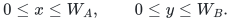
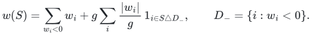
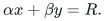
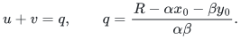
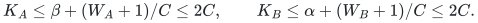
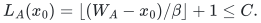
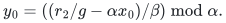
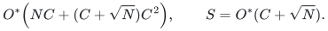

# Two short normalized ranges at arbitrary lattice scales

Author: Yilin Liu. Assistance: OpenAI Codex, including GPT-6 Astra.

## Theorem

Partition the coordinates into <code class="math">A,B,D</code>, each of size at most <code class="math">m</code>, and
put <code class="math">N=2^m</code>. After complementing negative coordinates in the first
two blocks and adjusting the target, suppose their sums have forms
<code class="math">g_Ax</code>, <code class="math">g_By</code>, where <code class="math">g_A,g_B</code> are positive integers and

<!-- math-display: f29a40d54b439fbae9436468
0\le x\le W_A,\qquad0\le y\le W_B.
-->

The third block is unrestricted. For any positive integer <code class="math">C</code> with
<code class="math">C^2\ge\max\{N,W_A+1,W_B+1\}</code>, exact deterministic decision and
witness recovery use

<!-- math-display: 98b527c5b42ba4b5ae4ee7fd
T=O^*(NC+C^3),\qquad S=O^*(C+\sqrt N).
-->

In particular two individual ranges <code class="math">W_A,W_B\le O^*(2^m)</code> suffice
for time <code class="math">O^*(2^{n/2})</code> and space <code class="math">O^*(2^{n/6})</code> when
<code class="math">n=3m+O(1)</code>. There is no restriction on <code class="math">g_A/g_B</code> or the third
block's range. This is a detectable input class, separate from the
general <code class="math">0.18261635770550353</code> writable-space theorem.

The partition and positive lattice scales are part of the input contract.
They can be checked by exact divisibility and summation. For a block with
weights <code class="math">w_i</code>, complementing its negative coordinates gives

<!-- math-display: 3b466924690f29b998d00941
w(S)=\sum_{w_i<0}w_i+
 g\sum_i\frac{|w_i|}{g}\,1_{i\in S\mathbin\triangle D_-},
\qquad D_-=\{i:w_i<0\}.
-->

Thus one may take the gcd of the nonzero absolute weights as the scale
(scale one for an all-zero block) and
<code class="math">W=\sum_i&#124;w_i&#124;/g</code>. No modulus is factored or expanded into a table of
its own size. Original indices, including repeated and zero weights,
are retained throughout.

## 1. Exact quotient coordinates

Let <code class="math">g=\gcd(g_A,g_B)</code>, <code class="math">\alpha=g_A/g</code>, and <code class="math">\beta=g_B/g</code>.
For a raw third-block mask with weight <code class="math">w_D</code>, put <code class="math">z=t-w_D</code>.
If <code class="math">g\nmid z</code>, discard it. Otherwise <code class="math">R=z/g</code> must satisfy

<!-- math-display: 959329b8d9a58cc5df766f86
\alpha x+\beta y=R.
-->

Since <code class="math">\gcd(\alpha,\beta)=1</code>, <code class="math">R</code> uniquely determines
<code class="math">x_0=x\bmod\beta</code> and <code class="math">y_0=y\bmod\alpha</code>. Writing
<code class="math">x=x_0+\beta u</code>, <code class="math">y=y_0+\alpha v</code> gives the exact condition

<!-- math-display: b5ef2cbe4b597d0545f4ef96
u+v=q,\qquad
q=\frac{R-\alpha x_0-\beta y_0}{\alpha\beta}.
-->

Least nonnegative residues are used throughout; negative target
quotients are rejected against the actual nonnegative quotient ranges.

## 2. Charged primitives

Two Boolean arrays of length at most <code class="math">C</code> can be convolved exactly
in <code class="math">O^*(C)</code> bit time and space by the
[elementary convolution lemma](convolution.md). It proves a deterministic
fixed-point transform, including rational construction of its roots,
rounding error below <code class="math">1/4</code> and the cost of schoolbook arithmetic on
<code class="math">O(\log C)</code>-bit words. No fast multiplication theorem is needed.
Store the integer coefficients in an array and one mask per occupied
input slot. A single <code class="math">O(C)</code> scan recovers a witness after a positive
coefficient is found.

One may choose the least integer capacity satisfying the required square
bound, by exact integer square root. Its bit length is <code class="math">O(n+L)</code>.
Choosing this capacity also proves the stated bounds for any larger
<code class="math">C</code>, by monotonicity; the algorithm need not allocate an unnecessarily
large user-specified capacity. Thus the convolution's logarithmic factors
are included in the fixed polynomial in <code class="math">n,L</code>.

A raw block congruence-and-interval query costs <code class="math">O^*(\sqrt N+J)</code>
time and <code class="math">O^*(\sqrt N)</code> space. Store its two half lists, sort the
second by residue and actual weight, and binary-search the matching
residue slice and translated interval for each first-list record.
<code class="math">J</code> counts all reported mask occurrences, including equal sums.
The modulus length is never an allocation size.

For nested positive moduli <code class="math">Q_1\mid Q_2</code>, all raw masks can also be
streamed in <code class="math">(w\bmod Q_1,w\bmod Q_2,w)</code> order in <code class="math">O^*(N)</code> time and
<code class="math">O^*(\sqrt N)</code> space. Here is an explicit construction of this
primitive. Sort the second half list by those three keys and an occurrence
identifier. Record the nonempty primary groups, and within each primary
group record its nonempty secondary groups. The entire directory is
linear in that half list.

For a first-half sum <code class="math">x</code> and fixed affine offset <code class="math">d</code>, set <code class="math">s=x+d</code>.
Adding <code class="math">s</code> rotates the primary residues, with cut at <code class="math">(-s)\bmod Q_1</code>.
Within the current primary group it rotates the secondary residues,
with cut at <code class="math">(-s)\bmod Q_2</code>. Binary search locates each cut in the
shared directory. The divisibility <code class="math">Q_1\mid Q_2</code> ensures that a
secondary group stays inside one shifted primary group. Actual weights
within a secondary group retain their order. A row therefore needs only
its current primary group, secondary group, occurrence position and wrap
counters. It visits only nonempty groups and emits every right-list
occurrence once. A heap holding one head per first-half record merges
these sorted rows. Group transitions and heap work cost a polynomial
factor per emitted occurrence; no right list or directory is copied per
row. Signed weights and arbitrarily large moduli change only the bit
length of the keys.

The large-scale case below applies the same primitive to the scaled
normalized A weights, obtaining <code class="math">(\alpha x\bmod\beta,x)</code> order because
<code class="math">\alpha&gt;0</code>, and to the affine D weights <code class="math">z=t-w_D</code>. Their actual order
and original mask identifiers are retained.

## 3. Both reduced scales at most C

Suppose <code class="math">\alpha,\beta\le C</code>. In each <code class="math">x_0</code> residue, split its
nonnegative <code class="math">u</code> range into width-<code class="math">C</code> blocks, and do the same for <code class="math">v</code>.
The total numbers of quotient blocks satisfy

<!-- math-display: 90885c5eceb873c35369dd03
K_A\le\beta+(W_A+1)/C\le2C,\qquad
K_B\le\alpha+(W_B+1)/C\le2C.
-->

Stream the A blocks once. For each A block regenerate the B stream,
fill the two occupancy arrays, and convolve them. If their starts are
<code class="math">s_A,s_B</code>, query third-block masks at the residue
<code class="math">z\equiv g(\alpha x_0+\beta y_0)\pmod{g\alpha\beta}</code> and within
the interval corresponding to
<code class="math">q\in[s_A+s_B,s_A+s_B+2C-2]</code>. Compute <code class="math">q</code> and inspect the coefficient.

Each third-block occurrence has one compatible residue pair. For
each fixed A block, its quotient belongs to at most two B sum bands;
over all blocks it is therefore reported <code class="math">O(C)</code> times. Raw output
cost is <code class="math">O^*(NC)</code>. There are <code class="math">O(C)</code> whole B passes and <code class="math">O(C^2)</code>
convolutions and query starts. The latter cost <code class="math">O^*(C^3)</code> because
<code class="math">\sqrt N\le C</code>. Only the current blocks and constant many stream
states coexist.

## 4. A large reduced scale

Otherwise swap A and B if needed so <code class="math">\beta\ge C</code>.
The full A quotient class at residue <code class="math">x_0</code> has ambient length

<!-- math-display: 31fe0c00f60b7403a6afe003
L_A(x_0)=\lfloor(W_A-x_0)/\beta\rfloor+1\le C.
-->

Process <code class="math">O(C)</code> B batches described below. For each batch, stream A
in <code class="math">(\alpha x\bmod\beta,x)</code> order and D on <code class="math">z=t-w_D</code> in
<code class="math">(z\bmod g\beta,z\bmod g\alpha\beta,z)</code> order. Merge their
primary groups, ignoring residues not divisible by <code class="math">g</code>. A matched
secondary D residue <code class="math">r_2</code> identifies

<!-- math-display: b04298976027815127befada
y_0=\left((r_2/g-\alpha x_0)/\beta\right)\bmod\alpha.
-->

The division is exact. Every record in that secondary group has the
same compatible B class and increasing target quotient <code class="math">q</code>.
If the current batch contains that class or segment, test whether
<code class="math">q</code> lies in the two ambient quotient intervals' sum band. Activate
the convolution only at the first relevant raw D occurrence, reuse
it for the rest of the secondary group, then release it. An empty
relevant group pays no convolution. All rejected D records are still
charged to the full raw scan.

If <code class="math">\alpha\le C</code>, one width-<code class="math">C</code> segment of a B residue class is
a batch. There are at most <code class="math">\alpha+(W_B+1)/C\le2C</code> batches.
Fill each batch by a complete B mask scan. A D occurrence is relevant
to at most two segments, because their starts are separated by <code class="math">C</code>
and <code class="math">L_A\le C</code>. Charging each activated convolution to its first
relevant D occurrence gives at most <code class="math">2N</code> activations in total.

If <code class="math">\alpha\ge C</code>, each full B class has length at most <code class="math">C</code>.
Enumerate only <code class="math">0\le y_0\le\min(\alpha-1,W_B)</code> and pack whole
class arrays greedily into batches of capacity <code class="math">2C</code>. Their total
ambient length is <code class="math">W_B+1\le C^2</code>; every nonfinal batch has more
than <code class="math">C</code> slots. Thus there are at most <code class="math">C+1</code> batches. A complete B
scan fills one batch's arrays. Every D occurrence has one B class
in one batch, giving at most <code class="math">N</code> convolution activations. This also
handles arbitrarily large lattice scales without enumerating an
absent modulus range.

Whole A, B, and D scans cost <code class="math">O^*(NC)</code>. Activated convolutions cost
<code class="math">O^*(NC)</code>. Conservatively, clearing the actual A class arrays costs
at most <code class="math">\sum_{x_0}L_A(x_0)=W_A+1\le C^2</code> per batch, hence
<code class="math">O(C^3)</code> overall. B batches use <code class="math">O(C)</code> slots each. These charges
prove the announced bound without requiring free array initialization.

## 5. Correctness, witnesses, and smaller ranges

A genuine solution has one residue pair and one quotient decomposition.
Its quotient blocks are processed together in the small-scale case.
In the large-scale case its B segment is in a processed batch, its A
and D primary groups match, and its target activates or queries the
correct convolution. A positive coefficient supplies actual occupied
slots and retained masks. The quotient identity proves their original
sum equals the target. Reversing the initial complements returns an
indexed witness. Finite exhaustion gives the exact NO decision.

At most two raw stream states, one A class, one B batch, and one
convolution are live. Their state is <code class="math">O^*(C+\sqrt N)</code>, including
witness masks, heap directories, and polynomial-bit moduli and keys.
The convolution's root and transform arrays use <code class="math">C\,\mathrm{poly}(\log(C+2))</code>
bits, already charged.

Dropping <code class="math">C^2\ge N</code> retains the more precise time bound

<!-- math-display: 508070605966e164b8e4350c
O^*\!\left(NC+(C+\sqrt N)C^2\right),
\qquad S=O^*(C+\sqrt N).
-->

Only the small-scale query startup changes to <code class="math">\sqrt N</code> per block
pair. If both ranges are at most <code class="math">W\le N</code>, choose
<code class="math">C=\lceil\sqrt{W+1}\rceil</code>: the time is <code class="math">O^*(N\sqrt{W+1})</code>
and state <code class="math">O^*(\sqrt N)</code>. Explicitly enumerated signature or
cardinality configurations multiply this time by their actual count.
Signed affine coordinates are permitted after translating their
accepted ranges and the target; membership filtering charges all raw
masks and retains the chosen configuration in every witness.

The theorem is conditional on the supplied three-block partition and its two normalized range bounds. It does not assert that arbitrary instances admit such a partition.

## 6. Executable evidence

The [range-identity check](verify/check_range_identities.py) verifies the
quotient formulas, ambient batches and packed coefficient identities.
The separate [reference solver check](verify/check_range_solver.py)
implements the two scale regimes, the shared-directory nested stream,
closed-interval queries, lazy convolution activation and restoration of
indexed witnesses. It compares every tested decision with independent
exhaustive mask enumeration, including negative and repeated weights,
zero and empty blocks, nontrivial gcds, unequal block sizes and lattice
scales of more than 80 bits.

This is finite evidence for the full control flow. Its packed-product
convolution is exact, while the asymptotic algorithm can use the
elementary transform above. The separate
[fixed-point transform check](verify/check_exact_convolution.py) constructs
all roots by rational arithmetic and compares its coefficients with direct
summation. These checks do not replace the arbitrary-length error and
resource proofs. The [source map](sources.md#short-range-theorem-arithmetic-proof)
records the discharged arithmetic dependency.

**Curated by:** Yilin Liu and GPT-6 Astra Pro.
