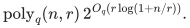
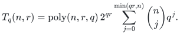
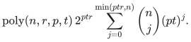

# Exterior endpoint counting for triangular low-rank updates

**Objective and output**

Evaluate the negative-integer alpha-permanent (equivalently the fermionant) of a supplied matrix `A=B+UV^T`, where `B` is upper triangular in a supplied simultaneous row/column order. The triangular part may be dense and have nonzero diagonal. The same exterior endpoint algorithm computes the directed Hamiltonian polynomial over any commutative ring annihilated by a fixed integer `M>=2`. Its marked output also gives every ordinary character immanant of a fixed partition width through classical integral Schur extraction; this is one algorithm family.

The substantive construction stores colored endpoint sets and exterior coefficients, with a sign invariant that survives changes in endpoint order. The [proof](proof.md) includes the full recurrence, diagonal handling, characteristic bounds, and integer/rational realization.

**Randomness**

Deterministic exact uniform division-free circuit construction; no random weights or identity test. The constructive endpoint recurrence is independent of the recent contraction and filtering theorems.

**Time**

For fixed negative cycle weight `-q`, or fixed annihilator `M` for Hamiltonian counting, and `1<=r<=n`, the ring-operation bound is

<!-- math-display: e1b1033bc20be7becc06f69a
\mathrm{poly}_q(n,r)\,
2^{O_q(r\log(1+n/r))}.
-->

For Hamiltonian evaluation read `q=M`. This is polynomial for fixed supplied width and subexponential whenever `r=o(n)` and the color parameter is fixed. The uniform bound for the negative-alpha and rooted outputs is

<!-- math-display: 4807aa1a85d348b56ae13d50
T_q(n,r)=\mathrm{poly}(n,r,q)\,2^{qr}
\sum_{j=0}^{\min(qr,n)}\binom nj q^j.
-->

When `p^t` annihilates the coefficient ring, integral finite differences compute the Hamiltonian polynomial with at most `pt` colors, in

<!-- math-display: 1ca8d7b46f1cc6b1a87fbdf8
\mathrm{poly}(n,r,p,t)\,2^{ptr}
\sum_{j=0}^{\min(ptr,n)}\binom nj (pt)^j.
-->

Tracking a fixed number `k` of color-size marks adds `poly_k(n)` coefficients and preserves the fixed-parameter entropy bound for the immanant completion. Explicit integer/rational inputs have polynomial input-length bit overhead for negative-alpha and fixed-width immanant evaluation.

**Space**

Two consecutive dynamic-program layers suffice. At most `poly(n,r,q) 2^(qr) S_q(n,r)` ring values are stored, where `S_q` is the displayed binomial sum. Marked evaluation adds the stated coefficient-table factor. No polynomial-space bound is asserted when `r` grows.

**Parameters**

`n>=1` is the matrix order; `r` is the supplied factor width, rather than a computed minimum rank. `q>=1` is the number of determinant colors (`q=1` is a determinant control); `M>=2` is an annihilating integer; `p` is prime and `t>=1` for the precision refinement; `k` is fixed partition width. Width zero is handled directly, including the one-vertex case. If `r>n`, the explicit factors `(UV^T,I_n)` reduce it to width `n` without division.

**Model and representation**

Any commutative unital coefficient ring, including characteristic zero and rings with zero divisors. The input supplies `B,U,V` and the triangular order; decomposition discovery is outside the theorem. The algorithm is a uniformly constructible division-free arithmetic circuit using explicit subset-indexed exterior coefficient arrays. The exterior algebra is never treated as a commutative scalar ring. The [reference implementation](reference/exterior.py) supports exact integer and generic-ring operations, and optional modular reduction for integer inputs.

**Lower-bound scope**

No optimality or matching lower bound is claimed. General-matrix fermionant hardness does not concern the supplied small-width class. A growing recovery modulus is charged through its color parameter; the result gives neither unrestricted exact-integer Hamiltonian evaluation nor an unrestricted dense permanent algorithm. Modular cancellation also prevents using a zero count as a general Hamiltonicity decision certificate.

**Review status**

**Ready for review.** Complete explicit exterior endpoint algorithm, changing-order wedge-sign invariant, all-ring correctness, uniform division-free circuit construction, entropy bound, integral prime-power HC extraction and exact integer/rational realization; marked DP and integral constant-width immanant extraction included within the family.

**Dependencies and scope.** Input supplies the simultaneous triangular order and B,U,V factors; decomposition discovery/minimum rank is outside scope. Subexponential conclusion fixes q (or annihilator M/partition width k) and assumes supplied `r=o(n)`. Uniform precision dependence is charged through pt; there is no growing-modulus exact-integer Hamiltonian inference. Ring-operation theorem requires no identity test. The sparse Python reference uses equality-based zero omission as an implementation optimization; structurally retained states unroll without it. Exact finite verification checks implemented instances, not asymptotic runtime, external peer review, formal proof, or publication-level priority. Bounded primary-source search only. Classical Crane, Knezevic/Cohen, Cauchy--Binet, Goulden/Jackson, dual Cauchy and alternant identities are credited antecedents, not new claims.

The [verification note](verify/README.md) identifies executable coverage. This status does not claim external peer review or proof-assistant verification.

**Source**

icekylinx and GPT-6 Astra Pro. Apache-2.0 under the repository [license](../../LICENSE). The [source map](sources.md) identifies the 2 November 2026 checkpoint members, preserved mathematics, code adaptations, primary antecedents, and excluded weaker routes.
