# Exterior endpoint algorithms for triangular updates

Authors: icekylinx and GPT-6 Astra Pro. Apache-2.0.

Curated from the 2 November 2026 checkpoint. The selected result is the explicit exterior endpoint algorithm. The classical extraction at the end completes its immanant interface within this family; it is not a separate novelty claim.

## Main constructive results

Let `n>=1` and let `R` be any commutative ring with identity. Suppose the input supplies

<!-- math-display: 971635960e0c18f684a49221
A=B+UV^{\mathsf T}\in R^{n\times n},\qquad U,V\in R^{n\times r},
-->
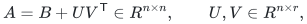

together with an order in which `B` is upper triangular. Its diagonal is
allowed to be nonzero; its strictly upper triangular part may be dense.
The decomposition is supplied, and no algorithm for finding the least
possible width is asserted. Define

<!-- math-display: 13d1eb17706a110b5da791f5
\mathrm{per}_{\alpha}(A)
=\sum_{\pi\in S_n}\alpha^{c(\pi)}\prod_i A_{i,\pi(i)},\qquad
\mathrm{Ferm}_{q}(A)=(-1)^n\mathrm{per}_{-q}(A),
-->
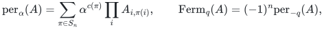

where `c(pi)` is the number of cycles. Put

<!-- math-display: 58c4aeb990e396fd52106037
S_q(n,r)=\sum_{j=0}^{\min(qr,n)}\binom nj q^j.
-->
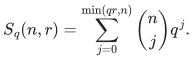

**Theorem 1 (all-ring negative-integer cycle weights).** For each integer
`q>=1`, there is a deterministic algorithm and a uniformly constructible
division-free arithmetic circuit computing `per_(-q)(A)`, and hence
`Ferm_q(A)`, with

<!-- math-display: 28e3a30649e2695e0b0646b5
\mathrm{poly}(n,r,q)\,2^{qr}S_q(n,r)
\tag{1}
-->
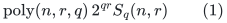

ring operations. For fixed `q` and `1<=r<=n`, this is

<!-- math-display: b01f64a66310b5e52dc3b511
\boxed{\mathrm{poly}(n,r)\,
  2^{O_q(r\log(1+n/r))}.}
\tag{2}
-->
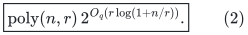

In particular it is polynomial for fixed width, and subexponential for
every `r=o(n)`. This theorem holds in characteristic zero and over rings
with zero divisors. For `q=1`, it agrees with the determinant identity
`per_(-1)(A)=(-1)^n det(A)`.

**Theorem 2 (fixed positive characteristic).** If `M*1_R=0`, `M>=2`, then
the directed Hamiltonian polynomial `HC(A)` can be computed with (1)
using `q=M`. Consequently it has the bound (2) for fixed `M`, with no
assumption that `M` is prime.

**Theorem 3 (uniform prime-power precision).** If `p` is prime, `t>=1`,
and `p^t*1_R=0`, then `HC(A)` can instead be computed in

<!-- math-display: a6bf48bd47fa62c4da790246
\boxed{\mathrm{poly}(n,r,p,t)\,
       2^{ptr}S_{pt}(n,r).}
\tag{3}
-->
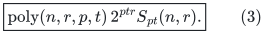

Thus the number of component colors depends on `pt`, rather than `p^t`.
No division by `p`, by factorials, or by interpolation denominators is
performed.

The construction depends only on the algebraic identities and the explicitly proved state invariant below. They are explicit dynamic programs. The
supplied update width is essential; arbitrary edge weights can increase
it. A growing modulus sufficient for general exact integer Hamiltonian
recovery is not claimed to preserve a subexponential bound.

## 1. Classical determinant-color identities

For a map `f:[n]->[q]`, let `J_s=f^(-1)(s)`. Empty principal determinants
are one. Expanding each determinant and counting the colors of each
permutation cycle gives the integer polynomial identity

<!-- math-display: 35e7428c842140cc4097485b
\sum_f\prod_{s=1}^q\det A[J_s]
 =\sum_{\pi\in S_n}(-1)^{n-c(\pi)}q^{c(\pi)}
       \prod_i A_{i,\pi(i)}
 =(-1)^n\mathrm{per}_{-q}(A).
\tag{4}
-->
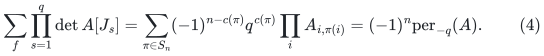

Fix a distinguished vertex `v_*` and require `f(v_*)=1`. Define

<!-- math-display: eed143b409d9336978672d8f
G_q(A)=(-1)^{n+1}
      \sum_{f:f(v_*)=1}\prod_s\det A[J_s].
-->
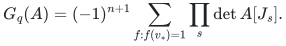

Then

<!-- math-display: 25c364cbb9577b0f36d60ff4
G_q(A)=\sum_{\pi\in S_n}(-q)^{c(\pi)-1}
                 \prod_i A_{i,\pi(i)}.
\tag{5}
-->
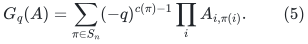

In a ring annihilated by `M`, equation (5) with `q=M` is exactly `HC(A)`.
Here `HC(A)` is the sum over permutations having exactly one cycle, including the single loop when `n=1`. The distinguished vertex need not be first in the triangular order.

Identity (4) is a specialization of Crane's classical decomposition
theorem for the alpha-permanent. The rooted identity (5), including its
finite-composite-characteristic version, is explicitly present in
Knezevic and Cohen, Theorem II.3.2.1. Neither identity is claimed as new.

## 2. Contracting selected triangular edges

Expand each matrix entry as its `B` term or its `UV^T` term. Selected
strictly upper triangular `B` edges in a permutation form vertex-disjoint
directed paths. A selected diagonal `B` edge is a completed loop.
Other directed cycles cannot use only `B` edges.

For one fixed component color, suppose there are `k` paths. List them
in the order of their current endpoints, and let `s_i,t_i` be their
starts and ends. The low-rank completion matrix is

<!-- math-display: df59d1601c4b9022cfdf53aa
C_{ij}=\sum_{a=1}^r U_{t_i,a}V_{s_j,a}.
-->
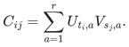

Its determinant is, by the integral Cauchy--Binet identity,

<!-- math-display: f7a9fa6f3f1cba6b11c947d0
\det C=
 \sum_{I\subseteq[r],\,|I|=k}
       \det U[(t_1,\ldots,t_k),I]\det V[(s_1,\ldots,s_k),I].
\tag{6}
-->
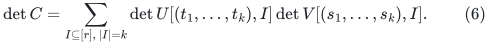

Both determinants use the displayed row-list orders; the start list
is not independently sorted. In particular the expression is zero
for `k>r`, over every ring. If the selected cover has `l` diagonal loops and `K` paths, its non-loop triangular edges number `n-l-K`. Contracting these edges changes a permutation sign by `(-1)^(n-l-K)`: the full permutation and the completion on paths have the same non-loop cycles. The diagonal loops contribute positive determinant sign. Thus a determinant-color path contribution is

<!-- math-display: 7501f24ac42e0a2fc03e89e4
(-1)^{n-l-K}\left(\prod_{\text{selected }B\text{ edges}} B_{ij}\right)
\prod_{s=1}^q\det C_s.
-->
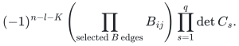

Multiplication by the global sign `(-1)^n` in (4) gives `(-1)^(l+K)` for `per_(-q)`. Give each selected diagonal loop its factor `-q B_vv` (summing its colors), and the remaining final sign is `(-1)^K`. For rooted (5), the additional global minus changes it to `(-1)^(K+1)`; a loop at the root has only one allowed color and factor `-B_vv`. These conventions include `K=0` and nonzero diagonals.

## 3. The exterior endpoint state

For each component color use a copy of the exterior module on `R^r`.
The coefficient space is the tensor product of these `q` modules,
of dimension `2^(qr)`. It is represented by explicit subset-indexed
coefficient arrays over `R`. The algorithm uses signed additions and
multiplications of these entries; it does not assume that an exterior
algebra is a commutative coefficient ring.

A state contains an unordered endpoint set with a persistent color
at every endpoint. Its canonical presentation orders endpoints by
the supplied triangular order. At most `r` endpoints of each color
are retained. The coefficient at the state is the tensor product,
over colors, of the wedges of the path-start vectors `V_s`, in the
same path order as the current endpoints, multiplied by the selected
edge weights and the scalar diagonal-loop multipliers below, and summed over all histories.

Process vertices in triangular order. At a vertex `v` the transitions
are as follows.

1. **Start a path of color `s`.** Append the endpoint `(v,s)` and wedge
   the vector `V_v` at the end of that color's start wedge. In the
   rooted computation, only color 1 is allowed when `v=v_*`.
2. **Extend a path ending at `u` with color `s`.** Multiply by `B_uv`
   and replace `u` by `v`. Because `v` is the newest endpoint, this
   moves the path past all later endpoints of its color. If their
   number is `h`, multiply the coefficient by `(-1)^h`. This is
   exactly the sign required to reorder its start wedge. When
   `v=v_*`, require `s=1`.
3. **Use the diagonal loop.** Keep the endpoint set unchanged. For
   `per_(-q)`, multiply by `-q B_vv`. For rooted `G_q`, use that same
   multiplier at nonroot vertices and use `-B_vv` at the root.

The third transition includes the loop's cycle sign and its `q`
possible colors; the distinguished loop has only one allowed color.
In particular, when `r=0`, the unrooted computation returns
`(-q)^n prod_v B_vv`, as required.

At the end, form the wedge of the endpoint vectors `U_t` in the
current endpoint order, separately for each color. Pair its subset
coefficients with the stored start-wedge coefficients. Equation (6)
says that this pairing is the product of the path-completion
determinants. Apply the final sign `(-1)^K` or `(-1)^(K+1)` and sum
over endpoint states.

Every selected triangular path cover has a unique history: a vertex
starts a path precisely when it has no selected strict predecessor,
extends its unique predecessor's path otherwise, or is a selected
diagonal loop. All information needed for future choices is in the
endpoints, their colors, and the start-wedge coefficients. Merging
histories with equal states is therefore exact. The reordering sign
maintains the wedge invariant, and (4)--(6) prove the two outputs.

The diagonal-loop convention also handles the rooted scalar identity
with nonzero diagonal. For `n>=2`, the final Hamiltonian value is
independent of the diagonal, as it must be.

## 4. Running time and uniformity

There are at most `S_q(n,r)` endpoint states: choose their vertex set
and give each vertex one of `q` colors. The additional per-color cap
can only reduce this count. Each state has at most `n+q+1`
transitions. Wedge multiplication by one vector and scalar updates
cost polynomially many operations per coefficient entry. The final
endpoint wedge and its pairing have the same bound. Two consecutive layers suffice, so the same expression bounds stored ring elements, up to a polynomial structural factor. This proves (1).

For fixed `q`, `qr=O_q(r)` and

<!-- math-display: d1f45fe22f39e67200748ff0
\log S_q(n,r)=O_q(r\log(1+n/r))\quad(1\le r\le n).
-->
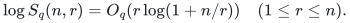

For `qr<=n/2` this is the binomial entropy bound. Otherwise use
`S_q(n,r)<=(q+1)^n` and `r=Omega_q(n)`. The coefficient factor
`2^(qr)` is absorbed, proving (2). If `r>n`, replace `UV^T` by
the explicitly supplied factors `(UV^T,I_n)` in polynomial time;
this uses no Gaussian elimination over the ring.

All endpoint states, subset indices, signs, and transitions depend
only on structural parameters and the supplied order. Keeping
zero-valued states if necessary unrolls the algorithm into a uniform
division-free circuit. The implementation may omit zeros as an
optimization; its correctness does not rely on an identity test.

## 5. Prime-power extraction with only `pt` colors

Write `H_c` for the contribution of permutations with `c` cycles.
Then `G_q=sum_c H_c(-q)^(c-1)`. For every `t>=1`,

<!-- math-display: 8a4a995afb7e5b5494977b43
\mathrm{HC}(A)\equiv
 \sum_{j=1}^t(-1)^{j-1}\binom tj G_{pj}(A)
                      \pmod {p^t}.
\tag{7}
-->
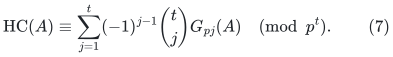

For the constant term the binomial weights sum to one. For powers
`q^a` with `1<=a<t`, the alternating binomial sum of `j^a` is zero.
For `a>=t`, every summand has the integer factor `p^a`, hence is
zero in a ring annihilated by `p^t`. This proves (7) without division.
Use the exterior algorithm `t` times, with at most `pt` colors.
The binomial coefficients have polynomial bit length and can be
embedded by signed double-and-add. This gives (3).

## 6. Exact integer and rational evaluation of the fermionant

Theorem 1 has no characteristic restriction. For integer factors of
bit length at most `b`, every entry of `A` has polynomial bit length
in `b+log(2r)`, and

<!-- math-display: 84c3347f9ad745f1e4549a8a
|\mathrm{per}_{-q}(A)|
      \le n!q^n\left(\max_{i,j}|A_{ij}|\right)^n.
-->
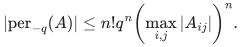

Evaluate the division-free circuit modulo `2^L` for
`L=O(n(b+log(2(n+1)(q+1)(r+1))))` large enough for unique signed reconstruction.
All arithmetic has polynomial bit overhead. For rational inputs take a common positive denominator `D` for all supplied factors and triangular entries. The decomposition `D^2 A = D^2 B + (DU)(DV)^T` is integral; divide the final result by `D^(2n)`. The denominator bit length is polynomial in the explicit input length. Thus (2) also yields exact integer/rational bit algorithms
up to polynomial input-length factors.

## 7. Exact implementation checks

[`reference/exterior.py`](reference/exterior.py) implements the selected exterior algorithm independently of any contraction engine. The curated checker goes further than the checkpoint by comparing the complete marked coefficient table and its extracted immanants end to end, and by evaluating rational and nonreduced rings. The current exact run records:

- 54 exact integer negative-alpha and 135 exact rooted-cycle comparisons;
- 126 modular Hamiltonian evaluations over 2, 3, 4, 5, 6, 8, and 9, including 54 nonzero outputs and 105 separate diagonal-independence controls;
- 25 prime-power Hamiltonian evaluations, with 60 individually checked rooted components and precision through modulus 16;
- 30 complete marked polynomial tables checked against independent principal-determinant partitions, followed by 78 integer immanants checked against Murnaghan--Nakayama character sums and 390 modular extraction controls;
- 72 rational and 72 nonreduced-ring cycle evaluations over `(Z/4Z)[epsilon]/epsilon^2`, including 12 Hamiltonian evaluations in that nonreduced ring;
- 18 determinant, 18 width-zero, and six nonzero pure-low-rank boundary controls;
- 1,901,265 actual exterior transitions.

The tests supplement the proofs. They do not certify asymptotic performance, external priority, or formal correctness. The [verification note](verify/README.md) specifies the executable coverage.

## 8. Primary sources and novelty boundary

1. Harry Crane, *Some algebraic identities for the alpha-permanent*,
   arXiv:1304.1772, Theorem 1.1. Taking its parameters to be `-1` and
   `q` gives (4), with the explicitly derived global sign above.
   [Primary preprint](https://arxiv.org/abs/1304.1772).
2. Anna Knezevic and Greg Cohen, *Some Facts on Permanents in Finite
   Characteristics*, Theorem II.3.2.1, PDF page 20 (zero-based page 19), gives the rooted
   determinant/permanent partition identity in finite characteristic,
   including composite characteristic. The related [arXiv record](https://arxiv.org/abs/1710.01783) credits Anna Knezevic, Greg Cohen, and Marina Domanskaya in its 2020 revision; the checked 2019 PDF has the first two authors. We use only the displayed elementary identity,
   proved independently here; no other algorithmic claims in that
   preprint are assumed.
   [Author preprint mirror](https://vixra.rxiv.org/pdf/1908.0355v1.pdf).
3. Stephan Mertens and Cristopher Moore, *The Complexity of the
   Fermionant and Immanants of Constant Width*, Theory of Computing
   9(6), 2013. They prove general-matrix hardness for fixed fermionant
   parameters: `q>2` is `#P`-hard under Turing reductions and `q=2`
   is parity-counting hard. Our theorem concerns the supplied
   triangular-plus-low-rank class and does not contradict those
   general-matrix results.
   [Primary publication](https://theoryofcomputing.org/articles/v009a006/).

The selected contribution recorded here is the explicit exterior endpoint
state, its changing-order sign invariant, the entropy running-time
bound on the supplied triangular-update class, and the concrete
prime-power extraction algorithm. The coloring identities, determinant
identities, and low-rank vanishing phenomenon have prior literature.
A bounded primary-source search did not locate the exact structured
algorithm above; publication-level priority remains unverified.

## 9. Marked determinant-color output and classical immanant extraction

Fix `k>=1`. The same algorithm computes every ordinary character immanant of partition width at most `k` simultaneously in `poly_k(n,r) 2^{O_k(r log(1+n/r))}` ring operations. This is a completion of its marked output via classical identities. For variables `t_1,...,t_k`, define

<!-- math-display: ba18dfb9a9fcf44979cfe567
H_A(t)=\sum_{S_1\sqcup\cdots\sqcup S_k=[n]}
           \prod_{s=1}^k t_s^{|S_s|}\det A[S_s,S_s],       \tag{A1}
-->
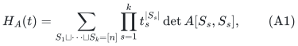

where the blocks are ordered and may be empty. The empty determinant is one. Setting every `t_s=1` gives the classical determinant-color expansion of a negative-integer alpha-permanent, up to its explicit global sign. That identity is prior; see Crane's Theorem 1.1.

Use the exterior endpoint dynamic program from the preceding sections, with `k` colors and no distinguished root. In each color, its current endpoints are listed in triangular order, and the coefficient tensor stores the wedge of their path-start `V` vectors in the corresponding current path order. Apply these transitions at vertex `v`:

- Start a path of color `s`: wedge in `V_v`, multiply by `t_s`, and add endpoint `(v,s)`.
- Append `v` after endpoint `(u,s)`: multiply by `-B_uv t_s`, move that path to the last position within color `s`, and multiply by the sign of that reordering.
- Select a diagonal sparse loop: multiply by `B_vv(t_1+...+t_k)` and leave the endpoint state unchanged.

At the end pair each color's start wedge with the wedge of its current endpoint `U` vectors. There is **no final global sign** in this version.

For a sparse path cover with `l` diagonal loops and `K` non-loop path components, the selected non-loop sparse edges number `n-l-K`. The explicit minus signs on those edges give `(-1)^(n-l-K)`. Cauchy--Binet supplies the determinant of the low-rank completion matrix on the paths; this gives exactly the permutation sign on the remaining vertices. Each diagonal loop has positive determinant sign and chooses one color. Every vertex contributes one `t_s` in its chosen component color. Hence the dynamic program evaluates (A1) over the universal integer polynomial ring and therefore over every commutative ring.

There are at most `r` endpoints in each color, since a larger wedge vanishes. The exterior coefficient space has dimension at most `2^(kr)`. The number of endpoint sets is bounded by

<!-- math-display: 7251ca49915e9558d4b541fd
S_k(n,r)=\sum_{j\le\min(kr,n)}\binom nj k^j.
-->
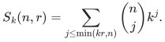

Tracking total `t`-degree at most `n` adds only `binom(n+k,k)=poly_k(n)` coefficients. The same entropy estimate as in the preceding sections gives

<!-- math-display: 76babf196ebeaf46c2228333
\log(2^{kr}S_k(n,r))=O_k(r\log(1+n/r)).
-->
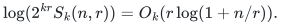

Thus all coefficients of `H_A` fit the stated fixed-`k` entropy bound.

### Integral Schur extraction

Let `Z=diag(z_1,...,z_n)`. Expanding the determinants shows that

<!-- math-display: eefd9ad34cfc67c6e9d90670
H_A(t)=[z_1\cdots z_n]\prod_{s=1}^k\det(I+t_sZA).       \tag{A2}
-->
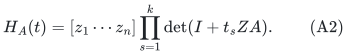

The classical dual Cauchy identity for Schur functions gives, as an integral polynomial identity,

<!-- math-display: c1e96f06f9cd5067be9f289e
\prod_{s=1}^k\det(I+t_sZA)
  =\sum_{\lambda:\,\ell(\lambda)\le k}
                      s_\lambda(t)s_{\lambda'}(ZA).
-->
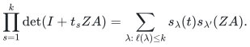

Taking the squarefree coefficient and using the classical Goulden--Jackson immanant identity yields

<!-- math-display: bc4ab445f55ee6dcac453083
H_A(t)=\sum_{\substack{\lambda\vdash n\\\ell(\lambda)\le k}}
                s_\lambda(t)\mathrm{Imm}_{\lambda'}(A).       \tag{A3}
-->
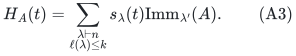

There is no character-dimension or factorial normalization. These identities first hold for the generic integer matrix; specialization proves them over every ring, including small and composite characteristics.

To extract an immanant without division, pad `lambda` to length `k`, put `delta=(k-1,k-2,...,0)`, and define

<!-- math-display: ed81db5ab40093ccf8f53ec5
\Delta(t)=\det(t_i^{k-j})_{i,j=1}^k.
-->
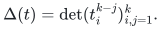

The alternant identity gives

<!-- math-display: 1b110ec945b9a2c36e5e3f57
\Delta(t)s_\lambda(t)=\det(t_i^{\lambda_j+k-j})_{i,j=1}^k.
-->
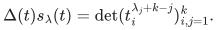

The exponent tuple `lambda+delta` is strictly decreasing. It appears with coefficient one in its own determinant, and appears in no determinant for another partition. Therefore

<!-- math-display: 6c6dde35075078300e15b259
\boxed{\mathrm{Imm}_{\lambda'}(A)
      =[t^{\lambda+\delta}]\Delta(t)H_A(t).}             \tag{A4}
-->
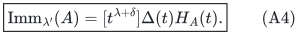

Only multiplication by an integral polynomial and coefficient selection are used; the Vandermonde is never divided out. At fixed `k` this requires polynomially many operations on the already computed coefficient table. The partitions `mu=lambda'` are exactly those of width at most `k`, proving the immanant extension.

### Immanant bit complexity

For explicitly represented integer factors, a matrix-entry bound `L` gives

<!-- math-display: 703b923bb9d12657e248644c
|\mathrm{Imm}_\mu(A)|\le (n!)^2 L^n,
-->
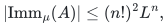

using `|chi_mu(pi)|<=chi_mu(1)<=n!`. Its bit length is polynomial in the explicit input length. Evaluate the division-free algorithm modulo a power of two exceeding twice this bound and recover the signed integer answer. This avoids any need to bound intermediate unmodded coefficients. For rational inputs, clear denominators by `D^2A=D^2B+(DU)(DV)^T` and divide the final degree-`n` answer by `D^(2n)`.

The ordinary immanants here use integer-valued symmetric-group characters, reduced in the target ring; Brauer characters are not being evaluated. The Schur/alternant identities are classical. This section advertises no separate result family: it completes the marked interface of the same constructive algorithm. Goulden and Jackson's *Immanants, Schur Functions, and the MacMahon Master Theorem* (1992), Theorem 2.1 and equation (9), is the primary coefficient-identity source. See [sources.md](sources.md) for attribution and review limits.
