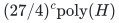
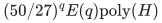
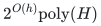
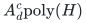
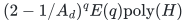

# Scheduling two common job sizes

**Guarantee**

One branch gives exact factor <code class="math">3/2</code> in the surplus-large-position parameter; a separate branch gives factor <code class="math">5/3</code> in the number of mandatory large units. Fixed integer <code class="math">d\ge2</code> also gives factor <code class="math">2-1/d</code>.

**Objective and output**

Assign all large and small units and recover the original job-polymatroid bases.

**Randomness**

Deterministic rank tests, omission branching and job reconstruction; the independent large-count branch and whole-ground alternative are also deterministic.

**Time**

Exact <code class="math">3/2</code> takes

<!-- math-display: 3211a2845f6c7b89cb8295a5
(27/4)^c\mathrm{poly}(H)
-->

Or

<!-- math-display: 4d39de6454b06fa654d85472
(50/27)^q E(q)\mathrm{poly}(H)
-->

Exact <code class="math">5/3</code> also takes

<!-- math-display: 5f7a04c2521911ad4f1510c9
2^{O(h)}\mathrm{poly}(H)
-->

More generally use

<!-- math-display: c6c31e6bc3da57cd70f9bee4
A_d^c\mathrm{poly}(H)
-->

Or

<!-- math-display: dae9cd9e80cdc15564511c37
(2-1/A_d)^q E(q)\mathrm{poly}(H)
-->

With <code class="math">A_d=\Gamma((d+1)/(d-1))</code>.

**Space**

Polynomial in the complete binary input and paid oracle workspace; numerical resource multiplicities are not expanded into individual units.

**Parameters**

<code class="math">h=f_b(P)</code> is the mandatory large-unit total; <code class="math">q</code> is the number of nonloop Boolean-cap large positions when their rank is <code class="math">h</code>; <code class="math">c=q-h</code>; positive sizes are <code class="math">u&lt;a</code>; <code class="math">\Gamma(R)=R^R/(R-1)^{R-1}</code> and <code class="math">E(q)=2^{O(q\log\log(q+2)/\log(q+2))}</code>.

**Model and representation**

Two common positive job sizes, arbitrary integral job polymatroids, binary ranks, and mandatory original bases. This transfer has no assignment-cost budget. Boolean-rank loss and one-size cases are handled separately.

**Lower-bound scope**

The [strict-below-three-halves value-oracle barrier](../allocation-lower-bounds/proof.md) applies to the named general recipient-rank model; no broader explicit-input hardness is inferred.

**Review status**

The [verification note](verify/README.md) records the proof scope, executable evidence and remaining conditions. No proof-assistant verification or external peer review is claimed.

**Source**

[Manuscript and proof](proof.md), with [dependencies and verification sources](sources.md).

The [large-unit-rank proof](rank-parameter.md) establishes the separate <code class="math">h</code> branch. The [integer-quota transfer](../whole-ground-allocation/integer-quotas.md) gives the full <code class="math">d</code> curve. For machine-specific times and exact assignment costs, see the distinct [two-time theorem](../two-time-scheduling/README.md).

**Attribution.** Yilin Liu · GPT-6 Astra Pro
