# A three-halves algorithm for two-size polymatroid scheduling in the corank parameter

The gap algorithm in [Unit-quota allocation by corank-bounded deficient-set branching](../../manuscripts/allocation-and-scheduling/unit-quota-corank-gap-branching.md), with the
batch refinement in [Single-exponential corank time by branching on a required omission batch](../../manuscripts/allocation-and-scheduling/unit-quota-corank-batch-branching-improvement.md), yields an
exact factor-3/2 makespan approximation for arbitrary two-size
job-polymatroid scheduling. Its exponential parameter is the number
of eligible large-job positions that a one-large-job-per-machine
basis leaves unused. This is complementary to the earlier factor-5/3
algorithm parameterized by the number of large units.

The guarantee applies to all instances of the stated model. A
Boolean-rank failure is an easy polynomial case, not a hypothesis
excluded from the theorem. A matching strict-below-3/2 obstruction
holds for this same corank parameter in the full value-oracle model.
No first-in-the-literature claim is made.

## 1. Scheduling model and parameter

Let P be a set of q machines. The two positive job sizes are 0<u<a.
Their aggregate integral polymatroid ranks are f_s and f_b. A legal
schedule consists of integer bases x_s in B(f_s) and x_b in B(f_b),
with machine load

<!-- math-display: 4fe24c4fabd5ab4cb63b6d4a
u x_s(p)+a x_b(p).
 \tag{D1}
-->
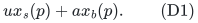

Write h=f_b(P) and s=f_s(P). The counts, numerical ranks, and job
sizes are binary encoded. Aggregating individually supplied job
matroids or job polymatroids is allowed; the final integer count
bases can be decomposed into the original assignments by the
standard integral polymatroid decomposition primitive.

Let M_b be the Boolean-cap matroid with independence polytope

<!-- math-display: 4a53d37ad6bc5056431f95b2
P(f_b)\cap[0,1]^P.
 \tag{D2}
-->
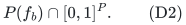

Its rank queries use the integral box formula and paid deterministic
submodular minimization. Put r_b=rank(M_b) and let P^+ be its
nonloop set. Equivalently, p belongs to P^+ exactly when f_b({p})>=1.
If r_b=h, define

<!-- math-display: e7aec332a7b60084925acc8c
c=|P^+|-h.
 \tag{D3}
-->
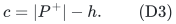

In ordinary restricted assignment, h is the number of larger jobs,
and P^+ contains all machines eligible for at least one such job.
The parameter c counts surplus eligible positions, not individual
small jobs or binary resource units.

**Theorem D.** If h=0, the instance is solved exactly in polynomial
oracle time. If r_b<h, a factor-3/2 schedule is found in polynomial
oracle time. Otherwise a deterministic factor-3/2 schedule is found
in

<!-- math-display: 48103daaa1894fceea1e55ee
(27/4)^c\mathrm{poly}(H)
                         =2^{O(c)}\mathrm{poly}(H)
 \tag{D4}
-->
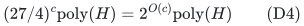

time and polynomial workspace. Here H includes all original input
bits and paid deterministic optimization, decomposition and
submodular-minimization work. No binary multiplicity is expanded
into individual slots.

## 2. Empty classes and the Boolean-rank failure branch

If h=s=0, the empty schedule has makespan zero. If h=0, an integer
small-job base under the uniform bound floor(T/u) exists exactly
when the box-restricted polymatroid retains rank s. Rational-grid
search therefore solves the single-size problem exactly. The same
observation can optionally handle s=0, though the main algorithm
does not require a separate branch for it.

Suppose h>0 but r_b<h. Every integer base of f_b must then put at
least two large units on some machine: otherwise it would be an
independent zero-one vector of M_b of size h. Consequently

<!-- math-display: 0c4a0f427a661f3e5bd031d3
\mathrm{OPT}\ge2a.
 \tag{D5}
-->

The standard fractional assignment relaxation is polynomially
optimizable for job polymatroids. Its additive rounding theorem
returns a legal integer schedule of makespan at most its fractional
optimum plus the largest job size a. This is at most OPT+a, hence at
most 3OPT/2 by (D5). The same primitive is already used in
[Two-size polymatroid scheduling parameterized by the number of large units](rank-parameter.md) and is proved for the
job-polymatroid model by Bamas et al., arXiv:2307.08453v1, Theorem 23:
<https://arxiv.org/html/2307.08453v1>.

This also covers h>q. We now assume r_b=h>0, so c in (D3) is a
nonnegative integer.

## 3. A one-sided target procedure

Fix a rational target T>=0. We will either return a legal schedule
of makespan at most 3T/2, or certify OPT>T.

If T<a, fail: at least one large unit must be scheduled. If T>=2a,
solve the fractional assignment relaxation with load bound T. Its
infeasibility certifies OPT>T. Otherwise additive rounding gives
load at most T+a<=3T/2.

The remaining case is

<!-- math-display: 2c8bc68633390f33d49a0dc9
a\le T<2a.
 \tag{D6}
-->
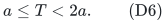

A target-T schedule then gives exactly one large unit to each
member of an h-element M_b-basis and no large units elsewhere.
The large Boolean-cap matroid was computed once and does not depend
on T.

Let

<!-- math-display: 7ca423880e7d4ccdf6727798
C=\lfloor T/u\rfloor,\qquad
       P(g)=P(f_s)\cap[0,C]^P.
 \tag{D7}
-->
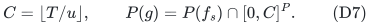

For every S subseteq P its rank is

<!-- math-display: 5a995f4cb434c5a4fee42637
g(S)=\min_{A\subseteq S}
                               \{f_s(A)+C|S\setminus A|\}.
 \tag{D8}
-->
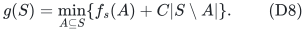

If g(P)<s, fail: a target-T small-job assignment would be a base
of the original rank s inside this box. Otherwise g(P)=s.

Form the dual recipient polymatroid on the **full original machine
set P**:

<!-- math-display: aeb4c013e4c9c3676ec81ee7
f_T(S)=C|S|+g(P\setminus S)-s.
 \tag{D9}
-->
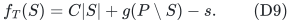

This function is normalized, monotone, integral and submodular.
Monotonicity follows because each marginal of g is at most C. Its
bases are precisely the vectors y=C*1-x_s with x_s in B(g).

Only after forming f_T do we restrict its recipient ground to P^+,
and use the loopless player matroid M_b|P^+. Recursive deletions in
the corank algorithm further restrict this fixed f_T. They do not
contract it or re-dualize the small-job resource on a smaller machine
set.

## 4. The integer quota supplied by a feasible target

Define the positive workload deficit and integer quota

<!-- math-display: 04d2f99097255b980fce5704
\delta_T=a+Cu-T,
 \qquad
 K=\left\lceil\frac{\delta_T}{u}\right\rceil
     =C-\left\lfloor\frac{T-a}{u}\right\rfloor.
 \tag{D10}
-->
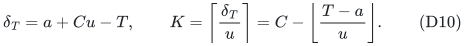

Since T-u<Cu<=T and 0<u<a<=T,

<!-- math-display: 3a1910ec76342b1aa3224d52
0<a-u<\delta_T\le a\le T,
                    \qquad 1\le K\le C.
 \tag{D11}
-->
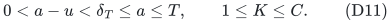

Suppose a target-T schedule exists. Let I* be its large-job recipient
basis, and set y*=C*1-x_s*. This is an integer base of f_T. For every
p in I*,

<!-- math-display: 42fa410e2caea3ff117c052b
a+u x_s^*(p)\le T
       \quad\Longrightarrow\quad
    y^*(p)\ge\delta_T/u
       \quad\Longrightarrow\quad y^*(p)\ge K.
 \tag{D12}
-->
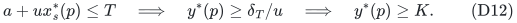

Downward closure gives K*1_(I*) in P(f_T|P^+). Hence a feasible
target supplies exactly the stronger promise needed by Theorem C.

Use output quota

<!-- math-display: 5ccbc67d983affddc8089cd1
b=\lceil K/2\rceil.
 \tag{D13}
-->
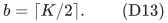

For K>=2, b<K and K/(K-b)<=3. The corank algorithm therefore returns
an M_b-basis I with b*1_I resource independent, or soundly certifies
that no K-unit basis exists. The latter implies OPT>T by (D12).
When K=1, use the exact polynomial one-unit matroid-intersection
procedure from Section 6 of the unit-quota note. Thus no invocation
with t=b is hidden in this step.

The recursive ground always has player rank h and starts with
corank c. Use the batch algorithm, which deletes an entire required
omission set at each branch. Its total computation-node count,
including candidate deletions rejected by rank tests, is at most

<!-- math-display: 3a69b05685ba82f51eede379
(c+1)(27/4)^c,
 \tag{D14}
-->
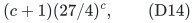

with an immediate polynomial exit when c=0. Target-specific deletion
of players with f_T({p})<K can only improve this parameter; any
resulting rank loss is a sound target rejection.

## 5. Zero extension, base completion, and the exact load bound

Extend the returned vector b*1_I by zero to all original machines P.
It remains independent in P(f_T): for every A subseteq P its count
equals b|I intersect A| and is bounded first by f_T(A intersect Q),
then by f_T(A), where Q was the final recursive ground. Complete
this vector coordinatewise to an integer base y of f_T by integral
polymatroid augmentation. This uses polynomial oracle time and
binary arithmetic, and preserves y(p)>=b on every p in I.

Set

<!-- math-display: d40473324c656ab46b55eed8
x_b=1_I,
                 \qquad x_s=C*1-y.
 \tag{D15}
-->
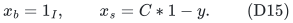

The small vector is nonnegative because every dual coordinate is
at most C. Base duality proves x_s in B(g), and the retained-rank
test proves x_s in B(f_s). Likewise x_b is independent in the
Boolean cap and has size h, so x_b in B(f_b). These are legal integer
count bases; decomposition into the original job types, if needed,
does not change any machine's total load.

An unselected machine has small load at most Cu<=T. A selected
machine has load

<!-- math-display: 04dfad8f00ca716035f801ba
\begin{aligned}
 a+u x_s(p)
   &\le a+Cu-bu\\
   &=T+\delta_T-bu\\
   &\le T+\tfrac12\delta_T\\
   &\le\tfrac32T.
 \end{aligned}
 \tag{D16}
-->
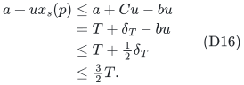

The penultimate inequality follows from b>=K/2 and Ku>=delta_T.
All small counts are integral, so there is no additional small-job
rounding term. In particular, the guarantee is exactly 3/2 rather
than 3/2 plus an accuracy loss or an additive u.

## 6. Target search without a monotone success assumption

Write the two rational sizes as a=A*gamma and u=U*gamma for positive
integers A,U and a positive rational gamma of polynomial bit length.
For example, a common denominator of a and u supplies such a grid.
Every integer schedule load, and consequently OPT, is an integer
multiple of gamma.

An explicit grid upper target is

<!-- math-display: 6e46388f7de412409c0f6d4b
T_{\rm hi}=ah+us.
 \tag{D17}
-->
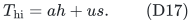

Any pair of integer bases is a feasible schedule, and its maximum
load is at most the total workload ah+us. Thus T_hi is genuinely
feasible and the target procedure must succeed there. Its grid
index Ah+Us has polynomial bit length, even for binary h and s.
Since h>0, zero is a certified infeasible lower target.

Maintain a failed lower grid index L and a successful upper index U,
recording the actual schedule at U. Query integer midpoints. A
failure proves OPT>gamma times that midpoint, so it may replace L.
A success supplies a legal schedule of load at most 3/2 times its
target, so it may replace U. The interval length halves at each
step. No monotonicity of success is used.

At termination U=L+1. Since OPT/gamma is an integer strictly above
L, one has gamma U<=OPT. The recorded schedule at U therefore has
load at most 3OPT/2. The number of target calls is polynomial in H.

## 7. Total complexity and special cases

Every target uses polynomially many original oracle operations
outside the recursive search. A dual rank query uses one small
box-rank query; the latter is computed by submodular minimization
through (D8). Nesting these polynomial oracle routines still gives
polynomial cost per recursive node. The integer C, dual rank values,
K, b, and all count vectors have polynomial bit length. No work is
proportional to their numerical magnitudes.

The recursion has the bound (D14), independent of T and K. A
depth-first traversal and the polynomial target search preserve
polynomial workspace. This establishes (D4).

If c=0, every eligible machine must receive a large unit in any
one-large-unit basis; the recursive test is a single submodular
minimization, and the theorem is polynomial. If the number of
eligible positions is smaller than h, Boolean rank necessarily
fails and Section 2 applies. Machines that cannot receive any large
unit are retained in the original small-job resource throughout
duality and final completion; they are removed only from the player
ground. This distinction is necessary for correctness.

## 8. Sharpness in the stated oracle model and comparison scope

Section 6 of [A value-oracle barrier below factor two for rank-parameterized allocation](../allocation-lower-bounds/proof.md)
uses q machines, the large matroid U_(q-c,q), large size 2, small
size 1, and an arbitrary small-job value oracle hiding one c-element
subset. The optimum makespan is 2. Every approximation factor
strictly below 3/2 must produce integer load at most 2 and therefore
identify the hidden subset. It requires at least binom(q,c)-1
queries.

For any claimed F(c)q^C oracle bound with fixed C, choose a fixed
integer c>max(C,1) and then let q increase. This excludes every
strictly better approximation factor with fixed-parameter oracle
runtime in c. Accordingly Theorem D attains the approximation
threshold for this parameter in the full arbitrary-polymatroid
value-oracle model. The single-exponential time is not shown optimal.

The lower bound does not apply automatically to explicit ordinary
restricted-assignment jobs. In that subclass Theorem D remains a
constructive upper bound, but any claim of priority or comparison
with specialized algorithms requires a separate literature audit.
It is also distinct from the existing factor-5/3 theorem whose
parameter is h: corank c can be small when h is large, and h can be
small when c is large. The two methods may be run in parallel and
their best feasible schedules compared.

---

**Attribution:** Yilin Liu and GPT-6 Astra Pro.
