# Two-size polymatroid scheduling parameterized by the number of large units

The normalized unit-quota theorem gives a scheduling consequence whose
exponential parameter is the number of large job units, not the number
of machines. This distinction is essential: a fixed-accuracy algorithm
exponential in the number of machines follows from a much simpler
count-enumeration baseline.

The proofs import the unit-core theorem from
[Unit quotas, a factor-three transfer, and the discrete time boundary](../../manuscripts/allocation-and-scheduling/unit-quota-three-transfer-and-discrete-time-gate.md) and the compressed
recipient-polymatroid implementation from
[Prefix normalization gives factor four for arbitrary recipient polymatroids](../recipient-polymatroid/proof.md).
The further refinement in [Two-size scheduling with a private-slack rank deficit](../../manuscripts/allocation-and-scheduling/two-size-makespan-private-slack-deficiency.md)
replaces h by a computable residual rank when sufficiently many
large-job positions have guaranteed private small-job slack.
Polymatroid aggregation, box restriction, base duality and additive
assignment rounding are the standard primitives used explicitly by
Bamas et al., arXiv:2307.08453v1, Proposition 9, Lemma 15, and
Theorems 21 and 23: <https://arxiv.org/html/2307.08453v1>.

## 1. Model and result

Let P be a set of q machines. Jobs have two common positive sizes
0<u<a. Aggregate each size class into an integral polymatroid on P,
with rank functions f_s and f_b, supplied by value oracles. A legal
schedule chooses integer bases x_s and x_b of these polymatroids.
Machine p has load

<!-- math-display: a40551ac7f04e89f15b5199d
u x_s(p)+a x_b(p).
 \tag{S1}
-->
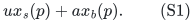

The same formulation covers individually supplied job matroids or
polymatroids: sum their rank functions within a size class, and use
integral polymatroid decomposition to recover individual assignments.
All ranks and multiplicities are binary encoded. Define

<!-- math-display: dbd43a8aa78e2010033ac372
h=f_b(P).
 \tag{S2}
-->
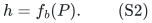

In ordinary restricted-assignment scheduling, h is exactly the number
of jobs of the larger size. In the general model it is the required
number of large service/job units, fixed independently of any target.

The resulting deterministic guarantee is

<!-- math-display: d640b2c0ed095df206f9225c
\boxed{\text{makespan at most }\tfrac53\,\mathrm{OPT}
              \text{ in }2^{O(h)}\mathrm{poly}(H).}
 \tag{S3}
-->
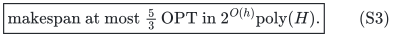

Here H includes q, the complete original input, all numerical bits,
and paid deterministic submodular-minimization and decomposition work.
No expansion by a binary job multiplicity is performed. The output
is an integral schedule, represented by aggregate counts or their
requested original decomposition.

For 0<eta<=1, there is also a target decision guarantee of
2-1/(3+eta) in rank-quasipolynomial time when u<=eta T/18. Its precise
optimization promise and runtime appear in Section 6.

## 2. The easy target branch

Fix a positive rational makespan target T. If the larger size satisfies
a<=T/2, solve the assignment relaxation and use the public additive
rounding theorem. An infeasible relaxation certifies OPT>T. Otherwise,
the integral schedule has makespan at most

<!-- math-display: d062e0fa36a1372ca763bd6c
T+a\le\tfrac32 T.
 \tag{S4}
-->
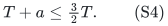

If h=0, the single remaining size class is handled exactly by checking
whether its polymatroid has a base under the coordinate bounds
floor(T/u). Rank zero and zero-size classes can be removed separately.
We henceforth consider h>0 and a>T/2.

## 3. Box restrictions and the rank-h player matroid

Any target-T schedule in the hard branch assigns at most one large
unit to each machine. Define

<!-- math-display: bec77d8fdf40fc435f5ffbd9
P_b'=P(f_b)\cap[0,1]^P,
 \qquad c=\lfloor T/u\rfloor,
 \qquad P_s'=P(f_s)\cap[0,c]^P.
 \tag{S5}
-->
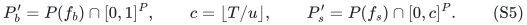

Their rank functions are obtained by the standard box formula

<!-- math-display: 8e78aae125d97c1995a9b34d
g_z(S)=\min_{A\subseteq S}
                \{f(A)+z(S\setminus A)\}.
 \tag{S6}
-->
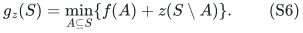

Check that the total ranks remain f_b(P) and f_s(P). A failure
certifies OPT>T. If T<a, the target is immediately infeasible because
h>0. Otherwise P_b' is the independence polytope of an ordinary
matroid M_b of rank h, with polynomial-time oracle implementation.
In particular, h<=q whenever this hard-branch rank check succeeds.

Let g_s be the rank function of P_s'. Its dual with respect to the
constant vector c is the integral polymatroid with rank

<!-- math-display: d026e01f8d872f81cb103237
\bar g_s(S)=c|S|+g_s(P\setminus S)-g_s(P).
 \tag{S7}
-->
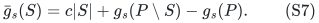

For bases, y belongs to this dual exactly when c*1-y belongs to P_s'.
Every coordinate of a dual independent vector is at most c. All
functions and dual queries use polynomially many original oracle
queries and polynomial-bit arithmetic; c is not expanded into slots.

## 4. A feasible schedule supplies a unit-quota basis

Put

<!-- math-display: 4d08e67a7c2b1921b501a0c2
t=a+c u-T,
             \qquad K=\lceil t/u\rceil.
 \tag{S8}
-->
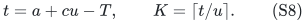

Since c u<=T and c u>T-u, one has

<!-- math-display: b512f54062d66418b40e54a1
0<a-u<t\le a\le T,
 \tag{S9}
-->
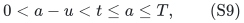

where the first displayed strict inequality uses a>u; in particular
t>0 and K>=1. If a target-T schedule exists, its large-unit recipients
form a basis I of M_b. Define y=c*1-x_s from its small-unit base.
On each p in I,

<!-- math-display: c511c103bfc56c687f338c89
a+u x_s(p)\le T
 \quad\Longrightarrow\quad
 y(p)\ge t/u
 \quad\Longrightarrow\quad y(p)\ge K.
 \tag{S10}
-->
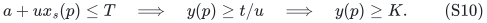

Thus the rank-h player matroid M_b and the one unit-value recipient
polymatroid P(bar g_s) have an integer K-unit basis allocation.
No player-configuration LP is used in this implication.

Apply the exact-boundary unit-core theorem with output quota

<!-- math-display: 4bff3f6cebd05ebfbc097dd3
b=\lceil K/3\rceil.
 \tag{S11}
-->
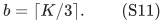

It returns a basis I of M_b and a dual-feasible count vector y
supplying at least b units to every p in I, or certifies absence of
a K-unit basis. Such absence is a sound certificate OPT>T by (S10).
Its runtime is 2^{O(h)}poly(H), since the selected player rank is h.

## 5. Reconstructing an integral schedule

Extend y coordinatewise to an integral base of P(bar g_s). Integral
polymatroid augmentation or box-constrained base optimization performs
this in polynomial oracle time. This extension only increases y and
does not reduce any promised value on I.

Set x_b=1_I and x_s=c*1-y. Base duality and the total-rank checks prove
that these are bases of the original large and small polymatroids.
For machines outside I the load is at most c u<=T. For machines in I,

<!-- math-display: 669b026be17bfd8e0e85791a
\begin{split}
 a+u x_s(p)
   &\le a+c u-bu\\
   &=T+t-bu\\
   &\le T+\tfrac23t\\
   &\le\tfrac53T.
 \end{split}
 \tag{S12}
-->
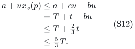

The key inequality bu>=t/3 follows from K u>=t and b>=K/3.
Every count remains integral. Individual job-matroid bases can be
recovered by the paid aggregate decomposition primitive.

Together with Section 2, this is a one-sided dual approximation oracle
for every rational target T. Standard finite-grid search yields (S3).
All possible integral schedule loads lie on a rational grid of
polynomial-bit denominator. An algorithmic failure always proves
OPT>T; a returned schedule is evaluated directly. Binary search does
not assume success is monotone, and keeps the best returned schedule.

## 6. Fine small jobs give rank-quasipolynomial time

Fix 0<eta<=1 and suppose the target additionally satisfies

<!-- math-display: 8c59998ff5efe6f986a8ed62
u\le\eta T/18.
 \tag{S13}
-->
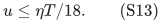

The easy branch remains polynomial. In the hard branch a>T/2 and
t>a-u>T/2-u. Hence

<!-- math-display: f3159e194e17208b67d214d8
\frac{t}{u}>\frac{T}{2u}-1
                             \ge\frac9\eta-1
                             \ge\frac{2(3+\eta)}\eta.
 \tag{S14}
-->
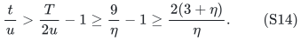

Use the unit-core algorithm with output b=ceil(K/(3+eta)). The
large-quota calculation in the unit-quota note gives constant-relative
growth Omega(eta), and runtime

<!-- math-display: 2e4ae0f239e2fffebff73494
\mathrm{poly}(H)
 \min\{2^{O(h)},(h+1)^{O((1+\eta^{-1})\log(h+1))}\}.
 \tag{S15}
-->
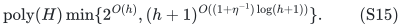

Its reconstruction has makespan at most

<!-- math-display: 8ec887ac05cebba76b3f3074
T+(1-1/(3+\eta))t
                        \le(2-1/(3+\eta))T.
 \tag{S16}
-->
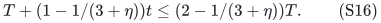

For optimization on instances promised to satisfy
u<=eta OPT/18, restrict target search to grid values at least
18u/eta. The promise puts OPT in that range, and every queried target
there satisfies (S13). Use the immediately preceding grid point as
the initial lower bound and a polynomial-bit upper target guaranteed
by arbitrary feasible bases. One-sided failures and successes give
the usual optimization guarantee without querying a target that would
require the small-quota exponential branch.

For eta<=1, the ratio in (S16) is at most 5/3+eta/9. This is an
explicit fine-small-job regime; it is not a uniform rank-quasipolynomial
5/3+eta theorem without a size promise. The unit-quota critical case
K=4, b=2 remains a real progress-count gate in the unrestricted case.

## 7. Why the parameter matters, and public comparison

The factor 5/3 is not new as an estimation or existence coefficient
for ordinary two-size restricted assignment. Jansen, Land and Maack,
*Estimating The Makespan of The Two-Valued Restricted Assignment
Problem*, SWAT 2016, prove a 5/3 configuration-LP gap and estimation
bound:
<https://drops.dagstuhl.de/entities/document/10.4230/LIPIcs.SWAT.2016.24>.
This source does not supply the constructive runtime claimed in (S3).

Raunak Sengupta's 2025 thesis, *Approximation algorithms for makespan
minimization: restricted assignments, interval uncertainties, and
price of connectivity*, reports a non-polynomial 5/3 local search for
ordinary restricted assignment, polynomial when the machine count is
fixed. Its primary repository abstract is at
<https://www.ideals.illinois.edu/items/139520>.
No matching 2^{O(h)} dependence or arbitrary job-polymatroid extension
was verified from that abstract; its full proof has not been audited
here.

For the general job-matroid/polymatroid model, Bamas et al., Theorem 4
and Corollary 5, give polynomial 7/4+epsilon through their resource
factor-four theorem. The new statement (S3) trades that polynomial
runtime for an explicit single-exponential dependence on h, which can
be much smaller than q. Statement (S15) is a second, restricted size
regime with rank-quasipolynomial dependence.

As proved in [Unit quotas, a factor-three transfer, and the discrete time boundary](../../manuscripts/allocation-and-scheduling/unit-quota-three-transfer-and-discrete-time-gate.md),
there is a simple fixed-accuracy (1+epsilon) scheduling baseline in
(1+epsilon^-1)^{O(q)}poly(H) by enumerating each machine's large-unit
count, combined with assignment rounding when all sizes are tiny.
It prevents claiming a new approximation-quality result merely from
a runtime exponential in q. It does not yield (S3) by replacing q
with h: enumerating the chosen h large-unit machine positions directly
costs q^{Theta(h)} in general.

The public search has not established exhaustive novelty. The actual
claim is the proved parameter and oracle-model transfer, with the
named public and elementary baselines stated separately.

**Attribution:** Yilin Liu and GPT-6 Astra Pro.
