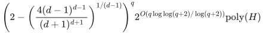
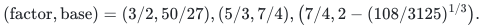

# Scheduling with two processing times per machine

**Guarantee**

For every fixed integer <code class="math">d\ge2</code>, returns makespan at most <code class="math">(2-1/d)\mathrm{OPT}</code>, including exact <code class="math">3/2</code> at <code class="math">d=2</code>.

**Objective and output**

Assign every original type total when each machine has at most two positive processing times, preserving the exact assignment-cost budget.

**Randomness**

Deterministic quota search and original-total recovery, including the fixed-factor endpoints and deterministic whole-ground conversion.

**Time**

For the fixed integer approximation parameter <code class="math">d\ge2</code>, time is

<!-- math-display: 1978ae1bee1cb5578fcb8a30
\left(2-\left(\frac{4(d-1)^{d-1}}{(d+1)^{d+1}}\right)^{1/(d-1)}\right)^q 2^{O(q\log\log(q+2)/\log(q+2))}\mathrm{poly}(H)
-->

Endpoints are

<!-- math-display: 6801e0cf663f5fac123cbc6b
(\text{factor},\text{base})=(3/2,50/27),(5/3,7/4),\bigl(7/4,2-(108/3125)^{1/3}\bigr).
-->

**Space**

Polynomial in the complete binary input and paid oracle workspace; numerical resource multiplicities are not expanded into individual units.

**Parameters**

<code class="math">q</code> is the physical-machine count; <code class="math">d\ge2</code> is a fixed integer; each machine has its own at most two positive times <code class="math">u_p&lt;a_p</code>. <code class="math">\Gamma(R)=R^R/(R-1)^{R-1}</code>. <code class="math">H</code> includes the explicit ground, all rational and integer encodings, and paid rank, submodular-minimization, LP, intersection, and decomposition work.

**Model and representation**

Integral job polymatroids, mandatory original bases, machine-dependent two-time pairs, arbitrary nonnegative assignment costs, and one exact scalar budget. Zero-time pairs are permitted.

**Lower-bound scope**

No lower bound is claimed for this algorithm.

**Review status**

**Ready for review.** The complete fixed-integer-d heterogeneous two-positive-processing-times-per-machine Theorem HT: original mandatory job-polymatroid bases, nonnegative rational times including zero, one exact assignment budget, exact small-quota gates, heterogeneous scaled support separators, protected omission recursion, joint minimum-cost integral recovery, streamed global conversion and one-sided rational-grid optimization. The complete-table reference realization has its own explicitly charged vertex, role and integer-count enumeration bound.

**Dependencies and scope.** The fast mathematical algorithm uses the explicitly paid exact rank/SFM, rational LP and integral polymatroid-intersection primitives. The reference backend implements semantic interfaces on complete rank tables by enumeration; it does not realize the fast theorem's time or polynomial workspace. The sharp base is for fixed integer `d>=2` and one scalar assignment budget. Finite executable tests have their stated scope; proof-assistant formalization, external peer review and publication priority are not claimed.

The [verification note](verify/README.md) identifies executable coverage. This status does not claim external peer review or proof-assistant verification.

**Source**

[Manuscript and proof](proof.md), with [dependencies and verification sources](sources.md).

The positive time pair may differ from machine to machine. A rational noninteger <code class="math">d</code> is not included in the discrete quota proof.

**Attribution.** icekylinx · GPT-6 Astra Pro
