# Two processing times per machine, with unrelated values across machines

Every machine may have its own positive pair {u_p,a_p}. Across machines
there can be arbitrarily many distinct processing times. A type may
use either member at each machine. Mandatory job-polymatroid bases and
one exact assignment budget remain intact. The weighted omission proof
handles heterogeneous count targets by scaling separator coordinates.

An [exact complete-table realization](reference-realization.md) implements the
joint LP, heterogeneous service separator, integral recovery and target search
with explicitly charged vertex, role and count enumeration. It is a separate
baseline; the fast omission/global-cover bound below retains its own proof.

## 1. Model and statement

Let P be q>=1 physical machines. Type j has a normalized monotone
integral recipient rank f_j and mandatory count n_j=f_j(P). Put
N=sum_j n_j. A schedule has integer x_j in B(f_j), satisfies original
pair eligibility, and respects one budget

<!-- math-display: 257f1e6b7d0241da8d7bcac5
\sum_{p,j}c_{pj}x_j(p)\le C,\qquad c_{pj}\ge0,\quad C\ge0.
 \tag{HT1}
-->
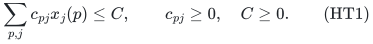

Every eligible processing time ell_pj is nonnegative. On each fixed
machine there are at most two distinct positive eligible times; when two,
write 0<u_p<a_p. The pair may vary arbitrarily between machines.
OPT is the minimum makespan under these original constraints.

H includes binary data and paid polynomial rank, SFM, LP and
intersection work. For fixed integer d>=2 put

<!-- math-display: 462c1cf10bd21860a2078d10
\rho_d=2-\frac1d,\quad R_d=\frac{d+1}{d-1},\quad
 A_d=\Gamma(R_d),\quad B_d=2-\frac1{A_d},\quad
 E(q)=2^{O(q\log\log(q+2)/\log(q+2))}.
 \tag{HT2}
-->
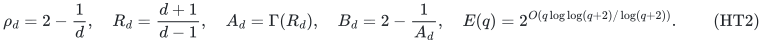

**Theorem HT.** A deterministic algorithm detects unbounded-load
budget infeasibility or returns makespan <=rho_d*OPT in
B_d^q E(q) poly(H) time and polynomial space, with every original
job total and HT1 exact. Exact factor 3/2 has base 50/27; factor 5/3
has base 7/4; factor 7/4 has base 2-(108/3125)^(1/3).

The joint spare-capacity construction is related to
[Unrelated two-size job scheduling with an exact assignment budget](../../manuscripts/allocation-and-scheduling/unrelated-two-size-costed-scheduling-tradeoff.md) and the direct
upper-prefix proof in [Arbitrary unrelated processing times: a bucket-label scheduling tradeoff](../processing-bucket-tradeoff/proof.md),
Section 3. Sections 4–6 prove the unequal-quota separator and the joint recovery for all machine classes.

## 2. Original totals and fixed-target preprocessing

Retain each original n_j after every pair mask. A masked type rank
is at most n_j. Intersect the masked resource direct sum with an
integral machine polymatroid and keep total N: every type then attains
n_j, since another type cannot compensate for its missing units.
This maximum-total face is integral. Minimum actual assignment cost
on it is no greater than the cost of a given fractional point. The
budget is not an extra row that is assumed to preserve integrality.

Initially minimize cost on the original eligible resource bases.
Infeasible original totals or minimum cost above C proves infeasibility.
Otherwise retain the integral optimizer as a finite feasible upper
schedule. If N=0 return the empty optimal schedule.

**Lemma 1 (zero-time block).** Zero-time pairs can remain available at
every role-search node without changing the guarantee or exponential
base.

**Proof.** At each machine put its zero-time coordinates in a separate
integral modular box with coordinate bound <code class="math">f_j(\{p\})</code>. These
redundant singleton bounds contain every legal resource assignment.
Take its direct sum with the positive-time machine polymatroid used
below. Thus zero-time units consume original resource capacity and
assignment cost but no positive-time count cap or load. The same
fractional full-total witness belongs to this enlarged machine
polymatroid, and one minimum-cost integral point recovers all original
type totals and the exact budget. A protected full schedule survives
each omission unchanged on zero-time pairs. No role state or additional
exponential choice is introduced. <code class="math">\square</code>

Test target zero exactly by masking to zero-time pairs and minimizing
cost with every original total still mandatory. On success return an
optimal zero-load schedule. Otherwise the optimum is positive.

At a positive target T, forbid every pair with ell_pj>T, keeping all
original totals. Such pairs cannot occur in a full target-T schedule.
Reclassify every machine on its remaining positive eligible processing values:

- No positive value: its positive-time counts are zero.
- One positive value s_p: impose count cap floor(T/s_p) on that group.
- Two values u_p<a_p<=T: use the classes below.

An original two-value machine whose large pairs were removed becomes
single-valued. No physical machine is removed from original resource
ranks or mandatory accounting.

## 3. Easy and small-quota classes

A two-value machine is easy if a_p<=(d-1)T/d. Keep its fractional
load bound T. At recovery, its own upper-prefix ceilings add at most
a_p, so its load is at most rho_d*T.

Every other two-value machine has

<!-- math-display: 49f2c2c06d07a7735753ac21
\frac{d-1}{d}T<a_p\le T.
 \tag{HT3}
-->
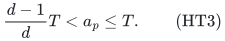

so a full target-T schedule has at most one large unit there. Define

<!-- math-display: b3fa8df51d1f22ec6a19334a
C_p=\lfloor T/u_p\rfloor,\quad \delta_p=a_p+C_pu_p-T,\quad
 K_p=C_p-\lfloor(T-a_p)/u_p\rfloor=\lceil\delta_p/u_p\rceil.
 \tag{HT4}
-->
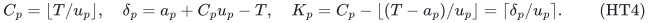

Then 0<delta_p<=a_p<=T, 1<=K_p<=C_p, and K_p*u_p>=delta_p.
A full schedule with one large unit has at most C_p-K_p small units;
without a large unit it has at most C_p small units.

If K_p<=d, impose fixed laminar caps

<!-- math-display: 7c741131cdae1aea37cd00ad
\text{large count}\le1,\qquad\text{positive total count}\le C_p.
 \tag{HT5}
-->
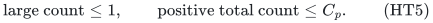

Every full target schedule satisfies these caps. After recovery, a
machine with a large unit has load at most

<!-- math-display: 8be9b547a98c49c68f411f4f
a_p+(C_p-1)u_p=T+\delta_p-u_p
 \le T+(1-1/d)\delta_p\le\rho_dT.
 \tag{HT6}
-->
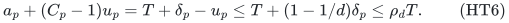

because delta_p<=K_p*u_p<=d*u_p. Without a large unit its load is
at most T. These machines need no role search. The caps give a weak
success for K_p>1, and are exact in the hard range for K_p=1.

## 4. The remaining role ground and its service region

Let H_T contain the machines satisfying HT3 and K_p>=d+1; write
h=|H_T|. For them put

<!-- math-display: ddc76989e536738675ee0d1f
b_p=\lceil K_p/d\rceil,\qquad b_p/K_p\le 2/(d+1)=:\beta.
 \tag{HT7}
-->
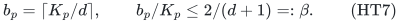

The inequality is the integer-quota identity proved in [the quota manuscript](../whole-ground-allocation/integer-quotas.md#2-the-integer-quota-ratio). At current
Q subseteq H_T, allow large H_T pairs only at Q, while small pairs
remain available on every physical machine under its fixed masks.
All non-H_T restrictions from Sections 2--3 remain unchanged.

X_Q is the joint fractional polytope with original masked resource
ranks, every equality x_j(P)=n_j, HT1, all non-H_T machine constraints,
and H_T caps

<!-- math-display: ba30ccf432e3afd21688f827
\begin{aligned}
 \text{large count}_p&\le1&&(p\in Q),\\
 \text{large count}_p&=0&&(p\in H_T\setminus Q),\\
 \text{small positive count}_p&\le C_p&&(p\in H_T).
 \end{aligned}
 \tag{HT8}
-->
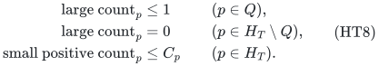

First test X_Q for emptiness. Masked rank loss, capacity failure and
budget failure may reject it. For nonempty X_Q define

<!-- math-display: faa7171ab2510199f30b8172
U_Q=\{z\in\mathbb R_{\ge0}^Q:\exists x\in X_Q,\quad
 z_p+\text{small positive count}_p(x)\le C_p\ (p\in Q)\}.
 \tag{HT9}
-->
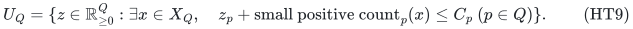

This region is compact, convex, downward and contains zero. Its exact
support for nonnegative lambda is the bounded LP maximizing

<!-- math-display: ea1c05646bae363902c42f68
\sum_{p\in Q}\lambda_p(C_p-\text{small positive count}_p(x)).
 \tag{HT10}
-->
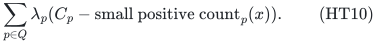

Negative count coefficients in this support objective are harmless.
The service separator has a nonnegative normal and capacity. Use
the normalized outer support LP as in US, with a nonpositive excess
meaning membership. Recover the fractional witness on success.
All base rows, target coefficients, extreme-point witnesses and
support separators have uniform polynomial binary complexity on
every branch. No sparse-separator assumption is used.

## 5. Scaling unequal quotas preserves the omission inequality

Fix an original full target-T integer schedule. Let I* be its machines
in H_T that receive a large unit, and k=|I*|. At every Q containing
I*, the unchanged schedule belongs to X_Q: each forbidden large pair
outside Q was unused. No job is dropped or moved and the original
cost and every resource base are unchanged. Its spare counts prove

<!-- math-display: 321bb5521016920569d3aff6
z^*_p=K_p\ (p\in I^*),\qquad z^*_p=0\ (p\notin I^*),\qquad z^*\in U_Q.
 \tag{HT11}
-->
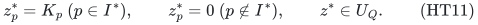

Query b_p on every p in Q. If a nonnegative row lambda*z<=W separates
that query, set w_p=lambda_p*K_p. By HT11 and HT7,

    w(I*)<=W<sum_(p in Q)lambda_p*b_p<=beta*w(Q).

Therefore

<!-- math-display: b1d5ec777979d7a1f5a508be
w(Q\setminus I^*)>(1-\beta)w(Q)=w(Q)/R_d.
 \tag{HT12}
-->
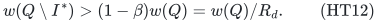

This is precisely the weighted first-crossing omission inequality.
The [first-violation certificate construction](../whole-ground-allocation/selection.md),
Sections 3–6, supplies its prefix-free branch count and polynomial-space
enumerator. Its combinatorial counting is unchanged when a fresh row is
computed at each node: the same complete schedule in HT11 supplies the
protected-witness invariant, as in the
[changing-region argument](../whole-ground-allocation/adaptive-selection.md),
Sections 5–6. No row from a previous node is reused as a description of the
new joint region.
The scaled weights have polynomial bit length, and their total is
positive on a failed query. The certificate routine has a child
avoiding I*, so the same complete schedule survives in that child.
Equal small times and equal full quotas are not needed.

For a fixed exact k, require |Q|>=k and start from H_T, or H_T minus
a forced seed Z. The full all-input recursion time, including failed
children and rank/LP gates, is

<!-- math-display: 619817ddca1c2da6e8e0a535
A_d^{\,h-k-|Z|}\mathrm{poly}(H).
 \tag{HT13}
-->
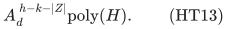

At zero deficit a protected Q=I* has the full HT11 witness and thus
a feasible weak query. An empty-X_Q rejection cannot occur on a
protected path.

## 6. One integral recovery for every machine class

At a successful query keep its joint fractional x. Retain every zero-time block from Lemma 1. For the disjoint positive-time coordinates, form one machine polymatroid as a direct sum over all physical machines:

- Empty machines have zero caps.
- Single-value machines retain their exact count caps.
- Easy machines get integer upper-prefix ceilings from x, including
  the full prefix in their own processing-time order.
- Small-quota hard machines keep HT5.
- Machines in Q have disjoint large cap one and small cap C_p-b_p.
- Machines in H_T minus Q have large cap zero and small cap C_p.

Every component is an integral partition, laminar or chain polymatroid.
The same x satisfies the direct sum and the one original masked
resource direct sum. Retain total N and minimize actual cost. The
integer result attains every n_j and costs no more than x.

Empty, single-value, easy and small-quota machines have their stated
guarantees. For p in Q, even with a large unit its load is at most

<!-- math-display: 618c168123cfd337fc3779da
a_p+(C_p-b_p)u_p=T+\delta_p-b_pu_p
 \le T+(1-1/d)\delta_p\le\rho_dT.
 \tag{HT14}
-->
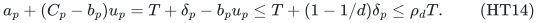

because b_p*u_p>=K_p*u_p/d>=delta_p/d. Without a large unit load
only decreases. A machine in H_T minus Q has load at most T. Thus
one minimum-cost integral point gives all guarantees simultaneously.
Machine classes are not rounded as independent resource copies.

## 7. All cardinalities, the global cover and optimization

First test Q empty with the joint LP and recovery above. This handles
k=0, including h=0, in polynomial time. Otherwise run every exact
k=1,...,h. Any full target schedule supplies one of these values.
A successful output may have a different number of large recipients
than its promised k. That is legal: the original problem fixes job
totals and cost, not the number of large processing choices.

For fixed k, the protected omitted set has exactly h-k elements of
H_T. HT13 supplies the forced-extension interface for the accepted
polynomial-space global cover. Its time is B_d^h E(h) poly(H).
All h cardinalities and non-H_T operations are polynomial. Since
h<=q, this is bounded by B_d^q E(q) poly(H), using a uniform monotone
subexponential upper envelope for E. All physical machines remain
in resource feasibility and recovery, although only H_T is branched.

The exact zero-target gate has already handled every zero-load solution; all remaining instances have OPT>0. Choose a positive rational g dividing
every original finite time; common-denominator integer gcd gives
polynomial encoding. Start with the initialized feasible schedule as
upper grid target and zero as lower target. At grid midpoints, total
failure excludes a full target and raises the lower endpoint. A weak
success saves its actual schedule and lowers the upper endpoint.
At adjacent endpoints, the saved upper target is at most OPT and its
schedule has makespan at most rho_d*OPT. No monotonicity of weak
successes or nominal full-feasibility claim is assumed.

The initial upper load is at most N times the maximum input time,
so the number of target calls is polynomial in binary input length.
All count floors, scaled rows, LPs and recovery data have polynomial
encoding. Depth-first omissions and the streamed cover use polynomial
space. This proves HT2's claimed bound without an unaccounted larger
exponential fallback or a numeric unit expansion.

## 8. Exact scope

The hypothesis is two distinct positive times per machine, not two
times in the whole matrix and not an intrinsic time per type. It is
still a restriction on general unrelated processing. The arbitrary-
processing bucket theorem has a broader model and a different curve.
Zero-time pairs are retained in the separate modular blocks of Lemma 1, outside all positive-time count quotas.

The theorem has one exact assignment budget. It does not infer
optional active-machine bases, startup charges, several exact cost
rows, or common allocations across scenarios. Mandatory jobs survive
because only unused large pairs are forbidden along a protected path;
the algorithm never discards all assignments of an omitted machine.

The sharp bases are fixed-d statements. With binary-input d, rational
quotas remain valid and a polynomial-bit bound such as 3R_d can replace
Gamma(R_d) in the global cover, as in the accepted quota theorem.
No publication-priority or formal/external verification claim is made.

---

**Attribution:** icekylinx and GPT-6 Astra Pro.
