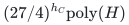
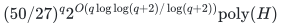

# Compulsory allocation with two common intrinsic values

**Guarantee**

Returns utility at least <code class="math">\mathrm{OPT}/2</code> for every compulsory player under one exact assignment-cost budget. For fixed integer <code class="math">d\ge2</code>, the same intrinsic-value model admits factor <code class="math">d</code>.

**Objective and output**

Allocate integer counts with common positive resource values <code class="math">u&lt;a</code>, preserving each original recipient polymatroid and one budget.

**Randomness**

Deterministic in the exact-two and whole-ground variants, with paid exact completion, rank, LP and decomposition primitives.

**Time**

Exact factor two takes

<!-- math-display: 21639e70b8786ac9d1909eeb
(27/4)^{h_C}\mathrm{poly}(H)
-->

Or

<!-- math-display: f970c34ebaeec5d27646ef45
(50/27)^q 2^{O(q\log\log(q+2)/\log(q+2))}\mathrm{poly}(H)
-->

For fixed integer <code class="math">d\ge2</code>, replace <code class="math">27/4</code> by <code class="math">A_d=\Gamma((d+1)/(d-1))</code> and the global base by <code class="math">2-1/A_d</code>.

**Space**

Polynomial in the complete binary input and paid oracle workspace; numerical resource multiplicities are not expanded into individual units.

**Parameters**

<code class="math">q</code> is the compulsory-player count; <code class="math">h_C</code> is the maximum number of distinct recipients affordable with one large-value unit each. <code class="math">\Gamma(R)=R^R/(R-1)^{R-1}</code>. <code class="math">H</code> includes the explicit ground, all rational and integer encodings, and paid rank, submodular-minimization, LP, intersection, and decomposition work.

**Model and representation**

Two common intrinsic resource values, arbitrary integral recipient polymatroids, nonnegative assignment costs, compulsory players, and one exact scalar budget.

**Lower-bound scope**

The [strict-below-two oracle obstruction](../allocation-lower-bounds/README.md) concerns the stated arbitrary recipient-rank model, not every explicit-item subclass.

**Review status**

**Ready for review.** The complete compulsory-player two-intrinsic-value arbitrary-assignment-cost theorem: polynomial affordable heavy-recipient parameter, attaining minimum original heavy completion, adaptive residual small-count region and protected pair, exact integral quota recovery, one-unit/pure-heavy/high-target boundaries, one-sided value-grid search and matching strict-below-two recipient-oracle threshold.

**Dependencies and scope.** All players are compulsory, values are intrinsic to disjoint heavy/light types and there is one exact nonnegative assignment-cost budget. Original heavy pairs remain available after every forced light omission; an attaining exact completion is required. Paid exact rank/SFM/LP and weighted matroid/integral polymatroid intersection retain their explicitly proved interfaces. The large-target branch uses the fixed compulsory set and cost-preserving additive rounding; no optional-player all-target LP is inferred. Shared reference evidence realizes weighted unit coverage, adaptive prefix recursion and native scalar setup flow. It does not implement the full two-value allocation LP/quota/rounding pipeline. Mathematical completeness is distinct from that software scope. The strict-below-two lower bound is deterministic hidden-set rank-oracle complexity for the same affordable-heavy parameter with zero costs. It does not imply ordinary explicit-eligibility hardness or an optimal exponential base.

The [verification note](verify/README.md) identifies executable coverage. This status does not claim external peer review or proof-assistant verification.

**Source**

[Manuscript and proof](proof.md), with [dependencies and verification sources](sources.md).

The broader [J2 theorem](../unrelated-values-joint-role/proof.md#9-compulsory-two-valued-unrelated-instances-exact-factor-two) allows player-specific pair values in <code class="math">\{0,u,a\}</code>, even within one shared resource type, with the same exact-two global base. Its [full integer tradeoff](../unrelated-values-joint-role/two-value-tradeoffs.md) requires compulsory players and does not obtain optional selection from a third-value dummy.

**Attribution.** Yilin Liu · GPT-6 Astra Pro
