# Unrelated-value allocation with an exact budget and a fractional comparator

## 1. Model and theorem

Let <code class="math">P</code> be an explicit set of <code class="math">q</code> players. For a normalized monotone
integral submodular rank <code class="math">f</code>, write

<!-- math-display: 9cf7f3db8cf9526de481b0fd
P(f)=\{x\in\mathbb R_{\ge0}^{P}:x(S)\le f(S)\text{ for every }S\subseteq P\}.
-->
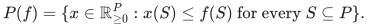

Resource type <code class="math">j</code> has rank <code class="math">f_j</code>. Its integer allocation is a vector
<code class="math">x_j\in P(f_j)\cap\mathbb Z^P</code>; unused units are allowed. Pair <code class="math">(p,j)</code>
has nonnegative rational value <code class="math">v_{pj}</code> and cost <code class="math">a_{pj}</code>. One budget is

<!-- math-display: aa9f4f699416f4223f946e5e
\sum_{p,j}a_{pj}x_j(p)\le C,\qquad C\ge0. \tag{U1}
-->
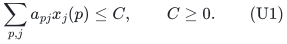

Let <code class="math">\mathcal B</code> be a nonempty family of <code class="math">r</code>-element player sets,
<code class="math">1\le r\le q</code>. A paid polynomial-time restriction selector finds a
member contained in any specified <code class="math">Q\subseteq P</code>, or correctly reports
that none exists. A matroid-basis family is the principal example. Put
<code class="math">c=q-r</code>. All resource ranks, costs and values remain fixed when the
selector is restricted. Eligibility masks are incorporated before the
algorithm starts.

For fixed <code class="math">I\in\mathcal B</code>, let <code class="math">\lambda_I</code> be the optimum common
utility with fractional resource counts, zero assignments outside <code class="math">I</code>,
and budget (U1). Define

<!-- math-display: 6bc26a8b5b55bed08919658b
\mathrm{FOPT}=\max_{I\in\mathcal B}\lambda_I,\qquad
 u_p=\max\bigl(\{v_{pj}:f_j(\{p\})\ge1\}\cup\{0\}\bigr),\qquad
 u=\max_pu_p. \tag{U2}
-->
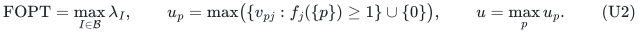

The selected set in FOPT is an actual member of <code class="math">\mathcal B</code>; only the
resource counts are relaxed. Thus FOPT is at least the integer optimum
OPT. Put <code class="math">\Gamma(R)=R^R/(R-1)^{R-1}</code> for <code class="math">R&gt;1</code>.

**Theorem U.** For every rational <code class="math">0&lt;\varepsilon&lt;1</code>, a deterministic
algorithm returns <code class="math">I\in\mathcal B</code> and an integer allocation obeying
(U1), such that

<!-- math-display: 7b75b5839b0eef1d6b8d86f0
\sum_jv_{pj}x_j(p)\ge
 \max\{0,(1-\varepsilon)\mathrm{FOPT}-u_p\}\qquad(p\in I). \tag{U3}
-->
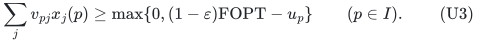

Its time is

<!-- math-display: 83c7576f308d45e1c58a54e3
\Gamma(1/\varepsilon)^c\mathrm{poly}(H), \tag{U4}
-->
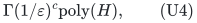

and its workspace is polynomial in <code class="math">H</code>. Here <code class="math">H</code> includes the full
binary input and accuracy, oracle-answer lengths, and the paid costs of
exact rank, submodular minimization, restriction selection, rational LP
and weighted polymatroid-intersection operations. These polynomial
bounds are uniform in <code class="math">c</code> and <code class="math">\varepsilon</code>.

For fixed rational <code class="math">\varepsilon</code>, the same guarantee also has time

<!-- math-display: 77d1784e7906e90ad82b5f2b
\left(2-\Gamma(1/\varepsilon)^{-1}\right)^q
 2^{O(q\log\log(q+2)/\log(q+2))}\mathrm{poly}(H). \tag{U5}
-->
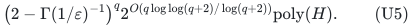

The unbudgeted theorem is the specialization <code class="math">a_{pj}=C=0</code>. The guarantee
against OPT follows from FOPT <code class="math">\ge</code> OPT. Both comparators use the full
requested accuracy in the exponent.

## 2. Exact separation of one fixed service region

Define

<!-- math-display: b1fbc0b91f2ba7a85f0d665e
\mathcal X_C=\{(x_j)_j:x_j\in P(f_j),\
                              \sum_{p,j}a_{pj}x_j(p)\le C\},
 \qquad
 \mathcal U_C=\{z\ge0:\exists x\in\mathcal X_C,\
                           z_p\le\sum_jv_{pj}x_j(p)\ (p\in P)\}. \tag{U6}
-->
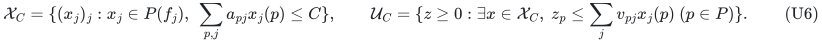

These are compact rational polytopes; <code class="math">\mathcal U_C</code> contains zero and
is downward closed. Every resource coordinate is bounded by its singleton
rank. Resource separation minimizes <code class="math">f_j(S)-x_j(S)</code>; the other rows
are explicit. Exact rational LP tests service membership and reconstructs
a fractional allocation in polynomial oracle time. A restriction query
has zero service outside <code class="math">Q</code> on the original ground. Resources are
neither contracted nor redefined.

**Lemma 1 (nonnegative separation).** A nonnegative query outside
<code class="math">\mathcal U_C</code> has an exactly computable polynomial-bit strict separator
<code class="math">a\cdot z\le h_C(a)</code>, with <code class="math">a\ge0</code> and <code class="math">h_C(a)\ge0</code>.

**Proof.** For <code class="math">a\ge0</code>, optimize

<!-- math-display: b5bcb49588db544c466e97fb
h_C(a)=\max_{x\in\mathcal X_C}\sum_{p,j}a_pv_{pj}x_j(p).
-->
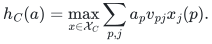

The support optimizer may be chosen at a vertex by lexicographic
refinement. All such vertices have uniform polynomial bit length:
resource rows have zero-one coefficients and encoded integral right
sides, the budget has original rational data, and a vertex uses at most
the ambient number of independent active rows.

Let <code class="math">V=\sum_j f_j(P)\max_pv_{pj}</code>. For the query <code class="math">z</code>, solve

<!-- math-display: 49ead4539f6cb13b7e05440a
\max\left\{a\cdot z-h:\ a\ge0,\ a(P)=1,\ 0\le h\le V,\
 h\ge\sum_{p,j}a_pv_{pj}x_j(p)
                       \text{ for every vertex }x\text{ of }\mathcal X_C\right\}.
 \tag{U7}
-->
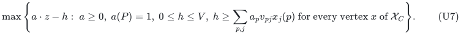

The inner support problem separates the last row family with
polynomial-bit inequalities. At an optimum <code class="math">h=h_C(a)</code>, so a positive
optimum supplies the required row. Conversely, strong separation of
<code class="math">z\ge0</code> from a compact downward region gives a nonnegative normal:
replace negative coordinates of a signed separator by zero. Downward
closure preserves the support value, while the queried scalar product
cannot decrease. Normalize its nonzero positive part to sum one.
Thus an external query has positive optimum in (U7); a nonpositive
optimum certifies membership. The argument covers zero budgets and
lower-dimensional service polytopes. <code class="math">\square</code>

## 3. The fixed-target selection gap

Set <code class="math">\alpha=1-\varepsilon</code>. Apply the
[weighted omission theorem](../whole-ground-allocation/selection.md)
with full service <code class="math">t=T&gt;0</code> and relaxed service <code class="math">b=\alpha T</code>. Its ratio
is <code class="math">t/(t-b)=1/\varepsilon</code>. Lemma 1 supplies the separator and the
given restriction selector supplies the fixed-cardinality family.

The routine returns an actual <code class="math">I\in\mathcal B</code> with
<code class="math">\alpha T\mathbf1_I\in\mathcal U_C</code>, or fails only when no permitted
set supports full target <code class="math">T</code>. Its all-input time is (U4), including
failed restrictions. Indeed, a violated row at <code class="math">Q</code> and a protected
full-target set <code class="math">I^*\subseteq Q</code> satisfy

<!-- math-display: 888f79c3671afae844865a98
T a(I^*)\le h<\alpha T a(Q),\qquad
                      a(Q\setminus I^*)>\varepsilon a(Q).
-->
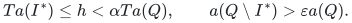

Ordering the nonnegative weights forces a first prefix whose omitted
density exceeds <code class="math">\varepsilon</code>. Prefix-free certificate enumeration
has branch sum <code class="math">\sum_D\Gamma(1/\varepsilon)^{-&#124;D&#124;}\le1</code>, and one deletion
preserves <code class="math">I^*</code>. The cited theorem proves the complete enumeration
and polynomial-space bounds. A successful nominal <code class="math">T</code> need not itself
be fully feasible.

## 4. Exact reoptimization preserves the fractional comparator

For each permitted set the original, target-independent LP is

<!-- math-display: 23b1e7805c9614824eb15ced
\begin{aligned}
 \max\;&\lambda,\\
 x_j&\in P(f_j),\qquad x_j(p)=0\quad(p\notin I),\\
 \sum_jv_{pj}x_j(p)&\ge\lambda\quad(p\in I),\\
 \sum_{p,j}a_{pj}x_j(p)&\le C,\qquad 0\le\lambda\le V .
 \end{aligned} \tag{U8}
-->
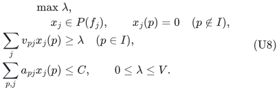

It is bounded, nonempty and exactly optimizable. Let <code class="math">n</code> bound its
dimension and let <code class="math">2^L</code> uniformly bound the numerator and denominator
magnitudes of its row data. Polynomial <code class="math">n,L</code> are computed from the
original data and full ranks. Clearing denominators row by row bounds
integer entries by <code class="math">W=2^{(n+2)L}</code>. Cramer's rule gives the uniform
denominator bound <code class="math">D=n!W^n</code> for every <code class="math">\lambda_I</code>; <code class="math">D</code> has polynomial
binary length. Boundedness ensures a vertex also on lower-dimensional
feasible faces. Since <code class="math">\mathcal B</code> is finite, FOPT is one of these optima.

Write <code class="math">\alpha=A/B</code> in lowest terms and use grid
<code class="math">\delta=1/(2BD^2)</code>. Start at lower target zero with any permitted set,
and an external upper grid target above <code class="math">V</code>. On a midpoint success
save the returned set and raise the lower endpoint; on failure lower
the upper endpoint. Every failed upper endpoint remains strictly above
FOPT. At adjacent endpoints the saved set obeys

<!-- math-display: 88b21dacf539f0ff9c9a9149
L>\mathrm{FOPT}-\delta,\qquad
                  \lambda_I\ge\alpha L. \tag{U9}
-->
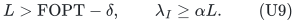

Reoptimize (U8) for this set. If <code class="math">\lambda_I&lt;\alpha\mathrm{FOPT}</code>,
their denominator bounds imply

<!-- math-display: e8f7eaf56b108a2f151502c5
\alpha\mathrm{FOPT}-\lambda_I
                            \ge 1/(BD^2)=2\delta,
-->
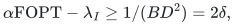

contradicting (U9). Therefore <code class="math">\lambda_I\ge\alpha\mathrm{FOPT}</code>.
There are polynomially many target calls, of polynomial bit length,
without enumerating <code class="math">D</code>. FOPT <code class="math">=0</code> is included. The
[rational optimization lemma](../whole-ground-allocation/rational-optimization.md)
gives the general form of this argument.

## 5. One integral rounding preserves every prefix and the cost

Restrict the fractional optimum to its fixed set <code class="math">I</code>. For each resource
write <code class="math">f=f_j&#124;I</code>, <code class="math">n=f(I)</code>, add a disposal coordinate <code class="math">0</code>, and define

<!-- math-display: 07a93b9692f0968125f9771b
\widehat f(S)=
 \begin{cases}f(S),&0\notin S,\\n,&0\in S.\end{cases} \tag{U10}
-->
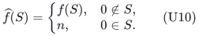

This is normalized, monotone, integral and submodular. Adding disposal
<code class="math">n-x_j(I)</code> completes the independent vector to a base without changing
any real assignment or cost. On the augmented ground <code class="math">E</code>, put

<!-- math-display: 1674cae4157d97d923e0a8b5
d_e=\widehat f(\{e\}),\qquad
 g(S)=\widehat f(E\setminus S)+d(S)-n.
-->
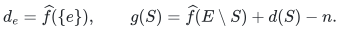

The rank <code class="math">g</code> is integral and submodular. It is monotone because every
marginal of <code class="math">\widehat f</code> is at most the corresponding singleton
<code class="math">d_e</code>. Base complementation gives the bijection

<!-- math-display: a6575a11046670cafc1225e8
y=d-\widehat x\in B(g)
             \quad\Longleftrightarrow\quad
                  \widehat x\in B(\widehat f). \tag{U11}
-->
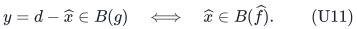

At each player order its type coordinates by nonincreasing value.
For each prefix <code class="math">S_h</code>, including the full prefix, impose
<code class="math">y'(S_h)\le U_h=\lceil y(S_h)\rceil</code>. These are the independence
inequalities of the integral chain polymatroid with rank
<code class="math">R(A)=\max\{U_h:e_h\in A\}</code> for nonempty <code class="math">A</code>, and empty rank zero.
Give disposal coordinates their singleton caps. Take the direct sum
of these chains and disposal groups.

Intersect this side with the direct sum of the complement resources.
Its maximum-total face at <code class="math">\sum_jg_j(E_j)</code> contains the fractional
<code class="math">y</code> and is integral. Maximize the actual assignment coefficients
<code class="math">a_{pj}</code> on this face, giving disposal coefficient zero, and choose
an integral optimizer <code class="math">y'</code>. Full total forces every resource
component to remain a base. Complement and discard disposal. The
result is a legal integer original allocation of no greater cost,
since <code class="math">a\cdot d</code> is constant and <code class="math">a\cdot y'\ge a\cdot y</code>.

Every player prefix satisfies

<!-- math-display: 540c9febc91de76b1b3415a3
x'(S_h)\ge d(S_h)-\lceil d(S_h)-x(S_h)\rceil
                              =\lfloor x(S_h)\rfloor. \tag{U12}
-->
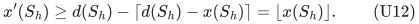

For decreasing values <code class="math">v_1\ge\cdots\ge v_m\ge0</code>, put <code class="math">v_{m+1}=0</code>.
Summation by parts yields

<!-- math-display: 3b904be5dd619856c9e6b512
\sum_i v_i x'_i
 \ge\sum_h(v_h-v_{h+1})\lfloor x(S_h)\rfloor
 \ge\sum_i v_i x_i-v_1. \tag{U13}
-->
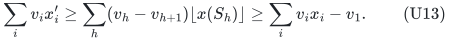

Here <code class="math">v_1\le u_p</code>. Combining (U9)--(U13) proves (U3), with its maximum
with zero following from nonnegative utility. This construction
optimizes one scalar cost on an integral face; it does not assume that
a budget halfspace preserves integrality. It adds one disposal coordinate
per resource, and every count stays binary encoded.

## 6. Time, global conversion and scope

The selection gap dominates the polynomial LP, target-search and
rounding work, proving (U4) and polynomial workspace. After forced
omissions <code class="math">Z</code>, a full witness avoiding <code class="math">Z</code> still survives and the
remaining deficit is <code class="math">c-&#124;Z&#124;</code>. The
[streamed global conversion](../whole-ground-allocation/global-conversion.md)
therefore gives (U5) for fixed rational accuracy. Target optimization
and rounding remain unchanged. For varying binary accuracy, the safe
rational upper bound <code class="math">A=3/\varepsilon&gt;\Gamma(1/\varepsilon)</code> gives
the uniform global base <code class="math">2-\varepsilon/3</code>.

The restriction family may comprise common bases of two matroids with
one fixed selection-cost threshold, when weighted matroid intersection
implements its selector. That selection threshold is distinct from
(U1). Several independent exact assignment budgets are not preserved
by the single rounding objective.

The guarantee remains additive. Without controlling <code class="math">u</code> relative to
the comparator it need not imply a positive multiplicative ratio.
Pairs with whole-unit cost larger than <code class="math">C&gt;0</code> remain in the fractional
LP because fractional use can contribute to FOPT. When <code class="math">C=0</code>, positive
cost coordinates can instead be masked out exactly.

Cost-preserving additive allocation rounding has public antecedents in
[Rohwedder, Rouhani and Wennmann, ICALP 2025](https://doi.org/10.4230/LIPIcs.ICALP.2025.127).
The proof above supplies its recipient-polymatroid, exact-budget,
selection and rational-comparator composition.

---

**Attribution:** icekylinx and GPT-6 Astra Pro.
