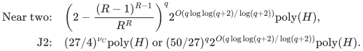
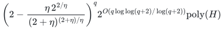
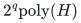
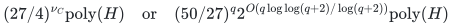
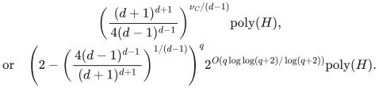

# Unrelated-value allocation with shared resource roles and setup costs

**Guarantee**

For fixed rational <code class="math">R&gt;1</code>, returns an actual selected basis and utility at least <code class="math">(1-1/R)\mathrm{OPT}/2</code> under one exact combined setup and assignment budget. Arbitrary values also admit exact factor two in <code class="math">2^q\mathrm{poly}(H)</code>. Compulsory pair values <code class="math">\{0,u,a\}</code> admit the sharper J2 endpoint.

**Objective and output**

Maximize minimum player-specific utility while light and heavy roles share the original resource capacities; return actual integer counts and selected players.

**Randomness**

Deterministic in the near-two, exhaustive exact-two, compulsory J2 and whole-ground variants, with paid exact optimization and rounding primitives.

**Time**

Use <code class="math">R=(2+\eta)/\eta</code> for factor <code class="math">2+\eta</code>. The near-two and J2 time bounds are:

<!-- math-display: 170d6dafeccc83d33d63833a
\begin{aligned}
\text{Near two:}\quad &\left(2-\frac{(R-1)^{R-1}}{R^R}\right)^q 2^{O(q\log\log(q+2)/\log(q+2))}\mathrm{poly}(H),\\
\text{J2:}\quad &(27/4)^{\nu_C}\mathrm{poly}(H)\text{ or }(50/27)^q 2^{O(q\log\log(q+2)/\log(q+2))}\mathrm{poly}(H).
\end{aligned}
-->

**Space**

Polynomial in the complete binary input and paid oracle workspace; numerical resource multiplicities are not expanded into individual units.

**Parameters**

<code class="math">q</code> is the original nonloop candidate count. <code class="math">R&gt;1</code> is fixed rational; <code class="math">\nu_C</code> is the largest affordable one-heavy-unit recipient set in the compulsory two-value model. <code class="math">\Gamma(R)=R^R/(R-1)^{R-1}</code>.

**Model and representation**

Arbitrary integral recipient polymatroids, arbitrary player-type values, nonnegative original setup and assignment costs, and one exact budget. Near-two and <code class="math">2^q</code> exact-two allow an optional player-matroid basis. The J2 and discrete factor-<code class="math">d</code> pair-value refinements require compulsory players.

**Lower-bound scope**

The arbitrary-oracle subclass has strict-below-two query barriers. Neither an optimal exponential base at factor two nor an optional-basis extension of J2 is proved.

**Review status**

The [verification note](verify/README.md) records the proof scope, executable evidence and remaining conditions. No proof-assistant verification or external peer review is claimed.

**Source**

[Manuscript and proof](proof.md), with [dependencies and verification sources](sources.md).

## Results and proofs

**<code class="math">2+\eta</code>**

**Time.**

<!-- math-display: b728033521b0eb090b902045
\left(2-\frac{\eta\,2^{2/\eta}}{(2+\eta)^{(2+\eta)/\eta}}\right)^q 2^{O(q\log\log(q+2)/\log(q+2))}\mathrm{poly}(H)
-->

**Scope and proof.** [Joint-resource roles](proof.md), and [shared setup budget](setup-budget.md) for optional paid selection

**Exact <code class="math">2</code> for arbitrary values**

**Time.**

<!-- math-display: f3672a8004afb23aafb85e2c
2^q\mathrm{poly}(H)
-->

**Scope and proof.** [Exact endpoint](exact-two.md), including optional selection and shared setup

**Exact <code class="math">2</code> for player-specific <code class="math">\{0,u,a\}</code>**

**Time.**

<!-- math-display: bb9b6fba185de4a71ff023a5
(27/4)^{\nu_C}\mathrm{poly}(H)\quad\text{or}\quad (50/27)^q 2^{O(q\log\log(q+2)/\log(q+2))}\mathrm{poly}(H)
-->

**Scope and proof.** [J2 proof](proof.md#9-compulsory-two-valued-unrelated-instances-exact-factor-two); compulsory players, one assignment budget

**Fixed integer factor <code class="math">d\ge2</code> for <code class="math">\{0,u,a\}</code>**

**Time.**

<!-- math-display: 6c85e769d7fb6e68ce3fac9b
\begin{gathered}\left(\frac{(d+1)^{d+1}}{4(d-1)^{d-1}}\right)^{\nu_C/(d-1)}\mathrm{poly}(H),\\\text{or}\quad \left(2-\left(\frac{4(d-1)^{d-1}}{(d+1)^{d+1}}\right)^{1/(d-1)}\right)^q 2^{O(q\log\log(q+2)/\log(q+2))}\mathrm{poly}(H).\end{gathered}
-->

**Scope and proof.** [Integer tradeoff](two-value-tradeoffs.md), <code class="math">A_d=\Gamma((d+1)/(d-1))</code>

If an optimum has at most <code class="math">K</code> selected heavy recipients at threshold <code class="math">(1-1/R)\mathrm{OPT}/2</code>, the near-two proof also gives <code class="math">\Gamma(R)^{q-r+K}\mathrm{poly}(H)</code>. This is a threshold-dependent support condition. The signed dummy used for setup accounting is an internal construction; original costs remain nonnegative.

**Attribution.** Yilin Liu · GPT-6 Astra Pro
