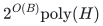
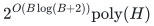
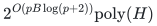
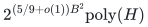
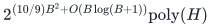
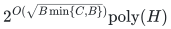
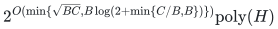
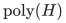
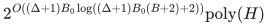
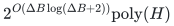

# Prefix, laminar and sparse quotas

Exact algorithms for structured quota systems and deterministic reductions that retain original items.

**Objective and output**

Decide mixed numeric quotas and recover an exact signed-scalar optimum; kernel rows instead return a smaller original ground with a replacement guarantee.

**Randomness**

Deterministic exact algorithms and deterministic original-ground reductions in the stated exact oracle model; universal colorings are explicitly enumerated rather than sampled.

**Time**

One order

<!-- math-display: 79cfb284b062bbe17182d965
2^{O(B)}\mathrm{poly}(H)
-->

Two orders

<!-- math-display: 1ceae624d788ccb6e3f622d2
2^{O(B\log(B+2))}\mathrm{poly}(H)
-->

<code class="math">p</code> shared weight families

<!-- math-display: 8410e92a14d5b27b774e1132
2^{O(pB\log(p+2))}\mathrm{poly}(H)
-->

Common-weight laminar quotas

<!-- math-display: 47246cde76546239b10fa92c
2^{(5/9+o(1))B^2}\mathrm{poly}(H)
-->

The laminar coefficient uses the locally explicit universal-set construction of Naor–Schulman–Srinivasan, Theorem 7; the complete elementary coloring proof gives

<!-- math-display: e489edb5e849eb6a795fc6be
2^{(10/9)B^2+O(B\log(B+1))}\mathrm{poly}(H)
-->

A laminar family with a single positive weight value gives polynomial time. Sparse and support-sensitive refinements appear below.

**Space**

Uniform polynomial binary workspace. Enumerated profiles and universal colorings are streamed.

**Parameters**

<code class="math">B</code> bounds finite targets; <code class="math">B_0\le B</code> is the distinguished root cap; <code class="math">\Delta</code> bounds positive nonroot incidences; <code class="math">C</code> counts distinct support patterns; <code class="math">H</code> is the full encoded input with paid oracle work. Kernel parameters are solution size <code class="math">k</code> and the specified frequency or additional matroid count.

**Model and representation**

One global normalized monotone integral polymatroid with exact rank access. Prefix rows share the stated coordinate orders and weight vectors. Sparse rows require every zero-root coordinate to be zero in every numeric row. Mandatory bases retain their original total; zero-weight coordinates retain their actual scalar costs.

**Lower-bound scope**

Oracle-query and readable-program ETH bounds are stated separately. Frequency-one disjoint weighted equalities already require <code class="math">2^{\Omega(B\log(B+2))}</code> queries. Row-dependent weights have a separate `W[2]` boundary. Even the common-weight laminar model with only positive values 1 and 2 needs exponential rank queries for mandatory feasibility or exact optional optimization; one positive value is polynomial. The laminar upper and lower exponents are not claimed to coincide.

**Review status**

**Ready for review in the stated scope.** The complete one-common-order exact mixed-prefix companion: common nonnegative integer weights, optional independent vectors or original-total mandatory bases, arbitrary signed rational scalar optimization, original eligibility and quota dominance, safe upper masks, shared active/passive copying and capped lower credit, a single charged marked prefix, actual support colors, colored-partition profile counting, exact resource/partition recovery, all-input traversal and uniform binary workspace. The associated sparse-paving oracle-query and separately encoded deterministic-ETH lower constructions and discrepancy scope boundary are audited. Native complete-table software now implements actual original-input one-order profiles and signed optimization. The prior scope is retained: sharp sparse-packing FPT restriction with improved basis-tree preprocessing, arbitrary signed-profit ordered extension, capacity-sensitive failure budget, exact original-context lower construction, aggregate laminar lower-row reduction, exact dominant-weight completion including signed zero-coordinate costs, binary count-rank recovery, one-positive-weight polynomial endpoint, elementary `10/9` and named universal-set `5/9` refinements, projected coloring and histogram-sensitive recovery; compatible cuts and two-positive-weight oracle/encoded-program boundaries remain separately proved.

**Dependencies and scope.** The added native and proof scope has one original order, one common nonnegative integer weight vector, one global integral polymatroid and one signed scalar. Mandatory masks retain the original required total; optional disposal is explicit and real zero-weight coordinates retain actual signed costs. The native copied resource uses original subset rows, with no copied-ground rank-table or numerical unit expansion. Two-order, bounded-family and the broader kernel/dependency chains remain outside this added bounded audit; the whole family retains partial readiness. The one-order theorem charges paid polynomial exact integral-polymatroid intersection and optimization. The reference instead reuses canonical exact Bland simplex with a separately charged potentially exponential finite basis count and polynomial complete-table/binary workspace. Occupied profiles are streamed by the canonical explicit-stack count/mass iterator. Its parameter time depends on the largest numeric target, not merely its bit length, while resource totals, signed coefficients and all count records remain binary. The retained laminar `5/9` coefficient specifically imports Naor-Schulman-Srinivasan Theorem 7 and its local indexing guarantee; the elementary `10/9` alternative has its local proof. Compatible-cut one-weight polynomial optimization requires prescribed or forced total numeric mass. General resource calls retain the named SFM and integral-polymatroid primitives. Oracle-query, encoded-rank-program ETH and explicit represented-resource models remain distinct. Finite checks and independent internal review are not proof-assistant verification, external peer review or exhaustive priority claims.

The [verification note](verify/README.md) identifies executable coverage. This status does not claim external peer review or proof-assistant verification.

**Source**

[Formal theorems and basic laminar catalogue](proof.md), [improved laminar recovery](manuscripts/laminar-dominant-weight-recovery.md), [complete companion and reference index](sources.md).

## Exact algorithm bounds

The following bounds include polynomial work in the full encoded input.

**One common order**

<!-- math-display: 79cfb284b062bbe17182d965
2^{O(B)}\mathrm{poly}(H)
-->

**Two common orders**

<!-- math-display: 1ceae624d788ccb6e3f622d2
2^{O(B\log(B+2))}\mathrm{poly}(H)
-->

**One order, <code class="math">C</code> actual supports**

<!-- math-display: 5c82689dbf00f078bd4f7332
2^{O(\sqrt{B\min\{C,B\}})}\mathrm{poly}(H)
-->

**Two orders, <code class="math">C</code> actual supports**

<!-- math-display: 89f9c1e93e1d3d71c089fb95
2^{O(\min\{\sqrt{BC},B\log(2+\min\{C/B,B\})\})}\mathrm{poly}(H)
-->

**<code class="math">p</code> shared weight families**

<!-- math-display: 8410e92a14d5b27b774e1132
2^{O(pB\log(p+2))}\mathrm{poly}(H)
-->

**Common-weight laminar family with root cap <code class="math">B</code>**

Using the explicitly cited local universal-set theorem:

<!-- math-display: 47246cde76546239b10fa92c
2^{(5/9+o(1))B^2}\mathrm{poly}(H)
-->

With the elementary coloring construction:

<!-- math-display: e489edb5e849eb6a795fc6be
2^{(10/9)B^2+O(B\log(B+1))}\mathrm{poly}(H)
-->

The [complete recovery proof](manuscripts/laminar-dominant-weight-recovery.md#8-cardinality-sensitive-catalogues-and-sharper-exponents) gives a sharper exact integer maximum using the actual depth and occurring weights.

**Laminar family with one positive weight value**

<!-- math-display: 5a5ab874318fb4203d250c74
\mathrm{poly}(H)
-->

This includes binary-large root caps and nonuniform signed zero-coordinate costs.

**Root cap <code class="math">B_0</code>, maximum target <code class="math">B</code>, frequency <code class="math">\Delta</code>**

<!-- math-display: bcc71f656e8c66a1e6dae992
2^{O((\Delta+1)B_0\log((\Delta+1)B_0(B+2)+2))}\mathrm{poly}(H)
-->

In particular, for <code class="math">\Delta\ge1</code>:

<!-- math-display: 8d3774961e1c2850f4d8d71f
2^{O(\Delta B\log(\Delta B+2))}\mathrm{poly}(H)
-->

## Quotas on either side of compatible cuts

The [compatible-cut extension](manuscripts/compatible-cut-quota-extension.md)
allows any pair of numeric sets to be nested, disjoint, or to cover the
whole positive ground. This includes choosing either side of cuts in an
unrooted tree. At a fixed total numeric mass, orienting every set away
from one anchor gives a laminar instance. The same FPT time bounds and
polynomial binary space apply while preserving the original resource total
and signed zero-coordinate costs.

For this larger family, the one-positive-weight polynomial endpoint is
stated when the total numeric mass is prescribed or otherwise forced.
An unknown binary-large total is handled by the FPT algorithm, without a
polynomial-time claim based on numerical enumeration.

## Deterministic ground reductions

These constructions are polynomial in the explicit input. The retained original resource oracle and weights remain part of the output model.

**One item matroid and frequency-<code class="math">\delta</code> sparse packing**

<code class="math">k\delta![k(\delta(k-1)+1)]^\delta=O_\delta(k^{2\delta+1})</code>

**The same packing with distinct item supports**

The leading multiplicity factor <code class="math">k</code> is unnecessary: <code class="math">O_\delta(k^{2\delta})</code>

**One arbitrary and <code class="math">d</code> additional coverable matroids**

<code class="math">k\,d![k(1+\sum_i g_i)]^d</code>, for the stated closure-class bounds <code class="math">g_i</code>

**One arbitrary and <code class="math">d</code> explicitly represented transversal matroids**

<code class="math">O_d(k^{2d+1})</code>

**Graph matching with one matroid on edges**

<code class="math">O(k^4)</code> for simple graphs; <code class="math">O(k^5)</code> with parallel edges

**Sparse numeric quotas and valuated completion**

Parameter-bounded positive capacity with all original zero-coordinate completion and signed costs retained

Each reduction preserves replacements against feasible contexts in the original instance. A small retained ground is not a parameter-only bit encoding of an arbitrary oracle.

## Sharper retained size with FPT preprocessing

The [sharp packing theorem](manuscripts/sharp-sparse-packing-fpt-restrictions.md)
gives a different time/size tradeoff for one arbitrary item matroid.

**Unweighted sparse packing**

At most <code class="math">k\binom{\delta k}{\delta}=O_\delta(k^{\delta+1})</code> original
items, with deterministic
<code class="math">2^{O(\delta k\log(\delta k+2))}\mathrm{poly}(H)</code> preprocessing.
This size is worst-case exact for single replacement against every
original feasible context. With <code class="math">q</code> fixed profit values, multiply the
support by at most <code class="math">q</code> to preserve profits exactly.

**Arbitrary signed profits**

At most <code class="math">e^\delta k^{\delta+1}</code> original items with no-worse-profit
replacements, independent of the number of profit values. The deterministic
preprocessing has the same FPT parameter dependence. The exponent is
optimal for original-context replacement at each fixed <code class="math">\delta</code>; the
displayed constant is not claimed optimal.

**Matching with an arbitrary edge matroid**

Retain at most <code class="math">k\binom{2k}{2}</code> edges for unweighted replacement, or
<code class="math">e^2k^3</code> for arbitrary signed profits, including parallel records.
Both use <code class="math">2^{O(k\log(k+2))}\mathrm{poly}(H)</code> oracle time. This
preprocessing is exponential in <code class="math">k</code>; the polynomial-time reduction above
has a larger retained ground.

**Larger packing capacities**

If every feasible context saturates at most <code class="math">h</code> rows, the unweighted
support becomes <code class="math">k\binom{h+\delta}{\delta}</code>; arbitrary profits use
<code class="math">k\Gamma(h,\delta)</code> with the explicit Bernoulli factor in the theorem.
The theorem gives a polynomially computable inverse-capacity load bound
on <code class="math">h</code>. When <code class="math">h\le1</code>, arbitrary signed
profits admit at most <code class="math">(\delta+1)k</code> retained items with uniform
polynomial preprocessing.

For common-weight laminar quotas, aggregate lower demands also reduce
the lower-row system to at most <code class="math">B</code> rows and <code class="math">B+1</code> membership patterns.
The [recovery theorem](manuscripts/laminar-dominant-weight-recovery.md) then
enumerates only the units outside a most frequent weight, at most
<code class="math">\lfloor B/3\rfloor</code>, and completes the rest in polynomial
time. Keeping the cardinality in the catalogue size improves the elementary
coefficient from `4` to `10/9`. The precise published locally explicit
universal-set construction improves it further to `5/9` plus a term tending
to zero. Actual depth and weights refine both bounds; a zero exception
budget gives polynomial time. The [projected-coloring refinement](manuscripts/laminar-dominant-weight-recovery.md#84-projected-coloring-identities-and-histogram-sensitive-recovery)
shares identical coloring identities within each candidate class and can
leave the most expensive weight catalogue for polynomial completion.
Every original numeric constraint is retained. The [two-weight boundary](manuscripts/two-positive-weight-laminar-boundary.md)
explains why that polynomial endpoint does not extend to arbitrary
instances with two positive weight values.

**Attribution:** Yilin Liu and GPT-6 Astra Pro.
