# Exact sparse numeric quotas with a root cap and arbitrary completion costs

**25 October 2026. Increment U. Complete manuscript-level proof with independent internal review.**

Rows may intersect arbitrarily and may have different nonnegative integer coefficients. A distinguished positive charge bounds the number of units that can participate in any numeric quota. The other structural parameter is column frequency, excluding that distinguished row. Neither the number of rows nor the number of distinct supports enters the exponential parameter.

Scalar coefficients on quota-free units are unrestricted. Their best completion cost is handled by the fixed-cardinality valuated-matroid interface established in *laminar_valuated_zero_completion_fpt.md* (VZ). A deterministic small-range hash catalogue replaces the laminar blocker recursion. Every actual resource optimization still uses one global integral polymatroid and one partition rank.

## 1. Model, parameters, and theorem

Let <code class="math">F</code> be a normalized monotone integral polymatroid rank on an explicit coordinate ground <code class="math">E</code>. Counts, coordinate domains, and rank values are binary encoded. The resource requirement is either

<!-- math-display: 0527a533952d9fabcccfb793
x\in P(F)\cap\mathbb Z_{\ge0}^{E},
 \qquad\hbox{or}\qquad
 x\in B(F)\cap\mathbb Z_{\ge0}^{E}.
\tag{BF1}
-->
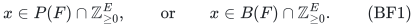

In the base model the required original total is <code class="math">R=F(E)</code>. Eligibility masks and box domains may be prepared into the rank, but a mandatory instance retains this original total and rejects if it cannot be attained.

There is a distinguished root cap

<!-- math-display: 007bb4c90fab69f7ddc79d17
\sum_{e\in E}w_ex_e\le B_0,
                   \qquad w_e\in\mathbb Z_{\ge0},
\tag{BF2}
-->
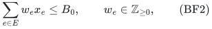

and an explicit collection of other rows

<!-- math-display: 21c3a3dcb66f1dbf6c63d18e
l_j\le\sum_{e\in E}a_{je}x_e\le u_j,
                     \qquad a_{je}\in\mathbb Z_{\ge0}.
\tag{BF3}
-->
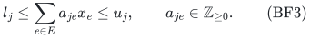

Missing lower bounds are zero; missing upper bounds are infinity. Finite targets are nonnegative integers. An equality is one interval row with equal targets. Coefficients need not factor into a common weight and set incidences.

The essential root-charge condition is

<!-- math-display: f48cf2526f2d3a35bb6f942a
w_e=0\quad\Longrightarrow\quad
                      a_{je}=0\quad\hbox{for every }j.
\tag{BF4}
-->
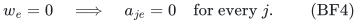

Thus every unit contributing to a nondistinguished numeric row consumes at least one integer root unit. Positive-root coordinates may have zero coefficients in all other rows.

Define

<!-- math-display: 74bd9f8772ec833a134e7409
\delta_0=\max_{e\in E}|\{j:a_{je}>0\}|,\qquad
 \Delta=\max\{1,\delta_0\},\qquad
 B=\max\{B_0,\text{all finite row targets}\}.
\tag{BF5}
-->
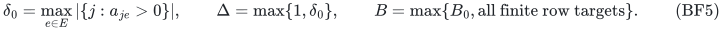

An empty maximum is zero. The root is excluded from frequency; an interval/equality row is counted once. Preparation may reduce actual frequency, and an upper bound on the original frequency remains valid.

The scalar <code class="math">c\cdot x</code> has arbitrary signed rational coefficients, including on root-zero coordinates, and is minimized or maximized exactly. A requested upper or lower bound on this same scalar can be decided by the corresponding optimum. This is not optimization of one scalar subject to a different independent scalar budget.

**Theorem.** If <code class="math">B_0=0</code>, feasibility and scalar optimization are polynomial. If <code class="math">B_0\ge1</code>, they have a deterministic algorithm with time

<!-- math-display: f28501bd78f023c60e83e3d2
2^{O(\Delta B_0\log(\Delta B_0B+2))}\mathrm{poly}(H)
 \ \le\
 2^{O(\Delta B\log(\Delta B+2))}\mathrm{poly}(H)
\tag{BF6}
-->
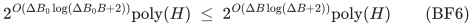

and uniform polynomial binary workspace. Here <code class="math">H</code> includes the explicit binary input and rank-oracle bit bounds. Exact SFM and weighted integral-polymatroid intersection are charged polynomially. The bound holds on all inputs, including infeasible instances and failed catalogue encodings.

For constant positive frequency, the worst-case order <code class="math">2^{O(B\log B)}</code> is sharp in the rank-oracle model. Section 12 retains the frequency-two zero-one baseline. The companion *disjoint_row_root_target_sharp_lower.md* strengthens the boundary to frequency one with disjoint weighted equalities, zero scalar, and pure feasibility in both resource domains.

The companion *sparse_root_quota_hash_profile_algorithm.md* gives a second, direct proof without unit expansion or valuated completion. *valuated_sparse_quota_sunflower_kernel.md* strengthens the preprocessing conclusion to a deterministic positive-capacity kernel; it does not reduce BF6's exponential order.

The convention <code class="math">\Delta=\max\{1,\delta_0\}</code> is deliberate: raw frequency zero leaves the root knapsack constraint and must not make the exponential factor disappear.

## 2. Safe preparation and integer lower capping

Negate the scalar for maximization. Discard vacuous rows and reject inconsistent intervals. Mask a positive-root coordinate if <code class="math">w_e&gt;B_0</code>, or if <code class="math">a_{je}&gt;u_j</code> in any finite upper row. Such a coordinate cannot occur even once in an integer feasible allocation. Upper-zero rows therefore mask all their positive-coefficient coordinates. Resource loops may also be removed. Root-zero coordinates are not removed merely because their scalar is nonzero.

For optional resources use VZ's disposal lift: add a coordinate of numeric weight and scalar zero, and define <code class="math">F^+(A)=F(A)</code> when disposal is absent and <code class="math">F^+(A)=R</code> when it is present. Every optional vector extends to total <code class="math">R</code> by putting unused resource in disposal. Projection preserves all original rows and scalar. Mandatory resources receive no disposal. Subsequent masks keep required total <code class="math">R</code>; rank loss is genuine mandatory infeasibility.

Write <code class="math">P=\{e:w_e&gt;0\}</code>, <code class="math">Z=\{e:w_e=0\}</code>, including disposal in <code class="math">Z</code> when present. Every numeric row is zero on <code class="math">Z</code>. Below <code class="math">F</code> denotes the prepared full-base rank.

For a positive lower row put

<!-- math-display: e8fd629a3609d10020116a90
\lambda_{je}=\min\{a_{je},l_j\},
                          \qquad l_j>0.
\tag{BF7}
-->
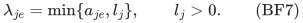

For nonnegative integer counts,

<!-- math-display: 674251d22b076f35f15bbb44
\sum_ea_{je}x_e\ge l_j
       \quad\Longleftrightarrow\quad
       \sum_e\lambda_{je}x_e\ge l_j.
\tag{BF8}
-->
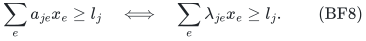

If a used coefficient is at least <code class="math">l_j</code>, its first capped occurrence reaches the target. Otherwise capping changes none of the used coefficients. The reverse implication follows from <code class="math">\lambda_{je}\le a_{je}</code>. This is integer feasibility equivalence, not equality of original totals or a fractional claim. Finite upper rows retain their original coefficients, which after individual eligibility lie in <code class="math">\{0,\ldots,B\}</code> on surviving coordinates.

## 3. Few positive lower rows and replacement classes

Each positive lower row needs a selected positive-root unit. There are at most <code class="math">B_0</code> such units, each occurring in at most <code class="math">\Delta</code> other rows. Therefore

<!-- math-display: 73407de0e15cf6a413c6abea
m_L:=|\{j:l_j>0\}|\le\Delta B_0
\tag{BF9}
-->
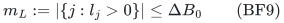

is necessary. Reject if it fails, or if a positive lower row has no remaining positive coefficient. This uses incidence counting, not a bound on the sum of targets: a large coefficient can meet a row with one unit.

Classify positive coordinates and their unit copies by

<!-- math-display: 973f63471b708c7d918ffa8f
(w_e,(\lambda_{je})_{j:l_j>0}).
\tag{BF10}
-->
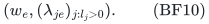

The capped lower vector has at most <code class="math">\Delta</code> nonzero entries, each at most <code class="math">B</code>. Thus the number <code class="math">G</code> of classes satisfies

<!-- math-display: 766675fed5881936a875b187
\begin{split}
 G&\le B_0\sum_{i=0}^{\min\{\Delta,m_L\}}\binom{m_L}{i}B^i\\
  &\le B_0(1+m_LB)^\Delta
   \le B_0(1+\Delta B_0B)^\Delta.
 \end{split}
\tag{BF11}
-->
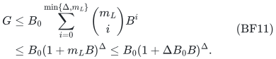

The middle bound encodes each sparse vector by <code class="math">\Delta</code> slots, each empty or a row/value pair, in canonical order. Only input classes need be stored. Same-class replacement preserves root charge and all capped lower totals; BF8 preserves original lower feasibility. Equalities follow once original upper sides are also preserved.

## 4. The valued completion interface

Allow <code class="math">b_e=\min\{F(\{e\}),\lfloor B_0/w_e\rfloor\}</code> distinct copies <code class="math">U_e</code> of each <code class="math">e\in P</code>, and set <code class="math">U=\bigcup_eU_e</code>. Section 11 avoids constructing them when <code class="math">B_0</code> is large. Fix <code class="math">0\le k\le\min\{B_0,R,&#124;U&#124;\}</code>.

For a <code class="math">k</code>-set <code class="math">S\subseteq U</code>, let <code class="math">p_k(S)</code> be the minimum true scalar of a full original-total resource base with positive units exactly <code class="math">S</code>, allowing arbitrary compatible integer counts on <code class="math">Z</code>. Set <code class="math">p_k(S)=+\infty</code> if no such completion exists.

VZ proves the following facts without using laminarity of any numeric row. When its finite domain is nonempty, <code class="math">p_k</code> is a minimum-cost valuated matroid: for domain bases <code class="math">S,A</code> and <code class="math">e\in S\setminus A</code>, some <code class="math">f\in A\setminus S</code> satisfies

<!-- math-display: 31a9384083ee1224abadc177
p_k(S)+p_k(A)\ge p_k(S-e+f)+p_k(A-f+e).
\tag{BF12}
-->
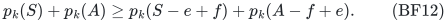

The proof maps to the established weighted Rado-induction theorem. Conceptually take the full natural matroid of the prepared resource on the right. Every allowed positive copy on the left has only its private right edge; <code class="math">R-k</code> mandatory left dummies may match any right zero unit. Edge weights are minus true scalar. The R-minor valuation is <code class="math">-p_k</code>. The right rank remains the original <code class="math">R</code>, even with restricted left positives. This huge finite graph is a proof device only.

For any <code class="math">Y\subseteq U</code>, an exact compressed oracle returns a domain basis <code class="math">A</code> first maximizing <code class="math">&#124;A\cap Y&#124;</code>, then minimizing <code class="math">p_k(A)</code>. On the actual ground <code class="math">U\dot\cup Z</code>, one integral resource rank is

<!-- math-display: a2d1f5f4cadfb1b5638f6bd9
G_F(D)=\min_{C\subseteq P}
 \left[F((D\cap Z)\cup C)+
                   \sum_{e\in P\setminus C}|D\cap U_e|\right].
\tag{BF13}
-->
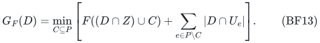

It represents the shared original resource with cap one on each positive copy, and is evaluated by SFM on original coordinates. Intersect it with **one** partition rank of caps <code class="math">k</code> on <code class="math">U</code> and <code class="math">R-k</code> on <code class="math">Z</code>, and require total <code class="math">R</code>. This integral face forces both totals exactly.

Clear scalar denominators, put <code class="math">C_{\max}=\max&#124;\widetilde c_e&#124;</code> and <code class="math">M=2RC_{\max}+1</code>, and minimize

<!-- math-display: f4aa0c90b2a4d57ee01d4eeb
\widetilde c\cdot z
                       -M\sum_{u\in Y}z_u.
\tag{BF14}
-->
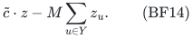

One overlap unit dominates all true-cost differences. Individual-copy rewards and caps are essential. Empty faces detect empty valuation domains. Fix deterministic ties for replay; VZ supplies a polynomial-bit tertiary subset score if desired.

No BF2–BF3 quota is imposed in this overlap oracle. Its basis need not be numerically feasible.

**Overlap replacement lemma.** For a domain basis <code class="math">S</code> and <code class="math">e\in S\cap Y</code>, some emitted <code class="math">f\in A\cap Y</code> satisfies

<!-- math-display: b6752ab75e99357370c96113
p_k(S-e+f)\le p_k(S).
\tag{BF15}
-->
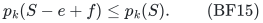

If <code class="math">e\in A</code>, use <code class="math">f=e</code>. Otherwise use BF12. An exchanged <code class="math">f\notin Y</code> would increase the overlap of <code class="math">A-f+e</code>, a contradiction. Thus <code class="math">f\in Y</code>, and the second optimization criterion implies <code class="math">p_k(A-f+e)\ge p_k(A)</code>. Cancellation proves BF15. A proper exchanged <code class="math">f</code> is outside <code class="math">S</code>.

## 5. A deterministic small-range hash catalogue

Let <code class="math">m_U</code> be the number of remaining finite upper rows, excluding the root. If it is zero, use one unfiltered pool per replacement class and omit the hashing construction.

Otherwise label its rows by distinct binary polynomials of degree less than

<!-- math-display: bbef81036c8c7d57f51c0915
L=\max\{1,\lceil\log_2(m_U+1)\rceil\}.
-->
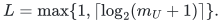

Set <code class="math">K=\Delta(B_0+1)</code>, <code class="math">D_0=\binom K2L</code>, and choose the smallest <code class="math">d\ge2</code> with

<!-- math-display: a1e9a592fafb4da12886b31e
q=2^d>4(D_0+1).
\tag{BF16}
-->
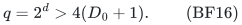

Then <code class="math">q=O(K^2L)</code>. Enumerate the monic irreducible degree-<code class="math">d</code> polynomials <code class="math">f\in\mathbb F_2[X]</code>. Each supplies a hash to the <code class="math">q</code> residues of degree less than <code class="math">d</code>:

<!-- math-display: b5314deec7e2991eaed2c2c6
h_f(j)=\mathrm{id}_j\bmod f.
\tag{BF17}
-->
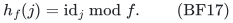

**Hash lemma.** Every set <code class="math">W</code> of at most <code class="math">K</code> row IDs is injectively hashed by at least one catalogue member.

For completeness, let <code class="math">I_d</code> count degree-<code class="math">d</code> monic irreducibles. The factorization of <code class="math">X^{2^d}-X</code> gives <code class="math">2^d=\sum_{r\mid d}rI_r</code>. Its roots form the field of <code class="math">2^d</code> elements; the minimal-polynomial degree divides <code class="math">d</code>, every irreducible of a dividing degree occurs, and the derivative is one. Since <code class="math">rI_r\le2^r</code> and every proper divisor of <code class="math">d</code> is at most <code class="math">d/2</code>,

<!-- math-display: d056c70f4bc8faad0526c547
dI_d\ge2^d-\sum_{r=1}^{\lfloor d/2\rfloor}2^r
                  \ge2^{d-1}\qquad(d\ge2).
\tag{BF18}
-->
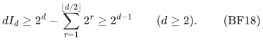

For fixed <code class="math">W</code>, its pair-difference product
<code class="math">D_W=\prod_{\{i,j\}\subseteq W}(\mathrm{id}_i-\mathrm{id}_j)</code>
is nonzero and has degree below <code class="math">D_0</code>; the empty product is one. At most <code class="math">D_0/d</code> distinct degree-<code class="math">d</code> irreducibles divide it, whereas <code class="math">I_d\ge q/(2d)&gt;D_0/d</code>. Choose one not dividing the product. No two IDs then have equal remainders.

The catalogue is explicitly deterministic. Stream all <code class="math">q</code> monic degree-<code class="math">d</code> polynomials and retain exactly those for which

<!-- math-display: 69a113521b0939675b1ffd5e
\gcd(f,X^{2^j}-X)=1
                 \quad(1\le j\le\lfloor d/2\rfloor).
-->
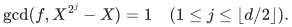

A reducible polynomial has an irreducible factor of degree at most <code class="math">d/2</code>, detected by one test; an irreducible degree-<code class="math">d</code> polynomial passes them all. Successive squaring modulo <code class="math">f</code> and binary-polynomial gcd are polynomial in <code class="math">d</code>. No prime-density estimate, randomized construction, or large stored hash table is assumed.

## 6. Coefficient-labelled pools

For a copy <code class="math">u</code>, let <code class="math">I(u)=\{j:u_j&lt;\infty,\ a_{j,u}&gt;0\}</code> be its nondistinguished finite-upper incidences, of size at most <code class="math">\Delta</code>. Coefficients are inherited from its owner.

Fix a class <code class="math">T</code>, a hash <code class="math">h</code>, a palette <code class="math">C</code> of at most <code class="math">\Delta</code> residues, and thresholds <code class="math">t_c\in\{1,\ldots,B\}</code> for <code class="math">c\in C</code>. Form

<!-- math-display: 0ff6b33950faf2e066484089
Y(T,h,C,t)=
 \{u\in T:h(I(u))\subseteq C,\
       a_{j,u}\le t_{h(j)}\text{ for every }j\in I(u)\}.
\tag{BF19}
-->
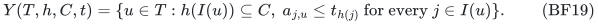

The empty palette is allowed and gives the members with no upper incidence. For each pool run the overlap-first oracle and emit all of <code class="math">A\cap Y</code>, at most <code class="math">k</code> copies.

For each hash, the palette/threshold count is at most

<!-- math-display: 368aecebd6052f8ee36d590c
\sum_{i=0}^{\min\{\Delta,q\}}\binom qiB^i
                     \le(\Delta+1)(qB+1)^\Delta.
\tag{BF20}
-->
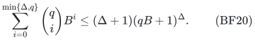

Stream sorted palettes with binary threshold counters, or use padded slots and reject noncanonical encodings. The same bound, up to an inessential parameter factor, includes failed encodings. No subset of the full upper-row ground is directly guessed.

## 7. Every upper row survives a protected replacement

Fix a numerically feasible domain <code class="math">k</code>-set <code class="math">S</code> and <code class="math">e\in S</code>, and use its class <code class="math">T</code>. Put

<!-- math-display: 6b8ead205845b3650f6a3e19
W=\bigcup_{u\in S}I(u).
\tag{BF21}
-->
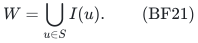

It has at most <code class="math">\Delta k\le\Delta B_0&lt;K</code> rows. Choose a catalogue hash injective on all of <code class="math">W</code>. Use palette and thresholds

<!-- math-display: 9f4be643f6af1bb4b8900563
C=h(I(e)),\qquad
          t_{h(j)}=a_{j,e}\quad(j\in I(e)).
\tag{BF22}
-->
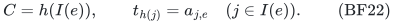

Injectivity makes thresholds well defined; individual eligibility places them in <code class="math">\{1,\ldots,B\}</code>. This pool contains <code class="math">e</code>.

Write <code class="math">S^-=S-e</code>. Every candidate <code class="math">f</code> in this pool preserves every finite upper:

1. If row <code class="math">j</code> meets both <code class="math">S^-</code> and <code class="math">e</code>, then <code class="math">a_{j,f}\le a_{j,e}</code> if <code class="math">f</code> enters it. Its total cannot increase.
2. If row <code class="math">j</code> meets <code class="math">S^-</code> but not <code class="math">e</code>, it belongs to <code class="math">W\setminus I(e)</code>. Its hash is outside the palette, so <code class="math">f</code> cannot enter.
3. If row <code class="math">j</code> does not meet <code class="math">S^-</code>, the only new positive occurrence is <code class="math">f</code>, and individual eligibility gives <code class="math">a_{j,f}\le u_j</code>. This is safe even when its hash collides with a different palette row.

The third case includes rows that met only the removed <code class="math">e</code>. Same-class membership preserves root charge and capped lower totals. Thus all original numeric predicates survive.

BF15 supplies an emitted candidate with no worse <code class="math">p_k</code>. Its finite valuation domain preserves resource feasibility and full original-total completion. The whole oracle basis <code class="math">A</code> need not satisfy any numeric quota.

Hashing all upper incidences of <code class="math">S</code>, rather than just a guessed overload list, is the reason this argument handles row-dependent coefficients. Collisions with rows untouched by <code class="math">S^-</code> are harmless because individual eligibility was enforced first.

## 8. Exact optimization from emitted positions

For each <code class="math">1\le k\le\min\{B_0,R,&#124;U&#124;\}</code>, detect and skip empty valuation domains. Conceptually take the union of all emitted copies over classes and pools.

Starting from a numerically feasible domain basis, replace any selected copy outside that union using Section 7. It cannot itself have been emitted, so the replacement is proper: the new copy is in the union and outside the old selected set. Each step preserves numeric feasibility, does not increase <code class="math">p_k</code>, and strictly increases the number of selected copies in the union. At most <code class="math">k</code> steps suffice.

Therefore an optimum at this cardinality lies in the emitted union. Enumerate <code class="math">k</code>-tuples of emitted positions, reject repeated physical copies, test the original numeric rows, and evaluate exact <code class="math">p_k(S)</code>. For this final query mask positives outside <code class="math">S</code> and use the same positive-total <code class="math">k</code>/zero-total <code class="math">R-k</code> face. Unit caps force all copies of <code class="math">S</code>, and the oracle returns an attaining zero vector or rejects.

Optimize <code class="math">k=0</code> separately on the zero ground, and choose the least true scalar over cardinalities. An original optimum can be assumed to use its own least-cost zero completion because all numeric rows vanish on <code class="math">Z</code>, so it is exactly represented by <code class="math">p_k</code>. Every returned solution is checked on the original resource and rows. Optional outputs discard only the designated disposal coordinate; no true zero-weight unit, scalar contribution, or mandatory resource is discarded.

## 9. All-input running time

Use <code class="math">L=q=1</code> for counting when <code class="math">m_U=0</code>, without constructing hashes. The count of possible emitted positions for a fixed cardinality obeys

<!-- math-display: d02bf1f9b5d709c77c70f474
K_k^{\rm pos}
 \le Gkq(\Delta+1)(qB+1)^\Delta
 \le(\Delta B_0B+2)^{O(\Delta)}L^{\Delta+1}.
\tag{BF23}
-->
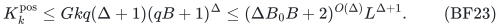

The unfiltered no-upper case satisfies this without hashes. Constants are absolute. Empty pools, reducible polynomials, invalid palette encodings, absent output indices, and duplicate copies can all be charged within this bound.

Enumerating at most <code class="math">B_0</code> positions costs

<!-- math-display: 8743efaad6b6d808abbd74ca
(\Delta B_0B+2)^{O(\Delta B_0)}
        L^{(\Delta+1)B_0}\mathrm{poly}(H).
\tag{BF24}
-->
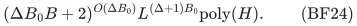

The row-count factor does not introduce a parameter-dependent polynomial exponent. For <code class="math">a\ge1</code>,

<!-- math-display: b00379a75df3417c98233af8
(\log(m+2))^a\le(a/e)^a(m+2)
\tag{BF25}
-->
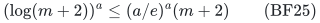

with natural logarithms, by maximizing <code class="math">x^ae^{-x}</code>. A change of base costs a constant to power <code class="math">a</code>. Take <code class="math">a=(\Delta+1)B_0\le2\Delta B_0</code>, and absorb its factor into BF24. This proves BF6 with a uniform polynomial factor in <code class="math">H</code>. The cardinality loop and zero case do not change it.

All catalogue calls are exact algorithms, not promise procedures. Failed positions and infeasible tuples are explicitly counted. The resource computations use only the two integral ranks from Section 4.

## 10. Best completion without expanding zeros

For a fixed positive resource-independent vector <code class="math">x</code>, define on <code class="math">Z</code>

<!-- math-display: 75bd9b85a3d70a88fa40f200
h_x(A)=\min_{C\subseteq P}
                              (F(A\cup C)-x(C)).
\tag{BF26}
-->
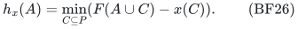

Positive independence gives normalization <code class="math">h_x(\varnothing)=0</code>. Monotonicity follows from <code class="math">F</code>. For submodularity choose minimizing <code class="math">C_1,C_2</code>, apply submodularity to <code class="math">A_1\cup C_1,A_2\cup C_2</code>, and use modularity of <code class="math">x</code>; the resulting union/intersection bounds dominate the corresponding minima. Thus <code class="math">h_x</code> is a monotone integral rank.

Compatible zero vectors are exactly <code class="math">P(h_x)</code>, since the full inequalities are <code class="math">y(A)+x(C)\le F(A\cup C)</code> for <code class="math">A\subseteq Z,C\subseteq P</code>. Also <code class="math">h_x(Z)\le R-x(P)</code>. Full completion exists exactly when equality holds. Then signed minimum-weight greedy base optimization on <code class="math">h_x</code> returns the best completion. Each rank evaluation is an SFM on original coordinates with a binary modular term.

## 11. Uniform polynomial binary space

Let <code class="math">n=&#124;P&#124;</code>, and distinguish <code class="math">B_0</code> from the potentially much larger maximum target <code class="math">B</code>.

If <code class="math">B_0=0</code> or <code class="math">n=0</code>, all positive counts vanish. Reject positive lower rows, and optimize the scalar on the zero resource retaining required total <code class="math">R</code>. This is polynomial even with nonuniform signed zero coefficients.

If <code class="math">B_0\ge n\ge1</code>, avoid copies and hashes. Stream all positive vectors <code class="math">0\le x_e\le\lfloor B_0/w_e\rfloor</code>. There are at most <code class="math">(B_0+1)^n\le(B_0+1)^{B_0}</code>. Test numeric rows and positive resource independence; use Section 10 for exact best completion. Retain only <code class="math">n</code> counters, one best output, and polynomial oracle workspace. This branch lies within BF6.

If <code class="math">1\le B_0&lt;n</code>, build at most <code class="math">nB_0&lt;n^2</code> positive copies and keep zero counts compressed. The hash range <code class="math">q=O(\Delta^2(B_0+1)^2L)</code> is polynomial in explicit input size because frequency is at most the number of rows. Each threshold up to binary-large <code class="math">B</code> needs only <code class="math">O(\log(B+1))</code> bits.

Do not store the emitted union. A position records its actual class, monic polynomial, padded palette/thresholds, and an index in sorted <code class="math">A\cap Y</code>. Replay the deterministic oracle and reject failed encodings. Each position needs

<!-- math-display: 59bd8ded0801e46d72d327a0
O(\log(n+1)+\log q+
       \Delta(\log(q+1)+\log(B+1))+\log(k+1))
-->
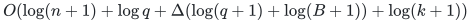

bits. A tuple has at most <code class="math">k\le B_0&lt;n</code> positions. The tuple, one replayed oracle problem, and the best binary output fit polynomial space. The count in Section 9 already includes invalid positions.

Denominator clearing, the BF14 reward, and deterministic ties have polynomial bit length. The conceptual full natural matroid and Rado zero dummies are never built. Binary-large <code class="math">R</code>, zero capacities, and target thresholds do not cause unit expansion.

## 12. Matching lower order at frequency two

Let <code class="math">b\ge2</code>, with ground the <code class="math">b^2</code> edges of <code class="math">K_{b,b}</code>. Every edge has root weight one, root cap <code class="math">B_0=b</code>, and each vertex supplies the equality <code class="math">\sum_{e\ni v}x_e=1</code>. Thus frequency is two, nondistinguished targets are one, <code class="math">B=b</code>, coefficients are zero-one, and scalar is zero.

Let <code class="math">\mathcal H</code> be the <code class="math">b!</code> perfect matchings. Distinct members cannot differ by one exchange: their symmetric difference is a union of alternating cycles of length at least four. Their intersection therefore has size at most <code class="math">b-2</code>.

Define rank-<code class="math">b</code> matroid <code class="math">M_\varnothing</code> with bases all <code class="math">b</code>-sets outside <code class="math">\mathcal H</code>. For each hidden <code class="math">A\in\mathcal H</code>, add <code class="math">A</code> as a base to obtain <code class="math">M_A</code>. These are matroids. For allowed bases <code class="math">C,D</code> and <code class="math">e\in C\setminus D</code>, if <code class="math">D\setminus C</code> is a singleton its only exchange is <code class="math">D</code>. Otherwise at least two exchanges share <code class="math">b-1</code> elements, so at most one belongs to the forbidden subfamily; an allowed exchange exists.

All smaller sets are independent: a <code class="math">(b-1)</code>-set has several extensions, at most one forbidden. Every larger set contains a base: the <code class="math">b</code>-subsets of a <code class="math">(b+1)</code>-set pairwise differ by one exchange and cannot all be forbidden. Hence the oracles for <code class="math">M_\varnothing</code> and <code class="math">M_A</code> differ only on the single query set <code class="math">A</code>.

The vertex equalities force a perfect matching, in either the optional or mandatory model. The reference is infeasible and the hidden instance has unique feasible allocation <code class="math">A</code>. Deterministic exact decision needs <code class="math">b!</code> worst-case rank queries. Under promise-search, an unqueried final output can save at most one, giving <code class="math">b!-1</code>.

For randomized decision, put mass one half on the reference and one half on a uniformly random hidden <code class="math">A</code>. A deterministic strategy with at most <code class="math">D</code> queries discovers at most <code class="math">D</code> hidden choices along the reference transcript. Its success is at most <code class="math">1/2+D/(2b!)</code>. Thus bounded error at most one third requires <code class="math">D\ge b!/3</code>, also giving the randomized worst-case query bound.

Since <code class="math">b!\ge(b/2)^{b/2}</code>, the lower order is

<!-- math-display: c0ad4eb9567411cb64f9469f
2^{\Omega(B\log(B+1))}.
\tag{BF27}
-->
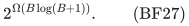

The explicit numeric data have polynomial size in <code class="math">b</code>. The hidden choice is available only through the rank oracle, not inspectable source. No lower bound for graphic/linearly represented resources, and no ETH claim, is inferred.

## 13. Scope boundaries and earlier increments

The root-charge condition is necessary for this parameterization. In the same lower construction make every root coefficient zero and set root cap one, keeping vertex targets one and rank <code class="math">b</code>. Then <code class="math">B=1</code> and frequency two for arbitrarily large <code class="math">b</code>, while the <code class="math">b!</code>-query obstruction remains. Dropping BF4 invalidates oracle FPT in <code class="math">B,\Delta</code>.

Unbounded frequency is another real boundary. The full-prefix SetCover reduction in *row_dependent_full_prefix_target_boundary.md* may be given the explicit cardinality root cap <code class="math">k</code>, already implied by its uniform resource. Its maximum target remains <code class="math">k+1</code>, but every column meets every universe row. Its W[2]-hardness in the largest target is consistent with BF6 because frequency is unbounded.

Common-weight set rows are a special case <code class="math">a_{je}=w_e\mathbf1[e\in A_j]</code>. Their targets above the root cap can be simplified, so one may take <code class="math">B=B_0</code>. No laminarity is then needed at small frequency. Conversely a laminar tree may have large depth/frequency and VZ's structural bound can be preferable. Neither bound dominates all instances.

For row-dependent weights, <code class="math">B_0</code> controls selected positive units and protected incidences, whereas <code class="math">B</code> controls capped coefficient diversity and palette thresholds. BF6 keeps that distinction. Signed numeric coefficients, cancellation-based root charges, a second unrelated resource, or an additional independent scalar side constraint are not covered.

## 14. Checked primary comparisons

These bounded comparisons delimit the claim; they do not establish publication priority.

- Huang and Ward, *FPT-Algorithms for the ell-Matchoid Problem with a Coverage Objective*, give deterministic fixed-parameter linear optimization in the general independence-oracle setting. Their joint representative theorem and kernel statement are Theorems 3.6–3.7 in the author PDF. This is an antecedent for resource-aware replacement, not a justification for treating weighted numeric rows as matroids. The present rows may have arbitrary integer coefficients, and <code class="math">p_k</code> is an optimal completion value.

  <https://www.di.ens.fr/~cchuang/work/matchoid.pdf>

- Bansal, Korula, Nagarajan and Srinivasan, *On k-Column Sparse Packing Programs*, explicitly parameterize column sparsity and give an <code class="math">(ek+o(k))</code>-approximation for packing integer programs. That approximation theorem for unrestricted solution sizes is different from exact mixed quotas under a root cap. No general dominance over sparse-packing approximation methods is claimed.

  <https://www.cs.umd.edu/~srin/PDF/2010/k-sparse-conf.pdf>

  <https://arxiv.org/abs/0908.2256>

- Eisenbrand, Rohwedder and Węgrzycki, *Sensitivity, Proximity and FPT Algorithms for Exact Matroid Problems*, arXiv:2404.03747v2, describe guessing counts of weight vectors followed by partition-matroid intersection. Here sparse incidence and a positive root cap yield a catalogue with no parameter-dependent polynomial exponent in the number of upper rows. This is not a first-use claim for partition recovery.

  <https://arxiv.org/html/2404.03747v2>

- Husić, Loho, Smith and Végh, *On complete classes of valuated matroids*, TheoretiCS 3 (2024), Definition 1.1 and Theorem 2.9, provide the weighted Rado/network-induction property. The mapping and binary compressed oracle are proved in VZ and recalled in Section 4. Negating their maximum-valued exchange convention gives BF12.

  <https://theoretics.episciences.org/14792/pdf>

The algorithm uses no three-rank intersection assertion: every recovery is a single resource rank intersected with one partition rank, or the explicit residual rank BF26.
