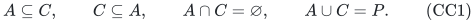
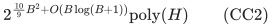
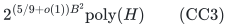
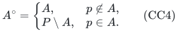
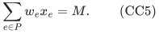
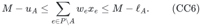

# Exact quotas on compatible cuts

The laminar algorithm also handles a family whose sets are pairwise
nested, disjoint, or together cover the whole numeric ground. Such a
family can describe quotas on either side of edges of an unrooted tree.
Fixing the total numeric mass lets every set be oriented away from one
anchor, after which the constraints are laminar.

This is a direct extension of
[the exact laminar recovery theorem](laminar-dominant-weight-recovery.md).
It preserves one arbitrary integral polymatroid resource, every original
mandatory total, and the original signed scalar costs, including costs
on zero-weight coordinates. The extension introduces no additional
optimization theorem.

## 1. Scope and theorem

Use one common nonnegative integer weight vector <code class="math">w</code> in every numeric
row, root cap <code class="math">w\cdot x\le B</code>, and the resource and objective model of
[the main theorem](../proof.md#1-model-and-theorem). Remove individually
prohibited positive coordinates by the usual safe preparation, keeping
the original required total. Zero-weight coordinates contribute nothing
to numeric rows and keep their resource role and scalar costs. Let <code class="math">P</code>
be the remaining positive numeric ground.

After projecting numeric sets onto <code class="math">P</code>, suppose every pair <code class="math">A,C</code> obeys
at least one of

<!-- math-display: 8b1f232b268789015b00c18c
A\subseteq C,\qquad C\subseteq A,\qquad
A\cap C=\varnothing,\qquad A\cup C=P.
\tag{CC1}
-->

This explicit condition is often called *cross-free*. It is checkable in
polynomial time on the listed sets. Projection preserves CC1, so a
family satisfying it on the original ground also satisfies it after
preparation. The root and empty sets cause no difficulty.

**Theorem.** Exact signed-scalar optimization under CC1 admits the same
deterministic parameter bounds as the laminar problem:

<!-- math-display: b326ebe931e081c04cd3806b
2^{\frac{10}{9}B^2+O(B\log(B+1))}\mathrm{poly}(H)
\tag{CC2}
-->

with the complete elementary coloring construction, or

<!-- math-display: 998813739561b2d27f072736
2^{(5/9+o(1))B^2}\mathrm{poly}(H)
\tag{CC3}
-->

using the specifically cited locally explicit universal-set theorem in
[the recovery proof, Section 8.3](laminar-dominant-weight-recovery.md#83-the-precise-published-construction-and-the-space-claim).
Both use uniform polynomial binary workspace. For a prescribed total
numeric mass, no loop over that mass is needed, and the actual-depth,
actual-weight and projected-coloring bounds of the laminar theorem apply
to the oriented instance.

With one positive weight value, the polynomial-time endpoint extends
when the total numeric mass is prescribed or otherwise forced. For
example, if every coordinate is positive with weight <code class="math">w</code> and a mandatory
resource base has original total <code class="math">R</code>, its numeric mass is forced to be
<code class="math">wR</code>. The statement does not infer a polynomial-time endpoint merely by
enumerating an unknown, binary-large mass when zero coordinates allow
the positive count to vary.

## 2. Orienting every set away from an anchor

Assume <code class="math">P\ne\varnothing</code>, and choose any anchor <code class="math">p\in P</code>. Replace a
set by its side that avoids the anchor:

<!-- math-display: f0e447c91c3101c919ab4109
A^{\circ}=
\begin{cases}
A,&p\notin A,\\
P\setminus A,&p\in A.
\end{cases}
\tag{CC4}
-->

The distinct nonempty sets <code class="math">A^{\circ}</code> form a laminar family.

If both original sets avoid <code class="math">p</code>, their union cannot be <code class="math">P</code>, so CC1
already says they are nested or disjoint. If both contain <code class="math">p</code>, they
cannot be disjoint; nested sets have reversely nested complements, and
sets with union <code class="math">P</code> have disjoint complements. Finally suppose <code class="math">p\in A</code>
and <code class="math">p\notin C</code>. The possible relations in CC1 give:

- If <code class="math">C\subseteq A</code>, then <code class="math">C</code> and <code class="math">P\setminus A</code> are disjoint.
- If <code class="math">A\cap C=\varnothing</code>, then <code class="math">C\subseteq P\setminus A</code>.
- If <code class="math">A\cup C=P</code>, then <code class="math">P\setminus A\subseteq C</code>.

The remaining inclusion <code class="math">A\subseteq C</code> is impossible because of <code class="math">p</code>.
This proves laminarity in every case. Adding the full set <code class="math">P</code> as a root
keeps it laminar.

## 3. Exact numeric correspondence at fixed total mass

Fix an integer <code class="math">M\in[0,B]</code> and impose the exact root equality

<!-- math-display: 07bd6dfb33aa6b276792c65b
\sum_{e\in P}w_e x_e=M.
\tag{CC5}
-->

A row <code class="math">\ell_A\le\sum_{e\in A}w_e x_e\le u_A</code> is unchanged when
<code class="math">p\notin A</code>. When <code class="math">p\in A</code>, replace it by

<!-- math-display: 48f777aa28c89e378e25d9a0
M-u_A\le\sum_{e\in P\setminus A}w_e x_e\le M-\ell_A.
\tag{CC6}
-->

Under CC5, CC6 is exactly the original row. An absent upper bound gives
no lower restriction on the complement; an absent lower bound is zero.
Intersect every new interval with <code class="math">[0,M]</code>, reject an empty interval,
and reject a positive lower requirement on an empty set. Merge repeated
oriented sets by taking the largest lower and smallest upper bound.
Unlike merely merging auxiliary coloring identities, this merge is valid
for the numeric constraints themselves because the fixed total makes
their rewritten left sides identical.

The oriented rows together with CC5 form a common-weight laminar
instance with root cap <code class="math">M\le B</code>. The shared resource and its required
total have not been modified. Neither the scalar coefficients nor the
zero-coordinate ground changes. Thus the feasible original allocations
of mass <code class="math">M</code> are exactly the feasible allocations of this transformed
instance, with exactly the same objective values. Apply the laminar
algorithm and keep its original-coordinate output.

The common weight vector is essential: one total <code class="math">M</code> would not give
CC6 for unrelated row-specific weight vectors. No such extension is
asserted.

## 4. Unknown total, binary input and workspace

If <code class="math">P</code> is empty, all numeric row values are zero. Check their lower
bounds and optimize the original signed scalar on the remaining
zero-weight resource at the original required total. This is the
existing polynomial zero-only case.

Otherwise let <code class="math">n=&#124;P&#124;</code>. If <code class="math">B&lt;n</code>, enumerate <code class="math">M=0,\ldots,B</code>, perform
Sections 2–3, and keep the best original feasible answer. Every feasible
allocation belongs to exactly one of these total-mass cases. The loop
has at most <code class="math">B+1</code> iterations, and all its laminar calls have parameter
at most <code class="math">B</code>. Its additional logarithmic time factor is absorbed in
CC2–CC3. Store only the current mass, one transformed instance and the
best binary output. The positive copy ground used inside each laminar
call is polynomial because <code class="math">B&lt;n</code>.

If <code class="math">B\ge n</code>, use the existing direct count-vector fallback on the
original positive coordinates. There are at most <code class="math">(B+1)^n</code> vectors
with <code class="math">0\le x_e\le\lfloor B/w_e\rfloor</code>. Test **every original numeric
row**, test the positive resource vector, and perform the exact compressed
zero completion with its signed costs. This method does not require
laminar geometry and takes
<code class="math">2^{O(B\log(B+1))}\mathrm{poly}(H)</code> time. It stores <code class="math">n</code> binary
counters, not an array indexed by numerical <code class="math">B</code>.

If a mass <code class="math">M</code> is prescribed, process just that mass. In the one-positive-
weight case, reject a mass not divisible by the positive weight, orient
the rows, and use the direct homogeneous completion on original
coordinates. The binary count-rank oracle avoids unit expansion even
for very large resource totals and bounds. This proves the polynomial
endpoint in the stated fixed-mass scope.

## 5. Interpretation as compatible tree cuts

For a tree with coordinates on its vertices, removing an edge produces
two complementary vertex sets. Quota rows may choose either side of
each such cut, and may include both sides. Two tree-edge cuts have
compatible bipartitions: among the four pairwise intersections of their
sides, at least one is empty. For any chosen sides, this says exactly
that they are disjoint, nested, or cover the whole ground, as in CC1.

Choosing the anchor fixes a root of the tree; CC4 orients the selected
cuts away from it. The resulting subsets are rooted subtrees and hence
laminar. Numeric bounds on a side containing the root are translated
by the fixed total, not dropped. The same reasoning applies when some
tree vertices carry no coordinates, by projection.

More generally, CC1 is the full hypothesis used by the proof; a tree
representation is unnecessary. Arbitrary crossing sets or arbitrary
circular intervals need not satisfy it and are not included.

## 6. Independent finite evidence and dependencies

Run the combined extension checker from the repository root:

~~~sh
python3 -B problems/weighted-prefix-quota-frontier/verify/check_quota_extensions.py
~~~

Its compatible-cut part enumerates all 2,629 families satisfying CC1
on grounds of at most four elements and all 10,441 anchor choices for
those families. For seeded integer bounds and common weights, including
zero weights, it compares the original and rewritten constraints on
every zero-one coordinate vector and every total through the chosen cap:
819,576 numeric-equivalence comparisons. The geometric tests directly
check laminarity of the oriented families. These checks isolate the new
orientation and numeric correspondence; they do not reimplement the
resource solver or prove the asymptotic running time.

The resource completion, representative catalogue and coloring dependencies
are exactly those named in
[the laminar recovery proof](laminar-dominant-weight-recovery.md) and
[the source map](../sources.md). The transformation in Sections 2–4
is proved here in full. The extension is ready for review in the stated
scope; it is not a claim of publication priority, external peer review
or proof-assistant verification.

**Attribution:** Yilin Liu and GPT-6 Astra Pro.
