# Deterministic sunflower kernels for several coverable matroids

**25 October 2026. Increment U. Complete manuscript-level proof with independent internal review.**

This note transfers the external-context sunflower reduction of *deterministic_sparse_packing_oracle_kernel.md* (SK) to several additional matroids whose small independent sets span only a bounded number of parallel classes. The feature supports are now parallel-class IDs, rather than packing-row IDs.

The additional matroids are not replaced by partition feasibility constraints. Their full independence conditions remain in the original instance. Parallel-class features are used only to certify safe single replacements.

## 1. Input and closure-class assumption

Let <code class="math">M_0,M_1,\ldots,M_d</code> be matroids on one explicit item ground <code class="math">E</code>, supplied by independence oracles. The first matroid <code class="math">M_0</code> is unrestricted. There is a cardinality limit <code class="math">k</code> and a rational additive profit <code class="math">c_e</code>, which may be signed as in SK. The original feasible family is

<!-- math-display: 08ddedca2cde46474e769ae9
\mathcal F=\{S\subseteq E:|S|\le k,\
                     S\in\mathcal I(M_i)\text{ for every }0\le i\le d\}.
\tag{CK1}
-->
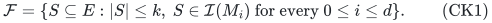

Here <code class="math">d</code> counts **additional** matroids, so there are <code class="math">d+1</code> matroids in total.

Delete elements that are loops in any matroid. In a loopless matroid, the span of a singleton is its parallel class, and every flat is a union of parallel classes. Assume that for each <code class="math">1\le i\le d</code> a supplied integer <code class="math">g_i\ge0</code> satisfies:

<!-- math-display: 33976d8313b9607bdf0fb208
\text{if }I\in\mathcal I(M_i),\ |I|\le k-1,\text{ then }
 \mathrm{cl}_{M_i}(I)
 \text{ is a union of at most }g_i\text{ parallel classes.}
\tag{CK2}
-->
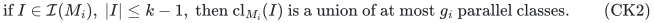

This is a semantic structural assumption, not a property the algorithm claims to verify for arbitrary oracle matroids. It is enough that the additional matroid is <code class="math">g_i(k)</code>-coverable in the sense of Huang–Kakimura–Kobayashi–Terao; one may then use that certified bound. The proof needs only the context sizes in CK2.

The estimates may be capped at <code class="math">&#124;E&#124;</code>, because a loopless ground has at most that many parallel classes. We assume the capped estimates are supplied or computable in polynomial time. The concrete classes below have elementary polynomial estimates.

Set

<!-- math-display: 80aed961992e1c19ce54a143
g=\sum_{i=1}^d g_i.
\tag{CK3}
-->
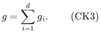

For <code class="math">d=0</code>, one greedy scan gives the usual at-most-<code class="math">k</code> ground. For <code class="math">k=0</code>, return the empty set. As usual, replace <code class="math">k</code> by <code class="math">\min\{k,&#124;E&#124;\}</code>.

## 2. The deterministic ground-kernel theorem

**Theorem.** There is a deterministic polynomial-time algorithm returning <code class="math">R\subseteq E</code> such that, for every original <code class="math">S\in\mathcal F</code> and every <code class="math">e\in S</code>, some <code class="math">f\in R\setminus(S-e)</code> satisfies

<!-- math-display: ac978e9a4bddc81fcf969ddb
c_f\ge c_e,\qquad S-e+f\in\mathcal F.
\tag{CK4}
-->
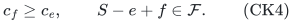

For <code class="math">d\ge1,k\ge1</code>, its retained ground obeys

<!-- math-display: bbd722028bcd4631cd62ab44
|R|\le k\,d!\,[\,k(g+1)\,]^d.
\tag{CK5}
-->
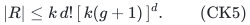

If no two items have the same tuple of parallel classes in <code class="math">M_1,\ldots,M_d</code>, the factor <code class="math">k</code> in front can be omitted.

Construction uses polynomial binary space and a polynomial number of oracle queries, uniformly in explicit <code class="math">d</code>. This is an **oracle ground kernel**, with the original matroid oracles and rational profits available. It is not a bound on an arbitrary oracle program's encoded size or on all weight bits.

The theorem preserves the best profit for every fixed cardinality up to <code class="math">k</code>, and gives deterministic element-by-element reachability. SK's fixed-original-context composition proves these consequences.

## 3. Computing the features

For each additional matroid, compute parallel classes by comparing each nonloop element with existing class representatives. Two distinct nonloops are parallel exactly when their pair is dependent. This uses at most <code class="math">O(d&#124;E&#124;^2)</code> singleton/pair independence queries and polynomial storage.

Give item <code class="math">e</code> the feature set

<!-- math-display: 2c067bb7da5d079432b87b87
\sigma(e)=\{(i,\mathrm{class}_{M_i}(e)):
                                      1\le i\le d\}.
\tag{CK6}
-->
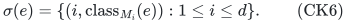

Every support has exactly <code class="math">d</code> features. Features from different matroids are distinct even when their class labels happen to have the same numerical name.

Keep these original feature IDs throughout the reduction. Removing candidates does not change the oracle or silently replace an original closure by a closure in a different context.

For a fixed feasible context <code class="math">I</code>, let <code class="math">\mathcal B_i(I)</code> be the feature classes contained in <code class="math">\mathrm{cl}_{M_i}(I)</code>. By CK2,

<!-- math-display: bd6a810b3078a981d9281db4
|\mathcal B(I)|:=
          \left|\bigcup_{i=1}^d\{(i,C):C\in\mathcal B_i(I)\}\right|
                                  \le g.
\tag{CK7}
-->
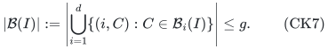

For an item <code class="math">f\notin I</code>, all additional matroid extensions <code class="math">I+f</code> are independent exactly when <code class="math">\sigma(f)</code> avoids this blocked-feature set. The equivalence holds because a matroid flat contains either all or none of each parallel class.

The algorithm does not need to compute these unknown context closures. They are only used in the correctness proof.

## 4. Identical feature tuples

Within each class of identical <code class="math">\sigma(e)</code>, keep only
<code class="math">\mathrm{Greedy}(M_0,\text{class},k)</code>, scanning in nonincreasing profit order and retaining independent elements until size <code class="math">k</code>.

For every original feasible <code class="math">I+e</code>, the SK greedy lemma returns a no-worse resource-valid replacement <code class="math">f</code> in this retained set, outside <code class="math">I</code>. Because <code class="math">e,f</code> are parallel in each additional matroid, <code class="math">e\notin\mathrm{cl}_{M_i}(I)</code> implies <code class="math">f\notin\mathrm{cl}_{M_i}(I)</code>. Thus all additional constraints remain valid.

This is an external-context reduction: <code class="math">I</code> need not lie in the current candidate set. Afterwards at most <code class="math">k</code> items have any one feature tuple, and later deletions preserve that invariant.

## 5. Sunflower thinning with blocked parallel classes

Set

<!-- math-display: 165ee891479d73450440a489
t=g+1,\qquad L=kt+1.
\tag{CK8}
-->
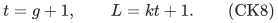

If the current ground has more than <code class="math">d!(L-1)^d</code> distinct feature supports, the constructive Erdős–Rado lemma from SK finds <code class="math">L</code> distinct supports forming a sunflower. No padding is needed because all supports have size <code class="math">d</code>.

Choose one current item per sunflower support, and let <code class="math">V</code> be these <code class="math">L</code> items. Construct <code class="math">t</code> disjoint layers

<!-- math-display: 5b528f94aa612db7fc774ff6
F_j=\mathrm{Greedy}
       \left(M_0,V\setminus\bigcup_{h<j}F_h,k\right),
                              \qquad 1\le j\le t.
\tag{CK9}
-->
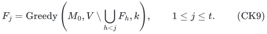

Their union has size at most <code class="math">kt=L-1</code>. Delete only the chosen flower items outside this union. At least one item disappears; other items of the same feature tuple are left alone.

Fix a deleted <code class="math">e</code>, and any original feasible <code class="math">I+e</code> with <code class="math">&#124;I&#124;\le k-1</code>. The item <code class="math">e</code> survives in every layer's pool. The weighted greedy lemma gives distinct representatives <code class="math">f_j\in F_j\setminus I</code> satisfying

<!-- math-display: add9877a7bd9669c416ed717
c_{f_j}\ge c_e,\qquad
                          I+f_j\in\mathcal I(M_0).
\tag{CK10}
-->
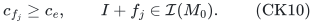

Every feature in the flower core belongs to <code class="math">\sigma(e)</code>. Such a feature is unblocked, since <code class="math">I+e</code> is independent in every <code class="math">M_i</code>. All blocked features therefore occur only in petals. The petals are pairwise disjoint, so each blocked feature can obstruct at most one of the distinct <code class="math">f_j</code>.

There are at most <code class="math">g</code> blocked features and <code class="math">g+1</code> representatives. Some <code class="math">f_j</code> avoids all blocked classes and is independent over <code class="math">I</code> in every additional matroid. It is the required no-worse replacement.

Retained items represent themselves. Thus each flower reduction has the full original external-context property.

## 6. Iteration, size, and polynomial implementation

Repeat the preceding deletion while the distinct-support threshold is exceeded. Every iteration removes at least one item, even if its support still has other surviving copies. There are at most <code class="math">&#124;E&#124;</code> iterations.

When the process stops there are at most <code class="math">d!(L-1)^d</code> supports and at most <code class="math">k</code> items per support. This is CK5. If tuples were initially distinct, they remain distinct, and the leading <code class="math">k</code> is absent.

For an original <code class="math">S,e</code>, fix <code class="math">I=S-e</code>. Under each successive reduction, replace only the current representative of <code class="math">e</code>; the feasible set always has the form <code class="math">I+e_j</code>, and its profit never decreases. Hence the final result satisfies CK4 even though the unchanged context <code class="math">I</code> may contain items removed from the candidate ground.

The sunflower construction follows one popular-feature branch at each of at most <code class="math">d</code> levels. It uses polynomial explicit-set work. If a flower is requested, <code class="math">L</code> cannot exceed the current number of distinct supports, so <code class="math">L\le &#124;E&#124;</code> and the number of greedy layers actually executed is at most <code class="math">&#124;E&#124;</code>. Each deletion therefore makes at most <code class="math">&#124;E&#124;^2</code> queries to <code class="math">M_0</code>, and at most <code class="math">&#124;E&#124;</code> deletions give a safe cubic bound. Together with class computation, a safe oracle count is

<!-- math-display: 09fe3a9d7e12f0d0ddc409d7
O(|E|^3+d|E|^2).
\tag{CK11}
-->
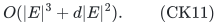

All large thresholds are tested using polynomial-bit integer arithmetic. If the threshold already exceeds the support count, no large sunflower or layer family is built. The original oracle IDs, tuple table, current ground, one recursion path, and one layer collection use polynomial space.

## 7. Graphic, cographic, and simple-partition consequences

For fixed <code class="math">d</code>, CK5 gives the following deterministic bounds.

| Additional matroids | Valid closure-class bound per matroid | Retained items |
|---|---:|---:|
| Simple partition matroids | <code class="math">g_i\le k</code> | <code class="math">O_d(k^{2d+1})</code> |
| Graphic matroids | <code class="math">g_i\le\binom{k+1}{2}</code> | <code class="math">O_d(k^{3d+1})</code> |
| Cographic matroids | <code class="math">g_i\le5k</code> | <code class="math">O_d(k^{2d+1})</code> |

Distinct feature tuples again remove one factor <code class="math">k</code>.

For a graphic matroid, an independent context is a forest. A spanned nonloop edge has its endpoints in one tree component. If the components contain <code class="math">r_1,\ldots,r_s</code> forest edges, the number of spanned parallel classes is at most
<!-- math-display: f94cab2349b28a9999ad48ea
\sum_j\binom{r_j+1}{2}
          \le\binom{1+\sum_jr_j}{2}
          \le\binom{k+1}{2}.
\tag{CK12}
-->
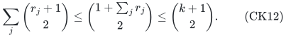
This safe elementary bound includes the one-edge case. Thus one arbitrary item matroid and <code class="math">d</code> graphical interpretations of the same items admit the displayed kernel for selecting a common forest.

For cographic matroids, the public coverability proof gives a linear bound. A safe explicit constant follows by contracting original graph bridges, which deletes the corresponding cographic loops, and considering an independent deletion set <code class="math">I</code>. Contract the bridge-free components of the graph after deletion; the newly spanned edges form a tree of bridges in each original connected component. Every leaf of a nontrivial such tree is incident with a deleted edge, since otherwise its tree edge would already have been an original graph bridge. Mark the at-most-<code class="math">2&#124;I&#124;</code> tree vertices incident with deleted edges and the at-most-<code class="math">2&#124;I&#124;</code> branching vertices. Its maximal unmarked-internal paths number at most <code class="math">4&#124;I&#124;</code>; edges along each path are parallel in the original cographic matroid, because the path interior has no deleted-edge endpoint. Adding at most <code class="math">&#124;I&#124;</code> classes for <code class="math">I</code> itself gives <code class="math">5&#124;I&#124;\le5k</code>. Empty trees are handled directly. This yields a deterministic kernel for selecting deletable edges while preserving connectivity in each graphical interpretation, together with the arbitrary resource matroid.

The simple-partition case follows because an independent context occupies at most <code class="math">k</code> parallel classes. Higher-capacity partition matroids are not automatically covered by this particular closure-class hypothesis; they are already covered directly by SK's sparse upper-packing theorem.

## 8. Public baseline and scope

Huang, Kakimura, Kobayashi and Terao, *Polynomial Kernels with Reachability for Weighted d-Matroid Intersection*, arXiv:2603.17345v1, Definition 2, introduces the <code class="math">g(k)</code>-coverability condition used here. Its Theorem 2 gives a randomized reachable ground of size
<code class="math">\widetilde O(k\prod_i g_i(k))</code>. Lemmas 4–5 establish the graphic and cographic classes. Its deterministic Theorem 6 treats one arbitrary and one coverable matroid with size <code class="math">k^2(g(k)+1)</code>.

<https://arxiv.org/html/2603.17345v1>

The case <code class="math">d=1</code> of CK5 has exactly that same deterministic size bound; it is not claimed as a new endpoint. With several additional matroids, the present reduction is deterministic but generally has a larger degree than the public randomized product bound. For example, with <code class="math">d</code> graphic matroids the public randomized order is <code class="math">\widetilde O(k^{2d+1})</code>, whereas the deterministic bound here is <code class="math">O_d(k^{3d+1})</code>.

The greedy replacement, sunflower threshold, and layered bounded-conflict argument have the primary antecedents recorded in SK, including the greedy-layer kernel in Fomin–Golovach–Korhonen–Saurabh, SWAT 2024, Theorem 4. This note's proof composes those tools with the explicit parallel-class feature interface. No first-ever or size-optimality claim is made.

An arbitrary additional oracle matroid need not satisfy CK2 with any parameter-only bound. Uniform, transversal, and laminar classes require separate qualifications; their mere presence in the public broader paper does not justify applying this theorem to them. The additional resource conditions remain actual matroid independence, not an asserted integral intersection of all feature partitions. This remains a deterministic oracle ground reduction on selectable items.
