# Deterministic sparse packing kernels with an oracle matroid

**25 October 2026. Increment U. Complete manuscript-level proof with independent internal review.**

This note gives a deterministic polynomial-time reduction for item-set packing with one arbitrary independence-oracle matroid and sparse zero-one upper constraints. It retains a polynomial number of items when the column frequency is fixed, and has a strong replacement guarantee against every feasible context in the **original** instance.

The proof combines two established tools: the weighted one-matroid greedy replacement lemma and the constructive Erdős–Rado sunflower lemma. The key composition is a deletion rule using several disjoint greedy layers of one sunflower. It does not require linear matroid representations, randomized kernels, or a claim that three matroid intersections are integral.

“Kernel” below means an **oracle ground kernel**: a retained subset of original items with the original resource oracle and item weights still available. It is not a claim that arbitrary oracle descriptions or arbitrary rational weights have been compressed to a parameter-only number of bits.

## 1. Model and main theorem

Let <code class="math">E</code> be an explicit set of <code class="math">n</code> selectable items, and let <code class="math">M=(E,\mathcal I)</code> be one arbitrary matroid supplied by an independence oracle. Let <code class="math">c:E\to\mathbb Q</code> be rational item profits. Nonnegative profits suffice for the usual maximization problem; the proof also permits signed profits, with greedy scans continuing through negative items.

The explicitly supplied packing rows are sets <code class="math">A_j\subseteq E</code> with nonnegative integer capacities <code class="math">b_j</code>. Feasible solutions satisfy

<!-- math-display: f03554e488e4ac48f2cdb25a
S\in\mathcal I,\qquad |S|\le k,\qquad
                 |S\cap A_j|\le b_j\quad\text{for every }j.
\tag{SK1}
-->
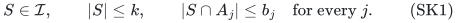

The resource is a matroid **on the selectable items**. For graph applications, it is a matroid on edges, not a matroid on their endpoint union.

Write <code class="math">\sigma(e)=\{j:e\in A_j\}</code> for an item's row support, and let

<!-- math-display: 170c7decf993c4d1b8ce2cda
\delta=\max_{e\in E}|\sigma(e)|.
\tag{SK2}
-->
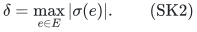

All rows may overlap arbitrarily; their capacities need not be one. The integer <code class="math">k</code> is an explicit cardinality limit, or a valid bound on the solution sizes of interest. Replace <code class="math">k</code> by <code class="math">\min\{k,n\}</code> without loss.

Let <code class="math">\mathcal F</code> denote the feasible family in SK1. A retained set <code class="math">R\subseteq E</code> has the deterministic single-replacement property if

<!-- math-display: ccdee27aa9de8dbdd58b0ee5
\begin{gathered}
 \text{for every }S\in\mathcal F\text{ and }e\in S,\text{ some }
 f\in R\setminus(S-e)\text{ satisfies}\\
             c_f\ge c_e,\qquad S-e+f\in\mathcal F.
 \end{gathered}
\tag{SK3}
-->
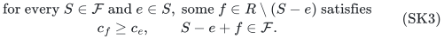

**Theorem.** A set <code class="math">R</code> satisfying SK3 can be found in deterministic polynomial time and polynomial binary space. If <code class="math">k\ge1,\delta\ge1</code>, one may guarantee

<!-- math-display: 9c9b5111e12196cd98277731
|R|\le
 k\,\delta!\,[\,k(\delta(k-1)+1)\,]^\delta
                =(\delta k+2)^{O(\delta)}.
\tag{SK4}
-->
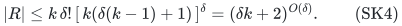

For fixed <code class="math">\delta</code>, this is <code class="math">O_\delta(k^{2\delta+1})</code>. If the original real supports are pairwise distinct, the leading factor <code class="math">k</code> can be omitted:

<!-- math-display: d453aadd6bc46129ce3154bf
|R|\le\delta!\,[\,k(\delta(k-1)+1)\,]^\delta
                         =O_\delta(k^{2\delta}).
\tag{SK5}
-->
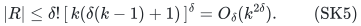

At <code class="math">k=0</code>, return the empty set. At <code class="math">\delta=0</code>, one truncated greedy scan returns at most <code class="math">k</code> items with SK3. The case <code class="math">k=1</code> can also be solved directly by retaining a maximum-profit individually feasible item, or no item if none exists.

The polynomial construction time is uniform when the explicit frequency <code class="math">\delta</code> is part of the input. Only the output-size bound has exponent depending on <code class="math">\delta</code>. The proof below gives a safe <code class="math">O(n^3+n)</code> independence-oracle query bound, in addition to polynomial explicit-set processing; no effort is made to optimize this implementation constant.

**Capacity-sensitive refinement.** If <code class="math">h</code> is any computable upper bound on
the number of packing rows saturated by a feasible context of at most
<code class="math">k-1</code> items, replace <code class="math">\delta(k-1)+1</code> in SK4--SK5 by <code class="math">h+1</code>.
One can take <code class="math">h</code> to be the floor of the sum of the largest <code class="math">k-1</code> item
loads <code class="math">\sum_{j\in\sigma(e)}1/b_j</code>, clipped to the number of rows, after
zero-capacity preparation. Section 6 only uses the number of saturated
rows, so its proof applies with exactly <code class="math">h+1</code> layers. The explicit load
proof appears in [the sharp FPT restriction](sharp-sparse-packing-fpt-restrictions.md#3-saturated-row-accounting-and-the-replacement-proof).

That companion also proves the different deterministic tradeoff
<code class="math">k\binom{\delta k}{\delta}=O_\delta(k^{\delta+1})</code> retained items for
unweighted original-context replacement, with
<code class="math">2^{O(\delta k\log(\delta k+2))}n^{O(1)}</code> preprocessing. An ordered
failure-summary variant gives at most <code class="math">e^\delta k^{\delta+1}</code> items
for arbitrary signed profits with the same FPT parameter dependence.
The exponential construction time keeps both variants distinct from the
uniformly polynomial arbitrary-profit theorem here.

## 2. Original-context replacement and composition

It is useful to state the local invariant before giving the reduction. For a current candidate set <code class="math">T\subseteq E</code>, a reduction <code class="math">T\mapsto R_T\subseteq T</code> has the external-context property if

<!-- math-display: 7c77195ba54049dd906cc99a
\begin{gathered}
 \forall S\in\mathcal F,\ \forall e\in S\cap T,\quad
 \exists f\in R_T\setminus(S-e):\\
                   c_f\ge c_e,\quad S-e+f\in\mathcal F.
 \end{gathered}
\tag{SK6}
-->
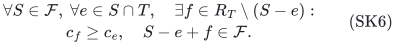

The context <code class="math">S-e</code> need not be contained in <code class="math">T</code>. Both <code class="math">\mathcal F</code> and <code class="math">M</code> in this statement refer to the original instance.

These reductions compose. Fix an original feasible <code class="math">S</code> and <code class="math">e\in S</code>, and set <code class="math">I=S-e</code>. Suppose the current representative is <code class="math">e_i\in T_i</code>, with <code class="math">I+e_i</code> feasible and <code class="math">c_{e_i}\ge c_e</code>. Applying SK6 to <code class="math">I+e_i</code> yields <code class="math">e_{i+1}\in T_{i+1}\setminus I</code>, with <code class="math">I+e_{i+1}</code> feasible and no smaller profit. The context <code class="math">I</code> stays exactly the same throughout. Thus the final retained ground satisfies SK3.

This is stronger than proving that every reduction preserves an optimum whose entire set lies in its current ground. That weaker assertion would not justify the external-context invariant used here.

## 3. The weighted greedy replacement lemma

For <code class="math">Y\subseteq E</code>, let <code class="math">\mathrm{Greedy}(M,Y,k)</code> scan <code class="math">Y</code> in nonincreasing profit order, with fixed deterministic ties, adding an item when matroid independence is maintained and fewer than <code class="math">k</code> items have been retained.

**Greedy lemma.** If <code class="math">S\in\mathcal I</code>, <code class="math">&#124;S&#124;\le k</code>, and <code class="math">e\in S\cap Y</code>, then this scan returns an <code class="math">f\notin S-e</code> with

<!-- math-display: 1c8601198fb6ac19bf6809a3
c_f\ge c_e,\qquad S-e+f\in\mathcal I.
\tag{SK7}
-->
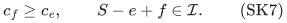

Here <code class="math">S-e</code> can contain items outside <code class="math">Y</code>.

To prove it, let <code class="math">I=S-e</code>, which has size at most <code class="math">k-1</code>. If <code class="math">e</code> is retained, use <code class="math">f=e</code>. If the scan has already retained <code class="math">k</code> items by the time it reaches <code class="math">e</code>, these items form an independent set of rank <code class="math">k&gt;&#124;I&#124;</code>, so some retained item is outside <code class="math">\mathrm{cl}_M(I)</code>. All were processed no later than <code class="math">e</code>, and have profit at least <code class="math">c_e</code>.

Otherwise the greedy prefix has fewer than <code class="math">k</code> retained items and rejected <code class="math">e</code> because that prefix spans <code class="math">e</code>. Since <code class="math">e\notin\mathrm{cl}_M(I)</code>, at least one member of the prefix lies outside <code class="math">\mathrm{cl}_M(I)</code>; use it as <code class="math">f</code>. Again its profit is at least <code class="math">c_e</code>. In both cases an item outside the closure is outside <code class="math">I</code> and extends it independently.

This is the same one-matroid property stated as Lemma 2 in Huang, Kakimura, Kobayashi and Terao, *Polynomial Kernels with Reachability for Weighted d-Matroid Intersection* (2026). The proof above records the exact external-context quantifier required here. No packing feasibility is imposed on the greedy pool itself.

## 4. Preparation and duplicate supports

Remove matroid loops and items in any zero-capacity row. Such items appear in no feasible original solution, so this is safe even for SK6. Discard the resulting zero-capacity rows: neither an original feasible context nor any surviving candidate can use their removed items. Every remaining packing capacity is then at least one. Capacities at least <code class="math">k</code> may be discarded as redundant, or kept; either choice is safe. Support labels below always refer to the chosen fixed original row system.

For each class of items with the same **real row support**, retain only

<!-- math-display: 07ec2e11445ee142ec640808
\mathrm{Greedy}(M,\text{class},k).
\tag{SK8}
-->
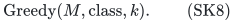

There are at most <code class="math">k</code> retained items per support. This simultaneous reduction has SK6: for any protected <code class="math">e</code>, the greedy lemma supplies a no-worse independent replacement in its own support class; identical supports preserve every packing row exactly. A replacement is outside the unchanged context.

Subsequent steps only delete items, so the at-most-<code class="math">k</code>-per-support invariant remains true. It is not necessary to collapse these classes again after each deletion.

## 5. Constructive sunflowers on distinct supports

Set

<!-- math-display: 49b97c9376edd5dfbae6f075
t=\delta(k-1)+1,\qquad L=kt+1.
\tag{SK9}
-->
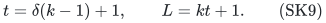

We will use a sunflower of <code class="math">L</code> **distinct** supports. Distinctness is not replaced by a count of items: many items may share one support.

For supports of size at most <code class="math">\delta</code>, pad each distinct support to size exactly <code class="math">\delta</code> with private labels assigned to that support. A padding label is not a packing row and belongs to only that one padded support. This is an explicit construction of at most <code class="math">\delta</code> labels per support.

If the number of distinct padded supports exceeds

<!-- math-display: cf7b3509d76bfdab106c4b30
\delta!(L-1)^\delta,
\tag{SK10}
-->
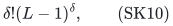

the constructive Erdős–Rado lemma finds <code class="math">L</code> of them with a common intersection core and pairwise disjoint petals.

For completeness, the standard induction is algorithmic. On a family of distinct <code class="math">r</code>-sets exceeding <code class="math">r!(L-1)^r</code>, greedily find a maximal disjoint subfamily. If it has at least <code class="math">L</code> members, they form a sunflower with empty core. Otherwise its union has at most <code class="math">r(L-1)</code> labels and meets every set. Some label occurs in more than
<!-- math-display: de35ae74c67ec3a273ec10ea
\frac{r!(L-1)^r}{r(L-1)}
                   =(r-1)!(L-1)^{r-1}
-->
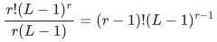
sets. Restrict to the sets containing it, delete that label, and recurse. The remaining sets stay distinct. Reinsert the label into the core of the returned flower. The singleton base case is immediate.

The recursion follows one popular-label branch, has depth at most <code class="math">r</code>, and uses only polynomial-time scans of the explicit set family. It is polynomial also when <code class="math">\delta</code> is part of the input. The threshold can be computed or compared using <code class="math">O(\delta\log(\delta+1)+\delta\log(L+1))</code> bits.

Since <code class="math">L\ge2</code>, no private padding label lies in the common core. On removing padding, the selected real supports have the same real core and disjoint real petals. Empty real petals cause no problem; distinct real supports allow at most one such petal.

## 6. Sunflower deletion by disjoint greedy layers

Choose one currently surviving item for each of the <code class="math">L</code> distinct supports of a found sunflower. Let <code class="math">V</code> be these <code class="math">L</code> chosen items, with real core <code class="math">C</code>. Other items with the same supports are not included in this particular choice.

Construct <code class="math">t</code> disjoint greedy layers:

<!-- math-display: f9ae03386f20b73a6279a006
\begin{split}
 V_1&=V,\\
 F_i&=\mathrm{Greedy}(M,V_i,k),\\
 V_{i+1}&=V_i\setminus F_i\qquad(1\le i\le t).
 \end{split}
\tag{SK11}
-->
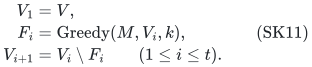

Let <code class="math">R_V=\bigcup_{i=1}^tF_i</code>. It has size at most <code class="math">kt=L-1</code>. Delete precisely the chosen items in <code class="math">V\setminus R_V</code>, retaining <code class="math">R_V</code> and all current items outside <code class="math">V</code>. At least one item is deleted.

**Deletion lemma.** This reduction satisfies SK6.

Let <code class="math">e</code> be a deleted item and fix any original feasible <code class="math">S</code> containing it. Put <code class="math">I=S-e</code>. Since <code class="math">e</code> is in none of the layers, it remains available in every pool <code class="math">V_i</code>. The greedy lemma gives, for each <code class="math">i</code>, an item <code class="math">f_i\in F_i\setminus I</code> with
<!-- math-display: f726c893c1ebb35972130aa5
c_{f_i}\ge c_e,\qquad I+f_i\in\mathcal I.
\tag{SK12}
-->
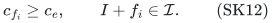
The <code class="math">f_i</code> are distinct because the layers are disjoint. They come from distinct supports and therefore from distinct petals of the chosen flower.

A row <code class="math">j</code> can block adding an item to <code class="math">I</code> only if it is saturated there, <code class="math">&#124;I\cap A_j&#124;=b_j</code>. Capacities are positive after preparation, so every such row contains some item of <code class="math">I</code>. There are at most
<!-- math-display: a7d2b1419636eea16a48c300
\delta|I|\le\delta(k-1)
\tag{SK13}
-->
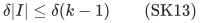
saturated rows, since each context item belongs to at most <code class="math">\delta</code> rows.

A saturated row cannot contain <code class="math">e</code>, because <code class="math">I+e=S</code> was feasible. In particular no saturated row belongs to the flower core, which is contained in the support of <code class="math">e</code>. Each saturated row therefore lies in at most one flower petal and can obstruct at most one of the distinct candidates <code class="math">f_i</code>. There are <code class="math">t=\delta(k-1)+1</code> candidates and at most <code class="math">t-1</code> blocking rows. At least one <code class="math">f_i</code> violates no packing row.

That item has the required independent extension, cardinality, and profit. It lies in the retained <code class="math">R_V</code>. Items not deleted can represent themselves, proving SK6 for the entire reduction.

The proof is unaffected by items of <code class="math">I</code> outside the current ground. They are counted in the original saturated rows, and the bound SK13 uses only their original frequency. It also does not require the greedy layers to be packing-feasible.

## 7. Algorithm, termination, and ground size

After the support collapse of Section 4, repeat:

- If the number of distinct real supports is at most SK10, stop.
- Otherwise construct a padded sunflower, choose one item per selected support, and perform Section 6's deletion.

Every iteration removes at least one current item. A support need not disappear in that iteration: other items of that support may remain. This does not affect termination, because the total number of items strictly decreases. There are at most <code class="math">n</code> deletion iterations.

At termination there are at most <code class="math">\delta!(L-1)^\delta</code> supports, each with at most <code class="math">k</code> retained items. Substituting <code class="math">L-1=k(\delta(k-1)+1)</code> gives SK4. If supports were pairwise distinct initially, deletion preserves that property and gives SK5.

Every deletion and the initial support collapse have the external-context property. Section 2's fixed-context composition therefore proves the final SK3, not merely preservation of an optimum.

If the explicit sunflower threshold is already at least the current support count, no flower search is attempted. All numerical comparison and factorial/product calculations have polynomial bit length.

## 8. Deterministic polynomial construction and space

Initial loop tests and support-class greedy scans use <code class="math">O(n)</code> independence queries. Rational profit comparisons are exact, and one global sorted order with fixed ties can be used in every later scan.

Whenever a sunflower deletion is invoked, its <code class="math">L</code> distinct supports belong to the current ground, so <code class="math">L\le n</code>. Consequently <code class="math">t\le L\le n</code>. Each greedy layer scans at most <code class="math">L</code> items and uses at most that many independence queries. A deletion costs at most <code class="math">tL\le n^2</code> queries, and at most <code class="math">n</code> deletions give the stated <code class="math">O(n^3+n)</code> bound.

The constructive sunflower routine uses at most <code class="math">\delta</code> levels and polynomial explicit set operations per level. It follows only one recursive subfamily. This is uniform polynomial computation in the explicit input; it is not an <code class="math">n^\delta</code> search over support tuples.

The current item set, its support table, padding labels, one recursive sunflower state, and the greedy layers all fit polynomial input space. There is no natural-matroid unit expansion or binary capacity expansion. The outputs retain original item identities and profits, and the resource oracle is still the original matroid restricted to those identities.

If desired, discard empty rows in the final restricted instance. At most <code class="math">\delta&#124;R&#124;</code> rows have a retained incidence. Capacities may be clipped to <code class="math">k</code>. These facts bound the combinatorial support size, but not arbitrary original profit encodings or an oracle's program description. No classical parameter-only bit kernel is claimed.

## 9. Reachability and exact optimization consequences

SK3 gives deterministic element-by-element reachability. Given an original feasible
<code class="math">S=\{e_1,\ldots,e_s\}</code>, process the original elements in that order. If the current set already contains <code class="math">e_i</code> in the retained ground, it can be kept; otherwise apply SK3 to replace it by a retained item of no smaller profit, outside all other current items. The resulting set remains feasible and has the same cardinality at every step. After at most <code class="math">s</code> proper replacements the entire set lies in <code class="math">R</code>.

In particular, restricting to <code class="math">R</code> preserves maximum additive profit for every fixed cardinality up to <code class="math">k</code>, and therefore for the size-at-most-<code class="math">k</code> optimization problem. Signed profits cause no difficulty, because no greedy layer was allowed to stop merely on reaching a negative profit.

Enumerating subsets of <code class="math">R</code> of size at most <code class="math">k</code> gives the standard exact time consequence
<!-- math-display: 71479f41f42b8d810fc9d1ba
2^{O(\delta k\log(\delta k+2))}
                         \mathrm{poly}(H).
\tag{SK14}
-->
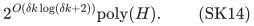
The exact FPT order itself is not the new comparison claimed here: sparse item-set packing already permits direct coloring/profile deductions. The stronger result of this note is the deterministic polynomial-time ground reduction with SK3.

The external-context statement also permits composing reductions of different candidate pools while retaining the original resource and row system. Any streaming or distributed use must maintain this original-context interpretation; no claim follows from restricting away the external context in the proof.

## 10. Concrete specializations

**One arbitrary matroid and several explicit partition matroids.** Suppose there are <code class="math">d-1</code> additional partition matroids, with arbitrary nonnegative integer capacities in their parts. Use one packing row per part, labelled by its partition. Each item occurs in at most <code class="math">d-1</code> rows. For fixed <code class="math">d\ge2</code>, SK4 gives a deterministic reachable oracle ground of size
<!-- math-display: 5ba3392b8321c07a5bf3d886
O_d(k^{2d-1}).
\tag{SK15}
-->
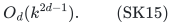
No simple-capacity-one assumption is required. If all part-incidence vectors are distinct, SK5 improves the exponent by one.

**Graph matching with a matroid on edges.** Give each vertex a capacity-one row and each edge its two endpoint incidences. For a loopless simple graph, supports are distinct and <code class="math">\delta=2</code>, so
<!-- math-display: f2183d422c9ca055ab8d70a3
|R|\le2[\,k(2k-1)\,]^2=O(k^4)
\tag{SK16}
-->
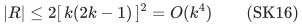
edges suffice deterministically. This holds in nonbipartite graphs as well. With parallel edges, support collapse gives the general <code class="math">O(k^5)</code> edge bound. Vertex capacities above one give the corresponding edge-matroid-constrained <code class="math">b</code>-matching ground reduction.

**Hyperedge selection with item independence.** A selectable hyperedge of size at most <code class="math">\delta</code> supplies the support of one item, and vertex capacities give the packing rows. SK4 applies to repeated hyperedge records and SK5 to distinct supports. The matroid is on hyperedge records. A matroid on the union of selected vertices is a different model and is not asserted.

## 11. Primary comparisons and attribution

The following primary statements were checked directly on 25 October 2026. They delimit the contribution and do not establish a publication-priority claim.

Huang, Kakimura, Kobayashi and Terao, *Polynomial Kernels with Reachability for Weighted d-Matroid Intersection*, arXiv:2603.17345v1, explicitly defines deterministic single exchangeability in Section 7. Its Lemma 2 is the greedy replacement lemma used here. Its Theorem 1 gives a randomized reachable ground of size <code class="math">\widetilde O(k^d)</code> for one arbitrary matroid and <code class="math">d-1</code> simple partition matroids; Corollary 2, via the transversal-matroid theorem, extends that same randomized size to arbitrary partition capacities. Theorem 5 gives <code class="math">\widetilde O(k^3)</code> for matching with an edge matroid. Theorem 6 is a deterministic result for two matroids, one <code class="math">g(k)</code>-coverable. The current abstract page lists only that March 2026 version.

<https://arxiv.org/html/2603.17345v1>

<https://arxiv.org/abs/2603.17345>

The present reduction has a larger polynomial degree than those randomized bounds in their overlapping cases. Its guarantee is deterministic and applies to arbitrary sparse zero-one upper packing, including nonunit capacities. It does not claim to match the public size optimum or to improve the public theorem's broader graphic, cographic, or transversal cases.

Huang and Ward, *FPT-Algorithms for the ell-Matchoid Problem with a Coverage Objective*, already give deterministic representative kernels for general oracle matchoids. Their Theorems 3.6–3.7 provide the representative/kernel interface, with size exponential in the solution parameter for a fixed nontrivial matchoid frequency. The sparse uniform-row specialization here obtains a polynomial-size ground by a different deletion rule; the general matchoid problem is not claimed solved by this note.

<https://www.di.ens.fr/~cchuang/work/matchoid.pdf>

Disjoint greedy layers followed by a bounded-conflict pigeonhole argument also have a direct antecedent. Fomin, Golovach, Korhonen and Saurabh, *Stability in Graphs with Matroid Constraints*, SWAT 2024, Theorem 4, construct <code class="math">kD</code> disjoint greedy independent layers for a graph of maximum degree <code class="math">D</code>, giving at most <code class="math">k^2D</code> retained vertices. Their proof obtains one resource-valid candidate from each layer and bounds the candidates obstructed by the remaining context. Section 6 uses this established mechanism inside a sunflower, where disjoint petals give the conflict bound despite an unbounded global conflict degree.

<https://drops.dagstuhl.de/storage/00lipics/lipics-vol294-swat2024/LIPIcs.SWAT.2024.22/LIPIcs.SWAT.2024.22.pdf>

The constructive support threshold is the classical Erdős–Rado sunflower bound. Their *Intersection Theorems for Systems of Sets*, Journal of the London Mathematical Society 35 (1960), pages 85–90, is available from the authors' institutional archive. Section 5 supplies the standard explicit induction so that no sunflower algorithm is hidden as an extra assumption.

<https://www.renyi.hu/~p_erdos/1960-04.pdf>

These comparisons support a concrete distinction: deterministic ground reduction with external-context reachability, at the displayed larger polynomial degree. They are not evidence for a first-ever deterministic kernel claim.

## 12. Limits of the theorem

The rows are zero-one **upper** packing rows. Arbitrary row-dependent integer coefficients, cover targets, and equality targets belong to the separate BF/HP exact-target theorems and do not inherit this polynomial kernel automatically. Same-support replacement would not preserve different numeric coefficients.

Only one arbitrary oracle matroid is imposed on the selectable items. The sunflower is formed on explicit row-ID supports, not on arbitrary matroid elements or vertex unions; no sunflower theorem for arbitrary matroids is assumed. A second unrelated arbitrary oracle matroid is outside the proof.

The retained ground may still have polynomial size larger than the input, in which case the algorithm simply returns the smaller current set. Numerical profits and the original oracle remain available. The theorem is therefore an oracle ground-kernel statement in the same sense as the cited reachable-kernel literature, not a compression of all input bits.
