# Deterministic kernels with explicitly represented transversal matroids

**25 October 2026. Increment U. Complete manuscript-level proof with independent internal review.**

This note transfers the deterministic sparse-packing ground kernel of *deterministic_sparse_packing_oracle_kernel.md* (SK) to one arbitrary oracle matroid and several explicitly represented transversal matroids. The transfer preserves the strong replacement guarantee against every feasible context in the original ground.

The product-of-matching-witnesses reduction has a direct public antecedent in Huang–Kakimura–Kobayashi–Terao, Section 4. The additional implementation argument here first truncates every left neighborhood to the solution-size bound, and uses a return-the-whole-ground branch before forming the product. Consequently the construction is polynomial in the explicit input even when the number of transversal matroids is not a fixed constant.

## 1. Model and theorem

Let <code class="math">E</code> be an explicit item ground, <code class="math">M_0</code> an arbitrary matroid on <code class="math">E</code> supplied by an independence oracle, and <code class="math">c_e\in\mathbb Q</code> a possibly signed profit for each item. For <code class="math">1\le i\le d</code>, a transversal matroid <code class="math">M_i</code> is supplied by an explicit bipartite graph

<!-- math-display: d66e028493161245e773b089
G_i=(E,W_i;A_i).
\tag{TR1}
-->
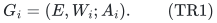

A subset of <code class="math">E</code> is independent in <code class="math">M_i</code> exactly when it can be matched injectively into <code class="math">W_i</code>. We seek solutions in

<!-- math-display: 68231a80221e81a737851e7c
\mathcal F=\{S\subseteq E:|S|\le k,\quad
                S\in\mathcal I(M_i)\text{ for }0\le i\le d\}.
\tag{TR2}
-->
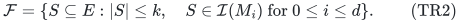

Here <code class="math">d</code> counts the additional transversal matroids; the total number of matroids is <code class="math">d+1</code>. The bipartite representations, rather than only independence oracles for these additional matroids, are part of the required input.

**Theorem.** A deterministic algorithm using polynomial time, a polynomial number of calls to the original <code class="math">M_0</code> oracle, and polynomial binary space returns <code class="math">R\subseteq E</code> with

<!-- math-display: 68a41bb6323d6902fef81f84
\begin{gathered}
 \forall S\in\mathcal F,\quad\forall e\in S,\quad
 \exists f\in R\setminus(S-e):\\
                    c_f\ge c_e,\qquad S-e+f\in\mathcal F.
 \end{gathered}
\tag{TR3}
-->
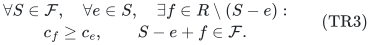

For <code class="math">d\ge1</code> and <code class="math">k\ge1</code>, it satisfies

<!-- math-display: cce1e36cce2c9e9c33a571aa
|R|\le K(k,d):=
           k\,d!\,[\,k(d(k-1)+1)\,]^d.
\tag{TR4}
-->
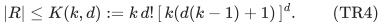

Thus for each fixed <code class="math">d</code>, the retained number of original items is
<code class="math">O_d(k^{2d+1})</code>. Construction is uniformly polynomial in the full explicit input; this uniformity is stronger than allowing an input-size exponent depending on <code class="math">d</code>.

The theorem preserves the maximum profit at every fixed cardinality at most <code class="math">k</code>, including when some profits are negative. It also preserves exact feasibility at every such cardinality. Applying TR3 repeatedly replaces all elements of an original solution by distinct retained elements while never decreasing profit.

This is an **oracle ground kernel**. It does not compress an arbitrary program for <code class="math">M_0</code>, or all rational profit bits, to a parameter-only number of bits. The additional bipartite representations can be reduced to at most <code class="math">dk&#124;R&#124;</code> incidences, as proved below.

## 2. Preliminary cases and deterministic neighborhood truncation

Delete every item that is a loop of <code class="math">M_0</code>, or has no neighbor in at least one <code class="math">G_i</code>. Such items occur in no original feasible set. Let <code class="math">n</code> be the number of remaining items, and replace <code class="math">k</code> by <code class="math">\min\{k,n\}</code>. The feasible sets of interest are unchanged by these operations.

At <code class="math">k=0</code>, return the empty ground. At <code class="math">d=0</code>, one truncated weighted greedy scan in <code class="math">M_0</code> returns at most <code class="math">k</code> items with TR3, by the greedy lemma in SK. The case <code class="math">k=1</code> can alternatively be solved by retaining a maximum-profit individually feasible item. These scans continue through negative profits when a fixed cardinality is to be preserved.

For each remaining item <code class="math">e</code> and each <code class="math">i</code>, fix an arbitrary deterministic subset

<!-- math-display: bfbf9accd2fdc32914f52520
N'_i(e)\subseteq N_i(e),\qquad
              |N'_i(e)|=\min\{k,|N_i(e)|\}.
\tag{TR5}
-->
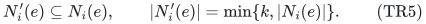

Let <code class="math">G'_i</code> have these truncated neighborhoods.

**Truncation lemma.** For every <code class="math">S\subseteq E</code> with <code class="math">&#124;S&#124;\le k</code>, the set <code class="math">S</code> has a matching into <code class="math">W_i</code> in <code class="math">G_i</code> if and only if it has one in <code class="math">G'_i</code>.

One direction follows from <code class="math">G'_i\subseteq G_i</code>. For the other, suppose <code class="math">S</code> has an original matching. By Hall's criterion, it suffices to verify

<!-- math-display: ffbc5d4e9c177949a49fd1a6
\left|\bigcup_{e\in T}N'_i(e)\right|\ge|T|
                                  \quad\text{for every }T\subseteq S.
\tag{TR6}
-->
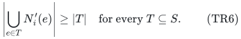

If <code class="math">T</code> contains any item with original degree at least <code class="math">k</code>, that item's retained neighborhood already has <code class="math">k\ge&#124;T&#124;</code> distinct vertices, so TR6 holds. Otherwise every item's neighborhood in <code class="math">T</code> was left unchanged, and TR6 follows from the original matching. This proves the lemma simultaneously for all sets of size at most <code class="math">k</code>; there is no guessed solution or randomized selection of neighbors.

In particular, after restricting to any returned ground <code class="math">R</code>, the graphs <code class="math">G'_i[R,W_i]</code> still encode exactly the original independent sets on <code class="math">R</code> of size at most <code class="math">k</code>. Delete isolated right vertices if desired. Their total edge count is at most

<!-- math-display: a0ced798cb53e5d5f9cb2e0c
dk|R|.
\tag{TR7}
-->
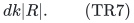

The cardinality limit remains part of the reduced instance: truncation is not asserted to preserve larger independent sets.

## 3. Avoiding a nonpolynomial witness product

Compute the integer <code class="math">K=K(k,d)</code> in TR4, or compare it with <code class="math">n</code> using capped integer arithmetic. If <code class="math">n\le K</code>, return the entire remaining ground, together with the truncated bipartite representations. Property TR3 then holds by using <code class="math">f=e</code>, and the size bound is immediate.

It remains to consider <code class="math">n&gt;K</code>. Since <code class="math">d!\ge1</code> and <code class="math">d(k-1)+1\ge1</code>,

<!-- math-display: d84dea298809939e7b200f73
K\ge k^{d+1},\qquad k^d<n.
\tag{TR8}
-->
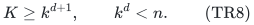

Thus the following product, although exponential in <code class="math">d</code> as an unrestricted symbolic expression, has polynomial size in the branch where it is actually built:

<!-- math-display: b43fbf3d54a3cfc00ac7e7a3
V=\{(e,r_1,\ldots,r_d): e\in E,\quad
                                  r_i\in N'_i(e)\text{ for every }i\}.
\tag{TR9}
-->
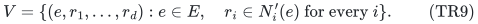

Writing <code class="math">\pi(v)=e</code> for the owner of a tuple gives

<!-- math-display: 3800ea3d388562cf12ce0950
|V|=\sum_{e\in E}\prod_{i=1}^d|N'_i(e)|
                         \le n k^d<n^2.
\tag{TR10}
-->
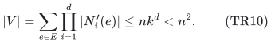

All tuples can therefore be enumerated explicitly using polynomial time and space, uniformly in the explicit integer <code class="math">d</code>. Storing their coordinates costs a further factor polynomial in the explicit input. The bit length of the threshold is
<code class="math">O(d\log(d+1)+d\log(k+1)+\log(k+1))</code>, or it can be capped as soon as it exceeds <code class="math">n</code>.

This return-the-whole-ground branch is essential to the stated uniform implementation. It would not be justified to enumerate <code class="math">n k^d</code> tuples unconditionally and call that polynomial for variable <code class="math">d</code>.

## 4. The parallel lift and packing constraints

Define a matroid <code class="math">\widehat M_0</code> on <code class="math">V</code> by

<!-- math-display: 623fb39c9e538b7aeb7e44b0
T\in\mathcal I(\widehat M_0)
 \quad\Longleftrightarrow\quad
 |T|=|\pi(T)|\text{ and }\pi(T)\in\mathcal I(M_0).
\tag{TR11}
-->
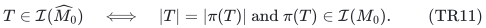

This is the parallel extension of <code class="math">M_0</code> obtained by replacing each original item by its tuples. It is a matroid. For completeness, heredity is immediate. If <code class="math">A,B</code> satisfy TR11 and <code class="math">&#124;A&#124;&lt;&#124;B&#124;</code>, matroid augmentation in <code class="math">M_0</code> yields an owner in <code class="math">\pi(B)\setminus\pi(A)</code> extending <code class="math">\pi(A)</code>; its unique tuple in <code class="math">B</code> augments <code class="math">A</code>. One oracle call for <code class="math">\widehat M_0</code> is implemented by a distinct-owner check and at most one call to <code class="math">M_0</code>.

For each pair <code class="math">(i,r)</code> with <code class="math">r\in W_i</code>, impose the capacity-one packing row

<!-- math-display: 51ac5852315186229d4ecd45
A_{i,r}=\{(e,r_1,\ldots,r_d)\in V:r_i=r\},
                        \qquad |T\cap A_{i,r}|\le1.
\tag{TR12}
-->
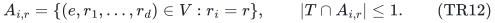

The row label includes <code class="math">i</code>; equal names in different right domains are different rows. Every tuple lies in exactly <code class="math">d</code> rows. Give it profit <code class="math">\widehat c_v=c_{\pi(v)}</code>, and retain the cardinality limit <code class="math">k</code>.

The resulting instance is exactly an SK instance with one arbitrary resource matroid and column frequency <code class="math">\delta=d</code>. It is also the intersection of <code class="math">\widehat M_0</code> with <code class="math">d</code> simple partition matroids, but the correctness proof does not rely on integrality of an intersection of three or more arbitrary matroids.

Apply SK to obtain <code class="math">\widehat R\subseteq V</code> of size at most <code class="math">K(k,d)</code> and with its full original-context replacement property. Return

<!-- math-display: c6bcfc616a065a4a91a762ad
R=\pi(\widehat R).
\tag{TR13}
-->
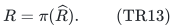

Then <code class="math">&#124;R&#124;\le&#124;\widehat R&#124;\le K(k,d)</code>.

## 5. Lifting solutions and projecting replacements

If <code class="math">S\in\mathcal F</code>, choose a matching of <code class="math">S</code> into <code class="math">W_i</code> in each truncated graph <code class="math">G'_i</code>; these exist by the truncation lemma. Combine the <code class="math">d</code> matching partners of each item into one tuple. The resulting <code class="math">\widehat S\subseteq V</code> has distinct owners and obeys every packing row in TR12, so it is feasible for the lifted SK instance. It has the same cardinality and profit as <code class="math">S</code>.

Conversely, any lifted feasible set has distinct owners by TR11. For each <code class="math">i</code>, its <code class="math">i</code>-th coordinates give a matching of those owners in <code class="math">G'_i</code>, by TR12. Its projection is therefore in <code class="math">\mathcal F</code>, with the same cardinality and profit.

To prove the stronger TR3 rather than only preservation of an optimum, fix an arbitrary original <code class="math">S\in\mathcal F</code> and <code class="math">e\in S</code>. Lift the entire <code class="math">S</code> using any of its truncated matching witnesses, and let <code class="math">v_e</code> be the tuple owned by <code class="math">e</code>. The SK guarantee gives

<!-- math-display: 008fdb921aae0adc4c9c0049
\widehat f\in\widehat R\setminus(\widehat S-v_e),\qquad
 \widehat c_{\widehat f}\ge\widehat c_{v_e},\qquad
             \widehat S-v_e+\widehat f\text{ is lifted-feasible}.
\tag{TR14}
-->
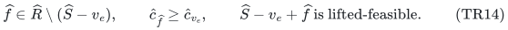

Set <code class="math">f=\pi(\widehat f)</code>. The distinct-owner condition in TR11 forces
<code class="math">f\notin S-e</code>, even when many tuples have the same owner. The lifted row conditions provide valid matchings after the replacement, while TR11 preserves the original resource independence. Thus

<!-- math-display: 55047f03224dd2a412f6f94f
c_f\ge c_e,\qquad S-e+f\in\mathcal F,
\tag{TR15}
-->
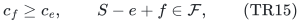

which proves TR3. The context <code class="math">S-e</code> is an arbitrary original context and need not be contained in <code class="math">R</code>. If <code class="math">f=e</code>, the conclusion is also valid, and means that another retained tuple has represented the same original item.

## 6. Complexity and useful interpretations

All preliminary operations are polynomial in the explicit bipartite graphs and rational input encoding. In the nontrivial branch, <code class="math">&#124;V&#124;&lt;n^2</code>. SK uses a safe cubic number of lifted independence queries, so a coarse bound for the original resource queries is

<!-- math-display: 6c363b3f1cee24c4198a10d2
O(n^6+n),
\tag{TR16}
-->
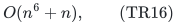

plus polynomial tuple processing; no effort is made to optimize this exponent. The exponent in this preprocessing bound is independent of <code class="math">d</code>. All threshold tests, stored tuples, greedy layers, and set-family scans use polynomial binary space.

For example, suppose a selected collection of items must be assignable injectively to eligible resources in each of several different bipartite systems, and must also be independent in an arbitrary resource matroid. The theorem retains <code class="math">O_d(k^{2d+1})</code> original items while preserving the exact best signed profit at every selected cardinality at most <code class="math">k</code>. Each assignment system in the returned instance needs only <code class="math">k</code> retained eligibility edges per retained item.

The theorem does not apply to an additional matroid merely because it is known abstractly to be transversal: the explicit bipartite representation is used to truncate and enumerate witnesses. It makes no claim that every laminar matroid has the representation required here. All original matroid and cardinality conditions remain part of the reduced problem.

## 7. Primary baseline and status of the increment

Huang, Kakimura, Kobayashi and Terao, *Polynomial Kernels with Reachability for Weighted d-Matroid Intersection*, arXiv:2603.17345v1, Theorem 3 and Section 4, gives a randomized reachable ground of size <code class="math">\widetilde O(k^{d+1})</code> when translated into this note's convention of <code class="math">d</code> additional transversal matroids. Its Section 4 lifts matching witnesses into a tuple ground with a parallel extension of the arbitrary resource matroid and simple partition constraints, then projects a kernel back to original items.

<https://arxiv.org/html/2603.17345v1>

That lift is an established ingredient, not a novelty claim of this note. The present deterministic consequence follows from SK, with the larger bound <code class="math">O_d(k^{2d+1})</code>. The neighborhood truncation and size-threshold branch above make the explicit implementation uniform in <code class="math">d</code>. This is a proved deterministic alternative with a larger output-size degree than the cited randomized construction; no first-ever or optimality assertion is made.

Dependencies: SK for deterministic sunflower thinning and the external-context greedy property; Hall's marriage criterion for TR6; ordinary matroid augmentation for TR11. The complete manuscript has undergone independent internal review, not formal verification or external peer review.
