# Sharp root-target lower bounds with disjoint weighted quota rows

**25 October 2026. Increment U. Complete manuscript-level proof with independent internal review.** It sharpens the constant-frequency endpoint of the sparse theorem to one nonroot row per coordinate. The hidden sparse-paving / SAT-decoder mechanism has public antecedents cited below; no priority claim is made for that mechanism.

## 1. Statement

Even with all of the following restrictions, exact feasibility requires
<!-- math-display: 209412d29527d8386afccc5e
2^{\Omega(B\log(B+2))}
-->
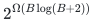
rank-oracle queries in the worst case:

- the resource is one ordinary matroid;
- the root row has unit weights and cap <code class="math">B_0</code>;
- every other quota row is an equality, the rows have disjoint supports, and each coordinate occurs in exactly one of them;
- coefficients and targets are nonnegative integers at most <code class="math">B</code>, with <code class="math">B=B_0+1</code>;
- there are no zero-root coordinates and the scalar objective is identically zero.

The result holds for mandatory bases and for optional independent sets. No objective or extra cardinality equality is needed in the optional case. The column frequency <code class="math">\Delta=1</code> counts an original equality as one row; splitting equalities into upper and lower inequalities doubles it to two and leaves the conclusion unchanged.

The same family has polynomially encoded, polynomial-time evaluable rank programs. Under deterministic ETH there is no deterministic
<!-- math-display: 5484c97f880af056d3a385fa
2^{o(B\log(B+2))}\mathrm{poly}(H)
-->
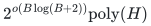
algorithm on that promised representation class. Randomized ETH is required separately for the corresponding randomized statement.

## 2. Explicit disjoint-row instance

Let <code class="math">d\ge2</code> be an integer and put <code class="math">k=2d</code>. The ground set is
<!-- math-display: 0ed0390dfff2bc35da9fa77e
E=\{(j,i):j\in[d],\ i\in[k]\}.
-->
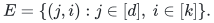
Thus <code class="math">&#124;E&#124;=dk=2d^2</code>. The root inequality is
<!-- math-display: 2daaa83b8d6d164af2cbbeba
\sum_{e\in E}x_e\le k.                                           \tag{DR1}
-->
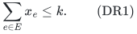
For every block <code class="math">j</code>, impose
<!-- math-display: 525034446d45e2ff99e17e90
\sum_{i=1}^{k} i\,x_{j,i}=k+1.                                  \tag{DR2}
-->
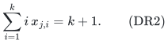
These <code class="math">d</code> nonroot rows are disjoint. Every column has root weight one and exactly one nonroot incidence. The maximum target is <code class="math">B=k+1</code>, while <code class="math">B_0=k</code>.

For each <code class="math">j</code>, the <code class="math">d</code> complementary pairs are
<!-- math-display: fff44cd00e024476ab7b5566
P_{j,t}=\{(j,t),(j,k+1-t)\},\qquad t\in[d].
-->
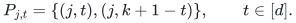
Let
<!-- math-display: 298c848240531d8f518def33
\mathcal H=
\left\{\bigcup_{j=1}^{d}P_{j,t_j}:
                     (t_1,\ldots,t_d)\in[d]^d\right\}.           \tag{DR3}
-->
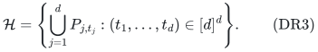
Then
<!-- math-display: 282734b347cf62cf8376751d
|\mathcal H|=d^d=(k/2)^{k/2}.                                   \tag{DR4}
-->
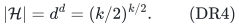

Any ordinary-matroid independent-set incidence vector satisfying DR1–DR2 uses at least two elements in each block, since one coefficient is at most <code class="math">k&lt;k+1</code>. There are <code class="math">d</code> blocks and the root cap is <code class="math">2d</code>, so it uses exactly two per block and exactly <code class="math">k</code> elements overall. Equality DR2 makes those two coefficients complementary. Consequently the sets satisfying the numeric rows are **exactly** <code class="math">\mathcal H</code>, whether the resource domain is a base or an optional independent set.

This argument uses the equality in DR2. Replacing it only by a covering inequality could admit overshooting pairs; no such pure-cover claim is made.

## 3. The resource is a valid sparse-paving matroid

Distinct members of <code class="math">\mathcal H</code> cannot differ by one exchange. Indeed, a cross-block exchange changes a positive block sum, and an exchange within one block changes its sum because all its coefficients are distinct. Equivalently,
<!-- math-display: dee765cd2479a63ba2f18779
A,A'\in\mathcal H,\ A\ne A'
 \quad\Longrightarrow\quad |A\cap A'|\le k-2.                    \tag{DR5}
-->
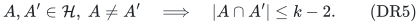

For an arbitrary subfamily <code class="math">\mathcal G\subseteq\mathcal H</code>, define allowed bases to be
<!-- math-display: 61cc9ad49e6fe41bc6d539da
\mathcal B_{\mathcal G}
 =\{S\subseteq E:|S|=k,\ S\notin\mathcal H\setminus\mathcal G\}.
                                                                    \tag{DR6}
-->
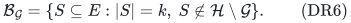
These are the bases of a rank-<code class="math">k</code> matroid <code class="math">M_{\mathcal G}</code>.

Here is a direct verification. For allowed bases <code class="math">X,Y</code> and <code class="math">e\in X\setminus Y</code>, if <code class="math">&#124;Y\setminus X&#124;=1</code>, the only exchange produces <code class="math">Y</code>, which is allowed. Otherwise there are at least two candidates <code class="math">X-e+f</code>, <code class="math">f\in Y\setminus X</code>. Any two share <code class="math">k-1</code> elements, so by DR5 at most one is forbidden. A valid exchange therefore exists. There are allowed <code class="math">k</code>-sets, and every set of size less than <code class="math">k</code> extends to one: for a <code class="math">(k-1)</code>-set, among its at least two one-element extensions at most one is forbidden; smaller sets first extend arbitrarily to size <code class="math">k-1</code>.

Its full rank function, for every query size, is
<!-- math-display: a876822b04643c4ce5ea239f
r_{\mathcal G}(S)=
\begin{cases}
 |S|,&|S|<k,\\
 k-1,&|S|=k,\ S\in\mathcal H\setminus\mathcal G,\\
 k,&\text{otherwise}.
\end{cases}                                                     \tag{DR7}
-->
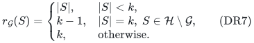
For <code class="math">&#124;S&#124;&gt;k</code>, an arbitrary <code class="math">(k+1)</code>-subset contains several mutually adjacent <code class="math">k</code>-subsets, at most one forbidden; hence its rank is <code class="math">k</code>, as asserted.

Since ordinary matroid singleton ranks are at most one, all integer resource vectors are zero-one. Combining Section 2 with DR6 gives
<!-- math-display: 83f2ce1659fd853d42e74a7f
\text{numeric-resource feasibility}\quad\Longleftrightarrow\quad
\mathcal G\ne\varnothing.                                      \tag{DR8}
-->
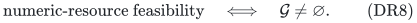

## 4. Oracle lower bound

Take the reference <code class="math">\mathcal G=\varnothing</code>, and for every <code class="math">A\in\mathcal H</code> the hidden instance <code class="math">\mathcal G=\{A\}</code>. The two rank oracles differ on exactly the set <code class="math">A</code>, and on no other subset of <code class="math">E</code>.

A deterministic decision algorithm must query every member of <code class="math">\mathcal H</code> along the reference transcript to certify infeasibility. On the promise that one hidden feasible set exists, an algorithm finding a feasible set requires at least <code class="math">&#124;\mathcal H&#124;-1</code> queries in the worst case.

For a bounded-error decision algorithm, consider the distribution that is reference with probability <code class="math">1/2</code>, and otherwise has a uniformly random hidden <code class="math">A</code>. With at most <code class="math">Q</code> queries, a deterministic algorithm encounters that distinguished set with probability at most <code class="math">Q/&#124;\mathcal H&#124;</code> on the hidden half. Its average success is therefore at most
<!-- math-display: 109f880ed4f9043ebdce15e0
\frac12+\frac{Q}{2|\mathcal H|}.
-->
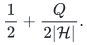
Yao's principle yields <code class="math">Q\ge&#124;\mathcal H&#124;/3</code> for worst-case success at least <code class="math">2/3</code>. Thus the oracle lower is
<!-- math-display: e0002aa2c53a76f6f2bbeb83
|\mathcal H|=2^{d\log_2 d}
            =2^{\Omega(B\log(B+2))}.                            \tag{DR9}
-->
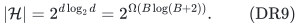

All explicit row data have size polynomial in <code class="math">B</code>. For arbitrary sufficiently large budget upper bounds <code class="math">b</code>, choose the largest even <code class="math">k\le b-1</code>; the same construction has <code class="math">B\le b</code> and exponent <code class="math">\Omega(b\log b)</code>. This is a worst-case statement over instances bounded by <code class="math">b</code>, not a requirement that every input have that complexity.

## 5. A readable rank program and ETH calibration

Let <code class="math">\varphi</code> be a 3-CNF formula with <code class="math">\nu</code> variables. Choose the least <code class="math">d\ge2</code> for which
<!-- math-display: 183a76df872bad084f966b80
d^d\ge2^\nu.                                                    \tag{DR10}
-->
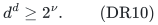
Set <code class="math">k=2d</code> and construct DR1–DR2.

Rank a tuple <code class="math">(t_1,\ldots,t_d)\in[d]^d</code> lexicographically using
<!-- math-display: fa9dee7e80218d2b1f9f00be
J(t_1,\ldots,t_d)
 =\sum_{j=1}^{d}(t_j-1)d^{d-j}\in[0,d^d-1].                     \tag{DR11}
-->
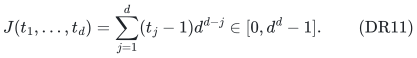
Define <code class="math">\mathcal G_\varphi\subseteq\mathcal H</code> by admitting its tuple if
<code class="math">J&lt;2^\nu</code> and the <code class="math">\nu</code>-bit binary expansion of <code class="math">J</code> satisfies <code class="math">\varphi</code>. Every <code class="math">\nu</code>-bit assignment occurs among these ranks. Therefore
<!-- math-display: 9804e569fc8af9d6f7177537
\mathcal G_\varphi\ne\varnothing
       \quad\Longleftrightarrow\quad \varphi\text{ is satisfiable}. \tag{DR12}
-->
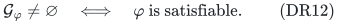

The rank program evaluates DR7. For a queried <code class="math">k</code>-set, it recognizes membership in <code class="math">\mathcal H</code> by checking the two complementary elements of each block. On such a set it computes DR11 and evaluates <code class="math">\varphi</code>; on all other query sizes or nonmembers of <code class="math">\mathcal H</code>, DR7 has an immediate answer. Each operation takes time polynomial in the input and formula length. The program always describes a matroid because Section 3 applies to every subfamily <code class="math">\mathcal G_\varphi</code>. Its computation can also be unrolled to a polynomial-size Boolean rank circuit, with the formula included in the representation.

Minimality gives, for <code class="math">d&gt;2</code>,
<!-- math-display: 1703f3a31fb1e1fb09bcbc1e
(d-1)\log_2(d-1)<\nu\le d\log_2 d.
-->
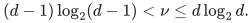
Furthermore
<!-- math-display: fd26f62fb3ccb55fd12bd46c
\frac{d^d}{(d-1)^{d-1}}
 =d\left(1+\frac1{d-1}\right)^{d-1}\le ed,
-->
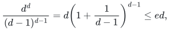
so
<!-- math-display: 0123b625ab5c72f76f6a299b
\nu\le d\log_2 d<\nu+\log_2(ed).
-->
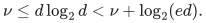
The finitely many small <code class="math">\nu</code> are harmless. In particular
<!-- math-display: 605aa020ba93d2fa42fc34ba
B\log(B+2)=\Theta(\nu),\qquad d=O(\nu),                           \tag{DR13}
-->
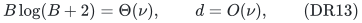
and the complete encoded target/resource instance has size polynomial in <code class="math">&#124;\varphi&#124;+\nu</code>.

A deterministic <code class="math">2^{o(B\log B)}\mathrm{poly}(H)</code> algorithm for this encoded problem would decide 3-SAT in <code class="math">2^{o(\nu)}\mathrm{poly}(&#124;\varphi&#124;)</code> time, contradicting deterministic ETH. The corresponding randomized conclusion requires randomized ETH, not deterministic ETH alone.

## 6. Relation to the upper bound and source credit

For fixed <code class="math">\Delta=1</code>, the direct sparse algorithm's bound
<!-- math-display: 1ceae624d788ccb6e3f622d2
2^{O(B\log(B+2))}\mathrm{poly}(H)
-->

has the correct exponent order in the oracle model, even though all nonroot rows have disjoint supports. The numeric coefficients create the obstruction; the lower should not be interpreted as a lower for the unit-coefficient disjoint-partition case, which has a different structure.

The construction is a disjoint-block specialization of the hidden exact-sum / sparse-paving technique used in earlier working notes. The public antecedents are substantive:

- Fomin, Golovach, Korhonen and Saurabh, [*Stability in Graphs with Matroid Constraints*, SWAT 2024](https://drops.dagstuhl.de/storage/00lipics/lipics-vol294-swat2024/LIPIcs.SWAT.2024.22/LIPIcs.SWAT.2024.22.pdf), Theorem 2, use a product of complement-pair choices in disjoint graph blocks and hide one rank-<code class="math">2p</code> stable set among <code class="math">q^p</code> candidates. Their underlying hidden family is precisely the pair-product family used here when <code class="math">p=q=d</code>. The present numeric rows encode those choices by disjoint weighted equalities and calibrate the root and maximum target.
- Doron-Arad, Kulik and Shachnai, [*Lower Bounds for Matroid Optimization Problems with a Linear Constraint*, arXiv:2307.07773v2](https://arxiv.org/html/2307.07773v2), develops exact-sum hidden families and, in Definitions 4.4–4.5 and Lemma 4.6, polynomially encoded SAT-matroid decoders.
- Their [*You (Almost) Can't Beat Brute Force for 3-Matroid Intersection*, arXiv:2412.02217v2](https://arxiv.org/html/2412.02217v2), Section 3, gives the general G-matroid margin construction.
- The ETH convention and sparsification framework are from Impagliazzo, Paturi and Zane, [*Which Problems Have Strongly Exponential Complexity?*, JCSS 63 (2001)](https://courses.cs.washington.edu/courses/cse599i/24sp/papers/ImpagliazzoPaturiZane_2001_jcss.pdf).

The new statement here is the explicit <code class="math">\Delta=1</code>, root-cap / maximum-target calibration, including optional pure feasibility and the readable-program exponent. It is proved in full rather than inferred as a priority claim from a literature gap.
