# Exact weighted prefix quotas parameterized by the largest target

**25 October 2026. Complete theorem and proof; full internal mathematical reviews completed for checkpoint T.**

The [native original-input client](../reference/README.md) now executes safe
preparation, actual occupied profiles and exact signed mandatory/optional
recovery. Its [realization proof](../reference-prefix-realization.md) gives
the original-subset LP and binary cost accounting, with finite Bland-simplex
time separate from the polynomial intersection primitive in this theorem.

With one common coordinate order and one common nonnegative integer weight per coordinate, exact mixed prefix quotas on a single global integral polymatroid can be solved in

<!-- math-display: 6451954fa8495dc2da74cdf5
\boxed{\exp(O(B))\mathrm{poly}(H),\qquad B=\max_j b_j,}
\tag{PX1}
-->
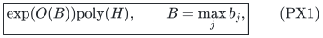

with polynomial binary workspace. The scalar objective is an arbitrary signed rational functional and is optimized exactly. Optional independent vectors and original-total bases are both covered. The sum of the prefix targets and the binary resource rank are not the parameter.

The exponent order is necessary for general rank oracles, even for weights in <code class="math">\{1,2,3,4\}</code>. Under deterministic ETH the same order is necessary for readable polynomial-time rank programs or polynomial-size rank circuits. These are distinct lower-bound models; neither is a hardness claim for graphic or matrix-represented resources.

This exact numeric-quota result does not resolve the polynomial-time constant-prefix-discrepancy conjecture discussed in Section 10.

## 1. Model and theorem

Let <code class="math">E=\{1,\ldots,n\}</code> have its given order. A normalized monotone integral polymatroid rank <code class="math">F</code> is available on this explicit ground. Integer vectors belong either to <code class="math">P(F)</code> or to the original base <code class="math">B(F)</code>, whose required total is <code class="math">R=F(E)</code>. Ranks and counts are binary encoded. Original eligibility restrictions are allowed.

There is one nonnegative integer weight <code class="math">w_e</code> per coordinate. Define

<!-- math-display: 19948c573a66650739979b05
W_p(x)=\sum_{e\le p}w_e x_e.
\tag{PX2}
-->
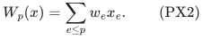

The explicitly listed quota rows are <code class="math">W_{p_j}(x)\,\rho_j\,b_j</code>, where each relation is independently chosen from <code class="math">\{\le,=,\ge\}</code>, and each target is a nonnegative integer. Put <code class="math">B=\max_j b_j</code>, with <code class="math">B=0</code> if there are no rows. All rows use the same weight vector and the same coordinate order.

An arbitrary rational scalar <code class="math">c^\top x</code>, with either sign permitted in <code class="math">c</code>, is minimized or maximized exactly. A threshold on this same scalar can be decided by the appropriate optimum. An additional unrelated unbounded scalar constraint is not included.

For <code class="math">B\ge1</code>, the proof gives the explicit bound

<!-- math-display: eb4c47b7654b9eb74408dc64
\exp\!\left(2\sqrt{2qL}\right)\mathrm{poly}(H),
\qquad q\le3B,\qquad L\le2B-1,
\tag{PX3}
-->
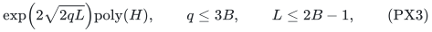

where <code class="math">q</code> is the actual number of nonempty auxiliary support colors defined below. In particular the exponential factor is at most <code class="math">\exp(4\sqrt3 B)</code>. Zero-target and zero-color cases are polynomial. This is an explicit upper estimate, not an optimal leading constant.

## 2. Prefix dominance and safe preparation

Split each equality into its upper and lower halves. At a duplicate endpoint retain the smallest upper target and largest lower target. Positive lower requirements on the empty prefix are infeasible; the remaining empty-prefix tests are immediate.

Nonnegative weights make <code class="math">W_p</code> nondecreasing in <code class="math">p</code>. Consequently:

- an upper row at a later prefix with no larger target dominates an earlier upper row;
- a lower row at an earlier prefix with no smaller target dominates a later lower row.

Retain the suffix-record minima of upper targets and the prefix-record maxima of lower targets. Along the prefix order, the remaining targets are strictly increasing in each family. Zero lower targets are automatic. A zero upper target forces every positive-weight coordinate in its prefix to zero; apply these masks and remove the now automatic row.

There are then <code class="math">u</code> positive upper rows and <code class="math">\ell</code> positive lower rows, with

<!-- math-display: 5980453ba4ff8c9467829bb2
u\le B,\qquad \ell\le B.
\tag{PX4}
-->
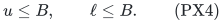

These record computations use only sorting and the given row list. They do not allocate an array indexed through <code class="math">B</code>. Dominated-row removal preserves the feasible set, including original equalities represented by their two halves.

Also mask a coordinate with <code class="math">w_e&gt;B</code> if it belongs to any original upper or equality prefix. Its positive integer use would violate that row. Do not mask it merely because it occurs in a lower row. Retain zero-weight coordinates: their resource mass and scalar contributions can matter.

For optional vectors, add a zero-weight, zero-scalar disposal coordinate after the original order, outside the original prefixes. Its rank is <code class="math">F(S)</code> on sets not containing disposal and <code class="math">R</code> on sets containing it. This exactly represents original independent vectors by completion to total <code class="math">R</code>. Mandatory bases receive no disposal. Masks retain the original required total in either prepared base representation; reject rank loss. Write <code class="math">F_0</code> for the prepared resource rank.

When <code class="math">B=0</code>, only the zero-upper masks remain and exact scalar optimization is polynomial. Assume <code class="math">B\ge1</code> below.

## 3. One charged active/passive lift

Set

<!-- math-display: fb304600d24ac621cb86c8ac
v_e=\min\{w_e,B\}.
\tag{PX5}
-->
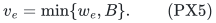

For every eligible coordinate occurring in an upper row, <code class="math">v_e=w_e</code> by the safe mask. A zero-weight coordinate needs only one passive copy. Each positive-weight coordinate receives active and passive copies. If no lower row remains, passive copies alone suffice.

Every copy retains the real scalar coefficient <code class="math">c_e</code>. The shared copied rank is

<!-- math-display: 72463f1093a0a90502900b1e
F^\uparrow(Y)=F_0(\pi(Y)),
\tag{PX6}
-->
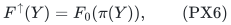

where <code class="math">\pi</code> forgets the copy label. This is a normalized monotone integral polymatroid rank: projection preserves unions, projected intersections are contained in intersections of projections, and submodularity and monotonicity give the rank inequality. Aggregation of copy counts is an exact equivalence of independent regions and original-total bases.

An upper prefix retains coefficient <code class="math">w_e</code> on both incident copies. A lower prefix has credited coefficient <code class="math">v_e</code> on incident active copies and zero on passive copies. Therefore every nonzero auxiliary column has the form

<!-- math-display: be8b4c8bccaf8094433397fe
v_e\,\mathbf1_A
\tag{PX7}
-->
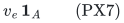

for a nonempty support <code class="math">A</code>. A single common magnitude within each column is where the common original weight vector is used.

True lower-prefix values dominate credited values. Upper-prefix and scalar values agree exactly after aggregation. Hence any feasible integer lifted point projects to an original feasible point of the same scalar value. A complete bounded family of lifted witnesses is established next.

## 4. A single marked prefix satisfies every lower quota

If lower rows remain, let <code class="math">C</code> be their largest target, so <code class="math">1\le C\le B</code>. Take any original feasible integer base, including a legitimate disposal completion in the optional case. Conceptually scan its positive-weight units in the fixed coordinate order, using their capped weights <code class="math">v_e</code>.

Capping at <code class="math">B</code> preserves every prefix lower demand at most <code class="math">B</code>. If a used unit in that prefix has weight at least <code class="math">B</code>, its capped contribution alone reaches the demand. Otherwise all its positive contributions are unchanged. This reasoning uses integer units; it is not asserted for arbitrary fractional vectors.

Mark the first-reaching positive prefix whose capped total reaches <code class="math">C</code>. It exists because the original prefix with target <code class="math">C</code> still reaches <code class="math">C</code> after capping. Assign marked units active copies and all other units passive copies. The marked mass obeys

<!-- math-display: 04085704cb95ec0ed607eb91
C\le W_{\rm active}\le C+B-1.
\tag{PX8}
-->
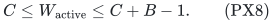

For any retained lower prefix, either the cut lies inside that prefix, so it receives all active credit and at least <code class="math">C</code>, or its entire positive-unit sequence precedes the cut, so none of its capped contributions was removed. Its credited quota is satisfied in either case. A cut partway through the last coordinate of a prefix belongs to the first case.

This marking is only a completeness proof. An output need not have a chronologically initial active set: credited feasibility already implies original feasibility. No unit sequence of length <code class="math">R</code> is materialized.

## 5. All nonzero auxiliary mass is at most twice the largest target

Let <code class="math">P_U</code> be the last retained upper prefix, if one exists. It contains every coordinate occurring in a retained upper row. Its true weighted mass in the witness is at most <code class="math">B</code>.

If the active cut is inside <code class="math">P_U</code>, every active nonzero copy lies there. Every passive nonzero copy also lies there, because passive copies have nonzero coefficients only in upper rows. Their combined mass is at most the original weighted mass of <code class="math">P_U</code>, hence at most <code class="math">B</code>.

If the cut is after <code class="math">P_U</code>, every positive-weight unit of <code class="math">P_U</code> is active. There is then no passive nonzero mass, and the total is the marked mass, at most <code class="math">C+B-1</code>. If no upper row exists, passive copies are all zero columns and this latter bound applies directly.

If no lower row exists, only passive copies are used and their nonzero mass is at most <code class="math">B</code>. Thus every original witness has a lifted representative satisfying

<!-- math-display: d064b5c21a65e6afe24d5ec4
\sum_{A,a}a h_{A,a}\le L,
\qquad L=B+\max\{C-1,0\}\le2B-1,
\tag{PX9}
-->
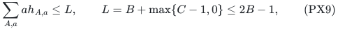

where <code class="math">C=0</code> when there are no lower rows, and <code class="math">h_{A,a}</code> counts columns equal to <code class="math">a\mathbf1_A</code>.

This is a bound on nonzero profile mass, not on the original resource rank. The common prefix order makes the cut comparable to the last upper prefix. Bounding the active and passive contributions separately would give the weaker valid allowance <code class="math">3B-1</code>.

## 6. Linearly many support colors

For active copies the support consists of all retained upper and lower prefixes containing the coordinate. Along the original order these supports form a chain and change only at retained endpoints. There are at most <code class="math">u+\ell</code> distinct nonempty active supports. Passive supports use only upper prefixes and have at most <code class="math">u</code> distinct nonempty values.

Let <code class="math">q</code> count the union of these actual support catalogues, merging duplicates. Then

<!-- math-display: 2d0fca74e7b1c7fbd7410234
q\le2u+\ell\le3B.
\tag{PX10}
-->
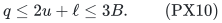

Different positive magnitudes on the same color remain separate classes <code class="math">(A,a)</code>, with <code class="math">1\le a\le B</code>. Only classes actually appearing on the at most two copies per original coordinate are stored. The algorithm does not generate a table of all <code class="math">qB</code> theoretical classes.

## 7. Colored partitions and exact recovery

Enumerate occupied-class multiplicities under PX9 and the total-count cap <code class="math">\sum h_{A,a}\le R</code>. One global zero-vector group receives the remainder. At a complete profile the value of every auxiliary prefix is the exact sum of <code class="math">a h_{A,a}</code> over colors containing that row. Test all upper and lower quotas.

For a profile that passes, prescribe its class totals through one partition-count polymatroid. Intersect this with <code class="math">F^\uparrow</code> and require total <code class="math">R</code>. The face is integral when nonempty. Every class cap is tight since the caps sum to <code class="math">R</code>. Exact scalar optimization gives an integer profile realization. An absent zero group with positive required remainder makes the face empty.

Every original feasible scalar value occurs by the canonical marking and PX9. Every lifted output aggregates to an original feasible vector of the same scalar. Taking the best value over the profiles therefore gives the exact original optimum and equivalent infeasibility reporting.

For the count, enlarge each of the <code class="math">q</code> colors to allow all positive integer magnitudes. The cumulative colored-partition count through <code class="math">L</code> satisfies, for every <code class="math">t&gt;0</code>,

<!-- math-display: 96bc99868c24c6a3427bea37
\begin{aligned}
\log P_q(L)
&\le tL+q\log\prod_{a\ge1}(1-e^{-ta})^{-1}\\
&\le tL+\frac{2q}{t}.
\end{aligned}
\tag{PX11}
-->
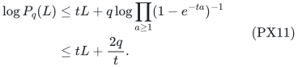

The second inequality follows by expanding the logarithm and bounding
<code class="math">\sum_{\ell\ge1}[\ell(e^{\ell t}-1)]^{-1}\le2/t</code>.
For positive <code class="math">q,L</code>, choose <code class="math">t=\sqrt{2q/L}</code>, obtaining

<!-- math-display: ae06ac0ecc630910fca4f809
P_q(L)\le\exp\!\left(2\sqrt{2qL}\right).
\tag{PX12}
-->
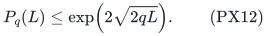

If <code class="math">q=0</code>, there is just the zero profile. Equations PX9–PX12 prove the stated time bound.

## 8. Failed inputs, zero cases and binary workspace

A next count in the streamed traversal is bounded by the remaining mass divided by its positive magnitude and by the remaining resource total. Every partial state extends by zero counts on the remaining nonzero classes. At a fixed depth distinct states yield distinct such completions within the mass cap. Thus every failed final quota filter and every empty integral face is charged by occupied depth times the colored-partition bound.

Store only one binary count vector, one global zero remainder, and one integral-intersection subproblem. The ground has at most two copies per coordinate. Retained rows are a sublist of the input rows, and all counts, masses and ranks are binary. Sorting, safe masks, weight capping and support computation are polynomial operations on the explicit input.

There is no rank-sized expansion, target-sized array or stored catalogue. Zero-weight coordinates remain available with their actual scalar costs. Rank-zero instances with a positive lower target fail the same filters. Target-zero instances are settled by preparation and ordinary scalar optimization.

## 9. Sharp oracle and encoded-ETH lower bounds

Take <code class="math">d</code> consecutive four-element blocks, with common weights <code class="math">1,2,3,4</code> within each block. At the end of block <code class="math">j</code>, impose

<!-- math-display: ec84eed910c9d5bb8a786622
W_{4j}(x)=5j,\qquad j=1,\ldots,d.
\tag{PX13}
-->
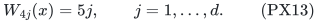

The largest target is <code class="math">B=5d</code>; the sum of targets is <code class="math">5d(d+1)/2</code>. Subtracting consecutive equalities forces weight five in every block. On subsets, the only choices in a block are <code class="math">\{1,4\}</code> and <code class="math">\{2,3\}</code>. The complete equality family <code class="math">\mathcal H</code> has <code class="math">2^d</code> members, all of size <code class="math">r=2d</code>.

No two members are one-exchange neighbors. Declare all sets smaller than <code class="math">r</code> independent and all rank-sized sets outside <code class="math">\mathcal H</code> bases. This is the reference paving matroid. Relax one hidden <code class="math">A\in\mathcal H</code>. Validity follows from the augmentation argument: among two candidate additions to an <code class="math">(r-1)</code>-set, at most one resulting rank-sized set is forbidden.

The two rank oracles differ only on <code class="math">A</code>. Below rank they return cardinality; above rank a query contains neighboring rank-sized subsets and therefore a reference basis. The reference prefix instance is infeasible, while the hidden one has its unique hidden feasible set. This holds for independent sets and bases, since the equalities already force cardinality <code class="math">r</code>.

The balanced reference/hidden distribution shows that success at least two thirds with <code class="math">Q_{\rm queries}</code> worst-case rank queries requires

<!-- math-display: 9f29834656d4d0cb08a1d4c0
Q_{\rm queries}\ge2^d/3=2^{\Omega(B)}.
\tag{PX14}
-->
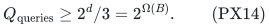

For the conditional computational version, given a 3-CNF formula on <code class="math">\nu</code> variables, put <code class="math">d=\nu</code> and use the two block choices as assignment bits. Admit a member of <code class="math">\mathcal H</code> exactly when its assignment satisfies the formula, retaining all other rank-sized sets and all smaller sets. Every forbidden subfamily remains nonadjacent, so this is a valid matroid for every formula.

The full rank evaluator returns cardinality below rank, full rank above rank, and full rank on rank-sized sets outside <code class="math">\mathcal H</code>. On a member of <code class="math">\mathcal H</code>, it evaluates the one decoded assignment and returns <code class="math">r</code> or <code class="math">r-1</code>. This is polynomial-time and can be unrolled to a polynomial-size rank circuit. An algorithm may read the full program and formula.

Prefix feasibility is equivalent to satisfiability, and

<!-- math-display: cc465104493eee15d3267574
B=5\nu,\qquad H=\mathrm{poly}(\nu+|\phi|).
\tag{PX15}
-->
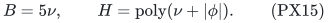

Deterministic ETH therefore excludes a deterministic <code class="math">2^{o(B)}\mathrm{poly}(H)</code> exact algorithm in this encoded-rank model. Randomized algorithms require randomized ETH separately. The unconditional query bound PX14 already allows bounded-error randomized decision.

These constructions use one global paving resource, not a graphic resource. They also exhibit a strict improvement in the parameter analysis over replacing the largest prefix target by the sum of all cumulative targets. No optimal leading constant is claimed.

## 10. Primary baseline and distinction from discrepancy

Berczi, Liu, Reis and Tarnawski, *Weighted Equitability and Matroid-Constrained Discrepancy*, arXiv:2608.13983v1 (14 August 2026), Section 6, formulates constant-error prefix-basis conjectures relative to a supplied fractional basis. Its Theorem 14 proves an <code class="math">O(\log n)</code> times largest-weight discrepancy guarantee with no cost increase. It also proves special constant-one cases for binary weights and uniform matroids. The primary text was directly checked:

<https://arxiv.org/html/2608.13983v1>

The present theorem takes exact integer quota inputs and is exponential in their largest numeric target. It does not assert constant discrepancy from every fractional basis or a polynomial-time solution to those conjectures. Exact integer feasibility can fail when the associated fractional prefix equations are feasible.

Count-profile/partition-intersection and selected-subfamily paving constructions have primary antecedents recorded in the earlier numeric notes:

<https://arxiv.org/html/2404.03747v2>

<https://arxiv.org/html/2307.07773v2>

<https://arxiv.org/html/2412.02217v2>

The ETH convention is the deterministic variable-count subexponential assumption for 3-SAT, as in the IPZ framework:

<https://courses.cs.washington.edu/courses/cse599i/24sp/papers/ImpagliazzoPaturiZane_2001_jcss.pdf>

This bounded comparison does not establish publication priority, and none is claimed.

## 11. Scope boundaries

The algorithm uses one coordinate order and one common nonnegative integer weight vector. Different weights on different prefix rows, signed numeric weights, unrelated additional resource ranks, or arbitrary sets instead of prefixes are outside PX1. The actual scalar may be signed because its contributions remain on all copies.

Rational weights and targets on an explicitly chosen common grid can be scaled, giving dependence on the largest normalized integer target. This numeric quantity, rather than its bit length or an approximation-error parameter, controls the exponential factor.
