# Joint lower bounds for prefix targets and weight-family count

**25 October 2026. Complete joint construction; full internal mathematical reviews completed for checkpoint T.**

The upper theorem in [few-weight-families-prefix-target-scheme.md](few-weight-families-prefix-target-scheme.md) gives

<!-- math-display: 5cfb69e001e3aa3df1910782
2^{O(pB\log(p+2))}\mathrm{poly}(H)
 \tag{FJ1}
-->
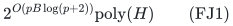

time and uniform polynomial binary space for one common coordinate order, p nonnegative integer weight families, largest target B, one global integral polymatroid, and exact signed scalar optimization.

The present separate increment strengthens that manuscript's two endpoint obstructions. For **every even p>=4 and every integer B>=1**, there is an ordinary matroid rank-oracle family with exactly those parameters and candidate count

<!-- math-display: 0a30a48a9ac6f5ca2d2db456
N=((p-1)!!)^{B}
                       =2^{\Theta(pB\log(p+2))}.
 \tag{FJ2}
-->
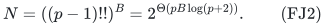

Exact feasibility requires at least N/3 worst-case rank queries for randomized algorithms with success probability at least two thirds on every instance. All scalar coefficients may be zero, all family weights are zero or one, and the explicit non-oracle data have polynomial size in p and B. Both mandatory bases and optional integer independent sets are covered.

A separate uniform rank-program/circuit reduction gives an ETH exclusion along explicitly calibrated joint parameter families. Budget envelopes extend the oracle classification beyond even exact family counts. No pointwise encoded-ETH assertion for arbitrary prescribed numerical pairs is made.

## 1. Reuse the same families across consecutive graph blocks

Fix even p>=4 and B>=1. Form B disjoint labeled copies of K_p. The ground has one coordinate (b,e) for every block b in [B] and edge e in its copy, so

<!-- math-display: 88402626aab9c3701d887086
n=B\binom p2,
                    \qquad r=Bp/2.
 \tag{FJ3}
-->
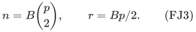

Give the ground one order listing entire blocks consecutively; the order inside each block is arbitrary and fixed. For each vertex label i in [p], use the weight family

<!-- math-display: 15b6d8c8bb5b66ece0cc89f0
w^i_{(b,e)}=\mathbf1[i\in e].
 \tag{FJ4}
-->
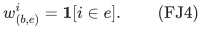

The same vector is used for all prefixes assigned to family i. Vertex labels are reused across blocks, rather than creating a new family for each block. These p vectors are genuinely distinct, as the incidence patterns of different vertices in K_p differ.

At the end of block j impose, in every family i, the equality

<!-- math-display: c6023fe77dc2bd90ee440d34
\sum_{b\le j}\sum_{e\in E(K_p)}w^i_{(b,e)}x_{(b,e)}=j,
                \qquad i\in[p],\quad j\in[B].
 \tag{FJ5}
-->
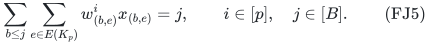

The largest target is exactly B. There are pB rows, all on prefixes of the same coordinate order. The target sum is pB(B+1)/2; the maximum, rather than this sum, is the parameter in FJ1. Every family coefficient belongs to {0,1}.

For a subset of the edge ground, subtracting consecutive equalities in FJ5 gives degree one at every vertex label in each individual block. Hence the equality-feasible subsets are exactly the products of one perfect matching in each block. Write this family as H. It has

<!-- math-display: 067d11a768c91fb22d03d3c1
|H|=((p-1)!!)^{B}=N.
 \tag{FJ6}
-->
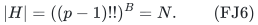

Every member has precisely p/2 edges per block and therefore total cardinality r. This cardinality follows from the equality rows themselves; no extra cardinality row, target, or scalar budget is introduced. It will make the optional and mandatory formulations equivalent on the lower construction.

## 2. Stability despite repeated local edge labels

Every full coefficient column in FJ5 is distinct. Within one block, different edges have different endpoint-incidence vectors. For coordinates in different blocks b<b', a prefix ending at block b sees the earlier coordinate and not the later one; choose either endpoint family of the earlier edge to distinguish their columns.

All members of H have the same full target vector. Replacing one selected coordinate by a different one would preserve that vector only if their full columns were identical, which they are not. Therefore distinct members of H are not single-element-exchange neighbors.

This is the key point for reusing p weight families across all B blocks. It is the cumulative prefix rows, rather than the repeated local weight labels alone, that prevent a cross-block exchange from preserving feasibility.

## 3. One global reference and hidden matroid

Declare every subset of size less than r independent. At size r, the reference matroid permits exactly the sets outside H. For a hidden A in H, additionally permit A. More generally, any chosen subfamily of H can be permitted at rank.

These are matroids. Heredity is immediate. In augmentation, the only nontrivial case has an independent (r-1)-set I and an independent r-set J. If J minus I contains just one element, adding it yields the known independent set J. With at least two candidates, the resulting r-sets share I and are exchange neighbors, so at most one is forbidden. An independent augmentation exists.

The rank is indeed r. Begin with a product of perfect matchings and, in its first block, replace edge {1,2} by {1,3} while retaining matching edge {3,4}. The resulting r-subset is not in H and is a reference base. Such a block exists because p>=4.

The reference and hidden rank oracles differ only on A. Their complete rank rules are

<!-- math-display: c4c61403c4bb77e99c4dfbab
\mathrm{rank}(S)=
 \begin{cases}
 |S|,&|S|<r,\\
 r,&|S|>r,\\
 r,&|S|=r,\ S\notin H,\\
 r-1,&|S|=r,\ S\in H\text{ and not permitted},\\
 r,&|S|=r,\ S\in H\text{ and permitted}.
 \end{cases}
 \tag{FJ7}
-->
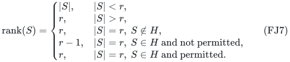

The above-rank case is valid because a set larger than r contains two adjacent r-subsets, at least one of which lies outside any forbidden subfamily of H. This also shows why a general rank query outside the hidden point supplies no extra information in the singleton-hidden construction.

There is one global resource matroid across all blocks. It is not a direct sum of B independently hidden matroids, which would have a different information bound.

The reference quota instance is infeasible. With one hidden candidate A permitted, its unique feasible solution is A. Since FJ5 forces cardinality r even without a base requirement, this conclusion holds over integer independent sets and over bases. Use scalar zero throughout.

## 4. Rank-query count and explicit input size

Consider the balanced distribution giving probability one half to the reference and one half to a uniformly chosen hidden instance. Follow a deterministic algorithm's reference transcript. At most D queries can equal D candidate sets, and all unqueried hidden inputs give the same transcript as the reference. Its success probability is at most

<!-- math-display: 051340f37ee6da93e6dc03c0
\frac12+\frac{D}{2N}.
 \tag{FJ8}
-->
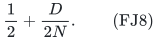

Averaging over internal random coins preserves this estimate for an algorithm with at most D worst-case queries. Success at least two thirds on every instance therefore implies

<!-- math-display: b3196d8a9603a060eba484b5
D\ge N/3.
 \tag{FJ9}
-->
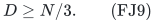

Elementary double-factorial bounds give, uniformly for even p>=4,

<!-- math-display: a1e396384b8d986c940de66f
\log_2((p-1)!!)=\Theta(p\log_2(p+2)).
 \tag{FJ10}
-->
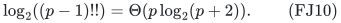

For example, when p>=8 at least floor(p/4)>=p/8 factors are at least p/2. This gives a lower bound (p/16)log_2 p. The finite cases p=4,6 satisfy an adjusted absolute constant. The upper bound follows by using at most p/2 factors each at most p. Combining FJ6, FJ9 and FJ10 gives the joint exponent in FJ2, with constants independent of p and B. The explicit N/3 formula also covers small constant cases without asymptotic conventions.

The ground has B binomial(p,2) elements. The p-vector weight table has O(Bp^3) binary entries, and the pB prefix rows have integer targets and endpoints of polynomial bit length. Even a fully expanded row matrix has polynomial size in (p,B). The common rank r also has polynomial bit length. Thus the exponential query bound is not absorbed by an exponentially large non-oracle encoding.

The hidden rank itself is accessed as an oracle in this section. The hidden candidate is not supplied as a readable string from which an algorithm could extract it. The next sections use a different, explicitly encoded representation and a conditional computational assumption.

## 5. Uniform joint calibration for an encoded reduction

Use deterministic ETH in its variable-count form: 3-SAT on nu variables has no deterministic 2^{o(nu)} poly(|phi|) algorithm. A randomized exclusion would require randomized ETH separately.

Given a 3-CNF formula phi on nu>=1 variables, choose an admissible even p>=4 and define

<!-- math-display: ec677bc43a8f0354fe09f319
A_p=(p-1)!!,
 \qquad a_p=\lfloor\log_2 A_p\rfloor,
 \qquad 1\le a_p\le2\nu,
 \qquad B=\left\lceil\frac{\nu}{a_p}\right\rceil.
 \tag{FJ11}
-->
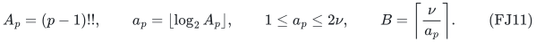

The reduction is uniform and polynomial-time for any such p supplied to it, or chosen by a polynomial-time rule. Its admissibility is checked using exact integer products and binary length; real logarithm computation is unnecessary. In particular p=4 is always an admissible choice. Larger admissible choices and intermediate choices give the calibrated joint regimes.

The ceiling gives

<!-- math-display: 96d5b0e62f786153ce45f23c
\nu\le B a_p<\nu+a_p\le3\nu.
 \tag{FJ12}
-->
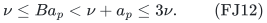

Since log_2 A_p>=1, its integer floor is within a constant factor of it. By FJ10,

<!-- math-display: 5db3c546e179079b75abb2c3
a_p=\Theta(p\log(p+2)),
              \qquad pB\log(p+2)=\Theta(\nu),
 \tag{FJ13}
-->
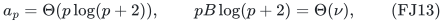

uniformly over every admissible choice of p. Moreover

<!-- math-display: 989cabb45b9cb7059af687ca
\log_2(A_p^B)<B(a_p+1)
                         \le2B a_p\le6\nu.
 \tag{FJ14}
-->
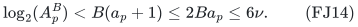

All product ranks therefore fit in O(nu) bits. The simple inequality A_p>=2^{p/2-1} implies p<=2(a_p+1)<=4nu+2, and B<=nu. Thus the entire explicit ground, weight table, prefix-row list and parameter computation are polynomial in the formula size. The stronger relation in FJ13 also bounds pB by O(nu).

This is a calibrated-family statement: B is chosen by FJ11 in the encoded reduction. It does not prescribe an arbitrary independent pair (p,B) and assert ETH hardness at that exact pair.

## 6. Polynomial product-matching ranking

At an ordered set of m remaining vertices, m even, take its smallest vertex and order its possible partners increasingly. Each partner choice leaves exactly A_(m-2)=(m-3)!! residual matchings. If the chosen partner has zero-based index j, set

<!-- math-display: 6ce76e6f3a853efff504e502
\mathrm{rank}_m(M)
       =j A_{m-2}
         +\mathrm{rank}_{m-2}(M\text{ after removing that edge}).
 \tag{FJ15}
-->
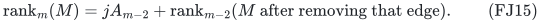

Use A_0=1 and empty matching rank zero. Induction on m proves a bijection from the A_p block matchings to integers 0,...,A_p-1. Ranking and inverse ranking use polynomially many operations on the bounded-length integers.

For a product of B block matchings with ranks j_1,...,j_B, use the mixed-radix rank

<!-- math-display: 6090513b14ce0e9f6ec3fe00
J=\sum_{b=1}^B j_b A_p^{b-1}.
 \tag{FJ16}
-->
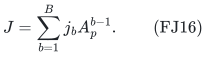

This is a bijection from H to 0,...,A_p^B-1. Recognition of H, its product rank, and its inverse all take polynomial time. They do not enumerate H. Equation FJ14 bounds all arithmetic sizes.

Call a product matching accepted when J<2^nu and the nu binary digits of J satisfy phi. All assignments occur because A_p^B>=2^nu. Ranks outside this initial range are rejected. Decoding and checking one specified assignment are polynomial operations.

## 7. A valid readable resource for every formula

Permit every set smaller than r, every nonmatching-product r-set, and exactly the accepted matching products at rank. Every forbidden subfamily of H is nonadjacent, so the augmentation and full-rank arguments in Section 3 prove that this is a matroid for every formula. No uniqueness-of-solution promise is used.

The rank decoder implements FJ7. Below rank, above rank and on nonmatching rank-sized sets its answers are immediate. Only on an element of H does it compute FJ16 and evaluate the acceptance predicate. This is polynomial time on the explicit subset indicator and the supplied formula. Bounded-loop unrolling produces a polynomial-size Boolean circuit computing the exact rank. The whole program or circuit, including the formula, is part of the input and may be inspected by the algorithm.

The prefix equalities are feasible if and only if an accepted product matching exists, which is equivalent to satisfiability of phi. Together with FJ13, this proves that a uniform exact algorithm with running time

<!-- math-display: 8e5c26fcc6b4680fbd0159ef
2^{o(pB\log(p+2))}\mathrm{poly}(H)
 \tag{FJ17}
-->
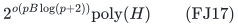

on all these encoded-rank inputs would contradict deterministic ETH. The same reduction for a bounded-error randomized algorithm requires randomized ETH to exclude the resulting randomized subexponential SAT algorithm.

The representation is a promised valid rank program or rank circuit, not an arbitrary unverified circuit, and not a matrix or graphic representation. Its validity is proved by the reduction. The oracle lower bound and this conditional encoded-input bound have distinct interpretations and are not substituted for one another.

## 8. A matching worst-case parameter-budget envelope

Let P>=1 and L>=1 be upper budgets on the number of families and the largest target, respectively. FW1 immediately gives the monotone upper envelope

<!-- math-display: 6ad246e0083d47cf9a596fcf
2^{O(PL\log(P+2))}\mathrm{poly}(H).
 \tag{FJ18}
-->
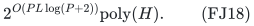

For P>=4, choose p=2 floor(P/2) and B=L in the oracle construction. Then p<=P and p>=3P/4. Also log(p+2) is within an absolute constant factor of log(P+2). Hence this budget class contains polynomial-size oracle instances requiring

<!-- math-display: 831dfb9eace1fcf221981065
2^{\Omega(PL\log(P+2))}
 \tag{FJ19}
-->
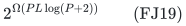

queries as the budget expression grows. No padding to an exact odd family count is necessary.

For P in {1,2,3}, use the one-family lower construction with t=floor(L/5) blocks of weights 1,2,3,4 and cumulative equalities 5j. For L>=5 it has actual largest target 5t<=L, one family, and at least 2^t hidden candidates. Since t>=L/10 and P log(P+2) is bounded above and below by absolute positive constants in this range, it gives the same exponential order as FJ19. The finitely many cases P<=3 and L<5 have bounded budget expression and carry no asymptotic distinction.

Therefore the worst-case rank-oracle exponent for parameter upper budgets is Theta(PL log(P+2)), with polynomial-size explicit non-oracle data. This is a budget-envelope classification. The exact-parameter construction asserted here is the even-p grid in FJ2; no exact odd-p representation is forced. Nor does this budget statement upgrade FJ11's ETH calibration to every arbitrary prescribed numerical pair.

## 9. Dependencies, primary antecedents and interpretation

The upper theorem is the separately reviewed [few-weight-families-prefix-target-scheme.md](few-weight-families-prefix-target-scheme.md). This note leaves that proof stable and strengthens its initially stated endpoint lower bounds. The disjoint-clique matching and mixed-radix decoder are the same elementary ingredients proved in [encoded-overlap-density-eth-lower-bound.md](../../numeric-target-frontier/manuscripts/encoded-overlap-density-eth-lower-bound.md) and [conditional-lower-bound-encoded-target-matroids.md](../../numeric-target-frontier/manuscripts/conditional-lower-bound-encoded-target-matroids.md). The new parameter organization reuses exactly p incidence weight families across B cumulative-prefix stages.

Selected acceptable families in paving-type matroids have established primary antecedents, including Doron-Arad, Kulik and Shachnai, *You (Almost) Can't Beat Brute Force for 3-Matroid Intersection*, arXiv:2412.02217v2, Section 3:

<https://arxiv.org/html/2412.02217v2>

The same authors' *Lower Bounds for Matroid Optimization Problems with a Linear Constraint*, arXiv:2307.07773v2, Definitions 4.4–4.5 and Lemma 4.6, explicitly constructs SAT-encoded matroid decoders. Those primary passages were directly checked for the encoded-representation comparison:

<https://arxiv.org/html/2307.07773v2>

No first paving, product-matching or encoded-matroid hardness framework is claimed. The result is the joint maximum-target/family-count calibration and its exact fit to the prefix upper theorem. It does not concern the retired general-matching exponent or imply a lower bound for restricted explicit resource classes.
