# Exact common-weight laminar quotas under a root cap

**25 October 2026. Complete incremental proof; full internal mathematical reviews completed for checkpoint T. The stronger arbitrary-zero-cost version is in [laminar-valuated-zero-completion-fpt.md](laminar-valuated-zero-completion-fpt.md).**

This note gives a deterministic algorithm parameterized solely by the root weighted cap, with no exponential dependence on the number of laminar nodes. It uses one global integral polymatroid and preserves one rational scalar objective exactly. Strictly positive common weights are covered without a scalar-sign restriction. Zero-weight coordinates are also covered when they have scalar zero in an optional problem, or one common scalar coefficient in a mandatory-base problem. The latter restriction is substantive and is kept explicit.

The proof uses a bounded-depth representative recursion adapted from Huang and Ward's joint-representative method. It proves the needed restricted lemma directly. It does not assert integrality of three matroid or polymatroid constraints.

## 1. Model and theorem

Let <code class="math">F:2^E\to\mathbb Z_{\ge0}</code> be a normalized, monotone, integral submodular rank function on an explicit coordinate ground. The resource is either the integer independent-set polytope <code class="math">P(F)</code>, or the integer base polytope with original total

<!-- math-display: 9105a820ab814277fc4ad1a5
x(E)=R=F(E).
\tag{LM1}
-->
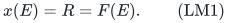

Eligibility restrictions and binary coordinate domains may be prepared using restriction and the standard box-cap rank formula. In the mandatory case, all preparations retain the original <code class="math">R</code>; a preparation whose maximum rank falls below <code class="math">R</code> is rejected. Below, <code class="math">F</code> denotes the resulting rank on the allowed ground, so its full rank is still <code class="math">R</code> in every nonrejected mandatory instance.

Let <code class="math">\mathcal L</code> be an explicitly represented laminar family. Each coordinate has one common nonnegative integer weight <code class="math">w_e</code>. Every numeric row uses that same weight:

<!-- math-display: 1eb6ba9d40f87c289a404063
l_A\le\sum_{e\in A}w_ex_e\le u_A,
                       \qquad A\in\mathcal L.
\tag{LM2}
-->
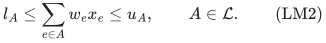

An absent lower bound means zero, an absent upper bound means infinity, and an equality uses equal bounds. All finite bounds are nonnegative integers. There is an explicit root upper bound

<!-- math-display: 75ce0887109b16374165a591
\sum_{e\in E}w_ex_e\le B.
\tag{LM3}
-->
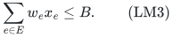

The root can additionally have a lower bound, including equality to <code class="math">B</code>. Let <code class="math">c\in\mathbb Q^E</code> be the scalar coefficient vector; either minimize or maximize <code class="math">c\cdot x</code> exactly. Thus an exact bound on this one scalar can also be decided by optimizing in its required direction. No additional independent scalar budget is included.

Put <code class="math">Z=\{e:w_e=0\}</code>. The theorem assumes one of the following:

* <code class="math">Z=\varnothing</code>, with arbitrary signed rational <code class="math">c</code>;
* the resource is optional and <code class="math">c_z=0</code> for every <code class="math">z\in Z</code>;
* the resource is mandatory and <code class="math">c_z=\gamma</code> for one common rational <code class="math">\gamma</code> and every <code class="math">z\in Z</code>. The common value may have either sign.

Let <code class="math">H</code> be the full binary input size, including the explicit laminar family, numbers, and the rank-oracle encoding/bit bounds. Polynomial-time rank evaluation, submodular minimization, and standard integral polymatroid operations are charged.

**Theorem.** Under these assumptions, feasibility and exact scalar optimization can be solved deterministically in

<!-- math-display: 36e66f5c8467215f47433ecc
2^{O(B^2\log(B+1))}\mathrm{poly}(H)
\tag{LM4}
-->
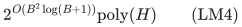

time and uniform polynomial binary workspace. Counts and ranks are not expanded in proportion to their binary numerical values when that would violate the space bound. The number of laminar nodes affects the polynomial factor only. The case <code class="math">B=0</code> is polynomial.

## 2. Safe preparation and the two dominance reductions

Zero-weight coordinates contribute nothing to every numeric row. Project the numeric sets onto the surviving positive-weight ground <code class="math">P=E\setminus Z</code>, merge identical sets, and retain the strongest lower and upper bounds. Projecting a laminar family preserves laminarity. Empty positive lower rows are infeasible; empty upper rows are automatic.

Every lower target exceeding <code class="math">B</code> is infeasible, and an upper target exceeding <code class="math">B</code> can be clipped to <code class="math">B</code>, because of the root. A positive-weight coordinate is ineligible if it is a resource loop or if <code class="math">w_e&gt;u_A</code> for some upper-bounded set <code class="math">A</code> containing it. In particular <code class="math">w_e&gt;B</code> is ineligible. Since counts are integral, even one unit of such a coordinate violates a row. Remove these coordinates, repeat the elementary merging of rows, and check the original total in a mandatory problem. A zero upper bound removes all its positive-weight coordinates. This preparation is polynomial and does not discard any feasible integer vector.

For the upper bounds, discard a set's upper row whenever an ancestor has an upper bound no larger. After this dominance reduction, upper bounds strictly increase up any retained inclusion chain. Every retained nonempty upper has capacity in <code class="math">\{1,\ldots,B\}</code>, so the upper forest has depth

<!-- math-display: a58dc0b951eb4deab843c103
D\le B.
\tag{LM5}
-->
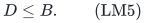

The root is retained, with its strongest bound. This does **not** bound the number of upper nodes. For example, arbitrarily many disjoint upper-one blocks may occur below a root of capacity two. The proof below never enumerates one occupancy choice per such block.

For lower bounds, use the inclusion forest of the lower-row sets, with a
dummy root of lower bound zero. At each node <code class="math">A</code>, let its children be the
maximal proper lower-row subsets, and compute bottom-up

<!-- math-display: 537f0798d06f9e4e78aa201d
q_A=\max\left\{l_A,\sum_{C\text{ child of }A}q_C\right\}.
-->
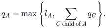

The children are disjoint. Hence every feasible nonnegative mass vector
has mass at least <code class="math">q_A</code> in <code class="math">A</code>, by induction. Reject if the dummy-root
value exceeds <code class="math">B</code>. A row <code class="math">A</code> is redundant whenever
<code class="math">l_A\le\sum_Cq_C</code>, because the children's constraints imply it. Delete
exactly those redundant lower rows; retained descendants still imply the
same <code class="math">q_A</code> by induction, so all original lower constraints are preserved.

Every retained node has a positive integer charge
<code class="math">q_A-\sum_Cq_C\ge1</code>; every deleted node has charge zero. Summing these
charges telescopes to the dummy-root value, at most <code class="math">B</code>. Consequently

<!-- math-display: 263caf8055f88c85c7477358
m_-:=\#\{\text{retained lower rows}\}\le B.
\tag{LM6}
-->
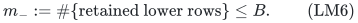

There are at most <code class="math">m_-+1</code> distinct lower-row membership patterns of coordinates. Indeed, a nonempty membership pattern is determined by its deepest containing lower set; its other containing lower sets are precisely that set's ancestors. The empty pattern supplies the additional class.

Upper and lower dominance are applied independently, including when they came from an equality. All discarded rows remain consequences of retained rows. Therefore preserving every retained lower row and satisfying every retained upper row suffices for the original instance.

## 3. Natural matroids on bounded positive copies

For the moment suppose positive units are explicitly represented. For each positive coordinate <code class="math">e</code>, make

<!-- math-display: 728fe720389aac58dc6b6484
b_e=\min\{F(\{e\}),\lfloor B/w_e\rfloor\}
\tag{LM7}
-->
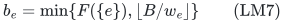

distinct conceptual copies. Let <code class="math">U</code> be this positive-copy ground and <code class="math">U_A</code> the copies owned by coordinates in <code class="math">A\subseteq P</code>. For <code class="math">S\subseteq U</code>, write <code class="math">x_S(e)</code> for its number of copies of <code class="math">e</code>.

The natural matroid <code class="math">M</code> has rank

<!-- math-display: 1d13a4a97e635545a5550422
r_M(S)=\min_{A\subseteq P}
                     \bigl(F(A)+|S\setminus U_A|\bigr).
\tag{LM8}
-->
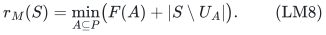

Thus <code class="math">S</code> is independent exactly when <code class="math">x_S\in P(F&#124;_P)</code>. This is the standard natural-matroid rank of an integral polymatroid with bounded copies. Each query is a submodular minimization over the original coordinate ground, with the selected copy counts as modular coefficients. Copies are distinguishable for replacement arguments, while their resource effects depend only on their owner counts.

Every root-feasible vector contains at most <code class="math">B</code> positive units. Its coordinates satisfy LM7, so it has a representation by a set <code class="math">S\subseteq U</code> of size at most <code class="math">B</code>. Conversely, each such independent set represents its integer resource-feasible positive vector. Section 9 implements this interface in polynomial binary space without assuming that numerical <code class="math">B</code> is polynomial in its encoding.

## 4. Exact completion through zero-weight coordinates

In an optional problem with scalar-zero <code class="math">Z</code>, simply set those coordinates to zero. Downward closure proves that this preserves every feasible positive vector and its scalar value. No completion matroid is needed.

In a mandatory problem, let

<!-- math-display: c0df73c4e42126a414150d5b
g(A)=F(A\cup Z)-F(Z),\qquad
 r'=R-F(Z),\qquad A\subseteq P.
\tag{LM9}
-->
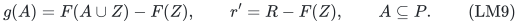

The function <code class="math">g</code> is the normalized integral contraction rank on <code class="math">P</code>, with full rank <code class="math">r'</code>. Reject if <code class="math">r'&gt;B</code>. Let <code class="math">Q</code> be the natural matroid of <code class="math">g</code> on the same copy ground <code class="math">U</code>. Its rank on a represented count vector is

<!-- math-display: 7665a15d0a0381c8cfbfcf6b
q(S)=\min_{A\subseteq P}
                  \bigl(g(A)+x_S(P\setminus A)\bigr).
\tag{LM10}
-->
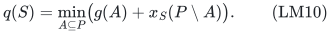

**Completion criterion.** If <code class="math">S</code> is independent in <code class="math">M</code>, its positive counts can be completed through <code class="math">Z</code> to a base of original total <code class="math">R</code> if and only if

<!-- math-display: d42761553d25986d206c54d4
q(S)=r'.
\tag{LM11}
-->
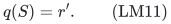

To prove the criterion and obtain a constructive completion, put <code class="math">x=x_S</code> and define on <code class="math">Z</code>

<!-- math-display: d52859b988e2d3d0797e1bf3
h_x(A)=\min_{C\subseteq P}\bigl(F(A\cup C)-x(C)\bigr).
\tag{LM12}
-->
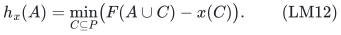

This is a normalized, monotone, integral submodular rank. Normalization follows from <code class="math">x\in P(F&#124;_P)</code> and the empty choice of <code class="math">C</code>. Monotonicity is immediate. For submodularity, take minimizers for two sets in <code class="math">Z</code>, apply submodularity of <code class="math">F</code> to their unions with the two minimizing positive sets, and use modularity of <code class="math">x</code>; their union and intersection give valid minimizing candidates for the corresponding sets in <code class="math">Z</code>.

For a zero vector <code class="math">z\ge0</code>, the inequalities <code class="math">z\in P(h_x)</code> are exactly the conditions that <code class="math">x+z\in P(F)</code> with the positive coordinates fixed. Its maximum zero total is therefore <code class="math">h_x(Z)</code>. Equations LM9–LM10 give

<!-- math-display: 4d90057976c27dfef2aa8f6a
h_x(Z)=F(Z)+q(S)-x(P).
\tag{LM13}
-->
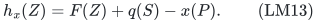

As <code class="math">q(S)\le g(P)=r'</code>, a full completion is possible exactly in LM11. When it is possible, an integral greedy base of <code class="math">h_x</code> has total <code class="math">R-x(P)</code> and gives the desired zero coordinates. Each rank query for <code class="math">h_x</code> uses submodular minimization over <code class="math">P</code>. This construction uses binary counts and polynomially many rank queries, even when <code class="math">R</code> or <code class="math">F(Z)</code> is large.

If all zero coordinates have common scalar coefficient <code class="math">\gamma</code>, every such full completion has scalar

<!-- math-display: 7984289c88456874246348e4
c\cdot(x+z)
                =\gamma R+\sum_{e\in P}(c_e-\gamma)x_e.
\tag{LM14}
-->
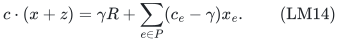

Hence exact scalar optimization reduces to the linear positive-copy coefficients <code class="math">c_e-\gamma</code>, with one fixed additive constant. This is why an arbitrary sign of <code class="math">\gamma</code> causes no issue, and why nonuniform zero coefficients are not included in this theorem.

## 5. A restricted representative lemma with a total-rank bound

Here is the precise representative fact used below. It is stated with independent tests separately in each matroid, so there is no assumption about the global rank of a matchoid.

**Lemma.** Let <code class="math">N_1,\ldots,N_\ell</code> be matroids on a common finite ground <code class="math">U</code>, let <code class="math">T\subseteq U</code> contain no loop of any <code class="math">N_i</code>, and give the candidates in <code class="math">T</code> rational scores <code class="math">a_e</code>. For an integer <code class="math">d\ge0</code>, one can generate a set of at most

<!-- math-display: d8cc5ea97a1df9f76ad212e6
K_{\ell,d}=\sum_{j=0}^{d}\ell^j
\tag{LM15}
-->
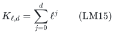

candidates with the following property. For any independent sets <code class="math">B_i</code> of <code class="math">N_i</code> satisfying <code class="math">\sum_i&#124;B_i&#124;\le d</code>, and any <code class="math">e\in T</code> outside every <code class="math">\mathrm{cl}_{N_i}(B_i)</code>, an emitted candidate <code class="math">f</code> has <code class="math">a_f\ge a_e</code> and is also outside all those closures. The sets <code class="math">B_i</code> may differ, overlap, or contain elements outside <code class="math">T</code>.

Generate the candidates recursively. Maintain independent <code class="math">J_i</code>, initially empty, and let

<!-- math-display: 50d6085af95e513f0c0eae1e
Y(J)=T\setminus\bigcup_{i=1}^{\ell}
                                   \mathrm{cl}_{N_i}(J_i).
\tag{LM16}
-->
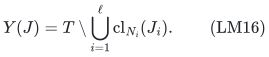

If <code class="math">Y(J)</code> is empty, stop this branch. Otherwise emit a highest-score candidate <code class="math">f\in Y(J)</code>, using a fixed tie order. If <code class="math">\sum_i&#124;J_i&#124;&lt;d</code>, branch on each <code class="math">i</code>, inserting <code class="math">f</code> into <code class="math">J_i</code>. The inserted set remains independent. The tree has depth at most <code class="math">d</code> and at most LM15 nodes.

For correctness, maintain <code class="math">J_i\subseteq\mathrm{cl}(B_i)</code> and the target <code class="math">e\in Y(J)</code>. The emitted score is then at least <code class="math">a_e</code>. If <code class="math">f</code> fails a test, choose <code class="math">i</code> with <code class="math">f\in\mathrm{cl}(B_i)</code>. Since <code class="math">f\notin\mathrm{cl}(J_i)</code>, independence and closure containment imply <code class="math">&#124;J_i&#124;&lt;&#124;B_i&#124;</code>. Inserting <code class="math">f</code> in this <code class="math">J_i</code> preserves containment; <code class="math">e</code> remains outside its closure. Thus a legitimate branch continues until a candidate passes all tests. It cannot require depth greater than <code class="math">\sum_i&#124;B_i&#124;\le d</code>. This proves the lemma.

One may obtain the same restricted tests from private copies in the joint-representative formulation of Huang–Ward. The direct proof above makes the smaller **sum of test ranks** bound explicit; it does not substitute <code class="math">d</code> for a public theorem's rank parameter without proof. Matroid closures are evaluated only on the generated candidate sets.

## 6. Candidate classes and auxiliary partitions

For each positive copy, record its weight, its membership pattern in the retained lower family, and, in the mandatory case, whether it is a loop of <code class="math">Q</code>. Form candidate classes with identical records. There are at most

<!-- math-display: f2abed61c52cf2d127ce99d7
G\le2B(B+1)
\tag{LM17}
-->
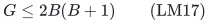

classes; the factor two can be omitted if there is no completion matroid. Every class has one fixed positive weight <code class="math">w</code>. Use the scalar coefficient itself as the score for maximization and its negative for minimization, after the adjustment in LM14 when required.

At each depth <code class="math">j\in\{1,\ldots,D\}</code> of the retained upper forest, its nodes are mutually disjoint. Define a rank-one partition matroid <code class="math">P_j</code> whose classes are the copy sets of those nodes and one additional class for everything outside them. These partitions are auxiliary tests; the original selected set need not be independent in them.

For a candidate class, apply the lemma to <code class="math">M,P_1,\ldots,P_D</code>, and also to <code class="math">Q</code> if the class consists of <code class="math">Q</code>-nonloops. Omit <code class="math">Q</code> for a <code class="math">Q</code>-loop class. Thus

<!-- math-display: 83cdf6296474742e03f5d0db
\ell\le B+2.
\tag{LM18}
-->
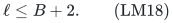

Each candidate is nonloop in every included matroid. Use depth <code class="math">d=3B-3</code> for <code class="math">B\ge1</code>. If no completion matroid is required, <code class="math">d=2B-2</code> suffices, but the uniform bound is convenient.

## 7. The replacement proof

Let <code class="math">S\subseteq U</code> be any feasible positive-copy set, with <code class="math">&#124;S&#124;\le B</code>, and take a copy <code class="math">e\in S</code>. Write <code class="math">S^-=S\setminus\{e\}</code>, and let its class have weight <code class="math">w</code>.

### Resource test

Use <code class="math">B_M=S^-</code> in the natural resource matroid. This is independent, has size at most <code class="math">B-1</code>, and <code class="math">e</code> lies outside its closure.

### Upper-quota tests

Call a retained upper node <code class="math">A</code> relevantly blocking if

<!-- math-display: 86780f52245c564104e028d5
u_A\ge w,
          \qquad \sum_{f\in S^-\cap U_A}w_f+w>u_A.
\tag{LM19}
-->
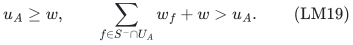

Nodes with <code class="math">u_A&lt;w</code> contain no candidate of the present class by the individual-eligibility preparation, so they require no blocker. Each relevantly blocking node contains at least one copy of <code class="math">S^-</code>: its current weight is strictly larger than <code class="math">u_A-w\ge0</code>. No blocking node contains <code class="math">e</code>, since reinserting <code class="math">e</code> recovers the feasible set <code class="math">S</code>.

Take the inclusion-maximal relevantly blocking nodes. They are disjoint, number at most <code class="math">&#124;S^-&#124;\le B-1</code>, and contain every relevantly blocking node. For each such maximal node, choose one copy of <code class="math">S^-</code> inside it. At depth <code class="math">j</code>, put the chosen copies for nodes of that depth into the test set <code class="math">B_j</code> of <code class="math">P_j</code>. This is independent because its node classes are distinct. The candidate <code class="math">e</code> is outside every such tested partition class, and

<!-- math-display: 8c37f4c2956c770edbccd497
\sum_j|B_j|\le B-1.
\tag{LM20}
-->
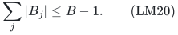

A replacement outside these closures cannot enter any newly overloaded upper node. Nodes containing the removed copy have lost weight <code class="math">w</code>, and inserting the same weight into such a node cannot exceed its old feasible load. Equivalently, any violated node after a replacement would be a relevantly blocking node containing the replacement, which the tests exclude.

### Completion test

If there is no completion requirement, skip this test. Otherwise <code class="math">q(S)=r'</code>. If <code class="math">e</code> is a <code class="math">Q</code>-loop, its deletion leaves full span, and every candidate in its class is also a loop; no completion test is needed.

For a nonloop class, if <code class="math">q(S^-)=r'</code>, take the empty <code class="math">Q</code>-test. The target <code class="math">e</code> passes it because it is a nonloop, and any replacement retains the already full span. If <code class="math">q(S^-)&lt;r'</code>, single-element rank change gives <code class="math">q(S^-)=r'-1</code>. Choose a <code class="math">Q</code>-basis <code class="math">B_Q\subseteq S^-</code>; then <code class="math">&#124;B_Q&#124;=r'-1\le B-1</code>, and <code class="math">e</code> is outside its closure. A passing replacement restores rank <code class="math">r'</code>.

The sum of all test ranks is at most

<!-- math-display: 1840fa8fea213836f7a67b2e
|S^-|+(B-1)+(B-1)\le3B-3.
\tag{LM21}
-->
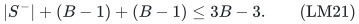

The lemma therefore supplies an emitted replacement <code class="math">f</code> of no worse scalar score. It preserves natural resource independence. It cannot already belong to <code class="math">S^-</code>, since the resource test would then reject it. It preserves every lower-row total exactly, because its weight and lower membership agree with those of <code class="math">e</code>. It satisfies all uppers by LM19–LM20 and preserves full completion by the <code class="math">Q</code>-test. Its cardinality is unchanged.

Consequently any feasible solution can be converted into one supported on the union of emitted candidates without worsening the scalar: repeatedly replace a selected candidate outside that union. Each step increases the number of selected copies in the union. In the mandatory case, LM14 ensures that this comparison is the true full scalar comparison, including all zero units.

## 8. Exact optimization from the representatives

The total number of emitted positions, including any duplicates, is at most

<!-- math-display: aeeec586f5a1d028e785a57e
K\le2B(B+1)\sum_{j=0}^{3B-3}(B+2)^j
                  =2^{O(B\log(B+1))}.
\tag{LM22}
-->
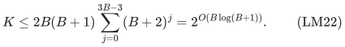

Enumerate sets of at most <code class="math">B</code> emitted copies, reject repetitions of a copy, test all numeric rows and natural resource independence, and in a mandatory instance test LM11. Keep the exact best scalar value. Empty sets are included. The replacement proof shows that the best surviving value is the original optimum. If no candidate survives, the original problem is infeasible.

Enumeration may use ordered index tuples padded by a blank symbol. There are at most <code class="math">(K+1)^B</code> such tuples. Duplicate enumeration is harmless and gives

<!-- math-display: 8288089ee5c3d27109bc46d3
(K+1)^B\mathrm{poly}(H+B)
                    =2^{O(B^2\log(B+1))}\mathrm{poly}(H).
\tag{LM23}
-->
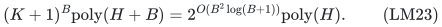

Only one exact scalar is optimized. A separate unrelated scalar restriction would not be preserved by selecting a highest-score replacement and is not claimed.

## 9. Uniform polynomial binary space

Let <code class="math">n=&#124;P&#124;</code> be the number of surviving positive coordinates. Handle <code class="math">B=0</code> or <code class="math">n=0</code> directly: all positive counts are zero; positive lower rows are impossible; an optional scalar-zero instance has value zero; a mandatory instance is feasible precisely when the zero ground has original rank <code class="math">R</code>, and then has value <code class="math">\gamma R</code>.

For <code class="math">B\ge n\ge1</code>, use a simpler streaming fallback. Enumerate

<!-- math-display: 868b8859f021710bc05e9d8b
0\le x_e\le\lfloor B/w_e\rfloor
                              \quad(e\in P).
\tag{LM24}
-->
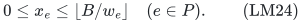

Test the root and all rows, test <code class="math">x\in P(F&#124;_P)</code> by submodular minimization, and test LM10–LM11 when necessary. There are at most

<!-- math-display: a4061baee6a1a137bbb38554
(B+1)^n\le(B+1)^B
\tag{LM25}
-->
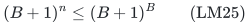

vectors. Store only <code class="math">n</code> binary counters, the current best vector, and polynomial-space oracle work. Thus this branch is faster than LM4 and never expands numerical capacities. Obtain the final zero completion using LM12.

For <code class="math">1\le B&lt;n</code>, the copy ground has size at most <code class="math">nB&lt;n^2</code>, and the recursion depth <code class="math">3B-3</code> is polynomial in explicit input length. The exponentially many representatives still need not be stored. An emitted position is specified by a candidate-class index and a branching word of length at most <code class="math">3B-3</code> over at most <code class="math">B+2</code> auxiliary matroids. Reconstruct its candidate by replaying that path, selecting the fixed highest-score element in LM16 at each step. If a prefix has no candidate, the position is invalid. This representation includes every actual emitted candidate.

Store at most <code class="math">B</code> such indices for the outer enumeration, reject invalid positions or repeated copies, and regenerate their actual candidates as needed. Each index has <code class="math">O(B\log(B+1)+\log(H+1))</code> bits. Each replay stores only the current independent sets <code class="math">J_i</code>, whose total size is at most <code class="math">3B-3</code>, and scans the polynomial-size copy ground. The index bound LM22 includes all possible branching words, so invalid paths and failed tuples are also charged. No accepted-solution list or exponential kernel is retained.

The rank queries in LM8, LM10 and LM12 use binary modular counts on the original ground. Rational score comparisons and objective sums have polynomial bit length. The final zero completion is an explicit binary vector on <code class="math">Z</code>, constructed with polynomially many greedy rank queries. This proves uniform polynomial binary space for both branches.

## 10. Boundaries and an exponential lower example

### Nonuniform zero costs are not covered

The zero restriction cannot simply be dropped from the proof. Consider a rank-two partition matroid with parallel pairs <code class="math">\{p_1,z_1\}</code> and <code class="math">\{p_2,z_2\}</code>. Give <code class="math">p_1,p_2</code> common numeric weight one and <code class="math">z_1,z_2</code> weight zero. Require one positive unit by a root equality, so <code class="math">B=1</code>, and require an original resource base. Let <code class="math">c_{p_1}=c_{p_2}=c_{z_1}=0</code> and <code class="math">c_{z_2}=100</code>, and minimize cost.

The positive choices have identical positive scalar scores and identical numeric membership. However, completing <code class="math">p_1</code> costs 100, whereas completing <code class="math">p_2</code> costs zero. A positive-only representative chosen by an arbitrary tie order need not preserve the optimum. This is a counterexample to removing the uniform-zero-cost hypothesis from the present argument, not an impossibility theorem for that broader model.

### A genuine exponential root-cap dependence can be necessary

The reviewed disjoint-row hidden-family construction in [column-support-numeric-target-dichotomy.md](../../numeric-target-frontier/manuscripts/column-support-numeric-target-dichotomy.md) gives a lower example already at laminar depth two. Take <code class="math">d</code> disjoint blocks, each with four elements of common coordinate weights <code class="math">1,2,3,4</code>, and impose weighted equality five on each block. Add root cap <code class="math">B=5d</code>. Use one rank-<code class="math">2d</code> hidden matroid whose potentially restored feasible sets choose in every block either the pair <code class="math">\{1,4\}</code> or <code class="math">\{2,3\}</code>.

Each equality needs at least two elements, so resource rank forces exactly one of these two pairs in every block. The <code class="math">2^d</code> candidate sets are pairwise nonadjacent under one exchange and support the usual reference/one-restored-base rank-oracle family. Scalar zero suffices, and both optional and mandatory formulations work. The decision-distribution argument requires <code class="math">2^{\Omega(B)}</code> rank queries. This does not match the upper exponent in LM4; no optimal <code class="math">B^2\log B</code> dependence is asserted.

The theorem also genuinely uses common weights across rows. Arbitrary row-specific coefficients, even on the same apparent prefix or set, are a different model. Finally, the single global resource may have arbitrary cross-coordinate dependence, but no second independently supplied global resource rank is added by the result.

## 11. Primary-source comparison

Huang and Ward's *FPT-Algorithms for the <code class="math">\ell</code>-Matchoid Problem with a Coverage Objective*, SIAM Journal on Discrete Mathematics (2023), gives a general-oracle deterministic joint-representative construction for the linear-objective case. Definition 3.1, Algorithm 1 and Theorem 3.6 in the [author PDF](https://www.di.ens.fr/~cchuang/work/matchoid.pdf) are the direct methodological antecedent. Lemma LM15 is a restricted total-blocking-rank version with its proof included above. Representative-set methods and rank-parameter tractability are not claimed as new here.

Huang, Kakimura, Kobayashi and Terao, *Polynomial Kernels with Reachability for Weighted <code class="math">d</code>-Matroid Intersection*, [arXiv:2603.17345v1](https://arxiv.org/html/2603.17345v1), provide stronger reachable-kernel results for one arbitrary matroid with special additional matroids, including partition and laminar cases. Their Theorems 1–4 and Section 5 are relevant public comparisons. The original weighted-laminar feasible set here is not simply a common independent set of the auxiliary depth partitions: those partitions are only used to encode a particular replacement's blocking subtrees. Their kernel theorem is therefore not invoked as an unproved direct solver for this model.

Doron-Arad, Kulik and Shachnai, *An FPTAS for Budgeted Laminar Matroid Independent Set*, [arXiv:2304.13984](https://arxiv.org/abs/2304.13984), studies a laminar matroid resource together with a single knapsack budget and gives an FPTAS. Its resource/side-constraint placement differs from the present arbitrary global polymatroid with common-weight quotas throughout an explicit laminar family. The comparison here uses the verified primary abstract and does not infer a missing exact parameterized theorem from that abstract.

These bounded comparisons establish antecedents and model distinctions, not a first-algorithm or priority claim. The new proved interface is the deterministic compression of arbitrarily many laminar weighted nodes into bounded total-rank replacement tests, together with original-total zero completion and the binary-space implementation.

## 12. Incremental status

This complete proof is included in checkpoint T. It does not edit the frozen support-pattern classification. The companion prefix manuscripts have a better exponential dependence in their narrower geometry. The present theorem handles a branching laminar family, with the explicit zero-cost scope stated in Section 1 and challenged in Section 10.

Arbitrary nonuniform scalar coefficients on zero-weight coordinates require an additional argument: their optimal completion cost is not the fixed affine expression LM14. The separate companion [laminar-valuated-zero-completion-fpt.md](laminar-valuated-zero-completion-fpt.md) supplies that argument for both optional and mandatory resources using an optimal-completion valuation. The present elementary proof and its stated scope remain unchanged.
