# Faster exact recovery for laminar quotas by fixing the uncommon weights

This manuscript improves the explicit quadratic exponent in the
[common-weight laminar algorithm](../proof.md) using its existing
representative replacement lemma. Recovery enumerates only the selected units outside a most
frequent positive weight and completes the remaining units by polynomial
optimization. The same completion gives a polynomial-time algorithm when
the prepared instance has only one positive weight value. Cardinality-aware
accounting in Section 8 sharpens the elementary time bound to
<code class="math">2^{(10/9)B^2+O(B\log(B+1))}\mathrm{poly}(H)</code>; the specific
published locally explicit universal-set theorem stated there gives
<code class="math">2^{(5/9+o(1))B^2}\mathrm{poly}(H)</code> with the same space guarantee.

**Scope.** One global normalized monotone integral polymatroid, a laminar
family of numeric lower and upper bounds, and one common nonnegative
integer weight vector for those rows. The scalar objective has arbitrary
signed rational coefficients. Every original mandatory resource total and
every real zero-weight coordinate, including its actual cost, is retained.
The model and the paid exact oracle operations are those of
[the main proof](../proof.md#1-model-and-theorem).

**Review status.** Ready for review in this scope after an independent
proof pass and the finite checks in Section 7. The executable evidence
checks the new count-rank and recovery mechanisms; it does not implement
the earlier representative catalogue or a general weighted polymatroid
intersection solver.

## 1. The basic recovery bound and its prerequisites

Let <code class="math">B</code> be the integer root cap on total positive numeric mass, and let
<code class="math">H</code> be the full encoded input length, including the stated polynomial-bit
rank-oracle model. The prepared positive coordinates have weights in a
finite set

<!-- math-display: f79aa50352165de199922822
W=\{w_1<\cdots<w_s\},\qquad
\eta(W)=
\begin{cases}
0,&s\le1,\\
\displaystyle\max_{2\le j\le s}
\frac{j-1}{w_1+\cdots+w_j},&s\ge2.
\end{cases}
\tag{DW1}
-->
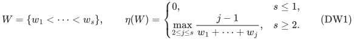

Weights exceeding <code class="math">B</code> and empty prepared positive classes are discarded
before forming <code class="math">W</code>: no such unit can be selected. This removal does not
lower a mandatory resource total. If the remaining coordinates cannot
realize that original total, the algorithm returns infeasibility.

**Theorem 1.** Put <code class="math">q=\lfloor B\eta(W)\rfloor</code>. If <code class="math">q=0</code>, the exact
signed-scalar optimum is computable in time polynomial in <code class="math">H</code>. If <code class="math">q\ge1</code>,
it is computable deterministically in

<!-- math-display: d94d1ec617366b29a53fc3f4
2^{4Bq+O(B\log(B+1))}\mathrm{poly}(H)
\le
2^{4B\lfloor B/3\rfloor+O(B\log(B+1))}
\mathrm{poly}(H)
\le
2^{\frac43 B^2+O(B\log(B+1))}\mathrm{poly}(H).
\tag{DW2}
-->
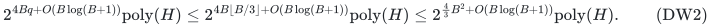

All cases use workspace polynomial in the original binary input length.
The <code class="math">q=0</code> case bypasses both the representative catalogue and the loop
over positive cardinalities. In particular, one positive weight value
admits polynomial time even when <code class="math">B</code> and the resource total are binary
large. Minimization is stated below; negating the scalar gives maximization.

This first bound improves the explicit coefficient <code class="math">4</code> in the basic recovery
bound of equation LC3 to <code class="math">4/3</code>. It retains the quadratic exponent class
and does not close the existing laminar oracle lower-bound gap. Section 8
then gives the sharper bounds stated at the beginning of this manuscript.

Only the following previously proved catalogue properties are used. For
each fixed positive cardinality <code class="math">k</code>, the main proof emits at most

<!-- math-display: 69a40ba2801c649c496b5ace
K_k\le 2^{4B+O(\log(B+1))}L^3,
\qquad L=O(\log(m+2)),
\tag{DW3}
-->
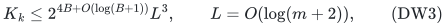

positions, where <code class="math">m</code> is the number of prepared upper rows. Each position
can be replayed using polynomial binary space. Every feasible optimum of
cardinality <code class="math">k</code> has a no-worse optimum supported on the emitted union,
with exactly the same positive weight multiplicities. This last assertion
follows because each catalogue replacement stays in its weight and lower
membership class. The completed-cost valuation and the catalogue are
proved in [the main proof, Sections 2–7](../proof.md) and
[the arbitrary-zero-cost companion](laminar-valuated-zero-completion-fpt.md).

For the new completion, the only general optimization ingredients are
exact submodular minimization and weighted intersection of two integral
polymatroids. They are concrete classical results, rather than an
unspecified additional oracle: Grötschel, Lovász and Schrijver,
[*The ellipsoid method and its consequences in combinatorial optimization*](https://ir.cwi.nl/pub/10046/10046D.pdf),
Combinatorica 1 (1981), Sections 3–5, give the separation/optimization
method and explicitly extend the intersection application to polymatroids
on page 183. Schrijver,
[*A combinatorial algorithm minimizing submodular functions in strongly polynomial time*](https://homepages.cwi.nl/~lex/files/minsubm6.pdf),
Journal of Combinatorial Theory, Series B 80 (2000), supplies a value-oracle
submodular minimization algorithm. All oracle work is charged. Sections
3–4 below prove the new rank functions and the exact correspondence of
their feasible vectors to original allocations.

## 2. A most frequent weight leaves few exceptions

For a selected positive set, let <code class="math">n_j</code> count its units of weight <code class="math">j</code>, let
<code class="math">k=\sum_j n_j</code>, and let <code class="math">a=\max_j n_j</code>, with <code class="math">a=0</code> for the empty set.
There are <code class="math">k-a</code> units outside a most frequent weight. The identity

<!-- math-display: ac7b068475e55fe465d4558b
\sum_{j\ge1}j n_j-3(k-a)
=3a-2n_1-n_2+\sum_{j\ge4}(j-3)n_j\ge0
\tag{DW4}
-->
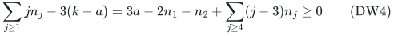

shows that <code class="math">k-a\le\lfloor B/3\rfloor</code>. The inequality uses
<code class="math">n_1,n_2\le a</code>. Equal multiplicities of weights <code class="math">1,2</code>, or of weights
<code class="math">1,2,3</code>, attain this histogram constant.

The actual weights give the stronger <code class="math">k-a\le\lfloor B\eta(W)\rfloor</code>.
For each integer height <code class="math">z=1,\ldots,a</code>, let
<code class="math">S_z=\{w\in W:n_w\ge z\}</code>. Every <code class="math">S_z</code> is nonempty and

<!-- math-display: 4a1028eef20fabbc6ce97360
k-a=\sum_{z=1}^{a}(|S_z|-1),
\qquad
\sum_{w\in W}w n_w
=\sum_{z=1}^{a}\sum_{w\in S_z}w.
\tag{DW5}
-->
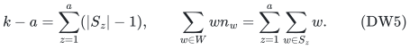

For a set of <code class="math">j</code> distinct occurring weights, its sum is at least
<code class="math">w_1+\cdots+w_j</code>. Hence
<code class="math">&#124;S_z&#124;-1\le\eta(W)\sum_{w\in S_z}w</code>, also when <code class="math">&#124;S_z&#124;=1</code>.
Summing proves the claim. Finally, <code class="math">w_i\ge i</code>, so

<!-- math-display: 4d36615b25e222b3b54f72ec
\frac{j-1}{w_1+\cdots+w_j}
\le \frac{2(j-1)}{j(j+1)}\le\frac13
\qquad(j\ge2).
\tag{DW6}
-->
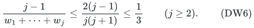

The rational number <code class="math">\eta(W)</code> is computable from the explicit sorted
weight values with polynomial binary arithmetic. It does not require an
array indexed by <code class="math">B</code>.

## 3. Laminar count constraints give one integral rank

Let <code class="math">V</code> be a finite coordinate ground with nonnegative integer caps
<code class="math">c_v</code>. On a laminar family containing <code class="math">V</code>, prescribe integer bounds
<code class="math">\ell_A\le z(A)\le u_A</code>, and prescribe the full total <code class="math">z(V)=R'</code>.
Caps and totals may be binary large. Missing upper bounds can be replaced
by the sum of the coordinate caps. Merge repeated sets by taking the
largest lower and smallest upper bound; reject an inconsistent empty row.

### 3.1 Ordinary basis exchange

Conceptually replace each coordinate <code class="math">v</code> by <code class="math">c_v</code> distinguishable unit
copies. Lift every row to all copies of its coordinates. Suppose the
family of feasible <code class="math">R'</code>-element subsets is nonempty. It is the basis
family of an ordinary matroid.

To prove this, take feasible sets <code class="math">S,T</code> and <code class="math">e\in S\setminus T</code>.
Choose an inclusion-minimal row <code class="math">A</code> containing <code class="math">e</code> whose lower bound is
tight at <code class="math">S</code>. The full-total row ensures existence. Laminarity implies
that every other tight lower row containing <code class="math">e</code> contains <code class="math">A</code>.

Inside <code class="math">A</code>, consider the inclusion-maximal rows <code class="math">U</code> with a tight upper
bound at <code class="math">S</code> and with <code class="math">e\notin U</code>. These rows are pairwise disjoint.
Every tight upper row containing a candidate <code class="math">f\in A</code> but not <code class="math">e</code> is
contained in one of these maximal rows: it intersects <code class="math">A</code>, and it cannot
contain <code class="math">A</code> while avoiding <code class="math">e</code>.

Feasibility of <code class="math">T</code> and the indicated tight bounds give

<!-- math-display: 1a9b55fac1514dd1b41fd405
|(T\setminus S)\cap A|\ge |(S\setminus T)\cap A|,
\qquad
|(T\setminus S)\cap U|\le |(S\setminus T)\cap U|.
\tag{DW7}
-->
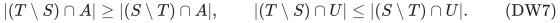

If every member of <code class="math">(T\setminus S)\cap A</code> were in those disjoint upper
rows, summing DW7 over them would give an upper bound of
<code class="math">&#124;(S\setminus T)\cap A&#124;-1</code>, because <code class="math">e</code> belongs to the right-hand set
and none of the upper rows. This contradicts the first inequality.
Choose <code class="math">f\in(T\setminus S)\cap A</code> outside them.

The exchange <code class="math">S-e+f</code> preserves every tight lower row that could lose a
unit and enters no tight upper row that could gain a unit. Every
nontight integer row tolerates that unit change. The total and available
copy caps are unchanged. This proves the ordinary basis-exchange axiom.
Denote the conceptual matroid by <code class="math">N</code>.

### 3.2 Coordinate rank and exact integer bases

Define

<!-- math-display: bb3427db05d094b6d9fce819
Q(A)=r_N(\text{all copies of coordinates in }A),
\qquad A\subseteq V.
\tag{DW8}
-->
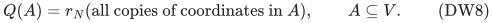

The copy blocks are disjoint. Therefore <code class="math">Q</code> is normalized, monotone,
integer and submodular, and <code class="math">Q(V)=R'</code>. Its integer bases are exactly
the original feasible count vectors.

Indeed, every feasible count vector is realized by a conceptual base and
satisfies all <code class="math">Q</code>-rank inequalities. Conversely, let
<code class="math">z\in P(Q)\cap\mathbb Z^V</code> have total <code class="math">R'</code>. Every row and coordinate
satisfy

<!-- math-display: 6ae824ca2f0dc616a03f558a
Q(A)\le u_A,
\qquad Q(V\setminus A)\le R'-\ell_A,
\qquad Q(\{v\})\le c_v.
\tag{DW9}
-->
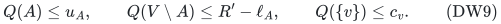

For example, the second inequality holds because every conceptual base
uses at least <code class="math">\ell_A</code> copies in <code class="math">A</code>, so no independent set in the
complement can exceed <code class="math">R'-\ell_A</code>. The rank inequalities and total now
give <code class="math">\ell_A\le z(A)\le u_A</code> and <code class="math">z_v\le c_v</code>. Thus the literal count
constraints follow directly. This argument needs no unproved assertion
about projecting an integer polytope.

### 3.3 Binary rank access without creating unit copies

A nonnegative integer vector <code class="math">y</code> represents a conceptual independent set
exactly when it extends coordinatewise to a feasible count base. Build
the laminar inclusion tree, adding singleton leaves and the full root.
At a leaf <code class="math">v</code>, start with the interval <code class="math">[y_v,c_v]</code> and intersect it with
any singleton bounds. At an internal row, sum the feasible intervals of
its children and intersect with its own lower and upper interval. Reject
an empty interval, and impose <code class="math">[R',R']</code> at the root.

This is an exact extension test. The children are disjoint, and every
integer between the sum of their lower endpoints and the sum of their
upper endpoints is attainable. Induction up the tree proves that the
computed interval is precisely the set of feasible totals at each row.
The test uses polynomial binary work and space. Test <code class="math">y=0</code> first to
detect an empty base family. An empty coordinate ground is feasible
exactly when its total and every lower requirement are zero; its rank
is then identically zero.

To evaluate <code class="math">Q(A)</code> for a nonempty feasible system, process the coordinates
of <code class="math">A</code> in any fixed order. Start with <code class="math">y=0</code>. For the current coordinate
<code class="math">v</code>, increase <code class="math">y_v</code> as far as the extension test permits, using binary
search on <code class="math">[0,\min\{c_v,R'\}]</code>. Previously chosen coordinates stay fixed.
Extendability is monotone in <code class="math">y_v</code>, and this procedure is exactly matroid
greedy with all copies of each coordinate consecutive. It returns <code class="math">Q(A)</code>
using at most

<!-- math-display: 2ca4bb9bdfd3aaafc624b012
O\!\left(|V|\log(2+\max_v c_v)\right)
\tag{DW10}
-->
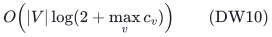

extension tests. The exponential conceptual copy ground is never built.

## 4. Exact completion after fixing the exceptional units

Use the prepared mixed ground <code class="math">U\dot\cup Z</code> of the main proof:
positive unit copies <code class="math">U</code>, compressed zero-weight coordinates <code class="math">Z</code>, and
the shared resource rank <code class="math">G</code> in equation LC6. Every positive copy has
resource cap at most one. The original required total is <code class="math">R</code>.

Fix a proposed remaining weight <code class="math">w\in W</code> and a set <code class="math">J</code> of distinct
positive copies whose weights differ from <code class="math">w</code>. Write <code class="math">b=&#124;J&#124;</code>. Reject
unless <code class="math">b\le R</code> and <code class="math">G(J)=b</code>. Let <code class="math">U_w</code> contain **all original prepared
copies** of weight <code class="math">w</code>, and put <code class="math">V=U_w\dot\cup Z</code>. Mask all other
positive copies. In particular, the completion is not restricted to
representative copies of weight <code class="math">w</code>.

For each original numeric row <code class="math">A</code>, let <code class="math">a_A</code> be the numeric mass of
<code class="math">J</code> in <code class="math">A</code>. The remaining numeric constraints are exactly

<!-- math-display: 06b54c8589140ce7ccef0718
\max\!\left\{0,\left\lceil\frac{\ell_A-a_A}{w}\right\rceil\right\}
\le z(A\cap U_w)
\le \left\lfloor\frac{u_A-a_A}{w}\right\rfloor.
\tag{DW11}
-->
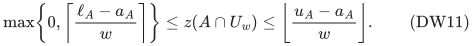

An absent upper bound stays absent; a negative upper bound rejects the
branch. Intersecting all rows with <code class="math">U_w</code> preserves laminarity, including
after repeated projected sets are merged. Add the full mixed-ground
total <code class="math">z(V)=R-b</code>. Give positive copies cap one and every zero coordinate
cap <code class="math">R-b</code> in this count system. The shared resource will still enforce
each zero coordinate's original cap. Section 3 yields a rank <code class="math">Q</code> with
full rank <code class="math">R-b</code>, or an explicit infeasibility result.

The other rank is the genuine contraction

<!-- math-display: 0d39f69b4a8c509f47f687f6
G_J(A)=G(A\cup J)-b,
\qquad A\subseteq V.
\tag{DW12}
-->
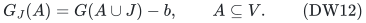

It is a normalized monotone integral polymatroid rank. To verify the
fixed-unit interpretation, note first that <code class="math">G(J)=&#124;J&#124;</code> and the unit caps
imply <code class="math">G(C)=&#124;C&#124;</code> for every <code class="math">C\subseteq J</code>. Submodularity then gives

<!-- math-display: d84b32863accb1bc36adb3f6
G(A\cup J)-b\le G(A\cup C)-|C|.
\tag{DW13}
-->
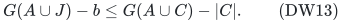

Hence <code class="math">z(A)\le G_J(A)</code> implies every original inequality using an
arbitrary partial set <code class="math">C</code> of the fixed copies. Conversely, the original
inequality using all of <code class="math">J</code> implies the contracted inequality. Thus
<code class="math">z\in P(G_J)</code> exactly when <code class="math">\mathbf1_J+z</code> respects the resource on
the masked ground.

Optimize the original scalar, including its fixed contribution on <code class="math">J</code>,
over

<!-- math-display: 139253920c29c4c09522fc80
z\in P(G_J)\cap P(Q),
\qquad z(V)=R-b.
\tag{DW14}
-->
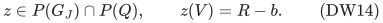

This uses exactly two integral polymatroids. Their intersection is an
integral polytope, and the required total selects its maximum-size face
if that face exists. To implement the face requirement with a single
weighted optimization, clear the scalar denominators, let <code class="math">C</code> be the
largest absolute resulting coefficient, and maximize
<code class="math">(2(R-b)C+1)z(V)-c\cdot z</code>. Integral feasible vectors have total at most
<code class="math">R-b</code>, so the multiplier makes total size primary and true scalar cost
secondary. Reject if the returned total is smaller. The coefficients
have polynomial bit length. The case <code class="math">R-b=0</code> is checked directly.

By Sections 3.2 and DW13, the integer vectors in DW14 are exactly the
original allocations with these fixed exceptions and all remaining
positive units of weight <code class="math">w</code>. Every real zero coordinate retains its
original signed scalar coefficient. This proves polynomial-time exact
completion. It introduces neither a third intersection nor a
uniform-zero-cost assumption.

The procedure does not fix the remaining positive cardinality. It may
return a different cardinality from the original witness. That is safe:
every returned vector still satisfies the original rows and original
resource total, and is compared using the original objective.

For the one-weight case, apply the same construction directly to the
original coordinates: take <code class="math">J=\varnothing</code>, use the original resource
<code class="math">F</code> restricted to the allowed coordinates, and give coordinates cap <code class="math">R</code>
in the count rank. Section 3.3 handles these binary-large caps. No positive
unit expansion is needed. If optional resource was converted to a base,
the existing zero-weight, zero-cost disposal coordinate remains present.

## 5. Recovering an optimum from the catalogue

First handle the zero-only case by masking every positive coordinate and
optimizing the original scalar at the required total, rejecting any
positive numeric lower bound. If <code class="math">q=0</code>, every feasible positive set has
a single weight by Section 2. Try each occurring weight with the direct
completion of Section 4 and take the best original feasible answer.
This is the claimed polynomial case; neither cardinality enumeration
nor the catalogue is used.

For <code class="math">q\ge1</code>, consider the catalogue for each relevant cardinality <code class="math">k</code>.
Its replacement property supplies an optimum positive set <code class="math">S'</code> in its
emitted union with the original weight histogram. Choose a most frequent
weight <code class="math">w</code> in that histogram and let <code class="math">J</code> be the units of other weights.
Section 2 gives <code class="math">&#124;J&#124;\le q</code>.

For every <code class="math">w\in W</code>, enumerate tuples of at most <code class="math">q</code> emitted positions,
rejecting a tuple if two positions name the same physical copy or if
an entry has weight <code class="math">w</code>. Run Section 4 on the resulting set <code class="math">J</code>. There
is a tuple naming the exceptional units of <code class="math">S'</code>. Its remaining units
and original zero completion are a feasible witness for DW14. The
returned cost is at most the optimum witness cost. Conversely, every
accepted answer is original feasible, so no branch has a cost below the
true optimum. Taking the best answer is exact.

This argument uses preservation of the entire weight histogram by the
earlier representatives. Preserving total weight alone would not justify
the exception bound for the supported optimum.

## 6. Time and uniform binary workspace

Let <code class="math">n</code> be the number of prepared positive coordinates. In the branch
<code class="math">B&lt;n</code>, the positive copy ground has size at most <code class="math">nB&lt;n^2</code>. There are
polynomially many relevant cardinalities and occurring weight values.
For each catalogue, tuples of length at most <code class="math">q</code> are bounded by
<code class="math">(K_k+1)^q</code>, using padding positions. Equation DW3 gives

<!-- math-display: 8fea40928eab47bcc369efb4
(K_k+1)^q
\le 2^{4Bq+O(q\log(B+1))}L^{3q}.
\tag{DW15}
-->
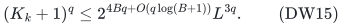

Each tuple takes polynomial work in the encoded mixed ground, plus the
catalogue replay already charged in the main proof. Since <code class="math">q\ge1</code>,
catalogue construction is absorbed in the bound. The usual inequality
<code class="math">(\log x)^a\le(a/e)^a x</code> for <code class="math">x\ge1</code>, with constants adjusted for the
chosen logarithm base, absorbs <code class="math">L^{3q}</code> into
<code class="math">2^{O(B\log(B+1))}\mathrm{poly}(H)</code>. This proves DW2 for <code class="math">B&lt;n</code>.

If <code class="math">B\ge n</code>, retain the main proof's direct count-vector fallback:
enumerate at most <code class="math">(B+1)^n</code> positive count vectors and solve the exact
compressed zero completion for each. Its time
<code class="math">2^{O(B\log(B+1))}\mathrm{poly}(H)</code> is within DW2. Run the <code class="math">q=0</code>
algorithm before this split so that the one-weight endpoint remains
polynomial even for large binary <code class="math">B</code>.

In the first branch, <code class="math">q\le B/3&lt;n</code>, and each emitted position has the
same polynomial-bit replay description as before. Store one tuple, one
compressed oracle instance, and the best original binary output. In the
fallback, keep one vector with <code class="math">n</code> binary counters. The rank algorithm
in Section 3.3 never expands large zero capacities. All general
optimization calls are polynomial in binary length, so workspace is
uniformly polynomial in <code class="math">H</code>.

## 7. Independent finite checks and remaining dependencies

Run from the repository root:

~~~sh
python3 -B problems/weighted-prefix-quota-frontier/verify/check_laminar_recovery.py
~~~

The deterministic checker refuses execution with assertions disabled.
It uses literal finite feasible-vector and basis enumeration as references,
separate from the interval extension and grouped-copy rank procedure.

- **Count-rank construction:** 77,438 laminar count systems, including
  60,980 empty systems; 1,480,360 extension comparisons, 200,256 rank
  comparisons, and 319,624 comparisons between rank bases and literal
  count constraints. Across 262 distinct nonempty base families it checks
  14,938 ordinary unit-copy basis-exchange conditions and 28,312 rank
  submodularity inequalities.
- **Binary capacity handling:** a separate instance with capacities up
  to <code class="math">2^{45}</code> compares all 16 coordinate ranks with an independent
  partition formula. The interval procedure uses 672 distinct queries;
  it does not enumerate capacity units.
- **Histogram bounds:** 194,016 histograms over distinct weights from
  one through eight, including 1,206 equalities in the actual-weight
  bound and 327 nonzero equalities in the universal one-third bound.
- **Recovery and signed costs:** 600 seeded integer-polymatroid instances
  compare the recovered optimum with all literal original bases. The
  resource is a sum of two independently chosen four-element matroid
  ranks. The check evaluates 945 contracted two-rank models and 4,015
  literal candidate vectors, including 215 infeasible instances, 550
  with unequal zero-coordinate costs, 422 with a negative zero cost,
  31 with root budget zero, and 212 with one positive weight value.

The refined accounting in Section 8 is also checked on 590,480
cardinality/depth/budget combinations and 6,321 actual-weight, row-count
and depth combinations. These compare the exact integer maximum with
direct enumeration and the stated continuous upper bound.

For recovery tests, all original prepared positive copies are used as
a valid superset of the earlier representative union. Thus these tests
isolate and verify the new contraction, projected count rank, exact
fixed-exception feasible set, and optimum recovery. They do not implement
or reverify the universal-coloring catalogue, weighted Rado induction,
or the polynomial intersection algorithm. Those mathematical dependencies
remain explicit in Section 1 and the linked source manuscripts. No
external peer review, proof-assistant verification, or literature-wide
priority claim is asserted.

## 8. Cardinality-sensitive catalogues and sharper exponents

The simple bound DW2 used the worst-case catalogue size before choosing
how many exceptional units to enumerate. Keeping these two quantities
together gives a smaller exponent. Let <code class="math">D\le B</code> be the prepared upper
forest depth, let <code class="math">m</code> be its number of rows, and retain <code class="math">q=\lfloor B\eta(W)\rfloor</code>. The case <code class="math">q=0</code> remains the direct polynomial algorithm.
For each <code class="math">1\le k\le B</code>, define

<!-- math-display: 1cd1db9fcc515fa3843fcb3d
h_k=\min\{m,D+k-1\},
\qquad q_k=\min\{q,B-k\},
\qquad
E=\max_{1\le k\le B} h_k q_k.
\tag{DW16}
-->
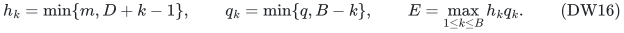

The maximum may be restricted to the positive cardinalities allowed by
the original resource. One may also replace <code class="math">q_k</code> by
<code class="math">\min\{q_k,k-1\}</code>, since a nonempty histogram has a nonempty largest
class. The displayed version is convenient for a uniform bound.

**Theorem 2.** The same problem has the following deterministic exact
algorithms, both with uniform polynomial binary workspace:

1. With the elementary coloring construction proved in the main manuscript,
   time <code class="math">2^{2E+O(B\log(B+1))}\mathrm{poly}(H)</code>.
2. With the indexed universal-set construction in Naor, Schulman and
   Srinivasan's Theorem 7, time
   <code class="math">2^{E+o(B^2)}\mathrm{poly}(H)</code>.

The exact integer maximum <code class="math">E</code> is the primary accounting bound. If
<code class="math">e=\eta(W)\le1/3</code>, it satisfies

<!-- math-display: 58b96375968e0b0489ce6acb
E\le eBD+e(1-e)B^2
\le\frac59 B^2.
\tag{DW17}
-->
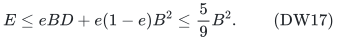

Thus the elementary construction gives
<code class="math">2^{(10/9)B^2+O(B\log(B+1))}\mathrm{poly}(H)</code>, and the published
indexed construction gives
<code class="math">2^{(5/9+o(1))B^2}\mathrm{poly}(H)</code>. The stronger bound explicitly
uses the cited universal-set theorem. The elementary alternative supplies
a complete local coloring proof with a larger leading coefficient.

### 8.1 Keep the positive cardinality in both bounds

The red/green certificate of the main proof marks at most <code class="math">D</code> ancestors
and at most <code class="math">k-1</code> disjoint blockers for a size-<code class="math">k</code> positive set. Therefore
that proof's hash and small-bias construction can be run separately with
prescription parameter <code class="math">h_k</code>, in place of its uniform <code class="math">2B-1</code>. Equations
LC23–LC24 then give a catalogue with

<!-- math-display: a65269fa552da30fb4c89c80
K_k\le 2^{2h_k+O(\log(B+1))}L^3.
\tag{DW18}
-->
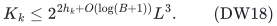

All previous oracle, exact replacement, and replay arguments are
unchanged. If <code class="math">m=0</code>, the single empty coloring suffices.

Let <code class="math">q'=k-a</code> be the actual number of exceptions in a selected histogram.
Since <code class="math">n_1\le a</code> and every other weight is at least two,

<!-- math-display: 7b425ea19279174cd1895cca
\sum_{j\ge1}j n_j
\ge n_1+2(k-n_1)
\ge 2k-a=k+q'.
\tag{DW19}
-->
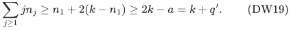

Hence <code class="math">q'\le B-k</code> as well as <code class="math">q'\le q</code>. Enumerate only <code class="math">q_k</code> positions
for cardinality <code class="math">k</code>. A branch with <code class="math">q_k=0</code> needs no catalogue: its optimum
witness, if it exists, is homogeneous, and Section 4 directly returns an
original feasible answer of no greater cost. A different returned
cardinality is harmless for the reason already given there.

For <code class="math">q_k\ge1</code>, DW18 gives a leading exponent <code class="math">2h_k q_k</code>. Its field
construction cost is absorbed because the same exponent is at least
<code class="math">2h_k</code>. The logarithmic input factors and all polynomial catalogue
multiplicities contribute <code class="math">O(B\log(B+1))</code> as in Section 6. This proves
part 1 of Theorem 2. In the binary-large branch, the same direct count
fallback contributes only <code class="math">2^{O(B\log(B+1))}\mathrm{poly}(H)</code>.

### 8.2 The actual-weight maximum

For a continuous variable <code class="math">k\in[0,B]</code>, use
<code class="math">q_k\le\min\{eB,B-k\}</code> and <code class="math">h_k\le D+k</code>. When
<code class="math">k\le(1-e)B</code>, the product <code class="math">(D+k)eB</code> increases with <code class="math">k</code>. When
<code class="math">k\ge(1-e)B</code>, the derivative of <code class="math">(D+k)(B-k)</code> is
<code class="math">B-D-2k\le-(1-2e)B-D\le0</code>. The maximum is therefore attained at
<code class="math">k=(1-e)B</code>, giving the first bound in DW17.

Since <code class="math">D\le B</code>, this is at most <code class="math">e(2-e)B^2</code>. The function <code class="math">e(2-e)</code>
increases on <code class="math">[0,1/3]</code> and equals <code class="math">5/9</code> at <code class="math">e=1/3</code>. This proves the
universal coefficient. Floors, the exact value of <code class="math">m</code>, and a restricted
cardinality range can only improve the primary maximum DW16.

For the full integer range <code class="math">1\le k\le B</code> and <code class="math">q\ge1</code>, one can evaluate
that maximum without enumerating cardinalities:

<!-- math-display: 325d0a8476e22a0afb0483ad
E=q\min\{m,D+B-q-1\}.
\tag{DW20}
-->
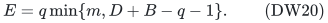

Indeed, up to <code class="math">k=B-q</code>, the exception cap is constant and <code class="math">h_k</code> is
nondecreasing. Beyond that point, a capped constant <code class="math">h_k</code> gives a
decreasing product; on an uncapped interval the derivative is
<code class="math">B-D+1-2k\le1-D-B/3\le0</code>, since <code class="math">q\le B/3</code> and <code class="math">q\ge1</code> implies
<code class="math">B\ge3</code>. Thus <code class="math">k=B-q</code> is a maximizer. If additional resource restrictions
exclude that cardinality, use the restricted maximum in DW16 instead.

### 8.3 The precise published construction and the space claim

Naor, Schulman and Srinivasan,
[*Splitters and near-optimal derandomization*](https://www.wisdom.weizmann.ac.il/~naor/PAPERS/splitters.pdf),
Theorem 7 in Section 5.2, supplies a **locally explicit**
<code class="math">(m,h)</code>-universal set of size <code class="math">2^{h+o(h)}\log m</code>. Section 1.3 defines
local evaluation as computing the bit at a given coordinate of a given
indexed member in polynomial time in the lengths of those indices.
Use the finite index range of that construction; handle <code class="math">m\le1</code> directly.
The linked preliminary paper states Theorem 7 with a proof sketch. It is
a named external theorem used here, not a locally reconstructed or
executably verified universal-set algorithm.

This local guarantee is the property needed here. It lets the algorithm
stream indexed colorings and replay any selected representative position
without storing the universal family. A position uses
<code class="math">O(h_k+\log(m+2)+\log(B+1))</code> bits, and each color is evaluated with
polynomial work on the <code class="math">B&lt;n</code> branch. The merely global listing guarantee
of the paper's Theorem 6 would not, by itself, justify this space claim.

Replacing the coloring family in DW18 now gives
<code class="math">K_k\le2^{h_k+o(h_k)}\mathrm{poly}(B)\log(m+2)</code>. The leading
recovery exponent is <code class="math">h_k q_k</code>. Uniformly over <code class="math">h_k\le2B</code> and
<code class="math">q_k\le B</code>, its additional exponent is <code class="math">o(B^2)</code>, including the
<code class="math">O(B\log(B+1))</code> logarithmic and fallback terms. This proves part 2.
No randomness is sampled by either algorithm, and no new universal-set
construction is claimed.

### 8.4 Projected coloring identities and histogram-sensitive recovery

The upper depth can be reduced further for individual candidate classes.
For a fixed weight/lower-membership class <code class="math">T</code>, form the family of distinct
nonempty sets

<!-- math-display: dfc0b519505e9b7ae3d8928a
\mathcal A_T=\{A\cap T:A\text{ is a retained upper row},\ A\cap T\ne\varnothing\}.
\tag{DW21}
-->
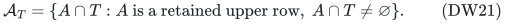

Let <code class="math">m_T=&#124;\mathcal A_T&#124;</code> and let <code class="math">D_T</code> be its maximum chain length.
Projection preserves laminarity, and <code class="math">m_T\le m</code>, <code class="math">D_T\le D</code>.
**Identical projections are merged only as coloring identities. Every
original numeric constraint remains in force.** Their residual capacities
need not agree before counts outside <code class="math">T</code> are fixed.

For example, take <code class="math">T=\{a,b\}</code> with weights one, a further item <code class="math">x</code> of
weight two, and upper rows <code class="math">\{a,b\}</code> of capacity two and
<code class="math">\{a,b,x\}</code> of capacity three. Both project to <code class="math">T</code>. With the outside
item <code class="math">x</code> fixed, their remaining capacities for <code class="math">T</code> are respectively two
and one. Deleting the second numeric constraint on the strength of equal
projections would be wrong. Sharing its color with the first is valid.

Define the class pool by retaining an item exactly when every projected
identity containing it is green, just as in the original catalogue.
For the coloring proof, fix a feasible size-<code class="math">k</code> positive set and a
protected <code class="math">e\in T</code>. Its green identities are the distinct projected
upper rows containing <code class="math">e</code>, at most <code class="math">D_T</code>. The at-most-<code class="math">k-1</code> maximal
original blocking nodes project to disjoint sets; drop empty projections.
Their nonempty red identities avoid <code class="math">e</code>, so none can equal a green
identity. All their members are excluded by coloring that identity red.
Conversely, coloring every green identity green keeps <code class="math">e</code> in the pool.
Thus the complete replacement proof uses at most

<!-- math-display: 8cc55377201db85d938ef975
\min\{m_T,D_T+k-1\}
\tag{DW22}
-->
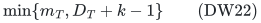

prescribed IDs. In particular, it still checks feasibility against every
original upper row, and its same-class replacement preserves every
original lower total. No numeric row is deleted by this argument.

For each occurring weight <code class="math">w</code>, put

<!-- math-display: e702c548410e42e1098c8e28
h_{k,w}=\max_{T:\,\text{weight}(T)=w}
             \min\{m_T,D_T+k-1\}\le h_k.
\tag{DW23}
-->
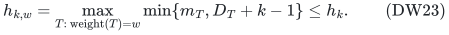

The union of class catalogues for that weight has at most
<code class="math">2^{2h_{k,w}+O(\log(B+1))}L^3</code> positions with the elementary coloring,
or <code class="math">2^{h_{k,w}+o(h_{k,w})}\mathrm{poly}(B)\log(m+2)</code> with the
published indexed coloring. The number of lower classes contributes
only a polynomial factor. Projecting onto all of <code class="math">U_w</code> instead of each
class also gives a valid, sometimes less sharp, bound.

Consider all numeric histograms <code class="math">n=(n_w)_{w\in W}</code> with
<code class="math">\sum_w w n_w\le B</code>, and write <code class="math">k(n)=\sum_w n_w</code>. For a nonempty
histogram, choose a remaining homogeneous weight <code class="math">v</code> maximizing
<code class="math">n_vh_{k(n),v}</code> among weights with <code class="math">n_v&gt;0</code>. Define

<!-- math-display: b47f806b621e0e01b059b1be
E_{\mathrm{proj}}=
\max_{\substack{n\in\mathbb Z_{\ge0}^{W}\\
                 0<\sum_w w n_w\le B}}
\left(\sum_w n_w h_{k(n),w}
       -\max_{v:\,n_v>0}n_v h_{k(n),v}\right),
\tag{DW24}
-->
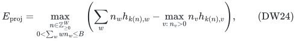

with value zero if no nonempty histogram exists. Resource cardinality
and per-weight availability restrictions may be used to skip additional
histograms.

**Theorem 3.** In the same model, the elementary algorithm takes
<code class="math">2^{2E_{\mathrm{proj}}+O(B\log(B+1))}\mathrm{poly}(H)</code> time,
and the published-family algorithm takes
<code class="math">2^{E_{\mathrm{proj}}+o(B^2)}\mathrm{poly}(H)</code> time, both in
uniform polynomial binary space. Moreover <code class="math">E_{\mathrm{proj}}\le E</code>.
The global <code class="math">q=0</code> case still uses the direct polynomial route before any
histogram enumeration.

For a fixed histogram and chosen <code class="math">v</code>, construct or replay only the
catalogues for exception weights <code class="math">w\ne v</code> with <code class="math">n_w&gt;0</code>. The replacement
proof can be applied only to nonrepresentative items of these weights.
Each replacement keeps its weight and improves the same fixed-cardinality
completed value, while the number of selected exception representatives
increases. It terminates at an optimum whose exception items all appear
in the corresponding catalogues. No catalogue for the omitted weight
<code class="math">v</code> is needed: its original items stay available for homogeneous
completion.

Enumerate <code class="math">n_w</code> positions from each exception weight's catalogue, reject
repeated physical copies, and apply Section 4 on their union <code class="math">J</code>. The
witness optimum appears. Every returned answer is original feasible,
even if its completed histogram differs from the enumerated witness
histogram. A homogeneous histogram requires no catalogue at all.

The leading product of the exception catalogue sizes is twice the
parenthesized expression in DW24 for the elementary construction, or
once that expression for the published construction. Setup for every
used exception weight is absorbed because <code class="math">n_w\ge1</code>. Polynomial class
factors and logarithmic input factors contribute <code class="math">O(B\log(B+1))</code>.

For completeness, enumerate histograms by sorted weight index. At a node
with remaining mass <code class="math">b</code>, loop over counts <code class="math">0,\ldots,\lfloor b/w\rfloor</code>
and recurse on the next weight with the reduced mass. This enumerates
every histogram exactly once, storing at most <code class="math">&#124;W&#124;\le B</code> binary counters
on the <code class="math">B&lt;n</code> branch. The number of histograms of total mass at most <code class="math">B</code>
is at most <code class="math">2^B</code>: map a histogram to its sorted composition of its mass;
there are <code class="math">2^{a-1}</code> positive compositions of mass <code class="math">a</code>, and include the
empty histogram. Thus the histogram loop adds <code class="math">O(B)</code> to the exponent,
already included above. In the <code class="math">B\ge n</code> branch retain the earlier
count-vector fallback, so no binary-large count array is built.

Finally, choose any most frequent weight <code class="math">v_0</code> in a histogram. The choice
of <code class="math">v</code> in DW24 saves at least <code class="math">n_{v_0}h_{k,v_0}</code>. Since every
<code class="math">h_{k,w}\le h_k</code>, the remaining sum is at most
<code class="math">h_k(k-n_{v_0})\le h_kq_k</code>. Taking maxima proves
<code class="math">E_{\mathrm{proj}}\le E</code>. The homogeneous weight chosen by this refinement
need not itself be most frequent: a weight with a more expensive
catalogue can be more useful to leave for polynomial completion.

The [extension checker](../verify/check_quota_extensions.py) compares
projected certificates with literal original-row replacements on 1,500
seeded laminar instances: 67,200 preparation comparisons, 25,797 projected
certificates and 32,473 replacement comparisons. It observes 22,066
strict depth reductions and 23,227 reductions in coloring identities.
Its streamed histogram generator is compared with literal products on
448 weight/budget instances, and it checks 1,368,168 weighted difficulty
profiles against the scalar bound. These are finite checks of the new
geometry and accounting; they do not implement the published universal
family or the earlier valuated representative oracle.

## 9. A boundary for the number of positive weight values

The polynomial one-positive-weight endpoint cannot extend to arbitrary
two-positive-weight instances in this oracle model. The
[two-weight boundary](two-positive-weight-laminar-boundary.md) gives a
complete depth-two construction with weights exactly <code class="math">1,2</code>, nonroot
targets two, and root cap <code class="math">B</code>. Mandatory-base feasibility already needs
<code class="math">2^{\Omega(B)}</code> rank queries. Optional exact optimization has the same
lower bound with all scalar profits one. The optional instances always
have a feasible solution, so the latter statement is explicitly about
optimization. The companion also gives the separately stated ETH
consequence for polynomial readable rank programs.

## 10. Quotas on either side of compatible cuts

The [compatible-cut companion](compatible-cut-quota-extension.md) extends
the same FPT bounds to set families whose pairs are nested, disjoint, or
cover the whole positive ground. It fixes total numeric mass and orients
every row away from one anchor, yielding a laminar instance with an exact
root equality. This includes quotas on either side of unrooted-tree cuts.
The companion states the binary-space implementation and the narrower
one-weight polynomial endpoint for prescribed or forced total mass.

**Attribution:** Yilin Liu and GPT-6 Astra Pro.
