# Exact laminar quotas with arbitrary zero-weight completion costs

**25 October 2026. Complete incremental proof; full internal mathematical reviews completed for checkpoint T.**

This note removes the uniform-zero-scalar restriction from [laminar-common-weight-root-cap-fpt.md](laminar-common-weight-root-cap-fpt.md) (LM). All coordinates may now have arbitrary signed rational scalar coefficients, including coordinates whose common numeric weight is zero. The resource remains one global integral polymatroid, with either optional integer vectors or original-total integer bases. All common-weight laminar quotas and the one scalar objective remain exact.

The new ingredient is a representative lemma for a valuated matroid supplied with an exact overlap-first optimization oracle. Optimal zero completion at a fixed positive cardinality is a valuated matroid by the established weighted Rado-induction theorem. Its possibly enormous matching representation is used only to prove exchange. Every actual optimization uses a compressed polymatroid intersection with just two ranks.

## 1. The full theorem

Let <code class="math">F</code> be a normalized monotone integral polymatroid rank on an explicit ground <code class="math">E</code>, with binary counts and rank values. Integer resource vectors are in <code class="math">P(F)</code>, or in the original base with total <code class="math">R=F(E)</code>. Eligibility masks and binary coordinate domains are allowed; a mandatory preparation always retains its original <code class="math">R</code>.

Let <code class="math">\mathcal L</code> be an explicit laminar family. One nonnegative integer vector <code class="math">w</code> supplies the coefficients of every row:

<!-- math-display: ba2ff711fd03565ed71a003c
l_A\le\sum_{e\in A}w_ex_e\le u_A,
                         \qquad A\in\mathcal L.
\tag{VZ1}
-->
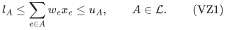

Rows may be upper, lower, or equality requirements. A missing lower bound is zero and a missing upper bound is infinity. An explicit root row gives

<!-- math-display: 8807651e24d9e4a0253baa3b
w\cdot x\le B.
\tag{VZ2}
-->
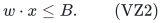

Every finite target is a nonnegative integer. The scalar <code class="math">c\cdot x</code> has arbitrary signed rational coefficients and is minimized or maximized exactly. A bound on this same scalar may be tested by its optimum. No additional independent scalar constraint is assumed.

**Theorem.** Exact feasibility and scalar optimization have a deterministic algorithm with running time

<!-- math-display: cba94bd4b9f69b4c3ce9b62a
2^{O(B^2\log(B+1))}\mathrm{poly}(H)
\tag{VZ3}
-->
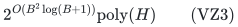

and uniform polynomial binary workspace. The exponential factor is independent of the number of laminar nodes, the numerical resource rank, and the number or scalar diversity of zero-weight coordinates. Here <code class="math">H</code> includes the full explicit binary input and polynomial rank-oracle encoding/bit bounds. Standard exact submodular minimization and integral polymatroid intersection are charged polynomially.

For maximization, negate <code class="math">c</code> and solve the minimization problem. The proof below therefore uses a minimum-cost convention throughout.

## 2. Preparation and optional disposal

Use LM's safe integer preparation. Lower targets exceeding <code class="math">B</code> are impossible. Upper targets can be clipped to <code class="math">B</code>. A positive-weight coordinate with <code class="math">w_e&gt;u_A</code> in a containing upper row cannot be used even once, and is masked. Resource loops are also removed. Zero upper rows mask their positive-weight coordinates. Numeric sets are projected onto the surviving positive ground, with duplicate sets merged and empty positive lower rows rejected. None of these rules removes a zero-weight coordinate merely because its scalar is nonzero.

For an optional resource, first add one disposal coordinate <code class="math">\delta</code>, of numeric weight and scalar zero. On the enlarged ground define

<!-- math-display: 1e4317f4a4278cf838871c03
F^+(A)=
 \begin{cases}
 F(A),&\delta\notin A,\\
 R,&\delta\in A.
 \end{cases}
\tag{VZ4}
-->
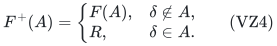

This is an integral polymatroid rank. An optional vector <code class="math">x</code> extends to its total-<code class="math">R</code> base by placing <code class="math">R-x(E)</code> in disposal, and projection back preserves every original row and scalar. Original mandatory resources receive no disposal. All subsequent masks retain the required total <code class="math">R</code>; rank loss rejects a mandatory attempt. In the optional lift, disposal supplies the original total without forcing the retained real resource itself to have rank <code class="math">R</code>.

Hence it is enough to solve the resulting full-base problem. Write <code class="math">P</code> for its positive-weight coordinates and <code class="math">Z</code> for all zero-weight coordinates, including disposal if present. The scalar coefficients on <code class="math">Z</code> are unrestricted. Below <code class="math">F</code> denotes this prepared rank and its full rank is <code class="math">R</code>.

Use the dominance reductions from LM. Retained upper capacities strictly
increase up an inclusion chain, so their depth <code class="math">D</code> is at most <code class="math">B</code>. For
lower rows, aggregate demands bottom-up as
<code class="math">q_A=\max\{l_A,\sum_{C\text{ child of }A}q_C\}</code> and reject when the
dummy-root demand exceeds <code class="math">B</code>. Delete a lower row if its target is at
most the aggregate child demand. Every retained lower node then has a
positive integer charge <code class="math">q_A-\sum_Cq_C</code>, and these charges telescope to
at most <code class="math">B</code>. Thus at most <code class="math">B</code> lower rows remain; the full equivalence and
charge proof are in LM, Section 2.

There are thus at most <code class="math">B+1</code> distinct lower-membership patterns. Candidates will be classified by their common positive weight and this membership pattern. This gives at most

<!-- math-display: de1156baa4d8f65acf5f4a06
G\le B(B+1)
\tag{VZ5}
-->
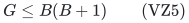

classes. The number of upper nodes may be arbitrarily large; only their depth is bounded. No occupancy vector over all upper nodes is enumerated.

## 3. An abstract valuated replacement lemma

Let <code class="math">U</code> be a finite ground and let

<!-- math-display: c9c43f82d0991a8365478497
p:\binom Uk\longrightarrow\mathbb Q\cup\{+\infty\}
\tag{VZ6}
-->
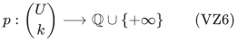

be a minimum-cost valuated matroid of rank <code class="math">k</code>, with nonempty finite domain. Its exchange axiom says that for domain bases <code class="math">S,A</code> and <code class="math">e\in S\setminus A</code>, some <code class="math">f\in A\setminus S</code> satisfies

<!-- math-display: 172ddaf96893acfec51e37a8
p(S)+p(A)\ge p(S-e+f)+p(A-f+e).
\tag{VZ7}
-->
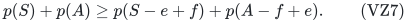

Assume an exact oracle which, for a set <code class="math">Y\subseteq U</code>, returns a domain basis <code class="math">A</code> first maximizing <code class="math">&#124;A\cap Y&#124;</code>, and subject to that minimizing <code class="math">p(A)</code>.

**Overlap replacement lemma.** For any domain basis <code class="math">S</code> and <code class="math">e\in S\cap Y</code>, an element <code class="math">f\in A\cap Y</code> is a feasible no-worse replacement:

<!-- math-display: 5a1dc94554115df53f424a91
p(S-e+f)\le p(S).
\tag{VZ8}
-->
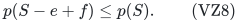

If <code class="math">e\in A</code>, choose <code class="math">f=e</code>. Otherwise apply VZ7. If the exchanged <code class="math">f</code> were outside <code class="math">Y</code>, the domain basis <code class="math">A-f+e</code> would have greater overlap with <code class="math">Y</code>, a contradiction. Thus <code class="math">f\in Y</code>, and <code class="math">A-f+e</code> has the same maximum overlap as <code class="math">A</code>. Optimality on that face gives <code class="math">p(A-f+e)\ge p(A)</code>. Cancelling this inequality in VZ7 proves VZ8.

Notice that <code class="math">A</code> is optimized over **all** domain bases. It is not required to lie in <code class="math">Y</code>. Only the emitted replacement candidates <code class="math">A\cap Y</code> lie in the desired pool.

## 4. Representatives against separately bounded blocker ranks

Let <code class="math">N_1,\ldots,N_D</code> be auxiliary matroids on <code class="math">U</code>, and let <code class="math">T\subseteq U</code> be a candidate pool. The following generator emits a small set of candidates.

Maintain independent sets <code class="math">J_i</code>, initially empty, and form

<!-- math-display: a41be922de5e8afc6d283a13
Y(J)=T\setminus\bigcup_{i=1}^{D}
                                      \mathrm{cl}_{N_i}(J_i).
\tag{VZ9}
-->
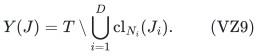

Use the overlap oracle on <code class="math">Y(J)</code> and emit every element of <code class="math">A\cap Y(J)</code>, at most <code class="math">k</code> elements. Stop if this set is empty. If <code class="math">\sum_i&#124;J_i&#124;&lt;d</code>, branch for every emitted <code class="math">f</code> and every <code class="math">i</code>, replacing <code class="math">J_i</code> by <code class="math">J_i+f</code>. Each insertion preserves independence, because <code class="math">f\in Y(J)</code>. The depth is at most <code class="math">d</code>, the branching factor at most <code class="math">kD</code>, and the number of emitted positions is at most

<!-- math-display: 54009be0ef2ddf879ebc5a8e
k\sum_{j=0}^{d}(kD)^j.
\tag{VZ10}
-->
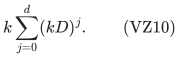

**Representative property.** Suppose <code class="math">S</code> is a domain basis and <code class="math">e\in S\cap T</code>. Let <code class="math">B_i</code> be independent in <code class="math">N_i</code>, with total size at most <code class="math">d</code>, and suppose <code class="math">e</code> is outside all their closures. Some emitted <code class="math">f</code> satisfies VZ8 and lies outside every <code class="math">\mathrm{cl}_{N_i}(B_i)</code>.

To prove it, maintain a recursion path with <code class="math">J_i\subseteq\mathrm{cl}(B_i)</code> and <code class="math">e\in Y(J)</code>. The overlap replacement lemma supplies at least one emitted <code class="math">f</code> with VZ8. If that <code class="math">f</code> passes every blocker test, the proof is complete. Otherwise it lies in <code class="math">\mathrm{cl}(B_i)</code> for some <code class="math">i</code>. Since it is outside <code class="math">\mathrm{cl}(J_i)</code>, one has <code class="math">&#124;J_i&#124;&lt;&#124;B_i&#124;</code>. The branch inserting this particular <code class="math">f</code> in <code class="math">J_i</code> remains legitimate: closure containment persists and <code class="math">e</code> stays outside. A legitimate path cannot exceed the total test rank <code class="math">\sum_i&#124;B_i&#124;\le d</code>. Thus it reaches a passing candidate.

All emitted candidates are tried as branch choices; the algorithm need not identify which one is good for the unknown protected solution. This is the step that replaces the fixed element scores of LM. There is no assumption that <code class="math">S</code> is independent in the auxiliary matroids.

## 5. Applying the lemma to laminar quotas at fixed positive cardinality

Use positive copies so that a set <code class="math">S\subseteq U</code> represents the positive counts. Each copy has its owner's positive weight, scalar coefficient, and numeric memberships. For a fixed <code class="math">k\le B</code>, the finite domain of <code class="math">p_k</code> will consist of the <code class="math">k</code>-sets that admit a full resource completion through <code class="math">Z</code>; its value will be their minimum true scalar cost. Sections 6–7 establish exactly this valuated matroid and its polynomial oracle.

For each upper depth <code class="math">j</code>, define a rank-one partition matroid whose classes are the retained upper nodes at that depth, together with a remainder class. For each weight/lower-membership class <code class="math">T</code>, run Section 4 with these <code class="math">D</code> auxiliary partitions and <code class="math">d=k-1</code>.

Here is why the test-rank budget is enough. Fix a numerically feasible domain basis <code class="math">S</code>, remove <code class="math">e\in S</code> of weight <code class="math">w</code>, and let <code class="math">S^-=S-e</code>. An upper node can newly block an equal-weight replacement only if

<!-- math-display: c56544fc1f162b6e8a888864
u_A\ge w,
           \qquad w(S^-\cap U_A)+w>u_A.
\tag{VZ11}
-->
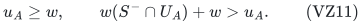

Nodes with <code class="math">u_A&lt;w</code> contain no candidate of this class by individual eligibility. Every node in VZ11 contains a unit of <code class="math">S^-</code>, and none contains <code class="math">e</code>. The inclusion-maximal such nodes are disjoint, number at most <code class="math">k-1</code>, and contain all the relevant blocking nodes. At each depth, choose one unit of <code class="math">S^-</code> in each maximal blocker at that depth; these chosen units form an independent test in that depth's partition. The total test size is at most <code class="math">k-1</code>, and <code class="math">e</code> passes every test.

The representative lemma gives a same-class replacement <code class="math">f</code> that avoids all blocking nodes and satisfies <code class="math">p_k(S-e+f)\le p_k(S)</code>. The valuated domain preserves both resource feasibility and full zero completion. The common weight and lower-membership class preserve every lower total exactly. Avoiding the blocking nodes preserves every upper. Since VZ7 returns <code class="math">f\in A\setminus S</code> when <code class="math">f\ne e</code>, a proper replacement preserves the set's cardinality.

Repeatedly replace any selected copy outside the union of emitted candidates. Each proper replacement increases the number of selected copies in that union, keeps all numeric rows feasible, and does not worsen the true completed scalar. Hence an optimum at this fixed <code class="math">k</code> is represented in the union.

For <code class="math">1\le k\le B</code>, the emitted-position count satisfies

<!-- math-display: fe37f0128228e8714d15cece
K_k\le B(B+1)\,k\sum_{j=0}^{k-1}(kD)^j
                     =2^{O(B\log(B+1))}.
\tag{VZ12}
-->
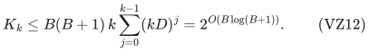

Enumerating <code class="math">k</code>-sets from these positions, testing the numeric rows, and computing their exact completion values costs at most <code class="math">(K_k+1)^k\mathrm{poly}(H)</code>. Summing over <code class="math">k\le B</code> gives VZ3. The zero-positive-cardinality case is handled separately by exact optimization on the zero ground.

## 6. Optimal zero completion is a valuated matroid

Give positive coordinate <code class="math">e</code> a pool <code class="math">U_e</code> of

<!-- math-display: aa6faf0b3c3894caa5949b35
b_e=\min\{F(\{e\}),\lfloor B/w_e\rfloor\}
\tag{VZ13}
-->
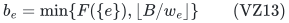

distinct copies. These represent all possible root-feasible positive counts. Let <code class="math">U=\bigcup_{e\in P}U_e</code>. For <code class="math">&#124;S&#124;=k</code>, define <code class="math">p_k(S)</code> as the minimum of the true scalar over all original-total bases whose positive units are exactly <code class="math">S</code>, using arbitrary integer zero counts on <code class="math">Z</code>. Set <code class="math">p_k(S)=+\infty</code> if no such completion exists.

We now apply a checked primary theorem, rather than assume a new projection property. Husić, Loho, Smith and Végh, *On complete classes of valuated matroids*, TheoretiCS 3 (2024), Definition 1.1, define an R-minor valuation by a maximum-weight matching from <code class="math">X\cup W</code> into a full basis of a right-hand matroid. Their Theorem 2.9 gives the underlying weighted network-induction property, and their contraction closure fixes the mandatory left set <code class="math">W</code>. The maximum-value exchange axiom appears as (1b); negating the value yields the minimum-cost form VZ7. The [primary article](https://theoretics.episciences.org/14792/pdf) was checked at these statements.

For the mapping, consider the finite natural matroid of the entire prepared polymatroid <code class="math">F</code>: it has <code class="math">F(\{e\})</code> conceptual right-hand copies for every coordinate and rank exactly <code class="math">R</code>. This is the **full** natural matroid, even if only some positive copies are allowed on the left. Its size may be numerically enormous and it will never be constructed by the algorithm.

On the left, use one vertex for each allowed positive copy <code class="math">u\in U</code>, with a single private edge to that same right-hand positive unit. Add <code class="math">R-k</code> dummy vertices, each adjacent to every right-hand zero-weight unit. Give an edge ending at a unit owned by <code class="math">e</code> weight <code class="math">-c_e</code>. A matching whose left endpoint set is <code class="math">S</code> together with all dummies and whose right endpoint set is a basis chooses exactly those positive units and a legal full zero completion. Its maximum weight is exactly <code class="math">-p_k(S)</code>.

Thus, whenever the finite domain is nonempty, <code class="math">-p_k</code> is the R-minor valuation in the cited definition, and <code class="math">p_k</code> satisfies VZ7. If the domain is empty, the compressed oracle below detects that and the cardinality <code class="math">k</code> is skipped. Allowing a conceptual graph with a huge finite dummy set is a proof device only; no running-time or workspace statement is charged to its construction.

## 7. The compressed overlap-first oracle

All actual computations use the coordinate ground

<!-- math-display: 6272cc821aff346978c7e4d6
U\ \dot\cup\ Z,
\tag{VZ14}
-->
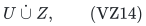

where positive copies have individual cap one and zero coordinates retain their original binary counts. Define one integral polymatroid rank on this mixed ground by

<!-- math-display: afca1bacf09082b040868b07
G(A)=\min_{C\subseteq P}
      \left[F\bigl((A\cap Z)\cup C\bigr)
               +\sum_{e\in P\setminus C}|A\cap U_e|\right].
\tag{VZ15}
-->
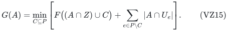

This is the shared projection rank with a box cap of one on each positive copy. Its independent region is exactly the vectors that aggregate to <code class="math">P(F)</code> and satisfy those unit caps. It is the standard box-cap polymatroid rank; VZ15 also evaluates it by submodular minimization on the original positive-coordinate ground. No zero units are expanded.

For an attempted cardinality, first guard

<!-- math-display: ad4bbb460ac25b77462572a2
0\le k\le\min\{R,|U|\}.
\tag{VZ16}
-->
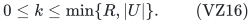

Use **one** additional partition-count rank, with positive-group cap <code class="math">k</code> and zero-group cap <code class="math">R-k</code>. Intersect it with <code class="math">P(G)</code> and require total <code class="math">R</code>. This integral face forces both group totals to be exact. Each positive coordinate is zero or one, so its positive part is a <code class="math">k</code>-set in the domain of <code class="math">p_k</code>. Conversely every such domain set and every full completion lie on this face. An empty face detects an empty domain.

To obtain the overlap-first oracle for <code class="math">Y\subseteq U</code>, clear the denominators of the scalar coefficients, obtaining integer coefficients <code class="math">\widetilde c</code>, and put

<!-- math-display: 50a899c5ce337b93805f5b41
C_{\max}=\max_e|\widetilde c_e|,
                 \qquad M=2RC_{\max}+1.
\tag{VZ17}
-->
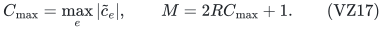

Every full allocation has integer scalar in <code class="math">[-RC_{\max},RC_{\max}]</code>. Minimize on the same integral face

<!-- math-display: 8d370e39786145b4869e52ec
\widetilde c\cdot z
                                  -M\sum_{u\in Y}z_u.
\tag{VZ18}
-->
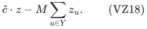

One extra overlap unit dominates every possible true-cost difference. Thus the returned positive set <code class="math">A</code> maximizes <code class="math">&#124;A\cap Y&#124;</code> and then minimizes <code class="math">p_k(A)</code>. The reward is attached to individual positive copies; their cap one in <code class="math">G</code> is essential. Zero coordinates keep their original arbitrary scalar coefficients.

The oracle does **not** restrict all positive choices to <code class="math">Y</code>, and it does not add an exact <code class="math">Y</code>-count as a third rank. The remaining laminar quotas are not imposed on this overlap query either: its returned basis need not satisfy them. The same-class replacement and blocker argument restores those requirements for the protected feasible solution. The oracle's only ranks are <code class="math">G</code> and the two-group partition. Standard deterministic weighted integral-polymatroid intersection supplies this optimization with polynomial binary complexity.

Fix deterministic tie rules for replay. If a canonical positive set is desired, multiply VZ18 by <code class="math">2^{&#124;U&#124;+1}</code> and add a distinct subset-bit score <code class="math">\sum_{j=0}^{&#124;U&#124;-1}2^j z_{u_j}</code>. Since positive entries are binary, this tertiary term cannot change the overlap or true-cost ordering and uniquely fixes the positive subset. In the branch where this oracle is used, <code class="math">&#124;U&#124;</code> is polynomial in the original input, as proved next.

For a final candidate <code class="math">S</code> of size <code class="math">k</code>, mask every positive copy outside <code class="math">S</code>, use the same positive-total <code class="math">k</code>/zero-total <code class="math">R-k</code> partition, and optimize the true scalar. The positive unit caps force every copy of <code class="math">S</code> to be chosen. This evaluates <code class="math">p_k(S)</code> and returns an attaining binary zero completion without extra constraints or a third polymatroid.

## 8. Uniform polynomial binary workspace and all-input time

Let <code class="math">n=&#124;P&#124;</code>. If <code class="math">B=0</code> or <code class="math">n=0</code>, all positive counts vanish. Reject any positive lower requirement and optimize the scalar on the zero resource, retaining original total <code class="math">R</code> in the lifted base problem. Rank loss gives infeasibility. This is a polynomial problem, including arbitrary signed zero costs.

If <code class="math">B\ge n\ge1</code>, use a direct count-vector fallback instead of constructing positive copies. Stream

<!-- math-display: 80f3510bd9f31e5f1003ecd0
0\le x_e\le\lfloor B/w_e\rfloor
                                    \quad(e\in P).
\tag{VZ19}
-->
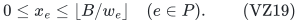

There are at most <code class="math">(B+1)^n\le(B+1)^B</code> vectors. Test their numeric rows and positive resource independence. For a surviving fixed <code class="math">x</code>, define

<!-- math-display: e39e1b99b0005e8f5c3ce904
h_x(A)=\min_{C\subseteq P}
                         \bigl(F(A\cup C)-x(C)\bigr),
                                  \qquad A\subseteq Z.
\tag{VZ20}
-->
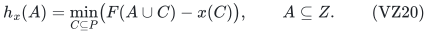

As proved in LM, this is an integral residual polymatroid and describes all compatible zero completions. Its full rank cannot exceed <code class="math">R-x(P)</code>. A full completion exists exactly when equality holds; then minimum-cost greedy base optimization on <code class="math">h_x</code>, using the original signed zero coefficients, gives the exact best completion. Rank evaluations are submodular minimizations with binary modular terms. Only <code class="math">n</code> counters, one best vector, and polynomial oracle workspace are retained. This branch costs <code class="math">2^{O(B\log(B+1))}\mathrm{poly}(H)</code>.

If <code class="math">1\le B&lt;n</code>, construct the at-most-<code class="math">nB&lt;n^2</code> positive copies and keep all zero counts compressed. Every attempted <code class="math">k</code> is at most <code class="math">B</code>, every representative recursion has depth at most <code class="math">k-1&lt;n</code>, and every auxiliary partition list is explicit-input size. The rank formula VZ15 and the integral intersections have polynomial-size grounds and polynomial-bit coefficients. Clearing rational denominators and the overlap reward VZ17 also use polynomially many bits. The optional canonical subset score has <code class="math">O(&#124;U&#124;)</code> bits, not <code class="math">2^{&#124;U&#124;}</code> stored bits.

Do not store the representative union. An emitted position is encoded by a candidate-class index, a recursion path, and the final index of an element in the sorted set <code class="math">A\cap Y</code>. Each path step gives an emitted-element index at most <code class="math">k</code> and a partition index at most <code class="math">D</code>. Replay the path using the deterministic oracle and discard an index if a step has no such emitted element. Recompute candidates whenever required. The number of all possible encoded positions is bounded by VZ12, including invalid positions.

Enumerate <code class="math">k</code>-tuples of those indices, reject repeated copies and failed numeric rows, and evaluate exact completion on each surviving set. Every actual representative set is included. The stored indices use <code class="math">O(B^2\log(B+1)+B\log(H+1))</code> bits, and the current <code class="math">J_i</code> have total size at most <code class="math">k-1</code>. All are polynomial in <code class="math">H</code> in this branch. Invalid paths, failed tuples, empty completion faces, and empty cardinality domains are counted within the same <code class="math">2^{O(B^2\log(B+1))}\mathrm{poly}(H)</code> bound on arbitrary inputs.

The output is the positive vector together with an attaining zero vector, both in binary. For an originally optional instance, discard only the designated disposal coordinate. No real mandatory unit or scalar contribution is discarded.

## 9. Exactness and the earlier zero-cost obstruction

Fix an original optimum after optional disposal if needed, and let <code class="math">k</code> be its positive cardinality. Its zero portion must already be a minimum-cost completion of its positive set: otherwise replacing it by a cheaper completion would leave all numeric rows unchanged and improve the optimum. Hence its scalar is <code class="math">p_k(S)</code>. The representative replacement theorem moves it to the finite candidate union without worsening <code class="math">p_k</code>, and the final compressed oracle returns an original feasible allocation attaining that value. Conversely every returned allocation satisfies the original resource, rows, total convention, and scalar definition. Therefore the optimum is exact.

The nonuniform-zero example in LM remains a valid counterexample to choosing representatives using positive element costs alone. It does not refute this theorem: the overlap oracle compares the **completed** value <code class="math">p_k</code>. At <code class="math">B=1</code>, it chooses the cheaper full completion directly, even when the positive coefficients tie.

The exponentially necessary <code class="math">2^{\Omega(B)}</code> rank-oracle dependence from LM's depth-two example still applies, since it has strictly positive weights and scalar zero. It does not match the present upper exponent, and no optimal <code class="math">B^2\log B</code> dependence is asserted.

## 10. Scope and primary-source positioning

The result uses one common numeric weight per coordinate across the laminar rows, nonnegative integer numeric weights, an explicit root cap, one global integral resource, and one exact rational scalar. Row-dependent numeric weights, overlapping nonlaminar families, another unrelated global rank, or a second independent unbounded scalar condition require further arguments. Rational common weights can be placed on a supplied common integer grid, with the normalized root cap used as the parameter.

The valuated exchange property is an established theorem, not a newly claimed characterization. The exact primary interface is Husić–Loho–Smith–Végh, [*On complete classes of valuated matroids*, TheoretiCS 3 (2024), Article 24](https://theoretics.episciences.org/14792/pdf), Definition 1.1, axiom (1b), and Theorem 2.9 (there attributed to Murota's network-induction theorem). Only their induced-valuation statement is needed; their structural negative results are not used.

The bounded-blocker recursion follows the representative-method perspective of Huang–Ward, with the new overlap-optimal-basis replacement argument written in Sections 3–4. LM records the directly checked [author version](https://www.di.ens.fr/~cchuang/work/matchoid.pdf) and the relevant 2026 reachable-kernel comparison. Count-profile and rank-parameter methods have substantial prior literature; this note makes no priority claim for those foundations.

The new proved composition is: arbitrary scalar zero completion becomes a valuated resource; one polynomial compressed overlap oracle supplies cost-aware candidate replacements; only the disjoint upper-blocker partitions need bounded-rank recursion. It removes the scalar-uniformity restriction while retaining the exact original model and the same root-cap running-time and binary-space bounds.

## 11. Incremental status

This is a separate stronger theorem in checkpoint T. It does not change the proofs of LM or [uniform-zero-scalar-laminar-extension.md](uniform-zero-scalar-laminar-extension.md), or any frozen checkpoint. The elementary uniform-cost arguments remain useful independent special-case derivations. Full internal reviews covered the valuation mapping, overlap cancellation, individual-copy box caps, true-cost oracle, and all-input binary-space implementation. These reviews are not formal verification or external peer review.
