# Sharp deterministic restrictions for sparse packing with an oracle matroid

## 1. The construction-time and retained-size tradeoff

Let <code class="math">E</code> be an explicitly listed item ground, let <code class="math">M</code> be an arbitrary
independence-oracle matroid, and let the packing constraints be

<!-- math-display: ecbd64bfd859e55a68138bb6
|S\cap A_j|\le b_j,\qquad b_j\in\mathbb Z_{\ge0}.
\tag{SP1}
-->
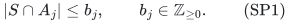

Feasible sets are independent in <code class="math">M</code> and have cardinality at most <code class="math">k</code>.
The matroid is on the selectable items. Items may share the same packing
support, and the packing rows may overlap arbitrarily.

Remove loops and items in zero-capacity rows, and put
<code class="math">\kappa=\min\{k,r_M(E)\}</code> on the remaining ground. Rows with
<code class="math">b_j\ge\kappa</code> are redundant and may be removed. Write
<code class="math">\Lambda(e)=\{j:e\in A_j\}</code> and
<code class="math">\delta=\max_e&#124;\Lambda(e)&#124;</code> for this prepared row system.
The cases <code class="math">\kappa=0</code> and an empty ground return the empty set. If
<code class="math">\delta=0</code>, ordinary ordered greedy gives at most <code class="math">\kappa</code> items and
preserves the best profit at every cardinality by no-worse-profit
replacements. If exactly equal-profit replacements are required, retain
one basis per profit class instead; its size is at most <code class="math">\sum_a r_a</code>.

For the remaining cases, let <code class="math">h</code> be any valid bound on the number of
packing rows saturated by a feasible context of at most <code class="math">\kappa-1</code>
items. The simple choice is

<!-- math-display: 9a97bcb4787ae73e619fc372
h=\delta(\kappa-1).
\tag{SP2}
-->
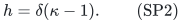

Section 3 gives a computable, sometimes much smaller, capacity-sensitive
choice. Define

<!-- math-display: 83399dc1d0e5b94ba7bd2b0f
C=\binom{h+\delta}{\delta},\qquad
\Theta_{\kappa,h,\delta}
  =\sum_{i=0}^{h}(\delta\kappa)^i.
\tag{SP3}
-->
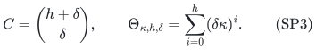

For the preprocessing bound, write
<code class="math">\Gamma(h,\delta)=(h+\delta)^{h+\delta}/(h^h\delta^\delta)</code>
when <code class="math">h\delta&gt;0</code>, and <code class="math">\Gamma(h,\delta)=1</code> otherwise, and put
<code class="math">L=\lfloor\kappa\Gamma(h,\delta)\rfloor</code>.

**Theorem 1 (unweighted, sharp retained size).** There is a deterministic
algorithm retaining at most <code class="math">\min\{&#124;E&#124;,\kappa C\}</code> original items
with the following property: for every original feasible <code class="math">S</code> and every
<code class="math">e\in S</code>, there is an <code class="math">f</code> in the retained ground, outside <code class="math">S-e</code>, such
that <code class="math">S-e+f</code> is feasible. The construction uses

<!-- math-display: bedc8dbf31f8f5845a1be98a
O\!\left(|E|\min\{|E|,L+2\}\Theta_{\kappa,h,\delta}\right)
\tag{SP4}
-->
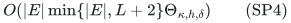

independence-oracle calls and parameter-polynomial bookkeeping per call.
For fixed <code class="math">\kappa,h,\delta</code>, the oracle-call bound is linear in
<code class="math">&#124;E&#124;</code>.
In particular, the choice SP2 gives
<code class="math">2^{O(\delta\kappa\log(\delta\kappa+2))}&#124;E&#124;^{O(1)}</code>
time in the oracle model. For fixed <code class="math">\delta</code>, the retained size is
<code class="math">O_\delta(\kappa^{\delta+1})</code>.

The size <code class="math">\kappa\binom{\delta\kappa}{\delta}</code> obtained from SP2 is
worst-case exact for this original-context single-replacement property,
even with a partition resource matroid and unit packing capacities.

**Theorem 2 (a bounded number of profit values).** Suppose items have fixed
signed rational profits taking <code class="math">q</code> distinct values. For each profit class
<code class="math">E_a</code>, let <code class="math">r_a</code> be its rank in the rank-<code class="math">\kappa</code> truncation of <code class="math">M</code>.
There is a deterministic restriction of size at most

<!-- math-display: 3d7304c6066a70a7d14c1770
\min\left\{|E|,\ C\sum_a r_a\right\}
\le \min\{|E|,q\kappa C\}
\tag{SP5}
-->
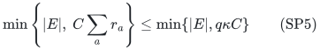

with the same call bound SP4. Every single replacement can have
**exactly the same profit** as the protected item. Consequently it
preserves the optimum fixed profit at every attainable cardinality up to
<code class="math">\kappa</code>, including negative profits and arbitrary ties.

**Theorem 3 (arbitrary signed profits).** For any fixed signed rational
profits, a deterministic restriction retains at most

<!-- math-display: 433f1a96397ad3cb5a83afab
K=\min\{|E|,\lfloor\kappa\Gamma(h,\delta)\rfloor\}
\tag{SP5a}
-->
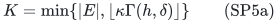

original items. For every original feasible <code class="math">S</code> and every <code class="math">e\in S</code>,
a retained item <code class="math">f\notin S-e</code> makes <code class="math">S-e+f</code> feasible and has profit
at least that of <code class="math">e</code>. Thus the optimum profit is preserved at every
attainable cardinality, with no restriction on the number of distinct
profit values. The construction uses at most
<code class="math">&#124;E&#124;\Theta_{\kappa,h,\delta}</code> independence queries after
sorting by nonincreasing profit and permanent ID. With SP2 and
<code class="math">\kappa\ge2</code>, its support is at most

<!-- math-display: d0b9ff652ef6132d9d01805f
\kappa\left(
\frac{\kappa^\kappa}{(\kappa-1)^{\kappa-1}}
\right)^\delta
\le e^\delta\kappa^{\delta+1}.
\tag{SP5b}
-->
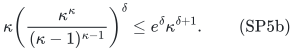

The worst-case exponent <code class="math">\delta+1</code> is exact for the original-context
replacement property, by the SP10 construction below. The Bernoulli
constant in SP5a is not asserted to be optimal. Theorem 2 still gives
exactly equal-profit replacements and can have a smaller support when
there are few profit classes.

The [original-basis refinement](../../matroid-failure-summaries/manuscripts/weighted-oracle-prefix-fpt-construction.md#a-stronger-bound-using-the-original-basis)
can replace <code class="math">\Gamma(h,\delta)</code> in SP5a by the strictly smaller
<code class="math">\Psi(h,\delta)</code> defined there, with a further improvement from the
actual label degrees of the ordinary greedy basis. For example,
<code class="math">h=2,\delta=1</code> gives at most <code class="math">5\kappa</code> rather than
<code class="math">27\kappa/4</code> items. The simpler SP5b remains valid and has the same
optimal exponent for fixed <code class="math">\delta</code>.

These are fixed-parameter constructions. They do not replace the
[uniform polynomial-time sunflower reduction](deterministic-sparse-packing-oracle-kernel.md)
as a uniform polynomial-time guarantee. That reduction retains
<code class="math">O_\delta(\kappa^{2\delta+1})</code> items, or
<code class="math">O_\delta(\kappa^{2\delta})</code> for distinct supports. Here the smaller
ground is obtained by allowing the explicit exponential preprocessing
factor SP4. Both outputs keep the original resource oracle and item
encodings; neither is a parameter-only bit kernel.

## 2. The exact failure-summary primitive

The prerequisite is the arbitrary-matroid theorem in
[Sharp matroid and submodular failure summaries](../../matroid-failure-summaries/proof.md).
For a rank-<code class="math">r</code> oracle matroid whose elements have at most <code class="math">d</code> labels, it
retains at most <code class="math">r\binom{h+d}{d}</code> original elements and preserves rank
after every deletion of at most <code class="math">h</code> label classes. A rank equality between
a restriction and its parent is also equality of their matroid closures.

For clarity, its deterministic construction does not need to enumerate
all label subsets. To decide whether an element <code class="math">e</code> is necessary in a
current restriction, search for at most <code class="math">h</code> labels disjoint from
<code class="math">\Lambda(e)</code> whose removal leaves <code class="math">e</code> outside the closure of all other
survivors. At a search node choose a basis <code class="math">B</code> of the other current
survivors. If <code class="math">B</code> does not span <code class="math">e</code>, the current failed labels are a
witness. Otherwise every possible witness must fail a label on <code class="math">B</code>:
if <code class="math">B</code> survives intact, it continues to span <code class="math">e</code>.

Branch on those labels, excluding labels on <code class="math">e</code>, and reduce the remaining
failure budget by one. There are at most <code class="math">dr</code> branches per level and
depth at most <code class="math">h</code>. Every node needs a greedy basis computation and one
independence test. Thus one deletion test costs
<code class="math">O(&#124;E&#124;\sum_{i=0}^{h}(dr)^i)</code> oracle calls. A single reverse-deletion
pass suffices: a witness protecting a retained element persists under
later deletions of other elements. The resulting restriction is
inclusion-minimal, and the circuit-blocking set-pair inequality in the
cited proof gives the exact binomial size. The search is exhaustive and
deterministic, with no random coloring, field representation, or
unimplemented separation oracle.

A depth-first implementation stores only the current branch and its
current surviving grounds. The budget is clipped to the number of
occurring labels, so this uses polynomial input workspace; an exponential
memoization table is unnecessary.

For Theorem 2 run the procedure separately inside each profit class,
using the rank-<code class="math">\kappa</code> truncation of the original resource matroid.
This gives SP5 and the simpler quadratic bound because
<code class="math">\sum_a &#124;E_a&#124;^2\le &#124;E&#124;^2</code>. Restrictions are only used inside the
summary construction; all replacement contexts in the next section
belong to the original resource matroid.

### A preliminary prefix summary makes preprocessing linear in input size

The ordered-basis tree described next first produces a prefix summary
of size at most <code class="math">K_0=\min\{&#124;E&#124;,L\}</code>, using at most
<code class="math">&#124;E&#124;\Theta_{\kappa,h,\delta}</code> queries. It in particular preserves
all required final ranks. Run the rank-only reverse-deletion procedure
on just these <code class="math">K_0</code> items. Rank preservation composes, and the second
pass is inclusion-minimal, so the sharp retained-size bound is unchanged.
The total number of independence queries is at most

<!-- math-display: 9c1f92678c12e941d6de9a0d
\left(|E|+K_0(K_0+1)\right)\Theta_{\kappa,h,\delta}.
\tag{SP4a}
-->
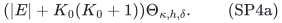

For equal-profit classes, use the same two stages separately. If
<code class="math">K_a\le\min\{&#124;E_a&#124;,L\}</code> is the preliminary support of class
<code class="math">E_a</code>, their total query count is at most

<!-- math-display: daa6cab713695cd640ac1f71
\left(|E|+\sum_a K_a(K_a+1)\right)\Theta_{\kappa,h,\delta}
\le |E|(L+2)\Theta_{\kappa,h,\delta}.
\tag{SP4b}
-->
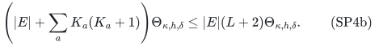

The inequality uses <code class="math">\sum_a K_a\le&#124;E&#124;</code> and <code class="math">K_a\le L</code>.
Combining this construction with direct reverse deletion gives SP4.
Neither stage enumerates all labels or all their failure subsets.

### The ordered primitive for arbitrary profits

For Theorem 3 use the
[deterministic weighted oracle prefix construction](../../matroid-failure-summaries/manuscripts/weighted-oracle-prefix-fpt-construction.md)
on the whole rank-<code class="math">\kappa</code> truncation, with item order given by
nonincreasing profit and permanent ID. It preserves the closure of
every surviving prefix after every failure set of size at most <code class="math">h</code>.
Its output is exactly the union of the canonical greedy bases under
those failures, and its size is at most
<code class="math">\kappa\Gamma(h,\delta)</code>.

At a node with already failed set <code class="math">F</code>, the construction scans the
original ordered input to compute its canonical surviving basis
<code class="math">B_F</code>, retains that basis, and branches on its at most
<code class="math">\delta\kappa</code> touched labels until <code class="math">h</code> failures have been spent.
For any target failure, either a remaining target label touches the
current basis and supplies a branch, or that basis survives unchanged
and is already the target's canonical basis. Thus the tree returns
exactly the canonical-basis union, using at most
<code class="math">&#124;E&#124;\Theta_{\kappa,h,\delta}</code> independence queries.

The companion also gives a one-pass alternative: test each next item
against the retained earlier prefix using the failure-witness search.
It returns the same set with at most
<code class="math">&#124;E&#124;(K+1)\Theta_{\kappa,h,\delta}</code> queries. Neither construction
uses randomness or a representation.

For completeness, the size factor is the existing Bernoulli bound.
If an item has a witness <code class="math">F_e</code>, independently failing every label with
probability <code class="math">p</code> makes it a greedy rank increment whenever all labels
of <code class="math">F_e</code> fail and all labels on the item survive. This event has
probability at least <code class="math">p^h(1-p)^\delta</code>. The expected total rank is at
most <code class="math">\kappa</code>, even though the random failure set used in this proof
may exceed <code class="math">h</code>. Choosing <code class="math">p=h/(h+\delta)</code> gives SP5a. For SP2,
the expression simplifies to SP5b, using
<code class="math">(1+1/(\kappa-1))^{\kappa-1}\le e</code>.

## 3. Saturated-row accounting and the replacement proof

Fix an original feasible <code class="math">S</code> and a protected item <code class="math">e\in S</code>. Put
<code class="math">I=S-e</code>, and let

<!-- math-display: 3d32be013319644a760918f2
F_I=\{j:|I\cap A_j|=b_j\}
\tag{SP6}
-->
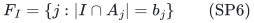

be the saturated rows. All remaining capacities are positive. Each row
in <code class="math">F_I</code> contains at least one context item, so
<code class="math">&#124;F_I&#124;\le\delta&#124;I&#124;\le\delta(\kappa-1)</code>. Feasibility of <code class="math">I+e</code>
implies <code class="math">F_I\cap\Lambda(e)=\varnothing</code>.

Apply the failure summary to the profit class containing <code class="math">e</code> (or to all
items in the unweighted case). The surviving retained items span <code class="math">e</code>
in the rank-<code class="math">\kappa</code> truncation. But <code class="math">e</code> is outside the closure of <code class="math">I</code>
there: <code class="math">I+e</code> is independent and has size at most <code class="math">\kappa</code>. If every
retained survivor belonged to the closure of <code class="math">I</code>, so would <code class="math">e</code>.
Therefore a retained survivor <code class="math">f</code> lies outside that closure. It is
outside <code class="math">I</code>, and <code class="math">I+f</code> is independent in the original matroid.

Since <code class="math">f</code> has no label in <code class="math">F_I</code>, adding it does not use a saturated
packing row. Every other integer packing row has at least one unit of
slack, so SP1 remains feasible. The class construction also makes
<code class="math">c(f)=c(e)</code>. This proves the original-context replacement property.
It is not necessary for <code class="math">I</code> to lie in the summary or in an intermediate
restriction.

Replacing omitted items one at a time terminates: each proper replacement
inserts a retained item outside the current set and removes an omitted
one. Cardinality and profit remain unchanged throughout. This proves the
optimization consequences without treating a rank-only summary as a
cost-prefix summary.

For Theorem 3, let <code class="math">P_e</code> be the ordered prefix ending at the protected
item. The surviving retained items in <code class="math">P_e</code> span <code class="math">e</code>, by the ordered
primitive. The same closure argument gives a retained survivor
<code class="math">f\in P_e</code> outside the closure of <code class="math">I</code>. Its position guarantees that
its profit is at least the profit of <code class="math">e</code>. It also avoids every saturated
row, so the original-context replacement remains feasible. Iteration
preserves cardinality and never decreases profit. A restriction cannot
improve the original optimum, so the best retained profit equals the
original optimum at every cardinality. This applies to signed profits
and does not require dropping negative-profit items.

### A computable capacity-sensitive budget

Define the exact rational row load of an item by

<!-- math-display: 1f7138abaf63271188e1584c
\rho(e)=\sum_{j\in\Lambda(e)}\frac1{b_j}.
\tag{SP7}
-->
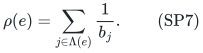

Let <code class="math">H_{\kappa-1}</code> be the sum of the largest at most <code class="math">\kappa-1</code>
such loads in the prepared ground. Then one may choose

<!-- math-display: d48e4f7a8218354a322fe1b2
h=\min\left\{L,\lfloor H_{\kappa-1}\rfloor\right\},
\tag{SP8}
-->
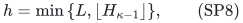

where <code class="math">L</code> is the number of occurring row labels. Indeed,

<!-- math-display: 185d0d7ce77ab519a0a13701
|F_I|
 =\sum_{j\in F_I}\frac{|I\cap A_j|}{b_j}
 \le\sum_j\frac{|I\cap A_j|}{b_j}
 =\sum_{e\in I}\rho(e)
 \le H_{\kappa-1}.
\tag{SP9}
-->
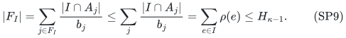

Sorting these rational loads and taking their sum has polynomial bit
complexity; binary capacities are never expanded. If every retained row
has capacity at least <code class="math">b</code>, this gives
<code class="math">h\le\lfloor\delta(\kappa-1)/b\rfloor</code>. The smaller budget improves
both the support SP3 and the branching time SP4. It also improves the
sunflower reduction's layer count to <code class="math">h+1</code>, as its deletion proof uses
only an upper bound on the number of saturated rows.

## 4. Exact worst-case sharpness

Assume <code class="math">\kappa,\delta\ge1</code>. Take a row universe <code class="math">U</code> of size
<code class="math">\delta\kappa</code>, with capacity one in every row. Use <code class="math">\kappa</code>
resource classes, each with partition-matroid capacity one. For every
class <code class="math">i</code> and every <code class="math">\delta</code>-subset <code class="math">A\subseteq U</code>, introduce one
item <code class="math">(i,A)</code> incident with exactly the rows of <code class="math">A</code>. All profits are zero.

There are exactly

<!-- math-display: f90603349030411d0e2e8a43
\kappa\binom{\delta\kappa}{\delta}
\tag{SP10}
-->
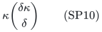

items. Fix any protected <code class="math">(i,A)</code>. Partition <code class="math">U\setminus A</code> into
<code class="math">\kappa-1</code> disjoint <code class="math">\delta</code>-sets, and assign one to each resource
class other than <code class="math">i</code>. Their items form a feasible context <code class="math">I</code>.
Any item extending <code class="math">I</code> in the resource matroid must belong to class <code class="math">i</code>.
Its support must avoid every occupied row in <code class="math">U\setminus A</code>, hence
be a <code class="math">\delta</code>-subset of <code class="math">A</code>. Its support is therefore exactly <code class="math">A</code>,
so it is the protected item itself.

Every original item is forced by some original feasible context. Thus
every restriction with the single-replacement property must retain all
SP10 items. This proves exact sharpness for that property. It is not a
lower bound for preserving only one no-failure optimum: in an unweighted
instance, one maximum feasible solution alone would preserve that much
weaker objective.

## 5. Useful specializations

For a graph matching with an arbitrary matroid on original edge records,
delete graph loops and put a capacity-one packing row at each vertex. Every edge has two labels,
so the unweighted restriction has at most

<!-- math-display: 2d6a349fc2b4a6a094dc21db
\kappa\binom{2\kappa}{2}=O(\kappa^3)
\tag{SP11}
-->
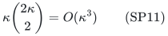

original edges, in deterministic
<code class="math">2^{O(\kappa\log(\kappa+2))}&#124;E&#124;^{O(1)}</code> oracle time. The graph may
be nonbipartite and may have parallel records. The resource is on edges,
not on their endpoints. With <code class="math">q</code> fixed profit values multiply the support
bound by <code class="math">q</code> if exactly equal-profit replacements are desired.
For arbitrary signed profits, Theorem 3 gives at most
<code class="math">e^2\kappa^3</code> original edges with no-worse-profit replacements and
the same FPT parameter dependence. The same argument treats hyperedge
records of maximum size <code class="math">\delta</code> and arbitrary positive integer vertex
capacities.

When SP8 gives <code class="math">h\le1</code>, an additional stronger endpoint is available.
The arbitrary-matroid one-label-failure theorem preserves fixed cost
prefixes in uniform polynomial time and uses at most <code class="math">(\delta+1)r</code>
elements. Apply it once to the entire rank-<code class="math">\kappa</code> resource in
nonincreasing profit order. Its surviving earlier-prefix closure supplies
a no-worse-profit replacement by the same proof as Section 3. Thus

<!-- math-display: 2f3b6e94a2eb505d7912ed63
|R|\le(\delta+1)\kappa
\tag{SP12}
-->
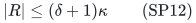

holds with arbitrary many signed profit values and uniform polynomial
preprocessing in this bounded-conflict case. If <code class="math">h=0</code>, ordinary ordered
greedy improves SP12 to <code class="math">\kappa</code>. The special one-failure prefix theorem
has a better support and a uniform polynomial construction; for <code class="math">h\ge2</code>
Theorem 3 instead uses the Bernoulli support with FPT preprocessing.
The exact-binomial weighted extension is false for arbitrary matroids,
as the [two-failure obstruction](../../matroid-failure-summaries/manuscripts/weighted-oracle-two-failure-obstruction.md)
shows. That obstruction does not invalidate SP5a.

## 6. Evidence, dependencies, and comparison

The [finite checker](../verify/check_sharp_packing.py) implements the
deterministic deletion-witness search as an oracle procedure and compares
its output with exhaustive original feasible contexts. It separately
checks the ordered arbitrary-profit reduction, the forcing construction,
and the capacity-load inequality. The
[weighted-prefix checker](../../matroid-failure-summaries/verify/check_weighted_prefix.py)
tests the new ordered primitive against complete rank tables, including
the nonrepresentable two-failure example. These are finite correctness
checks; the statements for arbitrary input sizes are proved above and
in the cited failure-summary theorems.

The mathematical prerequisites are the matroid rank/closure axioms, the
internally proved circuit-blocking summary theorem, and its one-failure
ordered-greedy endpoint. The arbitrary-profit version additionally uses
the internally proved retained-prefix witness construction and the
existing Bernoulli size bound. No external algorithmic implementation
is required beyond the stated original independence oracle.

Huang, Kakimura, Kobayashi and Terao,
[*Polynomial Kernels with Reachability for Weighted d-Matroid
Intersection*, arXiv:2603.17345v1](https://arxiv.org/html/2603.17345v1),
gives randomized polynomial-time reachable kernels, including
<code class="math">\widetilde O(\kappa^3)</code> for matching with an edge matroid. Its
deterministic and randomized guarantees, construction times, and
reachability quantifiers are recorded in the
[sunflower manuscript](deterministic-sparse-packing-oracle-kernel.md).
The present results supply an exact binomial unweighted bound, an
<code class="math">O_\delta(\kappa^{\delta+1})</code> arbitrary-profit bound, and deterministic
original-context replacements with explicitly exponential preprocessing.
They do not assert a uniform-polynomial derandomization of that paper or
a new lower bound for ordinary optimization kernels.

**Attribution:** icekylinx and GPT-6 Astra Pro.
