# A direct hash-and-profile algorithm for sparse exact root-bounded quotas

**25 October 2026. Increment U. Complete manuscript-level proof with independent internal review.** This is a separate direct proof of the sparse model treated by [bounded-frequency-root-cap-valuated-fpt.md](bounded-frequency-root-cap-valuated-fpt.md). It does not invoke a representative catalogue, a valuated-matroid completion theorem, or an expansion into resource units.

## 1. Exact model and theorem

Let <code class="math">F:2^E\to\mathbb Z_{\ge0}</code> be an integral, normalized, monotone submodular function supplied by a value oracle. Write
<!-- math-display: 4c30af0752e212f5d8035778
P(F)=\{x\in\mathbb R_{\ge0}^E:x(A)\le F(A)\ \forall A\subseteq E\},
\qquad R=F(E).
-->
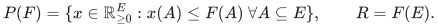
The domain is either the integer points of <code class="math">P(F)</code>, or the integer points of its base face <code class="math">x(E)=R</code>. All counts, ranks, coefficients and targets are binary encoded.

A distinguished row is
<!-- math-display: 89d2a3b0da29f2eef28cffcd
\sum_{e\in E} w_e x_e\le B_0,                                      \tag{HP1}
-->
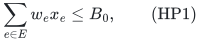
where <code class="math">w_e</code> is a nonnegative integer. Every other row has nonnegative integer coefficients and one of the relations
<!-- math-display: 439619c0b9e2b5cebc067195
a^j x\le u_j,\qquad a^j x=\tau_j,\qquad a^j x\ge\ell_j.              \tag{HP2}
-->
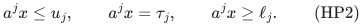
All finite targets are nonnegative and at most <code class="math">B</code>, where <code class="math">B\ge B_0</code>. Each coordinate appears with a positive coefficient in at most <code class="math">\Delta</code> nonroot rows. We require
<!-- math-display: cf5637e44bdb431e2ea73b65
w_e=0\ \Longrightarrow\ a^j_e=0\quad\hbox{for every nonroot row }j.  \tag{HP3}
-->
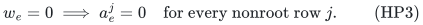
The scalar objective is one arbitrary signed rational linear functional <code class="math">c^\top x</code>, minimized exactly. Maximization is obtained by replacing <code class="math">c</code> with <code class="math">-c</code>. One further upper or lower threshold on this same scalar is consequently tested exactly; no simultaneous optimization of several arbitrary scalar objectives is asserted.

Let <code class="math">H</code> include the entire explicit row and coefficient encoding, the scalar encoding, and the bit lengths of rank values. There is a deterministic exact algorithm, with uniform polynomial binary space, taking
<!-- math-display: d7b268084695a0686cf94d72
2^{\,O((\Delta+1)B_0
 \log((\Delta+1)B_0(B+2)+2))}\mathrm{poly}(H)                 \tag{HP4}
-->
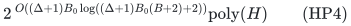
time and oracle calls when <code class="math">B_0\ge1</code>. In particular, for <code class="math">\Delta\ge1</code> and <code class="math">B_0\le B</code>, this is
<!-- math-display: 6109dd08ffc66ac8b1e91182
2^{O(\Delta B\log(\Delta B+2))}\mathrm{poly}(H).               \tag{HP5}
-->
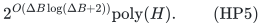
The case <code class="math">B_0=0</code> is polynomial time.

The result is exact feasibility and exact scalar optimization. There is no quota violation, budget augmentation, or rounding error.

The companion *disjoint_row_root_target_sharp_lower.md* proves the sharp constant-frequency <code class="math">B\log B</code> boundary already for disjoint weighted equality rows of frequency one. The separate *valuated_sparse_quota_sunflower_kernel.md* supplies deterministic positive-capacity preprocessing for this same root-charged model.

## 2. Optional-to-base conversion and preprocessing

Optional resource use can be converted to a mandatory base without altering any real assignment or scalar cost. Add a disposal coordinate <code class="math">z</code>, with all quota coefficients and scalar coefficient zero, and define
<!-- math-display: 53fb98e611701b216af5b6fb
F^+(A)=
\begin{cases}
 F(A),&z\notin A,\\
 R,&z\in A.
\end{cases}                                                     \tag{HP6}
-->
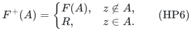
This is an integral polymatroid rank. Its integer bases are exactly
<code class="math">(x,R-x(E))</code> for integer <code class="math">x\in P(F)</code>. Thus it suffices to solve the base problem, keeping the original total <code class="math">R</code>. The disposal coordinate is included among the zero-root coordinates below. Mandatory inputs do not receive this disposal coordinate. From this point, <code class="math">E,F</code> denote the resulting base instance, with disposal included when needed.

Split each equality into an upper and a lower inequality. Let <code class="math">\delta\le2\Delta</code> bound the resulting number of nonroot positive incidences per coordinate. Delete zero lower targets. A zero upper target forbids every coordinate on which that row is positive. Also forbid a positive-root coordinate with <code class="math">w_e&gt;B_0</code>, or one individually exceeding an upper target. These operations impose coordinate bounds <code class="math">x_e=0</code>; they do **not** reduce the required original total <code class="math">R</code>.

For a positive lower target <code class="math">\ell_j</code>, replace its coefficient by
<!-- math-display: c07a555707a8800b8d6fe042
\bar a^j_e=\min\{a^j_e,\ell_j\}.                                  \tag{HP7}
-->
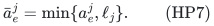
This is equivalent on integer nonnegative counts. Indeed, if a used coordinate has original coefficient at least <code class="math">\ell_j</code>, one integer unit already meets the row; otherwise every used coefficient is unchanged. We use this equivalence only for integer witnesses and integer outputs, not as a claim about unchanged fractional feasible regions.

Let <code class="math">P=\{e:w_e&gt;0\}</code> after permanent masks and let <code class="math">Z</code> contain the remaining zero-root coordinates. Every feasible solution uses
<!-- math-display: 42119d25f8f5d1b7a4cc5b39
k=x(P)\le B_0.                                                   \tag{HP8}
-->
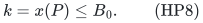
Every positive lower row needs at least one used coordinate with positive coefficient. Consequently the number <code class="math">m_L</code> of positive lower rows must satisfy
<!-- math-display: eef1ecf56be336e23244ad75
m_L\le\delta B_0.                                                \tag{HP9}
-->
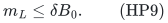
If this fails, or a positive lower row has no permitted coordinate, the instance is infeasible. Empty upper rows can be deleted.

If <code class="math">B_0=0</code>, every positive-root coordinate is forbidden. Positive lower requirements then make the instance infeasible; otherwise the remaining problem is exact signed linear optimization on the original-total resource face restricted to <code class="math">Z</code>, a polynomial-time problem. This handles <code class="math">R=0</code> as well.

From now on <code class="math">B_0\ge1</code>. No allocation of an array of length <code class="math">B_0</code>, <code class="math">B</code>, or <code class="math">R</code> is used.

## 3. A polynomial-size family of hashes for used upper rows

Let <code class="math">m_U</code> be the number of remaining upper rows. A feasible solution touches at most
<!-- math-display: f6e12c36c8d6acc6e2826fa2
K=\min\{\delta B_0,m_U\}                                        \tag{HP10}
-->
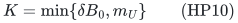
different upper rows. If <code class="math">m_U=0</code>, omit hashing and all upper-color data.

For <code class="math">m_U\ge1</code>, encode the upper-row IDs as distinct binary polynomials of degree less than
<!-- math-display: c246ccc835f1963e19db984d
L=\lceil\log_2(m_U+1)\rceil.
-->
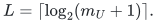
Choose a power of two <code class="math">q=2^d</code> satisfying
<!-- math-display: ac2e83c11af44204d50be17c
4(K+1)^2(L+1)\le q<8(K+1)^2(L+1).
-->
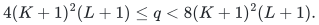
For every monic binary polynomial <code class="math">g</code> of degree <code class="math">d</code>, define
<!-- math-display: b2eeba7d264c9511cff5d28c
h_g(j)=j(X)\bmod g(X),                                          \tag{HP11}
-->
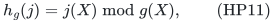
regarded as a <code class="math">d</code>-bit color.

This family has <code class="math">q</code> hashes. For every set of at most <code class="math">K</code> upper-row IDs, one hash is injective on it.

To prove the last statement, it is enough to consider the irreducible polynomials among the enumerated moduli. There are at least <code class="math">2^{d-1}/d</code> monic irreducibles of degree <code class="math">d</code>. Each nonzero difference of two row-ID polynomials, of degree less than <code class="math">L</code>, has fewer than <code class="math">L/d</code> irreducible degree-<code class="math">d</code> divisors. At most
<code class="math">\binom K2 L/d</code> irreducibles can therefore cause a collision on the prescribed set. The displayed choice of <code class="math">q</code> leaves an irreducible that causes none.

For completeness, the standard count used here follows from
<code class="math">2^d=\sum_{s\mid d}sN_s</code>, with <code class="math">N_s</code> the number of monic degree-<code class="math">s</code> irreducibles, and <code class="math">sN_s\le2^s</code>. The sum for proper divisors is bounded by
<code class="math">\sum_{s=1}^{\lfloor d/2\rfloor}2^s\le2^{d-1}</code>; the few smallest degrees satisfy the same inequality directly.

**Implementation precision.** Irreducibility need not be tested. We enumerate all monic degree-<code class="math">d</code> polynomials, since polynomial remainder is defined for every such modulus and the existence proof guarantees a good irreducible somewhere in the list. Moreover <code class="math">K\le m_U</code>, so <code class="math">q</code> is polynomial in the explicit row input, even when <code class="math">B_0</code> is numerically enormous. Only colors actually occupied by input rows are stored.

## 4. Guessing used colors and their capacities

Fix one hash <code class="math">h</code>. Enumerate every palette <code class="math">\mathcal C</code> of at most <code class="math">K</code> actually occupied colors, and every map
<!-- math-display: d618140f2e3da1b39d560e96
\beta:\mathcal C\to\{1,\ldots,B\}.                               \tag{HP12}
-->
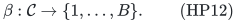
A positive coordinate <code class="math">e</code> is retained in this iteration only if:

1. every upper row incident with <code class="math">e</code> has its color in <code class="math">\mathcal C</code>;
2. for every incident upper row <code class="math">j</code>, <code class="math">u_j\ge\beta_{h(j)}</code>.

For a retained coordinate, form its hashed coefficient vector
<!-- math-display: 1fbe843ff46cb982a82e9f9b
b_{e,t}=\sum_{\substack{j\text{ upper}\\h(j)=t}}a^j_e
 \qquad(t\in\mathcal C).                                        \tag{HP13}
-->
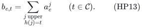
If <code class="math">b_{e,t}&gt;\beta_t</code> for some <code class="math">t</code>, mask <code class="math">e</code> in this iteration as well.

The sum in HP13 is essential. When several actual upper rows collide, using the maximum coefficient or retaining one arbitrary row would not justify the soundness proof below.

Each remaining positive coordinate has a type
<!-- math-display: 35b535846b955e1eb3dc70a2
\mathrm{type}(e)=
\left(w_e,\;(\bar a^j_e)_{j\text{ lower}},\;
                (b_{e,t})_{t\in\mathcal C}\right).               \tag{HP14}
-->
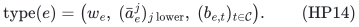
Group the **actual input coordinates** by these types. The zero-root coordinates form one separate group. All their nonroot coefficients are zero by HP3.

## 5. Exact profiles and one integral recovery problem

Let the actual positive type groups be <code class="math">E_1,\ldots,E_M</code>. Enumerate nonnegative integer counts <code class="math">n_1,\ldots,n_M</code> with total
<code class="math">k=\sum_i n_i\le\min\{B_0,R\}</code>. Keep a profile only if:

- its root-weight sum is at most <code class="math">B_0</code>;
- its capped lower coefficient sum meets every lower target;
- for every palette color <code class="math">t</code>, its hashed coefficient sum is at most <code class="math">\beta_t</code>.

For each kept profile impose group upper bounds
<!-- math-display: bff6f183f79090648b1cfd57
x(E_i)\le n_i\quad(1\le i\le M),\qquad x(Z)\le R-k,               \tag{HP15}
-->
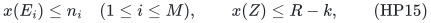
and forbid all coordinates masked in this iteration. Intersect these partition bounds with the original resource polymatroid and require
<!-- math-display: fc72a122c170f8c1e39a3251
x(E)=R.                                                        \tag{HP16}
-->
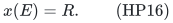
The caps in HP15 sum to <code class="math">R</code>; therefore HP16 forces every group bound to equality. This remains correct if a prescribed group is empty, if <code class="math">Z</code> is empty, or if restriction has lowered the available resource rank: the intersection then correctly reports infeasibility where necessary.

Both the resource rank and the partition rank are integral polymatroids. Their intersection is integral. Linear optimization on its maximum-total face, using the signed objective <code class="math">c^\top x</code>, is polynomial time with the usual rank/submodular-minimization oracles and rational linear optimization. Thus a successful profile returns an actual integer point of exact minimum scalar value on that profile.

This is the only recovery operation. It jointly determines positive counts and all zero-root completion, pays all their true scalar contributions, and preserves the original required base total. No auxiliary scalar objective is optimized in place of the true one.

## 6. Soundness, completeness and exact optimization

### Soundness

Take an output of a successful profile. Its root and lower rows hold by the profile checks and the integer equivalence HP7.

Consider an actual upper row <code class="math">j</code>. If no permitted coordinate touches it, its load is zero. Otherwise <code class="math">h(j)\in\mathcal C</code>, and every selected incident coordinate passed the guard <code class="math">u_j\ge\beta_{h(j)}</code>. Its total actual row load satisfies
<!-- math-display: 7853e7900a03111680d7b3b4
\sum_e a^j_e x_e
 \le\sum_e b_{e,h(j)}x_e
 \le\beta_{h(j)}
 \le u_j.                                                       \tag{HP17}
-->
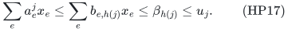
The first inequality follows from nonnegativity and HP13. It remains valid when many unrelated actual rows collide. Both halves of each original equality therefore hold.

Resource feasibility, original total and actual scalar cost are guaranteed by HP15–HP16. Optional inputs are recovered by dropping disposal only.

### Completeness

Fix any feasible original integer witness <code class="math">x^*</code>, not necessarily one of optimal scalar value. Let <code class="math">J^*</code> be its touched upper rows. By HP8–HP10, <code class="math">&#124;J^*&#124;\le K</code>. Select a hash injective on <code class="math">J^*</code>, let
<code class="math">\mathcal C=h(J^*)</code>, and set
<!-- math-display: 48c49e7fb5f11efc0f4552e6
\beta_{h(j)}=u_j \quad(j\in J^*).                                \tag{HP18}
-->
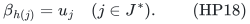
These choices are among the enumerated iterations.

Every used positive coordinate passes the incident-row capacity guards, and its hashed coefficients at used colors equal its actual coefficient on the unique corresponding touched upper row. In particular it passes the individual hashed-capacity masks. Its actual type counts satisfy all profile checks. The original witness, including its zero-root coordinates and disposal if present, belongs to HP15–HP16 for that profile.

### Scalar optimum

Apply completeness to a scalar-optimal original witness. The exact optimizer for its profile has objective at most that witness's value. Every output is feasible for the original problem, so taking the best output gives precisely the original optimum. If every profile fails, no feasible witness exists.

The proof therefore establishes an exact algorithm, rather than only a promise oracle or a one-sided gap procedure.

## 7. Time bound, including unsuccessful iterations

For a fixed hash, the number of palette/cap choices is at most
<!-- math-display: e7541b7b4aa4631d87aef51e
\sum_{h=0}^{K}\binom{q}{h}B^h\le(qB+1)^K,                       \tag{HP19}
-->
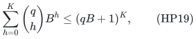
with the usual value <code class="math">1</code> when <code class="math">K=0</code>. Counting only occupied colors can only reduce this number.

Each type has root weight in <code class="math">[B_0]</code>, at most <code class="math">\delta</code> nonzero lower entries, and at most <code class="math">\delta</code> nonzero upper-color entries; all these entries are at most <code class="math">B</code> after the guards. Also <code class="math">m_L,&#124;\mathcal C&#124;\le\delta B_0</code>. A convenient upper bound for the total possible type count is
<!-- math-display: e02d0326865e8cc980e8732b
M_{\max}\le
 B_0(1+\delta B_0B)^{2\delta}.                                   \tag{HP20}
-->
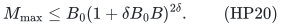
For <code class="math">\delta=0</code>, interpret the right side as <code class="math">B_0</code>.

The number of all type-count profiles of total at most <code class="math">B_0</code>, including profiles that fail numerical checks or fail resource recovery, is at most
<!-- math-display: bd3056ede24a99e74e2699d0
\binom{M_{\max}+B_0}{B_0}
 \le\left(\frac{e(M_{\max}+B_0)}{B_0}\right)^{B_0}.                \tag{HP21}
-->
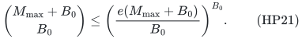
We use the actual <code class="math">M\le &#124;E&#124;</code> groups to enumerate. A depth-first traversal with partial total at most <code class="math">B_0</code> has at most <code class="math">M+1</code> times the number of final count vectors: every partial vector extends by zeros, so each fixed-depth prefix has an injective zero-extension into the final vectors. Numerical pruning only decreases the work. This charges unsuccessful profiles and all partial enumeration work.

Using <code class="math">q=O((K+1)^2\log(m_U+2))</code>, HP19–HP21 give an exponential contribution bounded by HP4, apart from a factor
<code class="math">(\log(m_U+2))^{O(K+1)}</code>. This is absorbed into the same parameter dependence and a fixed polynomial in the explicit input. For <code class="math">a\ge1</code> and <code class="math">y\ge1</code>,
<!-- math-display: 27249afb6ba22346a5ee2d1e
y^a\le(a/e)^a e^y;
-->
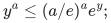
apply it with <code class="math">y=\ln(m_U+2)</code> and adjust constants for the logarithm base. The exponent of the final polynomial in <code class="math">H</code> is independent of <code class="math">\Delta,B_0,B</code>.

The <code class="math">q</code> hashes and every rank/optimization call have the already charged polynomial factors. Since <code class="math">\delta\le2\Delta</code>, this proves HP4–HP5.

## 8. Uniform polynomial binary space

The algorithm does not materialize the possible-type bound HP20, a hash-range array of length <code class="math">q</code>, or any natural-matroid unit expansion.

- A hash is stored as its degree-<code class="math">d</code> modulus. Row hashes are polynomial remainders of binary row IDs.
- Palettes are subsets of the actually occupied row colors, at most <code class="math">m_U</code> in number. Their capacities are binary counters.
- Actual types are computed from at most <code class="math">&#124;E&#124;</code> input coordinates, using the explicit lower rows and occupied palette.
- Count enumeration has depth at most <code class="math">&#124;E&#124;</code>, with binary counters of <code class="math">O(\log(B_0+1))</code> bits.
- The full resource total <code class="math">R</code> appears only in binary arithmetic and in the original-total face. Zero-root multiplicity is not expanded.
- Integral-polymatroid intersection and rational linear optimization use polynomial input/oracle working space.

Thus the space is polynomial in the original input encoding even when <code class="math">B_0,B,R</code> greatly exceed the number of coordinates. No separate large-<code class="math">B_0</code> enumeration fallback is needed for this direct algorithm.

## 9. Public antecedents and the appropriate comparison

This proof uses standard color coding / separating hashes, exact count profiles, and weighted integral-polymatroid intersection. It should not be described as a new representative-family paradigm.

A close deterministic framework antecedent is van Bevern, Tsidulko and Zschoche, *Representative families for matroid intersections, with applications to location, packing, and covering problems*, Discrete Applied Mathematics 298 (2021). Their Section 5 uses perfect hash families, color-partition enumeration, and matroid intersection with arbitrary oracle facility matroids; their general set-packing theorem separately requires linear representations. See [the primary full version](https://arxiv.org/html/1806.11527v4), Proposition 5.9, Lemma 5.7 and Proposition 5.12.

Huang, Kakimura, Kobayashi and Terao, *Polynomial Kernels with Reachability for Weighted d-Matroid Intersection* (2026), already prove a randomized <code class="math">O(k^3\log k)</code> reachable kernel for weighted matching subject to one arbitrary matroid on the edges. Enumerating its <code class="math">k</code>-subsets gives a <code class="math">2^{O(k\log k)}</code> exact parameterized algorithm. Their [primary Section 6](https://arxiv.org/html/2603.17345v1) is an important existing special case; the present theorem does not first establish that endpoint.

For arbitrary weighted two-row-incidence demands, Ahmadian and Friggstad's [ICALP 2017 paper](https://drops.dagstuhl.de/entities/document/10.4230/LIPIcs.ICALP.2017.55) already studies generalized demand matching under an arbitrary oracle matroid, with approximation and bicriteria guarantees. That model is a direct antecedent for weighted sparse packing, while the guarantee and parameterization differ.

Finally, the <code class="math">\Delta=2</code>, unit-upper-capacity subclass already contains matroid-constrained bipartite matching. The grid/G-matroid construction in Doron-Arad, Kulik and Shachnai, [*You (Almost) Can't Beat Brute Force for 3-Matroid Intersection*](https://arxiv.org/html/2412.02217v2), specializes to the hidden perfect-matching family of size <code class="math">k!</code>. It yields the <code class="math">2^{\Omega(B_0\log B_0)}</code> oracle obstruction on that subclass. No new lower-bound priority is claimed here.

The present proof's explicit additional scope is the simultaneous combination of row-dependent bounded integer coefficients, mixed exact relations, a bounded positive root mass, arbitrary many rows, a binary integral-polymatroid resource with original base totals, and arbitrary signed scalar costs on zero-root completion. This is a verified internal theorem with identified antecedents; this bounded source check is not an exhaustive novelty determination.

## 10. What this proof does not claim

- Root-zero coordinates may not occur positively in other quota rows.
- The frequency bound is on nonzero **column** incidences, not on the number of coordinates inside a row.
- Arbitrary large nonnegative coefficients are allowed in the input, but upper-ineligible coordinates are masked and lower coefficients are capped against the integer target before type enumeration.
- The exact scalar is one functional. Several independent arbitrary rational budgets are not covered by this scalar optimization statement.
- The theorem does not replace its parameterized exponential time by polynomial time.
- The direct proof is independent of the valued exchange proof; agreement of their bounds is an internal cross-check, not evidence of external priority.
