# Two weighted coordinate orders: a sharp largest-target classification

**25 October 2026. Complete theorem and proof; full internal mathematical reviews completed for checkpoint T.**

The [native client](../reference/README.md) implements the four-label copied
profiles and exact signed original-total recovery. Its
[realization proof](../reference-orders-families-realization.md) charges
concrete Bland LP time separately from the paid polynomial primitive below.

Two arbitrary coordinate orders with a common nonnegative integer weight vector admit exact mixed prefix-quota optimization in

<!-- math-display: 5355eff1f1cb977f1e31b0dd
\boxed{2^{O(B\log(B+2))}\mathrm{poly}(H),
        \qquad B=\max_j b_j,}
 \tag{TP1}
-->
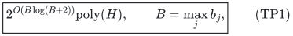

with uniform polynomial binary workspace. There is one global integral polymatroid resource, and the scalar objective is an arbitrary signed rational functional optimized exactly. Optional independent vectors and original-total bases are both covered. The sum of all targets, the number of input rows, and the binary resource rank need not be bounded by <code class="math">B</code>.

The exponential order is necessary for general rank oracles, already for unit weights and equality rows. A separate readable rank-program/circuit reduction gives the corresponding exclusion under deterministic ETH. This lower construction is a cumulative-prefix encoding of the known paving-plus-two-partition framework, not a new general framework for three-matroid intersection.

When the second order reverses the first, the upper bound improves to <code class="math">2^{O(B)}\mathrm{poly}(H)</code>. Thus mixed prefixes and suffixes on one line have a smaller worst-case exponent than two unrestricted orders.

## 1. Model and precise scope

Let <code class="math">F</code> be one normalized monotone integral polymatroid rank on an explicit ground <code class="math">E</code>. Original integer resource vectors belong either to <code class="math">P(F)</code> or to the original base <code class="math">B(F)</code>, with required total <code class="math">R=F(E)</code>. Ranks, counts and coordinate capacities are binary encoded. Eligibility masks are allowed.

Two linear orders <code class="math">\prec_1,\prec_2</code> are explicitly given. The same nonnegative integer weight <code class="math">w_e</code> is used by every row in both orders. Writing <code class="math">P_{i,p}</code> for a prefix of order <code class="math">i</code>, the rows have the form

<!-- math-display: 8e3da61c92ab9f3799c11844
\sum_{e\in P_{i,p}} w_e x_e\ \rho\ b,
       \qquad i\in\{1,2\},\quad
       \rho\in\{\le,=,\ge\},\quad b\in\mathbb Z_{\ge0}.
 \tag{TP2}
-->
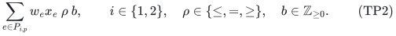

The rows are explicitly listed; not every prefix needs a row. Their endpoints, targets and relations are part of the input. Put <code class="math">B=\max b</code>, with <code class="math">B=0</code> for an empty row list. An arbitrary rational scalar <code class="math">c^\top x</code>, whose coefficients may have either sign, is minimized or maximized exactly. A threshold on that same scalar is decided by its extremum. An additional different unbounded scalar constraint is not included.

The complete binary size is <code class="math">H</code>. Rank, submodular minimization and exact integral-polymatroid intersection computations are implemented with their polynomial input-bit and oracle costs charged. The result does not grant a free stronger oracle. No rank-sized unit expansion is performed.

## 2. Dominance compression, masks and zero cases

Split every equality into its upper and covering halves. For a duplicate endpoint and direction, retain the strongest target. Empty-prefix tests are immediate. The nonnegative cumulative weights are nondecreasing along each order.

Consequently a later upper row with no larger target dominates an earlier upper row, while an earlier covering row with no smaller target dominates a later covering row. In each order retain upper suffix-record minima and cover prefix-record maxima. After removal of zero-target rows as described next, the retained positive targets increase strictly with the endpoint in each family. If <code class="math">u_i</code> and <code class="math">\ell_i</code> are the retained upper and cover counts in order <code class="math">i</code>, then

<!-- math-display: 80a06e0c2ba36d14608297a8
u_i\le B,\qquad \ell_i\le B.
 \tag{TP3}
-->
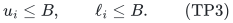

Zero covers are automatic. A zero upper target masks every positive-weight coordinate in its prefix and is then automatic. Also mask any coordinate with <code class="math">w_e&gt;B</code> that occurs in any original upper or equality prefix. Its positive integer use would violate that row. One may additionally mask <code class="math">w_e&gt;b</code> in an upper row of target <code class="math">b</code>, but this stronger mask is not required below. A coordinate is not masked just for occurring in a cover. Keep zero-weight coordinates; their resource mass and signed scalar contributions can matter.

For optional vectors, add one zero-weight, zero-scalar disposal coordinate after the original ground in both orders, outside the original prefixes. Its rank is <code class="math">F(S)</code> when disposal is absent and <code class="math">R</code> when it is present. Completing an original optional vector by <code class="math">R-x(E)</code> disposal units gives an exact base representation. Original mandatory bases receive no disposal. All masks preserve the same required total <code class="math">R</code>; reject prepared rank loss. Denote the prepared resource rank by <code class="math">F_0</code>.

All these operations preserve the original feasible family and objective. They use sorting and lists of original endpoints, without an array indexed through <code class="math">B</code>. At <code class="math">B=0</code>, only the necessary masks remain and exact scalar optimization is polynomial. Assume <code class="math">B\ge1</code> below.

## 3. Four shared labels and one common capped weight

Define

<!-- math-display: c59c4382f70b6a428c3777f5
v_e=\min\{w_e,B\}.
 \tag{TP4}
-->
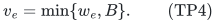

For an eligible coordinate appearing in an upper row, <code class="math">v_e=w_e</code>. On integer vectors, capping at <code class="math">B</code> preserves every covering predicate of target at most <code class="math">B</code>: if a used unit has weight at least <code class="math">B</code>, its capped weight alone reaches the target; otherwise the contributions are unchanged. This statement is about integer units, and is not asserted as an equivalence on arbitrary fractional vectors.

Give every original coordinate up to four copies <code class="math">(e,a_1,a_2)</code>, with <code class="math">a_i\in\{0,1\}</code>. Zero-weight coordinates need only one copy. If an order has no cover rows, its marking bit can be fixed to zero. Every copy keeps the full original scalar coefficient <code class="math">c_e</code>. If <code class="math">\pi</code> forgets the labels, use the shared rank

<!-- math-display: e964c07feaee0911f656e7f7
F^{\uparrow}(Y)=F_0(\pi(Y)).
 \tag{TP5}
-->
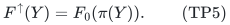

This is a normalized monotone integral polymatroid rank. Projection preserves unions, and <code class="math">\pi(Y\cap Z)\subseteq\pi(Y)\cap\pi(Z)</code>; submodularity and monotonicity of <code class="math">F_0</code> establish the required inequality. It does not create separate resource capacities for the different copies.

Aggregation <code class="math">x_e=\sum_{a_1,a_2}z_{e,a_1,a_2}</code> is an exact equivalence of the resource regions, including total-<code class="math">R</code> bases. In one direction, for an original subset <code class="math">A</code>, use the full inverse image <code class="math">\pi^{-1}(A)</code> in the copied rank inequality. In the other, for any copied subset <code class="math">Y</code>, one has <code class="math">z(Y)\le x(\pi(Y))\le F_0(\pi(Y))</code>. Aggregation preserves the original scalar exactly.

Every upper row retains its full true coefficient on all copies in its prefix. A cover row in order <code class="math">i</code> has coefficient <code class="math">v_e</code> on copies with <code class="math">a_i=1</code> in its prefix, and zero on other copies. Thus each nonzero auxiliary column has the form

<!-- math-display: 289487b160ab98624a2e0045
v_e\mathbf1_A
 \tag{TP6}
-->
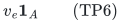

for some nonempty set <code class="math">A</code> of retained row labels. The common original weight is essential here.

Any integer copied point satisfying these auxiliary upper and cover rows projects to an original feasible point: upper values agree, and true covers dominate credited covers. This includes original equalities because both halves were retained or implied by retained rows. No chronological restriction on recovered marking bits is needed for soundness.

## 4. One canonical marked prefix for each order

Fix an arbitrary original feasible integer base, including its legitimate disposal completion if the original problem was optional. For each order with covers, let <code class="math">C_i</code> be the largest retained cover target, so <code class="math">1\le C_i\le B</code>. Conceptually scan its positive-weight units in that order using capped weights <code class="math">v_e</code>, and mark the prefix through the first unit reaching <code class="math">C_i</code>. It exists by the cover of target <code class="math">C_i</code>. Its mass obeys

<!-- math-display: a6f5e9c57687a0bf51f79911
C_i\le M_i\le C_i+B-1.
 \tag{TP7}
-->
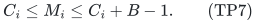

Every cover in order <code class="math">i</code> receives enough credit. If its prefix contains the cut, it receives all marked mass, at least <code class="math">C_i</code>. If it precedes the cut, all its original capped positive contributions are marked and its capped cover is satisfied. A cut partway through copies of the last coordinate of a prefix belongs to the first case.

Assign each unit its two marking bits. This simultaneous labeling uses the four shared copies and preserves the original counts and scalar. For repeated units of one coordinate, one can fix the same conceptual order of their indices for both scans; the two resulting binary labels coexist without any compatibility requirement. If an order has no covers, use bit zero throughout.

This is a completeness argument only. The algorithm stores no such unit sequence and never loops through a binary-sized <code class="math">R</code>.

## 5. Bounding the union of all nonzero auxiliary mass

For one order <code class="math">i</code>, let <code class="math">P_{U,i}</code> be its last retained upper prefix when it exists. It contains all coordinates occurring in any retained upper row, and its true weighted mass in the original witness is at most <code class="math">B</code>.

Suppose there are covers. If the marking cut is inside <code class="math">P_{U,i}</code>, every marked positive unit lies there, and every passive unit with a nonzero contribution to this order also lies there. Hence the union of units with a nonzero auxiliary contribution to this order has capped mass at most <code class="math">B</code>.

If the cut is after <code class="math">P_{U,i}</code>, every positive unit of that upper prefix is marked. All nonzero contributions to this order are then contained in the marked units, with mass at most <code class="math">C_i+B-1</code>. With no uppers, this latter bound applies directly. With no covers, the relevant units lie only in <code class="math">P_{U,i}</code>, with mass at most <code class="math">B</code>. An order with no retained rows contributes no mass.

Set <code class="math">C_i=0</code> when there are no covers, and use the convenient allowance

<!-- math-display: b9aff6f95f6be852fdd95635
L_i=B+\max\{C_i-1,0\}\le2B-1,
 \qquad
 W=L_1+L_2\le4B-2.
 \tag{TP8}
-->
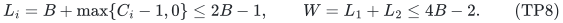

One can set <code class="math">L_i=0</code> for an order with no rows, but it is unnecessary for the bound. A copied unit has a nonzero full auxiliary column only if it contributes to at least one order. Counting its common capped weight once, the union bound proves that the canonical representative satisfies

<!-- math-display: 98eb2f5282166ec1402bf175
\sum_{A,v}v h_{A,v}\le W,
 \tag{TP9}
-->
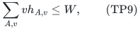

where <code class="math">h_{A,v}</code> counts copied units whose column is <code class="math">v\mathbf1_A</code>. Units counted in both per-order unions cause no difficulty. The quantity in TP9 is weight per nonzero unit, not the sum of entries in its column. The latter could multiply the bound by the number of rows and is not used.

Every original feasible scalar value therefore occurs in a copied feasible profile with TP9. Conversely, every feasible profile, regardless of how it was marked, projects to an original feasible vector of the same scalar value.

## 6. Quadratically many colors and the profile count

In order <code class="math">i</code>, a passive bit gives the suffix of retained upper rows containing the coordinate, with at most <code class="math">u_i</code> nonempty possibilities. An active bit gives all upper and cover rows containing it, with at most <code class="math">u_i+\ell_i</code> nonempty possibilities. These bounds hold because all these sets change only at the respective prefix endpoints and vanish beyond the last endpoint. Merging both bit states leaves at most

<!-- math-display: 84d5c14ebd640ab4705faf3c
q_i\le2u_i+\ell_i\le3B
 \tag{TP10}
-->
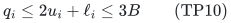

nonempty support patterns for order <code class="math">i</code>, besides the empty one. The row-label sets of the two orders are disjoint. Thus the full color catalogue satisfies

<!-- math-display: f18f88fe4470f3669765ea8c
q\le(q_1+1)(q_2+1)-1
                    \le(3B+1)^2-1.
 \tag{TP11}
-->
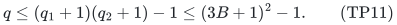

Different magnitudes on one color remain separate classes <code class="math">(A,v)</code>, but only the classes actually occurring among at most four copies per coordinate are stored.

For one fixed color and positive total weight <code class="math">s</code>, its multiplicities form a multiset of positive integers with sum <code class="math">s</code>. Sorting these integers injects the multisets into the compositions of <code class="math">s</code>, so there are at most <code class="math">2^{s-1}\le2^s</code> possibilities. Allowing all positive integer magnitudes only enlarges the actual catalogue.

If a profile uses <code class="math">k</code> colors, choose them in <code class="math">\binom qk</code> ways. Their positive weights summing to at most <code class="math">W</code> have <code class="math">\binom Wk</code> choices. Therefore

<!-- math-display: 0f6753f28e64530b93131e71
\#\text{profiles}
   \le2^W\sum_k\binom qk\binom Wk
   =2^W\binom{q+W}{W}
   =2^{O(B\log(B+2))}.
 \tag{TP12}
-->
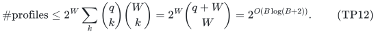

For example <code class="math">\binom{q+W}{W}\le[e(q+W)/W]^W</code> proves the last estimate for positive <code class="math">W</code>, using <code class="math">q=O(B^2)</code> and <code class="math">W=O(B)</code>. If the actual color count or allowance is zero, there is only the zero nonzero-class profile. The resource-count cap <code class="math">\sum h_{A,v}\le R</code>, row filters, and restriction to actual magnitudes can only reduce this count.

## 7. One exact integral face and all-input binary complexity

Enumerate multiplicities of actual nonzero classes subject to TP9 and <code class="math">\sum h_{A,v}\le R</code>. A global zero-column group receives the remainder

<!-- math-display: ff7012c23432c6da522f5132
h_0=R-\sum h_{A,v}.
 \tag{TP13}
-->
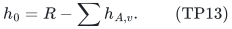

At a complete profile compute every auxiliary row value from its class counts, and reject any failed upper or cover. A passing profile prescribes an exact count for each nonzero class and for the single zero group.

Impose the corresponding group caps with a partition-count polymatroid. Explicitly, if the disjoint groups are <code class="math">G_g</code> with cap <code class="math">h_g</code>, its rank on a subset <code class="math">Y</code> is <code class="math">\sum_{g:Y\cap G_g\ne\varnothing}h_g</code>. Intersect its independent polytope with <code class="math">P(F^{\uparrow})</code> and require total <code class="math">R</code>. The intersection is integral. Since the caps sum to <code class="math">R</code>, every cap is tight on this face. An absent group with positive prescribed count makes the face empty, including an absent zero group with positive <code class="math">h_0</code>.

Exact signed scalar optimization on this integral full-total face either returns an integer realization or proves it empty. This is the same resource-plus-partition intersection primitive used in the preceding exact numeric-profile notes. No third resource matroid is introduced. Taking the best scalar value over all profiles is exact, because the completeness and soundness arguments preserve every original feasible scalar value. If every face fails, the original instance is infeasible.

For the all-input bound, traverse only the polynomially many actual classes. A next multiplicity is bounded by the remaining mass divided by that class's positive magnitude and by the remaining count to <code class="math">R</code>. Every partial state extends by zero multiplicities on the remaining classes to a full profile satisfying the mass/count caps. At any fixed depth, distinct partial states have distinct such completions. Hence all tree nodes, failed row filters, and empty integral faces cost at most a polynomial factor times TP12, even on infeasible inputs. No promise of a successful branch is used.

All multiplicities, masses, ranks and running scalar data are stored in binary. The lifted ground has at most four times the prepared number of coordinates; retained rows are sublists of the input; and a DFS state has one count per actual class. The algorithm does not materialize <code class="math">B</code>, <code class="math">q</code>, <code class="math">W</code> or <code class="math">R</code> many objects merely because these numbers are large. It stores one current profile and one intersection subproblem. This proves uniform polynomial binary workspace and TP1.

## 8. Reversing the second order gives a sharper exponent

Suppose <code class="math">\prec_2</code> is the reverse of <code class="math">\prec_1</code>. The quotas are then arbitrary mixed prefixes and suffixes on one common line.

The optional disposal coordinate is a zero column in every row, so its placement after both original orders does not affect this support count. Restricting the original orders to the eligible positive-weight coordinates preserves their reversal.

For a fixed bit pair <code class="math">(a_1,a_2)</code>, its support can change only at endpoints of upper rows in either order and of cover rows whose bit is active. Along the first order, each individual prefix or suffix indicator changes at most once. Thus the number of its distinct nonempty colors is at most

<!-- math-display: b6cde834cd6ff5ac71eb62aa
u_1+u_2+a_1\ell_1+a_2\ell_2+1.
 \tag{TP14}
-->
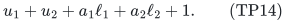

The extra one allows nonempty colors at both ends of the line. Summing the four catalogues, even before merging duplicates, gives

<!-- math-display: 193533a2a2c3414ac9bb13b9
q\le4(u_1+u_2)+2(\ell_1+\ell_2)+4
                       \le12B+4.
 \tag{TP15}
-->
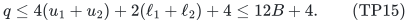

The mass proof and recovery are unchanged. In particular TP12 now gives

<!-- math-display: e407d2a9fe54fcdd2723b6f4
2^W\binom{q+W}{W}
          \le2^{q+2W}\le2^{20B}.
 \tag{TP16}
-->
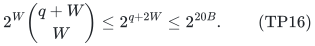

Therefore mixed common-weight prefix/suffix quotas have an exact <code class="math">2^{O(B)}\mathrm{poly}(H)</code> algorithm in uniform polynomial space. The leading constant in TP16 is only a convenient bound.

The one-order block lower bound in [exact-weighted-prefix-quotas-max-target.md](exact-weighted-prefix-quotas-max-target.md) applies to this subclass: take consecutive blocks of weights <code class="math">1,2,3,4</code>, cumulative equality targets <code class="math">5,10,\ldots,5d</code>, and a rank-<code class="math">2d</code> paving resource hiding one of the <code class="math">2^d</code> choices <code class="math">\{1,4\}</code> or <code class="math">\{2,3\}</code> in each block. One can leave the second-order list empty or add its redundant whole-ground equality. Thus <code class="math">2^{\Omega(B)}</code> oracle necessity, and the separately encoded ETH exclusion, persist in the reversed-order subclass. The primary construction and its complete verification are in that companion note.

## 9. Matching oracle lower bound for two unrestricted orders

For any integer <code class="math">B\ge2</code>, take the edge ground of <code class="math">K_{B,B}</code>, identified with pairs <code class="math">(i,j)\in[B]\times[B]</code>. Give every coordinate common weight one. Order one lists edges by left endpoint, and order two by right endpoint, with any fixed order inside a block. At the end of block <code class="math">k</code> in each order, require cumulative weight exactly <code class="math">k</code>, for <code class="math">k=1,\ldots,B</code>.

Subtracting consecutive equalities forces exactly one selected edge in each left block and each right block. Thus the feasible subsets of the prefix equalities are precisely the perfect matchings, or permutations. The largest target is <code class="math">B</code>, although the target sum is <code class="math">B(B+1)</code>. The last equality forces cardinality <code class="math">B</code>, so the statement covers optional independent sets as well as bases.

Let <code class="math">\mathcal H</code> be these <code class="math">B!</code> perfect matchings. Distinct members are not single-element-exchange neighbors. Define a reference rank-<code class="math">B</code> matroid permitting every set of size below <code class="math">B</code>, and every <code class="math">B</code>-subset outside <code class="math">\mathcal H</code> as a base. For a hidden <code class="math">A\in\mathcal H</code>, additionally permit <code class="math">A</code>.

These are valid matroids: in the only nontrivial augmentation case, the candidate additions to an independent <code class="math">(B-1)</code>-set yield adjacent <code class="math">B</code>-sets, so at most one is forbidden. If there is only one candidate, it is the known larger independent set. The rank is truly <code class="math">B</code>, because the <code class="math">B</code> edges incident with one left vertex form a nonmatching reference base.

The reference and hidden rank oracles differ only on <code class="math">A</code>. Smaller sets have their cardinality as rank. Every larger set contains two adjacent <code class="math">B</code>-subsets and therefore a reference base. The reference prefix instance is infeasible, while the hidden instance has exactly <code class="math">A</code> as a feasible solution.

Under the balanced reference/uniform-hidden distribution, an algorithm making at most <code class="math">D</code> rank queries has success probability at most <code class="math">1/2+D/(2B!)</code>. This follows by following its reference transcript: at most <code class="math">D</code> candidates can be queried, and all other hidden inputs give that same transcript. Averaging over the algorithm's random coins preserves the bound. Hence success at least <code class="math">2/3</code> on every instance requires

<!-- math-display: 5444bdde875bc69a719cbb4d
D\ge B!/3
                           =2^{\Omega(B\log B)}.
 \tag{TP17}
-->
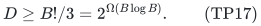

All non-oracle data are polynomial in <code class="math">B</code>: the ground has <code class="math">B^2</code> elements and there are <code class="math">2B</code> prefix equalities. All scalar coefficients may be zero. The lower bound is for the rank-oracle model and already allows bounded-error randomized decision. It matches the upper exponent order, without asserting an optimal exponential leading constant.

## 10. A readable encoded-rank ETH reduction

For completeness, the same prefix family has an encoded computational lower bound with a polynomial-size rank program or Boolean rank circuit. The algorithm is permitted to inspect the entire representation. This is a conditional result, distinct from TP17.

Given a 3-CNF formula <code class="math">\phi</code> on <code class="math">\nu\ge1</code> variables, choose the least integer <code class="math">B\ge2</code> such that

<!-- math-display: 45df77b5824aa6631b4c518d
B!\ge2^{\nu}.
 \tag{TP18}
-->
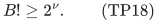

Successive integer multiplication finds it in polynomial time. Since <code class="math">(\nu+1)!\ge2^\nu</code>, one has <code class="math">B\le\nu+1</code>. Minimality gives

<!-- math-display: fc67f7a03668f6d101475488
\nu\le\log_2 B!
               <\nu+\log_2 B\le2\nu.
 \tag{TP19}
-->
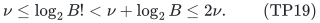

The elementary product bounds <code class="math">\log_2 B!=\Theta(B\log(B+1))</code>, uniform for <code class="math">B\ge2</code>, consequently imply

<!-- math-display: 21943c4e3f556b35c9b52d2d
B\log(B+1)=\Theta(\nu).
 \tag{TP20}
-->
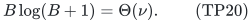

Thus the ground, rows, orders and stored factorials are polynomial in the formula size, and all factorial arithmetic uses <code class="math">O(\nu)</code> bits. No permutation enumeration is part of the reduction.

Recognize a perfect matching by checking that each left and right vertex has degree one, and write its permutation as <code class="math">\sigma(1),\ldots,\sigma(B)</code>. Let <code class="math">d_i</code> be the number of unused right labels smaller than <code class="math">\sigma(i)</code>. Its zero-based lexicographic rank is

<!-- math-display: 7cddaa21f83c9e5fc3b0a2ff
J=\sum_{i=1}^B d_i(B-i)!.
 \tag{TP21}
-->
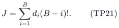

This is a bijection to <code class="math">\{0,\ldots,B!-1\}</code>: each choice of the next unused label leaves <code class="math">(B-i)!</code> completions, proving the positional formula inductively. Ranking and inverse ranking use polynomially many operations on the bounded-length integers.

Call a matching accepted when <code class="math">J&lt;2^\nu</code> and the <code class="math">\nu</code> binary digits of <code class="math">J</code> satisfy <code class="math">\phi</code>. Permit all smaller sets, all nonmatching <code class="math">B</code>-subsets, and exactly the accepted matchings at rank <code class="math">B</code>. Any forbidden subfamily of <code class="math">\mathcal H</code> remains nonadjacent, so this defines a valid matroid for every formula, with no uniqueness promise.

Its exact rank decoder has four cases: below <code class="math">B</code>, return cardinality; above <code class="math">B</code>, return <code class="math">B</code>; at <code class="math">B</code> on a nonmatching, return <code class="math">B</code>; on a matching, compute TP21, evaluate its acceptance predicate, and return <code class="math">B</code> or <code class="math">B-1</code>. The above-rank branch is valid for the same adjacent-subset reason as in Section 9. Every branch is polynomial-time. Its bounded loops and arithmetic can be uniformly unrolled to a polynomial-size Boolean circuit for the rank on the subset indicator.

Every Boolean assignment appears among the first <code class="math">2^\nu</code> permutations. Thus the two-order prefix instance is feasible exactly when <code class="math">\phi</code> is satisfiable. By TP20, a deterministic

<!-- math-display: 633b03b640d6dfb3826d53c9
2^{o(B\log(B+2))}\mathrm{poly}(H)
 \tag{TP22}
-->
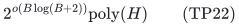

exact algorithm in this readable encoded-rank model would give a deterministic <code class="math">2^{o(\nu)}\mathrm{poly}(&#124;\phi&#124;)</code> algorithm for 3-SAT, contradicting deterministic ETH. A randomized statement requires randomized ETH separately. This is not a corresponding hardness claim for matrix, graphic, laminar, or other restricted explicit resource representations.

## 11. Primary comparison and boundaries

Doron-Arad, Kulik and Shachnai, *You (Almost) Can't Beat Brute Force for 3-Matroid Intersection*, arXiv:2412.02217v2, Section 1.3 and Lemmas 3.5, 3.9–3.11, explicitly use one paving matroid with partition matroids for coordinate-block counts. Two such partition families already describe bipartite perfect matchings. The lower construction here is an all-one-margin specialization and cumulative-prefix encoding of that established framework. Their Theorem 1.3 also gives rank-parameter oracle lower bounds. No first lower-bound framework or new general three-matroid-intersection hardness is claimed.

<https://arxiv.org/html/2412.02217v2>

Eisenbrand, Rohwedder and Węgrzycki, *Sensitivity, Proximity and FPT Algorithms for Exact Matroid Problems*, arXiv:2404.03747v2, Introduction, records the earlier method of guessing counts of coefficient-vector classes and recovering them through a partition matroid. The resource-plus-partition profile method itself is therefore not claimed as new. The new analysis here bounds the total nonzero common-weight mass under two independently marked prefix systems, while preserving arbitrary signed scalar values and binary resource totals.

<https://arxiv.org/html/2404.03747v2>

The one-order prerequisite and independent prefix/suffix endpoint lower are given in [exact-weighted-prefix-quotas-max-target.md](exact-weighted-prefix-quotas-max-target.md). The present proof includes the two-order mass and color arguments in full and does not alter that note or any frozen earlier checkpoint.

The upper theorem relies on two orders and a common nonnegative integer weight vector. Row-dependent weights, signed numeric row coefficients, an additional unrelated resource rank, or arbitrary row sets are outside TP1. On a supplied common rational grid, scaling gives the same theorem in the largest normalized integer target. This is a numeric-parameter bound, not a bound polynomial in <code class="math">\log B</code>, and it does not imply a polynomial-time exact or discrepancy result for arbitrary targets.
