# Two positive weights already force exponential laminar oracle complexity

The [homogeneous completion theorem](laminar-dominant-weight-recovery.md)
gives polynomial-time exact optimization when the prepared laminar instance
has one positive weight value. This note proves an exponential rank-oracle
boundary with exactly two positive values, <code class="math">1</code> and <code class="math">2</code>. The laminar family
has depth two, every nonroot target is two, and there are no zero-weight
coordinates.

The hidden sparse-paving construction and the readable SAT-decoder method
have established antecedents. Section 6 names the papers and the local
specialization proved here. No publication-priority claim is made.

## 1. Precise statement

**Theorem.** With one arbitrary ordinary matroid resource, common coordinate
weights in <code class="math">\{1,2\}</code>, disjoint block equalities of target two, and root
weighted cap <code class="math">B</code>, the following tasks require <code class="math">2^{\Omega(B)}</code> rank-oracle
queries in the worst case:

- Feasibility of an original-total matroid base, with scalar objective zero.
- Exact optimization over optional independent sets, with scalar profit
  one on every item.

The bound applies to deterministic algorithms and to randomized algorithms
with worst-case success at least <code class="math">2/3</code>. It holds even when all coordinates
are positive, and all numeric rows use the same coordinate weights.

For polynomially encoded, polynomial-time evaluable rank programs, a
deterministic <code class="math">2^{o(B)}\mathrm{poly}(H)</code> algorithm for either task
would contradict deterministic ETH. The randomized running-time version
requires randomized ETH separately. Oracle and encoded-program statements
are distinct models.

The optional examples always have a feasible solution. Their hardness is
for exact scalar optimization; no lower bound for optional pure feasibility
is inferred from them. No linear or graphic representation is asserted.

## 2. A depth-two instance with weights one and two

Fix integers <code class="math">d\ge2</code> and <code class="math">1\le t\le d-1</code>. The ground consists of <code class="math">d</code>
disjoint three-item blocks

<!-- math-display: 69e3d3a015833687b4261cfb
E=\{a_i,b_i,c_i:i\in[d]\},
\qquad w(a_i)=w(b_i)=1,\quad w(c_i)=2.
\tag{TW1}
-->
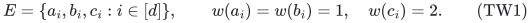

Impose the block equalities and root cap

<!-- math-display: 86e2afac71914c825a2bc732
x_{a_i}+x_{b_i}+2x_{c_i}=2\quad(i\in[d]),
\qquad w\cdot x\le B=2d.
\tag{TW2}
-->
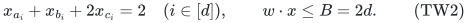

These rows are laminar. The resource will have rank <code class="math">r=d+t</code>, and it is
an ordinary matroid, so its nonnegative integer feasible vectors are
zero-one. Within one block, TW2 permits exactly the pair <code class="math">\{a_i,b_i\}</code>
or the singleton <code class="math">\{c_i\}</code>. Thus a numeric set of cardinality <code class="math">r</code> has
exactly <code class="math">t</code> pair-blocks.

For <code class="math">T\in\binom{[d]}t</code>, define

<!-- math-display: 400f402a1bd3fb731b944af2
A_T=\bigcup_{i\in T}\{a_i,b_i\}
\;\cup\!\bigcup_{i\notin T}\{c_i\},
\qquad
\mathcal H=\{A_T:T\in\tbinom{[d]}t\}.
\tag{TW3}
-->
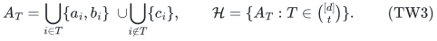

Consequently the numeric <code class="math">r</code>-sets are exactly <code class="math">\mathcal H</code>, and
<code class="math">&#124;\mathcal H&#124;=\binom dt</code>. If <code class="math">T\ne T'</code> and <code class="math">a=&#124;T\setminus T'&#124;</code>, then
<code class="math">&#124;T'\setminus T&#124;=a\ge1</code>. Switching these blocks removes three old
elements per exchanged block pair. Hence

<!-- math-display: ea01c182ae44ab7d35c20d27
|A_T\cap A_{T'}|=r-3a\le r-3.
\tag{TW4}
-->
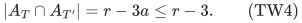

The root bound holds with equality for every numeric set; it is retained
to make the parameter <code class="math">B</code> explicit.

## 3. The matroid and every rank answer

For any subfamily <code class="math">\mathcal G\subseteq\mathcal H</code>, declare the allowed
bases to be

<!-- math-display: 2e98351c40e0abcc33595b89
\mathcal B_{\mathcal G}
=\{S\subseteq E:|S|=r,\ S\notin\mathcal H\setminus\mathcal G\}.
\tag{TW5}
-->
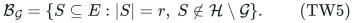

This is the basis family of a rank-<code class="math">r</code> matroid. First it is nonempty:
an <code class="math">r</code>-set containing a whole three-item block is not numeric, hence is
allowed. Such a set exists because <code class="math">3\le r&lt;&#124;E&#124;</code>.

For allowed bases <code class="math">X,Y</code> and <code class="math">e\in X\setminus Y</code>, if
<code class="math">&#124;Y\setminus X&#124;=1</code>, the sole exchange gives <code class="math">Y</code>. Otherwise consider
the candidates <code class="math">X-e+f</code> for <code class="math">f\in Y\setminus X</code>. Any two share <code class="math">r-1</code>
elements. By TW4 at most one can be forbidden, so an allowed exchange
exists. This proves the ordinary basis-exchange axiom directly.

Every <code class="math">(r-1)</code>-set has at least two one-element extensions, of which at
most one is forbidden. It therefore extends to an allowed basis, as does
every smaller set. Every set larger than <code class="math">r</code> contains an <code class="math">(r+1)</code>-set;
its distinct <code class="math">r</code>-subsets pairwise share <code class="math">r-1</code> elements, so at most one is
forbidden. The full rank function is therefore

<!-- math-display: fcbc2db05040185d303f7f50
r_{\mathcal G}(S)=
\begin{cases}
|S|,&|S|<r,\\
r-1,&|S|=r\text{ and }S\in\mathcal H\setminus\mathcal G,\\
r,&\text{otherwise}.
\end{cases}
\tag{TW6}
-->
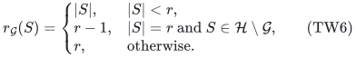

The formula accounts for all query sizes, including sets larger than the
required base. In particular, a numeric resource base exists exactly when
<code class="math">\mathcal G</code> is nonempty.

For optional independent sets with all profits one, the optimum is <code class="math">r</code>
when <code class="math">\mathcal G\ne\varnothing</code>. When <code class="math">\mathcal G=\varnothing</code>, no
numeric <code class="math">r</code>-set is independent, and rank excludes larger independent sets.
Choosing exactly <code class="math">t-1</code> pair-blocks gives a numeric set of size <code class="math">r-1</code>,
which is independent by TW6. Thus the optional optimum is exactly

<!-- math-display: d3cbae79ac438bc23a68c297
\mathrm{OPT}_{\mathcal G}=
\begin{cases}
r-1,&\mathcal G=\varnothing,\\
r,&\mathcal G\ne\varnothing.
\end{cases}
\tag{TW7}
-->
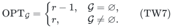

This scalar is the objective itself; no additional scalar constraint or
cardinality equality is supplied in the optional problem.

## 4. Query lower bound

Compare the reference instance <code class="math">\mathcal G=\varnothing</code> with the
instances <code class="math">\mathcal G=\{A\}</code>, one for every <code class="math">A\in\mathcal H</code>.
Their rank oracles differ on exactly the query <code class="math">A</code>, by TW6. A deterministic
algorithm must query every member of <code class="math">\mathcal H</code> on the reference
transcript to decide mandatory feasibility or distinguish the two exact
optional optimum values.

For bounded error, put probability <code class="math">1/2</code> on the reference and otherwise
choose <code class="math">A</code> uniformly from <code class="math">\mathcal H</code>. A deterministic algorithm using
at most <code class="math">Q</code> queries encounters the changed answer on at most a
<code class="math">Q/&#124;\mathcal H&#124;</code> fraction of the restored instances. Its average success
is at most <code class="math">1/2+Q/(2&#124;\mathcal H&#124;)</code>. Averaging over the random coins of
a randomized algorithm gives <code class="math">Q\ge&#124;\mathcal H&#124;/3</code> for worst-case success
at least <code class="math">2/3</code>.

Take <code class="math">t=\lfloor d/2\rfloor</code>. Since the largest binomial coefficient is
at least the average of the <code class="math">d+1</code> binomial coefficients,

<!-- math-display: 879c1f08cf599be2c96d3c21
Q\ge\frac13\binom d{\lfloor d/2\rfloor}
\ge\frac{2^d}{3(d+1)}
=\frac{2^{B/2}}{3(B/2+1)}.
\tag{TW8}
-->
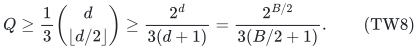

This is the stated exponential lower bound along even <code class="math">B\ge4</code>. For a
general sufficiently large budget upper bound, take the largest even
<code class="math">2d</code> no greater than it. The explicit graph-free quota data have size
polynomial in <code class="math">B</code>.

## 5. A polynomial rank program and ETH

Given a 3-CNF formula <code class="math">\varphi</code> with <code class="math">\nu\ge1</code> variables, use

<!-- math-display: 1ad76263af31fba230249267
d=2\nu,\qquad t=\nu,\qquad r=3\nu,\qquad B=4\nu.
\tag{TW9}
-->
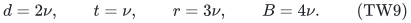

There are enough candidate bases to encode every assignment, because

<!-- math-display: 1250f164e386c5d0b3241472
\binom{2\nu}{\nu}
=\prod_{i=1}^{\nu}\frac{\nu+i}{i}\ge2^\nu.
\tag{TW10}
-->
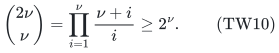

Order the <code class="math">t</code>-subsets of <code class="math">[d]</code> lexicographically and write <code class="math">J(T)</code> for
their zero-based ranks. For <code class="math">T=\{t_1&lt;\cdots&lt;t_t\}</code> and <code class="math">t_0=0</code>,

<!-- math-display: 6c0c1da51efca8818a3aac95
J(T)=\sum_{i=1}^{t}\sum_{v=t_{i-1}+1}^{t_i-1}
\binom{d-v}{t-i}.
\tag{TW11}
-->
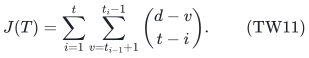

This counts all earlier subsets at their first differing position.
It is computable with polynomially many arithmetic operations on
polynomial-bit integers. Admit <code class="math">A_T</code> to <code class="math">\mathcal G_\varphi</code> exactly
when <code class="math">J(T)&lt;2^\nu</code> and its <code class="math">\nu</code>-bit binary expansion satisfies
<code class="math">\varphi</code>. Every assignment occurs, so
<code class="math">\mathcal G_\varphi\ne\varnothing</code> exactly when <code class="math">\varphi</code> is satisfiable.

The rank program evaluates TW6. Only size-<code class="math">r</code> queries need to be tested
against <code class="math">\mathcal H</code>: inspect the choice in every block, recover <code class="math">T</code>,
compute TW11, and evaluate the formula if the rank is in range. All work
is polynomial in <code class="math">&#124;\varphi&#124;+\nu</code>. Section 3 proves that the program
defines a valid matroid for every input formula.

A deterministic <code class="math">2^{o(B)}\mathrm{poly}(H)</code> algorithm for either
task would therefore solve 3-SAT in
<code class="math">2^{o(\nu)}\mathrm{poly}(&#124;\varphi&#124;)</code> time. This contradicts
deterministic ETH. The corresponding randomized conclusion uses
randomized ETH, not deterministic ETH alone.

## 6. Verification, provenance and scope

Run:

~~~sh
python3 -B problems/weighted-prefix-quota-frontier/verify/check_two_weight_lower.py
~~~

The deterministic script refuses assertions-disabled execution. It checks
all admitted subfamilies for <code class="math">d=2,3</code>, and the reference, every single
restoration, and full restoration for <code class="math">d=4</code>. Across 20 resulting matroids,
it checks 20,569,302 ordinary basis-exchange conditions and 37,120 complete
rank entries, computing the reference rank by enumerating subsets of
literal allowed bases. It also checks 4,672 numeric-family comparisons,
26,240 rank comparisons between reference and one-restored instances,
the exact mandatory and optional outcomes, and the lexicographic decoder.
An additional 276 complete truth tables give 5,224 independent decoder
membership comparisons. These finite checks do not prove the asymptotic
query or ETH conclusions; Sections 4–5 give those arguments.

The hidden-matroid method is not new. Doron-Arad, Kulik and Shachnai,
[*You (Almost) Can't Beat Brute Force for 3-Matroid Intersection*](https://arxiv.org/html/2412.02217v2),
Section 3, give the general forbidden-family matroid framework. Their
[*Lower Bounds for Matroid Optimization Problems with a Linear Constraint*](https://arxiv.org/html/2307.07773v2),
Definitions 4.4–4.5 and Lemma 4.6, give polynomial SAT-matroid encodings.
The [earlier disjoint-row manuscript](disjoint-row-root-target-sharp-lower.md)
records additional antecedents and the ETH convention.

The contribution here is the explicit depth-two encoding with only
weights <code class="math">1,2</code>, its mandatory-feasibility and optional-objective calibration,
and the boundary it supplies next to the polynomial one-weight theorem.
It does not close the general laminar quadratic-exponent gap. The complete
local proof and finite checks make this statement ready for review in its
stated oracle and readable-program scopes; external peer review or
proof-assistant verification is not claimed.

**Attribution:** icekylinx and GPT-6 Astra Pro.
