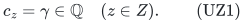
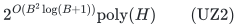
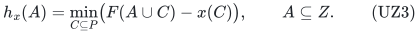
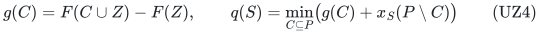
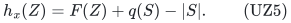
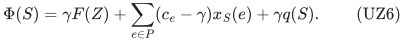
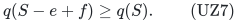
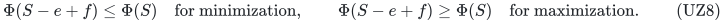

# Uniform scalar coefficients on optional zero-weight coordinates

**25 October 2026. Complete incremental extension of [laminar-common-weight-root-cap-fpt.md](laminar-common-weight-root-cap-fpt.md); full internal mathematical reviews completed for checkpoint T. The stronger nonuniform-cost companion is [laminar-valuated-zero-completion-fpt.md](laminar-valuated-zero-completion-fpt.md).**

The LM theorem already permits an arbitrary common scalar coefficient on zero-weight coordinates of a mandatory base. This note proves the analogous extension for an optional independent vector. The added point is that an optional optimum need not have full original resource rank: its best zero completion is expressed by a contraction rank that replacements preserve monotonically.

## 1. Statement and the easy sign

Use the global integral polymatroid, common-weight laminar rows, root cap <code class="math">B</code>, and exact rational scalar objective of LM. The resource here is optional: <code class="math">x\in P(F)\cap\mathbb Z^E</code>. Write <code class="math">P=\{e:w_e&gt;0\}</code>, <code class="math">Z=\{e:w_e=0\}</code>, and suppose

<!-- math-display: a54f60adae6b17c0a9bcb12d
c_z=\gamma\in\mathbb Q
                               \quad(z\in Z).
\tag{UZ1}
-->

Positive-weight coordinates may have arbitrary signed rational scalar coefficients. Then exact feasibility and scalar optimization still have deterministic running time

<!-- math-display: 800d1f20bd5d08d2a10c08e8
2^{O(B^2\log(B+1))}\mathrm{poly}(H)
\tag{UZ2}
-->

and uniform polynomial binary space, independent of the number of laminar nodes in the exponent.

If minimizing with <code class="math">\gamma\ge0</code>, or maximizing with <code class="math">\gamma\le0</code>, omit all zero-weight units. Downward closure preserves feasibility and cannot worsen the scalar. This is the positive-coordinate LM problem, with the original positive coefficients <code class="math">c_e</code>. Thus only minimization with <code class="math">\gamma&lt;0</code>, or maximization with <code class="math">\gamma&gt;0</code>, requires a new argument. Call these the favorable signs.

## 2. The exact optional completion value

For a resource-feasible positive vector <code class="math">x</code>, use the same residual rank as LM:

<!-- math-display: b07ad3cf1955c14cd5b9d342
h_x(A)=\min_{C\subseteq P}\bigl(F(A\cup C)-x(C)\bigr),
                              \qquad A\subseteq Z.
\tag{UZ3}
-->

It is a normalized integral polymatroid rank, and <code class="math">P(h_x)</code> is exactly the set of zero completions compatible with <code class="math">x</code>. Let

<!-- math-display: 6c5bc5d24a2677d105baee97
g(C)=F(C\cup Z)-F(Z),
 \qquad
 q(S)=\min_{C\subseteq P}\bigl(g(C)+x_S(P\setminus C)\bigr)
\tag{UZ4}
-->

be the natural contraction-matroid rank on positive copies. For a set <code class="math">S</code> representing <code class="math">x</code>,

<!-- math-display: e9d39e92b5570d1419946dee
h_x(Z)=F(Z)+q(S)-|S|.
\tag{UZ5}
-->

For either favorable sign, a best zero completion has the maximum possible total <code class="math">h_x(Z)</code>. An integral greedy base of <code class="math">h_x</code> constructs one with binary counts. Therefore the best true scalar attainable from <code class="math">S</code> is

<!-- math-display: 29fe5e164f439e0c3bec16cc
\Phi(S)=\gamma F(Z)
           +\sum_{e\in P}(c_e-\gamma)x_S(e)
           +\gamma q(S).
\tag{UZ6}
-->

This expression does not require <code class="math">S</code> to span the contraction matroid. Its full rank <code class="math">F(E)-F(Z)</code> may be larger than <code class="math">B</code>. In particular, the mandatory rejection rule <code class="math">F(E)-F(Z)&gt;B</code> is **not** applied in this optional extension.

The rank in UZ4 is evaluated by submodular minimization on the original coordinate ground. For every currently selected set, <code class="math">q(S)\le &#124;S&#124;\le B</code>, regardless of that matroid's full rank.

## 3. Preserving current contraction rank under replacement

Use the same candidate classes as LM: common positive weight, common lower-row membership, and common loop/nonloop status in the contraction matroid <code class="math">Q</code>. Give a copy the adjusted coefficient <code class="math">c_e-\gamma</code>, negated for a minimization representative score and unchanged for maximization.

Fix a feasible positive set <code class="math">S</code> and a selected copy <code class="math">e</code>, and put <code class="math">S^-=S-e</code>, <code class="math">\rho=q(S)</code>. Resource independence and the disjoint maximal upper-blocker tests are exactly as in LM. Only the meaning of the <code class="math">Q</code>-test changes.

If <code class="math">e</code> is a <code class="math">Q</code>-loop, deletion does not change <code class="math">\rho</code>, and a same-class replacement is also a loop. Omit the <code class="math">Q</code>-test.

If <code class="math">e</code> is a nonloop and <code class="math">q(S^-)=\rho</code>, use the empty <code class="math">Q</code>-test. The target passes it because it is a nonloop, and adding any replacement cannot reduce the already attained rank <code class="math">\rho</code>.

If <code class="math">q(S^-)&lt;\rho</code>, the one-element rank change implies <code class="math">q(S^-)=\rho-1</code>. Choose a <code class="math">Q</code>-basis <code class="math">D\subseteq S^-</code> as the test. Its size is at most <code class="math">&#124;S&#124;-1\le B-1</code>, and <code class="math">e\notin\mathrm{cl}_Q(D)</code>. A replacement outside that closure restores rank <code class="math">\rho</code>.

Thus the same separate-test representative lemma returns a no-worse adjusted-score replacement with

<!-- math-display: c7459f161de92733c9cdfa51
q(S-e+f)\ge q(S).
\tag{UZ7}
-->

The total independent-test rank remains at most <code class="math">3B-3</code>: at most <code class="math">B-1</code> for resource independence, at most <code class="math">B-1</code> for the disjoint upper blockers, and at most <code class="math">B-1</code> for this optional contraction test. No bound on the global rank of <code class="math">Q</code> was used.

For favorable minimization, the adjusted linear term does not increase and <code class="math">\gamma&lt;0</code>, so UZ7 cannot increase the final rank term either. For favorable maximization, the adjusted linear term does not decrease and <code class="math">\gamma&gt;0</code>, so UZ7 cannot decrease the rank term. Hence

<!-- math-display: 2c0365468ccf49db91bf11e8
\Phi(S-e+f)\le\Phi(S)\quad\text{for minimization},
 \qquad
 \Phi(S-e+f)\ge\Phi(S)\quad\text{for maximization}.
\tag{UZ8}
-->

Every numeric row remains feasible as before. Repeatedly replacing selected copies outside the representative union yields a solution entirely in that union with no worse **true** scalar value. Current contraction rank may increase during this process; this is permitted and helps the comparison.

## 4. Exact optimization, reconstruction, and space

Enumerate at most <code class="math">B</code> emitted candidates exactly as in LM. Test resource independence and all laminar rows. There is no full-span test. Evaluate UZ6 and keep the exact best value. Once the best positive vector is known, construct a greedy base of UZ3 on <code class="math">Z</code>. This produces the best zero completion and attains the saved scalar value.

The representative count and enumeration exponent are unchanged. The binary-space implementation is also unchanged. With <code class="math">n=&#124;P&#124;</code>, if <code class="math">B\ge n</code>, stream all count vectors <code class="math">0\le x_e\le\lfloor B/w_e\rfloor</code> using <code class="math">n</code> binary counters and evaluate UZ6. Otherwise, <code class="math">B&lt;n</code>, so the positive copy ground and recursion depth are polynomial in explicit input size, and representative positions are regenerated from their branching words. Neither branch expands zero capacities.

When <code class="math">B=0</code> or no positive coordinate survives, first reject any positive lower requirement. At a favorable sign, output a maximum-total zero vector, with scalar <code class="math">\gamma F(Z)</code>. At an unfavorable sign, output the zero vector, with scalar zero. These cases are polynomial.

## 5. Precise combined scope

Together LM and this note cover both optional and mandatory resources when all zero-weight coordinates share an arbitrary rational scalar coefficient. For mandatory bases the scalar reduction is the fixed affine expression in LM14; for optional resources the favorable case additionally uses the current contraction rank in UZ6. They are different arguments, and neither silently forces an optional vector to attain the original rank.

The nonuniform-zero example in LM remains a counterexample to its naive positive-only scalar comparison. This note removes only the optional **uniform**-coefficient restriction. It neither proves hardness for nonuniform coefficients nor claims that the present rank-monotonic argument already handles them.

This is a separate new increment. The reviewed LM manuscript remains unchanged, and its primary-source comparison and representative-lemma attribution continue to apply.
