# Labeled sunflower kernels for sparse numeric quotas and valuated completion

**25 October 2026. Increment U. Complete manuscript-level proof with independent internal review.**

This note gives a deterministic polynomial-time reduction on an explicit
item ground equipped with a minimum-valuated matroid. The constraints have
sparse, bounded, nonnegative integer upper columns. Additional constraints
are preserved by replacement classes. The objective is the full valuation,
which may include the optimal cost of a large, unexpanded completion.

The retained ground has no logarithmic dependence on the number of rows or
items. The proof combines coefficient-consistent sunflowers with disjoint
overlap-first optimization layers. Every deletion preserves a replacement
against contexts in the **original** instance.

The application to the root-cap model of BF gives a uniform polynomial-time
**positive-capacity kernel** even with binary resource counts and arbitrary
signed costs on quota-free coordinates. All such zero coordinates and the
original resource/completion oracle remain available. This is not a
parameter-only bit kernel or a claim that every binary unit is explicitly
listed in the output.

## 1. Explicit fixed-cardinality model

Let <code class="math">U</code> be an explicit item ground of size <code class="math">N</code>, and let <code class="math">0\le k\le N</code>.
A minimum-valuated matroid of rank <code class="math">k</code> is a function
<!-- math-display: 423c32cfbffdb60f68ef511c
p:\binom Uk\longrightarrow\mathbb Q\cup\{+\infty\}
-->
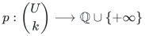
with nonempty finite domain and the exchange property
<!-- math-display: 98780b02c9887d0aa4060861
p(S)+p(A)\ \ge\
 p(S-e+f)+p(A-f+e)
\tag{VS1}
-->
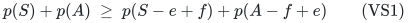
for some <code class="math">f\in A\setminus S</code>, whenever <code class="math">S,A</code> are finite-domain bases and
<code class="math">e\in S\setminus A</code>. In particular both exchanged sets on the right are
finite-domain bases. A separate domain test is allowed to report that the
domain is empty.

Assume an exact oracle which, for an explicit <code class="math">Y\subseteq U</code>, returns a
finite-domain basis <code class="math">A</code>, together with its value <code class="math">p(A)</code>, that first
maximizes <code class="math">&#124;A\cap Y&#124;</code> and then minimizes <code class="math">p(A)</code>:
<!-- math-display: 5d8404bedf3b177c8e42fb21
A=\mathcal O_p(Y).
\tag{VS2}
-->
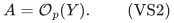
Deterministic tie breaking can be fixed. Oracle calls are charged separately
from polynomial explicit work. In the concrete application below, this
oracle is implemented in polynomial time by two integral polymatroid ranks.

Items are partitioned into <code class="math">g</code> nonempty replacement classes. Let
<code class="math">\mathcal L(S)</code> be any fixed collection of numerical predicates depending
only on the number of selected items in each class. The intended predicates
are the root cap and capped lower quotas. A same-class replacement preserves
<code class="math">\mathcal L</code> exactly.

There are explicit upper rows
<!-- math-display: 0bc2fa626d45e2d4521eead5
\sum_{e\in S}a_{je}\le u_j,\qquad
                    a_{je}\in\mathbb Z_{\ge0},
\tag{VS3}
-->
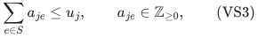
with finite nonnegative capacities. Every item retained for consideration
is individually eligible:
<!-- math-display: 64c6034f519db4a7969f2514
a_{je}\le u_j\quad\text{for every upper row }j.
\tag{VS4}
-->
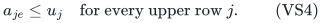
Items violating VS4 can be removed, since none belongs to a feasible set.
The valuation and context in the analysis continue to be those of the
original instance.

Set
<!-- math-display: 1ffa950543c0b054c7e6c694
\delta=\max\{1,\max_e|\{j:a_{je}>0\}|\},\qquad
 A_0=\max\{1,\max_{j,e}a_{je}\}.
\tag{VS5}
-->
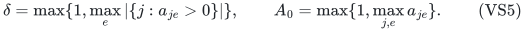
The quantities in VS5 are actual bounds from the explicit coefficient table;
their binary encodings do not require enumerating all values up to <code class="math">A_0</code>.
The root and class predicates are not counted again in this upper frequency.

Write <code class="math">\mathcal F</code> for the finite-domain <code class="math">k</code>-sets satisfying
<code class="math">\mathcal L</code> and VS3. The required output <code class="math">R\subseteq U</code> satisfies
<!-- math-display: fb2898d2f788c8d9a1a9fb0a
\begin{gathered}
 \forall S\in\mathcal F,\ \forall e\in S,\quad
 \exists f\in R\setminus(S-e):\\
 \tau(f)=\tau(e),\qquad S-e+f\in\mathcal F,\qquad
                         p(S-e+f)\le p(S),
 \end{gathered}
\tag{VS6}
-->
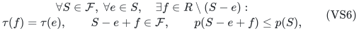
where <code class="math">\tau</code> is the class label. The context <code class="math">S-e</code> need not be contained
in <code class="math">R</code>, or in any intermediate candidate ground.

**Theorem 1.** For <code class="math">k\ge1</code>, a set satisfying VS6 can be constructed
deterministically with
<!-- math-display: 2b67119333978ca6985f00d6
|R|\le
 gk\,\delta!\,[A_0 k(\delta(k-1)+1)]^\delta.
\tag{VS7}
-->
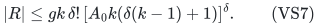
The construction makes <code class="math">O(N^2+N)</code> calls to VS2 and uses polynomial explicit
time and polynomial binary space. These polynomial bounds are uniform in
the explicit frequency and coefficient encodings. They are not
<code class="math">N^\delta</code> bounds. At <code class="math">k=0</code>, the retained positive ground is empty.
An empty valuation domain is detected separately.

The output retains the original valuation oracle, restricted only when a
final solution is recovered. It is a ground reduction for this valuation
and these classes, not a simultaneous statement for all objective functions.

## 2. The overlap replacement lemma

For a finite-domain basis <code class="math">S</code> and <code class="math">e\in S\cap Y</code>, the oracle output
<code class="math">A=\mathcal O_p(Y)</code> contains an <code class="math">f\in A\cap Y</code>, outside <code class="math">S-e</code>, such that
<!-- math-display: 607aaca26c459425023f5314
p(S-e+f)\le p(S).
\tag{VS8}
-->
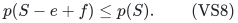

If <code class="math">e\in A</code>, use <code class="math">f=e</code>. Otherwise apply VS1. If its exchange element
<code class="math">f</code> were outside <code class="math">Y</code>, the finite-domain basis <code class="math">A-f+e</code> would have more
elements in <code class="math">Y</code> than <code class="math">A</code>, contradicting the first oracle criterion.
Thus <code class="math">f\in Y</code>. The two bases <code class="math">A</code> and <code class="math">A-f+e</code> have the same overlap
with <code class="math">Y</code>, so the second criterion gives
<!-- math-display: a095b3b081f3fe34352bfeba
p(A-f+e)\ge p(A).
-->
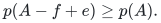
Substitution into VS1 proves VS8. A proper exchanged <code class="math">f</code> lies outside
<code class="math">S</code>, hence outside <code class="math">S-e</code>.

No numerical constraint is imposed on the oracle basis <code class="math">A</code>. It need not
satisfy VS3 or <code class="math">\mathcal L</code>. Feasibility will be established for the
single exchanged basis <code class="math">S-e+f</code>.

## 3. External contexts and duplicate full columns

For a current candidate set <code class="math">T\subseteq U</code>, a local reduction
<code class="math">T\mapsto T'\subseteq T</code> has the external-context property when the
statement in VS6 holds with <code class="math">e\in S\cap T</code> and <code class="math">f\in T'</code>. All quantifiers
over <code class="math">S</code>, all rows, and the valuation remain original.

These reductions compose. Fix <code class="math">I=S-e</code>. At a stage the current
representative <code class="math">e_i</code> satisfies <code class="math">I+e_i\in\mathcal F</code>. The next reduction
provides <code class="math">e_{i+1}</code> in the next ground with
<!-- math-display: 9b889902137245f5d3d87979
\tau(e_{i+1})=\tau(e_i),\qquad
 p(I+e_{i+1})\le p(I+e_i).
\tag{VS9}
-->
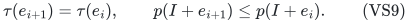
The context <code class="math">I</code> stays fixed. Thus the final output satisfies VS6 even
when <code class="math">I</code> contains elements discarded much earlier.

Within each replacement class, group items by their **entire labeled upper
column**
<!-- math-display: ea723ac862b707adbfaf9a33
\alpha_e:\{j:a_{je}>0\}\longrightarrow
                              \{1,\ldots,A_0\},\quad
                         \alpha_e(j)=a_{je}.
\tag{VS10}
-->
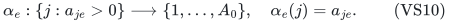
For every such full type <code class="math">Y</code>, keep only
<!-- math-display: 0fd5ed08a953817f295e5857
\mathcal O_p(Y)\cap Y.
\tag{VS11}
-->
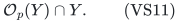
At most <code class="math">k</code> items survive in that type. For a protected element, VS8 gives
a replacement of the same full type and class. Every upper total and every
class predicate is unchanged. This simultaneous duplicate reduction
therefore has the external-context property.

If the overlap output has empty intersection with <code class="math">Y</code>, no finite-domain
basis can contain an item of <code class="math">Y</code>; otherwise that basis would achieve a
positive overlap. Deleting such a type is safe. Subsequent operations only
delete items, so at most <code class="math">k</code> copies of any full type remain forever.

## 4. A constructive labeled sunflower lemma

A labeled column is a partial function from row IDs to
<code class="math">\{1,\ldots,A_0\}</code>. A labeled sunflower of size <code class="math">L</code> consists of <code class="math">L</code>
distinct partial functions whose **row supports** form a sunflower, and
whose values agree on every row of the common core.

This is stronger than taking an ordinary sunflower of pairs
<code class="math">(\text{row},\text{value})</code>. Different values of the same row would then
look disjoint, although their real supports overlap. That incorrect
construction is not used here.

**Labeled sunflower lemma.** For <code class="math">L\ge2</code>, a family of distinct partial
functions of support size at most <code class="math">\delta</code>, of cardinality greater than
<!-- math-display: 5a37228b65a8329d618c2475
H_\delta(A_0,L)
                           :=\delta![A_0(L-1)]^\delta,
\tag{VS12}
-->
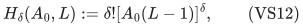
contains a labeled sunflower of size <code class="math">L</code>. It can be found in uniform
polynomial time on the explicit family.

First pad every distinct full type to support size exactly <code class="math">\delta</code>,
using private new row IDs for that type, with coefficient one. A private
row is not an actual quota. Distinctness of the partial functions is
preserved.

For the induction on the current support size <code class="math">d</code>, greedily choose a
maximal subfamily with disjoint **row supports**. If it contains at least
<code class="math">L</code> members, those members have empty core and give the required flower.
Otherwise its union <code class="math">Z_0</code> has at most <code class="math">d(L-1)</code> row IDs and meets every
support. Among pairs
<!-- math-display: ce9729b733209591affa913f
(j,a),\quad j\in Z_0,\quad 1\le a\le A_0,
-->
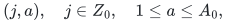
some pair occurs in more than
<!-- math-display: 8b295368e3835d3458990b7b
\frac{d![A_0(L-1)]^d}{d(L-1)A_0}
                   =(d-1)![A_0(L-1)]^{d-1}
\tag{VS13}
-->
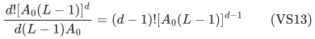
members. Restrict to that fixed pair, delete its row, and recurse. The
remaining partial functions are still distinct: their removed row and
value were identical. Reinsert the row with that value into the core.
At support size one the same disjoint-support argument finishes directly;
equivalently, a family of distinct empty functions cannot exceed one.

The recursion follows one popular-pair branch and has depth at most
<code class="math">\delta</code>. Popular pairs are counted by scanning pairs actually present;
there is no loop through all <code class="math">A_0</code> possible values. Maximal disjoint
families, restrictions, and pair counts are polynomial explicit operations.

Because <code class="math">L\ge2</code>, a private padding row cannot be in the common core.
Removing all padding leaves a real sunflower with identical coefficients
on its core and disjoint real petals. Two distinct real full types cannot
both have empty petals with identical core values. Nothing in the later
argument requires a nonempty petal.

## 5. Valuated layers inside one flower

Set
<!-- math-display: 890d05e4754e66f3542bcb4a
t=\delta(k-1)+1,\qquad L=kt+1.
\tag{VS14}
-->
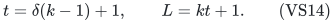
Suppose one replacement class contains more than VS12 distinct full types.
Find a labeled sunflower in that class and choose one currently surviving
item per flower type. Let <code class="math">V</code> be the resulting <code class="math">L</code>-item set. Other copies
of those types are left outside this particular choice.

Construct disjoint layers
<!-- math-display: e5b06259767b02ae1f409865
\begin{split}
 Y_1&=V,\\
 A_i&=\mathcal O_p(Y_i),\qquad F_i=A_i\cap Y_i,\\
 Y_{i+1}&=Y_i\setminus F_i\qquad(1\le i\le t).
 \end{split}
\tag{VS15}
-->
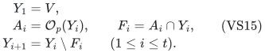
Every call uses the **original** valuation and item ground. Its emitted
layer has at most <code class="math">k</code> items. Consequently
<!-- math-display: f771f266cf58cfcf39e3fcf6
R_V:=\bigcup_{i=1}^t F_i,\qquad
                         |R_V|\le kt=L-1.
\tag{VS16}
-->
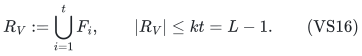
Delete exactly <code class="math">V\setminus R_V</code>. Keep <code class="math">R_V</code> and all current candidates
outside <code class="math">V</code>. At least one item is deleted.

## 6. Why one layer replacement satisfies every numeric row

Fix a deleted item <code class="math">e</code>, an arbitrary original feasible basis <code class="math">S</code>
containing it, and <code class="math">I=S-e</code>. The item <code class="math">e</code> remained in every <code class="math">Y_i</code>,
because it was emitted in none of the layers. VS8 gives
<!-- math-display: 4aad9bc5318140ee2f7cafb3
f_i\in F_i\setminus I,\qquad
                  p(I+f_i)\le p(I+e)\qquad(1\le i\le t).
\tag{VS17}
-->
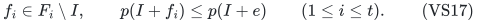
The <code class="math">f_i</code> are distinct since the layers are disjoint. They belong to
different selected flower types. Each is in the same replacement class as
<code class="math">e</code>, so every class predicate remains true.

Let <code class="math">C</code> be the real flower core. If <code class="math">j\in C</code>, labeled consistency gives
<!-- math-display: 0ac795fa701ec592970f3a30
a_{j,f_i}=a_{j,e}.
-->
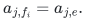
Thus the upper load of that row is exactly its original load in <code class="math">S</code>.

Outside <code class="math">C</code>, consider rows meeting the fixed context <code class="math">I</code>. Their number
is at most
<!-- math-display: cfd5b8d29bef46b0aa4c2d97
\left|\bigcup_{u\in I}\mathrm{supp}\alpha_u\right|
                         \le\delta(k-1)=t-1.
\tag{VS18}
-->

Every such row lies in at most one real petal of the chosen flower and
therefore can obstruct at most one of the distinct <code class="math">f_i</code>. Some of these
rows may already be safe; counting all of them only overestimates the
number of bad candidates.

Finally, a row outside the core that does not meet <code class="math">I</code> has zero context
load. If a candidate enters it, VS4 gives
<code class="math">a_{j,f_i}\le u_j</code>, so that row is safe.

The <code class="math">t</code> candidates and at most <code class="math">t-1</code> possibly obstructing touched rows
leave at least one feasible <code class="math">f_i</code>. Its valuation is no larger by VS17.
This proves the external-context property of the deletion. A retained item
can represent itself.

This argument handles unequal coefficients in petals. It requires their
equality only on the core and individual eligibility on untouched rows.
It also counts context items that have disappeared from the current
candidate set. No packing feasibility is assumed for any whole <code class="math">A_i</code>.

## 7. Termination, ground size, and uniform polynomial construction

Perform the duplicate reduction first. Then repeatedly choose a class with
more than <code class="math">H_\delta(A_0,L)</code> distinct full types and perform Sections 4–6.
Every iteration deletes at least one item; at most <code class="math">N</code> iterations occur.
A type can survive through an unchosen duplicate, but this does not affect
item-count termination.

At termination every class has at most <code class="math">H_\delta(A_0,L)</code> types, each with
at most <code class="math">k</code> items. VS7 follows from <code class="math">L-1=k(\delta(k-1)+1)</code>. The
external-context invariant composes by Section 3 and proves VS6.

There are at most <code class="math">N</code> initial type queries. Whenever a flower iteration
is invoked, its threshold is smaller than the number of current types.
For <code class="math">A_0,\delta\ge1</code>,
<!-- math-display: 3bfb4f8445d2b773cef8f9d4
H_\delta(A_0,L)\ge L-1,
-->
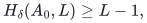
so <code class="math">L\le N</code> and <code class="math">t\le N</code> at that iteration. It makes at most <code class="math">N</code>
overlap queries. At most <code class="math">N</code> iterations give <code class="math">O(N^2+N)</code> calls in total.
The count includes empty overlaps and unsuccessful numerical feasibility
of the eventual optimization problem.

Private padding uses at most <code class="math">N\delta</code> labels. A flower search follows
at most <code class="math">\delta</code> recursive restrictions and performs polynomial work at
each level. The threshold has
<!-- math-display: 98099db3512c39b321fa356b
O\bigl(\delta\log(\delta+1)+
       \delta\log(A_0+1)+\delta\log(k+1)\bigr)
-->
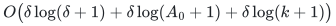
bits and can instead be saturated at <code class="math">N+1</code> during comparison. No candidate
tuple over row IDs or coefficient values is enumerated. All data structures,
oracle inputs, and threshold arithmetic fit polynomial binary space.

When there are no upper rows, one overlap query per class already suffices;
the normalized bound VS7 remains valid. For an empty finite domain, return
infeasibility before the construction. For a nonempty domain but no
numerically feasible basis, the replacement guarantee is vacuous and all
the same work bounds still hold.

## 8. Exact optimization and the meaning of the retained oracle

Starting with any <code class="math">S\in\mathcal F</code>, replace an element outside <code class="math">R</code> using
VS6. The replacement lies in <code class="math">R</code> and outside the unchanged context, so it
strictly increases <code class="math">&#124;S\cap R&#124;</code>. After at most <code class="math">k</code> steps the entire basis
lies in <code class="math">R</code>, its class counts are unchanged, and its valuation has not
increased. Hence restriction to <code class="math">R</code> preserves the minimum objective.

If only the overlap oracle is supplied, a proposed <code class="math">k</code>-set <code class="math">S</code> can be
tested and valued using <code class="math">\mathcal O_p(S)</code>. Maximum overlap <code class="math">k</code> occurs
exactly when <code class="math">S</code> is a finite-domain basis, and then the returned basis
equals <code class="math">S</code>. This gives an exact postprocessing oracle for enumeration.

The original oracle is not progressively replaced by an oracle whose
contexts are confined to the shrinking ground. It must continue to answer
VS2 for the original valuation. Final recovered solutions are restricted
to <code class="math">R</code>; this is compatible with every deletion proof above.

Theorem 1 applies to one specified valuation. It preserves arbitrary signed
costs that generated that valuation, but does not state that one retained
set works for every later change of costs. The function <code class="math">\mathcal L</code> and
its class system are also fixed throughout.

## 9. Application: binary polymatroid counts, mixed rows, and root cap

Consider the model of *bounded_frequency_root_cap_valuated_fpt.md* (BF).
One normalized monotone integral rank <code class="math">F</code> describes either optional
integer counts in <code class="math">P(F)</code>, or mandatory counts in <code class="math">B(F)</code> of original total
<code class="math">R</code>. There is a nonnegative integer root charge
<!-- math-display: a493c1f6e3258fd951c36144
\sum_e w_ex_e\le B_0
\tag{VS19}
-->
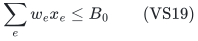
and arbitrary interval rows
<!-- math-display: 37f6f02afdafc21bc6e37d59
l_j\le\sum_e a_{je}x_e\le u_j.
-->
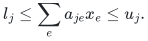
Finite targets and coefficients are nonnegative integers, upper bounds may
be absent, and an equality is one interval row. The essential assumption is
<!-- math-display: aa0cf33cbc22ec5decaf79ce
w_e=0\ \Longrightarrow\ a_{je}=0
                                         \quad\text{for all }j.
\tag{VS20}
-->
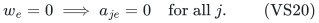
The scalar <code class="math">c\cdot x</code> is arbitrary signed rational and is minimized exactly;
maximization is handled by negation. This permits a decision threshold on
that same scalar, but does not add an unrelated second scalar constraint.

Let <code class="math">\Delta</code> be the maximum of one and the nondistinguished column
frequency, and let
<!-- math-display: 93e00ebd0128710c92a2d199
B=\max\{B_0,\text{finite row targets}\}.
\tag{VS21}
-->
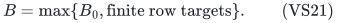
BF's preparation removes individually impossible coordinates, retains
original mandatory total <code class="math">R</code>, and introduces a free zero-scalar disposal
coordinate for an optional instance. The disposal rank is <code class="math">F^+(D)=F(D)</code>
if disposal is absent and <code class="math">F^+(D)=R</code> if it is present. Every optional
original vector extends to total <code class="math">R</code>, and projection preserves the
original scalar and rows.

Write <code class="math">P=\{e:w_e&gt;0\}</code>, <code class="math">Z=\{e:w_e=0\}</code> after preparation, and
<code class="math">n=&#124;P&#124;</code>. All numeric rows vanish on <code class="math">Z</code>; their scalar coefficients do
not have to vanish or agree. An upper-zero row masks all its positive
coordinates. Every surviving upper coefficient is individually eligible
and at most <code class="math">B</code>.

For a positive lower target, use
<!-- math-display: aa6103a41f6886d38c647034
\lambda_{je}=\min(a_{je},l_j).
\tag{VS22}
-->
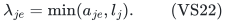
For integer nonnegative counts, replacing coefficients by VS22 preserves
the predicate that the row reaches <code class="math">l_j</code>. If a used coefficient is at
least <code class="math">l_j</code>, its first occurrence already reaches the target; otherwise
capping changes no used coefficient. It is not a fractional equivalence
or preservation of the original row total.

At most <code class="math">B_0</code> positive units can be selected. A positive lower row must
meet such a unit, so more than <code class="math">\Delta B_0</code> positive lower rows proves
infeasibility. Otherwise classify a positive coordinate by its root weight
and full capped lower vector. With <code class="math">G</code> actual classes,
<!-- math-display: b244512d59ee4126bc48703d
G\le B_0(1+\Delta B_0B)^\Delta
                         \qquad(B_0\ge1).
\tag{VS23}
-->
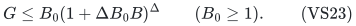
Same-class replacement preserves the root and all capped lower totals.
Upper sides are left to Theorem 1. Equalities follow from their lower and
upper sides together. Only classes occurring in the input are built.

## 10. The complete-cost valuation and its compressed overlap oracle

Give a positive owner <code class="math">e</code> the valid cap
<!-- math-display: 7f75b57c73a87685e7358ce9
b_e=\min\{F(\{e\}),\lfloor B_0/w_e\rfloor\}.
\tag{VS24}
-->
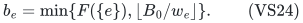
For the moment suppose its <code class="math">b_e</code> positive copies <code class="math">U_e</code> are explicit,
and let <code class="math">U=\bigcup_eU_e</code>. Section 11 removes this supposition when binary
capacities would be too large.

Fix <code class="math">0\le k\le\min\{B_0,R,&#124;U&#124;\}</code>. For a <code class="math">k</code>-set <code class="math">S\subseteq U</code>, define
<code class="math">p_k(S)</code> to be the least **full original scalar** of a resource base of
total <code class="math">R</code> with positive copies exactly <code class="math">S</code>, and arbitrary compatible
integer zero counts. Set <code class="math">p_k(S)=+\infty</code> when no completion exists.

The VZ manuscript, *laminar_valuated_zero_completion_fpt.md*, proves that a
nonempty finite domain of <code class="math">p_k</code> is a minimum-valuated matroid. That fact
uses no laminarity of the numerical rows. Its weighted Rado representation
has private edges for allowed positive copies and <code class="math">R-k</code> zero-only dummy
vertices; the right natural matroid keeps rank <code class="math">R</code>. Edge weights are minus
the true scalar. The resulting maximum valuation is <code class="math">-p_k</code>. This is a
finite conceptual proof construction, not a unit expansion in the algorithm.

The exact algorithm works on <code class="math">U\dot\cup Z</code>. Its first rank is
<!-- math-display: 25616d7942423e834a430e27
G_F(D)=\min_{C\subseteq P}
       \left[F((D\cap Z)\cup C)+
                      \sum_{e\in P\setminus C}|D\cap U_e|\right].
\tag{VS25}
-->
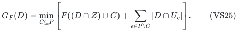
This is the original resource lifted to positive copies and capped at one
per positive copy, while retaining binary zero coordinates. Rank queries
are submodular minimizations on original coordinates.

Intersect VS25 with **one** partition rank: positive total at most <code class="math">k</code>,
zero total at most <code class="math">R-k</code>. Require total <code class="math">R</code>. This integral full-total
face forces both counts exactly. It detects an empty <code class="math">p_k</code> domain and
permits exact signed linear optimization.

After clearing scalar denominators, let <code class="math">C_{\max}</code> be the largest
absolute integer scalar coefficient and put <code class="math">M_0=2RC_{\max}+1</code>. Minimizing
<!-- math-display: 7e7ef4a3642a6c9512a351d6
\widetilde c\cdot z-M_0\sum_{u\in Y}z_u
\tag{VS26}
-->
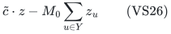
first maximizes overlap with <code class="math">Y</code>, then minimizes <code class="math">p_k</code>. Indeed any two
full-total true costs differ by at most <code class="math">2RC_{\max}</code>. The overlap reward
is on individual positive copies, not merely their owner totals.
Deterministic tie breaking has polynomial bit complexity.

No numeric row is added to this overlap problem, and no extra rank is
introduced for <code class="math">Y</code>. Its basis may fail all the root or lower constraints;
same-class replacement and the labeled-flower argument are what preserve
them in the protected solution.

Consequently Theorem 1 applies with <code class="math">g=G</code>, <code class="math">\delta=\Delta</code>, and
<code class="math">A_0\le B</code>. For every nonempty cardinality domain it returns <code class="math">R_k</code> with
<!-- math-display: 175972849602a9d9b6196ad6
|R_k|\le
 Gk\,\Delta!\,[B k(\Delta(k-1)+1)]^\Delta.
\tag{VS27}
-->
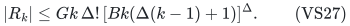
The zero coordinates, their signed costs, and the original total remain
part of <code class="math">p_k</code> at every oracle call.

## 11. Uniform polynomial preprocessing without binary expansion

Here a **positive-capacity kernel** means a reduction of the allowed
positive coordinate capacities, with a parameter-bounded sum of those
capacities, while retaining original coordinate identities, numeric rows,
scalar coefficients, all zero coordinates, and the original resource
oracle. The bound does not include the number of zero coordinates or their
binary resource mass.

**Theorem 2.** The BF instance admits a deterministic, uniform
polynomial-time positive-capacity kernel preserving feasibility and the
exact scalar optimum at every positive cardinality. For <code class="math">B_0\ge1</code>, its
total positive capacity is at most
<!-- math-display: 75f01539407300fbc2d475bd
\begin{split}
 K_+ := \max\bigg\{ B_0^2,\quad&
 G\,\frac{B_0(B_0+1)}2\,\Delta!\,
       [B B_0(\Delta(B_0-1)+1)]^\Delta\bigg\}\\
 &\le(\Delta B_0B+2)^{O(\Delta)}.
 \end{split}
\tag{VS28}
-->
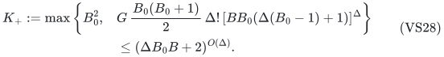
For fixed frequency this is a polynomial in the numerical parameters.
Construction uses polynomial binary workspace. It does not require
enumerating <code class="math">B_0</code> values when <code class="math">B_0</code> is binary-large.

The following two branches prove this stronger original-input statement.

**Large root cap: <code class="math">B_0\ge n\ge1</code>.** Keep every positive coordinate with
the valid binary cap VS24. Their total capacity obeys
<!-- math-display: 6a412fce36ce89a83a542094
\sum_{e\in P}b_e\le nB_0\le B_0^2.
\tag{VS29}
-->
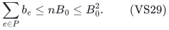
Nothing is expanded. These caps are already implied by the root and
singleton resource bounds on every feasible integer solution, so this
branch preserves the entire feasible set. It performs only polynomial
binary arithmetic and oracle work. The theorem in this branch is a bound
on a compressed capacity sum, not an explicit listing of that many items.

**Small root cap: <code class="math">1\le B_0&lt;n</code>.** Expand the at most
<code class="math">nB_0&lt;n^2</code> allowed positive copies. The zero ground remains compressed.
For each <code class="math">k\le\min\{B_0,R,&#124;U&#124;\}</code>, detect whether <code class="math">p_k</code> has a finite
domain; skip empty domains and construct <code class="math">R_k</code> for the others. Every one
of these kernels uses the same original <code class="math">U</code>, original completion oracle,
and original rows. One cardinality's reduction is not substituted into the
next cardinality's oracle.

Keep <code class="math">R_+=\bigcup_kR_k</code>. By monotonicity of
<code class="math">k(\Delta(k-1)+1)</code> and summing the leading <code class="math">k</code> in VS27,
<!-- math-display: 950745fb43930f72826de1e0
|R_+|\le
 G\,\frac{B_0(B_0+1)}2\,\Delta!\,
       [B B_0(\Delta(B_0-1)+1)]^\Delta.
\tag{VS30}
-->
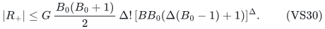
There are fewer than <code class="math">n</code> cardinalities, each on fewer than <code class="math">n^2</code>
positive items. Theorem 1 and the compressed oracle of Section 10 therefore
give a uniform polynomial original-input construction. No factor
<code class="math">n^\Delta</code>, no coefficient-value enumeration, and no binary-<code class="math">B_0</code>
cardinality loop is hidden in this statement.

Copies of a fixed original owner have identical resource behavior, rows,
and true scalar. They can be merged back into that owner's binary capacity
<!-- math-display: 6e4e4f08124932590b20bf2d
\widehat b_e=|R_+\cap U_e|.
-->
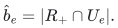
An original count vector fitting these caps can be realized using retained
copies, since the shared resource depends on owner counts and is symmetric
within every copy class. Conversely any retained-copy vector projects to
the same original resource and rows. Thus merging is exact.

At each fixed positive cardinality, Theorem 1 retains a feasible basis
with no greater <code class="math">p_k</code> than any original feasible one. Restriction cannot
create a solution outside the original instance. Hence the optimum is
preserved exactly. Arbitrary true zero costs are already included in
<code class="math">p_k</code>, so no subsequent independent insertion of zeros is being assumed.

For example, with <code class="math">X=\Delta B_0B+2</code>, the class bound and elementary
<code class="math">\Delta!\le\Delta^\Delta</code> show that VS28 is at most <code class="math">X^{7\Delta}</code>.
This rough explicit exponent is only a size bound; no claim of optimal
polynomial degree is made.

When <code class="math">B_0=0</code> or <code class="math">n=0</code>, all positive counts vanish. Positive lower
requirements fail, and otherwise the signed scalar is optimized on the
zero resource with the original required total. This is polynomial. Zero
original resource rank is covered by the same gate.

## 12. Exact FPT consequence, bits, and workspace

The capacity kernel supplies the same all-input FPT order as BF:
<!-- math-display: 318e74c3f720b22ec274d92f
2^{O(\Delta B_0\log(\Delta B_0B+2))}
                                      \mathrm{poly}(H).
\tag{VS31}
-->
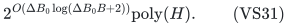
The additional conclusion is the uniform polynomial-time positive-capacity
preprocessing with original-context replacement, not a smaller FPT
exponential order than the already proved hash and direct-profile methods.

For the small-cap branch, enumerate at most <code class="math">B_0</code> distinct retained
positive copies, test the original numeric rows, and compute the attaining
completion <code class="math">p_k</code>. A final fixed <code class="math">S</code> query masks <code class="math">U\setminus S</code>, uses
positive total <code class="math">k</code>, and keeps zero total <code class="math">R-k</code>; unit caps force exactly
the requested positive set. Enumeration of a ground bounded by VS28 gives
VS31. Since the ground actually stored is a subset of fewer than <code class="math">n^2</code>
input copies, this branch uses polynomial space.

For the large-cap branch, do not materialize the capacity bound. Stream
positive vectors <code class="math">0\le x_e\le b_e</code>. There are at most
<code class="math">(B_0+1)^n\le(B_0+1)^{B_0}</code>, within VS31. For each numerically feasible,
resource-independent positive vector, use the residual zero rank
<!-- math-display: 1ef88219e84f2946b34c114e
h_x(D)=\min_{C\subseteq P}
                              [F(D\cup C)-x(C)]\qquad(D\subseteq Z).
\tag{VS32}
-->
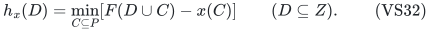
It is normalized, monotone and submodular. Compatible zero counts are
exactly <code class="math">P(h_x)</code>, by the original inequalities for <code class="math">D\cup C</code>. Its total
rank is at most <code class="math">R-x(P)</code>; full completion exists exactly when equality
holds. Then signed minimum-weight base optimization on <code class="math">h_x</code> returns the
best completion. This is the same explicit compressed primitive proved in
BF. It keeps only <code class="math">n</code> binary counters and polynomial oracle workspace.

In either branch the required total <code class="math">R</code> is retained after all masks and
boxes. Rank loss is not repaired by silently lowering that total.
Denominator clearing and the reward VS26 have polynomial bit length.
The conceptual natural matroid, Rado dummies, and binary-large zero counts
are never expanded.

The preprocessing retains all zero coordinates. Consequently it does not
bound the whole explicit ground, the full original rank, the lengths of
arbitrary scalar coefficients, or the size of an oracle program by the
parameters alone. The exact optimum, rather than all possible zero
completions, is what the valued positive reduction preserves.

## 13. Relation to the simpler packing kernel and primary antecedents

The companion manuscript *deterministic_sparse_packing_oracle_kernel.md*
(SK) covers an ordinary oracle matroid with additive profits and zero-one
upper packing. Its greedy layers and original-context composition motivate
the present construction. Here two extra ingredients are necessary:
coefficients must agree on the sunflower core, and full completion cost is
represented by a valuation rather than an additive item cost.

The underlying tools have established antecedents:

- Erdős and Rado, *Intersection Theorems for Systems of Sets* (1960),
  provides the sunflower framework. Section 4 proves the precise
  coefficient-labeled induction required here, including its constructive
  and binary-input accounting.
  <https://www.renyi.hu/~p_erdos/1960-04.pdf>

- Fomin, Golovach, Korhonen and Saurabh, *Stability in Graphs with Matroid
  Constraints*, SWAT 2024, Theorem 4, uses disjoint independent layers and
  a bounded-conflict replacement argument. The present flower supplies
  a local touched-row bound, and VS8 replaces the ordinary rank exchange.
  <https://drops.dagstuhl.de/storage/00lipics/lipics-vol294-swat2024/LIPIcs.SWAT.2024.22/LIPIcs.SWAT.2024.22.pdf>

- Huang, Kakimura, Kobayashi and Terao,
  *Polynomial Kernels with Reachability for Weighted d-Matroid
  Intersection*, arXiv:2603.17345v1, Lemma 2 and Section 7, explicitly
  develop the external-context greedy exchange and deterministic
  single-exchangeability interfaces. Its randomized reachable kernels
  have smaller degrees in several ordinary matroid/partition
  specializations. This note does not claim to improve those degrees.
  <https://arxiv.org/html/2603.17345v1>

- Husić, Loho, Smith and Végh, *On complete classes of valuated matroids*,
  TheoretiCS 3 (2024), Definition 1.1 and Theorem 2.9, supplies the
  weighted Rado induction behind <code class="math">p_k</code>. VZ gives the precise sign
  convention and the compressed two-rank implementation used here.
  <https://theoretics.episciences.org/14792/pdf>

These comparisons delimit the proof contribution: deterministic
coefficient-consistent ground reduction, followed by a compressed
positive-capacity application with full signed completion costs. They
do not establish a first-ever kernel or a new sunflower construction
framework.

## 14. Scope limits

The finite upper coefficients are nonnegative and bounded numerically by
<code class="math">A_0</code>. The bound necessarily records that diversity. Treating only
unlabeled supports as types would fail for unequal upper coefficients.

The extra numerical predicates must be invariant within each replacement
class. In the BF application, the number of classes is controlled by the
root cap, lower capping, and frequency. Arbitrary extra constraints that
do not meet this condition are not automatically preserved.

The assumption VS20 makes the zero coordinates quota-free. Without it,
the optimal-completion valuation does not by itself encode their numerical
feasibility, and BF already records an oracle obstruction to the proposed
root parameterization. No removal of VS20 is claimed.

There is one global integral resource and one exact scalar objective.
A second unrelated resource, several independent scalar budgets, signed
quota coefficients, or a classical parameter-only bit kernel requires
additional arguments. The present integral recoveries use one resource
rank and one partition rank, or the residual rank VS32.
