# Exact prefix, laminar and sparse quotas

The algorithms in this family optimize one signed rational scalar exactly while preserving mixed nonnegative integer quotas, a single global integral polymatroid, and every original mandatory resource total. Their complexity parameters describe quota geometry; they are separate from numeric-target sums.

| Theorem | Time apart from <code class="math">\mathrm{poly}(H)</code> | Complete proof |
|---|---|---|
| One common order and common weights | <code class="math">2^{O(B)}</code> | [Prefix theorem](manuscripts/exact-weighted-prefix-quotas-max-target.md) |
| Two common orders | <code class="math">2^{O(B\log(B+2))}</code> | [Two-order theorem](manuscripts/two-order-weighted-prefix-target-classification.md) |
| <code class="math">C</code> support patterns, one order | <code class="math">2^{O(\sqrt{B\min\{C,B\}})}</code> | [Support tradeoffs](manuscripts/weighted-prefix-support-budget-tradeoffs.md) |
| <code class="math">C</code> support patterns, two orders | <code class="math">2^{O(\min\{\sqrt{BC},B\log(2+\min\{C/B,B\})\})}</code> | [Support tradeoffs](manuscripts/weighted-prefix-support-budget-tradeoffs.md) |
| <code class="math">p</code> shared weight families | <code class="math">2^{O(pB\log(p+2))}</code> | [Family algorithm](manuscripts/few-weight-families-prefix-target-scheme.md), [joint lower calibration](manuscripts/few-weight-prefix-joint-lower-bounds.md) |
| Common-weight laminar quotas, root cap <code class="math">B</code> | <code class="math">2^{(5/9+o(1))B^2}</code> | Catalogue below; [improved recovery](manuscripts/laminar-dominant-weight-recovery.md) |
| Quotas on compatible cuts | <code class="math">2^{(5/9+o(1))B^2}</code> | [Fixed-mass orientation](manuscripts/compatible-cut-quota-extension.md) |
| Laminar quotas with one positive weight value | <code class="math">\mathrm{poly}(H)</code> | [Binary count-rank completion](manuscripts/laminar-dominant-weight-recovery.md#4-exact-completion-after-fixing-the-exceptional-units) |
| Sparse root-bounded mixed quotas | <code class="math">2^{O((\Delta+1)B_0\log((\Delta+1)B_0(B+2)+2))}</code> | [Direct hash-and-profile proof](manuscripts/sparse-root-quota-hash-profile-algorithm.md) |

Here <code class="math">B</code> bounds the finite targets, <code class="math">B_0\le B</code> is the root cap, and <code class="math">\Delta</code> counts positive nonroot incidences per coordinate. In the sparse theorem a zero-root coordinate is zero in every numeric row, but can have an arbitrary scalar cost. All algorithms use uniform polynomial binary workspace.

The following reductions return a retained ground with the original oracle and weights. They are not running-time exponents or parameter-only encodings of an arbitrary oracle.

| Deterministic polynomial-time reduction | Retained-ground bound | Complete proof |
|---|---|---|
| Sparse packing with one item matroid, frequency <code class="math">\delta</code>, solution size at most <code class="math">k</code> | <code class="math">k\delta![k(\delta(k-1)+1)]^\delta=O_\delta(k^{2\delta+1})</code> | [Sparse packing](manuscripts/deterministic-sparse-packing-oracle-kernel.md) |
| One arbitrary and <code class="math">d</code> additional coverable matroids | <code class="math">k\,d![k(1+\sum_i g_i)]^d</code> | [Coverable matroids](manuscripts/deterministic-coverable-matroid-sunflower-kernel.md) |
| One arbitrary and <code class="math">d</code> explicit transversal matroids | <code class="math">O_d(k^{2d+1})</code> | [Transversal transfer](manuscripts/deterministic-transversal-matroid-kernel-transfer.md) |
| Graph matching with a matroid on edges | <code class="math">O(k^4)</code> for a simple graph; <code class="math">O(k^5)</code> with parallel edges | [Graph corollaries](manuscripts/deterministic-sparse-packing-oracle-kernel.md) |
| Sparse numeric quotas with valuated completion | Parameter-bounded positive capacity; original zero-coordinate completion retained | [Coefficient-consistent sunflower proof](manuscripts/valuated-sparse-quota-sunflower-kernel.md) |

There is also a sharper retained-size tradeoff with **fixed-parameter
preprocessing**. For unweighted sparse packing with an arbitrary item
matroid, at most <code class="math">k\binom{\delta k}{\delta}</code> original items suffice
for single replacements against every original feasible context, and this
bound is exact in the worst case. Construction takes
<code class="math">2^{O(\delta k\log(\delta k+2))}\mathrm{poly}(H)</code> oracle time.
With <code class="math">q</code> fixed profit values, multiply the support by at most <code class="math">q</code>;
every replacement can preserve its profit exactly. With arbitrary many
signed profit values, an ordered failure-summary construction instead
retains at most <code class="math">e^\delta k^{\delta+1}</code> items and gives no-worse-profit
replacements, with the same FPT parameter dependence. The exact
binomial lower bound also proves that this exponent is optimal for the
original-context replacement requirement at fixed <code class="math">\delta</code>.
A capacity-sensitive saturated-row budget improves these bounds.
These claims and the distinct polynomial-time weighted endpoint for
budget one are proved in
[Sharp sparse-packing restrictions](manuscripts/sharp-sparse-packing-fpt-restrictions.md).

The lower bounds distinguish rank queries from computation with an explicitly readable rank program. In particular, [disjoint nonroot equality rows](manuscripts/disjoint-row-root-target-sharp-lower.md) already force <code class="math">2^{\Omega(B\log(B+2))}</code> rank queries at frequency one; [row-dependent weights](manuscripts/row-dependent-full-prefix-target-boundary.md) cross a separate W[2]-hard boundary. The laminar theorem below has a <code class="math">2^{\Omega(B)}</code> oracle lower bound and does not close that exponent gap.

## Main theorem: the quadratic laminar exponent

The complete basic catalogue construction below gives the bound LC3.
The [most-frequent-weight recovery companion](manuscripts/laminar-dominant-weight-recovery.md)
keeps the actual positive cardinality in the catalogue and enumerates only
units outside a most frequent weight. With this manuscript's elementary
coloring, it gives <code class="math">2^{(10/9)B^2+O(B\log(B+1))}\mathrm{poly}(H)</code>.
Using the specific locally explicit universal-set construction of
Naor–Schulman–Srinivasan, Theorem 7, it gives
<code class="math">2^{(5/9+o(1))B^2}\mathrm{poly}(H)</code> with the same polynomial binary space.
The companion states the exact integer maximum before these simplified
coefficients and explains the local evaluation guarantee that makes the
published construction compatible with streaming. Its projected coloring
identities and histogram-dependent choice of the homogeneous weight can
reduce the exponent further, while retaining every original numeric row.
The [compatible-cut extension](manuscripts/compatible-cut-quota-extension.md)
uses the same bounds after orienting quota sets at a fixed total mass;
it includes quotas on either side of edges of an unrooted tree.

It also proves a polynomial endpoint for one positive weight value,
with arbitrary signed costs on zero-weight coordinates and the original
resource total. The [two-weight boundary](manuscripts/two-positive-weight-laminar-boundary.md)
shows exponential rank-query hardness already with weights 1 and 2 at
laminar depth two, for mandatory feasibility and optional exact scalar
optimization. The construction below remains a valid baseline and supplies
the catalogue prerequisite.

The arbitrary-cost laminar theorem in [laminar-valuated-zero-completion-fpt.md](manuscripts/laminar-valuated-zero-completion-fpt.md) (VZ) has time <code class="math">2^{O(B^2\log(B+1))}\mathrm{poly}(H)</code>. This note replaces its recursive upper-blocker representatives by deterministic universal colorings. The resulting time is

<!-- math-display: a61ef894f32274abf93baa45
2^{O(B^2)}\mathrm{poly}(H),
\tag{LC1}
-->
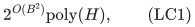

with the same exact numeric constraints, arbitrary signed scalar costs, original resource totals, and uniform polynomial binary space. In particular, real zero-weight coordinates keep their arbitrary costs and binary counts.

Universal sets, small-bias constructions, and weighted Rado induction are established tools. The new composition here is the short two-color certificate supplied by laminar blockers, together with the completed-cost overlap oracle. A self-contained elementary coloring construction is included so that no exponential-space catalogue is assumed.

## 1. Model and theorem

Let <code class="math">F</code> be a normalized monotone integral polymatroid rank on an explicit coordinate ground <code class="math">E</code>. Resource vectors are integer vectors in <code class="math">P(F)</code>, or in its original-total base of total <code class="math">R=F(E)</code>. Eligibility restrictions and binary domains can be absorbed by the same preparation as in VZ; a mandatory problem always retains its original required total.

An explicit laminar family <code class="math">\mathcal L</code> has common nonnegative integer coordinate weights <code class="math">w</code> and mixed quotas

<!-- math-display: afa2244c1cbfb3427aa77445
l_A\le \sum_{e\in A} w_e x_e\le u_A.
\tag{LC2}
-->
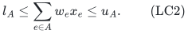

A root row imposes <code class="math">w\cdot x\le B</code>, with nonnegative integer <code class="math">B</code>. Missing directional bounds are allowed. The scalar <code class="math">c\cdot x</code>, with arbitrary signed rational coefficients, is minimized or maximized exactly. Testing a bound on this same scalar is included; a second independent scalar constraint is not asserted.

**Theorem.** This problem admits a deterministic exact algorithm of time LC1 and workspace polynomial in the complete binary input length <code class="math">H</code>. Polynomial rank-oracle bit bounds and standard exact submodular minimization and integral polymatroid intersection are included in the computational model.

More explicitly, the construction below gives a bound of the form

<!-- math-display: 60947615a6f0ad33e1026a7e
2^{4B^2+O(B\log(B+1))}\mathrm{poly}(H)
                    \qquad (B\ge1).
\tag{LC3}
-->
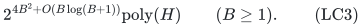

The coefficient in LC3 describes the basic full-tuple recovery below.
The companion refines recovery through two integral polymatroids and
keeps the cardinality in the catalogue parameter. This gives coefficient
<code class="math">10/9</code> with the elementary coloring, or <code class="math">5/9+o(1)</code> with the specifically
cited local universal-set construction. Its actual-weight and depth
refinements can reduce the exponent further. The existing <code class="math">2^{\Omega(B)}</code> oracle lower family remains applicable and leaves an exponent gap.

## 2. Prepared geometry and the completed-cost oracle

We restate the exact prerequisites from VZ, whose detailed proofs remain separate companion proofs.

An optional resource can be converted to a full base by one new zero-weight, zero-cost disposal coordinate. Its rank is <code class="math">F(A)</code> on sets without disposal and <code class="math">R</code> on sets with disposal. An optional vector extends by its missing mass, and projection preserves all original constraints and the scalar. A mandatory resource receives no disposal. All real zero-weight coordinates are retained.

Remove positive coordinates individually prohibited by an upper row, and perform the safe upper/lower dominance reductions. The retained upper capacities are positive integers that strictly increase up a containing chain. Their depth <code class="math">D</code> is therefore at most <code class="math">B</code>. The number <code class="math">m</code> of upper rows may be arbitrarily large.

Lower rows admit a stronger aggregate reduction. On their inclusion forest,
with a dummy root of lower bound zero, compute
<code class="math">q_A=\max\{l_A,\sum_{C\text{ child of }A}q_C\}</code> bottom-up.
The disjoint children force mass at least their aggregate demand; reject
if the dummy-root demand exceeds <code class="math">B</code>. Delete a row when
<code class="math">l_A\le\sum_Cq_C</code>, since retained descendants already imply it.
Each retained row contributes a positive integer
<code class="math">q_A-\sum_Cq_C</code>; these contributions telescope to at most <code class="math">B</code>.
Thus at most <code class="math">B</code> lower rows and <code class="math">B+1</code> lower-membership patterns remain.
This equivalence uses only nonnegative mass and laminarity. Its complete
proof is in [the laminar preparation lemma](manuscripts/laminar-common-weight-root-cap-fpt.md#2-safe-preparation-and-the-two-dominance-reductions).

Write <code class="math">P</code> for positive-weight coordinates and <code class="math">Z</code> for zero-weight coordinates after preparation, including disposal if applicable. A positive coordinate <code class="math">e</code> needs at most

<!-- math-display: 3822b2f1e67bf3f23dc5cd4f
b_e=\min\{F(\{e\}),\lfloor B/w_e\rfloor\}
\tag{LC4}
-->
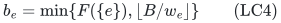

unit copies. Their explicit ground, when constructed, is <code class="math">U=\dot\bigcup_{e\in P}U_e</code>. Copies inherit their owner's weight, scalar, and numeric memberships. A class <code class="math">T\subseteq U</code> fixes the positive weight and the full retained lower-membership pattern. There are at most

<!-- math-display: 70500e44f21d242383cb5627
G\le B(B+1)
\tag{LC5}
-->
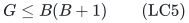

nonempty classes.

For a fixed <code class="math">k</code>, let <code class="math">p_k(S)</code> be the minimum true scalar of a full resource base whose positive copy set is exactly <code class="math">S\in\binom Uk</code>, with arbitrary compatible zero counts; set its value to <code class="math">+\infty</code> when no such completion exists. If its finite domain is nonempty, <code class="math">p_k</code> is a minimum-cost valuated matroid. One proof uses the full natural matroid of <code class="math">F</code>, private edges for positive copies, and <code class="math">R-k</code> compulsory left dummy vertices adjacent to zero units. Matching edge weights are the negatives of their true scalar coefficients. Public weighted Rado induction then gives the valuation; the large conceptual matching ground is never constructed.

The needed oracle, given <code class="math">Y\subseteq U</code>, returns a finite basis <code class="math">A</code> maximizing <code class="math">&#124;A\cap Y&#124;</code>, then minimizing <code class="math">p_k(A)</code>. It is polynomial on the compressed ground <code class="math">U\dot\cup Z</code>. Its first rank is the box-truncated shared resource

<!-- math-display: 79eea358997ede579f89bf26
G(V)=\min_{C\subseteq P}
       \left[F((V\cap Z)\cup C)
                  +\sum_{e\in P\setminus C}|V\cap U_e|\right].
\tag{LC6}
-->
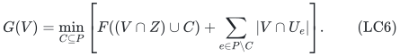

The second is one partition rank with positive-group cap <code class="math">k</code> and zero-group cap <code class="math">R-k</code>. Requiring total <code class="math">R</code> makes both caps tight on an integral face. Guard <code class="math">0\le k\le\min\{R,&#124;U&#124;\}</code>, and skip an empty face. After clearing scalar denominators, <code class="math">M=2R\max_e&#124;c_e&#124;+1</code> makes minimizing true cost minus <code class="math">M</code> times positive-copy overlap exactly the required lexicographic optimization. Here the displayed <code class="math">c</code> in this reward formula denotes the cleared integer coefficients. A polynomial-bit tertiary subset score can fix the returned positive set deterministically.

Thus individual-copy rewards, unrestricted zero costs, and the original total use exactly two integral ranks. The numeric laminar rows are not imposed on this oracle. They are preserved by replacements below.

For completeness, the overlap replacement consequence is short. Given a finite basis <code class="math">S</code> and <code class="math">e\in S\cap Y</code>, if <code class="math">e\in A</code>, keep it. Otherwise valuated exchange supplies <code class="math">f\in A\setminus S</code> with

<!-- math-display: 95f87eb5fb19dee8a8761c6b
p_k(S)+p_k(A)\ge p_k(S-e+f)+p_k(A-f+e).
\tag{LC7}
-->
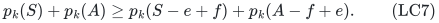

Maximum overlap forces <code class="math">f\in Y</code>. On that same overlap face, minimum value gives <code class="math">p_k(A-f+e)\ge p_k(A)</code>. Hence

<!-- math-display: 783f670f51a21ef416dcd0b0
f\in A\cap Y,\qquad p_k(S-e+f)\le p_k(S).
\tag{LC8}
-->
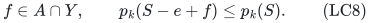

If the replacement is proper, <code class="math">f\notin S</code>.

## 3. A short red/green certificate for laminar replacement

Fix a numerically feasible finite basis <code class="math">S</code>, an element <code class="math">e\in S</code>, and its class <code class="math">T</code>. Put <code class="math">S^-=S-e</code> and <code class="math">w=w_e</code>. Let <code class="math">\mathcal A(e)</code> be the retained upper nodes containing <code class="math">e</code>. Then

<!-- math-display: 82f6b8bb70b2d2189434185c
|\mathcal A(e)|\le D\le B.
\tag{LC9}
-->
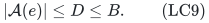

An upper node that blocks an equal-weight replacement satisfies

<!-- math-display: 8f898a1a0168fb2588310418
u_A\ge w,\qquad w(S^-\cap U_A)+w>u_A.
\tag{LC10}
-->
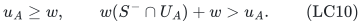

Nodes with capacity below <code class="math">w</code> contain no eligible candidate of this class. A node in LC10 contains at least one unit of <code class="math">S^-</code>, and cannot contain <code class="math">e</code>: if it did, the left side would be exactly the original feasible total of <code class="math">S</code> in that node.

Let <code class="math">\mathcal X</code> be the inclusion-maximal nodes in LC10. Laminarity makes these nodes disjoint, and each contains a unit of <code class="math">S^-</code>. Therefore

<!-- math-display: 4e083b2ae3f68c2de8297d91
|\mathcal X|\le k-1,
                 \qquad \mathcal X\cap\mathcal A(e)=\varnothing.
\tag{LC11}
-->
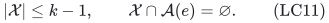

Every blocking node lies inside a member of <code class="math">\mathcal X</code>.

A coloring of the upper-node IDs is suitable if every node in <code class="math">\mathcal A(e)</code> is green and every node in <code class="math">\mathcal X</code> is red. Only

<!-- math-display: fe58d404d3860b5ef5181145
D+k-1\le2B-1
\tag{LC12}
-->
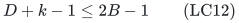

IDs have prescribed colors. For any coloring <code class="math">\chi</code>, define the class pool

<!-- math-display: f08ca8a997771637d38fcc41
Y(T,\chi)=\{f\in T:\text{every retained upper node containing }f
                                      \text{ is green}\}.
\tag{LC13}
-->
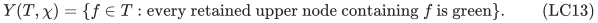

For a suitable coloring, <code class="math">e\in Y(T,\chi)</code>, and no member of the pool lies in any maximal blocker. Apply LC8 to the overlap-optimal basis for this pool. The resulting same-class replacement avoids all upper blockers, preserves every lower total, preserves root weight, and does not worsen completed scalar cost.

This reduces representative construction to a binary coloring family realizing every prescription on at most <code class="math">2B-1</code> upper IDs. It does not require identifying the protected basis or its blockers algorithmically.

## 4. An elementary injective hash family

Assume <code class="math">m\ge1</code>, and put

<!-- math-display: 80741748e05d13a941b8a24c
K=\min\{m,2B-1\},\qquad
 L=\max\{1,\lceil\log_2(m+1)\rceil\},\qquad
 D_0=\binom K2L.
\tag{LC14}
-->
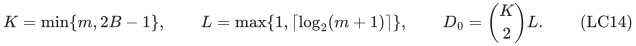

Represent distinct upper-row IDs by their distinct binary polynomials <code class="math">a_j(X)</code> of degree less than <code class="math">L</code>. Let <code class="math">d\ge2</code> be the least integer such that

<!-- math-display: c3a6befe037851e79f8173be
q=2^d>4(D_0+1).
\tag{LC15}
-->
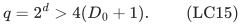

Then <code class="math">q\le8(D_0+1)=O(K^2L)</code>. Enumerate all monic degree-<code class="math">d</code> polynomials over <code class="math">\mathbb F_2</code>, retain the irreducible ones, and use

<!-- math-display: 3c6097725397c103f614ddc3
h_f(j)=a_j(X)\bmod f(X)
\tag{LC16}
-->
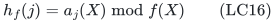

as a hash value in <code class="math">\{0,\ldots,q-1\}</code>, using the binary coefficient encoding of the remainder.

Every set <code class="math">W</code> of at most <code class="math">K</code> IDs is injective under at least one such hash. Indeed, the nonzero pair-difference product

<!-- math-display: 635829833051c6f2afdcd983
P_W(X)=\prod_{i<j,\ i,j\in W}(a_i(X)-a_j(X))
\tag{LC17}
-->
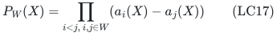

has degree at most <code class="math">D_0</code>. At most <code class="math">D_0/d</code> different monic irreducibles of degree <code class="math">d</code> divide it. The number <code class="math">I_d</code> of monic irreducibles of that degree satisfies

<!-- math-display: f31d7c7d57fd5fd4683a4eb4
I_d\ge\frac{2^d}{2d}
                                      >\frac{D_0}{d}.
\tag{LC18}
-->
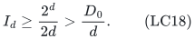

The standard elementary factorization of <code class="math">X^{2^d}-X</code> gives
<code class="math">dI_d=2^d-\sum_{j\mid d,\,j&lt;d}jI_j</code>.
Every proper divisor is at most <code class="math">d/2</code>, and <code class="math">jI_j\le2^j</code>. Summing <code class="math">2^j</code> for <code class="math">1\le j\le\lfloor d/2\rfloor</code>, with <code class="math">d=2,3</code> checked directly, proves the first inequality in LC18. Thus some enumerated irreducible does not divide LC17 and causes no collision on <code class="math">W</code>. The empty product for <code class="math">&#124;W&#124;\le1</code> causes no exception.

Irreducibility is testable using polynomial binary workspace: for every <code class="math">1\le j\le\lfloor d/2\rfloor</code>, compute
<code class="math">\gcd(f,X^{2^j}-X)</code> by repeated squaring modulo <code class="math">f</code>. A reducible degree-<code class="math">d</code> polynomial has an irreducible factor of degree at most <code class="math">d/2</code>, and that factor is detected at its degree. An irreducible degree-<code class="math">d</code> polynomial passes all these tests. Thus enumeration and each test use polynomial work per candidate; there are at most <code class="math">q</code> candidates.

The product LC17 is a proof device and is not constructed.

## 5. Explicit small-bias colorings after hashing

Let

<!-- math-display: 70ed63a11e3703c0af61031a
t=d+K+2,\qquad Q=2^t=q\,2^{K+2}.
\tag{LC19}
-->
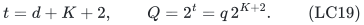

Construct a field <code class="math">\mathbb F_Q</code> by finding one monic irreducible degree-<code class="math">t</code> binary polynomial. Enumerating at most <code class="math">Q</code> candidates and using the preceding irreducibility test suffices. Only a degree-<code class="math">t</code> polynomial and polynomial-size arithmetic state are retained.

For every <code class="math">(\alpha,\beta)\in\mathbb F_Q^2</code>, color hashed position <code class="math">i\in\{0,\ldots,q-1\}</code> by

<!-- math-display: 1fbe57ff0ef0204dba6f2070
\gamma_{\alpha,\beta}(i)
                             =\mathrm{Tr}(\alpha\beta^i)
                                 \in\mathbb F_2.
\tag{LC20}
-->
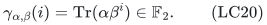

Color one is green and color zero is red. The convention <code class="math">\beta^0=1</code> includes <code class="math">\beta=0</code>.

Here <code class="math">\mathrm{Tr}(z)=\sum_{a=0}^{t-1}z^{2^a}</code>. This is a nonzero <code class="math">\mathbb F_2</code>-linear map to <code class="math">\mathbb F_2</code>: squaring leaves its value unchanged, and its defining nonzero polynomial has degree <code class="math">2^{t-1}&lt;Q</code>, so it cannot vanish on all of <code class="math">\mathbb F_Q</code>. Consequently its values are equally split between zero and one. Multiplication by any nonzero field element preserves that balance.

For a nonempty position set <code class="math">J</code>, let <code class="math">P_J(Y)=\sum_{i\in J}Y^i</code>. It is a nonzero polynomial of degree at most <code class="math">q-1</code>. Averaging first over <code class="math">\alpha</code> gives

<!-- math-display: e0ee00b1c5fb19d9efb93211
\mathbb E_{\alpha,\beta}
     (-1)^{\sum_{i\in J}\gamma_{\alpha,\beta}(i)}
       =\Pr_\beta[P_J(\beta)=0]
       \le\frac{q-1}{Q}<\frac qQ.
\tag{LC21}
-->
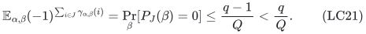

The absolute value has the same bound; the displayed expectation is nonnegative. For <code class="math">s\le K</code> distinct positions and any prescribed bits <code class="math">b_1,\ldots,b_s</code>, expand the product of their indicator functions. The empty term is one, and each nonempty term has absolute expectation below <code class="math">q/Q</code>. Therefore

<!-- math-display: 67fe8a4e440951e5f772bcd2
\Pr[\gamma(i_a)=b_a\text{ for every }a]
   \ge 2^{-s}\left(1-(2^s-1)\frac qQ\right)
   >\frac34\,2^{-s}>0.
\tag{LC22}
-->
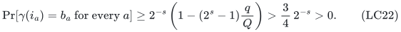

Every prescribed pattern on at most <code class="math">K</code> hashed positions is realized by an enumerated seed.

Compose LC20 with all hashes LC16. On every set of at most <code class="math">K</code> original IDs, first choose an injective hash and then a seed realizing the desired pattern. This gives a deterministic universal family <code class="math">\mathcal C</code> with

<!-- math-display: 07d26031bc92bd5ceff453ba
|\mathcal C|\le qQ^2
                =q^3\,2^{2K+4}
                \le 2^{4B+O(\log(B+1))}\,L^3.
\tag{LC23}
-->
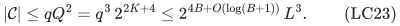

Duplicates are harmless. No coloring list or field table is stored. Given a row ID and a seed, its color is evaluated by polynomial division, binary powering and repeated squaring for the trace. If <code class="math">m=0</code>, use the single empty coloring instead and omit Sections 4–5.

## 6. Representatives and exact recovery

For each nonempty weight/lower-pattern class <code class="math">T</code>, each valid cardinality <code class="math">1\le k\le B</code> with nonempty completion domain, and each <code class="math">\chi\in\mathcal C</code>, call the overlap oracle on LC13. Emit its at-most-<code class="math">k</code> elements in <code class="math">A\cap Y(T,\chi)</code>.

For every numerically feasible finite basis <code class="math">S</code> and selected <code class="math">e</code>, the universal family contains the red/green certificate of Section 3. That call supplies a no-worse feasible replacement. Repeatedly replace a selected element outside the emitted union. Every proper replacement inserts a representative not already selected, so the count of selected representatives strictly increases. Numeric feasibility, original completion and true scalar value are preserved or improved. Hence a fixed-cardinality optimum is represented.

The number of emitted positions for cardinality <code class="math">k</code> is at most

<!-- math-display: 423f1a083a40b9560be64e96
N_k\le Gk\,qQ^2
                       \le 2^{4B+O(\log(B+1))}\,L^3.
\tag{LC24}
-->
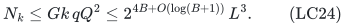

Enumerate <code class="math">k</code>-tuples of position descriptions, reject repeats, test every original numeric row, and evaluate <code class="math">p_k(S)</code> by the compressed full-completion oracle. An empty or impossible position is rejected. For a fixed positive set, masking all other positive copies, keeping positive total <code class="math">k</code> and zero total <code class="math">R-k</code>, and minimizing the true scalar returns its exact best completion.

Every emitted union need not itself be materialized. Nor is any upper or lower numeric row added to the overlap query. Those rows are checked on final sets, and Section 3 proves that a represented optimum is among them.

Take the best attaining solution over all cardinalities, including the separate zero-positive solution if feasible. Since every returned solution is original-feasible and some represented solution has optimum scalar, the algorithm is exact.

## 7. All-input time and uniform polynomial space

Use the same two implementation branches as VZ. Let <code class="math">n=&#124;P&#124;</code>.

If <code class="math">B=0</code> or <code class="math">n=0</code>, positive counts vanish. Test the lower rows and optimize the signed scalar on the remaining zero-weight resource, retaining the required total. This is polynomial, including the rank-zero case.

If <code class="math">B\ge n\ge1</code>, stream original positive count vectors
<code class="math">0\le x_e\le\lfloor B/w_e\rfloor</code>.
There are at most <code class="math">(B+1)^n\le(B+1)^B</code>. Test numeric rows and positive-resource feasibility. For a surviving vector, the exact zero-completion rank is

<!-- math-display: a39915390971ed29e268dd3e
h_x(A)=\min_{C\subseteq P}\{F(A\cup C)-x(C)\},\qquad A\subseteq Z.
\tag{LC25}
-->
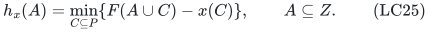

Its full rank is at most <code class="math">R-x(P)</code>, and equality is necessary and sufficient for a full completion. Signed-cost greedy optimization on this residual base recovers the best zero vector. This branch keeps only input-many binary counters and polynomial oracle state. Its time fits LC3, and no large copy ground is built.

In the remaining branch <code class="math">1\le B&lt;n</code>, <code class="math">&#124;U&#124;\le nB&lt;n^2</code>. Also <code class="math">m</code> is explicit-input size, <code class="math">K\le2B-1</code>, <code class="math">d=O(\log(B+1)+\log(L+1))</code>, and
<code class="math">t=O(B+\log(L+1))</code>.
The hash range <code class="math">q=O(B^2L)</code> is polynomial in <code class="math">H</code>. The larger field has <code class="math">Q=2^{O(B)}\mathrm{poly}(B,L)</code> elements, but a field element is stored in only <code class="math">t</code> bits. A defining irreducible polynomial can be found in <code class="math">Q\mathrm{poly}(t)</code> time and polynomial space, once and for all.

A representative position consists of a class index, a degree-<code class="math">d</code> polynomial, two degree-<code class="math">t</code> field elements, and an output index in <code class="math">[k]</code>. Its deterministic oracle call can be recomputed from that description. Invalid irreducibles, empty pools and missing output indices are rejected, so counting all such position descriptions only enlarges LC24. At most <code class="math">B</code> descriptions are stored at once, along with the current <code class="math">k</code>-set and one compressed recovery problem. Their total bit length is polynomial in <code class="math">H</code>.

The enumeration time is bounded on every input by

<!-- math-display: ff71f3b219f62404842b9352
\sum_{k=1}^{B}(N_k+1)^k\mathrm{poly}(H)
       \le 2^{4B^2+O(B\log(B+1))}\,L^{3B}
                                                 \mathrm{poly}(H).
\tag{LC26}
-->
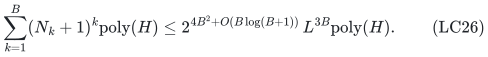

This includes failed tuples, invalid positions, rejected numeric rows and empty completion faces. The construction of the field and hash family is smaller than this bound. Every replayed oracle computation has polynomial cost on the current branch's polynomial-size ground.

The remaining logarithmic input factor is absorbed with a fixed-degree polynomial, not with an input exponent depending on <code class="math">B</code>. For every <code class="math">a&gt;0</code>, maximizing <code class="math">x^a e^{-x}</code> over <code class="math">x\ge0</code> gives

<!-- math-display: 6e2a7ac1347f04f695aa6efd
(\log(m+2))^a\le(a/e)^a(m+2).
\tag{LC27}
-->
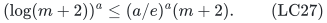

Since <code class="math">L=O(\log(m+2))</code>, taking <code class="math">a=3B</code> shows that <code class="math">L^{3B}</code> contributes only <code class="math">2^{O(B\log(B+1))}(m+2)</code>. This proves LC3 and hence LC1, uniformly. The direct count-vector branch has the same space guarantee when <code class="math">B</code> is binary-large. No probability, successful-instance promise, or stored exponential family is used by the algorithm.

## 8. Sources, improvement, and remaining gap

The power/linear-functional small-bias method is classical. Alon, Goldreich, Håstad and Peralta's [*Simple Constructions of Almost k-wise Independent Random Variables*](https://www.cs.tau.ac.il/~nogaa/PDFS/aghp4.pdf), Section 5, Construction 3, uses finite-field powers paired with a binary linear functional. The trace formulation above gives the same family up to an invertible change of the linear-functional seed. Their Lemma 1 and Appendix A give the small-bias-to-pattern conversion. The present proof states the elementary polynomial-root and indicator-expansion arguments explicitly; it does not claim a new small-bias family.

Naor, Schulman and Srinivasan's [*Splitters and near-optimal derandomization*](https://www.wisdom.weizmann.ac.il/~naor/PAPERS/splitters.pdf) supplies the established universal-set and splitter context. Neither universal sets nor their use to derandomize bounded prescriptions is a novelty claim here. Our deliberately elementary family is sufficient for the quadratic exponent and exposes its polynomial-space evaluation directly.

The completed-cost valuated oracle is the accepted VZ dependency; its public weighted Rado source is Husić, Loho, Smith and Végh's [*On complete classes of valuated matroids*](https://theoretics.episciences.org/14792/pdf), Definition 1.1 and the cited induction/exchange statements. The original global resource, all mandatory units, and all signed zero costs remain unchanged in this refinement.

The proved gain is the replacement of VZ's <code class="math">2^{O(B\log B)}</code>-size recursive candidate catalogue by <code class="math">2^{O(B)}\mathrm{poly}(B,\log m)</code> emitted positions. Its <code class="math">B</code>-set recovery reduces the exponent from <code class="math">B^2\log B</code> to <code class="math">B^2</code>. This does not close the gap to the existing <code class="math">2^{\Omega(B)}</code> lower bound, nor assert an optimal exponent or publication priority.

The aggregate lower-row reduction is replayed by the
[finite laminar checker](verify/check_laminar_reduction.py). The separate
[packing checker](verify/check_sharp_packing.py) tests the sharp
failure-summary transfer, the arbitrary-profit prefix transfer, and the
forcing examples. These finite checks do
not certify the arbitrary-size valuated completion or coloring arguments;
their scope is recorded in the [verification note](verify/README.md).

**Attribution:** icekylinx and GPT-6 Astra Pro.
