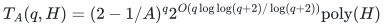

# Whole-ground selection and allocation transfers

**Guarantee**

Converts a forced-omission extension of cost <code class="math">A^{c-\lvert Z\rvert}\mathrm{poly}(H)</code> into a deterministic whole-ground algorithm while preserving the original approximation, exact constraints, and comparator.

**Objective and output**

Stream an inclusion cover of the omitted set, run the original extension from each seed, and retain an actual legal output.

**Randomness**

Deterministic streamed inclusion covers and fixed-order enumeration. Bernoulli measures in the analysis count branches; the procedure draws no random bits.

**Time**

<!-- math-display: 32f950bc0d59548e8215da72
T_A(q,H)=(2-1/A)^q 2^{O(q\log\log(q+2)/\log(q+2))}\mathrm{poly}(H)
-->

Where fixed <code class="math">A&gt;1</code>. Exact-one-half quota cases use <code class="math">A=27/4</code> and base <code class="math">50/27</code>; factor-three count cases use <code class="math">A=4</code> and base <code class="math">7/4</code>.

**Space**

Polynomial in the explicit ground, binary input, streamed block cover, current recursion, and paid extension workspace.

**Parameters**

<code class="math">q</code> is the explicit nonloop ground; <code class="math">c</code> is the promised omission cardinality; <code class="math">Z</code> is a forced omitted seed; <code class="math">A</code> is a supplied admissible base. Sharp algebraic base displays use fixed rational tradeoff parameters.

**Model and representation**

An all-input extension bound, a full witness surviving every seed contained in its omitted set, and legal weak success. Allocation, scheduling, robust service, and splittable flow retain their separate models.

**Lower-bound scope**

No common lower bound or optimality of the transformed bases is asserted.

**Review status**

**Ready for review.** The complete whole-ground transfer family and all six shared components: actual weighted first-crossing omission with full unfinished/failed work accounting; attaining adaptive residual budgets; streamed logarithmic-block covers and corank-profile refinement; fixed-family rational comparator recovery; exact integer-quota endpoints/tradeoffs; every main allocation, scheduling and flow transfer; and the stated balanced deterministic rank-oracle barriers. Reference implements actual prefix recursion, block streaming, rational search, certified selectors and native fixed/adaptive flow gaps.

**Dependencies and scope.** Paid restriction/completion selectors, valid polynomial-bit separators, exact LP/SFM/intersection/decomposition and actual model-specific recovery remain stated mathematical primitives. Adaptive rows require the same original protected witness; local strict violation alone cannot certify that premise. The supplied rational-base reference implements exact block comparisons. Sharp algebraic Gamma global displays require fixed rational tradeoffs; varying binary inputs retain the supplied rational upper-envelope option and its encoding cost. The native flow integration executes real omission and exact witness recovery, but uses the canonical finite Bland simplex with separately charged potentially exponential LP cost. The code does not implement every allocation/scheduling recovery or arbitrary algebraic-number input. All selected sets and original ranks, mandatory totals, scalar budgets and comparators retain their own models. Heavy/light types must be intrinsically disjoint in that transfer; omitted light candidates keep original heavy options. Balanced lower bounds are deterministic black-box rank-oracle statements for strictly better factors, not explicit-input hardness or optimality of the threshold base.

The [verification note](verify/README.md) identifies executable coverage. This status does not claim external peer review or proof-assistant verification.

**Source**

[Manuscript and proof](proof.md), with [dependencies and verification sources](sources.md).

## Shared proof components

**Weighted first-crossing omissions and the <code class="math">\Gamma</code> base**

[Selection theorem](selection.md)

**Attained residual budgets and a protected full witness**

[Adaptive selection](adaptive-selection.md)

**Streamed logarithmic-block inclusion covers**

[Polynomial-space conversion](global-conversion.md)

**Exact fixed-set rational reoptimization without splitting accuracy**

[Rational comparator recovery](rational-optimization.md)

**Exact integer quota and scheduling tradeoffs**

[Integer quotas](integer-quotas.md)

**Model-specific consequences and oracle boundaries**

[Transfer theorem](proof.md)

The [arbitrary-value joint-role record](../unrelated-values-joint-role/README.md) adds the setup extension, J2, and the exact-factor-two enumeration endpoint. None is obtained by treating binary numerical counts as an explicit ground.

**Attribution.** icekylinx · GPT-6 Astra Pro
